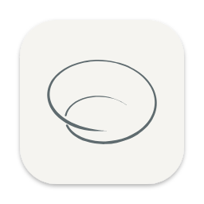

<p align="center"></p>
<p align="center"></p>

# Orbit

**看见你与 AI 的协作方式，让下一次合作更顺畅。**

Orbit 是一个开源的本地 macOS App。它把散落在 Claude Code、Codex 等 Agent 中的会话整理到一起，让你回看工作过程、理解协作习惯，并从有证据的改进建议中选择下一步。

[下载 macOS App](https://github.com/Orbit-Labs-AI/Orbit-Zhiyin/releases/latest) · [开始使用](docs/getting-started/README.md) · [文档](docs/README.md) · [参与贡献](CONTRIBUTING.md) · [反馈问题](https://github.com/Orbit-Labs-AI/Orbit-Zhiyin/issues/new/choose)

[](https://github.com/Orbit-Labs-AI/Orbit-Zhiyin/actions/workflows/backend.yml)
[](https://github.com/Orbit-Labs-AI/Orbit-Zhiyin/actions/workflows/connectors.yml)
[](LICENSE)
[](docs/getting-started/installation.md)


> Orbit 正在早期迭代。桌面 App 面向 Apple Silicon、macOS 14+；截图和独立 HTML 演示使用示例数据。本文档跟随 `main`，已发布安装包的功能与限制请以对应 Release 为准。

## 用 Orbit 做什么

- **回看一次协作。** 按项目、Agent 和时间找到会话，查看消息、工具调用、关键时刻和对应证据。
- **理解自己的工作方式。** 用协作人格、项目习惯、工具调用和情绪语义页面观察模式，结合样本数量与覆盖情况解读结果。
- **尝试具体的改进。** 从 Skills、规则、Hooks 等资源中查看建议与适用依据，预览支持的安装操作，确认后应用，并在需要时撤销。
- **关注正在进行的工作。** 通过菜单栏、浮动 HUD 和桌面小组件查看本机可观察到的会话状态。
- **按需使用 AI。** 授权后调用已配置的本地 Agent 做问答、解读与生成；基础导入和统计不要求启用模型。

Lite 与 Advance 是同一个 App 的两种界面，可在侧栏顶部切换。Lite 聚焦常用页面，Advance 展开更多分析；二者共享数据、组件和设置。协作人格是会话行为的描述，推荐中的估算也需要后续验证。详见[当前能力与边界](docs/product/scope.md)。

## 开始使用

### 在 Mac 上安装

从 [GitHub Releases](https://github.com/Orbit-Labs-AI/Orbit-Zhiyin/releases/latest) 下载适合 Apple Silicon 的 DMG 或 ZIP，将 Orbit 放入「应用程序」后打开。用户机器无需安装 Python 或 Node。当前构建的签名与公证状态、首次打开和升级步骤见[安装指南](docs/getting-started/installation.md)。

当前版本：[Orbit 0.0.4](https://github.com/Orbit-Labs-AI/Orbit-Zhiyin/releases/tag/v0.0.4)（Apple Silicon、macOS 14 及以上；ad-hoc 签名，未经 Apple 公证），见[版本说明](releases/0.0.4/README.md)。

第一次使用时选择允许 Orbit 读取的 Agent 来源，再等待导入发布数据。先从概览或会话轨迹进入，确认样本范围后再看分析和建议。

### 用示例数据体验

克隆仓库后可直接用浏览器打开 [`prototypes/advance/orbit-demo.html`](prototypes/advance/orbit-demo.html)，体验 Lite / Advance 界面，无需连接个人会话。

若要运行后端示例，准备 Python 3.13、uv、Node ≥24.7 和 pnpm 11.25.0：

```sh
git clone https://github.com/Orbit-Labs-AI/Orbit-Zhiyin.git Orbit-Zhiyin
cd Orbit-Zhiyin
bash scripts/bootstrap.sh
uv run orbit demo
pnpm dev --home .local/demo/data
```

最后一条命令启动示例库的报告 API，可打开 [API 文档](http://127.0.0.1:8765/docs)。桌面界面的 live 模式使用另一个 App gateway 入口，见[开发环境](docs/development/setup.md)。

## 支持哪些数据

Orbit 已有 Claude Code、Codex、DeepSeek Harness、pi、Hermes、OpenCode 和 Kimi Code 的原生来源适配。不同 Agent、日志格式与版本提供的信息不同；支持读取某种格式，不代表每类指标都完整可用。[来源说明](docs/guides/importing-data.md)列出标识与边界，[连接器文档](docs/modules/data/agent-connectors.md)说明扩展方法。

会话导入和基础分析在本机进行，来源只有在明确启用后才导入。AI 默认关闭；启用本地 Agent 后，它仍可能使用自己配置的远端模型。目录同步和资源获取也可能联网。数据位置、授权与清理说明见[隐私与数据](docs/guides/privacy.md)。

## 参与开发

欢迎提交可复现的问题、改进文档、补充构造样本或实现经过讨论的功能。先读[贡献指南](CONTRIBUTING.md)，再按关注点进入：

| 关注点 | 入口 |
| --- | --- |
| 本地 App 与界面 | [桌面宿主](apps/desktop/README.md)、[UI 源码](prototypes/README.md)、[设计规范](docs/design/README.md) |
| 数据导入与分析 | [数据包](packages/data/README.md)、[后端](packages/backend/README.md)、[数据契约](docs/contracts/README.md) |
| 资源检索与推荐 | [Catalog](packages/catalog/README.md)、[推荐引擎](docs/modules/recommendation/engine.md) |
| 全局结构与验证 | [架构](docs/architecture/README.md)、[测试指南](docs/development/testing.md)、[文档维护](docs/development/documentation.md) |

Orbit 由 [Orbit-Labs-AI](https://github.com/Orbit-Labs-AI) 发起。维护成员为 [`yhyfhgs`](https://github.com/yhyfhgs)、[`MistyHuang03`](https://github.com/MistyHuang03) 与 [`genius-FXC`](https://github.com/genius-FXC)。参与讨论请遵守[行为准则](CODE_OF_CONDUCT.md)；安全问题请按[安全政策](SECURITY.md)报告。

## 许可证

Orbit 原创代码与文档采用 [Apache License 2.0](LICENSE)。第三方源码、字体及其他独立声明许可的材料遵循各自许可证；参见 [third_party](third_party/README.md)。已发布版本的许可范围与第三方声明随版本保存，例如 [0.0.4 许可范围](releases/0.0.4/LICENSE-SCOPE.md)；发布流程见 [RELEASING.md](RELEASING.md)。
