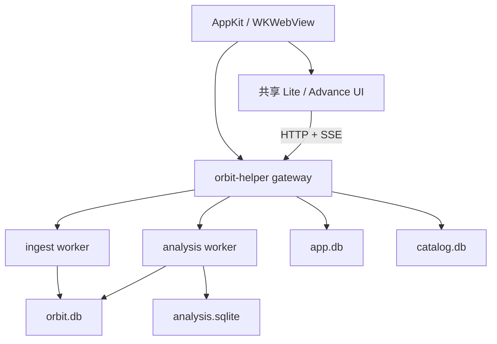

# App 服务与进程

原生宿主负责系统交互和 helper 生命周期，gateway 负责 HTTP/SSE、任务和应用编排；导入与分析在受监督 worker 中运行。UI 通过 API 读取数据，不直接写 SQLite。

## 启动与停止

宿主以动态 loopback 端口启动 helper，通过 stdout 读取实际端口，使用每次生成的 token 轮询状态，然后加载 `/app`。每个 WebView 注入端点、token 和原生能力清单。关闭主窗口只隐藏窗口；完整退出会停止 helper。异常退出、重启与父进程退出处理在[Mac App 文档](../development/mac-app.md)说明。

开发环境用 `uv run orbit-helper gateway` 启动同一入口。普通 `orbit serve` 属于报告 API，不具备相同的 App 生命周期与路由集合。

## 数据所有权

| 数据 | 所有者 | 消费方式 |
| --- | --- | --- |
| `orbit.db` 与来源索引 | `orbit_data` / 导入服务 | 发布后的只读事务与分页 |
| `app.db` | gateway 的应用状态服务 | 设置、任务、AI、推荐、安装的模块接口 |
| `catalog.db` | `orbit_catalog` | 目录查询、来源同步和索引任务 |
| `analysis.sqlite` | 分析历史服务 | 不可覆盖的运行结果与分页读取 |

各库使用自己的迁移与连接规则。不要绕过服务直接向另一个模块的库写入，也不要把 TypeScript staging 当 canonical 库打开。

## 长任务与快照

导入先捕获/索引，再标准化、派生、校验并发布。分析按范围与版本使用快照。UI 应保留上一份可用结果并显示新鲜度；`202` 的计算中与 `503` 的暂不可用不是空数据。SSE 用于进度和失效通知，断线后按事件游标恢复，必要时重新同步。

来源版本、范围、排除项、规则版本及相关设置影响缓存身份；无法匹配的旧结果应标陈旧或重算，不能套用其他范围的结论。导入失败或取消保留可解释状态，重试复用已完成阶段。

## 安全与可观察性

gateway 对 API 使用 Bearer token、Host/Origin 校验；页面是同源入口。原生消息桥只接受对应主框架与来源。日志、任务状态、覆盖报告和错误码分别回答运行、数据与结果问题，日志不得被当作新的会话事实。

实现从 [services](../../packages/backend/src/orbit_backend/services/)进入；具体流程见[导入流程](../development/import-pipeline.md)、[共享适配层](../../prototypes/shared/README.md)和[契约](../contracts/README.md)。早期服务拆分方案及当时测量保留在[历史设计](../archive/plans/app-services.md)。
