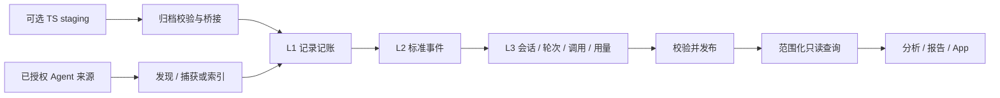

# 数据流程与所有权

Orbit 将来源读取、统一事实、分析结果和应用状态分开。数据层拥有会话事实；分析与 App 从已发布的只读快照消费，不向来源目录写入。



## 包边界

`orbit_data` 实现发现、mapper、派生、迁移、来源索引、安装清单与查询。`orbit_backend` 编排导入任务和分析；`orbit_catalog` 持有独立资源库；TypeScript connector 只写自己的 staging。

原生扫描保存来源引用与哈希，不默认复制整份日志。明确的归档输入与桥接保留原始字节。记录发生变化或消失后，原文接口必须说明可用性，不能把来源索引当备份。详见[索引与轨迹](../modules/data/indexed-trajectories.md)。

## App 接入

```python
from pathlib import Path
from orbit_data.service import ImportRequest, ImportService
from orbit_data.store import Store

with Store(Path('/absolute/orbit-home')) as storage:
    result = ImportService(storage).import_source(
        ImportRequest('codex', Path('/absolute/authorized-codex-home'))
    )
```

只对用户已授权根调用导入。每个工作线程建立自己的 Store，不共享 SQLite 连接。home 与来源不能互相包含。`files` 或 `limit` 是样本范围，不得显示成全量回填。

列表使用分页，事件通过 `after_seq` 继续读取；分析使用 `read_analysis` 的一致事务。UI 不需要为显示一页会话加载整个 bundle。进度回调只包含阶段与计数，具体结果和覆盖应在发布后读取。

## 发布、取消与维护

输入记录、标准化和派生各有阶段；发布前验证完整性。失败或取消不发布半份投影，已捕获输入可供重试。旧的已发布快照可继续供 App 显示，但必须带新鲜度说明。

单写者控制与 WAL 允许只读消费。导入后的存储维护独立记录耗时，可按运行场景后台执行、等待或关闭；新导入优先于后台维护。性能策略不能改变记录身份、覆盖或逻辑结果。

## 范围与兼容

会话库、应用库、目录库与分析历史各有独立迁移。默认 home 为 `~/Library/Application Support/Orbit`，支持 `ORBIT_HOME` 和 `--home`。历史品牌目录由兼容模块处理；旧 MVP JSON ledger 必须显式 `--db` 使用，不能改名当 canonical。

分析保留未知值、样本边界、上下文与统计成员，具体遵循[分析输入](../contracts/analysis-inputs.md)。扩展来源见[连接器](../modules/data/agent-connectors.md)，运行排障见[导入流程](../development/import-pipeline.md)。
