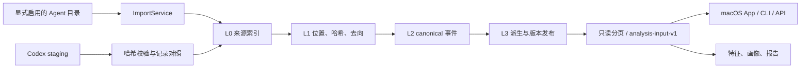

# macOS App 的模块化数据入口

默认 `tandem import / ingest / report / analytics / serve / demo` 已接入 `tandem-session-v1`，替换 MVP 直接扫描日志写 `sessions/events` 的入口。目标是本地 macOS App。数据标准见 [L1–L3 字段契约](../contracts/data.md)，来源范围见 [数据获取方案](../plans/data-acquisition.md)。

## 模块与目录

| 目录 / 模块 | 职责 |
| --- | --- |
| `packages/connectors` | TypeScript Codex 采集，输出独立 staging |
| `packages/data/src/tandem_data/connectors` | 各 Agent 原生记录映射与注册 |
| `discovery.py / store.py` | 白名单发现、L0 来源索引、L1 全记录索引、迁移 |
| `pipeline.py / reduce.py` | L2 标准化、L3 派生与来源级原子发布 |
| `bridge.py / service.py` | staging 校验、App 导入任务、进度、取消、写入互斥 |
| `query.py / analysis_input.py` | 发布版本校验、分页与带范围的分析契约 |
| `migrations / schemas` | 权威 SQLite DDL、机器可验证契约 |
| `packages/backend/src/tandem_backend/data_access` | 产品编排与只读消费，不解析原生日志 |
| `packages/backend/src/tandem_backend/analytics` | 消费 `analysis-input-v1` 的特征计算 |
| `packages/backend/src/tandem_backend/legacy` | 原 MVP 解析、存储与评价兼容 |
| 根目录 `uv.lock` | backend 与 data 的唯一 Python workspace 锁 |

原 `store.py`、`importers/codex.py` 保留兼容导入门面。新 Agent 不再在 backend 增加解析器。Catalog、推荐和 UI 设计不由本次改造扩展。

## 数据链路



TypeScript staging 的 L2/L3 不作为第二个分析事实源。桥接验证归档并使用 Python canonical mapper，保留 `connector_record_link`，不扫描已经变化的原始路径。Native 导入与 staging 最终使用同一套身份和标准化规则。

L0/L1 与派生发布分离：中断后可能留下尚未投影的索引；读者检查 `projection_run`、L1 revision 与 mapper/reducer/redaction 版本，未发布或过期时要求重算。重复导入跳过未变文件；已有分析表在上游删除后保留，原文引用明确返回不可用状态。导入和重算用同一个 macOS 文件锁串行化，SQLite WAL 允许并发只读访问。

## App 接入

```python
from pathlib import Path
from tandem_data.paths import default_home
from tandem_data.service import ImportRequest, ImportService
from tandem_data.store import Store
from tandem_backend.data_access.store import CanonicalStore

# 在后台工作线程中使用，每个线程建立自己的 Store。
with Store(default_home()) as storage:
    result = ImportService(storage, progress=print).import_source(
        ImportRequest("claude_code", Path.home() / ".claude")
    )
page = CanonicalStore(default_home()).session_page(limit=50)
```

`ImportRequest.files / limit` 是显式样本选择，`selection=sample` 不能显示成全量回填。App 应展示 `capture_errors / current_unparsed`；进度回调仅含阶段和计数，取消检查在文件之间。普通进程退出不证明来源完整。

事件列表用 `GET /v1/sessions/{session_uid}/events?after_seq=…&limit=100`，从 `next_after_seq` 继续。列表直接 SQL 分页；证据接口按 canonical UID 返回脱敏事件的兼容表示，包含 `record_uid / event_path`，原文通过显式的 `/v1/records/{record_uid}/source?include_content=true` 读取。现有报告在一个一致快照中适配 L2/L3，不创建第二份持久事实库。

## 规模边界

- 采集以流处理，变化文件保留不可变版本，派生按受影响来源重算。本地单写者是有意约束，不承诺分布式 ETL。
- 列表与证据接口不加载完整分析 bundle。分析范围先在 SQLite 内过滤，再解码事实与必要上下文。
- 分析默认不截断正文、不限制候选事件数量；调用方可显式设置报错式预算。App 列表使用分页，页大小不会裁剪单条正文。
- 统计成员由 canonical reader 返回，窗口外上下文只用于解释。缺失值、累计快照与模型请求保持契约语义，不按旧 session.model 猜测。
- 本次交付是数据层、CLI 与本机 API 的 App 接入边界，没有新增 Swift UI 或安装包。

## 验证与迁移

```sh
uv sync --locked --all-packages --dev
pnpm --dir packages/connectors install --frozen-lockfile
pnpm --dir packages/connectors check
uv run ruff check packages/backend/src packages/backend/tests packages/data/src packages/data/tests tests
uv run ruff format --check packages/data/src packages/data/tests
uv run pytest -q packages/backend/tests tests
uv run pytest -q packages/data/tests
uv build --all-packages
uv run tandem demo
uv run tandem evaluate
```

同名数据管线测试已明确命名，根 pytest 可以一次收集全部模块与集成测试。macOS CI 构建 TypeScript producer，保证 staging 桥接测试不被跳过。构造样本覆盖各 Agent、来源身份、上下文与统计分离、只读 API、分页、过期版本拒绝，以及原始来源消失后的归档桥接。

`TANDEM_HOME`、`--home` 与 App 共用默认目录 `~/Library/Application Support/Tandem`。旧 `.local/tandem.sqlite` 必须显式 `--db` 读取，不能改名当 canonical 库。旧导入的持久采样参数保留在兼容模式；新导入遇到这些参数会提示使用分析范围，不静默扩大样本。评价在独立临时兼容库运行。

完整原生 trajectory、原文索引、schema 5 迁移与无复制采集边界见 [来源索引与 App 接口](../modules/data/indexed-trajectories.md)。
