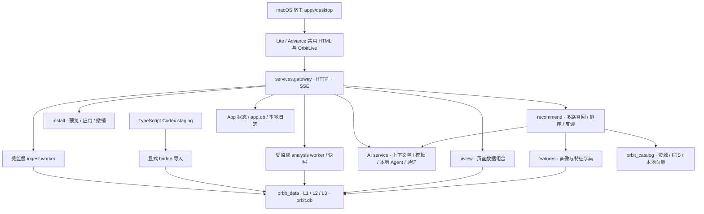

# 模块接入与依赖

状态：现行实现；核对基线：2026-10-03，main `05049926` 与本轮可靠性修复。仓库集成负责人：`yhyfhgs`。算法维护归属不因本文整理而变化。

## 运行架构

原生宿主已经存在，不再是空目录。`prototypes/advance` 的统一界面在独立 HTML 下使用构造数据，由 gateway 的 `/app`、`/lite` 托管时进入 live 模式，Lite / Advance 共用组件。原生宿主负责服务启停、系统窗口、文件选择、菜单栏、通知和偏好。UI 通过 HTTP/SSE 访问网关，不直接写数据库。旧 CLI 与 `api.routes` 的报告接口仍保留；普通 `orbit serve` 与 App gateway 是两个入口，不可混称。

## 模块、输入与输出

| 模块 | 输入与处理 | 对外输出 / UI | 状态与边界 |
| --- | --- | --- | --- |
| data / connectors | 显式启用的 agent 根目录；发现、捕获、标准事件映射、派生、投影发布 | 会话、轮次、工具/模型调用、证据、来源与完整性状态 | 七类原生 mapper；TS Codex 是独立 staging，需 bridge；不保证原 Agent 未落盘内容 |
| services / snapshots | 导入与分析任务、窗口与来源范围；队列、进程监护、版本化快照、SSE | `/v1/app/*`、`/v1/analytics/*`、`/v1/events`；进度、重试和上次可用结果 | 已接 UI；文件级日志保留在现有旋转日志，前端进度可节流 |
| analytics / profiling | canonical 事实、文本及受验证语义观察；八族特征、统计、比较、任务图 | overview / sessions / projects / tools / statistics / lexical / work-graph / products | 缺失值、未知状态与分母需保留；AI 观察不代替已记录事实 |
| features | 分析与安装清单；标准特征 ID、scope、问题诊断 | 特征字典、画像、problem/evidence，供检索与推荐使用 | 显式空集合表示不选任何样本；与 AI 时间窗口做键名适配 |
| uiview | 上述事实与特征按页面组合 | `/v1/uiview/*` → 概览、人格、会话轨迹、工具、项目、情绪 | 已接 Lite/Advance；展示计算应在后端定义分母，UI 只呈现 |
| recommend | 本地画像、问题证据、资源库、安装状态、反馈历史 | `/v1/recommendations*`、卡片、排序理由、曝光与反馈 | 多路召回、RRF、资格门控和排序；可选 AI 重排/查询扩展/专家建议有界降级 |
| catalog | 官方及固定版本资源元数据/可许可正文；预处理、FTS、特征和可选 E5 | `/v1/catalog/*`、资源库与推荐候选 | 元数据完备分与效果/安全结论不同；有文本索引不代表已生成向量 |
| ai | scope 内事实、所选证据、任务定义、引擎授权；上下文预算、schema/证据门控与缓存 | `/v1/ai/*`、分类/解读、问答、四套专业分析模板、生成工坊 | 复用本地 CLI runner；本地 Agent 仍可能使用其已配置的远端模型；效果需独立真实标签评测 |
| install / sessionops | 资源/草稿、目标 agent、配置、预览摘要；冲突检测、备份、应用/撤销；会话排除/恢复 | 安装弹窗、资源库已安装状态、继续会话/定位日志、排除列表 | 已实现真实操作；生成建议不自动安装；状态追踪只使用可观察证据 |
| realtime / shell / quota | 当前会话事实、事件时间与用量、通知策略 | 实时条、HUD、菜单栏、小组件、额度与上下文提示 | 已接网关与原生桥；无信号时显示空闲/未知，不套用 demo 数据 |
| platform / appdata / exporting | 设置、任务、健康指标、日志与存储；本地维护/导出 | 设置、诊断包、暂停/恢复、清理、报告/表格/图片导出 | 系统权限和文件对话框依赖原生宿主；更新检查未接远端更新源 |
| evaluation / evalrun / reporting | 构造样本、独立标签、回放与结果 | CLI/API 评测、报告与安装后验收 | 自动检查不等同真实模型效果、原生 App 全流程或用户收益已验证 |

## UI 页面与数据链

| 页面 / 交互 | 主要后端输入 | 计算 / 输出 |
| --- | --- | --- |
| 概览 / Lite 首页 | 会话事实、工具调用、时间段、特征 | uiview facts/overview、聚合指标、趋势、top 推荐 |
| 协作人格 | Instruction/Interaction/Preference 等信号 | uiview persona、四轴及类型、样本量、证据；不是心理诊断 |
| 会话与轨迹 | session/event/tool_call/model_call、来源定位 | sessions/trajectory/moments；筛选、详情、排除与恢复 |
| 工具调用 / 项目习惯 | 工具状态、项目身份、命令与文件特征 | uiview tools/projects、失败率与分母、时序与明细 |
| 情绪与语义 | 用户文本、纠偏/反馈、语义证据 | uiview sentiment、表达分布与时间轴；观察与推测分开 |
| 优化建议 | 画像、problem、catalog、反馈/安装历史 | recommend slate、解释/来源/追踪；AI 草稿可转工坊 |
| 资源库 | catalog items/facets/status、install state | 分类、搜索、来源、质量维度、预览与安装 |
| 问本地 Agent | 当前窗口、项目、来源、排除集、所选会话 | ask 或专业分析 job；结构化 findings、证据、下一步、局限 |
| 生成工坊 | 目标、模板、上下文包、agent | preview → job → 校验/回放 → artifact → 审阅/安装或入库 |
| 设置 / 菜单栏 / 小组件 | App 状态、collection、notification、realtime | 持久设置与 SSE 同步；失败回退、恢复补采与诊断日志 |

## 契约与验收

数据库权威 DDL 位于 `packages/data/src/orbit_data/migrations/`；JSON Schema 在同包内。每项接入必须有真实公开入口、范围与缺失语义、关键失败路径回归及如实标注的 UI 状态。主链验证见[测试指南](../development/testing.md)。

本轮证据与未完成边界见[导入审计](../audits/ingestion-reliability-2026-10-03.md)、[分析与 AI 审计](../audits/analysis-ai-reliability-2026-10-03.md)、[推荐与目录审计](../audits/recommendation-reliability-2026-10-03.md)与[集成审计](../audits/integration-reliability-2026-10-03.md)。这些文档说明实际核查范围，不承诺所有模块已无缺陷。
