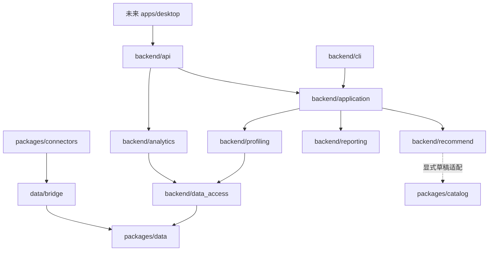

# 模块接入与依赖

状态：当前实现与接入缺口；基线：main `15a753f` 加结构迁移。仓库集成负责人：`yhyfhgs`；各能力的算法维护归属延续原任务，目录移动不改变分工。

## 依赖方向

图中原型不接入真实数据；当前 API 仍直接调用部分只读服务。数据包不反向导入后端，UI 不直接写数据库，原生来源解析器只进入数据层。staging 与 canonical 分库，通过桥接发布。

## 功能接入表

| 功能 | 对外入口 | 实现归属 | 契约 / 验证 | 当前状态 |
| --- | --- | --- | --- | --- |
| 授权来源导入、进度与重算 | CLI ingest / import-connector；ImportService | data/connectors、service、bridge、pipeline | data 测试；根 integration 桥接回归 | 后端已实现，UI 待接入 |
| 会话与证据浏览 | /v1/sessions、/v1/evidence、trajectory、records/source | backend/api + data_access + data/query | 分页、只读、范围与过期版本回归 | API 已实现 |
| 特征分析 | analytics CLI；/v1/analytics/* | backend/analytics，各特征族保持独立目录 | analysis-input；模块和集成测试 | 已实现能力见各特征族说明 |
| 共享任务关系 | /v1/analytics/work-graph、tasks/{task_uid}/trajectory | backend/analytics/work_graph | [身份、关系与证据契约](../../packages/backend/src/tandem_backend/analytics/work_graph/README.md)；构造轨迹、隔离与截止回归 | API / 模块完成；候选边界与未知版本明确保留 |
| 有边界的语义观察 | evals.analytics.semantic_cascade；显式本地缓存 → analytics | backend/analytics/semantic_cascade | [输入、引用与推断边界](../../packages/backend/src/tandem_backend/analytics/semantic_cascade/README.md)；无人工标注接入、负例、超时和历史缓存回归 | 共享模块完成；真实模型准确率需独立标签与外发授权 |
| 统计分析与运行历史 | /v1/analytics/statistics、lexical、compare、runs；analysis-history | backend/analytics/products；data/analysis_history | 数值与词频独立预期、并发及快照完整性回归 | 已实现；[方法与记录](../modules/analytics/statistics-history.md) |
| UI 分析组合与本地验收 | analysis-report；/v1/analytics/products*；evals.analytics.products | backend/analytics/products | analysis-products-v1；模块与服务流程组合测试 | API / 报告完成；两版原型待接入，见[说明](../modules/analytics/analysis-products.md) |
| 画像、瓶颈与报告 | report / demo；/v1/analysis | application/reports → profiling / recommendation / reporting | 既有回归；服务流程检查 CLI/API 输出一致 | 两个入口共用报告用例 |
| 资源匹配与推荐 | /v1/analytics/recommendations GET/POST；analytics CLI | backend/recommend/service + analytics/recommendations 诊断 | 七类 JSON/Schema；recall、ranking 与 API/CLI 回归 | 最新 main 已接入；UI 待接入 |
| 固定资源兼容 | catalog-refresh；/v1/catalog | recommend/legacy_catalog、resource_fetch、legacy | 固定版本资源、证据与缓存回归 | 原画像推荐 API 保留 |
| 独立资源索引 | /v1/catalog/*；tandem-catalog CLI | packages/catalog；catalog-macos Swift 客户端 | catalog-v1、包测试、跨包 API、Swift tests | 已进入 main；模型须显式配置 |
| 文本与链路评价 | evaluate；/v1/evaluation | backend/evaluation | 包内 JSON 样本、读者评审、evals | 自动检查不等于人类验收 |
| Lite / Advance | 独立 HTML 原型 | prototypes/lite、prototypes/advance | Lite 构造数据检查；Advance Playwright | 设计参考、尚未接入 API |
| 桌面交付 | 未来 apps/desktop | 正式 UI、系统集成与服务启停 | 原生 App 流程与安装测试待加入 | 未实现 |

## 数据与兼容

`packages/data/src/tandem_data/migrations/` 是会话库 DDL 的权威来源；JSON Schema 在同包内。产品默认路径与旧库限制见[数据流](data-pipeline.md)。

旧根级 Python 模块保留薄兼容导出，现有 import 和安装后的 `tandem` 命令保持可用。新增实现应写入职责目录，不能继续往兼容文件添加算法。兼容入口的清理必须等活跃分支完成迁移，并在后续 PR 明确处理。

## 一项功能接入完成的条件

公开入口调用真实实现；输入输出和缺失状态有契约；关键失败路径有测试；UI 接线状态如实记录；文档与检查命令可复跑。模块完成而 UI 未接入时，状态仍标为“API / 模块完成”。

PR #26 带入的推荐引擎沿用公开 `tandem_backend.recommend` 命名空间。`analytics/recommendations` 保存现有瓶颈诊断与旧入口适配，新排序和召回位于 recommend；独立采集/索引的 tandem_catalog 已由 PR #29 接入 packages/catalog，推荐端仍按显式审核流程接收草稿。
