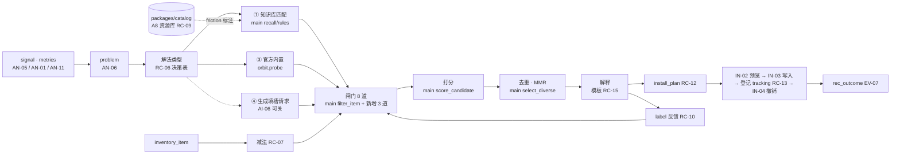

# Orbit 推荐模块设计（RC）：如何用分析结果做匹配推荐

> 文档状态：历史记录。正文保留原基线、日期与证据；其中的状态和数字不代表当前版本。现行入口见[文档导航](../../README.md)。


> 状态：方案（不等同当前能力） · 维护者 `yhyfhgs` · 核对版本 main `0c96334` · 适用：Advance / Lite（另注明处除外）

> 状态：2026-10-02 第 2 版（按评审意见修订）。依据：[`contract.md`](module-contract.md) 第 2 版 + 本轮评审统一结论（并入契约第 3 版的条目见 §16）；**main `6f31203`**：PR #26（`genius-FXC`，`orbit_backend.recommend` 推荐引擎：七类资源 `recommendation-item-v1`、七条瓶颈规则、硬过滤、四路召回 + RRF、加权评分、MMR）、PR #28（结构重构：`src/orbit_backend` → `packages/backend/src/orbit_backend`，Advance Demo → `prototypes/advance`，Lite Demo → `prototypes/lite`，`prototypes/advance/benchmark-review.md` → `docs/archive/design/lite-review.md`）、PR #29（`packages/catalog`：`catalog.db`、FTS5、特征倒排、本地 E5 向量）、PR #30（`docs/archive/plans/analysis-review.md`）；本地分支 `feat/local-inventory`（`yhyfhgs`，DT-09 安装清单扫描：`packages/data/src/orbit_data/inventory/`，基于 `f834616`，待 PR）。其他三份模块文档与契约第 2 版仍写重构前路径，对照表见 main `docs/archive/migrations/structure-migration.md`。
>
> 版本名按 main `AGENTS.md` 与 `docs/design/README.md`：**Lite** = `genius-FXC` 设计（`prototypes/lite/orbit-benchmark-demo.html`，8 页，范围见 `docs/archive/design/lite-review.md`）；**Advance** = `yhyfhgs` 设计（`prototypes/advance/src`，重构前 `prototypes/advance/src`；功能清单 [`feature-map.md`](feature-map.md) §5）。历史材料中的「Advanced」指 Advance。
>
> MVP 判定规则（契约第 3 版 §2.1）：MVP = Lite 8 页需要的数据 + Advance 的三张安装闭环卡（只读放行、重复失败熔断、高频纠偏 → 规则）；只服务 Advance 独有界面（A9 工坊外壳、ASK、菜单栏 / HUD / 小组件、首次启动、SET-21 周报、A1-06 上期对比、A3 阶段带与情绪泳道）的 feature 一律 v1。
>
> 读法：§0 结论；§2–§3 算法主体；§7 与 main 推荐引擎的关系（本文的所有设计落到该引擎上，不另起一套）；§10 MVP 三步；§11 功能清单供分工；§12 本模块负责的功能卡段落（完整九段卡在 `docs/archive/plans/feature-map.md`）。「待验证」只引契约 §7 编号；「估计」= 无实测来源的默认参数。

## 0. 结论先行

1. **推荐的输入是 `problem`（AN-06），输出是 `candidate` 批次**；没有 `problem` 时只有事实驱动的减法（规则文件过长、常驻过高）。main 的 `recommend.service.recommend()` 已经把「瓶颈信号 → 资源 → 过滤 → 召回 → 评分 → MMR → 解释卡」跑通，本文只做三件事：把 AN-06 的 `problem` 接成它的 `signals`、把契约的 `remedy_rule` 落成它的 `recommendation-item-v1`、在它后面补 `install_plan + tracking`。
2. **链路固定 8 步、全部 L0 确定性**：信号 → 问题 → 解法类型（代码决策表）→ 召回（知识库 ①、官方内置 ③；Catalog ② 只给 A8 资源库；生成 ④ 是填槽请求）→ 闸门（MVP 8 道）→ 打分（沿用 main `score_candidate`）→ 去重与 MMR（沿用 main `select_diverse`）→ 解释（模板）→ `install_plan` + 确认安装时登记 `tracking`。AI 介入点：AI-06（填槽，MVP 可关）、AI-10（workflow 诊断，MVP 单次调用只展示）、AI-04（候选细分，v1）、AI-12（适配判断与解释，v1 可关）。
3. **机制由代码决策表选（RC-06），不让模型选**：MVP 只实现 5 行——高频纠偏 → 规则、必须每次成立 → hook、习惯问题 → 只给建议、规则过长 / 常驻过高 → 减法、只读审批 → 权限白名单；其余 9 行标 v1 并写明等待的 AN 检测器。
4. **排序 MVP 不新造公式**：沿用 main `ranking/score.py` 的加权评分，只替换两个输入——`confidence` 用 `problem.wilson_lo`、`friction.setup_cost` 用 §2.3 的 L 级常数；`expected_effect.targets` 的默认值按 kind 取 §3.5 的先验均值常数且不更新。卡片主数字只用能机械计数的量（`problem.weekly_count`），`priority_score` 只用于次序。分钟当量换算、Beta 先验回写、风险罚分全部 v1。
5. **卡片措辞只有四种**：已计数 / 估计 / 未测 / 数据不足（= main `effect_status = unmeasured`、`score_meaning` 的现有措辞）；不写「提速 X%」（[METR 随机对照](https://arxiv.org/abs/2507.09089)）。
6. **main 现有代码全部保留**：`recommend/` 包（`contracts / catalog / families / recall / ranking / explain / service / state`）是 RC-02…RC-05、RC-09 的实现；`legacy.py` 五项硬条件保留为 `communication_gap` 路径的闸门 1–5；`analytics/recommendations/rules.py` 七条规则是 AN-05 → AN-06 的现有实现；`packages/catalog` 是 DT-11 / DT-12 / DT-13 / RC-09 的实现。本文新增的只有 `problem` 适配、三道新闸门、`orbit` 扩展字段、`install_plan.py`、`tracking.py`。
7. **个性化 MVP 只做一件事**：用户水平作闸门（`audience_ok`，沿用 Lite / Advance 现有筛选）。历史采纳 / 拒绝降权、项目级收缩 v1；人格不进推荐（Lite 资源库「同人格正在用」删除）。
8. **检索优先于生成**：能匹配到审查过的条目或模板就用现成的；只有模板槽位无法由默认值填满时才请求 AI-06 填槽（MVP：规则、hook、SKILL.md、与专家 skill 的粘合规则，可关；关闭时用模板默认值并标「未个性化」）。依据：LLM 自写上下文文件成本 +20% 且不提升成功率（[ETH](https://arxiv.org/abs/2602.11988)）、模型自写 skill 低于不用 8.1–11.5pp（[SkillsBench](https://arxiv.org/abs/2602.12670)）。
9. **高层次 workflow 建议 MVP 只有两条规则型模板（RC-16）**：验证阶梯、大杂烩会话拆分；并行 worktree、长任务进度文件、完成契约开场、计划模式等 AN 的 v1 检测器到位后再加。AI-10 `diagnose.workflow` MVP 单次调用只展示，v1 映射回 RC-06 机制入列。
10. **MVP 三步**（§10）：① 知识库 12–15 条写进 main 的七个 `data/recommend/*.json` + `problem` 适配；② 闸门 8 道 + 去重；③ `install_plan` + `tracking` + 两个路由。每步附 `pipeline_eval` 风格的构造用例；全程 0 token。

## 1. 范围、输入与输出

### 1.1 本文回答什么

| 问题 | 本文答案 | 不在本文（去哪） |
| --- | --- | --- |
| 推荐什么 | §2.1 十二种 `remedy.kind` 与 main 七个 family 的对应 | 生态抓取与 Catalog 建库：`docs/archive/plans/data-acquisition.md` §5–§6（DT-11、DT-12）；已实现部分见 main `docs/modules/catalog/architecture.md` |
| 怎么从分析结果推出候选 | §3.1 问题 taxonomy（含 main `rule_id` 对照）→ §2.4 决策表 → §3.2 召回 | 信号与问题怎么检测：`analysis.md`（AN-05、AN-06） |
| 怎么排序、去重、解释 | §3.3–§3.7 | 文案可读性检查：`evaluation.md`（EV-09） |
| 怎么个性化 | §4 | 人格四轴：`analysis.md`（AN-08） |
| 什么时候生成 | §5 | 生成模板、自检、headless 通道：`ai.md`（AI-06、AI-07、AI-01） |
| workflow 级建议 | §6 | 过程挖掘：`analysis.md`（AN-04） |
| 推荐侧需要安装什么契约 | §8 | 写入、备份、ledger、撤销：IN-01…IN-08（契约 §2.7、§3.5、§4.2 第 6 段；端到端卡在 `docs/archive/plans/feature-map.md`，本轮并行撰写，落地前以契约为准） |
| 效果怎么算 | §3.8 只写登记与回写 | DiD、bootstrap、护栏判定：`evaluation.md`（EV-07） |

### 1.2 输入

| 输入 | 来源 ID | 表 / 字段（契约） | 现状（main `6f31203`） | 缺失时的降级 |
| --- | --- | --- | --- | --- |
| 问题 | AN-06 | `problem(type, key, scope, sessions, denom, wilson_lo, weekly_count, weekly_cost_minutes, cost_basis, evidence_session_uids, top_signal_ids)` | 计划；现有雏形 = `analytics/recommendations/rules.py` 的七条规则产出的 `signals[]`（`rule_id / evidence / confidence / severity / recurrence`，按根会话树）与 `assessments[]`（`triggered / below_threshold / insufficient_evidence`）；旧链路 `profiling/bottlenecks.diagnose()` 四类 | 直接消费 `signals[]`（过渡期映射见 §7），`weekly_count` 由证据数 ÷ 窗口周数近似并标「估计」 |
| 信号 | AN-05 / AN-17 | `signal(kind, dimension, friction_type, severity, evidence)` | main `analytics/{interaction,respond,outcome,cost_time}` 特征族（PR #19 已合入）；`feedback.signals()` 8 维度要求 | 只用 main 已有的七条规则与四类候选 |
| 画像 | AN-08 | `profile.observations` | main `profiling/portrait.profile()` | 闸门 1 只对有 `dimension` 的问题检查（§3.3） |
| 项目上下文 | DT-07 / AN-17 | `project`、`session.project_id`、`scene`、`language` | main `task_contexts()`；canonical `project` 表 | 无仓库级项目时按 `legacy_project_id` |
| 已安装清单 | DT-09 | `inventory_item(type, name, config, content_hash, enabled, catalog_item_id)` | 分支 `feat/local-inventory`（七类 Agent 扫描、版本化快照；`coverage.inventory` 透传） | `RecommendationContext.installed_resources = None`（未知）→ 候选标 `needs_context`，不扣除已装项 |
| 环境上下文 | DT-09 / FE-15 | `RecommendationContext(agent, os, tools, software, permissions, denied_permissions, installed_resources)` | main `recommend/contracts.py`（`None` = 未知，`[]` = 已确认为空） | 未知项列入 `pending_requirements` |
| Catalog | DT-11…DT-14 | `recommendation-item-v1`（七个 `data/recommend/*.json`，目前全部为空 envelope）+ 旧种子 12 条（5 条原创 prompt + 7 条固定版本社区资源，经 `sources/normalize.legacy_item` 适配）；`packages/catalog` 的 `catalog.db` | main | 只用旧种子 |
| 模型清单与成绩 | DT-14 | `model_info`、`benchmark_result` | `packages/catalog` 表已建；`recommend/model_configs/benchmarks.py` 合同 | RC-08 不出候选 |
| 指标 | AN-01 / AN-11 / AN-12 | `metrics(resident_tokens_*, installed_unused_*, would_prompt_count, …)` | `feature-analytics` 六组现有；○ 项计划 | 对应候选不生成 |
| 用户设置 | FE-15 | `audience`（新手 / 进阶 / 专家）、`source_ids` | Advance Demo `S.recs.aud`；Lite「适配 Agent」 | 默认「进阶」 |
| 反馈 | RC-10 / EV-10 | `label`、`install_state` | 计划 | 无过滤 |

### 1.3 输出

| 输出 | 表 / 形状 | 消费者 | 现状 |
| --- | --- | --- | --- |
| 候选批次 | `candidate`（`batch_id`、`gates`、`score`、`evidence`、`explain`、`rank`、`status`、`first_shown_at / last_shown_at`） | FE-09 A7 / Lite 优化建议、FE-03 A1 Top 3 / Lite 本周建议、EV-05 | main `recommendation-pipeline-v1` 卡片（`priority_score`、`score_breakdown`、`evidence[]`、`explanation`、`recommendation_status ∈ trial / needs_context / adaptation_required`、`evaluation_plan`、`effect_status = unmeasured`）；无持久化 |
| 安装计划 | `install_plan(targets[], rendered_by, preview_digest)` | IN-02 预览、IN-03 写入 | 计划（两个 Demo 为示意文本；main 卡片只有 `setup_steps / preview` 文本） |
| 追踪登记 | `tracking(metrics[], baseline_*, follow_days, scope_filter, min_sessions, confounders_watch)` | EV-07、FE-09 效果追踪 Tab | 计划（main `evaluation_plan.target_metrics` 是雏形） |
| 资源库匹配 | `catalog_match(item_id, score, parts, matched_features)` | FE-10 A8 / Lite 资源库 | `packages/catalog` 检索（BM25 + 特征 + 向量，RRF / MMR）已实现；`friction` 标注计划 |
| 知识库 | 七个 `data/recommend/*.json`（`recommendation-catalog-v1`）+ `orbit` 扩展字段；`kb_version = catalog_digest` | RC-02、EV-03 用例、AI-06 模板索引 | envelope 已有，条目计划 |

## 2. 推荐对象类型、Catalog 字段与机制选型

### 2.1 推荐对象类型（`remedy.kind`，契约 §3.4 枚举）与 main family 的对应

main 的卡片 `kind` 来自 `KINDS[family]`（`prompt / skill / plugin / mcp / hook / model_config / workflow`）或 `legacy_kind`。本文的 12 种 `remedy.kind` 比它细（权限白名单、减法、内置功能、子代理），落法：条目的 `family` 取承载它的文件；`orbit.kind` 记真实 kind；卡片显示 `orbit.kind ?? KINDS[family]`（契约建议 C3）。

| kind | 对象 | main `family` | 适用 Agent 与 MVP 落点 | 安装方式（IN-01 action） | 难度 | 常驻成本 | 示例 | A7 Tab / Lite Tab |
| --- | --- | --- | --- | --- | --- | --- | --- | --- |
| `rule` | 规则段落（`AGENTS.md` 为源；Claude 侧 `CLAUDE.md` 只含 `@AGENTS.md`；子目录用带 `paths` 的 `.claude/rules`） | `rules_prompts` | 全部；MVP claude_code、codex | `append_block`（标记块） | L1 | 每行每次请求都付 | `deploy-target`、`summary-compact`；旧种子 `agents-md` 作来源 | 规则与 Prompt / Prompt |
| `prompt` | 开场模板、可复用命令 | `rules_prompts` | 全部 | `clipboard` / `create_file`（commands 目录） | L1 | 0 | `acceptance`（完成契约五要素）；旧种子 5 条原创 prompt | 同上 |
| `skill` | `SKILL.md`（[Agent Skills 规范](https://agentskills.io/specification)） | `skills` | 正文放 `.agents/skills/<name>/`（codex、opencode、kimi、pi、dsh 读），Claude 侧再放 `.claude/skills/<name>`（软链是否被跟随待验证 V16） | `create_dir` | L2 | 描述常驻（Claude ≤ 1,536 字符 / 列表占上下文 1%；Codex 2% 或 8,000 字符） | `pr-wrapup`；旧种子 `humanizer-zh / humanizer / doc-coauthoring / systematic-debugging` | Skills / Skill |
| `hook` | 事件处理器（stdin JSON、退出码 2 阻断） | `hooks`（`family_features.event / condition / action` 必填，否则 `needs_context`） | claude_code（`settings.json`）、codex（`hooks.json`，按哈希信任后才运行 → 「已安装、未信任」）；kimi / hermes / pi / opencode v1 | `merge_json` + 脚本 `create_file` | L2–L3 | 0 | `retry-breaker` | Hooks / Hooks |
| `permission_rule` | allow / deny 前缀规则 | `rules_prompts`（`orbit.kind = permission_rule`） | claude_code `permissions.allow`；codex execpolicy `.rules`（语法待验证 V6）；opencode v1 | `merge_json` / `create_file` | L1 | 0 | `readonly-allowlist` | 规则与 Prompt（Demo 归 Hook，本文按真实落点） |
| `mcp` | MCP server | `mcp`（`permissions` 并入 `required_permissions`） | 全部；claude_code `~/.claude.json` 或项目 `.mcp.json`；codex `config.toml [mcp_servers]` | `merge_json` / `merge_toml` | L3 | 工具名常驻 | `browser-check`（Lite） | 插件 / MCP |
| `plugin` | 插件（含 skills / hooks / mcp / agents） | `plugins`（`dependencies` 并入 `requirements.resources`） | claude_code 市场、codex、copilot、gemini | `run_command`（`claude plugin install …`） | L3 | 组成之和 | `cloudflare-deploy` | 插件 / MCP |
| `subagent` | 子代理定义 | `workflows`（main 把旧 `agent` 映射到此，`roles` 字段） | claude_code `.claude/agents/*.md`；codex `.codex/agents/*.toml`（待验证 V6） | `create_file` | L2 | 0（派生时才付） | `citation-checker`、Lite `verifier` | 子代理 |
| `model` | 模型与思考档位 | `model_configs`（`model / reasoning_effort / agent_harness` 必填） | claude_code `settings.json` 的 `model` / effort；codex `model_reasoning_effort` | `set_key` / 教程 | L1 | 0 | `think-medium` | 模型与思考 / 模型 |
| `workflow` | 流程改造（教程 + 可复制命令） | `workflows` | 全部 | `tutorial`（不写文件） | L3–L4 | 0 | `worktree`、`session-handoff` | 工作流 / Workflow |
| `removal` | 停用、移除、精简、合并已装项 | 目标项所属 family，`orbit.kind = removal` | 全部 | 反向：`remove_pointer` / `set_key(enabled=false)` / `trim_block` | L1 | 负 | 规则文件 > 200 行拆分 | 对应维度 + 「可以移除」分组（v1） |
| `builtin` | 官方内置功能，零安装 | 被替代机制的 family，`orbit.kind = builtin`、`orbit.probe{command, min_version}` | 按版本探测：`claude --version`、`codex features list` | `run_command`（复制命令）或 `set_key` | L1 | 0 | Claude Code `/fewer-permission-prompts`（2.1.111+）、`/doctor`（2.1.205+）、`/skill-doctor`（2.1.261+）；Codex `tool_suggest`（[commands](https://code.claude.com/docs/en/commands)） | 对应维度 |

### 2.2 Catalog 字段：契约 `remedy_rule` ↔ main `recommendation-item-v1`

契约 §3.4 的 `remedy_rule` YAML 不单独落地，字段映射到 main 的条目合同；main 没有的字段放新增的公共子对象 `orbit`（契约建议 C2；main `Contract` 是 `extra = forbid`，`family_features` 按 family 严格校验，所以不能塞进 `family_features`）。

| 契约 `remedy_rule` 字段 | main `recommendation-item-v1` 落点 | 说明 |
| --- | --- | --- |
| `id / version` | `identity.id / version` | — |
| `problem.type / signal` | `trigger.rule_ids[]`（受控键：main 七条 + 本文新增 `would_prompt`、`missing_verification`、`resident_cost`、`installed_unused`，见 §3.1） | `rules` 路召回按它精确匹配 |
| `problem.key / min_sessions / min_wilson_lo` | `orbit.problem_key`、`orbit.min_sessions`、`orbit.min_wilson_lo` | 闸门 9 读；缺省 3 / 0.05 |
| `remedy.kind / dimension / level / scope` | `orbit.kind`（卡片 kind）、`orbit.dimension`（A7 Tab）、`orbit.level`（L1–L4）、`orbit.scope ∈ user/project` | `family` 按 §2.1 |
| `remedy.agents` | `compatibility.agents{agent: native/manual/adaptation_required/unsupported/unknown}` | main 硬过滤已实现 |
| `remedy.template` | `orbit.template_id@version` + `orbit.slots[{name, type, required, default, project_specific}]` | RC-12 渲染；AI-06 填槽 |
| `remedy.alternatives[]` | `orbit.alternatives[{kind, ref}]` | 同问题其他机制，详情里切换 |
| `benefit.unit / formula / basis` | `orbit.benefit{unit, metric, basis}` | 卡片主数字来源 |
| `benefit.prior_effect{alpha, beta}` | `expected_effect.targets{rule_id: p}`（MVP 常数，= §3.5 先验均值）；`orbit.prior_effect` 留给 v1 回写 | `effect` 路召回与 `effect_match` 读 `targets` |
| `cost.setup_minutes / context_tokens` | `friction.setup_cost`（L1 0.05、L2 0.2、L3 0.6、L4 1.0）、`friction.runtime_cost`（常驻 token ÷ 2,000，封顶 1）；原值存 `orbit.cost` | main `friction` 特征 = `0.7 × setup + 0.3 × runtime` |
| `risk.level / flags` | `risk_permission.level`（low 0.1、medium 0.5、high 0.9）+ `required_permissions[]`；`orbit.risk_flags[]` | 闸门 10 读 `flags` |
| `track{…}` | `orbit.track{triggered[], mechanical[], guardrail[], behavioral[], follow_days}` | RC-13 登记 |
| `sources[]` | `source{origin, status, url, source_path, verified_sha, blob_sha, content_sha256, license}` | main `_verified_source()` = 闸门 5 + 11 |
| `explain.limitation / trial` | `action.limitations[] / action.trial` | main 已要求非空（`missing_action` 过滤） |
| `probe{command, min_version}`（builtin） | `orbit.probe` | 召回 ③ |
| `generic` | `orbit.generic = true` | RC-11（v1） |
| `kb_version` | `catalog_digest`（`load_catalog()` 已算） | — |

`packages/catalog` 侧补充约定（DT-12 / DT-13，与 DA §6.3 一致）：`item_feature(feature = friction, value = <problem.type>)` 只对 Orbit 模板库与官方 / 精选条目人工标注（`origin = curated`），是进 A7 的必要条件；无 `friction` 标注的条目只进 A8。`item_version.manifest.resident_tokens_est`（skill 取 description 长度 ÷ 4；MCP 取工具数 × 150，估计；插件取组成之和）进 `friction.runtime_cost`。

### 2.3 难度 L1–L4：按动作定义，不按类型

| 级别 | 定义 | 典型动作 | 例子 | `friction.setup_cost` | Demo 不一致处（A7-05） |
| --- | --- | --- | --- | --- | --- |
| L1 一键 | Orbit 可完整渲染并写入用户层 / local 层，键级可撤销 | `merge_json`、`append_block`、`set_key`、`remove_pointer`、复制命令 | 只读放行、规则段、档位设置 | 0.05 | `deploy-target` 标 L1 却是复制片段 → 复制类按 L1 但 action = `clipboard`，主按钮「复制」 |
| L2 复制粘贴 / 文件 | 新建文件或目录，无需凭据 | `create_file`、`create_dir`、hook 脚本 | skill、子代理、hook | 0.2 | — |
| L3 需配置 | 需要凭据、外部安装命令、按 Agent 信任 | `run_command`、MCP 环境变量、Codex hook 信任 | MCP、插件、Codex hook | 0.6 | — |
| L4 架构调整 | 改变工作方式，只给教程与命令 | `tutorial` | worktree、headless + 定时 | 1.0 | — |

### 2.4 机制选型决策表（RC-06）

决策表由代码执行，输入是 §3.1 的 `problem` 与已装清单，输出 `remedy.kind` 优先序；模型不参与。依据：官方「Build your setup over time」触发表与「护栏放进 hook」原则（[features-overview](https://code.claude.com/docs/en/features-overview)、[best-practices](https://code.claude.com/docs/en/best-practices)）、OpenAI 把反复违反的规则升级为 lint（[Harness engineering](https://openai.com/index/harness-engineering/)）、Hermes curator（[curator](https://hermes-agent.nousresearch.com/docs/user-guide/features/curator)）。

| # | 触发证据（可计算口径） | 机制 | 门槛（默认） | 已装条目存在时 | 阶段 | 等待的 AN 产物 |
| --- | --- | --- | --- | --- | --- | --- |
| 1 | 同一约定或命令跨会话被纠正（`problem.type = repeated_instruction`，同 `key`） | `rule`（AGENTS.md 优先；只涉及子目录 → 带 `paths` 的规则） | **同 key 纠正 ≥ 2 次，且问题已按 AN-06 升级（≥ 3 个主会话 ∧ Wilson 下界 ≥ 0.05）**；main `repeated_requirements` 的 `repeated_min_count = 2` 即「≥ 2 次」 | 规则文件已有同 key 条目仍被违反 → 走 #2 | MVP | 无（main `repeated_requirements` + AN-05 `correction`） |
| 2 | 规则写入后仍被违反；或原话含强制语气；或问题 kind 是「每次都该发生」（验证、格式化）；`tool_env_failure` 的熔断 | `hook`（PreToolUse 拦截、PostToolUse 格式化、Stop 检查）或项目 lint | 违反 ≥ 2 次，或强制语气 ≥ 1 次；重试段 ≥ 2 | 同一约束已在 hook → 建议删掉规则里的重复条（减法） | MVP（「每次都该发生」与熔断）；v1（强制语气） | 强制语气需 AN-17 `modality ∈ must/prefer`（analysis.md 待补） |
| 3 | 风格类要求（缩进、命名、导入顺序） | formatter / linter + PostToolUse hook | 有对应工具 | — | v1 | `requirement.dimension = convention` 细分 |
| 4 | 同一多步流程近重复（`repeated_workflow`）或 ≥ 5 步且会重复 | `skill` | 第 3 次 | 已有 skill 覆盖同流程 → 改写（AI-06.8）而不是新建 | v1 | AN-04 变体、`duplicate_prompt` |
| 5 | 有副作用的流程（部署、发版、删数据） | `skill` + 只允许手动触发（Claude `disable-model-invocation: true`；Codex `allow_implicit_invocation: false`） | 涉及不可逆操作 | — | v1 | 同 #4 |
| 6 | 旁支任务输出淹没主会话；读多写少的探索（`process_overhead`） | `subagent` | 大输出且之后未被引用的比例高 | pi 用户不推 | v1 | `unreferenced_large_output`（analysis.md 待补） |
| 7 | 反复手工搬运外部系统数据；同一 `software`（`wrangler`、`gh`）的失败集中 | `builtin` / CLI 优先，其次 `mcp` | 反复粘贴或同软件失败 ≥ 3 会话 | 已装同 `software` 的 MCP 未用 → 减法 | v1 | `external_paste`、`software` 归一（DT-13） |
| 8 | 反复要求同样的回复长度 / 格式 / 语气（`communication_gap`） | Claude Code output style；其他 Agent 用 `rule` | 多会话 | — | v1（MVP 沿用 main `legacy.py` 的 skill 匹配） | — |
| 9 | 同一组规则 / skill 在 ≥ 2 个项目手工复制 | `plugin` | ≥ 2 项目内容哈希相同 | — | v1 | DT-09 跨项目清单 |
| 10 | 长任务反复失败、上下文压力、压缩后丢约定（`context_loss`） | `workflow`（进度文件）或 `rule`（60% 先总结） | ≥ 3 会话 | — | v1 | `mid_task_compaction`、main `context_pressure` 的 L3 化 |
| 11 | 纠正螺旋、大杂烩会话（`wrong_approach` 等习惯问题） | **不装东西**：`prompt`（完成契约）与 workflow 建议（两次纠偏后 `/clear` 重写） | — | — | MVP | 无（main `correction_density` + `task_contexts()` 任务数） |
| 12 | 规则文件过长；常驻过高；扩展闲置 | **减法**（RC-07）：拆分 / 精简 / 停用 / 合并 | 根文件 > 200 行、Codex 拼接 > 32 KiB、常驻 ≥ 2,000 token；闲置 = 14 天且 10 会话未用 | — | MVP（行数、常驻）；v1（闲置、合并） | 闲置需 AN-11 调用计数 |
| 13 | 只读命令反复弹审批（`permission_friction`） | `permission_rule`；并列 `builtin`（`/fewer-permission-prompts`） | ≥ 3 会话 | `permissions.allow` 已含前缀 → 不推 | MVP | 无（AN-05 `would_prompt`，V12） |
| 14 | 模型 × 档位分层后某类任务代价明显更高 | `model` | RC-08 的 P(更好) ≥ 0.8 | — | v1 | AN-12 分层、DT-14 |
| 15 | 同一领域（`domain` / `file_type` / 项目）交付后被纠正或返工 ≥ 3 会话，且有可机器检查的验收方式 | 只读核查 `subagent`；验收需要浏览器或外部系统 → Catalog 中带 `friction = missing_verification` 的 `mcp` / `plugin`，CLI 优先 | ≥ 3 会话 | 已装同领域核查工具 → 不推 | v1 | AN-19 `rework` × `domain`；AI-06.5 |

反模式（直接丢弃）：仓库概览式规则；凭先验写的「大而全」skill；CLI 能做的事推荐 MCP；给 pi 推子代理 / 计划模式 / MCP；同一强制约束同时写进规则与 hook；一次推荐 > 3 个 skill（SkillsBench：≥ 4 个 skill 收益只剩 +10.1pp）。

## 3. 问题驱动链路



| 步 | 输入 | 处理 | 输出 | ID | main 落点 / 现状 |
| --- | --- | --- | --- | --- | --- |
| 1 信号 → 问题 | `signal`、`metrics` | 同 `type:key` 在 ≥ 3 个主会话出现且 Wilson 下界 ≥ 0.05（V1）；按 `scope` 各算一份；附 `weekly_count`、`cost_basis` | `problem` | AN-06 | 计划；过渡期直接用 `rules.py` 的 `signals[]`（§7） |
| 2 问题 → 解法类型 | `problem`、`inventory_item` | §2.4 决策表，输出 kind 优先序与「修改已有 / 新增 / 删除」 | `candidate.kind`、`match_basis` | RC-06 | 计划（静态表 `remedy_priority`） |
| 3 召回 | kind 优先序 | §3.2 | `candidate(status = candidate)` | RC-02、RC-07、（RC-09 只给 A8） | `recall/rules.py`（精确 `rule_id` 1.0 / 能力重合 ≤ 0.8）、`recall/effect.py`、`recall/sparse.py`（BM25）、`recall/context.py`、`fusion.py`（RRF k = 60） |
| 4 闸门 | 候选 | §3.3 | `candidate.gates` | RC-03 | `ranking/filters.py` + `legacy.py` 五项；新增 3 道计划 |
| 5 打分 | 过闸候选 | §3.5 | `candidate.score` | RC-04 | `ranking/score.py` |
| 6 去重与 MMR | 打分候选 | §3.6 | `candidate.rank` | RC-05 | `ranking/diversity.py`（λ 0.8、同资源唯一、每规则 ≤ 2） |
| 7 解释 | 排序候选 | §3.7 模板句 + 证据 ID；EV-09 检查 | `candidate.explain / evidence` | RC-15 | `explain.py`（`reason / evidence / hypothesis / evaluation_plan`）、`legacy.trial_method()` |
| 8 安装计划；确认安装时登记追踪 | 展示候选 / 安装动作 | §3.8、§8 | `install_plan`、`tracking` | RC-12、RC-13 | 计划 |

### 3.1 分析信号 → 问题 taxonomy

`problem.type` 沿用契约 `signal.friction_type` 枚举 + `installed_unused / resident_cost / quality_drop`；本文补四项（`communication_gap`、`repeated_instruction`、`repeated_workflow`、`missing_verification`，契约建议 C1）。每类写明产生它的 AN feature、main 现有 `rule_id`、代价度量与默认解法优先序。`problem.key` 在 `missing_verification`、`buggy_output` 上按领域细分（`<type>:<domain|file_type>`），供决策表 #15。

| `problem.type` | 定义 | 主要 `signal.kind` | main `rule_id`（`analytics/recommendations/rules.py`）/ 现状 | MVP 可产出 | `weekly_cost` 度量（`cost_basis`） | 默认 `remedy.kind` 优先序 |
| --- | --- | --- | --- | --- | --- | --- |
| `permission_friction` | 只读命令会弹审批或被拒 | `would_prompt`、`permission_denied` | 无；新增受控键 `would_prompt`（AN-05 计划；`permission_mode` V12） | ● | 次 / 周（measured） | `permission_rule` > `builtin` > `hook` |
| `tool_env_failure` | 同参数重试、失控循环、环境 / 认证失败 | `retry_loop`、`runaway_loop`、`error` | `identical_retries`（确认的失败后同参数重试 ≥ 2）、`tool_failures`（同工具已知结果 ≥ 10、失败率 ≥ 0.2、`PREFLIGHT_REASONS` → `tool_preflight`） | ● | 失败段数 / 周 + 段内可靠区间并集分钟（measured；无区间 1 分钟 / 段，估计） | `hook`（熔断）> `skill`（systematic-debugging）> `rule`（环境怪癖）> `builtin` / CLI |
| `communication_gap` | 要求说清 / 简洁后仍需改写；术语未解释；篇幅超限 | `explanation_revision`、`long_response`、`unexplained_terms`、`requirement` | 旧链路 `profiling/bottlenecks.diagnose()` 三类 + `legacy.recommend()`；`correction_density`（friction `understanding / scope` → `scope_alignment`） | ● | 修改要求次数 / 周（measured） | `skill`（humanizer-zh / doc-coauthoring）> `rule` > output style |
| `repeated_instruction` | 同一约定跨会话重复要求或纠正 | `duplicate_prompt`、`requirement`（同 dimension + key）、`correction` | `repeated_requirements`（同任务同对象再次强调 ≥ 2） | ● | 次 / 周（measured） | `rule` > `hook`（强制语气）> `prompt` |
| `missing_verification` | 最后一次编辑后没跑验证就结束；验收项无证据 | `missing_verification` | `acceptance_evidence_gap`（明确验收集合缺匹配证据 ≥ 2，需 `tool_calls` 覆盖完整）；AN-05 `missing_verification`（计划，新增受控键） | ● | 次 / 周（measured）；返工 10 分钟（估计） | `rule`（验证清单）> `hook`（Stop）> `subagent`（验收）—— 验证阶梯 |
| `buggy_output` | 同任务同范围验证反复失败 | `correction` + `friction_type = verification` | `validation_failures`（同任务 / 产物版本 / 范围失败 ≥ 2） | ●（key 按领域） | 纠偏次数 / 周 | `skill`（systematic-debugging）> `subagent`（核查）> `prompt` |
| `wrong_approach` / `misunderstood_request` / `excessive_changes` | 纠偏类型细分 | `correction` + `friction_type` | `correction_density`（已确认意图 ≥ 8、纠偏 ≥ 3 且率 ≥ 0.25、标注覆盖 ≥ 0.6） | ●（合并为「纠偏」问题） | 纠偏次数 / 周（measured） | `prompt`（完成契约）> `rule` > `workflow`；默认**不装东西** |
| `resident_cost` | 规则文件 > 200 行；常驻 ≥ 2,000 token；缓存重复计费 | 事实 | 无；新增受控键 `resident_cost`（输入 = DT-09 清单 + AN-11 `resident_tokens`） | ●（行数、常驻） | token / 周 | `removal`（精简 / 拆分） |
| `context_loss` | 任务中压缩后丢约定、重复说明 | `mid_task_compaction`、`context_pressure` | `context_pressure`（请求 ≥ 5、未缓存输入 ≥ 20,000 且输入占比 ≥ 0.8，与重试 / 压缩共现） | ○ v1 | 重复说明次数 / 周 × 2 分钟（估计） | `rule`（60% 先总结）> `skill`（session-handoff）> `workflow` |
| `repeated_workflow` | 同一多步流程在 ≥ 3 会话近重复 | `duplicate_prompt`、`workflow_pattern` | 无（AN-04 变体 v1） | ○ v1 | 指令条数 / 周 | `skill` > `plugin` > `subagent` |
| `parallel_conflict` | 多会话同仓库同时改、覆盖改动 | `parallel_conflict` | 无（AN-05 v1；MVP 代理 `parallel_overlaps ∧ files 交集非空`，analysis.md 待补） | ○ v1 | 次 / 周 × 15 分钟（估计） | `workflow`（worktree）> `skill` > `hook` |
| `process_overhead` | 旁支任务淹没主会话、读太多 | 大输出未被引用、长 `search → read+` 链 | 无 | ○ v1 | token / 周 | `subagent` > `plugin` > `rule` |
| `quota_interrupt` | 撞限后放弃或换 Agent | `quota_hit` | 无（DT-17 v1） | ○ v1 | 次 / 周 | `model` > `workflow`（RC-14） |
| `installed_unused` | 14 天且 10 会话未用的 skill / MCP / 插件 | 事实 | 无；新增受控键（AN-11 调用计数，需 DT-09） | ○ v1 | 常驻 token × 会话 / 周 | `removal` |
| `quality_drop` | 纠偏率 / 返工率上升 | 趋势 | 无（AN-15 v1） | ○ v1 | — | 诊断清单 |

分母与阈值沿用契约 §1：分母 = 窗口内有确认真人消息的主会话；分母 < 5 不升级；`weekly_count` = 近 4 周均值。`problem.key` 例：`would_prompt:readonly_shell`、`retry_loop:wrangler`、`repeated_instruction:language_zh`、`explanation_revision:clarity`、`missing_verification:latex`、`resident_cost:rules_file:AGENTS.md`。

### 3.2 候选召回（RC-02）

| 路 | 输入 | 匹配规则 | `match_basis` | 阶段 | main 落点 / 现状 |
| --- | --- | --- | --- | --- | --- |
| ① 知识库匹配 | `problem` × 七个 `data/recommend/*.json` | `trigger.rule_ids ∋ problem.type 对应键 ∧ (orbit.problem_key 为空 ∨ = problem.key) ∧ compatibility.agents[source.agent] ≠ unsupported`；一条带 `orbit.alternatives[]` | `problem_rule` | ● MVP | `recall/rules.py`（精确 `rule_id` 1.0、能力重合 ≤ 0.8）；`legacy.recommend()` = ① 在 `communication_gap` 与 `tool_env_failure` 上的特例（`dimensions × problem_types × scenes × language`） |
| ② Catalog 内容匹配 | `problem` + `session_feature` + `item_feature` | 只有 `friction ∈ problem.type` 的条目进 A7；无 `friction` 标注的条目只进 A8 资源库 | `catalog_feature` | ● MVP（A8 接线）；v1（A7 候选） | `packages/catalog`（BM25 + 特征倒排 + E5 向量，RRF / MMR）已实现；`recommend/recall/sparse.py` BM25；`friction` 标注计划 |
| ③ 官方内置功能 | `problem` + Agent 版本探测 | `orbit.kind = builtin` 条目带 `probe{command, min_version}`；`claude --version` / `codex features list` 不满足即不进 | `problem_rule` | ● MVP | 计划 |
| ④ 生成填槽请求 | ① 命中但 `orbit.slots` 含 `required` 且默认值不可用 | 不调用模型，只产出 `generate_request(candidate_id, template_id@version, evidence_pack)` 交 AI-06 | `problem_rule` | ● MVP：`generate.rule`、`generate.hook`、`generate.skill`、粘合规则 `glue`（AI-06.1 / 06.3 / 06.4 / 06.7，可关；关闭时模板默认值并标「未个性化」）；v1：`generate.subagent / command / revise`（AI-06.5 / 06.6 / 06.8） | 计划（Advance Demo A9、Lite「Agent 定制草稿」为示意）；权限白名单是纯模板，不走 AI |
| ⑤ 减法（RC-07） | DT-09 `inventory_item` + 规则文件行数 + AN-11 | 根规则文件 > 200 行 → 拆分；常驻 ≥ 2,000 token → 标黄 + 建议；闲置 → 停用（v1）；功能重叠 → 合并（v1）；同一约束已在 hook → 删规则条（v1） | `inventory_fact` | ● MVP（行数、常驻）；v1（其余） | 计划（分支 `feat/local-inventory` 提供清单） |
| ⑥ 冷启动（RC-11） | 主会话 < 10 个 | 通用起步包 3 条（`orbit.generic = true`） | `generic` | ○ v1 | main `reporting/narrative.explain()` 的「证据不足」分支 |

**MVP 知识库（RC-01，12–15 条）只收 MVP 能产出的问题类型**：`permission_friction`（只读放行模板、`/fewer-permission-prompts` builtin）、`tool_env_failure`（retry-breaker hook、旧种子 `systematic-debugging`）、`missing_verification`（验证清单规则、Stop hook）、`communication_gap`（旧种子 `humanizer-zh / humanizer / doc-coauthoring`，沿用 `legacy.py` 匹配）、`repeated_instruction`（规则模板 + `generate.rule` 槽位）、`resident_cost`（规则文件拆分、常驻标黄）+ 通用起步包 3 条（只读白名单、完成契约、验证清单；MVP 只在空状态作「通用建议」展示，RC-11 的会话数逻辑 v1）。每条附一个能触发它的构造用例（EV-03）。Demo 其余条目（`deploy-target`、`pr-wrapup`、`worktree`、`cloudflare-deploy`、`citation-checker`、`browser-check` …）随对应 AN 检测器在 v1 入库。条目必须 `evidence_quality.status = reviewed`、`source.status = verified`、`action.setup_steps / preview / trial` 非空，否则 main 过滤为 `draft`。

### 3.3 闸门（RC-03）

每道闸门写 `gates.checks.<name> ∈ {true, false, "n/a"}`；不适用时记 `"n/a"`，不记为失败。任一 `false` 即 `gates.passed = false`，候选仍写入 `candidate`（`status = not_applicable` 或 `candidate`）供「为什么没推荐」（`include_gated`）与 EV-05，但不展示。MVP 8 道 = main 现有 5 道 + `agent_supported` + `not_dismissed` + `evidence_ok`（并入 `fresh_ok`）；`risk_ok / license_ok` MVP 读条目静态字段；`not_installed / conflict_ok` 随 DT-09；`audience_ok` 用 Demo 现有水平筛选。

| # | 检查 | 规则 | 适用条件 | 失败结果 | 阶段 | main 落点 |
| --- | --- | --- | --- | --- | --- | --- |
| 1 | `profile_evidence` | 问题涉及的维度在画像（全局 ∧ 同场景）有 ≥ 1 条证据会话 | **只在 `problem.dimension` 非空时检查**（`communication_gap`、`repeated_instruction`）；其余 `n/a` | 不展示 | MVP | `legacy.recommend()`（`matched_profile ∧ profile_evidence_ids`） |
| 2 | `bottleneck_evidence` | `problem.evidence_session_uids` 非空且都能回链 `event_uid / call_uid` | 全部 | 不展示 | MVP | `state.py` 校验 `signal.evidence` 属于根会话树；`features.grounded` |
| 3 | `scene_ok` | 候选 `scenes` 含问题场景（筛选不能改写证据的场景） | **只在条目声明了 `scenes` 时检查**；其余 `n/a` | 不展示 | MVP | `legacy.recommend()` |
| 4 | `language_ok` | 资源语言 ∈ 交付语言或 `any` | **只对文本类 kind（`rule / prompt / skill / subagent`）**；其余 `n/a` | 不展示 | MVP | `legacy.recommend()` |
| 5 | `source_verified` | `source.status = verified ∧ content_sha256`；GitHub 来源另需仓库 URL、相对路径、40 位 `verified_sha`、许可非空；Orbit 模板库条目（`origin = local`）视为已核对 | 全部 | 不展示 | MVP | `filters._verified_source()` |
| 6 | `agent_supported` | `compatibility.agents[目标 Agent] ≠ unsupported`；`unknown` → `needs_context`；pi 不推 `mcp / subagent / 计划模式` | 全部 | 不展示 / `needs_context` | MVP | `filter_item`（`incompatible_agent`） |
| 7 | `not_installed` | `inventory_item` 无同 `identity.id` / 同内容哈希 / 同前缀规则；规则类按「同 key 条目已存在」判定 | `installed_resources ≠ None` 时检查；未知 → `n/a` 并标「未扣除已装项」 | 转为「修改已有」或减法 | MVP（随 DT-09） | `filter_item`（`already_installed`）；内容哈希与前缀规则计划 |
| 8 | `not_dismissed` | 无 `label ∈ {not_applicable, snooze 未过期}` 且规则级「不再提示」未开启 | 全部 | 不展示 | MVP | 计划（新增） |
| 9 | `evidence_ok` | `problem.sessions ≥ orbit.min_sessions ∧ wilson_lo ≥ orbit.min_wilson_lo ∧ problem.status = active ∧ last_seen 在窗口内`；分母 < 5 → 不展示并写「再积累 N 个会话」；主信号类型在 `.local/evaluation/detector-summary.json` 中 `passed = false` → 可展示但标「候选（未校准）」且不进 Top N（EV-02） | 有 `problem` 的候选；减法 `n/a` | 不展示（占位卡 RC-11 v1） | MVP | 计划（新增；main `assessments` 的 `insufficient_evidence / below_threshold` 是雏形） |
| 10 | `risk_ok` | `risk_permission.level ≥ 0.9` 或 IN-05 `dangerous` 不进；`caution` 或 `orbit.risk_flags` 含 `runs_command / network` 时不允许 L1 一键（降为 L3，预览逐行）；MCP / 插件凑齐私有数据 + 不可信内容 + 对外通信时警告（[lethal trifecta](https://simonwillison.net/2025/Jun/16/the-lethal-trifecta/)） | 全部 | 不展示 / 降为 L3 | MVP（静态字段）；v1（IN-05 扫描） | `filter_item` 的权限检查（`permission_denied / permission_not_allowed`） |
| 11 | `license_ok` | 无许可证的条目只给链接，不渲染 `install_plan` | GitHub 来源 | 降为「查看教程」 | MVP | `_verified_source()` 已要求许可 |
| 12 | `audience_ok` | `orbit.audience_min ≤ 用户水平` | 全部 | 不展示（「按我的水平」切换后可见） | MVP | Advance `visibleRecs()`、Lite 适配筛选（前端） |
| 13 | `conflict_ok` | 与 `permissions.deny` 同前缀冲突；同一约束已由 hook 强制；同事件已有 hook 改写同一工具输入 | 有已装清单时 | 不展示并写原因 | v1（随 DT-09；V17） | `filter_item` 的 `denied_permissions` 是雏形 |
| 14 | `requirements_ok` | `requirements.tools / software / resources` 在环境中存在；未知 → `pending_requirements` | 条目声明了依赖 | `needs_context` | MVP | `filter_item`（`missing_tools / pending`） |

`pipeline_eval.evidence_checks` 的三项消融（去掉画像 / 瓶颈 / 场景后推荐消失）扩展为**对适用闸门各一项消融**；`n/a` 的闸门不做消融（EV-03）。契约 §4.2 只读放行卡的闸门因此是：1–4 `n/a`，6、7、9、10、14 检查。

### 3.4 问题 → 解法类型

即 §3.1 最后一列 + §2.4 决策表；实现上是一张静态表 `remedy_priority[problem.type] → [kind…]`，与知识库同一 PR 维护，`catalog_digest` 变化整批重算。

### 3.5 打分与排序（RC-04）

**MVP：沿用 main `ranking/score.py`，不新造公式。**

```text
base  = max(0, (0.10·task + 0.20·trigger + 0.25·effect + 0.10·context + 0.20·evidence + 0.15·fusion
                − 0.10·friction − 0.15·risk) ÷ 1.00)
score = clip(base × confidence × compatibility_factor, 0, 1)      # grounded 才非 0
priority_score = 100 × score                                      # 只用于次序
```

MVP 只替换两个输入、固定一组常数：

| 项 | main 现值 | MVP 取值 | 说明 |
| --- | --- | --- | --- |
| `confidence` | `coverage × min(1, n / target_n)`（`rules.py`） | `problem.wilson_lo`（AN-06） | 一个数同时表达支持度与样本量 |
| `friction.setup_cost / runtime_cost` | 条目自填 0–1 | §2.3 的 L 级常数；`runtime_cost = resident_tokens_est ÷ 2,000`（封顶 1） | 常数随 `orbit.level` 自动填 |
| `expected_effect.targets[rule_id]` | 条目自填 0–1 | 按 kind 的先验均值常数（不更新）：`permission_rule / removal` 0.9、`hook` 0.8、`builtin` 0.7、`skill` 0.6、`rule / subagent / mcp / plugin` 0.5、`prompt / model / workflow` 0.4（估计，团队设定） | = 契约 §3.4 `prior_effect` 的 Beta 均值；v1 才回写 |
| `evidence_quality.score` | 审核人填 | Orbit 模板库 1.0；官方 / 精选 0.8；社区固定版本 0.6 | 信任因子 |
| `risk_permission.level` | 条目自填 | low 0.1 / medium 0.5 / high 0.9 | 闸门 10 另处理 `flags` |

卡片主数字仍是 `problem.weekly_count`（已计数）；`score_breakdown` 原样进 `candidate.score`，说明 Tab 显示三行：触发证据（`wilson_lo`、会话数）、先验（kind）、成本（L 级、常驻 token）。示例（契约 §4.2 只读放行）：`trigger = 1、effect = 0.9、context = 1、evidence = 1、fusion ≈ 0.5、friction = 0.05、risk = 0.1` → `base ≈ 0.87`，`× wilson_lo 0.31 × 1.0` → `score ≈ 0.27`、`priority_score ≈ 27`；`retry-breaker`（`wilson_lo 0.22`、L2、hook 先验 0.8）→ `priority_score ≈ 17`；两者并列时只读放行在前。

**v1：分钟当量排序**（原第 1 版公式，等真实数据与 EV-05 反馈后再决定是否替换）：`priority = weekly_saving × applicability × p_effective ÷ (1 + setup_minutes/30 + context_tokens/2000) − risk_penalty`，`weekly_saving = weekly_count × unit_cost[type]`（审批 0.5 分钟、重复失败段取可靠区间并集、纠偏 5、重复指令 0.5、并行冲突 15、返工 10；1,000 常驻 token × 周会话数按价目或 ÷ 20），`p_effective` 为 Beta 先验的共轭更新，`risk_penalty` low 0.05 / medium 0.5 / high 2。与 [RICE](https://www.intercom.com/blog/rice-simple-prioritization-for-product-managers/) 同构。

### 3.6 去重、MMR、配额与频控（RC-05）

| 规则 | 内容 | 默认 | 阶段 | main 落点 |
| --- | --- | --- | --- | --- |
| 去重 | 同一 `identity.id` 只留一条；同一问题的多种机制保留优先序最高的一条，其余作 `alternatives` 在详情里切换；每批 `skill ≤ 2` | — | MVP | `select_diverse`（同资源唯一、每 `rule_id` ≤ 2）；`alternatives` 计划 |
| MMR | `argmax [λ · score − (1−λ) · max Jaccard(能力标签 ∪ 效果键 ∪ family)]`（[Carbonell & Goldstein](https://doi.org/10.1145/290941.291025)） | λ = 0.8（main） | MVP（沿用，不调参） | `ranking/diversity.py` |
| 首屏配额 | 5 条覆盖不同问题、≥ 3 个维度；`removal ≤ 2`、`builtin ≤ 1` | — | v1 | — |
| Top N 快照 | A1 / Lite「本周建议」= 未安装候选前 3；菜单栏 / 小组件 = 前 1；写 `report_snapshot(kind = rec_top)` 带 `batch_id`，一周内不随查询抖动 | 每次 `recompute` 更新，最多每天 1 次自动 | v1（MVP 的「本周建议」直接取当前批次前 3） | — |
| 频控 | 同一候选 3 天内只展示一次，除非证据变化 ≥ 20%；`snooze` 14 天；`not_applicable` 直到 `catalog_digest` 或 `problem.key` 变化；`installed` 且追踪中不再推荐 | — | v1（MVP 只有 `not_dismissed` 闸门的隐藏） | — |
| AI-12 重排 | 只把 `fit = unfit` 的候选移到同批末尾，不改 `priority_score`；`candidate.rank_before_rerank` 记录重排前位次 | 可关 | v1 | — |

探索位与 `rec_exposure.propensity` 删除（单用户、每批 ≤ 5 条时 IPS 没有可用精度，且契约 §0.10「bandit 不进 MVP」）；多用户 v2 再议。

### 3.7 解释与证据（RC-15）

| 字段 | MVP（模板，0 token） | AI 版（AI-12 `rerank.fit`，v1，可关） |
| --- | --- | --- |
| `explain.reason` | 按 kind 的模板句：「`{command_heads}` 等 `{n_heads}` 个命令族在 `{sessions}` 个会话里会触发审批，它们都不改文件。」；main `rules.py` 的 `reason` 与 `legacy.recommend()` 的句式分别保留给对应问题 | AI-12 只替换 `explain.reason`，保留 `explain.template_reason`；只能引用 `problem_id` 与计数 |
| `explain.capability / trial / limitation` | 沿用条目 `capability.text`、`action.trial / limitations` 与 `legacy.trial_method()`（同任务对照） | 同形状 |
| `explain.mechanism` | 补充字段：「为什么是 hook 不是规则」= 决策表命中行 + 触发证据数 | — |
| `explain.pair_with` | — | AI-12 输出：建议与哪条候选一起装 |
| `evidence` | `session_uids`（显式集合，A3 用 `root_session_uids` 过滤，修 A7-09 / BUG-27）、`signal_ids`、三组 `*_evidence_ids`、`counts`、`snippets_redacted ≤ 5` | `evidence_ids` 必须真实存在，否则整段丢弃 |
| 文案检查 | 进入界面前 `evaluate_text(text, scene = recommendation)`（EV-09，预算 1,100 字），`error` 级退回模板 | 同 |

### 3.8 预览、安装与效果追踪登记（RC-12 / RC-13）

RC 产出 `install_plan` 与 `tracking`，不执行写入（§8）。**`tracking` 在用户确认安装时登记**（`POST /v1/install/apply` 成功后），`baseline` = 安装前 28 天（从历史日志回算；Demo 的 7 天太短，受回归均值影响，[Barnett 等](https://doi.org/10.1093/ije/dyh299)）；指标集合由 `orbit.track` 的版本固定，展示时不预登记。按 kind 的默认指标：

| kind | triggered | mechanical（主指标，方向） | behavioral（EV-07 DiD，v1） | guardrail |
| --- | --- | --- | --- | --- |
| `permission_rule` | `allow_rule_matches` | `would_prompt_count:<key>` ↓ | — | `denied_count` 不升；`destructive_allowed_count = 0` |
| `hook` | `hook.run` 次数 | 被拦 / 被替代事件 ↓（如 `retry_runs`） | `wasted_minutes_per_session` | `false_block_count = 0`；`interruption_count` 不升 |
| `rule` / `prompt` | 规则文件加载（可观测时） | 同 `key` 的纠偏 / 重复指令次数 ↓ | `correction_signal_rate` | `tokens_per_session` 不升 > 20% |
| `skill` | `skill_invocations:<skill>` | 每次流程的指令条数 ↓ | `rework_rate` | `tool_failure_rate` 不升；14 天 0 次触发 → 弱负反馈（v1） |
| `removal` | — | `resident_tokens_median` ↓ | — | 14 天内重装或出现对应 `software` 需求 → 建议恢复 |
| `subagent` | `subagent_spawn_count:<name>` | 主会话 `context_peak_ratio` ↓ | — | `subagent_token_share` 不超阈值 |
| `model` | 档位变更会话比例 | 每完成任务 token ↓ | `completed_rate` 不降 | `correction_signal_rate` 不升 |
| `workflow` | 教程类无触发（worktree 可数目录） | `parallel_conflict` ↓ | — | — |
| `builtin` | 设置 / allow 列表变化 | 同对应机制 | — | 同对应机制 |

`follow_days = 7`、`extend_days = 28`、`min_sessions = 5`（前后窗各）、`scope_filter` = 候选覆盖的 `source_ids / project_ids`、`confounders_watch = [harness_version, model_id, effort_rank, other_installs, project_mix]`。结果回写（枚举与 evaluation.md 统一，契约建议 C5）：`rec_outcome.status = ok` 且主指标方向正且 `lo > 0` → `effect_status = positive`；区间跨 0 → `neutral`（文案「暂未看到明显变化」）；方向反或 `rec_outcome.status = guardrail_hit` → `negative`（建议撤销）；样本不足 → `insufficient`；安装后未到 7 天 → `tracking`。先验回写只按 §3.9 的 v1 规则做一次，回滚率只作 EV-05 报告指标。

### 3.9 反馈回写（RC-10）

| 用户动作 | 写入 | MVP 效果 | v1 效果 | 时效 |
| --- | --- | --- | --- | --- |
| 展示 | `candidate.first_shown_at / last_shown_at` | — | 频控、EV-05 采纳率分母（installed ÷ 展示过的候选数） | — |
| 展开详情 / 预览 | 无 | 无 | `rec_exposure.action = open / preview` | — |
| 安装 | `install_state`、`tracking` | 该候选退出列表 | 同 `identity.id` 其他候选先验暂不变 | 追踪期 |
| 不适用（必选原因，统一枚举：已有等价 / 不想改 / 判断错误 / 环境不符 / 其他） | `label(not_applicable, reason)` | 隐藏（闸门 8） | 同条目 `priority_score × 0.5`；「判断错误」另写 `label(target = problem, inaccurate)` 供 EV-02 | 90 天 |
| 不再提示此类 | 规则级 mute | 该条目不再召回 | 同 | 直到用户恢复 |
| 稍后 | `label(snooze)` | 隐藏 | 同 | 14 天 |
| 撤销安装 | `install_ledger(revert)`、`label(not_useful)` | 隐藏 | 强负反馈：Beta β+2 | 永久 |
| 保留（7 天后） | `label(useful)` | 无 | α+1（与 `rec_outcome` 二选一） | — |
| 装了从未触发 | 自动 `label(not_useful, reason = never_triggered)` | 无 | β+1 | 14 天后 |

## 4. 个性化（RC-17 + RC-11）

| 维度 | 输入 | 做法 | 影响范围 | 阶段 | 不做什么 |
| --- | --- | --- | --- | --- | --- |
| 用户水平 | 设置 `audience ∈ {0 新手, 1 进阶, 2 专家}`；行为推断只作提示（已装 hook / 自写 skill / 用 worktree → 建议切到「进阶 / 专家」） | 闸门 12；说明深度按水平换模板（新手多一句「这是什么」） | 可见集合与文案 | MVP（闸门）；v1（排序偏置 `× (1 − 0.2 × max(0, audience_min − audience))`、推断提示） | 不自动改设置 |
| 历史采纳 / 拒绝 | `label`、`install_state`、`rec_outcome` | §3.9 的固定规则；按 `identity.id` 与 `kind` 两级聚合（某 kind 连续 3 次「不适用」→ 该 kind `× 0.7`） | 排序 | v1 | 不训练模型 |
| 项目差异 | `problem.scope = project`、项目级 `session_feature`、项目已有规则文件 | 项目级候选先于全局候选（同 key）；项目级比率用全局先验做 Beta-Binomial 收缩（m = 10）再算 `wilson_lo`；`install_plan` 默认 `scope = project` | 召回与落点 | MVP（落点默认）；v1（收缩） | 不跨项目合并证据 |
| 冷启动（RC-11） | 主会话数、每类问题分母 | < 10 个会话 → 通用起步包（`orbit.generic`）；某类分母 < 5 → 占位卡「再积累 N 个会话」；新 Agent / 新项目 → 用户级画像先验 | 列表 | v1（首次启动是 Advance 独有） | 不出个性化数字 |

人格（AN-08 四轴）不进推荐：不进 `priority_score`、不按人格推荐资源、不改交互形式；Lite 资源库「同人格正在用」与 Advance「为 DIMV 精选」删除（契约 §0.10）。

## 5. 检索 vs 生成 vs 组合

| 情形 | 选择 | 判定（代码） | 例子 | token 成本 | 阶段 |
| --- | --- | --- | --- | --- | --- |
| 知识库条目带固定模板，槽位能由分析结果填满 | **检索（模板渲染）** | `orbit.slots.required ⊆ 可计算槽位`（命令族、文件扩展名、项目名、阈值） | 只读放行、规则文件拆分、60% 先总结规则、验证清单 | 0 | MVP |
| Catalog 有审查过的现成条目（`friction` 匹配、`evidence_quality.score ≥ 0.8`） | **检索（现成专家 skill / plugin / subagent）** | ① 命中且闸门通过 | humanizer-zh、doc-coauthoring、systematic-debugging、官方插件 | 0 | MVP（旧种子 4 条）；v1（Catalog 条目） |
| 现成条目需要接入用户环境 | **现成 + 生成粘合** | 条目 kind ∈ {skill, mcp, plugin} 且项目有特有约定（命令 / 路径） | 装 systematic-debugging + 生成「`wrangler` 未登录先停」规则；装 MCP + 生成 allow 规则 | AI-06.7 `glue`，≤ 12K 输入，约 $0.05–0.2 | MVP（可关） |
| 项目特有流程、无现成条目 | **生成（AI-06 填槽）** | `repeated_workflow` 命中但 Catalog 无 `friction` 匹配；或槽位 `project_specific = true` | paper-audit skill、latex 页数 hook、citation-checker 子代理 | 每条约 $0.05–0.5；MVP 无 AI 时给「交给生成工坊」入口与模板骨架 | MVP（规则、hook、skill）；v1（子代理、command） |
| 工作方式问题 | **教程（不生成文件）** | kind = workflow 且 `tutorial_only` | worktree、headless + 定时 | 0 | MVP（验证阶梯、大杂烩拆分）；v1（其余） |
| 证据不足或反模式 | **不推荐** | 闸门 9 / 决策表反模式 | 仓库概览规则 | 0 | MVP |

生成物不直接展示：MVP 经 AI-07 三道自检（规范校验、静态安全扫描、历史回放 dry-run），结果写 `install_plan.ai_filled_slots / risk_scan`；失败退回模板默认或不展示；judge 复核 v1。生成的 skill 一次 ≤ 2–3 个（SkillsBench）。

## 6. 高层次综合推荐

### 6.1 输入信号

| 信号 | 来源（现状） | 推出的 workflow 问题 |
| --- | --- | --- |
| 流程模式：高支持度变体、三步链、`repeated_transition_rate` | main `features.workflow()`（DFG 已有）；AN-04 变体 v1 | 可封装流程（→ skill）、探索过长（→ 范围限定 / 子代理） |
| 阶段分布：`verify` 阶段缺席、验收证据缺口 | main `acceptance_evidence_gap`；AN-03 阶段（v1） | 缺验证（→ 验证阶梯） |
| 一会话多任务 | main `task_contexts()` / PR #13 `segment_tasks()`（AN-02 行需补 `task_count`） | → 大杂烩会话拆分 |
| 并行会话冲突与交错工作段 | main `respond.parallel_intervals`；AN-03 `work_block.interleaved`（v1） | → worktree 隔离 |
| 长会话、压缩次数、上下文峰值 | main `context_pressure`；AN-02 `compactions / context_peak_ratio`（v1 / v2） | → 拆会话、进度文件、60% 先总结 |
| 模型 × 档位分层 | AN-12 `group_by = model_effort`（MVP 表格）；DT-07 `effort_rank` 为空 | → 档位调整（RC-08，v1） |
| 额度 | DT-17（v1） | → 任务分配（RC-14，v1） |
| 定时任务与 headless 使用 | DT-09 `inventory_item(type = automation)` | → 长任务改 headless + 定时检查（v1） |

### 6.2 规则型 workflow 模板（RC-16）

| 模板 | 触发（`problem` / 指标） | 建议内容（教程 + 可复制命令） | 可升级为 | 依赖的 AN 产物 | 可用阶段 |
| --- | --- | --- | --- | --- | --- |
| 验证阶梯 | `missing_verification` problem ≥ 3 会话 | 提示模板 → 完成契约 → Stop hook → 审查子代理，按证据强度递进一级 | `rule` → `hook` → `subagent` | main `acceptance_evidence_gap`；AN-05 `missing_verification` | **MVP** |
| 大杂烩会话拆分 | main `task_contexts()` 单会话任务数 ≥ 3 且该会话有纠偏信号 | 按任务开会话；`/clear` 时机 | `prompt` | AN-02 行 `task_count`（analysis.md 待补，MVP 低成本） | **MVP** |
| 完成契约开场 | 首条消息无完成条件的会话纠偏率显著更高（两组比率 + Newcombe 差值区间） | 目标 / 完成条件 / 不要做 / 验证方式 | `rule`（让 Agent 主动追问） | AN-12 `split_by = opening_structured`（v1） | v1 |
| 并行 worktree | `parallel_conflict` ≥ 2 | 每个并行任务独立 worktree；结束后合并清理 | `skill` | AN-05 `parallel_conflict`（v1；MVP 代理 `parallel_overlaps ∧ files 交集`） | v1 |
| 长任务进度文件 | 会话 > 90 分钟且 `compactions ≥ 1` 且 `repeat_explanation_count ≥ 1` | 进度文件 + 特性清单 + 一次一个特性；两次纠偏后开新会话 | `skill`（session-handoff） | `mid_task_compaction`、`repeat_explanation_count`（v1） | v1 |
| 计划模式 | `files_touched ≥ 5` 且返工率高于用户均值 | 只对这类任务建议 plan 模式 | — | AN-02 `files_touched`、AN-19 `rework_rate`（v1） | v1 |

每条写明「改哪一步、为什么（证据数）、怎么验证（tracking 指标）」；不写收益百分比。

### 6.3 AI 诊断（AI-10）

MVP：用户在 A7 点「深度诊断」时单次调用（≤ 12K），输出 `{findings: [{step, why, change, verify, mechanism}]}` 只展示，`why` 必须引用真实 `problem_id`，校验失败整条丢弃；24 小时内同输入复用上次结果；无 AI 时按钮灰显。v1：输入扩到 ≤ 20K（AN-04 变体 Top 10、Declare 违反、已装清单、§6.2 已命中的模板），`mechanism` 必须是 §2.1 的 kind，经 RC-06 映射成候选后才入列（修 A7-03）。每次约 $0.1–0.3。

### 6.4 模型与思考档位（RC-08，v1）

MVP 的「模型」Tab 直接读 AN-12 `GET /v1/analytics/metrics?group_by=model_effort`（带 n 与区间），不经 RC、不下结论。v1：`benchmark_result` 按任务类型映射到相关基准作先验（修 bug → SWE-bench 同 harness；终端运维 → Terminal-Bench），与用户自己的结果做 Beta-Binomial 收缩（m ≈ 10）；`P(更好) ≥ 0.8` 且每完成任务成本可接受才出 `model_configs` 候选；只在同厂商内比档位；超过 6 个月的成绩降权；卡片写明「强模型常被分配给难任务」混杂。main `model_configs/benchmarks.py` 的 `BenchmarkObservation` 是落点。

### 6.5 跨 Agent 额度与任务分配（RC-14，v1）

输入 DT-17 `quota_window` + 各 Agent 在该任务类型上的分层表现；输出「这类任务本周交给 X」的 `workflow` 候选；只建议，不切号、不代理。

## 7. 与 main 推荐引擎的关系

路径以 main `6f31203` 为准（`packages/backend/src/orbit_backend/`）。

| main 模块 | 对应本文 | 保留 | 扩展（本文新增） | 退役 |
| --- | --- | --- | --- | --- |
| `recommend/contracts.py`（`recommendation-item-v1`、`RecommendationContext`、`RankingPolicy`） | RC-01 条目格式、§2.2 | 全部 | 公共子对象 `orbit`（§2.2）；`trigger.rule_ids` 受控键加 `would_prompt / missing_verification / resident_cost / installed_unused`（契约建议 C2） | 无 |
| `analytics/recommendations/rules.py`（七条规则）+ `policy.py`（阈值） | AN-05 → AN-06 的现有实现 | 全部 | AN-06 的 `problem` 作为第二种 `signals` 来源：`problem → signal{rule_id, evidence, confidence = wilson_lo, severity, recurrence}` 适配函数（`state.py`） | 无 |
| `recommend/recall/{rules,sparse,effect,context,fusion}.py` | §3.2 ①②、RRF | 全部 | ③ builtin 的 `probe` 过滤 | 无 |
| `recommend/ranking/filters.py` | 闸门 5、6、7、10、11、14 | 全部 | 新增 `gates.py`：`not_dismissed`、`evidence_ok`、`audience_ok`，与 `filter_item` 并列，结果合并进 `candidate.gates.checks`（含 `n/a`） | 无 |
| `recommend/ranking/score.py` | §3.5 | 全部 | `confidence` 改读 `wilson_lo`；L 级 → `friction` 常数表 | 无 |
| `recommend/ranking/diversity.py` | §3.6 | 全部（λ 0.8、每规则 ≤ 2） | `alternatives[]` 收集；`skill ≤ 2` | 无 |
| `recommend/explain.py` | RC-15 | 全部（`reason / evidence / hypothesis / evaluation_plan`） | `explain.mechanism`、模板句、`evidence.session_uids` 显式集合 | 无 |
| `recommend/service.py`（`recommend()`，`recommendation-pipeline-v1`） | §3 链路 | 全部 | 返回体加 `batch_id / computed_at / kb_version = catalog_digest / gated[]`；`candidate` 持久化到 `analysis.db` | 无 |
| `recommend/legacy.py`（五项硬条件、`trial_method()`）+ `legacy_catalog.py`（旧种子 12 条） | 闸门 1–5、`communication_gap` 路径 | 全部 | 输入从 `analysis["bottlenecks"]` 改为 `problem[]`（过渡期两者都接） | 旧种子在七个 JSON 落地后由 `sources/normalize.legacy_item` 适配，不再单独维护 |
| `profiling/bottlenecks.diagnose()` 四类 | 过渡期映射 | 保留措辞「候选」 | `repeated_tool_failure → tool_env_failure`（key = `retry_loop:<command_head>`）；`explanation_revision / long_response / unexplained_terms → communication_gap`（key = `<type>:<dimension>`） | canonical 接入后由 `rules.py` 取代 |
| `packages/catalog`（`catalog.db`、FTS5、特征倒排、E5 向量、`/v1/catalog/*`、`orbit-catalog` CLI） | RC-09、DT-11…DT-14 | 全部 | `item_feature(friction)` 人工标注；`resident_tokens_est` | 无 |
| `api/routes.py` `GET/POST /v1/analytics/recommendations`、`GET /v1/catalog`、`/v1/catalog/match-analysis` | §9 | 兼容保留 | 新增参数与路由（§9） | 无 |
| `evals/recommendation/{demo,catalog}.py` | EV-03 | 全部 | 每条知识库条目一个触发用例；闸门消融 | 无 |
| `evaluation/pipeline.py` `evidence_checks` | EV-03 | 三项消融 | 对适用闸门各一项 | 无 |

**代码落点（MVP 不新建包）**：`recommend/contracts.py` 加 `orbit` 子对象；`recommend/state.py` 加 `problem` 适配；新文件 `recommend/gates.py`、`recommend/install_plan.py`、`recommend/tracking.py`；知识库写进 `data/recommend/*.json`；`data/recommend/templates/<template_id>@<version>/` 放渲染模板。评审建议的「在 `recommend.py` 内加函数、包拆分留到 v1」以 main 已有的 `recommend/` 包为准执行，不再适用。

## 8. 安装侧契约（推荐侧需要的部分）

### 8.1 `install_plan`（契约 §3.4）

| 字段 | RC 填法 |
| --- | --- |
| `rendered_by` | `template_id@version`（确定性渲染器；AI 填槽也只改槽位） |
| `targets[]` | 每个目标 Agent 一项：`{agent, scope, path, action, pointer, content, content_hash, block_marker, requires_trust, mappable, reason, note}`；不可映射的 Agent 也要列（`mappable = false, reason`） |
| `ai_filled_slots` | AI-06 填过的槽位名与值（预览里紫色 ✦ 行） |
| `risk_scan` | AI-07 ①②③ / IN-05 结果（safe / caution / dangerous，flags） |
| `preview_digest` | `sha256(targets 规范化 JSON)`；确认写入时必须回传，内容一变即重新确认（参照 Claude `/import --yes=<digest>`） |

### 8.2 落点表（kind × Agent，MVP = claude_code、codex；其余列为不可映射，v1 补）

| kind | claude_code | codex | 其他（v1） |
| --- | --- | --- | --- |
| `rule` | 项目：`AGENTS.md` 标记块 + 确保 `CLAUDE.md` 含 `@AGENTS.md`（Claude ≥ 2.1.277 有 CLAUDE.md 时不读 AGENTS.md）；用户：`~/.claude/CLAUDE.md` 块；子目录：`.claude/rules/<id>.md`（`paths`） | 项目：同一 `AGENTS.md` 块（拼接 ≤ 32 KiB，`AGENTS.override.md` 会遮蔽）；用户：`~/.codex/AGENTS.md`（V6） | kimi 不读 CLAUDE.md；pi / hermes 有 AGENTS.md 时不读 CLAUDE.md；dsh 两者都读 → 都走 AGENTS.md |
| `permission_rule` | `~/.claude/settings.json` 或 `.claude/settings.local.json` 的 `/permissions/allow` `merge_json` | `~/.codex/rules/orbit-<id>.rules` `create_file`（V6） | opencode `permission` 以最后命中为准 |
| `hook` | `settings.json` `/hooks/<Event>` `merge_json` + 脚本 `~/Library/Application Support/Orbit/hooks/<id>.sh` | `~/.codex/hooks.json` + 同一脚本；`requires_trust = true` → 「已安装、未信任」 | kimi `[[hooks]]` 4 字段；hermes `config.yaml hooks:`；pi / opencode 生成扩展 |
| `skill` | `~/.claude/skills/<name>/`（用户）或 `.claude/skills/<name>/`（项目）；与 `.agents/skills` 同内容（软链 V16） | `~/.agents/skills/<name>/` 或 `.agents/skills/<name>/`；Codex 扩展写 `agents/openai.yaml` | opencode / kimi / pi / dsh 读 `.agents/skills`；hermes 需 `external_dirs` |
| `mcp` | `~/.claude.json` 的 `mcpServers`（只抽该子树）或项目 `.mcp.json` | `config.toml [mcp_servers.<name>]` | pi `exposure`；hermes YAML |
| `plugin` | `run_command: claude plugin install <name>@<marketplace>` | `run_command`（V6） | — |
| `subagent` | `~/.claude/agents/<name>.md` | `.codex/agents/<name>.toml`（V6） | opencode `.opencode/agents/*.md` |
| `model` | 项目 `.claude/settings.json` 的 `model`（`set_key`）；effort 教程 | `config.toml` `model_reasoning_effort` 或 profile `set_key` | — |
| `removal` | 反向：`remove_pointer`、`enabledPlugins[name] = false`、`trim_block` | 同 | 同 |
| `builtin` / `workflow` | `run_command`（复制命令）或教程；不写文件 | 同 | 同 |

写入位置只在用户层或 local 层，不写托管层与团队共享层；`settings.json / config.toml` 做键级 diff 与备份（IN-02 / IN-03）。

### 8.3 `tracking`（契约 §3.4）

字段 `metrics[{metric, layer ∈ triggered/mechanical/behavioral/guardrail, direction, must_be_zero}]`、`baseline_from / baseline_to`（安装前 28 天）、`follow_days 7`、`extend_days 28`、`scope_filter`、`min_sessions 5`、`confounders_watch`；默认取值见 §3.8。**登记时机 = 确认安装**（IN-03 写入成功后，由 RC-13 读 `orbit.track` 生成）。EV-07 读 `tracking` 算 `rec_outcome`，RC-13 读 `rec_outcome` 更新 `effect_status`（v1 再回写先验）。

### 8.4 安装执行（引用）

预览（IN-02）→ 确认绑定 `preview_digest`、写前备份、原子写、标记块（IN-03）→ append-only `install_ledger` 与单条 / 整批撤销，用户改过的文件不自动撤销（IN-04）→ 风险闸门与静态扫描（IN-05）→ 生命周期状态机（IN-06）→ 条目获取（IN-08，`recommend/resource_fetch.py` 是实现起点）。RC 只消费 `install_state.state` 作闸门 7 与追踪起点。

## 9. 接口（与契约 §5.3 对齐；现状按 main `api/routes.py`）

| 端点 | 参数 | 返回 | 现状 / 阶段 |
| --- | --- | --- | --- |
| `GET /v1/analytics/recommendations?scope&family&kind&target_agent` + `POST`（`context, family, limit`） | main 现有 | `recommendation-pipeline-v1` | **现有**；MVP 在此基础上加参数：`include_gated`、`problem_id[]`、`session_uid`（经 `problem.evidence_session_uids` 反查）、`q`（标题 / 原因全文检索）、`status[]`、`audience`、`dimension`、`level`；返回体加 `batch_id, computed_at, kb_version, rules_version, gated[{candidate_id, failed_gate, reason}], counts{pending, installed, not_applicable}`，每条带 `status` |
| `GET /v1/recommendations/{id}` | — | `candidate` 全量 + `install_plan` 摘要（targets、mappable、risk_scan）+ `tracking` + `alternatives[]` + `trial` | 新增，MVP |
| `POST /v1/recommendations/{id}/feedback` | `{action ∈ not_applicable/snooze/mute_rule/useful/not_useful, reason}` | 写 `label`；返回新状态 | 新增，MVP |
| `POST /v1/recommendations/recompute` | `{scope}` | 新 `batch_id`（v1 同时写 `report_snapshot(rec_top)`） | 新增，MVP |
| `POST /v1/install/preview` | `{candidate_id, scope ∈ user/project, selected_targets}` | `plan_id, targets, diff, risk_scan, preview_digest` | 新增（IN-02），MVP |
| `GET /v1/outcomes/{install_id}` | — | `rec_outcome[]` + 混杂列表 | 新增（EV-07），MVP |
| `GET /v1/catalog`、`GET /v1/catalog/match-analysis`、`/v1/catalog/*`（`packages/catalog`） | — | 旧种子与缓存状态；检索与 `catalog_match` | **现有**；A8 接线 MVP；加 `problem_type` 过滤 v1 |
| `GET /v1/inventory` | — | `inventory_item[]` + 闲置 / 常驻标记 | 新增（DT-09，分支 `feat/local-inventory`），MVP |
| `GET /v1/snapshots/rec_top` | — | Top 1–3 候选快照（`batch_id` + 时间） | 新增，v1（契约建议 C7：`report_snapshot.kind` 加 `rec_top`，与 AN-14 的 `menubar` 分开） |

## 10. MVP 与迭代

| 阶段 | 内容 | 验收 |
| --- | --- | --- |
| MVP 第 1 步 | 知识库 12–15 条写进七个 `data/recommend/*.json`（`reviewed / verified / action` 齐全）+ `orbit` 子对象；`problem` 适配进 `state.py`（过渡期接 `rules.py` 的 `signals[]` 与 `bottlenecks.diagnose()` 映射）；旧种子经 `legacy_item` 适配 | main 全量 pytest（约 1,068 项）不降；`evals/recommendation/{demo,catalog}` 通过；每条条目一个 EV-03 触发用例 |
| MVP 第 2 步 | 闸门 8 道（`filter_item` + `gates.py`，含 `n/a`）；去重（每个 problem 一条、其余 `alternatives`、`skill ≤ 2`）；沿用 `score_candidate` 与 `select_diverse`；`candidate` 持久化到 `analysis.db`，`first_shown_at / last_shown_at`；`label` 写入 | 对适用闸门各一项消融用例；**EV-03 注入集写 6 组成对候选的期望次序，结果 6 / 6 一致** |
| MVP 第 3 步 | `install_plan` 渲染（claude_code、codex × 规则 / 权限 / hook / skill），接 AI-06.1 / 06.3 / 06.4 / 06.7 的槽位 JSON，把 AI-07 ①②③ 结果写入 `install_plan.ai_filled_slots / risk_scan`；确认安装时登记 `tracking`；`GET /v1/recommendations/{id}`、`POST …/feedback`、参数扩展 | 契约 §4.2 只读放行端到端：构造会话 → problem → 候选（闸门 1–4 `n/a`）→ plan → 预览 JSON；三张卡（只读放行、重复失败熔断、高频纠偏 → 规则）各走通一次 |
| v1 | RC-05 频控与 `rec_top` 快照、RC-07 闲置 / 合并、RC-09 A7 候选（`friction` 标注）、RC-10 降权与 `rec_exposure`、RC-11 起步包、RC-16 其余四条、RC-17 偏置与项目收缩、AI-06.5 / 06.6 / 06.8、AI-10 映射入列、AI-12、RC-08、RC-14、§3.5 分钟当量公式与 Beta 回写、闸门 13、决策表其余行 | EV-05 采纳率按 `identity.id × surface`；EV-07 至少 2 条已装建议有 `rec_outcome` |
| v2 | 多 Agent 落点（kimi、pi、hermes、opencode、dsh）、workflow 建议升级为可安装 skill、CUPED / N-of-1、多用户探索位 | — |

复杂度与成本：召回 `O(P × R)`（≤ 50 × 50）；RC-09 `O(F × I)`（FTS5 内置 `bm25()`，[SQLite FTS5](https://www.sqlite.org/fts5.html)）；闸门与打分 `O(C)`；MMR `O(k × n)`；运行时机 = 每次导入 / rebuild 后增量重算 + 用户触发；MVP 全程 0 token。AI 路：填槽每条 $0.05–0.5、诊断每次 $0.1–0.3（`ai.md` §2.1 实测固定开销换算）。

## 11. 功能清单

负责人规则（契约第 3 版 §6）：已合入实现的 feature，owner = 该实现的分支作者；新建 feature 按契约 §6 的角色分工。RC-02…RC-05、RC-09 的实现是 PR #26 / #29（`genius-FXC`），owner 据此写定；RC-12 的渲染器与落点表和 IN-01 同人（`yhyfhgs`）。

| ID | 名称 | 说明 | 输入 | 输出 | 依赖 | 阶段 | 现状 | 负责人 | reviewer |
| --- | --- | --- | --- | --- | --- | --- | --- | --- | --- |
| RC-01 | 问题 → 解法知识库 | 七个 `data/recommend/*.json` 的 `recommendation-item-v1` 条目 + `orbit` 子对象；每条附触发用例与 `action.limitations` | 旧种子 12 条、Demo 条目、官方触发表、内置功能清单、减法规则 | 12–15 条（MVP）；`kb_version = catalog_digest` | DT-12 | MVP（12–15 条）；v1（其余 Demo / Lite 条目） | main:`data/recommend/*.json`（空 envelope）+ `legacy_catalog.py` 旧种子 12 条（4 条可触发） | yhyfhgs | genius-FXC |
| RC-02 | 候选生成 | ① 知识库 ③ 内置 ④ 生成填槽请求；`problem` 适配；输出 `candidate(status = candidate)` | `problem`、`inventory_item`、条目、Agent 版本 | `candidate` | RC-01、AN-06、RC-06 | MVP（①③④ 规则 / hook / skill / 粘合，可关）；v1（④ 子代理 / command / revise） | main:`recommend/recall/*`、`state.py`、`service.py`（PR #26）；`legacy.recommend()`（① 对 `communication_gap / tool_env_failure` 的特例）；`problem` 适配与 ③ 计划 | genius-FXC | MistyHuang03 |
| RC-03 | 闸门 | §3.3 的 8 道 MVP 闸门（含 `n/a`），失败候选保留并记原因 | `candidate`、`inventory_item`、`label`、条目静态字段、用户水平 | `candidate.gates` | DT-09、RC-10 | MVP（8 道）；v1（`conflict_ok`、IN-05 扫描） | main:`ranking/filters.py`（5、6、7、10、11、14）+ `legacy.py`（1–5）；`gates.py` 计划 | genius-FXC | MistyHuang03 |
| RC-04 | 打分与排序 | 沿用 `score_candidate`，`confidence = wilson_lo`、L 级常数、kind 先验常数 | 过闸 `candidate`、`problem` | `candidate.score / rank` | AN-06、AN-10 | MVP（沿用）；v1（分钟当量、Beta 回写） | main:`ranking/score.py` | genius-FXC | MistyHuang03 |
| RC-05 | 去重、MMR 与 Top N 快照 | 沿用 `select_diverse`；`alternatives`；v1 频控、配额、`rec_top` 快照 | 打分候选、`label` | 有序列表、快照 | RC-04、RC-10 | MVP（去重 + MMR）；v1（频控、快照） | main:`ranking/diversity.py` | genius-FXC | MistyHuang03 |
| RC-06 | 机制选择决策表 | §2.4 的 15 行 + 反模式；输出 kind 优先序与「修改 / 新增 / 删除」 | `problem`、`inventory_item` | `candidate.kind`、`remedy_priority` 表 | AN-05、DT-09 | MVP（第 1、2、11、12、13 行）；v1（其余） | 计划 | yhyfhgs | genius-FXC |
| RC-07 | 减法推荐 | 规则文件 > 200 行拆分、常驻 ≥ 2,000 token 标黄（MVP）；闲置停用、重叠合并、hook 已强制的规则删除（v1） | `inventory_item`、规则文件行数、`metrics(resident_tokens_*, installed_unused_*)` | `candidate(kind = removal)` | DT-09、AN-11 | MVP（行数、常驻）；v1（闲置、合并） | 计划（分支 `feat/local-inventory` 提供清单；Advance A4-14） | MistyHuang03 | yhyfhgs |
| RC-08 | 模型与思考档位建议 | v1 先验收缩与 P(更好)；MVP 的「模型」Tab 直接读 AN-12 | AN-12 分层、`benchmark_result`、DT-07 `effort_rank` | `candidate(kind = model)` | DT-14、AN-12、EV-08 | v1 | main:`recommend/model_configs/benchmarks.py` 合同；候选逻辑计划 | MistyHuang03 | yhyfhgs |
| RC-09 | 资源库匹配 | A8 / Lite 资源库接 `packages/catalog` 检索（BM25 + 特征 + 向量，RRF / MMR）；`friction` 标注；热度只作并列次序 | `session_feature`、`item_feature`、`problem` | `catalog_match` | DT-12、DT-13 | MVP（接线）；v1（`friction` 标注进 A7、IDF 调参） | main:`packages/catalog`（PR #29）、`recommend/recall/sparse.py` | genius-FXC | MistyHuang03 |
| RC-10 | 曝光与反馈日志 | `candidate.first_shown_at / last_shown_at` + `label` 写入（MVP）；降权规则与 `rec_exposure`（v1） | 展示事件、用户动作 | `label`、两列时间 | EV-10 | MVP（label + 两列）；v1（降权、`rec_exposure`） | 计划（Advance `S.recs.gone` 只在内存；Lite localStorage） | genius-FXC | MistyHuang03 |
| RC-11 | 冷启动 | 通用起步包、占位卡「再积累 N 个会话」、新项目先验 | 会话数、问题分母 | `candidate(generic = 1)` | RC-01 | v1 | main:`narrative.explain()` 的「证据不足」分支 | MistyHuang03 | yhyfhgs |
| RC-12 | install_plan 生成 | 确定性渲染器按 `template_id@version` 生成 `targets[]`，§8.2 落点表，不可映射项列出，`preview_digest`，接 AI-06 槽位与 AI-07 结果 | 展示候选、模板、`inventory_item` | `install_plan` | IN-01、AI-06（可选） | MVP（claude_code、codex 四类）；v1（其余 Agent） | 计划（Advance `51-install.js`、Lite `configCode()` 为示意） | yhyfhgs | genius-FXC |
| RC-13 | 效果追踪登记与先验回写 | 确认安装时登记 `tracking`（§3.8 默认指标、28 天基线、护栏）；读 `rec_outcome` 更新 `effect_status`；v1 回写先验 | 安装动作、`orbit.track`、`rec_outcome` | `tracking`、`effect_status` | EV-07、IN-03 | MVP（登记 + `effect_status`）；v1（先验回写） | 计划（main `evaluation_plan` 是雏形） | MistyHuang03 | yhyfhgs |
| RC-14 | 跨 Agent 额度与任务分配建议 | 「这类任务本周交给 X」，只建议 | DT-17 额度、AN-12 分层 | `candidate(kind = workflow)` | DT-17 | v1 | 计划 | MistyHuang03 | yhyfhgs |
| RC-15 | 试用方法与推荐解释 | 模板句、`explain.mechanism`、显式 `session_uids` 证据、EV-09 检查；AI-12 版沿用形状 | 候选、`problem`、`signal.evidence` | `candidate.explain / evidence` | EV-09、AI-12（可选） | MVP | main:`recommend/explain.py`、`legacy.trial_method()`、`narrative.explain()`；`mechanism` 与显式证据集合计划 | genius-FXC | MistyHuang03 |
| RC-16 | workflow 改造建议（规则型模板） | §6.2：验证阶梯、大杂烩拆分（MVP）；完成契约、并行 worktree、长任务进度文件、计划模式（v1） | main `acceptance_evidence_gap`、`task_contexts()` 任务数；v1 AN-03 / AN-05 / AN-12 | `candidate(kind = workflow)` | AN-05、RC-06 | MVP（2 条）；v1（4 条 + AI-10 入列） | 计划（Advance `worktree / headless`；Lite `worktree / session-handoff`） | MistyHuang03 | yhyfhgs |
| RC-17 | 个性化权重 | 用户水平闸门（MVP）；排序偏置、历史采纳 / 拒绝降权、项目级收缩（v1）；人格不进推荐 | 设置、`label`、`problem.scope` | 排序偏置、`install_plan.scope` | RC-10 | MVP（水平闸门、项目落点默认）；v1（其余） | Advance `S.recs.aud`、Lite 适配筛选（前端） | MistyHuang03 | genius-FXC |

## 12. 串联：本模块负责的功能卡段落

完整九段卡（契约 §4.1 模板）只写一份，放 `docs/archive/plans/feature-map.md`；本节只写 RC 负责的第 3 段「解法与排序」，并标出该卡在其他模块的段落位置。

| 卡 | 阶段 | AN 第 2 段（analysis.md） | RC 第 3 段（本文） | AI 第 4 段（ai.md §9） | EV 第 5 段（evaluation.md） | IN 第 6 段 |
| --- | --- | --- | --- | --- | --- | --- |
| 只读命令自动放行：「近 30 天约 212 次只读命令会弹审批（已计数）」 | MVP | AN-05 `would_prompt`（DT-13 词表，V12）→ AN-06 `permission_friction:readonly_shell` | RC-06 #13 → RC-02 ① `readonly-allowlist`（`rules_prompts`，`orbit.kind = permission_rule`）+ ③ `/fewer-permission-prompts`（`orbit.alternatives`）；闸门 1–4 `n/a`，6、7、9、10、14；`score`：`wilson_lo` × 先验 0.9 × L1；RC-12 两个 Agent 落点；确认安装时登记 `tracking` | 无（词表静态） | EV-03 两个构造用例；EV-06 dry-run 交集 = 0；EV-07 机械层 + 护栏 | IN-02 键级 diff → IN-03 `merge_json` → IN-04 按值撤销 |
| 重复失败熔断：「23 段失败后原样重试，最长 4 次」 | MVP | main `identical_retries`（`respond.retry_links` 确认关系）→ AN-06 `tool_env_failure:retry_loop:<command_head>` | §3.1 优先序 `hook` → RC-02 ① `retry-breaker`（`hooks`，`event / condition / action` 必填）+ 并列旧种子 `systematic-debugging`（`alternatives`）；闸门 2、6、7、9、10、14；`score`：`wilson_lo` × 0.8 × L2；RC-12 `merge_json` + 脚本，Codex「已安装、未信任」 | AI-06.3 `generate.hook` 填命令族槽位（可关） | EV-06 历史 `tool_call` 回放 dry-run（误拦 = 0）；EV-07 `retry_runs` ↓、`false_block_count` | IN-03 `merge_json` + 脚本；IN-04 撤销 |
| 高频纠偏 → 规则：「`language_zh` 在 6 个会话被重复要求」 | MVP | main `repeated_requirements` + AN-05 `correction` → AN-06 `repeated_instruction:<key>` | RC-06 #1（纠正 ≥ 2 次 ∧ 已升级）→ RC-02 ① 规则模板 + ④ `generate.rule` 填槽请求；闸门 1（有 dimension）、2、4、6、7、8、9；`score`：`wilson_lo` × 0.5 × L1；RC-12 `append_block` 到 AGENTS.md | AI-06.1 `generate.rule`（可关；关闭时模板默认值标「未个性化」）+ AI-07 ①②③ | EV-03 用例；EV-06 lint + 规则反事实 judge（v1）；EV-07 同 key 纠偏次数 ↓ | IN-03 `append_block` → IN-04 `trim_block` |
| 装 systematic-debugging（Catalog）+ 生成「`wrangler` 未登录先停」粘合规则 | v1 | AN-05 `retry_loop:wrangler`（`software` 归一，DT-13） | RC-09 ② `friction = tool_env_failure` 的 Catalog 条目 + 闸门 5 / 10 / 11 / 14 → `alternatives` 中并列粘合规则 | AI-06.7 `glue`（`uses_catalog_items`） | EV-06 ② 扫描；EV-07 `skill_invocations` 与 `retry_loop_count` | IN-08 sha256 与许可 → IN-05 扫描 → IN-03 `create_dir` + `append_block` |
| 论文引用反复返工 → `citation-checker` 子代理 | v1 | AN-19 `rework` × `domain = paper` → `missing_verification:paper` | RC-06 #15 → `subagent`（`workflows`，`roles`）；验收需浏览器时改 Catalog `mcp`（CLI 优先） | AI-06.5 `generate.subagent` | EV-07 `subagent_spawn_count:<name>`、`rework_rate` | IN-03 `create_file` |

其余 Demo 条目（移除闲置 MCP、60% 先总结、并行 worktree、thinking medium）的 RC 段随对应 AN 检测器在 v1 补入 `feature-map.md`。

## 13. 与 Demo 的对应

### 13.1 Advance Demo（`prototypes/advance/src`，功能清单 [`feature-map.md`](feature-map.md) §5）

| 面板 / 交互 | 清单 ID | 驱动它的 RC feature | Demo 示例逻辑 | 真实实现差距 | 阶段 |
| --- | --- | --- | --- | --- | --- |
| A7 页头「12 条 · 按预计收益排序 · 更新时间」、重新计算 | A7-01、A7-02 | RC-02 批次、`POST /recommendations/recompute` | 条数实时，排序与时间写死 | `batch_id + computed_at`；真排序 | MVP |
| A7 维度 Tab、难度、按我的水平、已应用 / 不适用计数 | A7-04…A7-07 | RC-17 水平闸门、§2.3 难度、RC-10 状态 | `DIMS / LEVELS / AUD` 静态；`visibleRecs()` 只按 `aud` 过滤 | 难度按 action 定义；状态持久化到 `candidate.status / label`；计数来自 `counts{}` | MVP |
| A7 建议卡（两组）、收益、原因、依据、兼容、主操作 | A7-08、A7-09、A7-11、A7-12 | RC-04 `score_breakdown`、RC-15 `explain / evidence`、RC-12 `targets.mappable` | `RECS` 13 条静态，收益百分比写死 | 主数字 = `problem.weekly_count`（已计数）；依据 = 显式 `session_uids`；按钮按 `install_plan.targets[].action` 分流 | MVP |
| A7 不适用 + 撤销、保留 | A7-10、A7-15 保留 | RC-10 | `S.recs.gone` 内存；「降权」未实现 | 必选原因（统一枚举）；`label` 落库；降权 v1 | MVP（label）；v1（降权） |
| A7 预览 Tab | A7-13、INST-02、INST-03、INST-05 | RC-12 `install_plan` | 文件内容静态；安装范围不传给安装流程（BUG-22）；新建标「修改」（BUG-23） | 按 Agent 分 targets 的键级 diff；`scope` 进 plan；不可映射列出 | MVP |
| A7 效果追踪 Tab | A7-15、INST-06 | RC-13 `tracking` + EV-07 `rec_outcome` | 对比值静态，结论恒「有效」，无 n / 区间 | 四态结论、n、CI、护栏、混杂列表（= UG-EV-01，前端只做一次） | MVP |
| A7 教程 Tab、详情底栏来源与许可 | A7-14、A7-16 | RC-01 `source`、`license` | 写死「Orbit 模板库 · MIT」 | 按条目 | MVP |
| A7 让本地 Agent 深度诊断 | A7-03 | AI-10（MVP 只展示）→ RC-06 映射入列（v1） | 模板回答，结果不能入列 | 诊断结果经 RC-06 映射成候选入列 | v1 |
| A1 AI 解读「立刻可做」、本周建议 Top 3 | A1-11、A1-25 | RC-02 当前批次前 3（MVP）；RC-05 `rec_top` 快照（v1） | `visibleRecs()` 目录顺序前 3 | 快照 + 跳转定位到该候选 | MVP / v1 |
| A1「卡在哪」证据 → A7 | A1-10 | `GET …/recommendations?problem_id[]` | `countBy(fric)` 取首 | 按 `problem_id` 反查候选 | MVP |
| A2 优势与盲点「→ 建议」 | A2-15 | `GET …/recommendations?problem_id[]` | 摩擦 → 建议映射表 | 按该摩擦类型的 `problem_id` 反查 | MVP |
| A3 会话详情「这次会话的启示 → 查看相关建议」 | A3-18 | `GET …/recommendations?session_uid` | `errors > 3` 二选一；装的是目录里固定建议 | 经 `problem.evidence_session_uids` 反查候选；无命中显示「此会话未参与任何问题」 | MVP |
| 命令面板建议检索 | PAL-06 | `GET …/recommendations?q&status[]` | 按标题、类型、理由匹配；已安装 / 不适用照样列出 | 全文检索 + 每条 `status` 标记 | MVP |
| 侧栏「优化建议待处理 N」 | SB-05 | `counts.pending` | 可见 − 已安装 | 与 A7 同口径 | MVP |
| 菜单栏面板 / 小组件「本周最值得做」 | POP-07、WG-05 | RC-05 `report_snapshot(rec_top)` | 目录第一条 | 快照；面板内可标「不适用」 | v1 |
| A4 MCP 行「移除闲置」 | A4-14 | RC-07 + DT-09 | 两行写死 | `inventory` 驱动；闲置判定 v1 | MVP（常驻）；v1（闲置） |
| A5 识别到的工作流、规则与配置覆盖 | A5-11、A5-12 | RC-16、RC-07、DT-09 | 步骤手填、支持度写死 | AN-04 变体 + `inventory_item` | v1 |
| A8 浏览方式、匹配度构成、精选卡、更多匹配、不感兴趣、获取 | A8-03…A8-09 | RC-09（`packages/catalog`）、RC-10、RC-12 | `LIB` 12 条静态；匹配度 = 0.5 行为 + 0.3 痛点 + 0.2 社区；资源与建议错绑（BUG-28） | `parts = {feature_overlap, friction, trust}`，无社区项；「同类型用户」「热门」删除或改为并列次序；条目自带 `install` | MVP（接线）；v1（`friction`） |
| A8 和你相似的人 | A8-10 | 无数据通路 | 1,240 写死 | 删除（契约 §0.10） | — |
| 首次启动第 4 步「看看优化建议」 | OB-06 | RC-11 起步包 | 计数静态 | `generic` 批次 | v1 |
| A9 安装产物、存入资源库 | A9-16、A9-18 | RC-12（`rendered_by` 含 AI 槽位）、RC-13 | 生成产物不进追踪 | 生成物走同一 `install_plan / tracking` | MVP（随 AI-06 规则 / hook / skill）；A9 外壳 v1 |

### 13.2 Lite Demo（`prototypes/lite/orbit-benchmark-demo.html`，范围见 `docs/archive/design/lite-review.md`）

| 页面 | 对应 RC feature | Demo 逻辑 | 差距 | 阶段 |
| --- | --- | --- | --- | --- |
| 优化建议（8 类 Tab，8 条 `RECOMMENDATIONS`，`score + min(10, evidence/10)` 排序，`evidence()` 按 reason 计数，适配 Agent 与预期效果） | RC-02、RC-03、RC-04、RC-15、RC-12（`configCode()` 按目标 Agent 生成示意、`installKey(r, target)`） | 静态分数 + 当前筛选的相关会话数；预期效果为演示估算 | 分数改 `priority_score`；证据改 `problem.evidence_session_uids`；配置示意改 `install_plan.targets[agent]`；每类 Tab 计数来自真批次；「预期效果」改「未测」 | MVP |
| 优化建议详情三 Tab（程序说明 / 预览代码 / 教程）、Agent 定制草稿、模拟安装 / 撤销 | RC-15、RC-12、AI-06（草稿 = 填槽前的模板）、IN-02…IN-04 | localStorage 标记 | 真安装闭环；草稿变为 `generate_request` | MVP |
| 优化建议 › 模型 Tab | AN-12 `group_by = model_effort`（不经 RC） | 示例 | 读 `metrics` 表格，带 n 与区间，不下结论 | MVP（AN）；RC-08 v1 |
| 资源库（为你推荐 / 同人格正在用 / 热门；精选 + 更多匹配；搜索、排序、配置预览） | RC-09（`packages/catalog`） | `RESOURCES` 8 条静态 `match / peer / users` | 「同人格」删除；「热门」只作并列次序；匹配度拆解为 `parts` | MVP（接线） |
| 概览「本周工作建议」固定三条 | RC-02 当前批次前 3 | `acceptance / retry-breaker / session-handoff` 写死 | 当前批次前 3；快照 v1 | MVP |
| 会话详情「从这次协作中得到的启示 → 查看相关建议」 | `GET …/recommendations?session_uid` | `errors > 3 ? retry-breaker : acceptance` | 按 `problem` 反查 | MVP |
| 情绪与语义「相关建议」 | `GET …/recommendations?problem_id[]` | 示例 | 按摩擦类型的 `problem_id` 反查 | MVP |
| 项目分析「配置覆盖」 | RC-07、DT-09 | 示例快照 | `inventory_item` | MVP（DT-09） |

Lite 的 RC 子集 = RC-01…RC-05、RC-07（常驻）、RC-09（接线）、RC-10（label）、RC-12、RC-13、RC-15、RC-16（2 条）、RC-17（水平）；不含 RC-08、RC-11、RC-14、生成工坊入口。

### 13.3 Demo 示例逻辑与真实实现的共性差距

| Demo 做法 | 真实实现 | 依据 |
| --- | --- | --- |
| 13 条 / 8 条建议都带收益数字并「按预计收益排序」 | 主数字只用可计数事件；`priority_score` 只用于次序并标「启发式试用优先级」（main `score_meaning`）；效果「未测」直到 `rec_outcome` | 契约 §0.5 |
| 「同类用户 −30%」「同为 DIMV 的用户安装后冲突减少 72%」 | 删除；无数据通路 | 契约 §0.10 |
| 收益单位混用（次 / 月、%、tokens） | 卡片显示原单位与 `basis`；排序只看 `priority_score` | §3.5 |
| 「Hook」Tab 含权限白名单与规则 | 按真实 `orbit.kind` 标注 | §2.1 |
| 7 天前后对比恒「有效」 | 28 天基线、四态结论、护栏、混杂 | §3.8 |
| 跨 Agent「转换给 Codex」自动完成 | 按 §8.2 落点表渲染，不可映射项列出，Codex hook 需信任 | 契约 IN-01 |
| 匹配度 = 行为相似 × 0.5 + 痛点 × 0.3 + 社区效果 × 0.2 | `parts = {feature_overlap, friction, trust}`，无社区项 | §2.2 |

## 14. 前端升级条目（RC 侧，去重后；并入 `docs/archive/plans/feature-map.md` 的合并表）

与其他模块重复的条目只保留一处：A7-15 效果追踪 = **UG-EV-01**（EV 负责，RC 只提供 `tracking`）；A7-10「不适用」原因 = **UG-EV-02**（原因枚举统一为 §3.9 的 5 项，EV 负责入口，RC 负责闸门 8）；A9-15 自检清单 = **UG-AI-04**。本节剩余 RC 条目 P0 共 4 项。

| ID | 页面 | 改什么 | 为什么 | 依赖的后端 feature | 优先级 | 复杂度 |
| --- | --- | --- | --- | --- | --- | --- |
| UG-RC-01 | A7 建议卡与说明 Tab / Lite 建议卡 | 主数字改为可计数量 + `basis` 标签（已计数 / 估计 / 未测）；说明 Tab 的分解行简化为三项：触发证据（`wilson_lo`、会话数）、先验（kind）、成本（L 级、常驻 token） | 现在收益百分比写死且不可比，用户无法判断「为什么排第一」 | RC-04 | P0 | S |
| UG-RC-02 | A7 列表 / Lite 优化建议 | 「为什么没推荐」折叠区：未过闸候选及原因（已安装、已拒绝、证据不足「再积累 N 个会话」、风险、`needs_context` 的待补环境条件）；空状态区分「数据不足」与「没有问题」 | 闸门是推荐可信的核心，不可见就无法解释「为什么我的问题没出建议」 | RC-03（`include_gated`） | P0 | S |
| UG-RC-03 | A7 依据链接 → A3 / Lite 会话详情反查 | 依据 = 显式 `session_uids` 集合；A3 顶部显示「建议依据 · N」芯片；会话详情「查看相关建议」改为 `session_uid` 反查 | 现在数量对不上（A7-09、BUG-27），破坏「每条结论能回到证据」 | RC-15 `evidence`、§9 `session_uid` 参数 | P0 | S |
| UG-RC-05 | A7 预览 Tab / 安装浮层 / Lite 预览代码 | 按目标 Agent 分组的 targets（路径、action、键级 diff、不可映射原因、`requires_trust`）；安装范围（用户 / 项目）进计划；常驻 token 与风险标记 | 现在是模板全文而非对用户文件的 diff（INST-02），范围不生效（BUG-22） | RC-12、IN-02 | P0 | M |
| UG-RC-07 | A7 卡片 | 「机制」行：`kind` 标签 + 一句决策表理由（「同一约定被纠正 3 次 → 规则」）+ 「换成 hook」替代切换 | 用户要能质疑机制选择；Demo 的 Tab 归类与真实落点不一致 | RC-06、RC-02 `alternatives` | P1 | S |
| UG-RC-08 | A7 列表分组 | 新增「可以移除」分组（规则文件过长、常驻过高；v1 闲置、重叠），显示负常驻 token；A4-14 MCP 行读 `inventory` | 做减法与加法同等重要，Demo 只有一条 `remove-figma` | RC-07、DT-09、AN-11 | P1 | S |
| UG-RC-09 | A8 资源库 / Lite 资源库 | 「为你推荐」按 `catalog_match.parts` 三段显示；删除「同类型用户在用」「同人格正在用」「和你相似的人」；「热门」改为并列次序提示；条目详情面板（来源、许可、版本哈希、风险扫描、常驻 token、自带安装落点） | 现有匹配度公式含社区项且资源与建议错绑（BUG-28）；无详情无法判断安全 | RC-09、IN-05、IN-08 | P1 | M |
| UG-RC-10 | A1 本周建议 / Lite 本周建议、命令面板、侧栏计数 | 读当前批次前 3（v1 读 `rec_top` 快照）；跳转定位到该候选；命令面板结果带 `status`；侧栏「待处理」= `counts.pending` | 「本周」现无周期依据；已安装 / 不适用的建议照样被检索 | RC-02、§9 参数 | P1 | S |
| UG-RC-11 | A7 卡片（builtin） | 「零安装」样式：命令可复制、版本探测结果（`claude 2.1.285 ✓`），不走安装浮层 | 官方内置功能是最低风险的一等推荐项，Demo 没有这类卡 | RC-02 ③ | P1 | S |
| UG-RC-12 | 设置 › 分析 / A7 筛选 | 用户水平显式设置；打开专家级建议不再静默改筛选（BUG-80） | 水平是闸门输入，不能只在筛选条里临时改 | RC-17 | P2 | S |
| UG-RC-13 | A5 识别到的工作流 | 工作流卡接 AN-04 变体（支持度 n / N），双入口：「查看 workflow 建议」（RC-16）与「封装为 Skill」（A9） | 支持度写死，无法驱动 workflow 建议 | RC-16、AN-04 | P2 | M |

## 15. 待验证

只引契约 §7 编号（阻塞 MVP 的三项：V4 性能、V11 `human_origin` 覆盖、V12 `permission_mode`）。本模块相关：V1（AN-06 阈值；影响 RC-02 / 闸门 9）、V6（Codex `.rules` 语法、`~/.codex/AGENTS.md`、`.codex/agents/*.toml`、`codex plugin`；影响 RC-12）、V7（配置历史近似；影响闸门 7）、V8（DiD 区间宽度；影响 RC-13）、V12（影响只读放行卡）。建议并入契约 §7 的新编号：**V16** Claude Code 是否跟随 `.claude/skills/<name>` 软链到 `.agents/skills`（本机实测；RC-12）；**V17** 「同一约束已由 hook 强制」能否从 hook 配置反推约束对象（对 `retry-breaker + 规则` 构造用例；闸门 13、RC-07）；**V18** 常驻 token 估计（规则字符 ÷ 1.5、MCP 工具 × 150）与 `claude plugin details` / `/context` 实测偏差 ≤ 30%（对 5 个已装条目；RC-04、RC-07）；**V19** main `score_candidate` 的次序在 EV-03 六组成对候选上 6 / 6 一致，否则 v1 换 §3.5 分钟当量公式（RC-04）。原第 1 版 R3（MMR λ）、R7（Beta 伪计数）、R8（探索位）、R9（IDF 权重）随对应功能移到 v1 或删除。

## 16. 并入契约第 3 版的条目

本文的契约修改建议直接并入 [`contract.md`](module-contract.md) 第 3 版，不在此重复正文；下表只列条目号与一句话，供核对。

| # | 位置 | 条目 | 状态 |
| --- | --- | --- | --- |
| C1 | §3.2 `problem.type` | 枚举增加 `communication_gap`（合并 main 三类：`explanation_revision`、`long_response`、`unexplained_terms`）、`repeated_instruction`、`repeated_workflow`、`missing_verification`；`buggy_output` 的 key 按领域细分 | 并入 |
| C2 | §3.4 `remedy_rule` | 不单独落 YAML：字段映射到 main `recommendation-item-v1`（§2.2 表），新增公共子对象 `orbit{kind, dimension, level, scope, problem_key, min_sessions, min_wilson_lo, template_id, slots[], alternatives[], benefit, cost, risk_flags[], track, probe, generic, audience_min}`；`trigger.rule_ids` 受控键加 `would_prompt / missing_verification / resident_cost / installed_unused`；`kb_version = catalog_digest` | 并入 |
| C3 | §3.4 `candidate` | 卡片 `kind = orbit.kind ?? KINDS[family]`；`explain` 增加 `mechanism`、`template_reason`、`pair_with`；`evidence.session_uids` 定义为显式集合并作 A3 过滤键；增加 `alternatives TEXT`、`first_shown_at / last_shown_at`、`rank_before_rerank`；`gates.checks` 取值 `true / false / "n/a"` | 并入 |
| C4 | §3.4 `tracking` | `metrics[]` 元素增加 `direction` 与 `must_be_zero`；`baseline` 默认 28 天；登记时机 = 确认安装 | 并入 |
| C5 | §3.4 枚举 | `effect_status ∈ unmeasured | tracking | insufficient | positive | neutral | negative`；`rec_outcome.status ∈ ok | insufficient | guardrail_hit`；先验回写只按 RC §3.9 的 v1 规则，回滚率只作 EV-05 报告指标；`label.reason` 不适用原因统一 5 项 | 并入（与 evaluation.md 统一） |
| C6 | §2.2 DT-11…DT-14 现状 | 改为 main `packages/catalog`（PR #29：`catalog.db`、FTS5、特征倒排、本地 E5 向量、`/v1/catalog/*`、`orbit-catalog` CLI）；`item_feature(feature = friction)` 取值 = `problem.type`，只对 `origin = curated` 标注；`resident_tokens_est` | 并入 |
| C7 | §3.2b、§5.3 | `report_snapshot.kind` 加 `rec_top`（RC-05，v1），与 AN-14 的 `menubar` 分开；`GET /v1/analytics/recommendations` 为现有路由，新增参数 `include_gated / problem_id[] / session_uid / q / status[] / audience / dimension / level` 与返回 `counts{}`；新增 `GET /v1/recommendations/{id}`、`POST …/feedback`（`action` 含 `mute_rule`）、`POST …/recompute`、`GET /v1/inventory` | 并入 |
| C8 | §2.4 现状列、§6 owner 表 | RC-02…RC-05、RC-09 现状改为 main `recommend/*`、`packages/catalog`（PR #26 / #29），owner = `genius-FXC`、reviewer = `MistyHuang03`；RC-12 owner = `yhyfhgs`（与 IN-01 同人）、reviewer = `genius-FXC`；RC-07 / RC-08 / RC-11 / RC-13 / RC-14 / RC-16 / RC-17 owner = `MistyHuang03`；规则：已合入实现的 feature，owner = 分支作者 | 并入（直接写定） |
| C9 | §0.1、§2.2 DT-05 / DT-09 现状 | DT-05 改为「PR #9 26 种、PR #11 25 种」；PR #14 `user_version = 4`；DT-09 现状改为分支 `feat/local-inventory`（七类 Agent 扫描、版本化快照、`coverage.inventory` 透传）；全文路径按 PR #28 重构后目录（`docs/archive/migrations/structure-migration.md`） | 并入 |
| C10 | §2.1 状态列、§2.4 阶段列 | MVP 判定规则（Lite 8 页 + 三张卡）；RC 各 feature 阶段按本文 §11 重标；RC-16、RC-17 作为新 ID 登记 | 并入 |
| C11 | §4.2 示例 | 第 3 段 `score` 改为 main `score_candidate` 的分解（`priority_score ≈ 27`，次序不变）；闸门改为「1–4 `n/a`，6、7、9、10、14」；`tracking` 在确认安装时登记 | 并入 |
| C12 | §7 | 新增 V16–V19（§15） | 并入 |
| C13 | §3.6 `ai_task` | `rerank.fit`（AI-12）登记为 v1、L2、可关；`classify.candidate` 改名 `classify.feedback`（随 ai.md） | 并入 |
