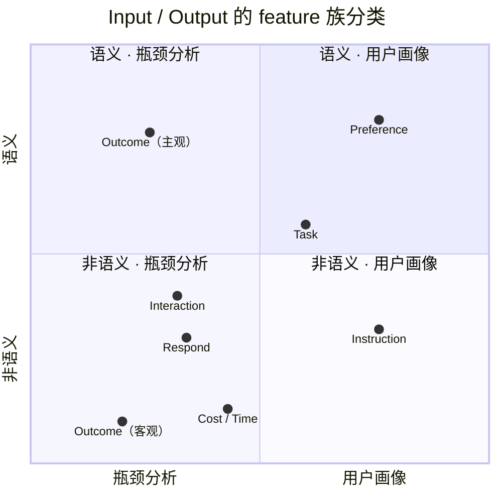

# 分析模块分类

> 历史来源：本页为2026-10-01 至 10-03 的历史方案，2026-10-07 从团队 Vault 迁入。原位置：`项目/Orbit/分析模块/分析模块分类.md`。正文与原有日期、结论保留，仅整理导航和空白；私人会话定位不公开。本文中的“当前”、TODO、测试数量和执行命令仅对原文基线成立，本次没有重新验证，也不自动形成任务或授权。现行入口：[源码文档](<../../../../modules/analytics/README.md>)。

点击下表的特征族进入开发文档。每页开头是具体 Feature 的 TODO，后面给出特征口径、分析函数和验收样例，大家可以直接补充和认领。

## 维度分类

| 特征族                         | 当前需要的特征                                                 | 暂缓或按需保留                                     | 对应页面        |
| --------------------------- | ------------------------------------------------------- | ------------------------------------------- | ----------- |
| **[Task 任务](<task.md>)**             | 任务领域 `domain`、任务类型 `task_type`、任务标题、目标与产物、关键任务起止位置、关联会话 | 复杂度可作为辅助标签；新颖度、精细的开放程度评分暂缓                  | 画像、轨迹、项目、语义 |
| **[Instruction 指令／控制方式](<instruction.md>)** | 执行授权 `requested_autonomy`、先规划还是先做、核验要求、操作范围与禁止事项、验收标准   | 明确表达的详略、格式、工具偏好可以保留；约束密度、prompt 具体程度的综合评分暂缓 | 画像、轨迹、摩擦分析  |
| **[Interaction 交互行为](<interaction.md>)**    | 用户消息意图、人工介入位置、纠偏次数与比例、重复强调要求、摩擦类型                       | 单独的追问率、执行／讨论比例暂缓；需要时可从消息意图计算                | 概览、画像、轨迹、语义 |
| **[Preference 主观偏好](<preference.md>)**     | 用户明确表达或确认的偏好、适用任务／项目、证据、发生或变化时间                         | 隐式偏好排序、完整偏好向量、推荐匹配参数暂缓                      | 画像、语义       |
| **[Respond Agent 回应与执行](<respond.md>)** | 轮次数、工具调用序列、调用结果、失败原因、重试关系、子代理关系、实际并行区间                  | 回滚、上下文重启有明确记录时保留；分叉本身先作为关系字段                | 轨迹、工具、项目、画像 |
| **[Cost / Time 用量与时间](<cost-time.md>)**   | 输入／输出／缓存 token、执行起止与耗时、会话跨度、按日和小时的活动分布                  | 实际费用、估算费用、到首次验收的时间、真实人工投入时长暂缓               | 概览、轨迹、工具、项目 |
| **[Outcome 主观结果](<subjective-outcome.md>)**        | 用户接受／拒收、用户确认的完成状态、返工反馈及对应对象                             | 最终是否在外部实际使用、长期满意度暂缓                         | 轨迹、项目、摩擦分析  |
| **[Outcome 客观结果](<objective-outcome.md>)**        | 测试／构建／检查结果、验收项是否通过、结果证据                                 | 没有验收依据时不生成“客观任务成功率”                         | 轨迹、工具、项目    |

## 如何跟进 Feature 开发

1. 进入对应特征族，在开头 TODO 认领具体条目：追加 GitHub 账号和实现仓库的 Issue 链接；新增特征也先加一条 TODO。
2. 用页面底部的小节补全定义、数据来源、统计粒度、提取规则和正反例；讨论与已确认结论分别记录。
3. 在分析函数表补接口，再写清输入、输出、缺失处理、验收样例及跨族依赖。初始字段与函数建议待确认，现有实现对照 [分析Feature一览](<../feature-inventory-2026-10-02.md>)。
4. 将代码、测试和版本链接回填到文档；特征定义、函数接入和样例验收完成后勾选 TODO，任务状态与负责人同步到 Issue。

### 共用口径

- 每个特征标明消息、调用、任务或会话等统计粒度；汇总时保持筛选范围和分母一致。
- 保留证据 ID、来源、有效／未知样本量及缺失原因；未知不填 0，零分母返回空值。
- 指令、偏好、执行行为和主观／客观结果分别记录；跨族使用同一证据时通过 ID 关联。
- 时间字段说明时区、来源和质量；使用后续反馈作历史解释时，标明该反馈何时才可见。
- AI 草案、团队确认和代码验收分别标注；TODO 勾选需要实现与验收依据。

前端用途见 [前端交互流程](<../frontend-flow.md>)。本目录保留协作定义与开发入口，详细实现随代码仓库维护。
