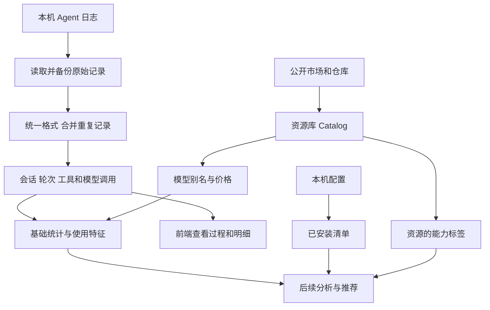
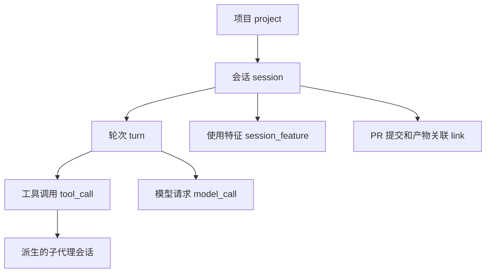

# 数据标准化+预处理

> 历史来源：本页为2026-10-01 至 10-03 的历史方案，2026-10-07 从团队 Vault 迁入。原位置：`项目/Orbit/数据/数据标准化+预处理.md`。正文与原有日期、结论保留，仅整理导航和空白；私人会话定位不公开。本文中的“当前”、TODO、测试数量和执行命令仅对原文基线成立，本次没有重新验证，也不自动形成任务或授权。现行入口：[源码文档](<../../../README.md>)。

Tandem 要把各个 Agent 的使用记录整理成一份能看懂、能统计、能查回原文的数据。同时收集公开的 Skills、插件、MCP 等资源，为后面的分析和推荐准备材料。

最终希望回答：**你在哪个项目用了什么模型，做了哪些操作，花了多少时间和 token；已经装了什么工具，实际用了哪些。** 基础统计在数据层完成，诊断、画像和推荐由后续模块负责。

> 这是 2026-10-02 的设计记录，尚未实现；MVP 范围仍待三位成员确认。文末保留详细方案和格式调研的来源。

## 数据从哪里来

| 来源 | 收集什么 | 用来做什么 |
| --- | --- | --- |
| 本机 Agent 日志 | 用户输入、模型回复、工具操作、错误、用量 | 还原过程，统计时间、工具和模型消耗 |
| 本机配置 | 已装的 Skills、插件、MCP、Hooks、规则和定时任务 | 知道用户已经有什么，避免重复推荐 |
| 公开资源 | 官方市场、MCP Registry、Git 仓库、模型信息和公开成绩 | 建资源库，提供兼容性、模型别名和价格信息 |

会话日志先接 Claude Code、Codex、DeepSeek Harness；pi 和 Antigravity 的明文记录一并考虑，OpenCode、Hermes 补齐样本后接入。公开资源先接官方来源。

首次运行让用户选择数据源，先处理近期记录，再补旧记录。之后监听变化，只处理新增或发生修改的部分。**采集只读 Agent 目录，不改它们的数据，也不读取登录凭据。会话内容留在本机。**

## 整体流程

采集和处理由一个独立的本地进程完成，拟用 TypeScript 与 Node。Mac App 读取结果，展示时间线、工具明细和统计；前端不再各自解析日志或换算 token。

## 为什么分成 L0 到 L3

四层各做一件事：**留原文、记去向、统一事实、整理成表。**

| 层 | 可以把它理解成 | 保存什么 |
| --- | --- | --- |
| L0 原始归档 | 原始材料的备份 | 文本原始内容；数据库来源的行快照 |
| L1 记录索引 | 原始材料的目录 | 每条记录在哪里、如何处理、对应哪些事件 |
| L2 标准事件 | 统一格式的过程记录 | 用户输入、模型回复、工具调用与结果、用量、压缩、中断等 |
| L3 派生表 | 整理好的查询与统计数据 | 会话、轮次、调用明细、项目归属、基础统计和使用特征 |

例如同一次模型回复，在某个 Agent 中可能被拆成五行。我们先保留五行原文，再说明它们各自的去向，最后将它们整理成相应事件；模型用量只算一次。

一条原始记录也可能包含回复、工具调用和用量，需要拆成多个事件。因此原始记录数不等于事件数。没有用到的字段仍保留，解析失败的记录保留并提示，不悄悄丢掉。

这样分层后，规则改了就能重算。例如改了项目归属或模型别名，从 L2 重新生成 L3；解析方法改了，从 L0 重新处理。重算要使用对应版本的规则、词表和价格。统计结果应能沿着 **L3 → L2 → L1 → L0** 查回原文。

## L3 具体整理成什么

L3 的骨架是“项目 → 会话 → 轮次”，轮次下记录工具调用和模型请求。

| 表 | 记录什么 |
| --- | --- |
| `project` | 属于哪个项目，包含哪些仓库路径 |
| `session` | 一次会话的标题、来源、起止、状态，以及父子会话关系 |
| `turn` | 一次输入触发的这轮处理，何时开始、是否完成或中断 |
| `tool_call` | 一次工具操作及结果，例如读文件、改代码、运行测试；保留成败、耗时和审批信息 |
| `model_call` | 有明确逐次请求证据的模型调用，保留模型、思考档位、token 和成本 |
| `session_feature` | 实际使用过哪些工具类别、命令、MCP、Skill 和文件类型，以及次数 |
| `link` | 会话或轮次关联的 PR、commit 和其他产物 |

用户说“修复这个报错”，Agent 读文件、改代码、运行测试、最后回复，这通常是一轮处理，包含多个工具调用和模型请求。**一次输入、一次模型请求、一次工具操作是不同单位。** 手动压缩等辅助请求不一定属于某一轮，允许单独记录。

子代理有自己的会话，保留是谁派生了它、它属于哪个主会话。复制来的父历史不再次计量。项目先按 Git 仓库和工作目录识别，同一仓库的 worktree 合在一起，用户可以手动调整归属。

统计主要按项目、模型和思考档位分组。Agent 名称用于说明来源和判断兼容性。模型要记录每次调用时的实际选择；不能用会话最后的模型覆盖整段历史，不同厂商的思考档位也不能直接等价。

## 几条必须算对的规则

1. **同一操作只记一次。** 重复日志、分叉时复制的历史、跨 Agent 导入的旧内容不能重复统计。两份记录各有不同信息时先合并，例如一份有参数，另一份有退出码。
2. **真实重试要保留。** 失败后重新调用模型或工具，确实又花了资源，需要计入。工具调用和返回结果要配对；没有结果时标为进行中、中断或未知。
3. **单次用量和累计总量分开。** 有每次请求证据的才进模型调用明细。只有累计值的来源就记录累计值，不能平均拆到每条消息。父会话总量若已包含子代理，不再把子代理加一遍。
4. **统一 token 和费用口径。** 普通输入、缓存读取、缓存写入和输出分开；思考 token 已包含在标准输出中，不再额外累加。按价格表折算的费用注明估算，并保留价格来源与版本。
5. **缺数据就标未知。** 没有时间、成本或审批等待数据时不填 0。估算值要说明依据。累计值不能全部算到导入当天，也不能把多个累计快照相加。
6. **顺序和耗时分开。** 过程按日志里的先后顺序整理，时间统一存 UTC。执行时间和落盘时间分别说明，并行工具耗时不能直接相加成用户等待时间。
7. **真人输入和系统消息分开。** 通知、注入上下文、其他 Agent 的消息不当作用户发言；纠偏和情绪只分析明确的真人输入。

轮次结束、工具成功，都不直接等于任务成功或用户满意。这些判断留给后续分析或用户反馈。

## 会话和资源库如何接起来

两边使用同一套“能力标签”：会话记录实际用了什么，资源条目标注能做什么。常见标签包括工具类别、命令、MCP 服务、软件、Skill、Hook 事件、文件类型和任务领域。

例如会话里经常使用 `gh pr`，就记录 GitHub PR 相关的使用特征；公开 Skill 若也处理 PR，就标相同的能力标签。后续模块可以据此找候选资源，再结合兼容性、已安装清单和问题证据判断是否推荐。

资源库保留条目的来源、版本、许可和组成。一个插件包含的 Skills、Hooks、MCP 等要拆出来，同一资源在多个市场出现时合并重复项。模型成绩保留测试工具、基准版本和来源，避免把不同测试条件的分数混排。

已安装清单与资源库另做对应，保留匹配依据；匹配不上就显示未关联。标签和使用次数只是匹配材料，不能直接证明“装这个就能提速”。

## 数据放在哪里 如何更新

| 位置 | 内容 |
| --- | --- |
| `tandem.db` | 本机会话、标准事件、L3 表和已安装清单 |
| `catalog.db` | 公开资源、版本、标签、模型和成绩，可更新整个快照 |
| `raw/` | 压缩后的原始归档，保留不同版本 |
| `cache/` | 临时数据库副本和下载缓存 |

存储采用 SQLite 加压缩归档。会话库与公开资源库分开，更新资源库不会覆盖本机会话。工具输出可只在数据库里存短预览，全文从归档读取；独立图片、PDF 默认只记录位置和哈希，未复制的附件可能随上游清理而不可读。

更新分四种情况：

- **追加了记录：** 只处理新增的完整行或完整压缩帧。正在写的一半记录等下次读取。
- **原文件被改写或截断：** 保存新版本，重建受影响的数据；旧版本留在归档中，默认查询显示当前版本。
- **上游文件被删除：** 标记来源已消失，已经归档的数据继续保留。
- **处理规则改变：** 按变更范围从 L0 或 L2 重算，并一起更新记录间的关联。

数据库内容和“处理到哪里”的标记要一起提交。处理中途失败时保留上一份完整结果，下次继续；不能显示一半更新的数据。用户手动设置的项目规则也要保留。

## 先实现什么 怎样验证

先定字段和样本，再做连接器，然后生成 L3 与基础统计、接资源库，最后做持续监听并接入前端。基础统计先用 SQL 查询或视图，遇到实际性能问题再缓存。

最重要的验证是：每条原始记录都有去向；重复导入结果不变；重复历史和累计值不会多算；重算能得到一致结果；每个明细和统计都能查回证据。前端实时更新的设计目标是新记录写入后 5 秒内可见，尚待实测。

目前仍待定的关键设计包括：跨项目会话是否将归属细化到每次调用；轮次关系和累计用量是否需要独立表；价格有效期、账号识别和所有输出字段的脱敏边界。它们在详细方案定稿时明确，不在这里当作已确认功能。

Hooks、OTel 和反代属于补充采集方式；画像、摩擦诊断、AI 标注与推荐属于后续模块，先把数据链路跑通。

## 来源与实现细节

- [数据获取与标准化方案](https://github.com/Orbit-Labs-AI/Orbit-Source/blob/f3773669f95f90ba88576e0e06b29c71d11091a4/docs/plan/data-acquisition.md)：2026-10-02 的数据方案基线，包含字段、SQL、身份、时间、计量和归档规则。
- [六种 Agent 会话调研](https://github.com/Orbit-Labs-AI/Orbit-Source/tree/f3773669f95f90ba88576e0e06b29c71d11091a4/docs/research/agent-sessions)：每家日志格式和解析依据。
- [后端处理流程](<backend-flow.md>)：团队模块划分。

本次 L3 讨论和本机未提交的研究稿只用于补充待定设计，不能视为团队已确认决定。详细契约和实现继续在 Hackathon 仓库维护。
