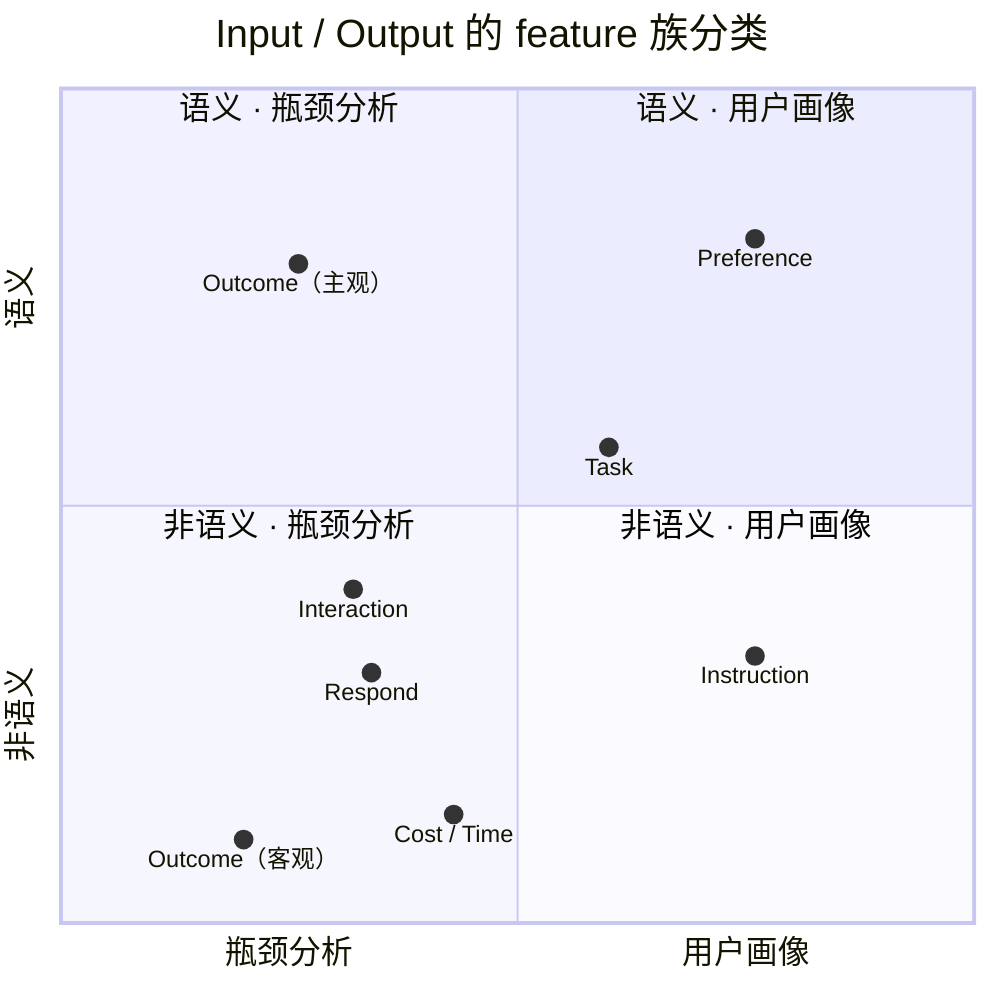

# 数据标准化构想

> 历史来源：本页为2026-10-01 至 10-03 的历史方案，2026-10-07 从团队 Vault 迁入。原位置：`项目/Orbit/数据/数据标准化构想.md`。正文与原有日期、结论保留，仅整理导航和空白；私人会话定位不公开。本文中的“当前”、TODO、测试数量和执行命令仅对原文基线成立，本次没有重新验证，也不自动形成任务或授权。现行入口：[源码文档](<../../../README.md>)。

## Feature 族的进一步分类



依据手绘图重绘：横轴从瓶颈分析到用户画像，纵轴从非语义到语义。点位表示分类倾向，坐标仅用于布局，不是量化评分。

## 用户画像（十六人格）+ 瓶颈分析 + 技术推荐：数据特征设计

## 原始提问

现在我们想进入之前提到的用户画像（十六人格）+瓶颈分析+技术推荐的具体设计，考虑到这些实际上是数据特征的低维投影，也就是如果你能够从历史数据中获取足够多的信息，那么你就可以自然而然得到后面的功能。因此，我觉得我们首先需要回答以下问题：

1. 历史数据中足够多的信息到底有哪些，才能够满足各类用户的使用需要？这些信息并非完整的json块，而是用户交互行为的特征表现，是标准化之后的结果。
2. 信息大致分为两类，语义和非语义的内容，还有什么重要的分类需要考虑在内？
3. 对于不同类比的信息，我们怎么高效地采集这些信息，背后的数学原理与算法是什么，效果如何？效果包含信息有效性、处理高效性与鲁棒性。是否有现有的项目可以借鉴？

---

## 回答

你们现在真正要设计的，不是“16 人格分类器”，而是一个 **User Representation Layer**。历史数据 $H_u$ 先被压缩成一个稳定的用户状态 $z_u$，然后：

$$
H_u \longrightarrow z_u
\begin{cases}
\longrightarrow \text{Persona}\\
\longrightarrow \text{Bottleneck}\\
\longrightarrow \text{Skill/Hook/Tool Recommendation}
\end{cases}
$$

“十六人格”只是 $z_u$ 的一个可视化投影，不应该反过来决定底层采什么数据。

---

## 1. 到底哪些历史信息是“足够”的？

数学上可以把它理解成一个 **information bottleneck**：

$$
\max_{z=F(H)}
I(z;Y)
-\beta I(z;H),
$$

其中 $Y$ 不是“人格标签”，而应该是未来真正需要预测的东西：

- 用户会不会接受这次结果；
- 会不会继续修改 / rollback / retry；
- 哪里最容易浪费时间；
- 什么 skill / tool 能减少这些问题；
- 用户在类似任务中希望 Agent 如何行动。

因此所谓“足够”，其实是：

> **保留能够预测未来行为和干预效果的信息，而不是尽可能多地保存历史。**

建议把每个 session 标准化成下面 7 类 feature。
典型化特征仅供参考

| 特征族                    | 典型标准化特征                                                                                                 | 主要用途              |
| ---------------------- | ------------------------------------------------------------------------------------------------------- | ----------------- |
| **Task** 任务            | domain、task type、artifact、复杂度、开放程度、novelty                                                              | 防止把“任务难”错判成“用户难搞” |
| **Instruction** 客观控制方式 | verbosity、证据需求、格式、控制粒度、工具偏好及其随时间变化、constraint density、prompt specificity、format demand、autonomy request | 用户画像              |
| **Interaction** 交互行为   | 人工介入位置、执行/讨论比例、追问率、纠错率                                                                                  | bottleneck        |
| **Preference** 主观偏好    |                                                                                                         | personalization   |
| **Respond**回应          | turn 数、retry、rollback、branch、上下文重启、tool sequence、tool switching                                         | 画像 + bottleneck   |
| **Cost/Time** 成本       | latency、tokens、session duration、time-to-accept、model/tool cost 推荐模型可用                                   | 效率瓶颈              |
| **Outcome** 主观结果       | accept/reject、主观完成度、rework、verification、最终是否使用                                                          | 最重要的监督信号          |
| **Outcome** 客观结果       | 客观task success                                                                                          |                   |
【outcome以后可以激励用户反馈，形成数据】
【统计的不同粒度：时间、项目】

---

## 2. “语义 / 非语义”之外，还必须有两个正交分类

### 第一轴：信息的表示方式

可以分为：

$$
\boxed{\text{Semantic}}
\qquad
\boxed{\text{Behavioral / Telemetry}}
$$

例如：

#### Semantic

> “不要解释那么多，直接改代码。”

可以解析成：

```text
verbosity_preference = low
action_preference = execution
autonomy = high
```

#### Non-semantic

```text
user_prompt_len = 18
agent_output_len = 1250
retry = 1
tool_calls = 7
rollback = 1
time_to_accept = 180s
```

但是只这么分是不够的。

### 第二轴：信息在因果链中的角色

更重要的是：

$$
\boxed{
\begin{gathered}
Task\rightarrow User\ Action\rightarrow Agent\ Action\\
\rightarrow Outcome\rightarrow User\ Feedback
\end{gathered}
}
$$

也就是区分：

- 用户偏好；
- 任务条件；
- Agent 行为；
- 结果反馈。

之前的 $p/q$ 模型正好可以放在这里：

$$
p_u(a|s)
=
\text{用户真正希望发生的 transition},
$$

$$
q(a|s)
=
\text{Agent 实际发生的 transition}.
$$

然后 bottleneck 可以理解成某种

$$
D(p_u,q).
$$

而 accept / correction / retry / rollback 就是在反向估计 $p_u$。

### 第三轴：时间尺度

还应该分：

$$
\text{event}
\rightarrow
\text{session}
\rightarrow
\text{long-term user}.
$$

例如：

- “这次要求简短”是 **session preference**；
- “过去三个月 83% 情况都要求简短”才可能成为 **user preference**。

这一点对于避免人格画像乱漂非常关键。

---

## 3. 各类信息怎么采？建议四套算法并行

### A. Telemetry：尽可能不用 LLM

适合：

- timestamp
- token
- tool call
- error
- retry
- edit distance
- file diff
- branch
- model switch
- latency
- accept/reject

直接采用 parser + SQL / Polars aggregation。

这是**最快、最便宜、最鲁棒**的一类。

可借鉴项目：

- [ActivityWatch](https://docs.activitywatch.net/en/latest/privacy.html)：本地行为记录，privacy-first。
- [WakaTime](https://wakatime.com/features)：项目、文件、branch、language、cursor、代码增删、AI/human 代码量等开发行为遥测。

---

### B. Semantic：Embedding 为主，LLM 为辅【x反了】

不要每条历史都让 LLM “总结用户”。

推荐：

$$
\text{text}
\rightarrow embedding
\rightarrow
\begin{cases}
\text{task classifier}\\
\text{intent classifier}\\
\text{preference classifier}\\
\text{cluster}
\end{cases}
$$

例如抽取：

```text
task = debugging
domain = coding
requested_autonomy = high
needs_explanation = low
evidence_requirement = medium
```

对于低置信度样本再调用 LLM。

也就是：

> **cheap model cover 80–90% + expensive model resolve ambiguity**

而不是全文 LLM analysis。

可参考：

- [LaMP: When Large Language Models Meet Personalization](https://aclanthology.org/2024.acl-long.399/)：比较 lexical、semantic 和 time-aware retrieval，核心思想是从用户历史中检索真正相关的信息，而不是把全部 history 都塞进去。

---

### C. Revealed Preference：最值得做的一类信息

例如：

Agent 输出 $A$。

用户：

> 太啰嗦了，直接说结论。

Agent 输出 $B$。

用户接受。

这实际上产生了一个天然 pairwise preference：

$$
B\succ A.
$$

如果定义输出 feature：

$$
\phi(A)=
(\text{verbosity},
\text{technicality},
\text{autonomy},
\text{evidence},\ldots),
$$

可以使用 Bradley–Terry / logistic model：

$$
P(B\succ A)
=
\sigma\left(
\theta_u^\top
[\phi(B)-\phi(A)]
\right).
$$

于是 $\theta_u$ 就是一个非常自然的 **user preference vector**。

相比“让 LLM 猜这个人喜欢什么”，这个信号更强：

> 用户说了什么是 stated preference；
> 用户最后接受了什么是 revealed preference。

---

### D. Workflow：Process Mining / Markov Graph

把 session 转成：

```text
ask
→ explain
→ ask clarification
→ generate code
→ run
→ error
→ edit
→ rerun
→ accept
```

形成 transition matrix：

$$
P_{ij}
=
P(s_{t+1}=j|s_t=i).
$$

统计：

- loop probability；
- 某节点平均 dwell time；
- failure transition；
- repeated correction；
- tool-switch；
- manual intervention。

这基本就是 Process Mining 的问题。

传统 process mining 本身就是从 event logs 恢复实际 workflow，并用于发现 bottleneck、throughput time 和偏离正常流程的位置。

参考：

- van der Aalst 等关于 Process Mining 的经典工作：
  [Process Mining: Overview and Opportunities](https://www.kdd.org/exploration_files/V13-02-07-vanderAalst.pdf)

对于 48 小时 hackathon，不需要上复杂 Petri Net。

先做：

$$
\text{event sequence}
\rightarrow
\text{directly-follows graph}
\rightarrow
\text{loops / latency / failure}
$$

效果已经会非常直观。

---

## 4. 最后如何变成“十六人格”？

底层应该保留几十维连续 feature，最终通过 PCA / factor model 等方法，选出 4 个**可解释轴**：

$$
z_u=(A,W,V,S).
$$

可以设计为：

- **Autonomy**：micro-control ↔ delegation
- **Workflow**：边做边改 ↔ plan-first
- **Verification**：trust ↔ verify
- **Scope**：single-task ↔ cross-tool/system

然后：

$$
4\text{ binary axes}
\Rightarrow 2^4=16
$$

这时候“16 人格”才是合理的。

而像：

- 喜欢说人话；
- 喜欢 LaTeX；
- 喜欢先给结论；
- 喜欢代码直接执行；

这些不需要硬塞进人格，应该保留为 **preference vector**，直接驱动 Hook / Skill recommendation。

---

## 5. 推荐系统最后应该长什么样

整体数据流可以是：

```text
Chat / Codex / Claude / IDE history
              ↓
      Unified Event Schema
              ↓
 ┌────────────┼────────────┐
 telemetry   semantic   trajectory
 parser      encoder     mining
 └────────────┼────────────┘
              ↓
       User Feature Store
              ↓
     Latent User State z_u
        ↓       ↓       ↓
    Persona  Bottleneck  Preference
                    ↓
          Skill / Hook / Tool
             Recommendation
```

底层 trace schema 可以参考 Langfuse：

- observation
- trace
- session
- human score
- programmatic score
- LLM judge
- quality / latency / cost

参考：
[Langfuse Scores & Evaluation](https://langfuse.com/docs/evaluation/scores/overview)

跨 Claude / Codex / GPT 时，则应该参考 OpenTelemetry 的思想：

> 先定义统一 semantic conventions，而不是给每个 Agent 写一套数据模型。

参考：
[OpenTelemetry Semantic Conventions](https://opentelemetry.io/docs/specs/semconv/general/)

---

## 6. 最值得研究的现有工作

### 1. ActivityWatch / WakaTime

解决：怎么低成本采行为。

### 2. Langfuse + OpenTelemetry

解决：怎么定义跨 Agent trace schema。

### 3. Process Mining

解决：怎么从 sequence 自动找到 bottleneck。

### 4. LaMP

解决：怎么从历史中选择真正有价值的个性化信息。

链接：
[LaMP](https://aclanthology.org/2024.acl-long.399/)

### 5. PersonaMem

专门研究长期、动态 user profile，包含最多 60 个 multi-turn sessions 的历史。

链接：
[PersonaMem](https://arxiv.org/html/2504.14225v1)

### 6. IBA-Bench

该 benchmark 刻意加入 noisy、implicit、temporal inconsistent 的长期交互，并测试 Agent 能否从历史推断隐含约束并在任务执行中遵守。

其中一个很有价值的概念是：

> **knowledge-to-action gap**

即：

> “知道用户”与“真正按用户习惯执行”之间的差距。

链接：
[IBA-Bench](https://arxiv.org/abs/2608.02171)

---

## 7. 推荐的第一阶段实验

不要先做人格 UI，而应先定义大约 **30–50 个 canonical features 的 Feature Dictionary**，然后拿真实历史做一次 ablation：

$$
\text{Task only}
\rightarrow
+\text{Semantic}
\rightarrow
+\text{Behavior}
\rightarrow
+\text{Outcome}
\rightarrow
+\text{Trajectory}.
$$

分别考察加入各类信息以后，对于以下指标的增益：

- future accept prediction；
- retry prediction；
- correction prediction；
- bottleneck detection；
- skill recommendation。

这样可以直接回答最核心的问题：

> **历史数据中哪些信息才是真的有用？**

同时这也非常适合作为产品 demo 中的一张核心实验图，因为它可以把“为什么要做用户画像”从一个概念问题，转化为可量化的预测增益问题。

---

## 核心结论

整个系统更合理的抽象不是：

```text
历史记录
→ 十六人格
→ 推荐
```

而应该是：

```text
历史记录
→ 标准化行为 / 语义 / outcome / workflow 特征
→ User Representation
→ Persona / Bottleneck / Preference
→ Personalized Agent Configuration
```

也就是说，**人格只是展示层，低维用户状态才是真正的核心资产**。
