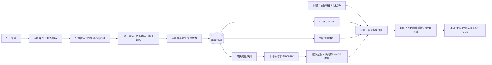

# 推荐侧资源数据与混合检索

状态：2026-10-02。此设计按本次明确要求实现向量检索，替代旧数据方案中“向量检索暂不做”的范围判断。它属于 DT-11/12/13/14 与 RC-09 的数据基础；不变更其他成员的分析模块、安装模块或两套 UI。

## 目标与模块边界

推荐输入是用户分析出的具体问题和项目特征。外部资源不能只保存名称和链接，还需要可追溯的说明、适用条件、能力特征、正文分块以及语义表示。检索给出相关候选和匹配依据，实际收益仍须通过安装后对照验证。

`src/tandem_catalog` 独立于 `tandem_backend` 的分析实现，拥有 `catalog.db`；不打开、更不写入 `tandem.db` 或 `analysis.db`。已有 Python 本地服务向 Mac App 提供接口，Swift Package 封装异步调用。当前仓库没有可集成的原生 App target，所以不另建整套 UI。

## 数据库与索引

实际 DDL 是 [`schema.sql`](../../src/tandem_catalog/schema.sql)。使用 SQLite WAL、外键、STRICT 表、FTS5；`application_id = 0x54434C47`、`user_version = 1`。打开其他模块的数据库或未来版本会明确失败。

| 表 | 粒度与作用 | 主要索引 |
| --- | --- | --- |
| `catalog_source` | 一个明确启用的来源；刷新时间、已提交 revision/watermark、失败退避 | 主键 source_id |
| `sync_run / sync_stage` | 一次来源同步与已完成分页；重启后从 checkpoint 继续 | source/status；run/native_id |
| `catalog_item` | 当前统一资源，类型、名称、语言、兼容 Agent、难度、内容版本 | status/type/difficulty；content_hash |
| `item_source` | 各来源原始元数据、原生 ID 和归一结果；多来源不会相互删除 | item/status/source |
| `item_version` | 不可变资源版本；正文、清单、许可、特征版本和来源 SHA | item/created_at |
| `item_feature` | 能力词表中的 feature/value/weight/origin/evidence | feature/value/item |
| `item_component` | 插件与组成条目的关系，允许组件暂未索引 | parent/child |
| `resource_chunk / chunk_fts` | 当前版本分块；字段、标题、序号、偏移、原文与哈希 | item/version；FTS5 |
| `embedding_model` | 完整向量空间身份：权重、分词器、维度、前缀、池化、运行库版本 | model_id |
| `chunk_embedding / embedding_cache` | 当前块向量及可复用文本哈希缓存 | model/chunk；model/text_hash |
| `model_info / benchmark_result` | 供应商模型规格、独立的评测配置与结果 | item 主键 |

Git 文件的身份使用 `type:github.com:数字仓库ID:路径`；插件以所在目录识别。MCP 使用官方名称；尚未解析的外部市场指针保留 marketplace 身份和 `pointer_only` 状态，不假装已下载其内容。模型供应商和基准配置保留在各自的来源记录，不凭相近名称强行合并。

许可允许的资源保留正文；许可不明确的只保存元数据、哈希与源链接。`declared` 是发布者声明，`extracted` 是确定性文本抽取，`curated` 是本地审查标注；文本出现“测试”只能说明领域相关，不能自动产生“能修复重复失败”的有效性结论。

## 增量与一致性

1. App 或 CLI 显式调用刷新；模块本身不驻留、不创建系统定时任务。`next_due_at` 供启动、恢复和定期检查时调用。
2. Git 来源固定完整 commit SHA，分批下载同一个 tree 下的内容并核对 Git blob SHA。HEAD 未变时跳过。单文件 JSON 以 ETag/Last-Modified 和内容哈希判断变化。
3. MCP 使用 cursor 与 `updated_since`，重叠读取五分钟覆盖时间边界；包含下架/删除状态。游标未前进或返回格式不符即失败。
4. 每页归一记录和 checkpoint 在一个短事务中暂存。网络失败、取消、页数预算耗尽都不改变已发布数据或水位。下次从同一 run 的 checkpoint 继续。
5. 全量快照完成后，事务发布资源、版本、特征、分块及 FTS，并退休该来源缺失的条目。增量快照只处理显式变更；一次空增量不会清空目录。其他有效来源仍引用同一条目时保留它。
6. 网络工作期间使用进程文件锁保证单写者；WAL 读事务看到完整的旧版或新版。失败保存错误码和指数退避，绝不把失败批次标成“刷新成功”。
7. 向量缺失表连接就是可恢复队列。每批推理在事务外运行，提交前重新检查当前块身份；资源在推理期间更新不会把旧向量挂到新正文。相同 text_hash 的已算向量复用。

## 本地向量空间

默认适配器是 `intfloat/multilingual-e5-small` 的 ONNX 导出，384 维。模型文件只从用户指定的本地目录加载，下载是独立的显式准备步骤。用户查询、问题证据不传往外部 embedding API。

每个空间包含权重文件 SHA-256、tokenizer SHA-256、query/passage 前缀、masked mean 池化和 L2 归一方式、维度与运行库版本。模型 ID 由描述哈希生成；不同空间不允许混搜。模型切换时新旧向量可并存，返回已索引/待索引数量，未完成时明确表示覆盖不足。

正文按标题和重叠字符窗口分块，保留溯源字段。E5 内部对超过 512 token 的块继续分窗，每窗补上对应前缀并聚合，避免隐式截断。向量以 little-endian float32 保存，写入时验证维度、有限值和非零范数。

第一版在结构化过滤后分批计算精确余弦 Top-K，复杂度 O(Nd)、批处理内存 O(Bd)，不会先用关键词截断语义候选。它是实际可用的本地向量存储和检索，但不是 ANN。5 万个 384 维向量的纯向量约 73 MiB；实际磁盘还包括缓存、文本、历史版本和 SQLite 开销。以后根据实测 P95 延迟，再评估 sqlite-vec、HNSW 或独立服务，不能只凭条目数宣称需要迁移。

## UI 与排序契约

A8 资源库需要搜索、类型/来源/兼容性筛选、已安装排除、资源详情和匹配解释；A7 优化建议需要额外的问题 ID、画像及瓶颈证据、适用条件和效果状态。已被后续设计取消的“同人格用户在用”“社区效果”不提供模拟数值。

多路召回与接口的实际字段、命令和验证方式将在模块实现完成后补在本文。

参考：[SQLite FTS5](https://www.sqlite.org/fts5.html)、[E5 模型](https://huggingface.co/intfloat/multilingual-e5-small)、[RRF](https://www.elastic.co/docs/reference/elasticsearch/rest-apis/reciprocal-rank-fusion)、[MCP 增量接口](https://github.com/modelcontextprotocol/registry/blob/main/docs/reference/api/official-registry-api.md)。
