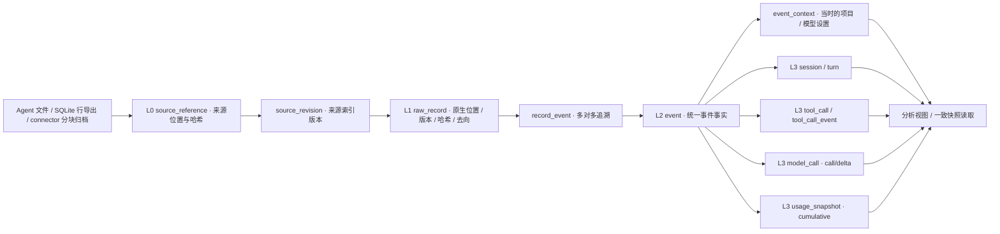

# Orbit 会话数据契约 v1

数据库契约为 `tandem-session-v1`；分析对象契约为 `analysis-input-v1`。本文件描述已经实现的结构。字段字典由实际 DDL 生成，不能把旧设计草图或 TypeScript staging 库当成这一版。

- 权威 DDL：[迁移目录](../../packages/data/src/tandem_data/migrations/)，当前来源索引迁移为 [006.sql](../../packages/data/src/tandem_data/migrations/006.sql)
- L2 语义校验：[event-v1.schema.json](../../packages/data/src/tandem_data/schemas/event-v1.schema.json)
- 全部表的字段、类型、可空性、外键和建表语句：[tables-v1.schema.json](../../packages/data/src/tandem_data/schemas/tables-v1.schema.json)
- 可运行命令：[packages/data](../../packages/data/README.md)
- 分析消费语义：[analysis-inputs.md](analysis-inputs.md)

## 1. 为什么分成这几层

L0 保存来源位置、版本和哈希，不复制原生 session。L1 说明每条原生记录的位置与处理去向。L2 保存可追溯的统一事实。L3 保存便于分析复用的实体和配对结果。数据库不实现画像、情绪判断、推荐或因果归因；分析团队从统一事实出发开发自己的算法。



L2 的 `session_uid` 引用 `session_identity`，L3 `session` 再复用同一 ID。这样原生身份不依赖某次派生结果。`event.turn_uid` 是可重建的 L3 关联，在同一投影事务里补齐。

## 2. L0 与 L1：来源、版本和索引

| 表 | 一行代表什么 | 主要字段与关联 |
| --- | --- | --- |
| `source` | 一个已明确登记的 Agent 数据根目录 | `source_id`、`agent`、`root_path`、`label`、`enabled`、`discovered_at`；同 Agent 多账号分开登记 |
| `source_file` | 来源内的一个逻辑路径 | `file_id`、`source_id`、`relative_path`、`role`、`format`、`status`、`watermark`、`last_scan_at`；唯一键 `(source_id, relative_path)` |
| `source_reference` | 一份原生来源索引 | `revision_uid`、`sha256`、`byte_len`、`encoding`；原文仍在来源目录 |
| `record_location` | 某次扫描中的记录位置 | `record_uid`、`revision_uid`、`ordinal`、`byte_offset`、`byte_len` |
| `source_scan` | 最近一次扫描边界 | 来源、时间、全量/样本、发现数、索引数、失败数和取消状态 |
| `archive_blob` | 兼容旧库和显式归档导入的原始字节 | `archive_uid`、`path`、`sha256`、`byte_len`、`stored_len`、`codec`、`created_at`；zstd 文件在 `raw/` |
| `source_revision` | 一个文件的一次已成功索引的捕获版本 | `revision_uid`、`file_id`、递增 `revision`、`archive_uid`、`captured_at`、`source_stat`、`record_count` |
| `raw_record` | 一条原生记录的一个内容版本 | `record_uid`、`file_id`、`revision_uid`、`locator`、`version`、`ordinal`、`byte_offset`、`byte_len`、`sha256`、`native_type`、`native_id`、`harness_version`、`shape_hash`、`session_uid`、`disposition`、`note` |
| `file_record` | 当前文件位置使用哪个记录版本 | `(file_id, locator) → record_uid`；与不可变的历史记录分开 |
| `record_event` | 一条原记录对一个事件的贡献 | `(record_uid, event_uid)`、`relation`、`contribution`；真实外键约束 |
| `ingest_issue` | 一项采集、映射或派生缺口 | 来源与记录引用、`stage`、`code`、`severity`、`detail`、`detected_at` |

`locator` 为结构化 JSON：JSONL 使用 `["line", physical_ordinal]`；SQL 行使用 `["row", table_name, primary_key_object]`。原生索引按字节位置或主键读取并校验记录哈希；压缩源使用解码偏移。SQL BLOB 在显式原文读取中用 `$binary` base64 表示。

文件追加或改写时，未变化行复用 `record_uid`，`record_location` 更新当前偏移。SQL 行 A→B→A 产生三个观测版本，历史索引不会假称旧内容仍然可读。上游文件删除后保留已有表和索引，原文返回 `missing`；记录改写返回 `changed`。已有旧归档不会被迁移删除。

**原生 `capture_file` / `ImportService` 流式读取来源并建立索引，不创建整文件快照。** 不完整压缩帧和读取期间变化会回滚本次索引，保留之前已发布的 L2/L3；非法 JSON 行保留定位并标记 `unparsed`。`capture_stream` 与显式 staging 桥接仍提供旧归档兼容，App 的无复制路径不使用它们。完整接口与边界见 [来源索引与轨迹](../modules/data/indexed-trajectories.md)。

### 记录去向

| `disposition` | 含义 | 约束 |
| --- | --- | --- |
| `mapped` | 生成一个或多个新事件 | 必须有 `record_event` |
| `folded` | 为已有事件补充字段，或流式分片被最终消息承接 | 必须指向承接事件 |
| `replayed` | 已确认的历史复制段 | 指回正本事件，不再生成行为副本 |
| `duplicate` | 同一信息的重复表示 | 指回正本事件 |
| `ignored` | 非轨迹控制、界面状态，或被新版本替代的记录 | `note` 给出原因，不挂事件 |
| `unparsed` | 尚不能可靠解析或定位正本 | 保留原文、记缺口，不挂事件 |

一条记录可以同时贡献内容、工具和 usage，`record_event.relation` 按贡献分别记录；记录级去向按 `mapped > folded > replayed > duplicate` 取值。不会在 `note` 里维护容易失效的多事件 ID 数组。`v_raw_record_ledger` 给出兼容入口 `ref_event_uid`、`event_count`、`is_current`。

## 3. L2：统一事件

| 字段组 | 字段 | 含义 |
| --- | --- | --- |
| 身份与来源 | `event_uid`、`session_uid`、`record_uid`、`native_id`、`native_key`、`event_path` | 原生逻辑身份与内容路径；一条原记录可以拆成多个事件 |
| 顺序与时间 | `seq`、可空 `ts`、`attrs.time`、`attrs.order` | 会话内稳定序号；UTC 毫秒与原生时间质量分开 |
| 语义与关联 | `kind`、`actor`、`turn_uid`、`parent_uid`、`call_id` | 统一事件类型、来源角色、原生树、轮次和配对键 |
| 内容与版本 | `text`、`text_truncated`、`attrs`、`ext`、`contract_version`、`mapper_version` | 可检索投影、结构化事实、未归一字段与规则版本 |

事件 ID 为 `hash([namespace, native_key, kind, event_path])`，使用固定的 JSON 结构编码，不靠字符串拼接或导入时刻。`seq` 不参与 ID：拆分规则升级可以重排展示顺序。Claude 内容按来源内 UUID，usage 按响应身份去重；pi 身份带文件作用域；没有原生 ID 时按文件和原生位置兜底。请求、工具与会话的 ID 使用不同 namespace。

Codex 使用 `session_meta.id` 作为线程身份；`session_id` 是根线程的 trace ID，不能用来合并父子线程。`thread_spawn` 的继承切点只在该类型内适用，guardian 不据此丢弃内容。复制段按已确认父文件中原生 payload 与来源顺序匹配；fork 前缀里发生变化的 world_state/developer 环境，没有相同父记录时作为注入上下文保留，不制造真人行为或假引用。

事件类型包括 `session.meta / session.title / setting.change / turn.start / turn.end / message.user / message.assistant / reasoning / tool.call / tool.result / model.usage / context.inject / context.compaction / permission.* / branch / hook.run / subagent.* / plan.update / file.change / link / queue / error / ui.state / unknown`。未识别类型以 `unknown + ext` 保存并告警。

`attrs.time` 必须包含 `source_field / semantics / quality / reported`。`ts=null` 对应 `quality=missing`；非空时间必须有字段来源，质量为 `reported` 或 `estimated`。`semantics` 区分创建、请求开始、开始、完成、写入和未知。秒和毫秒由连接器声明单位，ISO 无 offset 且无可信来源时区时保持未知。采集时刻不能替代动作时刻。

补充的分析字段已经实际生成：

| 字段 | 生成规则 |
| --- | --- |
| `attrs.origin` | 区分 human、queued、notification、peer、automation、injected、unknown；默认真人视图进一步只取 main 会话 |
| `attrs.phase` | 保留原生 commentary/final 等阶段；缺失不猜测 |
| `attrs.original_chars / message_digest` | 对完整、脱敏后的规范正文计数和摘要；正文不再有长度截断 |
| `attrs.writing_measurements.reply` | 可见回复的字符数、surface、measured 质量和 complete 标记；无法确定正文/摘要边界时 `body / summary` 为空 |
| `attrs.artifact_body_present` | 当前没有可靠的跨 Agent 正文边界提取，保持未知 |
| `attrs.input_format` | 普通 user 文本为 prompt；专门问答回执尚未在全部来源可靠提取，不能声称 question_reply 完整覆盖 |
| `attrs.argument_digest / argument_digest_basis` | 普通完整参数采用规范 JSON 摘要；含凭据或需要脱敏的输入不发布摘要，避免成为离线猜测秘密的校验器 |
| `attrs.is_wrapper / status_scope` | 保留编排外层的标志；未确认状态作用范围时为 unknown，不能把外层完成外推到内层全部成功 |
| `attrs.known_command_results / failed_command_results / unknown_return_values` | 没有原生统计证据时为空；不从输出里的 error 单词猜计数 |

L2 文本、attrs、ext 经过版本化脱敏；凭据字段与令牌匹配被替换，加密内容和签名仅保留不透明摘要。L0 仍保存本机原始字节。`Store.read_raw(record_uid)` 是明确的原文下钻接口；分析默认使用脱敏投影。调用方应只对已选中证据读取原文，不能绕开分析的会话排除或截止边界。

## 4. L3：队友直接消费的表

| 表 | 粒度与主要字段 | 关联 |
| --- | --- | --- |
| `project` | 项目；`project_id / key_type / key / name / git_remote / paths` | 远程仓库键优先；worktree 通过 common git dir 归并，支持 `project_override` |
| `session` | 逻辑会话；来源、kind、父/根、fork/import、深度、项目、cwd/Git、客户端/版本、标题、UTC 边界、时区来源、状态 | 复用 `session_identity`；血缘未解析时 `lineage_unresolved=1` |
| `event_context` | 每个事件的历史归属；`project_id / cwd / provider / model_raw / effort_raw` | `event_uid` 一对一；中途切目录或模型后，旧事实不改到最终设置 |
| `turn` | 一次输入或显式轮次；idx、触发来源、boundary_source、项目、状态、起止、触发/首尾事件 | `session_uid` 一对多；轮次不等于分析任务 |
| `tool_call` | 一次逻辑工具调用；原生 ID、调用/结果证据、原名/类别、MCP、技能、子会话、命令头/文件、状态、配对质量、退出码/错误、耗时质量、审批、归因、wrapper、参数摘要 | 会话/轮次/项目外键；重复 ID 并发且无法区分时保留歧义，不按相邻事件硬配 |
| `tool_call_event` | 调用与结果的证据链接 | 连接 `call_uid ↔ event_uid` |
| `model_call` | 可确认请求边界的一次请求；provider、原始/规范模型与解析状态、effort、用途/coverage、各 token 桶、成本来源、延迟/TTFT、停止原因、时间 | `usage_event_uid` 唯一；只来自 call/delta |
| `usage_snapshot` | 一个累计观测；snapshot_key、计数周期、scope/coverage、模型/用途、顺序、原生 ts、采集 observed_at、token/金额 | `event_uid` 唯一；版本化 SQL 累计行的历史观测都保留 |
| `link` | 外部证据关联；kind、ref、时间 | 会话、轮次、事件引用 |
| `session_feature` | 机械特征计数；tool_category、MCP、skill、command_head、file_extension | 由工具事实生成，不混入 LLM 标签 |

`model_alias(provider, model_raw)` 是明确的别名映射。未配置时保留原始模型键，并标 `model_resolution=unmapped`；不会凭相似名字把两种模型合并。effort_rank、成本和延迟没有证据时为空。目录模型映射和定价属于后续 Catalog 接入。

### token 与成本口径

`input_tokens` 是未缓存输入；缓存读/写分桶。`output_tokens` 包含思考，`reasoning_tokens` 是其中的子集。Codex 输入扣除已报告的缓存命中；OpenCode 输出加上单独报告的 reasoning。缺失字段保留 `null`，不能当成零。

`model.usage` 必须带 `usage_scope / measurement / coverage / reported`。call/delta 另有稳定 `request_key`；两种累计 snapshot 必须带 `snapshot_key`，不伪造 request_id。Claude cost-state 的根树覆盖与子代理逐次调用不会在视图里相加。

`v_session_call_usage` 只汇总观察到的逐次值，每个指标不完整时该合计为空。`v_latest_usage_snapshot` 是同 key、同周期的**最后观测值**，不是可随意相加的日增量。计数回退会产生 `cumulative_counter_decreased`；消费者必须核对这个诊断，不能假定旧周期仍连续。数据层不自动做差、不把首次快照归到导入当天，也不以快照生成请求次数。

## 5. 分析入口与证据范围

推荐读取 `v_analysis_event / v_human_message / v_analysis_tool_call / v_analysis_model_call`。默认事件与调用视图只包含 main 及已解析的 subagent/workflow_agent 根树，排除 import/review/automation/auxiliary 与未解析血缘。子代理不是新的真人会话分母。

`read_analysis(home, AnalysisScope(...))` 在一个只读事务内返回分析对象、版本、sample_boundary、coverage、diagnostics 和 statistical_members。传 `None` 表示全部，传空 tuple 表示明确选择零个。时间窗口使用 `[from_ts, until_ts)`；未知时间不进入有界统计。模型筛选后保留关联轮次的用户请求等上下文，但上下文事件不增加统计成员。截止点之后的反馈、返回状态和退出码不能进入之前的快照。

有 `until_ts` 的历史读取也会屏蔽时间未知的完成/失败结果，因为无法确认其发生在截止点之前；无截止点的过程读取仍可把它作为明确标注的关联材料。prepare 阶段的原生坏记录逐条隔离并记录诊断，不中断其他记录和会话；Schema 编程错误或 L0 损坏仍使重算回滚，避免发布不一致投影。

每次成功重算登记 `projection_run`，包含 parser/derivation 版本、完成时刻、事件数和 L1 revision 数。L1 已增加而 L2/L3 尚未重算时，读取入口拒绝把旧投影冒充当前数据。DDL 的 schema version 与 `schema_manifest.contract_id` 一起校验，防止两套 user_version=1 的不兼容库被误用。

SQL 查询示例：

```sql
-- 本机只读打开 tandem.db，先 BEGIN，再读所需表，最后 COMMIT。
SELECT session_uid,seq,event_uid,text,attrs
FROM v_human_message ORDER BY session_uid,seq;

SELECT project_id,model_id,effort_raw,COUNT(*) AS observed_calls
FROM v_analysis_model_call GROUP BY project_id,model_id,effort_raw;

-- 证据的全部原始贡献；record_uid 可传给 Store.read_raw。
SELECT re.record_uid,re.relation,r.locator,r.sha256,v.archive_uid
FROM record_event re JOIN raw_record r USING(record_uid)
JOIN source_revision v USING(revision_uid) WHERE re.event_uid=:event_uid;
```

导出 L3 CSV 与标准事件 JSONL 使用 `tandem-data export --table ... --output ...`。CSV 面向表结构，JSON 文本列进入分析对象前需解析；普通导出不是公开发布。

## 6. Connector 接口与跨语言对接

连接器可以提交 `Store.capture_stream(source_id, relative_path, chunks, format_name=...)`，格式为 jsonl、jsonl_zstd、sqlite_rows，或白名单 sidecar 的单文档 json。只提交完整原始字节，不让分析团队重写日志解析。映射器实现 `prepare(records)` 与 `map(RawRecord) -> Mapping`，输出 `EventDraft`；用 `register_mapper` 注册。库负责 ID、seq、Schema 校验、多对多贡献、版本与事务，不把来源类型映射规则混进分析算法。

TypeScript connector 的 `archive_chunk / generation` 库通过 `import-connector` 接入：按 generation 和 offset 重组原字节，验证每块大小/哈希，导入 L0/L1，然后按本契约重算。`connector_checkpoint` 避免重复导入旧 generation；`connector_record_link` 连接旧 record_uid 和 canonical record_uid。staging 的旧 L2/L3 不被直接复制，原来的 event_uid 也不冒充新事件 ID。

两边的归档目录与数据库必须分开。桥接只读 staging 数据库与其 raw 目录，不修改 connector 文件、不重新扫描上游、不接受越出 raw 目录的归档路径。生产可继续使用 TypeScript 增量读取和监听，同时让分析团队只消费 canonical 库。

staging schema v1/v2 的 `archive_chunk / raw_record` 都已实际对接。v2 的原始归档重新解析后，canonical 可以保留独立线程、peer 消息、web.search 扩展、collaboration 工具以及 local_image；两边因事件拆分粒度不同，L2 行数不要求相同。L1 记录交叉索引、请求数、样本身份和正本覆盖才是联调核对项。

## 7. 验证范围和当前缺口

| 来源 | 本次实现 | 已验证 | 仍需明确的边界 |
| --- | --- | --- | --- |
| Claude Code | JSONL、子代理文件身份、消息/思考/工具/usage、响应去重 | 构造拆行/重复样本 + 本机真实样本 | 桌面索引、子代理 .meta、workflow journal 未单独采集，spawn_call_uid 可空 |
| Codex | rollout、两套消息表示、逐次 usage、累计快照、原生轮次与设置、staging metadata 桥接 | 本机真实样本 + 实际 TypeScript CLI → staging → 本库 | 直接 scan 读取最高版本 state 索引、标题与导入账本；只读取白名单元数据列。旧格式/找不到正本的复制段标 partial，保留 L0 |
| DSH | v0–v4 已研究的事件、拼接 zstd、流式合并、工具与审批 | v0 本机真实样本 + v4/多帧/半帧构造样本 | 未出现的新插件事件转 unknown；缺父会话时根树分析排除并告警 |
| pi | 消息树、模型/effort、工具/usage、显式 fork 复制段 | 本机真实样本 + fork 构造样本 | 父文件未登记时不能可靠认定复制段；clone 导入无血缘证据不猜测 |
| Hermes | session/message 与累计行的只读 SQL 导出和版本化 | 实际创建的 SQLite 来源 + 行 A→B→A 样本 | 本机未安装；未验证真实运行版本，按 partial 接入。只有累计值，不生成 model_call |
| OpenCode | V1 message/part、V2 session_message 内容/工具/用量与原地更新 | V1/V2 SQL、WAL、更新/删除和 CLI E2E | 本机未安装；尚无真实 session，原生运行版本按 partial 接入 |
| Kimi Code | wire 1.x、session_index、loop 内容/工具、usage 去重、控制事件 | wire 1.5 构造样本、内容分片归并、CLI E2E | 本机无 session；早期 .kimi Python CLI 的另一套 wire 不在本版验证范围 |

本轮使用的真实样本仅用于本机验证，没有提交正文或数据库；不是全量历史回填。共同 Codex 样本为 6 个归档/空闲 rollout：1,203 条原生记录 → 1,491 条 canonical 事件，4 个 main、1 个 subagent、1 个 review，149 条逐次请求记录、默认分析视图 136 条，unparsed=0、unknown=0。未采集 guardian 的外部父线程时保留一项血缘诊断，review 本身不进入默认分析。重复桥接新增为 0，1,203 个 record crosswalk 可按原文 SHA 核对。另有 Claude/DSH/pi 本机样本与实际 SQLite 构造来源验证。

Antigravity/protobuf、Copilot 元数据和 catalog 未在本包实现。配置 inventory 已通过显式扫描接入，保留未扫描、已知为空、部分失败的区别；来源、隐私与快照语义见 [本机安装清单](../modules/data/local-inventory.md)。L2 脱敏版本记录于 `schema_manifest`，当前 `1.2.0` 覆盖 token/client_secret/secret_access_key、camelCase、环境变量前缀与 JSON 字符串内嵌凭据；计量字段与 request_key 保留。L0 的明确原文读取不执行脱敏。

结构验证包含 JSON Schema、真实外键、索引唯一性、L0 哈希、记录全记账、重复导入、SQL 行观测版本、fork 去重、Schema 升级失败时旧投影保留、UTC/null 质量、完整正文篇幅、只读来源和桥接 record 对照。具体测试以包内测试和 CI 为准。

SQLite 使用 STRICT 表、WAL、显式启用 foreign_keys 和外键检查；需要 FTS5 的构建。外键需要逐连接启用，见 [SQLite 官方说明](https://www.sqlite.org/foreignkeys.html)。zstd 原生多帧与尾帧检查采用官方库的逐帧 EOF 接口，见 [python-zstandard 解压接口](https://python-zstandard.readthedocs.io/en/latest/decompressor.html)。

当前存储 user_version=8，逻辑契约仍为 v1（008：ext 大字符串内容寻址、消息检索索引，见 [存储去重与索引](../modules/data/storage-dedup.md)）。多来源导入服务、迁移、完整性验证与一键真实样本检查见 [Agent 模块说明](../modules/data/agent-connectors.md)。
