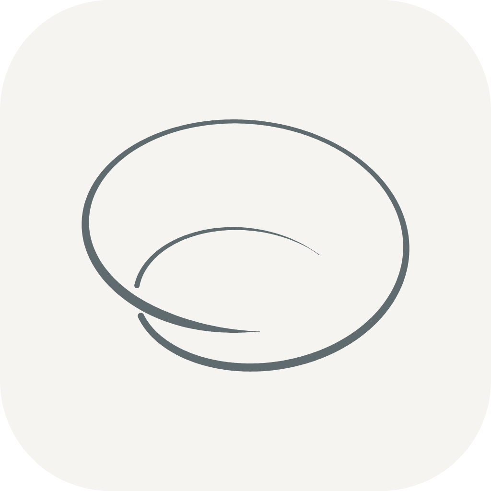

# Orbit 品牌：名称、标志与字体

状态：现行 · 维护者 `yhyfhgs` · 2026-10-02 起生效（标志素材包 2026-10-03 更新） · 适用：Lite / Advance（同一个 App）

## 名称

产品名为 **Orbit**，取代暂定名 Tandem / 同频。界面可见的文字、文档正文、路演与宣传材料一律写 Orbit。

代码标识暂不改名，文档引用它们时按原样书写：

| 类别 | 保持原样的标识 |
| --- | --- |
| Python 包与 CLI | `tandem_backend`、`tandem_data`、`tandem_catalog`，命令 `tandem`、`tandem-data` |
| 数据目录与环境变量 | `~/Library/Application Support/Tandem/`、`.tandem/`、`TANDEM_HOME`、`tandem.db` |
| 前端与客户端 | `TandemLive`、`TandemCatalogClient`、`@tandem/*` workspace 包名、`X-Tandem-Freshness` 响应头、localStorage 前缀 |
| 文件名 | `prototypes/advance/tandem-demo.html`、`prototypes/lite/tandem-benchmark-demo.html` |

规划中的 App bundle 写作 `Orbit.app`。若日后统一改代码标识，需要同时迁移已有数据目录，届时另行记录。

## 标志

标志是一条 1.6 圈的锥形螺旋线：半径由外向内收、同时沿轴向抬升，斜看（yaw 20°、pitch 45°）时内圈从外环下方穿过，像一条正在收拢的轨道。线条语言沿用此前的莫比乌斯带与洛伦茨吸引子版本：一笔画成，近处粗、远处细，投影交叉处较远的一支断开，两端渐细收笔，只用一种颜色。

- 线色是低饱和板岩灰 `#5f6b6f`，App 原型中为品牌 token `--orbit`（浅色 `#5f6b6f`，深色 `#a3adb0`），只用于标志、罗盘指针北半与 00 基准三角。
- App 图标是暖纸底（`#f5f4f0`）圆角方块，标志居中；黑夜版是黑底（`#000000`）白线（`#ffffff`）。
- **所有尺寸、所有底色都是 App 图标那条曲线的整体等比缩放**：线宽变化（近粗远细、两端渐细）与断口宽度随标志一起缩放，不为小尺寸单独加粗或拉平线宽。2026-10-03 起取消此前的小尺寸加粗版 `orbit-mark-small.svg`；主标志 `orbit-mark.svg` 的线宽也从原来较细的 2.6–11 统一为 App 图标的 4–14（设计坐标）。
- 标志是矢量轮廓：一条由三次贝塞尔曲线组成的 SVG path（两段闭合轮廓，对应交叉处断开的两段线），放大不出现折线棱角。每个 SVG、PDF 都内嵌同一条 path，外层只套平移与等比缩放。
- App 原型的菜单栏图标、App 图标与 favicon 由 `prototypes/advance/tools/brand-icon.mjs` 从 `orbit-icon.svg`、`orbit-mark.svg` 生成 `src/js/01-brand.js`，各尺寸都用同一条 path；macOS App 构建（`apps/desktop/build.py`）同样只原样渲染这两个文件。

### 文件

| 文件 | 用途 |
| --- | --- |
| [`logo/orbit-spec.json`](logo/orbit-spec.json) | **唯一参数来源**：曲线、视角、线宽、断口、矢量精度、图标底板、Dock 网格与配色 |
| [`logo/orbit.py`](logo/orbit.py) | 解析几何：螺旋 → 投影 → 线宽与断口 → 贝塞尔轮廓 |
| [`logo/generate.py`](logo/generate.py) | 写出全部 SVG、PDF 与 `orbit-geometry.json`；`--check` 只比对 |
| [`logo/export.mjs`](logo/export.mjs) | 用 Chromium 把 SVG 渲染成 PNG，并打包 ICO、ICNS，写出 `kit/manifest.json` |
| [`logo/orbit-geometry.json`](logo/orbit-geometry.json) | 计算结果记录：交叉点、断口区间、外框、各素材的放置变换、线宽比例与完整 path，供 Swift、Figma、前端复用 |
| [`logo/orbit-icon.svg`](logo/orbit-icon.svg)、[`logo/orbit-icon.png`](logo/orbit-icon.png) | App 图标（1024 px），兼容旧引用 |
| [`logo/orbit-mark.svg`](logo/orbit-mark.svg)、[`logo/orbit-mark-light.svg`](logo/orbit-mark-light.svg) | 透明底主标志（板岩灰 / 暖纸色线），兼容旧引用 |
| [`logo/kit/`](logo/kit/manifest.json) | 全部素材，见下表；`manifest.json` 列出每个位图的尺寸与母版 |

### 素材包 `logo/kit/`

| 目录 | 内容 | 格式与尺寸 |
| --- | --- | --- |
| [`app-icon/`](logo/kit/app-icon/orbit-app-icon.svg) | App 图标：暖纸底板岩灰线、黑夜版（黑底白线）；圆角方块满版 1024 | SVG、PDF；PNG 16、32、48、64、128、256、512、1024 |
| [`dock/`](logo/kit/dock/orbit-dock.svg) | macOS Dock / Finder 图标：按 Apple 图标网格放在 1024 画布中央 824 方块，带投影；浅色与黑夜版 | SVG；PNG 16–1024；`Orbit.icns`、`Orbit-night.icns` |
| [`mark/`](logo/kit/mark/orbit-mark-ink.svg) | 透明底标志：板岩灰、黑、白、暖纸四色；紧凑画布（`orbit-mark-*`）与 App 图标同位置的 1024 方形画布（`orbit-mark-square-*`） | SVG、PDF；PNG 高 64、128、256、512、1024 |
| [`nav/`](logo/kit/nav/orbit-nav-template-22@2x.png) | 菜单栏与导航栏：黑色模板图（`template`，macOS `isTemplate` 只取 alpha）、板岩灰、白 | PNG 高 16、18、20、22、24、32 pt，各 @1x @2x @3x；矢量用 `mark/orbit-mark-black.pdf` |
| [`favicon/`](logo/kit/favicon/favicon.svg) | 网页图标：`favicon.svg`（随浏览器深色模式切换黑夜配色）、`favicon.ico`（16/32/48）、`apple-touch-icon.png`（180，方形不加圆角，由系统裁切）、PWA `icon-192/512.png` | SVG、ICO、PNG |
| [`wordmark/`](logo/kit/wordmark/orbit-wordmark-ink.svg) | 字标 Orbit：标志作首字母 O，后接小写 rbit；板岩灰、黑、白、暖纸四色，透明底 | SVG、PDF；PNG 高 32、48、64、128、256、512 |
| [`motion/`](logo/kit/motion/orbit-reveal.html) | 交互动效页：点击 45° 标志 → 转为俯视正圆并移到 O 的位置 → r、b、i、t 依次升起淡入；再点击按相反顺序收回。转动的每一帧都由同一套参数算出（pitch 45°→75°，`motion` 一节记录帧数与时长），支持深色模式与减少动态效果 | 单文件 HTML |
| [`social/`](logo/kit/social/orbit-social.svg) | 分享图 1280×640：图标居中于同色底 | SVG、PNG |

PDF 是纯矢量（单页、不压缩），可直接拖入 Keynote、Figma、Xcode 资源目录（勾选 Preserve Vector Data）。

### 绘制参数

全部数值在 [`logo/orbit-spec.json`](logo/orbit-spec.json)。改动任何一项都会改变标志，须经 `yhyfhgs` 确认；改后依次运行 `python3 docs/design/logo/generate.py`、`node docs/design/logo/export.mjs`、`node prototypes/advance/tools/brand-icon.mjs && node prototypes/advance/build.mjs`。`pnpm check`（`scripts/check-repository.py`）会比对矢量文件与参数，并核对清单中每个位图的存在与尺寸。

| 组 | 参数 | 值 | 含义 |
| --- | --- | --- | --- |
| 曲线 | `turns` / `r_start` / `r_end` / `rise` / `phase` | 1.6 / 9 / 16 / 14 / 0.6 rad | 锥形螺旋 P(t) = (r cos θ, r sin θ, rise·t)，θ = 2π·turns·t + phase，r 由 9 线性变到 16，t ∈ [0, 1] |
| 视角 | `yaw` / `pitch` | 20° / 45° | 先绕 z 轴、再绕 x 轴旋转后正交投影；深度越大越近 |
| 设计坐标 | `size` / `pad` | 512 / 48 | 投影后中心线等比缩放进 512 方块、四周留 48 |
| 线宽 | `w_far` / `w_near` | 4 / 14 | 按深度在最远与最近之间线性插值：近粗远细 |
| 收笔 | `taper` / `w_floor` | 0.10 / 0.6 | 两端各 10% 弧长按 sin 曲线渐细；最细不小于 0.6 |
| 断口 | `gap` | 24 | 投影交叉处较远的一支，沿弧长两侧各断开 gap/2 + 该处线宽 |
| 端点 | `cap` | round | 每段两端为半圆圆头 |
| 矢量 | `tolerance` / `digits` | 0.002 / 3 | 贝塞尔拟合误差上限（设计单位）与坐标小数位 |
| 外框 | `box_pad` | 4 | 紧凑画布 = 轮廓外框四周加 4 |
| 图标底板 | `tile.size` / `radius` / `mark` | 1024 / 230 / 0.68 | 圆角方块；标志外框长边占底板 68%，居中 |
| Dock | `canvas` / `tile` / `shadow` | 1024 / 824 / dy 10、blur 10、30% | Apple 图标网格：中央 824 方块（四周 100 透明），方块内与 App 图标等比 |

由参数推出、任何尺寸都应保持的比例（相对标志外框长边）：最细线宽 0.92%、最粗线宽 3.24%、断口 5.55%，外框宽高比 1.292。在 1024 图标上对应最细 6.4 px、最粗 22.5 px、断口 38.6 px。

### 字标

字标的 O 是同一条螺旋换成俯视视角（pitch 75°，宽高比约 1.01，近正圆）的投影：曲线、线宽规则、断口与标志完全相同，只改 `wordmark.o_pitch`。单独使用的标志仍是 45° 斜视。rbit 是几何单线小写字母（直线与圆弧，圆头收笔，r 肩部与 t 收尾用大圆弧），线宽 30；字母同样展开成填充的贝塞尔轮廓，字标 SVG 只含标志 path 与字母 path 两条。参数在 `orbit-spec.json` 的 `wordmark` 一节，长度以字高 H 为单位（H = 标志墨迹高度去掉上下各 1.5% 的圆形溢出；基线 = 标志墨迹底边上移 1.5%）：

| 参数 | 值 | 含义 |
| --- | --- | --- |
| `o_pitch` | 75° | 字标 O 的俯仰视角（标志本身为 45°） |
| `stroke` | 30 | 字母线宽（设计单位） |
| `x_height` / `ascender` / `t_height` | 0.6 / 1.0 / 0.8 | 小写字高、b 的升部、t 的高度 |
| `r_shoulder` / `r_arm_end` | 0.5 / 320° | r 肩部圆弧半径（× x 字高）与收笔角度 |
| `i_dot` / `i_dot_gap` | 1.5 / 0.1 | i 点直径（× 线宽）与点到 x 字高的间隙 |
| `t_bar` | 0.46 | t 横笔长度（× x 字高），以竖干为中心 |
| `t_hook` / `t_hook_end` | 0.2 / 50° | t 底部圆弧收尾的半径（× x 字高）与收笔角度 |
| `spacing` | O–r 0.2、r–b 0.12、b–i 0.13、i–t 0.1 | 字间距（墨迹到墨迹） |

**与上一版的关系**：上一版（v1）把中心线每 1.5 设计单位取一点、画成折线多边形。矢量版沿用 v1 的离散常数（端点、深度范围、断口区间与外框，记录在 `orbit-geometry.json` 的 `v1`），只把折线换成平滑曲线；轮廓与 v1 顶点的最大偏差为 0.013 设计单位（1024 图标上约 0.02 px），渲染出的 1024 PNG 与旧版逐像素比对，差异只在抗锯齿边缘。

**小尺寸**：等比缩放意味着远处的细线在小尺寸下会很淡。16 px 图标里最细处约 0.1 px，菜单栏 16 pt 高的标志最细约 0.2 pt（@2x 约 0.4 px）。这是保持线宽比例的结果；如需小尺寸更醒目，应作为单独设计决定另行确认，不在导出时调整线宽。

## 字体

2026-10-03 起全站改为一套无衬线系统字体，取代此前「标题用衬线 Source Serif 4、数字与元信息用等宽 JetBrains Mono」的约定。App 只面向 macOS 14+ 且离线运行，因此只用系统自带字体，不打包、不内联网页字体；做法参照 [Apple HIG Typography](https://developer.apple.com/design/human-interface-guidelines/typography)。

| 用途 | 字体 | token（`prototypes/advance/src/styles/00-base.css`） |
| --- | --- | --- |
| 正文、控件、眉题 | SF Pro（拉丁、数字）+ PingFang SC（中文） | `--font-sans` |
| 页面标题、弹窗标题、人格字母 | 同上，用较大字号和 600 字重，不用衬线 | `--font-display` |
| KPI、表格、日期范围、计数 | 同 `--font-sans`，加 `font-variant-numeric: tabular-nums` | `--font-num`（`.mono` 类） |
| 代码、路径、命令、ID、快捷键、原始 CSV/报告文本 | SF Mono（`ui-monospace`），中文回退 PingFang SC | `--font-mono`（`.code-t` 类与 `code`/`kbd`/`.tt-cmd` 等） |

- 字体栈拉丁在前、中文在后（`-apple-system` / SF Pro → PingFang SC → Hiragino Sans GB → sans-serif），中英文各自落到对应字体；`-apple-system` 由系统按字号切换 SF Pro Text / Display。
- 眉题 `.eb` 为 11 px 600 大写 sans，字距 0.04em；不再用等宽字体的负词距修正。
- 历史类名 `.mono`（数字/元信息）与 `.serif`（标题）保留以减少改动，含义以上表为准。分享卡 canvas 与 SVG 文字读取同一组 token。

## 备选与历史版本

两个洛伦茨吸引子（σ=10, ρ=28, β=8/3）版本由 [`logo/variants/legacy.py`](logo/variants/legacy.py) 用 v1 折线画法生成，只作存档，文件组成相同（mark、light、small、icon）：

| 版本 | 位置 | 曲线 |
| --- | --- | --- |
| 洛伦茨 | [`logo/variants/lorenz/`](logo/variants/lorenz/orbit-mark.svg) | 一段左右两翼各绕两圈的吸引子轨道；改名前的 Tandem 主标志 |
| 洛伦茨（复杂度略增） | [`logo/variants/rich/`](logo/variants/rich/orbit-mark.svg) | 同一段轨道多取一圈，右翼多绕一圈 |

更早的莫比乌斯带版本见 git 历史（`391203a` 及更早）。
