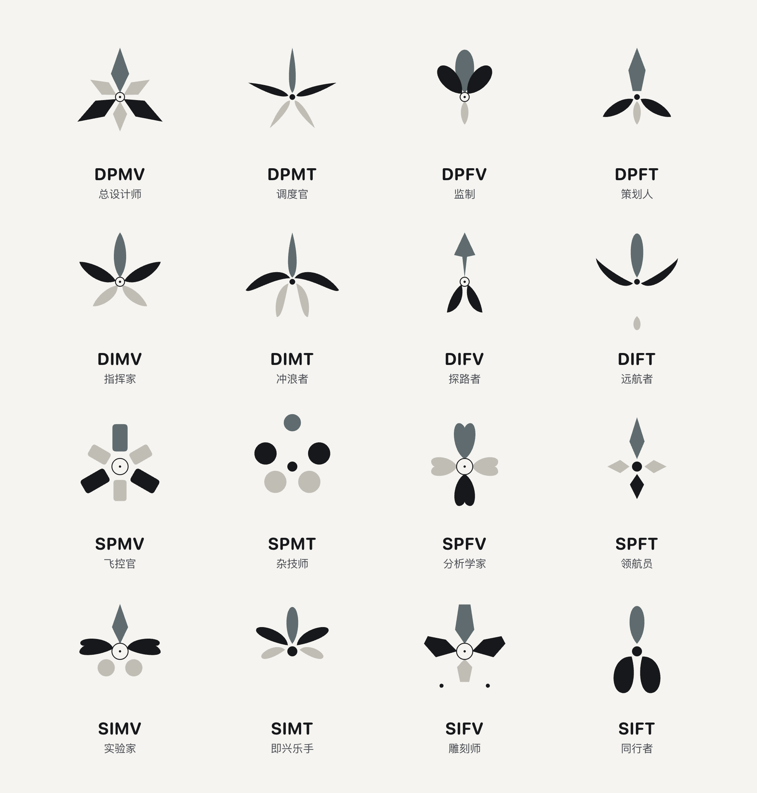
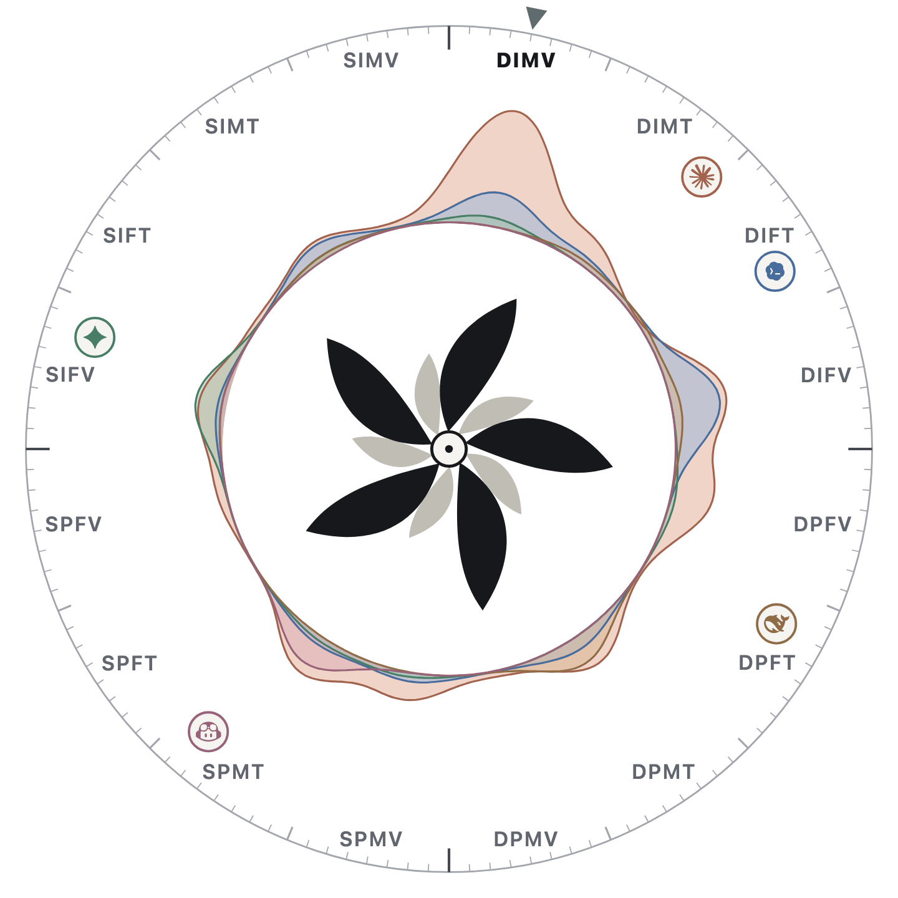

# Orbit 人格素材

协作人格的视觉素材：16 型协作人格之花、16 型总览图，以及画像页的表盘（协作人格之花与轨道）。全部由 [`export.mjs`](export.mjs) 从现行 [Orbit 单文件原型](../../../prototypes/advance/orbit-demo.html) 导出：脚本在页面里调用原型自己的 `typeP()`、`bloom()`、`bloomParts()` 与画像页表盘，只导出、不重画，原型改了就重新导出。类型名取自 `05-data.js` 的 `TYPES`。

[`kit/manifest.json`](kit/manifest.json) 记录每个文件的尺寸、主题、类型码与字节数，以及导出时的完整提交 SHA 和两套主题解析出的颜色。



## 素材范围

| 目录 | 内容 | 格式 |
| --- | --- | --- |
| [`flowers/svg/`](kit/flowers/svg/DIMV-light.svg) | 16 型花：`<类型码>-light`、`-dark` 为两色（墨色主瓣 + 浅灰小瓣）；`-ink` 为单色墨稿（`#17181b`），供印刷、描摹或改色 | SVG，180 × 180 方形视框，透明底 |
| [`flowers/png/`](kit/flowers/png/DIMV-light-512.png) | 浅色、深色两套花 | PNG 512、128，透明底 |
| [`sheet/`](kit/sheet/types-light.png) | 16 型总览 4 × 4：花、类型码（App 的 `.tcode`，SF Pro Rounded）与中文名，铺在 App 纸面 / 深色底上 | PNG 1968 × 2060 |
| [`dial/`](kit/dial/dial-light.svg) | 画像页表盘，示例数据，入场动画结束后的静止状态 | SVG（以圆心为中心的方形视框，包住表盘外的三角）；PNG 1440 × 1440（720 px 的 2 倍）；透明底 |

浅色、深色指适用的底色：`light` 放在浅色底上，`dark` 放在深色底上。

| 颜色 | 浅色 | 深色 | 用途 |
| --- | --- | --- | --- |
| `--ink-1` | `#17181b` | `#f2f2f4` | 主瓣、花心 |
| `--h2` | `#c0bdb5` | `#4a4a50` | 小瓣（浅灰） |
| `--orbit` | `#5f6b6f` | `#a3adb0` | 表盘上指向你的类型的三角 |
| `--bg` | `#f5f4f0` | `#161619` | 总览图底色、表盘徽章的圆底 |

## 16 型花

| 类型码 | 中文名 | 花形 | SVG | 浅色 PNG | 深色 PNG |
| --- | --- | --- | --- | --- | --- |
| `DPMV` | 总设计师 | 六片尖头莲瓣 + 六片浅灰小菱形，层次规整如蓝图 | [浅色](kit/flowers/svg/DPMV-light.svg) · [深色](kit/flowers/svg/DPMV-dark.svg) · [墨稿](kit/flowers/svg/DPMV-ink.svg) | [512](kit/flowers/png/DPMV-light-512.png) · [128](kit/flowers/png/DPMV-light-128.png) | [512](kit/flowers/png/DPMV-dark-512.png) · [128](kit/flowers/png/DPMV-dark-128.png) |
| `DPMT` | 调度官 | 五片细长杏仁瓣放射开，放手并行 | [浅色](kit/flowers/svg/DPMT-light.svg) · [深色](kit/flowers/svg/DPMT-dark.svg) · [墨稿](kit/flowers/svg/DPMT-ink.svg) | [512](kit/flowers/png/DPMT-light-512.png) · [128](kit/flowers/png/DPMT-light-128.png) | [512](kit/flowers/png/DPMT-dark-512.png) · [128](kit/flowers/png/DPMT-dark-128.png) |
| `DPFV` | 监制 | 三片水滴瓣 + 三片浅灰小瓣，一次只开一朵 | [浅色](kit/flowers/svg/DPFV-light.svg) · [深色](kit/flowers/svg/DPFV-dark.svg) · [墨稿](kit/flowers/svg/DPFV-ink.svg) | [512](kit/flowers/png/DPFV-light-512.png) · [128](kit/flowers/png/DPFV-light-128.png) | [512](kit/flowers/png/DPFV-dark-512.png) · [128](kit/flowers/png/DPFV-dark-128.png) |
| `DPFT` | 策划人 | 四片杏仁瓣 + 四片浅灰小瓣，即分享卡的 4/8 花 | [浅色](kit/flowers/svg/DPFT-light.svg) · [深色](kit/flowers/svg/DPFT-dark.svg) · [墨稿](kit/flowers/svg/DPFT-ink.svg) | [512](kit/flowers/png/DPFT-light-512.png) · [128](kit/flowers/png/DPFT-light-128.png) | [512](kit/flowers/png/DPFT-dark-512.png) · [128](kit/flowers/png/DPFT-dark-128.png) |
| `DIMV` | 指挥家 | 五片杏仁瓣带浅灰小瓣齐齐旋向一侧，齐头并进 | [浅色](kit/flowers/svg/DIMV-light.svg) · [深色](kit/flowers/svg/DIMV-dark.svg) · [墨稿](kit/flowers/svg/DIMV-ink.svg) | [512](kit/flowers/png/DIMV-light-512.png) · [128](kit/flowers/png/DIMV-light-128.png) | [512](kit/flowers/png/DIMV-dark-512.png) · [128](kit/flowers/png/DIMV-dark-128.png) |
| `DIMT` | 冲浪者 | 六片弯月瓣卷成浪 | [浅色](kit/flowers/svg/DIMT-light.svg) · [深色](kit/flowers/svg/DIMT-dark.svg) · [墨稿](kit/flowers/svg/DIMT-ink.svg) | [512](kit/flowers/png/DIMT-light-512.png) · [128](kit/flowers/png/DIMT-light-128.png) | [512](kit/flowers/png/DIMT-dark-512.png) · [128](kit/flowers/png/DIMT-dark-128.png) |
| `DIFV` | 探路者 | 四片长矛瓣旋开探向前方，浅灰小瓣随后 | [浅色](kit/flowers/svg/DIFV-light.svg) · [深色](kit/flowers/svg/DIFV-dark.svg) · [墨稿](kit/flowers/svg/DIFV-ink.svg) | [512](kit/flowers/png/DIFV-light-512.png) · [128](kit/flowers/png/DIFV-light-128.png) | [512](kit/flowers/png/DIFV-dark-512.png) · [128](kit/flowers/png/DIFV-dark-128.png) |
| `DIFT` | 远航者 | 四片水滴瓣像帆顺风微旋，浅灰瓣一样饱满 | [浅色](kit/flowers/svg/DIFT-light.svg) · [深色](kit/flowers/svg/DIFT-dark.svg) · [墨稿](kit/flowers/svg/DIFT-ink.svg) | [512](kit/flowers/png/DIFT-light-512.png) · [128](kit/flowers/png/DIFT-light-128.png) | [512](kit/flowers/png/DIFT-dark-512.png) · [128](kit/flowers/png/DIFT-dark-128.png) |
| `SPMV` | 飞控官 | 六片方头扇瓣围着大环心，像仪表盘 | [浅色](kit/flowers/svg/SPMV-light.svg) · [深色](kit/flowers/svg/SPMV-dark.svg) · [墨稿](kit/flowers/svg/SPMV-ink.svg) | [512](kit/flowers/png/SPMV-light-512.png) · [128](kit/flowers/png/SPMV-light-128.png) | [512](kit/flowers/png/SPMV-dark-512.png) · [128](kit/flowers/png/SPMV-dark-128.png) |
| `SPMT` | 杂技师 | 五片圆瓣，梅花一样饱满 | [浅色](kit/flowers/svg/SPMT-light.svg) · [深色](kit/flowers/svg/SPMT-dark.svg) · [墨稿](kit/flowers/svg/SPMT-ink.svg) | [512](kit/flowers/png/SPMT-light-512.png) · [128](kit/flowers/png/SPMT-light-128.png) | [512](kit/flowers/png/SPMT-dark-512.png) · [128](kit/flowers/png/SPMT-dark-128.png) |
| `SPFV` | 分析学家 | 四片心形凹口瓣十字端正，浅灰小菱形补角 | [浅色](kit/flowers/svg/SPFV-light.svg) · [深色](kit/flowers/svg/SPFV-dark.svg) · [墨稿](kit/flowers/svg/SPFV-ink.svg) | [512](kit/flowers/png/SPFV-light-512.png) · [128](kit/flowers/png/SPFV-light-128.png) | [512](kit/flowers/png/SPFV-dark-512.png) · [128](kit/flowers/png/SPFV-dark-128.png) |
| `SPFT` | 领航员 | 四片圆菱形瓣 + 四片浅灰小菱形，罗盘星 | [浅色](kit/flowers/svg/SPFT-light.svg) · [深色](kit/flowers/svg/SPFT-dark.svg) · [墨稿](kit/flowers/svg/SPFT-ink.svg) | [512](kit/flowers/png/SPFT-light-512.png) · [128](kit/flowers/png/SPFT-light-128.png) | [512](kit/flowers/png/SPFT-dark-512.png) · [128](kit/flowers/png/SPFT-dark-128.png) |
| `SIMV` | 实验家 | 五片心形瓣一起旋开，几种做法同时转起来 | [浅色](kit/flowers/svg/SIMV-light.svg) · [深色](kit/flowers/svg/SIMV-dark.svg) · [墨稿](kit/flowers/svg/SIMV-ink.svg) | [512](kit/flowers/png/SIMV-light-512.png) · [128](kit/flowers/png/SIMV-light-128.png) | [512](kit/flowers/png/SIMV-dark-512.png) · [128](kit/flowers/png/SIMV-dark-128.png) |
| `SIMT` | 即兴乐手 | 六片水滴瓣转成风车 | [浅色](kit/flowers/svg/SIMT-light.svg) · [深色](kit/flowers/svg/SIMT-dark.svg) · [墨稿](kit/flowers/svg/SIMT-ink.svg) | [512](kit/flowers/png/SIMT-light-512.png) · [128](kit/flowers/png/SIMT-light-128.png) | [512](kit/flowers/png/SIMT-dark-512.png) · [128](kit/flowers/png/SIMT-dark-128.png) |
| `SIFV` | 雕刻师 | 四片尖头莲瓣斜着排开，像一刀刀刻出 | [浅色](kit/flowers/svg/SIFV-light.svg) · [深色](kit/flowers/svg/SIFV-dark.svg) · [墨稿](kit/flowers/svg/SIFV-ink.svg) | [512](kit/flowers/png/SIFV-light-512.png) · [128](kit/flowers/png/SIFV-light-128.png) | [512](kit/flowers/png/SIFV-dark-512.png) · [128](kit/flowers/png/SIFV-dark-128.png) |
| `SIFT` | 同行者 | 三片心形宽瓣与三片浅灰圆瓣交错相拥 | [浅色](kit/flowers/svg/SIFT-light.svg) · [深色](kit/flowers/svg/SIFT-dark.svg) · [墨稿](kit/flowers/svg/SIFT-ink.svg) | [512](kit/flowers/png/SIFT-light-512.png) · [128](kit/flowers/png/SIFT-light-128.png) | [512](kit/flowers/png/SIFT-dark-512.png) · [128](kit/flowers/png/SIFT-dark-128.png) |

**旋转对称**：每朵都是 N 片相同的墨色主瓣（3–6 片）均匀围着花心，可再加一圈 N 片浅灰小瓣（错开半格），中间是花心；形状与颜色都按 360°/N 重复，不求镜像，没有领瓣、花籽或花蕊。一片主瓣朝 12 点，表盘里整朵花旋转，让它指向你的类型。

**字母约定**：

- **多线 M / 专注 F**：M 5–6 瓣，F 3–4 瓣。
- **即兴 I / 规划 P**：I 的瓣同向旋卷，像风车；P 的瓣直。
- **委托 D / 掌舵 S**：D 瓣长、花心小，S 瓣短而宽、花心大。
- **求证 V / 信任 T**：V 的花心是一圈环加中心点，T 是实心圆点。

其余靠元素区分：主瓣的形状（杏仁、水滴、圆、圆菱形、心形凹口、长矛、尖头莲瓣、方头扇瓣），以及浅灰小瓣的有无和形状。素材里的花是每型的代表花（四个维度都取该极、强度 72，与算法说明里的 16 型表一致）；App 里的比例会随强度微调（委托越强瓣越长、掌舵越强瓣越短，即兴越强旋得越多）。

## 表盘



画像页的协作人格之花与轨道（[浅色 SVG](kit/dial/dial-light.svg) · [PNG](kit/dial/dial-light.png)，[深色 SVG](kit/dial/dial-dark.svg) · [PNG](kit/dial/dial-dark.png)）：外框是 16 型（相邻两型只差一个字母，右半委托、左半掌舵、上半即兴、下半规划），刻度内侧 16 个扇区各标类型码（SF Pro Rounded，正立，你的类型加粗墨色，其余浅灰；表盘缩到码不足 8 px 时只留你的类型码）；轨道是每个会话按自己的四个维度落到的方位密度，每个 Agent 一条独立曲线，从同一条基线长出、共用一个高度尺度，越高会话越多，曲线之间可以重叠（半透明低饱和填充 + 细边，会话多的 Agent 先画）；Agent 标志徽章停在曲线外的同一条轨道上，方位是该 Agent 全部会话的平均方向，碰到类型码或别的徽章时沿轨道稍微错开；内盘是你的类型的花，一片瓣与外侧的 `--orbit` 三角指向你的类型。

素材使用 Demo 示例数据（画像页默认的「近 90 天」，结果为 DIMV 指挥家），**不代表真实统计**；引用时标注“示例数据”。表盘外圈仍在打磨，原型更新后重新导出即可得到当时的样子。

## 使用说明

- 花的环形花心是空心的，透明底下会露出底色；徽章带 `--bg` 圆底，放在别的底色上会看到圆底。
- 表盘 SVG 用了遮罩来扫出轨道，类型码依赖系统字体（SF Pro Rounded）；设计工具不支持遮罩或缺字体时用 PNG。
- 花与表盘的 SVG 已把颜色、变换写成具体值，不依赖 App 的 CSS；改色可直接替换 hex，或用单色墨稿。
- 不在素材上重画或改形状：花形与表盘以原型为准，改原型后重新导出。

## 重新导出

先按[开发指南](../../development/testing.md)安装依赖与 Playwright Chromium。脚本复用 `prototypes/advance` 的 Playwright，不新增依赖：

```sh
node prototypes/advance/build.mjs                  # 原型源码改过时先构建
node docs/design/persona/export.mjs                # 写入 docs/design/persona/kit/
node docs/design/persona/export.mjs --check        # 只比对：导出到临时目录，SVG 与 kit/ 不一致时列出并以 1 退出
node docs/design/persona/export.mjs --out output/playwright/persona-kit   # 写到别处（相对仓库根）
```

脚本先确认 `orbit-demo.html` 与 `src/` 一致，再以示例数据模式打开页面，等表盘入场动画结束后导出，页面脚本出错即失败。`PLAYWRIGHT_CHANNEL=chrome` 可改用本机 Chrome，`PLAYWRIGHT_MODULE` 可指定别的 Playwright 模块。Chromium 不认 `ui-rounded`，macOS 上脚本会把系统自带的 SF Pro Rounded 注册给页面，让总览图的类型码与 App 一致；其他系统会退回无衬线字体并给出提示。同一提交在同一台机器上重复导出，文件逐字节不变；`--check` 只比对 SVG（PNG 会随字体与浏览器版本略有差异）。
