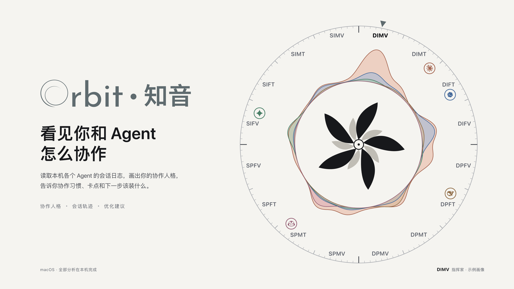

# 产品展示图

展示图复用品牌、人格素材、真实原型组件与动画帧，服务 README、路演和介绍。它们是指定版本的示例界面，不是个人数据、性能或推荐收益的测量结果。



## 文件索引

| 文件 | 内容 |
| --- | --- |
| [`orbit-hero-light.png`](png/orbit-hero-light.png) · [`-dark`](png/orbit-hero-dark.png) · [`-square`](png/orbit-hero-square.png) | 主视觉：罗盘 + 字标 + 标语，浅色 / 深色 16:9，方形 1:1 |
| [`orbit-01-dial-anatomy.png`](png/orbit-01-dial-anatomy.png) | 罗盘怎么读：三角、外框 16 型、Agent 曲线、人格之花、Agent 徽章 |
| [`orbit-02-sixteen-types.png`](png/orbit-02-sixteen-types.png) | 四个维度与 16 型之花 |
| [`orbit-03-how-it-works.png`](png/orbit-03-how-it-works.png) | 工作原理：找到会话 → 本机整理 → 看见自己 → 动手改进 |
| [`orbit-04-first-launch.png`](png/orbit-04-first-launch.png) | 首次启动四步与 Genesis 揭晓逐帧 |
| [`orbit-05-bloom-switch.png`](png/orbit-05-bloom-switch.png) | 人格切换：收起再绽开的逐帧与时间轴 |
| [`orbit-06-install-loop.png`](png/orbit-06-install-loop.png) | 建议闭环：预览 → 确认 → 撤销 → 7 天追踪 |
| [`orbit-07-session-replay.png`](png/orbit-07-session-replay.png) | 会话轨迹回放的 7 个要点 |
| [`orbit-08-desktop.png`](png/orbit-08-desktop.png) | 菜单栏面板、悬浮胶囊五种状态、桌面小组件 |
| [`orbit-09-share-cards.png`](png/orbit-09-share-cards.png) | 周卡 / 月卡 / 季卡 / 全时卡 |
| [`orbit-10-lite-advance.png`](png/orbit-10-lite-advance.png) | Lite 与 Advance：同一个 App |

主版为 3840×2160，方形为 3200×3200；以 manifest 和实际文件尺寸为准。插入时保持比例与示例说明。

## 更新

完成原型构建与浏览器依赖准备后，在根目录运行：

```sh
python3 scripts/heavy.py node docs/design/showcase/capture.mjs
python3 scripts/heavy.py node docs/design/showcase/export.mjs
```

输出在 `output/playwright/orbit-showcase/`；检查结果后再更新本目录 `png/` 中的受控发布素材和 manifest。版式在 [boards.html](boards.html)，`--only` 可选择单张。布局改动后重新核对标注位置、阴影边界和示例文案，避免把旧截图当作最新 UI。

品牌与人格几何原样取自各自源资产，见[设计导航](../README.md)。
