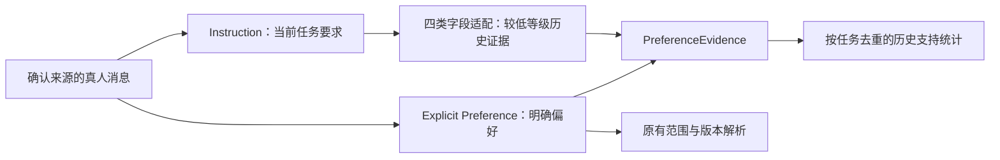

# Preference：显式偏好与历史证据

这组特征回答“用户明确表达了什么偏好，以及过去在任务中怎样要求 agent 工作”。实现位于 `packages/backend/src/tandem_backend/analytics/preference/`，通过 `/v1/analytics/preferences` 与现有 `tandem analytics` 输出接入。处理在本地完成，使用确定性规则，不调用模型或外部服务。

Instruction 继续表示**当前任务控制要求**。Preference 不再重新解析普通任务要求，而消费 Instruction 已经识别的结构化结果。Explicit Preference 保留独立的提取、作用范围和版本历史，作为最高等级证据；两条路径在 `PreferenceEvidence` 层汇合。



历史证据不自动变成全局偏好，也不进入当前生效规则。当前版本完成证据汇合与支持统计，尚未实现稳定偏好判定或推荐权重。

## 从 Instruction 消费什么

| Instruction 字段 | 接受的值 | Preference 维度／值 |
| --- | --- | --- |
| `requested_autonomy` | `ask_first`、`explicit` | `autonomy.ask_first`、`autonomy.autonomous` |
| `execution_order` | `plan_first`、`discuss_first`、`execute_first` | `execution_style`，保留原值 |
| `verification_requirements` | `requested` | `verification.requested` |
| `format_requirements` | 结构化 `format_values` | `format.table/list/json/markdown` |

`scoped` 授权、`allowed_scope`、`prohibited_actions`、`acceptance_criteria` 和结构计数不进入历史偏好证据。它们描述任务边界、目标或文本形式，不能直接证明个人偏好。工具选择作为后续扩展，本轮不消费。

格式由 Instruction 在原有匹配位置补充 `format_values` 和 `format_relation`，原字段值仍是 `format`。适配器不读原文猜值：旧版只提供通用 `format` 时保留待解析证据；“JSON 或 Markdown”也保留待解析；“Markdown 表格”允许两个可组合值。Instruction 的定义、授权规则与范围解析不变。

## 统一证据契约

| 字段 | 含义 |
| --- | --- |
| `evidence_id`、`source_type`、`source_id` | 稳定证据 ID、来源类型及原 Preference／Instruction 记录 ID |
| `dimension`、`value`、`polarity` | 统一维度、值与 prefer／avoid 极性；无法确定值时为 null |
| `session_uid`、`task_id`、`task_identity_quality` | 会话与任务归属；优先使用 Task 族映射，来源局部任务 ID 仅在会话内去重 |
| `project_id`、`legacy_project_id`、`cluster_id` | 项目与可选会话聚类上下文；复用同次分析的聚类 ID（-1 表示噪声），未计算或样本不足时为 null；不跨分析比较 ID |
| `confidence` | 固定的证据等级：Explicit 为 1.0，Instruction 历史证据为 0.6；不是校准后的正确率或偏好强度 |
| `observed_at`、`seq`、`evidence_event_uids`、`statement` | 观察时间、会话顺序、事件引用与经过既有清理的原话；观察时间不等于计划生效时间 |
| `scope`、`operation`、`history` | Explicit 原有范围、修改／撤销／重申关系；Instruction 保持任务范围 |
| `status`、`condition`、`targets`、`missing_reasons` | 可观察／待解析状态、条件、目标与缺失原因 |
| `corroborates_evidence_id` | 同一事件、维度、值和极性已经有显式证据时，关联高等级证据，避免重复投票 |

Explicit 路径继续支持语言、详略、格式、工具、协作方式，保留 task／project／global／unknown 范围。旧类别 `collaboration.plan_first` 可明确映射为 `execution_style.plan_first`；`collaboration.act_directly` 混合自主授权和执行顺序，暂时保留原类别，不猜测拆分。最高等级证据仍须尊重自身范围、极性、撤销历史和待解析状态，不因等级高而默认全局生效。

## 为什么这样计数

历史证据的统计单位是**任务**：同一任务中重复四次“无需确认”，只能形成一次自主执行支持。另一个任务没有提出自主要求时是未知；不能当成一次“希望先问”的反对票。

例如，两项可观察任务中，一项重复四次“无需确认”，另一项未提出要求，输出 `support_tasks=1`、`observed_tasks=2`、`task_rate=0.5`。这个比例表示任务中的要求出现率，不能解释为“用户有 50% 概率偏好自主执行”。

- 相同任务、维度和值只算一次支持；原始证据全部保留以便审计。跨会话合并必须有 Task 族的共同任务身份。
- 同一任务出现“先问”和“无需确认”，或“直接执行”和“先规划／讨论”，保留冲突，不给任一方向投票。
- 条件尚未求值、文本截断、任务身份缺失、格式未知或备选格式未确定时，保留待解析证据，不计入无条件支持。
- 可组合的格式、先规划与先讨论可以共同出现；各值的比例之和不必为 1。
- 分母是本次筛选中至少有一条可用、未截断真人正文且能归属任务的任务数；未提出要求不是相反偏好。
- Explicit 引用与历史支持分层返回，不把多条较弱证据相加来覆盖明确偏好。只被重复识别为同一个显式事实的 Instruction 也不增加历史支持。

这些处理抑制重复提醒、任务局部约束和缺失信息造成的虚假强度。它们仍不能消除任务选择偏差：某项目反复要求测试可能是项目规范；判定长期或跨项目偏好需要后续证据与验证。

## 函数与兼容性

| 函数 | 输入 → 输出 |
| --- | --- |
| `extract_explicit_preferences(events, sessions, task_by_event=None)` | 真人事件 → 显式 records／candidates／coverage；普通任务要求不进入偏好词表解析 |
| `instruction_to_preference_evidence(instructions, sessions, task_by_event=None, cluster_by_session=None)` | 四类已确认的 Instruction 约束 → 历史证据；不重新解析文本或调用 Instruction 范围解析器 |
| `explicit_to_preference_evidence(preferences, sessions, task_by_event=None, cluster_by_session=None)` | 显式记录及候选 → 最高等级证据，保留范围、极性和历史 |
| `build_preference_evidence(...)` | 两条路径 → 统一证据及同事实关联 |
| `summarize_preference_evidence(evidence, instructions=None, sessions=(), task_by_event=None)` | 证据与观察样本 → 来源计数、按维度的显式引用、历史支持任务／会话数、比例、冲突和待解析引用 |
| `resolve_effective_preferences(history, task=None, at=None)` | 显式偏好历史 → applicable／conflicts／unresolved；不消费历史 Instruction 证据 |
| `summarize_preferences(preferences, scope=None)` | 原有显式记录 → 类别／范围计数 |

`preferences` 增加 `evidence_schema_version`、`evidence`、`evidence_summary`；会话增加 `preference_evidence_ids`。原 `records`、`candidates`、`summary` 和 API `effective` 保持显式语义。兼容键 `task_instructions` 废弃为有输入时 `[]`、无输入时 `null`；“这次简短一点”等非显式要求不再由 Preference 单独分类。普通回答风格证据留待后续设计。

service 只提取一次 Instruction，再传给证据适配器；分析缓存摘要包含 Instruction、Preference 与 Evidence 的各自版本。来源不可用保留 null，已观察但没有证据返回空集合，二者不混淆。默认输入属于同一被分析用户，多用户身份隔离尚未实现。

`at` 为包含该时刻的时间点；API 的 `until_ts` 不包含上界，所以内部使用 `until_ts - 1`。跨会话缺时钟或同时间不臆造版本先后。所有查询仅使用本次筛选内的历史，`from_ts` 之前的偏好不会自动补入。

## 验证与边界

新增回归见 [证据测试](../../../packages/backend/tests/analytics/test_preference_evidence.py) 与 [格式参数测试](../../../packages/backend/tests/analytics/instruction/test_format_arguments.py)。覆盖四类白名单、不重复解析、任务去重、同任务冲突、缺失与否定、来源／回放／子会话边界、历史作用范围、API 筛选和 service 单次提取。现有 Instruction 与 Explicit Preference 的回归继续运行。

[旧验收记录](validation.md)中的 9 条真人消息／918 条未知来源消息属于先前固定快照，不是当前本地数据全量。固定样例通过不能作为真实准确率；真实日志、数据库和逐条结果仅留本地，不提交。

2026-10-02 对已有本地数据库做只读抽查，沿用最近七日快照的筛选窗口：199 条真人消息中，Explicit 仍为 0；Instruction 有 7 条消息命中控制要求，其中白名单产生 3 条历史证据。2 条核验要求来自 2 个不同任务和会话，可计入支持；另 1 条自主性要求带未求值条件，保留待解析。可观察任务分母为 19。这验证了历史通路能保留原先 Explicit 路径遗漏的信号，不代表已经得到稳定偏好，也不是人工标注准确率。

当前新增通路只能利用 Instruction 已经识别的信号，不能修复它的规则召回不足。工具、回答风格、纠正反馈、行为代理、时间衰减、长期偏好评分、按聚类建立画像与推荐权重均未在本轮实现。

## 本地验证脚本

先在当前分支的 checkout 根目录安装依赖：`bash scripts/bootstrap.sh`。使用 Python 3.13 和根 `uv.lock`，不需要模型或外部服务。

```sh
# 默认只运行构造样本回归，不读取真实会话。
bash scripts/check-preference.sh

# 回归通过后，读取显式指定的 canonical 库；可复现上面的七日快照窗口。
bash scripts/check-preference.sh \
  --db /path/to/canonical/tandem.db \
  --from-ts 1790322173000 \
  --until-ts 1790926973000

# 已跑过回归时，可单独运行快照诊断。
uv run --locked python -m evals.analytics.preference_local \
  --db /path/to/canonical/tandem.db
```

`--from-ts` 包含下界，`--until-ts` 不包含上界，均为 UTC 毫秒；不传时间时读取所提供快照中的全部可见主会话用户消息。可重复传 `--project-id`、`--exclude-session`。`--max-messages` 默认 100000，超限报错，避免静默截断；`--help` 查看参数。

每次默认创建独立 `.local/preference-check/run-*` 目录，终端显示汇总与实际路径。也可用 `--output .local/my-preference-check` 指定一个尚不存在的目录。输出包括：

- `summary.json`：真人与可用文本数量、显式记录数、历史证据来源／状态／缺失原因、支持任务数、比例、样本摘要和分阶段耗时。
- `preferences.json`：Explicit 记录、统一 Evidence 和按任务去重汇总，用于追溯具体来源。
- `instruction.json`：已提取控制要求，可核对为何某条要求没有进入四类白名单或没有计入支持。

脚本复用现有提取函数，只从 `v_analysis_event` 读取现成投影，数据库以 `mode=ro`、`query_only` 和同一读事务打开。支持旧 canonical 快照的共同消息字段，不读取原始归档、不触发导入或迁移；不支持 connector staging 或旧 JSON ledger。它验证证据引用和本地通路，不保证快照投影为最新版本，也不等于完整服务验收或人工准确率。没有证据时明确返回 `no_evidence`；非零数量不是测试通过的硬编码条件。所有逐条内容保存在忽略目录，不提交。
