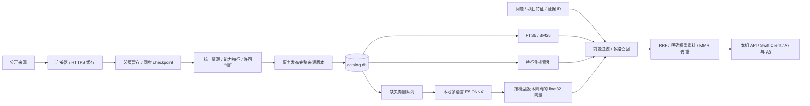

# 推荐侧资源数据与混合检索

状态：2026-10-02。此设计按本次明确要求实现向量检索，替代旧数据方案中“向量检索暂不做”的范围判断。它属于 DT-11/12/13/14 与 RC-09 的数据基础；不变更其他成员的分析模块、安装模块或两套 UI。

实际构建规模、模型、测试和查询耗时见[实测记录](validation.md)。

## 目标与模块边界

推荐输入是用户分析出的具体问题和项目特征。外部资源不能只保存名称和链接，还需要可追溯的说明、适用条件、能力特征、正文分块以及语义表示。检索给出相关候选和匹配依据，实际收益仍须通过安装后对照验证。

`packages/catalog/src/tandem_catalog` 独立于 `tandem_backend` 的分析实现，拥有 `catalog.db`；不打开、更不写入 `tandem.db` 或 `analysis.db`。与最新主干共用 Python 3.13、根目录 `uv.lock` 和 `packages/data`；已有 Python 本地服务向 Mac App 提供接口，Swift Package 封装异步调用。当前仓库没有可集成的原生 App target，所以不另建整套 UI。



## 数据库与索引

实际 DDL 统一放在 [`packages/data/src/tandem_data/migrations/catalog/`](../../../packages/data/src/tandem_data/migrations/catalog/)，字段字典为 [`catalog-v1.schema.json`](../../../packages/data/src/tandem_data/schemas/catalog-v1.schema.json)。这一子目录只用于独立的 `catalog.db`，不会被 canonical 会话库的顶层迁移加载。使用 SQLite WAL、外键、STRICT 表、FTS5；`application_id = 0x54434C47`、`user_version = 2`。v1 的 FTS rowid 由 `catalog/002.sql` 原子迁移；FTS 删除按 rowid 查找，避免对大目录反复扫描。打开其他模块的数据库或未来版本会明确失败。

| 表 | 粒度与作用 | 主要索引 |
| --- | --- | --- |
| `catalog_source` | 一个明确启用的来源；刷新时间、已提交 revision/watermark、失败退避 | 主键 source_id |
| `sync_run / sync_stage` | 一次来源同步与已完成分页；重启后从 checkpoint 继续 | source/status；run/native_id |
| `catalog_item` | 当前统一资源，类型、名称、语言、兼容 Agent、难度、内容版本 | status/type/difficulty；content_hash |
| `item_source` | 各来源原始元数据、原生 ID 和归一结果；多来源不会相互删除 | item/status/source |
| `item_version` | 不可变资源版本；正文、清单、许可、特征版本和来源 SHA | item/created_at |
| `item_feature` | 能力词表中的 feature/value/weight/origin/evidence | feature/value/item |
| `item_component` | 插件与组成条目的关系，允许组件暂未索引 | parent/child |
| `resource_chunk / chunk_fts` | 当前版本分块；字段、标题、序号、偏移、原文与哈希 | item/version；FTS5 |
| `embedding_model` | 完整向量空间身份：权重、分词器、维度、前缀、池化、运行库版本 | model_id |
| `chunk_embedding / embedding_cache` | 当前块向量及可复用文本哈希缓存 | model/chunk；model/text_hash；text_hash/model |
| `model_info / benchmark_result` | 供应商模型规格、独立的评测配置与结果 | item 主键 |

Git 文件的身份使用 `type:github.com:数字仓库ID:路径`；插件以所在目录识别。MCP 使用官方名称；尚未解析的外部市场指针保留 marketplace 身份和 `pointer_only` 状态，不假装已下载其内容。模型供应商和基准配置保留在各自的来源记录，不凭相近名称强行合并。

许可允许的资源保留正文；许可不明确的只保存元数据、哈希与源链接。`declared` 是发布者声明，`extracted` 是确定性文本抽取，`curated` 是本地审查标注；文本出现“测试”只能说明领域相关，不能自动产生“能修复重复失败”的有效性结论。

## 增量与一致性

1. App 或 CLI 显式调用刷新；模块本身不驻留、不创建系统定时任务。`next_due_at` 供启动、恢复和定期检查时调用。
2. Git 来源固定完整 commit SHA，分批下载同一个 tree 下的内容并核对 Git blob SHA。HEAD 未变时跳过。单文件 JSON 以 ETag/Last-Modified 和内容哈希判断变化。
3. MCP 使用 cursor 与 `updated_since`，重叠读取五分钟覆盖时间边界；提交水位不超过本轮扫描开始时间，避免长扫描期间发生在已遍历页面上的更新被跳过。包含下架/删除状态。游标未前进或返回格式不符即失败。
4. 每页归一记录和 checkpoint 在一个短事务中暂存。网络失败、取消、页数预算耗尽都不改变已发布数据或水位。下次从同一 run 的 checkpoint 继续。
5. 全量快照完成后，事务发布资源、版本、特征、分块及 FTS，并退休该来源缺失的条目。增量快照只处理显式变更；一次空增量不会清空目录。其他有效来源仍引用同一条目时保留它。
6. 网络工作期间使用进程文件锁保证单写者；WAL 读事务看到完整的旧版或新版。失败保存错误码，按 60 秒起指数退避至一天，并尊重数字形式的 Retry-After。增量批次只重算受影响的条目；HEAD/JSON 未变不重新遍历全部条目。
7. 向量缺失表连接就是可恢复队列。每批推理在事务外运行，提交前重新检查当前块身份；资源在推理期间更新不会把旧向量挂到新正文。相同 text_hash 的已算向量复用。

## 本地向量空间

默认适配器是 `intfloat/multilingual-e5-small` 的 ONNX 导出，384 维。模型文件只从用户指定的本地目录加载，下载是独立的显式准备步骤。用户查询、问题证据不传往外部 embedding API。

每个空间包含权重文件 SHA-256、tokenizer SHA-256、query/passage 前缀、masked mean 池化和 L2 归一方式、维度与运行库版本。模型 ID 由描述哈希生成；不同空间不允许混搜。模型切换时新旧向量可并存，返回已索引/待索引数量，未完成时明确表示覆盖不足。

正文按标题和重叠字符窗口分块，保留溯源字段。E5 内部对超过 512 token 的块继续分窗，每窗补上对应前缀并聚合，避免隐式截断。向量以 little-endian float32 保存，写入时验证维度、有限值和非零范数。

第一版在结构化过滤后分批计算精确余弦，扫描复杂度 O(Nd)，再对 R 条资源的最佳分数排序 O(R log R)；批处理和最佳命中的内存 O(Bd+R)。仅对最终候选加载正文片段，不保留全部资源的正文副本，也不会先用关键词截断语义候选。它是实际可用的本地向量存储和检索，但不是 ANN。5 万个 384 维向量的纯向量约 73 MiB；实际磁盘还包括缓存、文本、历史版本和 SQLite 开销。以后根据实测 P95 延迟，再评估 sqlite-vec、HNSW 或独立服务，不能只凭条目数宣称需要迁移。

## UI 与排序契约

A8 资源库需要搜索、类型/来源/兼容性筛选、已安装排除、资源详情和匹配解释；A7 优化建议需要额外的问题 ID、画像及瓶颈证据、适用条件和效果状态。已被后续设计取消的“同人格用户在用”“社区效果”不提供模拟数值。

### 查询与排序算法

1. **前置过滤**：active、启用来源、类型、Agent、交付语言、难度、已安装/不感兴趣 ID。过滤同时作用于所有召回通道，不能先取全局 Top-K 再筛选，避免小众兼容项被挤掉。
2. **独立召回**：`remedy` 匹配已审查的 friction；`feature` 使用调用方明确传入的分析特征；`lexical` 用 FTS5/BM25，过滤常见虚词并做小规模、可审查的中英术语展开，使无模型时的“调试”也能找到 debugging；`semantic` 扫描指定空间中的全部合格向量并按每条资源最佳 chunk 聚合。默认每路 100 条，合并候选再排序。语义通道不会被关键词结果提前截断，也不会把从搜索句猜出的宽泛领域当成额外的画像召回证据。
3. **RRF 融合**：`sum(route_weight / (60 + rank))`，权重 remedy=1.5、feature=1.2、lexical=1、semantic=2。跨语言自由文本以语义相关性为主；这是根据初次人工检索观察修正的启发式，不是独立标注集上的最优权重。除以当前有效通道都在第一名时的最大值，得到 `rrf_normalized`。
4. **透明重排**：`max(0, 0.75*rrf + 0.15*feature_coverage + 0.10*content_quality - risk_penalty)`。特征覆盖以请求特征的权重为分母；完整许可正文的内容覆盖分为 1，仅元数据为 0.5；每个风险标记减 0.02，最多减 0.1。这些是待评估的检索启发式，不是有效概率、收益预测或经过训练的相关性模型。
5. **多样性**：贪心 MMR `0.8*relevance - 0.2*max(feature-Jaccard)`；相同内容哈希去重，稳定的 item_id 打破平分。内容哈希包含清单、兼容性和安装信息，不能因名称/简介相同就合并两个不同服务。
6. **解释**：返回每路原始分数、名次与 RRF 贡献，重排分项、命中特征与标注来源、最佳文本块及版本、输入的证据 ID、向量覆盖状态；`score_meaning=retrieval_relevance_not_effectiveness`、`effect_status=unmeasured`。

`purpose=recommendation` 还要求问题 ID/type、画像证据、问题证据、scene、Agent 和交付语言，并匹配资源上已审查的 friction/scene/dimension 及来源核对标记。现有四个 Skill 种子具备这些标注；广泛采集的资源首先服务 A8 检索，尚未经过解法适用性审查的条目不会仅凭相似度进入 A7。更多已审查标注可由后续 RC 知识库通过 `Record/Feature` 契约写入，或作为独立高优先级来源发布。

无本地模型、权重加载失败或向量尚未补齐时，保留特征和 FTS 检索，明确返回 `not_configured / unavailable / not_indexed / partial`；不使用哈希向量冒充语义 embedding。切换模型 ID 只查询对应空间。

## 实现文件与调用

| 模块 | 职责 |
| --- | --- |
| `contracts.py` | 资源、特征、来源、分页、匹配请求的校验边界 |
| `network.py` | HTTPS 主机白名单、有限响应、ETag/Last-Modified、原子缓存；token 只从环境传入且只发给 GitHub API |
| `sources/github.py` | 固定 tree、blob 校验、市场指针与 Skill/Hook/规则/子代理/命令/工作流拆分 |
| `sources/structured.py` | MCP、models.dev、LiteLLM、SWE-bench、Gemini、ClawHub 与内置种子 |
| `features.py` | 可解释的能力词表抽取、中文 bigram/英文 token、带位置的分块 |
| `store.py` + data 包的 `migrations/catalog` | 单写者、历史版本、原子发布、重建、完整性检查 |
| `sync.py` | 刷新周期、分页断点、失败退避、取消与来源之间的失败隔离 |
| `vectors.py` | 本地 E5、分批补齐、文本哈希复用、提交前检查块版本 |
| `search.py` | 过滤、多路召回、融合、重排、MMR 与解释 |
| `analysis_adapter.py` | 将现有 `analyze()` 的 bottleneck 结果转成 MatchRequest；不反向依赖分析实现 |
| `service.py / api.py / cli.py` | 后台任务、本机 API、CLI；进度句柄可丢失，数据 checkpoint 保存在 SQLite |
| `packages/catalog-macos` | Swift actor、Codable 契约、任务等待/取消、loopback 限制与拒绝重定向 |

所有命令在仓库根目录运行。`--home` 默认 `$TANDEM_HOME`，未设置时为 `~/Library/Application Support/Tandem`。开发验证推荐显式用 `.local/catalog`，不会读取用户会话。

```sh
uv sync --locked --all-packages --dev
uv run tandem-catalog --home .local/catalog init
uv run tandem-catalog --home .local/catalog sync --source tandem-seeds
# 公共来源：首次全量，后续按来源周期增量。GitHub 有 GITHUB_TOKEN 时使用认证配额。
uv run tandem-catalog --home .local/catalog sync
uv run tandem-catalog --home .local/catalog status
uv run tandem-catalog --home .local/catalog verify
uv run tandem-catalog --home .local/catalog search '定位测试反复失败的根因' --type skill
```

默认开启内置种子及 8 个公开来源：Anthropic Skills、Claude 官方插件、OpenAI Plugins、awesome-copilot、官方 MCP Registry、models.dev、LiteLLM、SWE-bench。Gemini/ClawHub 适配器可通过 `init --sources <SourceSpec 数组.json>` 显式登记；其他平台不声称已经接入。

模型准备是一次独立下载，固定到具体 Hub revision。默认不下载模型、不访问外部 embedding API。

```sh
uv sync --locked --all-packages --dev --extra embeddings
hf download intfloat/multilingual-e5-small onnx/model.onnx onnx/tokenizer.json \
  --revision 614241f622f53c4eeff9890bdc4f31cfecc418b3 --local-dir .local/models/e5-small
uv run --extra embeddings tandem-catalog --home .local/catalog --model-dir .local/models/e5-small embed
uv run --extra embeddings tandem-catalog --home .local/catalog --model-dir .local/models/e5-small search '定位测试反复失败的根因' --type skill
uv run --extra embeddings tandem-catalog --home .local/catalog --model-dir .local/models/e5-small serve --port 8766
```

App 可以使用 `embed --max-chunks 256` 或对应 API 控制每次后台工作的大小；当前块的缺失向量自动成为下一批任务。优先索引 Skill 等解法资源及其元数据，再处理正文、MCP 与模型信息。长期暂停后仍可恢复。`rebuild` 只从已保存的归一记录更新特征/分块投影；规范化器解析规则变更需要重新采集源版本。历史版本和模型空间保留，当前版本没有自动清理历史的策略。

主后端也挂载同样的 `/v1/catalog/*` 路由，默认与 canonical `tandem.db` 共用 App home，使用独立 `catalog.db`。下面显式使用旧会话库的兼容模式：

```sh
uv run --extra embeddings tandem --db .local/tandem.sqlite --catalog-db .local/catalog/catalog.db \
  --catalog-model-dir .local/models/e5-small serve
```

| API | 用途 |
| --- | --- |
| `GET /v1/catalog/status` | 目录规模、版本、各向量空间覆盖 |
| `GET /v1/catalog/sources`、`PUT /sources/{id}` | 来源状态与启用开关；启用状态跨重启保留 |
| `POST /v1/catalog/sync` | source_ids、force、max_pages；返回 202 和 job_id |
| `POST /v1/catalog/embeddings` | max_chunks；补齐当前配置模型的缺失向量 |
| `GET /v1/catalog/jobs/{id}`、`POST /jobs/{id}/cancel` | 后台任务结果或在页/批次边界取消 |
| `POST /v1/catalog/search` | 结构化 MatchRequest，多路召回与匹配解释 |
| `GET /v1/catalog/items/detail?item_id=...` | 清单、许可、正文、来源、分块和版本 |
| `GET /v1/catalog/match-analysis` | 主后端提供：从 canonical 或显式旧库读取既有画像/瓶颈，逐批匹配 |

来源失败不会被其他来源成功掩盖：sync job 为 failed，结果数组保留每个来源的状态。页数预算耗尽为来源 run 的 paused；embedding 的 pending 大于零为 partial。job completed 仅表示本次提交的工作已经结束，App 必须展示结果中的覆盖状态。

给 A7 的请求示例（证据 ID 应来自真实分析，下面只是字段示例）：

```json
{
  "text": "同一条工具命令连续失败，需要先定位原因",
  "purpose": "recommendation",
  "problem_id": "problem-1",
  "problem_type": "repeated_tool_failure",
  "scene": "coding",
  "agents": ["codex"],
  "language": "zh",
  "features": [{"feature": "dimension", "value": "verification", "weight": 1}],
  "evidence_ids": ["event-failure-1"],
  "profile_evidence_ids": ["event-requirement-1"],
  "limit": 3
}
```

## 验证与实际边界

```sh
uv sync --locked --all-packages --dev
uv run ruff check packages/backend/src packages/backend/tests packages/data/src packages/data/tests packages/catalog/src packages/catalog/tests tests
uv run ruff format --check packages/data/src packages/data/tests
uv run pytest -q
uv run pytest -q packages/data/tests
uv build --all-packages
uv run tandem demo
uv run tandem evaluate
swift test --package-path packages/catalog-macos
# 可选真实模型集成；默认测试不会联网下载权重。
TANDEM_TEST_E5_DIR=.local/models/e5-small uv run --extra embeddings pytest -q packages/catalog/tests/test_real_embeddings.py
# DDL 变更后更新独立目录库字典；canonical 字典按项目 AGENTS.md 的命令生成。
uv run python -m tandem_catalog.schema_export --output packages/data/src/tandem_data/schemas/catalog-v1.schema.json
```

覆盖迁移、只读并发、失败回滚、多来源保留、空增量、checkpoint 重入、删除、内容许可、版本/向量一致性、模型空间隔离、中文 FTS、过滤前置、语义独立召回、推荐证据闸门、API 和 Swift 错误/取消/重定向边界。真实 E5 测试使用独立的三条英文资源与三条中文查询，验证跨语言通路；这不是生产相关性 benchmark。

初次验证发现旧锁定的 SciPy 1.15.3 macOS wheel 无法加载（Mach-O `__thread_bss` offset 错误）；合入最新主干后已使用主干的 `scipy>=1.16,<2` 约束和统一 `uv.lock`，不保留旧的 requirements 锁文件。

最新主干的推荐接收层已经提供 `tandem_backend.recommend.sources.normalize.catalog_resource()`，可接收本模块详情中的 `resource` 字典并转成 `RecommendationItem` 草稿。来源核验和语义相似度不会绕过该层的能力审核与兼容性检查。此实现提供目录库的多路检索及既有瓶颈适配；主干推荐服务的 task/trigger/capability 三个 dense 扩展空间仍需通过其专用接口接入，不能把单一元数据向量伪装成三个独立空间。

还保留以下明确边界：未知许可证和超过 250 KB 的正文只保留元数据/链接并标覆盖状态；外部插件指针不递归执行或下载安装器；模型与 benchmark 的别名尚未跨来源强行合并；当前没有安装执行、装后收益计算、跨用户数据或学习排序；原生 App target 尚不存在，交付的是可编译的 Swift 接入模块。

参考：[SQLite FTS5](https://www.sqlite.org/fts5.html)、[E5 模型](https://huggingface.co/intfloat/multilingual-e5-small)、[RRF](https://www.elastic.co/docs/reference/elasticsearch/rest-apis/reciprocal-rank-fusion)、[MCP 增量接口](https://github.com/modelcontextprotocol/registry/blob/main/docs/reference/api/official-registry-api.md)。
