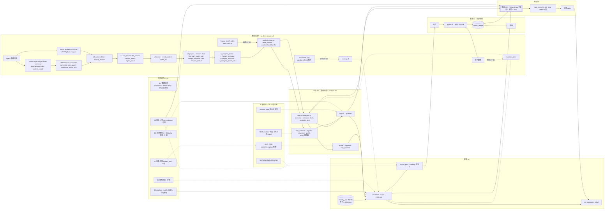

# Tandem 模块契约（内部工作文件）

> 用途：给分析（AN）、推荐（RC）、AI、评测（EV）四份模块文档的作者一套共用的分层、feature ID、字段级数据契约、写法模板与边界，保证并行写作不打架。要点之后进入各模块文档与功能映射文档。
>
> 依据（2026-10-02 第 2 版刷新）：main `c97c818`（`src/tandem_backend/` v0.13.6、`docs/backend/*.md`、`docs/plan/analysis-inputs.md`、`docs/plan/data-acquisition.md`（下称 DA）、`docs/research/agent-sessions/`、`docs/design/demo/src/`）；PR #9 `origin/feat/session-data-contract`（`packages/data`、`docs/data-contract.md`）；PR #11 `origin/feat/codex-connector`（`packages/connectors`）；Lite Demo `origin/feat/genius-FXC-dev`（`docs/design/demo/tandem-benchmark-demo.html`、`benchmark-review.md`）；`MistyHuang03` 进行中的 `origin/feat/analytics-{instruction,preference-task,subjective-outcome}`；`yhyfhgs` 的 `origin/ui/shell`；`.work/` 下的调研、盘点与评审。成员一律用 GitHub 账号指代。
>
> 状态：第 2 版（后端合入 main 之后）。「现状」列取值：`main:<路径>`（已合入，括号内写实现到什么程度）、`PR#9`、`PR#11`、`分支:<名>`（未合入）、`Adv Demo`（main `docs/design/demo/src`，示例数据）、`Lite Demo`、`计划`。标「待验证」的是需要真实数据或实测才能定的技术假设。

## 0. 结论先行

1. **数据契约已经存在，本文只引用、不再另画。** 库契约 `tandem-session-v1`（PR #9 `packages/data/src/tandem_data/migrations/001.sql`，`schema_manifest.contract_id = 'tandem-session-v1'`，`PRAGMA user_version = 1`）；分析入口契约 `analysis-input-v1`（`docs/plan/analysis-inputs.md`；PR #9 `analysis_input.read_analysis()` 产出，main `analytics/inputs.py::AnalysisInputBundle` 消费）；TypeScript Codex connector（PR #11）写独立的 staging 库（`schema/001.sql` + `002.sql`，`user_version = 2`），经 PR #9 `tandem-data import-connector` 桥接进 canonical `tandem.db`。原契约 §3 与这三者冲突的草图字段已删除；仍需要但尚未落库的字段一律标「补充约定」。
2. **main 后端是 Python 包 `tandem_backend` 0.13.6，两条链路并存。** 旧链路 `import → analyze → recommend → explain`（Codex 专用 parser 26，自有 `sessions / events / imports / sample_policies` 表，输出 `schema_version 1.8`）；新链路 `analytics`（`feature-analytics-v1`，消费 analysis-input-v1，`/v1/analytics/*` 六个路由，每次查询重算、不缓存）。两条链路目前都读 legacy 库 `.local/*.sqlite`，**还没有读过 canonical `tandem.db`**；接 canonical 是 AN 侧第一件事（AN-16）。
3. 七个模块前缀 DT / AN / RC / AI / EV / IN / FE 不变。本版新增 DT-19（staging → canonical 桥接）、DT-20（legacy 库适配，过渡）、AN-16（分析输入适配）、AN-17（任务上下文与明确要求）、AN-18（无监督文本表示）、RC-15（试用方法与推荐解释）——都是 main / PR 已有实现而原契约没有编号的能力；旧 ID 含义不改。
4. **分析产物分两类。** (a) 每次查询现算的测量：现状是 `analytics/service.py::analyze_bundle` 的五段 JSON（`overview / sessions / tools / projects / text`），带 `analysis_digest`、`coverage`、`effective_samples`、`unknown_counts`、`feature_dictionary`；契约只约定响应形状，不建表。(b) 需要跨时间稳定身份的产物（`signal`、`problem`、`profile`、`segment`、`key_moment`、`candidate`、`install_*`、`label`、`eval_run`、`report_snapshot`）落**独立的 `analysis.db`**（补充约定）——不写进 `tandem.db`，因为 PR #9 的 `rebuild` 会整表删除 L2 / L3，PR #11 要求采集库单写者、其他模块只读。
5. **推荐以 `problem` 为输入、`candidate` 为输出**（不变）。main `recommend.py` 的「画像证据 ∧ 瓶颈证据 ∧ 场景 ∧ 交付语言 ∧ 来源已核对 → `status = trial`、`effect_status = unmeasured`」是闸门 RC-03 的雏形，`data/skills.json` 的 10 条资源是 `remedy_rule` 的种子（RC-01）；打分、MMR、`install_plan`、`tracking` 均为计划。卡片主数字只用能机械计数的量，估计值标「估计」，效果未测标「未测」（与 main 的 `effect_status = unmeasured` 一致）。
6. **AI 是可关闭的横切层**（不变）。main 明确「新增分析不请求远程 LLM」，AI-01…AI-11 全部计划；AI-05 的无 AI 降级文案已存在（`narrative.explain() / markdown()`），AI 叙述输出沿用它的 JSON 形状，不另起一套。
7. **评测**：EV-09 可读性检查（`evaluation.py` readability-v2）、EV-03 合成注入框架（`pipeline_eval.py`：构造 Codex 形态日志 → 独立临时库 → 正式链路 → 事后对标签；dev 34 + probe 12 案例）、EV-10 读者评审入口（`reader_eval.py`）已实现；E1 回归分散在 main 398 项测试、PR #9 `verify` 与 pytest、PR #11 26 项回归；E2 / E4 / E5 / E6 / E7 为计划。
8. **安装（IN）全部计划。** Adv Demo 与 Lite Demo 的安装都是浏览器内模拟；main `resource_fetch.py` 只核对来源版本，不写入任何 Agent 配置。
9. **前端**：Adv Demo（main `docs/design/demo/src`，A1–A9 + 外壳 + 浮层）与 Lite Demo（`genius-FXC`，8 页）都用示例数据、在浏览器内自算指标（`15-derive.js`）；FE 契约 = §5.3 路由，Lite 子集以 Lite Demo 的 8 页为准（FE-21）。
10. 不进 MVP 且无数据通路的功能清单不变：跨用户对比、匿名贡献上传、审批等待时长（Claude Code 转录没有）、Hooks / OTel 实时通道、bandit 在线学习、反代。

## 1. 全局分层与数据流



数据流的硬规则：

| 规则 | 内容 | 现状 |
| --- | --- | --- |
| 单向依赖 | DT → AN → RC → IN；AI 与 EV 只横向介入，不被下游反向依赖（无 AI 时所有产物仍能产出）。 | main 已遵守：`analytics` 不调模型；`recommend` 只吃 `analyze()` 输出。 |
| 可重算 | L1–L3 由 `tandem-data rebuild` 从 L0 / L1 整体重算并登记 `projection_run`；L1 已增而 L2/L3 未重算时 `read_analysis()` 拒绝读旧投影。分析测量每次查询现算（`analysis_digest = hash(content_digest, scope, FEATURE_VERSION)`）；`analysis.db` 的派生表带版本列，版本变化即整表重算。 | PR#9 `pipeline.rebuild()`、`projection_run`；main `service.analyze_bundle` 的 `analysis_digest`。 |
| 回链 | 任何对外展示的数字、句子、建议都能回到 `session_uid / event_uid / call_uid`，再经 `event.record_uid → raw_record → source_revision/archive_blob` 到原文（`Store.read_raw(record_uid)`，PR #9）；AI 产出的引用必须是真实存在的 `event_uid`，否则校验失败。 | main `GET /v1/evidence/{event_id}`、`cli evidence`、`feature_dictionary.provenance`；PR#9 `record_event` 多对多。 |
| 统计口径 | 「确认真人消息」= `kind = message.user ∧ 会话 kind = main ∧ attrs.origin = human ∧ actor ∈ {human, user}`（main `analytics/features.py::human()`，= PR #9 视图 `v_human_message`）。比例类分母 = 窗口内有 ≥ 1 条确认真人消息的主会话数；`main_sessions` 只作规模。子代理 / workflow_agent 的工具与用量归根会话（`include_children`），不进真人分母；`review / automation / import / auxiliary` 默认排除。分母 < 5 显示「数据不足」，5–30 必须带区间。按**项目**与**模型 × 思考档位**分组展示，Agent 只作来源筛选（DA §4.5）。 | main `select()` 的排除原因枚举；Wilson 仅在旧链路 `analysis.wilson_interval()`；区间与「数据不足」为补充约定。 |
| 时间 | UTC 毫秒存储；窗口 `[from_ts, until_ts)`；顺序用 `event.seq`，时间戳只用于时长与展示；时间未知的记录不进有界统计（`time_unknown_rows` 单列）。legacy `before` 是含截止点，换算 `until_ts = before + 1`。 | PR#9 `attrs.time.quality`；main `Scope` 校验与 `legacy_before_inclusive`。 |
| 隐私 | L0 原文只在本机；L2 `text / attrs / ext` 为版本化脱敏副本（PR #9 `redaction_version = 1.0.0`，PR #11 `codex-redact/0.2.0`），文本 8 KiB 截断前先完成测量；任何出本机进程的内容只取脱敏文本并逐项预览；Tandem 自身不上传。 | PR#9 `privacy.py`、PR#11 `privacy.ts`、main `privacy.redact() / direct_user_text()`。 |
| 单写者 | `tandem.db` 只由 `tandem-data` 写；AN / RC / AI / EV 只读 `tandem.db`（`mode=ro`、`query_only`、`busy_timeout`，一次查询一个读事务）并写自己的 `analysis.db`；staging 与 canonical 目录分开。 | PR#9 `readonly_connection()`；PR#11 README「App 与其他模块只读」。 |

## 2. Feature ID 方案与顶层 feature

### 2.1 规则

| 项 | 约定 |
| --- | --- |
| 形式 | `<模块>-<两位序号>`，如 `AN-03`；细化 `AN-03.2`；模块前缀固定为 DT、AN、RC、AI、EV、IN、FE。 |
| 稳定性 | 已写入本文的 ID 含义不改；要改含义就标「（废弃）」并新编号。各作者在本节基础上细化，不重编号。 |
| 状态列 | `MVP`（v0，Demo 能接真实数据）、`v1`（有标注与几周数据后）、`v2`（多 Agent / 多用户后）、`P1/P2`（DT 侧沿用 DA 的优先级）。 |
| 现状列 | 写**已存在的代码名称与接口**，格式 `main:<路径>（程度）` / `PR#9` / `PR#11` / `分支:<名>` / `Adv Demo` / `Lite Demo` / `计划`。已实现的部分以代码为准，契约只补缺口；一个 feature 可以同时列多个来源。 |
| 对照列 | `Demo` 列写 [`feature-map.md`](feature-map.md) §5 的条目 ID（如 `A7-15`）；`DA` 列写 DA 章节号。 |
| 产物 | 每个 feature 文档必须写：输入 → 处理 → 输出（引用 §3 的表与字段）、MVP 做法与后续迭代、复杂度与 token 成本、待验证项。模板见 §4。 |
| 术语 | 「benchmark」只指 `benchmark_result`（公开模型成绩，DT-14）；Tandem 自己的检验叫「评测 EV」；用户与自己过去的比较叫「上期对比」（AN-12）。Lite Demo 标题里的「个人协作 Benchmark」是产品名，不是 EV。 |

### 2.2 DT 数据（对齐 DA 章节与 tandem-session-v1）

| ID | 名称 | 一句话 | DA | 现状 | 状态 |
| --- | --- | --- | --- | --- | --- |
| DT-01 | 连接器与数据源发现 | 每个 Agent 一个连接器，声明根目录与环境变量覆盖，登记 `source`；凭据黑名单永不打开 | §3.1、§3.2、§3.5 | PR#9 `discovery.py`（路径白名单，`discover` 只列不导入）+ `connectors/{claude_code,codex,dsh,pi,hermes,opencode}.py`（六个 mapper；Hermes / OpenCode 标 partial）；PR#11 `discovery.ts`（Codex，`CODEX_HOME` 回退，不读 `auth.json / .key / logs_*.sqlite`）；main `importers/codex.py`（legacy parser 26，只读 `sessions / archived_sessions`，跳过非 user 线程）。Antigravity / Copilot / Kimi 未实现。 | MVP：Claude Code、Codex、DSH、pi（PR#9）；P1：OpenCode、Hermes（partial）；P2：Antigravity、Copilot、Kimi Code |
| DT-02 | 增量读取、监听与运行状态 | 水位、改写识别、FSEvents 合并、10 分钟兜底；只读判断「会话是否在运行」 | §3.3 | PR#11 `ingest.ts / watch.ts`（头尾检查点 + 代次、通知合并 1 s、10 min 兜底、监听不可用降级 2 s 轮询、维护锁检测）；PR#9 `scan` 为手动整文件快照，无守护；main `import_codex` 按 `size:mtime_ns` 签名跳过未变文件。「运行中」判断：PR#11 `session.status` 只由轮次是否闭合推断 → 计划（AN-13）。 | MVP |
| DT-03 | L0 原始归档 | 原始字节 zstd 追加归档；二进制只记引用；可关闭与清除 | §3.3、§7.1、§9 | PR#11 `archive.ts / zstd.ts`（不可变 zstd 块 + `archive_chunk` 清单，追加只归档新增字节）；PR#9 `archive_blob + source_revision`（整文件 zstd 快照，按行复用 `record_uid`）。关闭 / 一键清除：计划。 | MVP |
| DT-04 | L1 原始记录索引与全记账 | 每条原始记录有 `disposition`，记录数 = 各去向之和；格式漂移告警 | §4.1、§4.2 | PR#9 `raw_record.disposition`（`mapped / folded / replayed / duplicate / ignored / unparsed`）、`record_event(relation, contribution)` 多对多、`file_record`、`ingest_issue(stage l1/l2/l3)`、视图 `v_raw_record_ledger`；PR#11 `raw_record + current_record + record_event + format_fingerprint + diagnostic`；main `imports(signature, warnings, policy)`。 | MVP |
| DT-05 | L2 标准事件 | `kind` 枚举、`actor`、`attrs`（按 kind 的 Schema）、`ext` 保留未映射字段 | §4.4、§4.6 | PR#9 `event` 表（STRICT、`UNIQUE(session_uid, seq)`、`attrs.time` 与 `model.usage` 的 CHECK）+ `schemas/event-v1.schema.json` + `contract.KINDS`（27 种，含 `permission.request / permission.decision / unknown`）+ `EventDraft.envelope()` 自动补 `origin / original_chars / message_digest / writing_measurements / argument_digest / is_wrapper / status_scope`；PR#11 `schema/events.schema.json`（26 种，**缺 `permission.request`**）+ `validateEvent`；main legacy 8 种（`analytics/inputs.py::KINDS` 映射到 L2 名）。 | MVP |
| DT-06 | L3 派生表与归一规则 | `session`、`turn`、`tool_call`（工具归一 + 命令头）、`model_call`、`usage_snapshot`、`link`；去重、打断、分支、审批映射 | §4.3、§4.5 | PR#9 `reduce.py`（`TOOL_KINDS` 归一：shell / file.* / web.* / mcp / subagent / skill / ask_user / other；`pairing_quality ∈ {native_id, missing_result, ambiguous, missing_call}`；`duration_source / duration_quality`）+ 视图 `v_analysis_* / v_session_call_usage / v_latest_usage_snapshot`；PR#11 `normalize.ts`（同名表，staging）；main `legacy_bundle()` 按 `(session_id, call_id)` 配对，`tool_identity()` 归一。 | MVP |
| DT-07 | 项目归属与模型归一 | Git 远程 > 主仓库根 > cwd；`project_override`；`model_raw → model_id`，`effort_raw → effort_rank` | §4.5 | PR#9 `project(key_type ∈ git_remote/git_root/path/bucket)`、`project_override`、`model_alias(provider, model_raw → model_id, family)`，未配置时 `model_resolution = unmapped`；PR#11 `project.ts`（remote 规范化 + worktree 归并，override 未实现）；main 只有 cwd 摘要 `legacy_project_id`，传 `model_ids / effort_raw` 返回 422。`effort_rank` 列存在但无证据为空：计划。 | MVP |
| DT-08 | token 与成本 | 五个互斥分桶；成本来源原生 > 价目表（带版本）> 未知；`cache_write_5m / 1h`、`service_tier`、`price_*` | §4.5、§4.6；`oss-usage.md` §6.3 | PR#9 `contract.normalize_usage()`（六方言分桶：input 不含缓存，output 含 reasoning）、`model_call` 只收 `call/delta`、`usage_snapshot(snapshot_key, counter_cycle, coverage)`、`cost_usd` 无价目表为 NULL；PR#11 同口径 + `rate_limits` 窗口写入 attrs；main `features.usage()` 消费（`call_delta` 与 `cumulative_snapshot` 二选一、不相加）。价目表折算（依赖 DT-14）、5m/1h 拆分、`quota_window`：计划。 | MVP（分桶）；v1（价目、5m/1h、额度） |
| DT-09 | 已安装清单 | 扫描各 Agent 配置、技能、hooks、MCP、定时任务，生成 `inventory_item` 并链接到 `catalog_item` | §3.5、§6.4 | 计划。PR#9 `coverage.inventory = unavailable`；main `feature-analytics.md` 列为 P2 缺口。 | MVP |
| DT-10 | 脱敏 | L2 写入前密钥检测替换；规则表（路径用户名、邮箱、IP、手机号、自定义正则） | §4.7 | PR#9 `privacy.redact() / sanitize()`（`schema_manifest.redaction_version = 1.0.0`）；PR#11 `privacy.ts`（递归脱敏、去 creator 账号、媒体 / 加密推理只留哈希）；main `privacy.redact()`（5 条密钥模式）+ `direct_user_text()`（剥平台块、引用、围栏、问答回执）。用户可编辑规则表：计划。 | MVP |
| DT-11 | 生态来源抓取 | MCP Registry、插件市场、Skills 仓库、Hooks 资源表、规则 / 子代理 / 工作流、模型与价目、榜单；ETag / SHA 增量 | §5.1–§5.4 | main `resource_fetch.py`（GitHub REST，固定 commit + blob sha + sha256 校验，`tandem catalog-refresh [--latest] [--resource-id]`，原子写 `.local/catalog.json`；只抓 Markdown，不执行任何脚本）。Registry / 市场 / 榜单：计划。 | MVP：P0 来源；v1：其余 |
| DT-12 | Catalog 实体与去重 | `catalog_item` 12 类、`item_version`、`item_component`、`item_relation`；内容哈希去重；风险标记 | §6.1、§6.2 | main `data/skills.json` 10 条种子（字段 `id / kind / language / url / source_path / verified_sha / blob_sha / content_sha256 / license / dimensions / scenes / problem_types / summary / limitations / trial / verification / effect_status`）= `catalog_item + item_version` 的最小实例；`catalog.db` 与 12 类：计划。 | MVP |
| DT-13 | 共享能力词表与特征 | `feature_vocab`、`session_feature`、`item_feature`；命令族（test / build / lint / git / deploy / pkg / run）与只读命令族随词表维护 | §6.3 | PR#9 / PR#11 `session_feature(session_uid, feature ∈ {tool_category, mcp, skill, command_head, file_extension}, value, n)`；main `language_signals`（真人文本中的文件扩展名）、`validation_command_candidates`（`test|pytest|lint|typecheck|build` 命令头正则）。`feature_vocab / item_feature / 命令族表`：计划。 | MVP |
| DT-14 | 模型清单与公开成绩 | `model_info`（models.dev + LiteLLM 价目）、`benchmark_result` | §5.1、§6.2 | 计划（PR#9：「目录模型映射和定价属于后续 Catalog 接入」）。 | MVP：models.dev、LiteLLM、SWE-bench；v1：其余 |
| DT-15 | 存储、迁移与导出 | `tandem.db` / `catalog.db` / `raw/`；WAL、FTS5；`user_version` 迁移；导出 | §7 | PR#9 `~/Library/Application Support/Tandem/{tandem.db, raw/}`（`TANDEM_HOME`；STRICT、WAL、`event_fts`、`schema_manifest`、`projection_run`），`tandem-data export --table <11 张表/视图> --format jsonl|csv`、`verify`、`stats`；PR#11 staging `connectors/codex/`（`user_version = 2`、`application_id`、`export --session`、`raw --record`）；main `.local/*.sqlite`（legacy）。`catalog.db`、ATIF 导出：计划。 | MVP |
| DT-16 | 补充通道：Hooks 与 OTel | 审批等待时长、决策来源、实时「等待审批」；作为可撤销的采集类安装项 | §3.4 | 计划。 | P1（不进 MVP） |
| DT-17 | 额度快照 | 从日志里已有的 `rate_limits / quotaLimits` 重建额度窗口 | §3.4；`oss-usage.md` §4.12 | PR#11 把 Codex `rate_limits` 按 `window_minutes` 判定 5 小时 / 周窗口并保留在 attrs；L3 化与跨 Agent：计划。 | v1 |
| DT-18 | 本机 `/insights` 产物对照读取 | 只读 `~/.claude/usage-data/{session-meta,facets}` 作 EV-01 对照 | `agents-a.md` §3.1 | 计划。 | MVP（只读对照） |
| DT-19 | staging → canonical 桥接 | 只读 PR#11 staging 的 `source / source_file / archive_chunk / raw_record`，按代次与偏移重组原字节、校验块哈希，导入 L0 / L1 后按 canonical 规则重算 | DA §7 | PR#9 `bridge.import_connector()`（`connector_checkpoint` 防重复代次、`connector_record_link` 对照 `record_uid`；拒绝越出 `raw/` 的路径；staging 的 L2 / L3 不复制）。 | MVP |
| DT-20 | legacy 库适配（过渡） | 把 main 旧 `sessions / events` 表适配成 analysis-input-v1，带 `coverage` 说明每项为何 partial / unavailable | — | main `analytics/inputs.py::legacy_bundle()`（一次读事务；`versions.storage = legacy-json-ledger`；`projects / model_calls / inventory = unavailable`；`human_origin` 只认原生回执或显式 origin）。canonical 接入（AN-16）后退役。 | MVP（过渡） |

### 2.3 AN 分析

`MistyHuang03` 正在把 `analytics/` 按**特征族**拆目录（分支 `feat/analytics-instruction` → `analytics/instruction/structure.py`；`feat/analytics-preference-task` → `analytics/task/representation.py`、`analytics/preference/`、`analytics/common.py::human()`；`feat/analytics-subjective-outcome` → `analytics/outcome_subjective/`）。补充约定：每个 AN ID 在模块文档里写明落到哪个特征族目录，目录命名以 `MistyHuang03` 的分支为准，契约不另起名。

| ID | 名称 | 一句话 | 主要输出 | Demo | 现状 | 状态 |
| --- | --- | --- | --- | --- | --- | --- |
| AN-01 | 指标引擎 | 七类约 40 个确定性指标，按 `Scope` 与时间桶聚合，比例带 Wilson 区间，不合成总分 | `metrics` 响应（§3.2） | A1-12…A1-24、A4-05…A4-09 | main `analytics/features.py + service.py`（feature-analytics-v1：会话 / 工具 / 节律 / 流程 / 用量 / 文本六组，`feature_dictionary` 逐项写单位、规则、分母、类型；每次查询现算）。缺：周 / 日序列聚合端点、Wilson 区间、`basis` 标签、合成指标清单 §3.2 ○ 项。 | MVP |
| AN-02 | 会话事实 | 每个主会话一行确定性事实 | `sessions[]` 行（§3.2） | A3-06、A3-11、DM-01 | main `session_features()`（`features / effective_samples / unknown_counts / text_measurements / workflow / correction_signals / prompt_structure / language_signals / objective_outcomes / subjective_outcome_candidates / tool_sequence / human_evidence_ids`）+ 行级 `usage / tools / coverage / cluster_id / novelty / embedding_x,y`。缺：`outcome`、`verify_*`、`autonomy_steps`（旧链路 `portrait.interaction.recorded_steps_per_request` 是雏形）、`context_peak_ratio`、`compactions`（legacy 不支持该 kind → null）。 | MVP |
| AN-03 | 分段 | 工作段（30 分钟空闲切）、任务（相似度骤降 + 文件集合变化）、阶段（规则标注 + 粘性 HMM 平滑） | `segment`、`work_block` | A2-11、A3-12 | main `feedback.task_contexts()`（任务 `task_id`：新主题 / 短跟进 / 文件引用规则；`scene` 5 类；读者；交付语言）= 任务级分段的现有实现（规则，无 HMM）。工作段、阶段：计划。 | MVP |
| AN-04 | 过程挖掘 | 活动词表、频次 DFG 与 P(下一步∣当前)、三步链、轮次级变体、性能瓶颈（等 Agent vs 等人）、Declare 约束 | `workflow_pattern`、`dfg_edge`、`declare_check` | A4-11、A5-11 | main `features.workflow()`（11 个状态 `HUMAN_MESSAGE … INTERRUPTION`，`transitions[{from,to,count,probability}]`、`repeated_transition_rate`、`max_repeated_transition_run`、`consecutive_failed_calls`、`confirmed_same_argument_failed_retries`）= 频次 DFG 已有。三步链、变体、`wait_side`、Declare：计划。 | MVP |
| AN-05 | 摩擦与纠偏候选信号 | 移植 agentsview 检测器并中文化；每会话每类型最多计 1 次；严重度 L1–L3 | `signal` | A1-16、A6-07、A6-08、A4-12 | main `features.correction_terms()`（`CORRECTION` 中英词表，proxy）；旧链路 `bottlenecks.diagnose()` 4 类候选（`explanation_revision / long_response / unexplained_terms / repeated_tool_failure`，均标「候选而非失败判定」）+ `data_gaps` 3 类 + `feedback.signals()` 8 维度要求（`RULES`：clarity / brevity / grounding / actionability / autonomy / planning / verification / scope；`category ∈ request/refinement/correction`；`target ∈ communication/workflow`）。`retry_loop / edit_churn / would_prompt / context_pressure …` 的 agentsview 移植、`severity`、`friction_type` 枚举：计划。 | MVP |
| AN-06 | 问题升级 | 同类型在 ≥ 3 个主会话出现且 Wilson 下界达阈值 → `problem`；附每周次数与代价 | `problem` | A1-10、A7 输入 | 计划。雏形：旧链路 `_preferences()` 的 `scope = cross_project_candidate`（≥ 3 会话且跨 > 1 项目）。 | MVP |
| AN-07 | 情绪弱标注 | 5–6 个打标函数加权投票；置信度 < 0.6 不计；标「实验性」 | `signal(kind=sentiment)` | A6-06、A6-11 | 计划。雏形：`subjective_outcome_candidates`（同任务最终交付之后的「可以了 / 还是不行」短句 → positive / negative；分支 `analytics/outcome_subjective/`）。 | MVP（等权）；v1（标定权重） |
| AN-08 | 画像与人格 | 明确要求覆盖（8 维度 + convention，会话计数 + Wilson）、开场质量、规划度、验证要求；四轴 D/S、P/I、M/F、V/T 按天分块 bootstrap，区间整体偏向一侧才给字母 | `profile`、`profile_history` | A1-21、A2-05…A2-13、A5-08 | main `portrait.profile()`（`observations[]` 按维度：sessions / tasks / messages / categories / examples；`interaction` 密度；`contexts`；`stability = unverified`；`preference_audit`）+ `analysis._preferences()` 的 `reference_interval`（Wilson）。四轴与字母：Adv Demo `15-derive.js::persona/axisView`、Lite Demo `persona()`（示例算法，≥ 30 会话、45–55 不定型）；真实实现：计划。 | MVP；M 轴阈值待验证 |
| AN-09 | 关键时刻 | 规则生成的实心标记；AI 推断的空心标记另存 | `key_moment` | A3-17、A3-18 | 计划（Adv Demo A3 时间线、Lite Demo 会话轨迹为示例重建）。 | MVP（规则）；v1（AI） |
| AN-10 | 小样本统计库 | Wilson、按下界排序、Beta-Binomial 与正态收缩、按天分块 bootstrap、分半信度 | 库函数 | — | main `analysis.wilson_interval(successes, trials, z=1.96)`、`union_duration()`、`features.quantile()`。EB 收缩、bootstrap：计划。 | MVP |
| AN-11 | 已装未用、常驻开销与缓存浪费 | 30 天内调用为 0 的 MCP / Skill / 子代理；每会话首请求输入 token；缓存重复计费 | `metrics(installed_unused_*, resident_tokens_*, cache_rebill_*)` | A4-14、A7「移除闲置」 | 计划（依赖 DT-09；`resident_tokens` 可由 `model_call` 第一条的 `input + cache_read + cache_write` 得到）。 | MVP |
| AN-12 | 趋势与对比 | 周序列与上期对比（同口径、带区间）；项目间与「模型 × 档位」分层描述 | `metrics` 聚合 | A1-06、A1-17、A5-06、A5-09 | main `features.activity()`（`by_day / by_hour / weekday_distribution`，按 `display_timezone` 分桶，时间未知单列）、`projects[]` 聚合。周序列、上期对比、分层描述：计划。 | MVP |
| AN-13 | 实时状态 | 运行中 / 空闲、当前工具、上下文占用、刚完成 | SSE `realtime` | MB-13、POP-03、HUD-02…HUD-05 | 计划。PR#11 `watch` 只采集；`session.status` 来自轮次闭合，不能证明进程存活。 | MVP（运行中 / 空闲）；P1（审批） |
| AN-14 | 固定口径快照与报告 | 周报与分享卡用固定窗口快照；Markdown / CSV / JSON 导出 | `report_snapshot` | EXP-01…EXP-05、SET-21、POP-06 | main `cli report`（`analysis.json / report.md / profile.{md,json} / bottlenecks.{md,json} / process.{md,json}` + `evidence/` 快照，`analysis_reports.py`）、`cli analytics --output`；`report_snapshot` 表与固定窗口：计划。Lite Demo 的 Markdown / CSV / SVG 下载是前端示例。 | MVP |
| AN-15 | 质量下降诊断 | 纠偏率或返工率上升时依次查模型 / 档位 / 升级 / 上下文 / 压缩 / skill 移除 | `problem(type=quality_drop)` | A1-10 | 计划。 | v1 |
| AN-16 | 分析输入适配与范围 | 把 canonical `tandem.db`（`read_analysis()`）或 legacy 库适配成 `AnalysisInputBundle`；`Scope` 校验；统计成员与上下文分离；覆盖与未知计数 | `AnalysisInputBundle`、`meta` | — | main `analytics/inputs.py`（`Scope`、`AnalysisInputBundle.from_dict`、`legacy_bundle`、`select`：七种排除原因、重放剔除、模型歧义轮次、未来返回隔离）。**缺 canonical 适配器**：读 PR#9 `read_analysis()` 的输出（已含 `usage_snapshots / statistical_members / diagnostics`）→ `AnalysisInputBundle`；`scene` 由 AN-17 在适配后补到 `attrs`。 | MVP（第一件事） |
| AN-17 | 任务上下文与明确要求 | 从确认真人消息提取任务 `task_id`、场景、读者、交付语言、8 维度要求与篇幅契约；同任务的要求—交付—反馈关联 | `attrs.scene / task_id`、`signals[]`、`contexts[]` | A2-05、A6-07 | main `feedback.py`（`task_contexts()`、`signals()`、`reader_constraints()`、`answers_clarification()`）、`content.py`（篇幅契约）、`trajectory.audit_revisions()`（原回复 / 改写 / 相对评价对）。`legacy_bundle` 只对确认真人消息复用 `task_contexts`。 | MVP（已实现） |
| AN-18 | 无监督文本表示 | 主会话真人文本的字符 n-gram TF-IDF → SVD → DBSCAN 簇、PCA 二维坐标、仅用更早样本的新颖度 | `text`（§3.2） | A6-04、A2-11 | main `analytics/text.py`（`char-tfidf-svd-v1`：2–4 gram、≤ 20k 特征、≤ 32 维、cosine DBSCAN eps 0.35 / min 2、≥ 4 样本才聚类；`temporal_novelty` 前缀拟合）；分支 `analytics/task/representation.py`。簇不命名、不带人格含义。 | MVP（已实现） |

### 2.4 RC 推荐

| ID | 名称 | 一句话 | 主要输出 | Demo | 现状 | 状态 |
| --- | --- | --- | --- | --- | --- | --- |
| RC-01 | 问题→解法知识库 | 随仓库发布的 YAML（`remedy_rule`）；种子 = `skills.json` 10 条 + Demo 13 条 + 官方「触发条件 → 加什么」表 + `/insights` 封闭功能清单；每条附一个能触发它的合成用例 | `remedy_rule` | A7-08 | main `data/skills.json`（`dimensions × problem_types × scenes × language` 即「问题 → 资源」条件；`trial` 即试用方法）。YAML 格式与其余种子：计划。 | MVP：30–50 条 |
| RC-02 | 候选生成 | `problem × remedy_rule` 匹配 + Catalog 内容匹配 + 官方内置功能零安装候选 | `candidate` | A7-08、A1-11 | main `recommend.recommend(analysis, scene, language, catalog)`（bottleneck × 场景内画像维度 × 资源；每个资源保留一条；输出字段见 §3.8）。Catalog 匹配、内置功能：计划。 | MVP |
| RC-03 | 闸门 | 适用 Agent、已安装 / 已拒绝 / 不再提示、风险等级、证据会话数、许可、用户水平、目标 Agent 设计哲学 | `candidate.gates` | A7-05、A7-06 | main 五项硬条件（画像证据、瓶颈证据、场景、交付语言、`verified_sha ∧ verification = repository_and_skill_read`）；`pipeline_eval.evidence_checks` 用三项消融验证闸门生效。其余闸门：计划。 | MVP |
| RC-04 | 打分与排序 | `priority = 每周节省 × 适用度 × P(有效) ÷ 成本 − λ·风险`，逐项写进卡片 | `candidate.score` | A7-08、A7-12 | 计划（main 刻意不排序、不用热度：「Popularity is deliberately absent」）。 | MVP |
| RC-05 | 去重与「本周最值得做」 | MMR；首屏 5 条覆盖不同问题、≥ 3 个维度；菜单栏与小组件取 Top 1–3 | 排序列表 | A1-25、POP-07、WG-05 | main 每资源保留首条（`seen` 去重）；MMR、Top N 快照：计划。Lite Demo「本周工作建议」固定三条示例。 | MVP |
| RC-06 | 机制选择决策表 | 纠正 ≥ 2 次 → 规则；流程第 3 次 → skill；必须每次成立 → hook；风格 → formatter；旁支 → 子代理；外部数据 → CLI > MCP；第二个仓库 → plugin；习惯 → 只建议；规则过长 → 减法 | `remedy_rule.remedy.kind` | A7-04 | 计划。 | MVP |
| RC-07 | 减法推荐 | 14 天且 10 个会话未用的 skill / 插件建议停用；常驻 ≥ 2000 token 标黄；功能重叠合并 | `candidate(kind=removal)` | A7「移除闲置 figma MCP」 | 计划（依赖 DT-09、AN-11）。 | MVP |
| RC-08 | 模型与思考档位建议 | 按任务类型分层，`benchmark_result` 作先验，用户自己的结果 Beta-Binomial 收缩 | `candidate(kind=model)` | A7「thinking medium」 | 计划（依赖 DT-07 `effort_rank`、DT-14）。 | v1（MVP 只展示分层描述） |
| RC-09 | 资源库匹配 | 加权特征重合 + 摩擦标签 + FTS5 BM25 召回 + 质量信任因子；热度只作并列次序 | `catalog_match` | A8-03…A8-09 | 计划。main `catalog.resources()` 只返回种子 + 缓存状态；Lite Demo「为你推荐 / 同人格 / 热门」为示例。 | MVP |
| RC-10 | 曝光与反馈日志 | 每次展示写 `rec_exposure`；「不适用」「不再提示」「撤销」写 `label` 并降权 | `rec_exposure`、`label` | A7-07、A7-10、A8-07 | 计划。 | MVP |
| RC-11 | 冷启动 | 会话 < 10 个只给「通用起步包」；证据不足的问题卡显示「再积累 N 个会话」 | `candidate(generic=1)` | OB-06 | main `narrative.explain()` 的「证据不足，暂不推荐」分支已有；通用起步包：计划。 | MVP |
| RC-12 | install_plan 生成 | 确定性渲染器按 `template_id@version` 生成目标文件；跨 Agent 落点映射；无法映射项列出 | `install_plan` | A7-13、INST-05、INST-08 | 计划（Adv Demo `51-install.js`、Lite Demo `configCode()` 为示意文本）。 | MVP |
| RC-13 | 效果追踪预登记与先验回写 | 推荐时登记目标 / 护栏指标、窗口、作用范围；7 天结果回写 `prior_effect` | `tracking` | A7-15 | 计划（main `effect_status = unmeasured` 为占位）。 | MVP |
| RC-14 | 跨 Agent 额度与任务分配建议 | 结合各订阅剩余额度与任务类型给「这类任务本周交给 X」 | `candidate(kind=workflow)` | — | 计划（依赖 DT-17）。 | v1 |
| RC-15 | 试用方法与推荐解释 | 每条候选带「为什么」（模板句 + 证据 ID）、「这次怎么试」（同任务对照）、「局限」；无 AI 时全部由模板渲染 | `candidate.explain`、`trial` | A7-09、A7-11 | main `recommend.trial_method()`（按场景生成读者复述式对照）、`narrative.explain() / markdown()`（`reason / capability / trial / limitation`，audience user / developer）。AI 版（AI-05）计划。 | MVP（已实现） |

### 2.5 AI

| ID | 名称 | 一句话 | 层级 | Demo | 现状 | 状态 |
| --- | --- | --- | --- | --- | --- | --- |
| AI-01 | 调用通道与安全参数 | headless 本机 Agent（Claude `-p --safe-mode --tools "" --no-session-persistence --json-schema --max-budget-usd`；Codex `exec --ephemeral --sandbox read-only --ignore-user-config --ignore-rules --output-schema`；pi `-p --no-session --no-tools --mode json`）；可选 API Key / Ollama；能力 / 登录 / 额度探测；固定标记 + 临时 cwd，导入时过滤自身会话 | 通道 | SET-18、A9-08、ASK-06 | 计划。main `store.import_codex` 的 `--exclude-session` 与 `sample_policies` 已能排除评测会话（过滤自身会话的现有机制）。 | MVP |
| AI-02 | 任务注册表与分级路由 | `ai_task` 注册表：task_id、tier、输入预算、schema、缓存键、模型槽位、预算上限、降级 | 通道 | — | 计划。 | MVP |
| AI-03 | 逐会话 facet | 输入结构化事件摘要；输出固定枚举；缓存键含内容哈希 / prompt_version / schema_version / model_id；5–10 个会话打包 | L2 | A6-08、A6-09、A1-16、FB-04 | 计划。输入摘要可直接用 AN-02 行 + `tool_sequence`。 | MVP（可关闭） |
| AI-04 | 候选判定与歧义消解 | 只判 L0 定位的短候选：是否纠偏、摩擦类型、情绪、失败原因聚类命名 | L1 / L2 | A4-12、A6-07 | 计划。L0 候选来源 = AN-05 `correction_terms` 与 `bottlenecks.diagnose`。 | MVP（随 AI-03） |
| AI-05 | 叙述 | 概览解读、周报、人格自述、单会话复盘；只吃汇总统计 + 每类问题 ≤ 3 条摘要；输出结构化（结论句 + 引用的 `event_uid`） | L3 | A1-07…A1-10、A2-04、A3-04 | 降级文案已实现：main `narrative.explain()`（`summary / sample_summary / findings[{title,text,evidence_ids,example}] / bottlenecks / next_step`）与 `analysis_reports.{profile,bottlenecks,process}_markdown`。AI 版沿用同一 JSON 形状（§3.3）：计划。 | MVP（概览）；v1（周报） |
| AI-06 | 生成式推荐 | 模板 + 填槽：SKILL.md、Hook、规则段落、权限白名单、子代理、工作流教程；模型只填有类型的槽位；最终文件由确定性渲染器拼出 | L3 | A9-04…A9-14、A6-03、A5-03 | 计划（Adv Demo `48-a9-studio.js` 为交互示意；Lite Demo 未实现生成工坊）。 | MVP：规则、白名单、Hook；v1：SKILL.md、子代理 |
| AI-07 | 生成物四道自检编排 | ① 规范校验 ② 静态安全扫描 ③ 历史回放 dry-run ④ judge；失败退回模板默认或不展示 | L0 + L2 | A9-15 | 计划。④ 的文案层可先复用 EV-09 `evaluate_text()`（`unverified_certainty / inflated_language` 等）。 | MVP（①②③）；v1（④） |
| AI-08 | 上下文包构建与预览 | 从 L2 取脱敏文本、L3 统计、问题证据（≤ 5 条）、已有规则文件相关段落；token 估算；逐项预览与取消勾选 | L0 | A9-06、A9-07、ASK-01 | 计划。脱敏文本来源 = L2 `text`（已脱敏、8 KiB 截断）；全文需 `Store.read_raw` 且逐项确认。 | MVP |
| AI-09 | 问本地 Agent | 只读、合并过的查询接口交给本机 Agent；预算上限；回答带引用 | L4 | ASK-01…ASK-07、A1-04 | 计划（Adv Demo `53-ask.js` 示意）。 | v1 |
| AI-10 | 高层次综合建议（workflow 改造） | 输入 AN-04 变体 / 瓶颈 / Declare 违反 + `problem` + 已装清单；输出「改哪一步、为什么、怎么验证」，再映射到 RC-06 | L3 / L4 | A7-03、A5-11、A4-03 | 计划。 | v1 |
| AI-11 | 预算、节流与不污染数据 | 预估「本次 N 次、约 X token」；并发 ≤ 3；空闲时段；剩余额度 < 25% 跳过；只处理新会话；失败退避并降级 | 通道 | A1-08、A9-11 | 计划。「不污染数据」的现有机制：`sample_policies` 排除名单 + 固定快照 `before`。 | MVP |

### 2.6 EV 评测

| ID | 名称 | 一句话 | 层 | Demo | 现状 | 状态 |
| --- | --- | --- | --- | --- | --- | --- |
| EV-01 | 数据层回归 | 全记账测试、重复导入零差异、与 `/insights` `session-meta` 对照、与 `cost-state` / ccusage 对账 | E1 | — | main 398 项 pytest（含 `test_import_lifecycle`、`test_feature_analytics` 的契约夹具 `tests/fixtures/analysis-input-v1.json`）+ CI `.github/workflows/backend.yml`（ruff、pytest、`tandem demo`、`tandem evaluate`）；PR#9 `tandem-data verify` + `tests/data/{test_contract,test_edges,test_pipeline}.py` + CI `data-contract.yml`；PR#11 26 项回归 + 真实样本原文 SHA 对账 + CI `connectors.yml`。`/insights`、ccusage 对账：计划。 | MVP |
| EV-02 | 检测器标注集 | 分层抽样约 200 个会话、两人独立标注、Cohen's κ；每类信号报 P / R / F1；κ ≥ 0.6 才上线 | E2 | — | 计划。 | MVP |
| EV-03 | 合成注入回归集 | 在脱敏 fixtures 里注入已知模式；「先跑后对标签、分母为 0 保持未知」；每条 `remedy_rule` 至少一个触发用例 | E1 / E2 | — | main `pipeline_eval.pipeline_benchmark()`（`_write_case` 构造 Codex JSONL → 独立临时库 → `import_codex / analyze / recommend / explain` → 事后对 `expected`；`data/pipeline_cases.json` 34 例 + `pipeline_probe_cases.json` 12 例；`precision / recall / exact_cases`；`evidence_checks` 8 项 + `source_unchanged`）。注入模式扩展到 L2 事件形态（压缩、并行冲突、中英文纠偏）与 remedy_rule 用例：计划。 | MVP |
| EV-04 | judge 校准 | 固定 judge 版本；50–100 条金标；成对交换顺序；Rogan–Gladen 校正；漂移监测 | E2 | — | 计划。 | MVP |
| EV-05 | 推荐回放与曝光评估 | 时间切分回放（HitRate@k、NDCG@k）；采纳率 / 不适用率 / 撤销率 | E6 | — | 计划（依赖 RC-10）。 | MVP |
| EV-06 | 生成物评测 | lint 通过率；Hook / 白名单回放 dry-run；规则反事实 judge；description 触发评测；可选 `claude plugin eval` | E3 / E4 | A9-15 | 计划。 | MVP（dry-run、judge）；v1（触发评测、plugin eval） |
| EV-07 | 装后效果 | 三层：触发 / 机械 / 行为（前窗 14–28 天对后窗 7 天，DiD，按天 bootstrap）；列出混杂；恶化即建议撤销 | E5 | A7-15、INST-06 | 计划（main `effect_status = unmeasured`、`trajectory.audit_revisions` 的 `effect_status / eligible_for_training` 已把「未测」固化为字段）。 | MVP（简版） |
| EV-08 | 模型 × 档位的先验与用户数据合并 | 任务类型 → 相关基准映射；只用于先验与排序；超过 6 个月的成绩降权 | E5 | A7「thinking medium」 | 计划。 | v1 |
| EV-09 | 「说人话」可读性评测 | readability-v2（7 个问题码、6 个篇幅预算）、链路对照、读者评审材料 | E3 / E7 | — | main `evaluation.evaluate_text()`（`SCENE_BUDGETS` 六场景；问题码 `empty_information / missing_fact / unsupported_claim / detail_overload / unexplained_jargon / inflated_language / unverified_certainty`；`score = 100 − 35·error − 12·warning`）、`benchmark()` 8 条对照、`POST /v1/evaluation`；`reader_eval.make_pack / reader_results`（`reader-pack-v1`，X / Y 两表、4 维 0–4 分、`acceptance.decision`）。 | MVP（已实现） |
| EV-10 | 人工反馈与标注入口 | 「不像我」「不准确」「不适用」「有用 / 没用 + 原因」统一写 `label` | E7 | A2-09、A7-10、A8-07 | main 读者评审表（`ratings-{X,Y}.json`）是唯一人工入口；界面 `label` 与 `POST /v1/labels`：计划。 | MVP |
| EV-11 | 自身 token 账本 | 记录 Tandem 每次 AI 调用的用量与费用 | — | SET-18 | 计划（随 AI-01）。 | MVP |

### 2.7 IN 安装

| ID | 名称 | 一句话 | Demo | 现状 | 状态 |
| --- | --- | --- | --- | --- | --- |
| IN-01 | 目标落点解析与跨 Agent 映射 | 按 `remedy.kind × agent × scope` 查落点表；无法映射项列出 | INST-05、INST-08 | 计划。 | MVP：Claude Code、Codex；v1：其余 |
| IN-02 | 预览 | 结构化 diff（JSON / TOML 键级、Markdown 标记块级）、常驻与触发成本、风险标注、证据回链 | INST-02、INST-03、A7-13 | 计划（Adv Demo `51-install.js`、Lite Demo `recDetail()` 预览 Tab 为示意）。 | MVP |
| IN-03 | 确认与写入 | 确认绑定内容哈希；写前备份；原子写；Tandem 标记块；只写用户层 / local 层 | INST-04、INST-06 | 计划。 | MVP |
| IN-04 | ledger 与撤销 | append-only `install_ledger`；单条与整批撤销；用户改过的文件不自动撤销 | INST-07、A7-17、GL-03 | 计划（两个 Demo 的「撤销模拟安装」只改浏览器 localStorage）。 | MVP |
| IN-05 | 风险闸门与静态扫描 | safe / caution / dangerous；第三方 skill 入库先扫描；lethal trifecta 警告 | A8-08、A7-16 | 计划。main `resource_fetch` 的「不执行仓库脚本、只读 Markdown」是入库前的最低安全线。 | MVP |
| IN-06 | 生命周期状态机 | 候选 → 待批 → 已安装 → 观察中 → 保留 / 改写 / 撤销 → 闲置 → 归档 | A7-07 | 计划。 | MVP（状态）；v1（自动流转） |
| IN-07 | Tandem 自身采集类安装 | 调大 `cleanupPeriodDays`、statusline 包装、只读 Hooks；同样走预览 → 确认 → 撤销 | SET-11 | 计划。 | P1 |
| IN-08 | 资源库条目获取 | 下载、校验内容哈希与许可、按类型写入目标路径；无许可证只给链接 | A8-08、A9-18 | main `resource_fetch.GitHubSourceClient.fetch()`（固定 commit、blob sha、sha256、SPDX license、≤ 250 KB）已做「下载 + 校验」；写入目标路径：计划。 | MVP |

### 2.8 FE 前端

Adv Demo = main `docs/design/demo/src/js/`（`40-a1-overview … 48-a9-studio`、`51-install`、`52-palette`、`53-ask`、`55-exports`、`56-onboarding`、`57-settings`、`60-menubar-panel`、`61-hud`、`62-widgets`、`70-sim`；指标在 `15-derive.js` 自算：`stats / persona / axisView / fitOf / buckets / series / heat / toolRows / moodSeries / regress / projRows / visibleRecs`）。Lite Demo = `genius-FXC` 的单文件 `tandem-benchmark-demo.html`（8 页：概览、协作画像、会话与轨迹、工具调用、项目分析、情绪与语义、优化建议、资源库；470 个示例会话；`check-benchmark.cjs` 自检）。两者都不调后端。

| ID | 名称 | 覆盖的 Demo 条目 | 消费的后端产物 | 现状 | 状态 |
| --- | --- | --- | --- | --- | --- |
| FE-01 | 外壳与窗口 | SB-*、GL-*、WIN-*、MB-01…MB-12、KB-*、NAV-*、INIT-* | `status`、`realtime` | Adv Demo `20-ui / 22-window / 25-nav / 85-keyboard`；分支 `ui/shell`（`yhyfhgs`：固定舞台、可调整主窗口、统一标题栏、中性灰令牌 + 系统强调色、`tests/shell.spec.mjs`，未合入）；Lite Demo 单窗口 + 抽屉侧栏。 | MVP |
| FE-02 | 全局筛选与 `Scope` | FB-01…FB-06、SET-20 | 所有端点共用 `Scope` | Adv Demo `10-state / 15-derive::win,prevWin,sourceEnabled`；Lite Demo 日期 / Agent / 项目 + URL 恢复。后端 `Scope` 参数见 §3.1。 | MVP |
| FE-03 | A1 概览 | A1-01…A1-25 | `analytics/overview`、`analytics/metrics`、`analytics/profile`、`recommendations` Top 3 | Adv Demo `40-a1-overview.js`；Lite Demo `PAGES.overview`（AI 一句话、MBTI 卡、4 指标、按日强度、星期 × 小时热力、工具 / 语言排行、本周建议）。 | MVP |
| FE-04 | A2 协作人格 | A2-01…A2-16（删「全体用户」） | `analytics/profile`、`profile/history`、`label` | Adv Demo `41-a2-persona.js`；Lite Demo `PAGES.persona`（人格码、散点、逐月演变、四维卡）。 | MVP |
| FE-05 | A3 会话与轨迹 | A3-01…A3-20 | `analytics/sessions`、`analytics/sessions/{id}`、`sessions/{id}/events`、`segment`、`key_moment`、`signal` | Adv Demo `42-a3-sessions.js`（三段式时间线、回放、双会话对比）；Lite Demo `PAGES.sessions`（任务时间轴可缩放、列表、详情 + 启示）。 | MVP |
| FE-06 | A4 工具调用 | A4-01…A4-15 | `analytics/tools`（现有：`by_tool`、`transitions`）、`problems(permission_friction)`、`inventory` | Adv Demo `43-a4-tools.js`；Lite Demo `PAGES.tools`（可排序明细、固定样例转移矩阵、失败原因）。 | MVP |
| FE-07 | A5 项目习惯 | A5-01…A5-12（A5-06 只画散点与 n） | `analytics/projects`（现有）、`workflow_pattern`、`inventory` | Adv Demo `44-a5-projects.js`；Lite Demo `PAGES.projects`（项目列表、Agent 构成、配置覆盖示例、完成度 × Token 散点）。 | MVP |
| FE-08 | A6 情绪与语义 | A6-01…A6-11 | `analytics/text`（现有：簇、坐标、`correction_terms`）、`analytics/signals` | Adv Demo `45-a6-sentiment.js`；Lite Demo `PAGES.sentiment`（高频反馈语、语义兴趣、纠偏类型）。 | MVP（仅统计模式可降级） |
| FE-09 | A7 优化建议与详情 | A7-01…A7-17 | `recommendations`、`candidate` 详情、`install/preview`、`outcomes` | Adv Demo `46-a7-recs.js`；Lite Demo `PAGES.recommend`（8 类 Tab、`recCard / recDetail` 三 Tab、Agent 定制草稿、模拟安装 / 撤销）。 | MVP |
| FE-10 | A8 资源库 | A8-01…A8-09（删 A8-10） | `catalog/search`、`catalog_match`、`inventory` | Adv Demo `47-a8-library.js`；Lite Demo `PAGES.library`（为你推荐 / 同人格 / 热门、搜索）。 | MVP |
| FE-11 | A9 生成工坊 | A9-01…A9-18 | `ai/preview`、`ai/jobs`、`install/preview` | Adv Demo `48-a9-studio.js`；Lite Demo 未实现。 | MVP（规则、白名单、Hook）；v1（skill、子代理） |
| FE-12 | 安装闭环浮层 | INST-01…INST-08 | `install/*`、`ledger` | Adv Demo `51-install.js`；Lite Demo 内嵌在建议详情。 | MVP |
| FE-13 | 问本地 Agent | ASK-01…ASK-07 | `ai/jobs(task=ask.query)` | Adv Demo `53-ask.js`；Lite Demo 无。 | v1 |
| FE-14 | 命令面板 | PAL-01…PAL-07 | `search`（FTS5） | Adv Demo `52-palette.js`；Lite Demo 全局搜索。 | MVP |
| FE-15 | 设置 | SET-01…SET-24（删 SET-14） | `status`、`sources`、`redaction`、`ai/capabilities`、`evaluation/runs` | Adv Demo `57-settings.js`；Lite Demo 只有主题。 | MVP |
| FE-16 | 首次启动 | OB-01…OB-06 | `sources`、`ingest` 进度、`recommendations(generic)` | Adv Demo `56-onboarding.js`；Lite Demo 无。 | MVP |
| FE-17 | 菜单栏面板、悬浮组件、桌面小组件 | POP-*、HUD-*、WG-* | `realtime`、`report_snapshot`、Top 1–3 推荐快照 | Adv Demo `60-menubar-panel / 61-hud / 62-widgets`；Lite Demo 无。 | MVP（运行中 / 空闲、人格、Top 推荐）；P1（审批、压缩前） |
| FE-18 | 通知 | NT-*、SET-22、SET-23 | `realtime`、`ai/jobs` 完成、周报 | Adv Demo `70-sim.js` 模拟；Lite Demo 无。 | MVP（生成完成、周报）；P1 |
| FE-19 | 导出与分享卡 | EXP-01…EXP-07、MB-06 | `export/report`、`export/csv`、`snapshots` | Adv Demo `55-exports.js`（文本模拟）；Lite Demo 真实下载 Markdown / CSV / SVG（1080 × 1080）。 | MVP |
| FE-20 | 不确定性与来源的界面语义 | 跨页面 | 所有带 `n / lo / hi / basis / freshness` 的字段 | 两个 Demo 均有「样本不足」「示例」标注；`coverage / effective_samples / unknown_counts` 的渲染：计划。 | MVP |
| FE-21 | Lite / Advanced 模式 | 跨页面 | 同一 API | Lite = Lite Demo 的 8 页（FE-03…FE-10 + FE-02、FE-14、FE-19 子集；无 FE-11/13/15/16/17/18）；Advanced = Adv Demo 全部。 | MVP |
| FE-22 | 用量与额度视图 | `oss-usage.md` §6.1 | `analytics/metrics(tokens_*, cost_*, cache_*)`、`quota_window`（v1） | 计划（现有 `analytics/overview.usage` 可先接）。 | v1 |

## 3. 模块间数据契约

命名规则：表名与字段 snake_case；主键后缀 `_uid`（跨来源确定性 ID，PR #9 `contract.uid(namespace, *parts)`）或 `_id`；JSON 列用 `TEXT` 存并在仓库放 JSON Schema；枚举值小写下划线；所有派生表带版本列。

### 3.0 已存在的数据契约（引用，不改）

**`tandem-session-v1`（PR #9 `migrations/001.sql`，canonical `tandem.db`）**

| 层 | 表 / 视图 | 关键字段（以 DDL 为准） |
| --- | --- | --- |
| 元 | `schema_manifest` | `contract_id`、`schema_version`、`redaction_version` |
| L0 | `source`、`source_file`、`archive_blob`、`source_revision` | `source(agent, root_path, enabled)`；`source_file(relative_path, role, format, status ∈ active/gone_upstream/error, watermark)`；`archive_blob(sha256, codec='zstd')`；`source_revision(revision, archive_uid, captured_at, record_count)` |
| L1 | `raw_record`、`file_record`、`record_event`、`ingest_issue`、`v_raw_record_ledger` | `raw_record(locator, version, ordinal, byte_offset/len, sha256, native_type, native_id, harness_version, shape_hash, session_uid, disposition, note)`；`record_event(relation ∈ mapped/folded/replayed/duplicate, contribution)` |
| L2 | `event`、`event_context`、`event_fts`、`session_identity` | `event(event_uid, session_uid, record_uid, native_id, native_key, event_path, kind, actor ∈ human/assistant/system/tool/hook/subagent/harness, seq, ts, parent_uid, turn_uid, call_id, text, text_truncated, attrs, ext, contract_version=1, mapper_version)`；`event_context(project_id, cwd, provider, model_raw, effort_raw)` |
| L3 | `project`、`project_override`、`model_alias`、`session`、`turn`、`tool_call`、`tool_call_event`、`model_call`、`usage_snapshot`、`link`、`session_feature` | `session(kind ∈ main/subagent/workflow_agent/review/automation/import/auxiliary, parent_uid, root_uid, forked_from, imported_from, spawn_call_uid, depth, lineage_unresolved, project_id, cwd, git_*, client, harness_version, title, title_source, started_at, ended_at, timezone, timezone_source, status ∈ active/completed/interrupted/failed/unknown)`；`tool_call(name_raw, name, kind, mcp_server, mcp_tool, skill, subagent_session_uid, command_head, files, status, pairing_quality, exit_code, error_class, is_wrapper, argument_digest, status_scope, started_at, ended_at, duration_ms, duration_source, duration_quality, approval, approval_wait_ms, attribution)`；`model_call(usage_event_uid, request_id, provider, model_raw, model_id, model_resolution, effort_raw, effort_rank, purpose, coverage, input/cache_read/cache_write/output/reasoning_tokens, cost_usd, cost_source, latency_ms, ttft_ms, stop_reason, ts)`；`usage_snapshot(snapshot_key, counter_cycle, usage_scope, coverage, observation_seq, …)` |
| 视图 | `v_analysis_event`、`v_human_message`、`v_analysis_tool_call`、`v_analysis_model_call`、`v_session_call_usage`、`v_latest_usage_snapshot` | 默认只含 `main` 及已解析的 `subagent / workflow_agent` 根树；`v_session_call_usage` 只汇总 call/delta，任一桶不完整即为空 |
| 运行 | `projection_run`、`connector_checkpoint`、`connector_record_link` | `projection_run(contract_version, mapper_version, reducer_version, completed_at, event_count, l1_revision_count)` |

PR #11 staging 库（`schema/001.sql + 002.sql`）同名表但物理布局与 ID 不同（`archive_chunk`、`current_record`、`dirty_session`、`format_fingerprint`、`diagnostic`、`pipeline_version`、`source_boundary`、视图 `main_model_usage`）；**分析只消费 canonical**，staging 经 DT-19 桥接。

**`analysis-input-v1`（PR #9 `read_analysis(home, AnalysisScope)` 的返回，main `AnalysisInputBundle` 消费）**

| 键 | 内容 | main 适配器现状 |
| --- | --- | --- |
| `input_contract`、`db_schema_version`、`parser_version`、`derivation_version`、`redaction_version`、`projection_run_id` | 版本 | `AnalysisInputBundle.versions`（legacy：`storage = legacy-json-ledger`、`parser_version = [26]`、`derivation_version = legacy-adapter-v1`、`content_digest`） |
| `scope`、`sample_boundary`、`catalog_snapshot` | 范围、台账边界、生态快照 | `sample_boundary.ledger_policies[]`（legacy） |
| `coverage{events, tool_call, model_call, usage_snapshot, inventory, catalog}` | 每项 `status ∈ available/partial/unavailable/excluded`、`rows`、`reasons` | `from_dict` 同时接受 `tool_call / tool_calls` 单复数；缺的键补 `partial` 并注明「调用方未声明完整覆盖」 |
| `projects[]`、`sessions[]`、`turns[]`、`events[]`、`tool_calls[]`、`model_calls[]`、`usage_snapshots[]` | L3 行与 L2 事件（JSON 列已解析） | main 没有 `usage_snapshots` 字段，改从 `events[kind = model.usage]` 的 `attrs` 读累计快照——**补充约定：canonical 适配器把 `usage_snapshots` 原样透传，并保证对应 `model.usage` 事件在 `events[]` 里** |
| `statistical_members{event_uids, tool_call_uids, model_call_uids}`、`diagnostics[]` | 统计成员与上下文分离；`ingest_issue` | main 在 `select()` 内自行算 `selected_event_ids / context_events`；接 canonical 后以 `statistical_members` 为准 |

### 3.1 共用对象

**Scope（统一查询对象）**

现状：main `analytics/inputs.py::Scope`（API 以重复 query 参数传递，`project_ids=` 显式空值表示零个）；PR #9 `AnalysisScope`（frozen，tuple，无 `scene / legacy_project_ids`）。

| 字段 | 现状 | 说明 |
| --- | --- | --- |
| `display_timezone` | 两者都有 | IANA 名；只影响分桶与展示 |
| `project_ids[]`、`model_ids[]`、`effort_raw[]` | 两者都有 | legacy 库下 `project_ids` → 422（用 `legacy_project_ids`），`model_ids / effort_raw` → 422 |
| `from_ts`、`until_ts` | 两者都有 | UTC 毫秒，`[from, until)` |
| `root_session_uids[]`、`excluded_session_uids[]`、`include_children` | 两者都有 | 排除项按根会话也生效 |
| `scene` | main 有 | AN-17 派生标签；筛选不改写要求 |
| `legacy_project_ids[]` | main 有 | 过渡；canonical 接入后废弃 |
| `source_ids[]`（Agent 筛选） | **补充约定** | 按 `session.source_id` 过滤；界面上的「Agent」= `source.agent` 分组 |
| `window.preset ∈ 7d/30d/90d/all/custom` | **补充约定（仅前端）** | 前端换算成 `from_ts / until_ts`，后端不认 preset |
| `signal_kind`、`friction_type`、`hour`、`weekday` | **补充约定（仅特定端点）** | 只在 `analytics/sessions`、`analytics/signals` 作二级过滤，不进 `Scope` |

**响应 `meta`**：现状 = feature-analytics-v1 的共享键 `input_contract、feature_schema_version、scope、coverage、source_coverage、versions、sample_boundary、selection、effective_samples、unknown_counts、analysis_digest、feature_dictionary`。补充约定：新增端点再带 `freshness: {projection_run_id, completed_at, pending_revisions}`（来自 `projection_run` 与 `source_revision` 计数差）和 `rules_version`。

**不确定量**（补充约定，用于所有比例与均值；现有引擎只给裸值 + `effective_n / unknown_n`）：`{"value": 0.23, "n": 38, "lo": 0.14, "hi": 0.35, "basis": "measured|estimated|proxy|unknown", "method": "wilson|eb|bootstrap"}`；`n < 5` 时 `value = null, status = "insufficient"`。`basis` 与 `feature_dictionary.type` 的对应：`direct_observation / deterministic_derived → measured`，`proxy → proxy`，`unsupervised_representation → proxy`，任一输入 `duration_quality = estimated` 或 `cost_source ∈ price_table/estimate → estimated`。

**版本列（已存在的名称优先）**

| 用途 | 现有名称 | 新增（补充约定） |
| --- | --- | --- |
| 数据层 | `contract_version = 1`、`mapper_version`（PR#9 `1.0.0`）、`reducer_version`（`1.0.0`）、`redaction_version`（`1.0.0`）、`projection_run.run_id`；PR#11 `pipeline_version(parser codex-connector/0.2.0, derivation codex-derive/0.2.0, redaction codex-redact/0.2.0)`；legacy `policy.parser = 26` | — |
| 分析 | `feature_schema_version = feature-analytics-v1`、`VECTOR_VERSION = char-tfidf-svd-v1`、`analysis_digest`；旧链路 `schema_version 1.8`、`analysis_version context-v25`、`Signal.rule_version` | `rules_version`（AN-05/06/08/09 的检测与阈值）、`vocab_version`（DT-13） |
| 推荐 / AI | `effect_status`、`match_basis`、`source_status` | `kb_version`、`prompt_version + schema_version + model_id`、`template_id@version` |
| 评测 | `readability-v2`、`reader-pack-v1`、`pipeline-contrasts-v1`、`contrasts-v1`、`dataset_sha256` | `eval_run.component_version` |

### 3.2 分析对外输出（AN）

**(a) 查询现算（现状：`GET /v1/analytics/*`；契约只约定形状）**

| 段 | 现有键 | 补充约定（新增键或新增端点） |
| --- | --- | --- |
| `overview` | `counts{sessions, main_sessions, session_kind_unknown, human_messages, human_origin_unknown, events, turns, correction_signals, correction_signal_rate}`、`usage{status, request_count, total_tokens, total_basis, token_buckets, cost_usd, cost_sources, price_table_versions, median_latency_ms, median_ttft_ms, models, cumulative_snapshots, …}`、`activity_rhythm{sessions, human_messages, tool_calls, model_requests, active_days, hour_distribution, weekday_distribution}`、`top_tools`、`top_languages` | `problems_top[]`（AN-06）、`profile_card`（AN-08）、`compare_previous`（AN-12） |
| `sessions[]` | 行 = AN-02 现有字段 + `included_session_uids`、`cluster_id / novelty / embedding_x,y` | `outcome`、`verify_ran / verify_requested / edit_without_verify`、`autonomy_steps_median`、`compactions`、`context_peak_ratio`、`signals_summary{kind: n}`、`segments[]`、`key_moments[]`（详情端点） |
| `tools` | `totals / by_tool[{name_raw, kind, call_count, paired_result_count, unpaired_count, known_success_count, known_failure_count, rejected/interrupted/running/unknown_status_count, success_rate, failure_rate, median/p25/p75/p90_duration_ms, duration_sum_ms, reliable_interval_union_ms, …}]`、`transitions[{from, to, count, probability}]` | `by_kind`（按 L3 `kind` 聚合）、`by_command_head`、`by_error_class`、`three_step_chains[]`、`wait_side`（AN-04）、`would_prompt_count:<族>`（AN-05） |
| `projects[]` | `project_id / legacy_project_id / name / identity_quality / session_count / main_session_count / human_message_count / turn_count / correction_signal_count / tools / usage / cluster_distribution` | `workflow_patterns[]`、`declare_checks[]`、`coverage{inventory}` |
| `text` | `vectorizer_version / clustering / top_terms / clusters / coordinates / correction_terms` | `friction_type_mix`（AN-05）、`mood_series`（AN-07，实验性）、`phrases_top[]` |
| `metrics`（**新增端点**） | — | `GET /v1/analytics/metrics?scope&metric[]&bucket=day|week`：`[{metric, bucket, value, n, lo, hi, basis}]`；枚举见下表 |
| `profile`（**新增端点**） | 旧链路 `profile{headline, observations[], interaction, communication, workflow, contexts, method, preference_audit}` | 四轴 `axes{D,P,M,V}`、`code`、`type_name`、`experimental`、`requirements[]`（= `observations[]` 加 `convention`） |

**`metrics` 枚举（AN-01，七类；● 现有引擎已有同义字段、○ 计划）**

| 类别 | metric | 现状来源 |
| --- | --- | --- |
| 效率 | `sessions`●、`active_days`●、`turns_per_session`●（`turn_count`）、`human_chars_per_turn`●（`avg_user_message_chars`）、`observed_span_minutes`●（`observed_session_span_ms`，不是工作时长）、`wall_minutes`○、`active_minutes`○、`autonomy_steps_median/p90`○、`human_response_s_median`○、`parallel_overlaps`○、`commits_per_active_hour`○ | `session_features()`、`activity()` |
| 质量 | `completed_rate`○、`abandoned_rate`○、`first_turn_success_rate`○、`verify_rate`○（`validation_command_candidates` 是候选）、`edit_without_verify_rate`○、`rework_rate`○ | `objective_outcomes`（`task_success = null`） |
| 摩擦 | `correction_signal_rate`●（proxy）、`tool_failure_rate`●（`failure_rate`，分母 = 已知成功 + 失败）、`consecutive_failed_calls`●、`confirmed_same_argument_failed_retries`●、`interruption_count`●、`retry_loop_count`○、`would_prompt_count[:<族>]`○、`denied_count`○、`frustration_count`○、`quota_hit_count`○ | `workflow()`、`tool_summary()` |
| token | `request_count`●、`total_tokens`●、`input/cache_read/cache_write/output_tokens`●、`cost_usd`●（需 `price_table_version`）、`median_latency_ms`●、`median_ttft_ms`●、`cache_hit_rate`○、`reasoning_share`○、`compaction_count`●（legacy 为 null）、`context_peak_ratio_max`○、`resident_tokens_median`○、`cache_rebill_tokens`○ | `usage()` |
| 工具 | `tool_calls:<kind>`●、`tool_failures:<kind>`●、`mcp_calls:<server>`●（`name_raw` 拆分）、`skill_invocations:<skill>`○、`command_heads:<head>`○、`installed_unused:<type>`○、`subagent_spawn_count`●、`subagent_token_share`○ | `tool_summary()` by_tool |
| 协作 | `prompt_structure.*`●（12 项 proxy）、`language_signals`●、`opening_structured_rate`○、`planning_rate`○、`interaction_pattern:<p>`○（facet） | `structure()` |
| 节律 | `human_messages_by_hour/day`●、`weekday_distribution`●、`work_blocks_per_day`○、`correction_rate:h<0-23>`○（EB 收缩）、`mood_mean`○ | `activity()` |

**(b) 持久化派生表（`analysis.db`，补充约定；由 Python 后端拥有，`PRAGMA user_version` 自管，所有表带版本列、可整表重算）**

```sql
CREATE TABLE signal (                          -- AN-05 / AN-07 / AN-17 / AI-04；每会话每类最多参与一次会话级计数
  signal_id TEXT PRIMARY KEY, session_uid TEXT NOT NULL, event_uid TEXT, call_uid TEXT, ts INTEGER,
  kind TEXT NOT NULL,            -- 现有：correction（proxy 词表）| requirement（feedback.signals 8 维度）|
                                 --      explanation_revision | long_response | unexplained_terms | repeated_tool_failure（bottlenecks.diagnose）|
                                 --      subjective_feedback（positive/negative 短句）
                                 -- 计划：frustration | error | retry_loop | runaway_loop | edit_churn | mid_task_compaction | context_pressure |
                                 --      interruption | workaround | duplicate_prompt | missing_verification | would_prompt | permission_denied |
                                 --      quota_hit | parallel_conflict | sentiment
  dimension TEXT,                -- clarity | brevity | grounding | actionability | autonomy | planning | verification | scope | convention（feedback.RULES + 1）
  category TEXT, target TEXT,    -- request | refinement | correction；communication | workflow（沿用 Signal 字段）
  scene TEXT, task_id TEXT,      -- AN-17 派生（math_explanation | developer_report | document | coding | conversation）
  detector TEXT NOT NULL, severity TEXT,                           -- L1 | L2 | L3
  friction_type TEXT,            -- wrong_approach | misunderstood_request | excessive_changes | buggy_output | tool_env_failure |
                                 -- permission_friction | process_overhead | context_loss | parallel_conflict | quota_interrupt | other
  type_source TEXT,                                                -- rule | facet | user
  value REAL, confidence REAL,
  evidence TEXT NOT NULL,                                          -- {"event_uids":[],"snippet_redacted":"","numbers":{}}（= 现有 evidence_ids + quote）
  rules_version TEXT NOT NULL, analysis_digest TEXT) STRICT;

CREATE TABLE problem (                         -- AN-06，推荐的输入
  problem_id TEXT PRIMARY KEY, type TEXT NOT NULL,                 -- 同 friction_type，另有 installed_unused | resident_cost | quality_drop
  key TEXT NOT NULL,                                               -- 如 retry_loop:wrangler / would_prompt:readonly_shell / explanation_revision:clarity
  scope TEXT, scope_id TEXT,                                       -- all | project | source
  sessions INTEGER, denom INTEGER, wilson_lo REAL,
  first_seen INTEGER, last_seen INTEGER,
  weekly_count REAL, weekly_cost_minutes REAL, cost_basis TEXT,    -- measured | estimated
  evidence_session_uids TEXT, top_signal_ids TEXT,
  status TEXT, rules_version TEXT) STRICT;                         -- active | resolved | dismissed

CREATE TABLE profile (                         -- AN-08；observations/interaction 直接复用 portrait.profile() 的 JSON
  profile_id TEXT PRIMARY KEY, scope TEXT, scope_id TEXT, window_from INTEGER, window_to INTEGER,
  axes TEXT,        -- {"D":{"value":0.62,"lo":0.55,"hi":0.70,"n_units":84,"unit":"turn","letter":"D"}, "P":…, "M":…, "V":…}
  code TEXT, type_name TEXT, experimental INTEGER DEFAULT 1,       -- 任一轴区间跨 50% 记 "?"
  observations TEXT, interaction TEXT, contexts TEXT,              -- 来自 portrait.profile()
  opening_structured_rate TEXT, planning_rate TEXT, verify_requested_rate TEXT,
  interaction_pattern_mix TEXT, rules_version TEXT, prompt_version TEXT, computed_at INTEGER) STRICT;
CREATE TABLE profile_history (scope TEXT, scope_id TEXT, month TEXT, axes TEXT, code TEXT, rules_version TEXT,
  PRIMARY KEY (scope, scope_id, month, rules_version)) STRICT;

CREATE TABLE segment (                         -- AN-03；level=task 的现有来源是 feedback.task_contexts()
  session_uid TEXT, level TEXT, idx INTEGER,                       -- level: task | phase
  label TEXT,                                                      -- task: scene；phase: explore|plan|implement|verify|debug|deliver|converse
  first_event_uid TEXT, last_event_uid TEXT, started_at INTEGER, ended_at INTEGER,
  confidence REAL, rules_version TEXT, PRIMARY KEY (session_uid, level, idx)) STRICT;
CREATE TABLE work_block (block_id TEXT PRIMARY KEY, started_at INTEGER, ended_at INTEGER,
  session_uids TEXT, interleaved INTEGER, rules_version TEXT) STRICT;

CREATE TABLE workflow_pattern (                -- AN-04（dfg_edge 的现有来源是 workflow().transitions）
  pattern_id TEXT PRIMARY KEY, scope TEXT, scope_id TEXT, level TEXT,
  variant_hash TEXT, activities TEXT, support_turns INTEGER, support_sessions INTEGER, share REAL,
  median_duration_ms INTEGER, correction_rate TEXT, failure_rate TEXT, example_turn_uids TEXT, rules_version TEXT) STRICT;
CREATE TABLE dfg_edge (scope TEXT, scope_id TEXT, a TEXT, b TEXT, n INTEGER, p_next REAL,
  median_dt_ms INTEGER, p90_dt_ms INTEGER, wait_side TEXT, rules_version TEXT,
  PRIMARY KEY (scope, scope_id, a, b, rules_version)) STRICT;
CREATE TABLE declare_check (scope TEXT, scope_id TEXT, constraint_id TEXT, satisfied INTEGER, violated INTEGER,
  violating_session_uids TEXT, rules_version TEXT, PRIMARY KEY (scope, scope_id, constraint_id, rules_version)) STRICT;

CREATE TABLE key_moment (                      -- AN-09
  moment_id TEXT PRIMARY KEY, session_uid TEXT NOT NULL, event_uid TEXT NOT NULL, ts INTEGER,
  kind TEXT NOT NULL,       -- correction | failure_streak | verify_pass | deviation | compaction | permission_denied | delivery | quota_hit
  origin TEXT NOT NULL,                                            -- rule | ai | user
  signal_id TEXT, label TEXT, explanation TEXT, confidence REAL, rules_version TEXT, prompt_version TEXT) STRICT;

CREATE TABLE report_snapshot (snapshot_id TEXT PRIMARY KEY, kind TEXT, window_from INTEGER, window_to INTEGER,
  json TEXT, rules_version TEXT, analysis_digest TEXT, created_at INTEGER) STRICT;   -- weekly | share_card | menubar
```

删除的草图：`session_facts` 表（改为 `sessions[]` 行形状）、`metric_daily` 表（改为 `metrics` 端点 + 可选 `metric_cache`）；两者的字段清单并入上面两张表。

### 3.3 AI 输出：facet 与叙述

```sql
CREATE TABLE session_facet (                   -- AI-03，analysis.db，可重建
  session_uid TEXT, content_hash TEXT, prompt_version TEXT, schema_version TEXT, model_id TEXT,
  json TEXT, status TEXT, usage TEXT, created_at INTEGER,          -- status: ok | failed | skipped
  PRIMARY KEY (session_uid, prompt_version, schema_version, model_id)) STRICT;
CREATE TABLE ai_usage (job_id TEXT, task_id TEXT, model_id TEXT, engine TEXT, usage TEXT, cost_usd REAL, ts INTEGER) STRICT;  -- EV-11
```

`session_facet.json`（schema v1，全部枚举 + `other` 兜底；开放文本只允许在 `summary`、`text_redacted` 且限长）：

```json
{
  "session_uid": "…",
  "task_type": "feature|bugfix|refactor|review|docs|research|ops_deploy|data|config|chat|other",
  "scene": "math_explanation|developer_report|document|coding|conversation",
  "interaction_pattern": "directive|feedback_loop|task_iteration|validation|learning",
  "outcome": "fully_achieved|mostly_achieved|partially_achieved|not_achieved|unclear",
  "candidates": [{"event_uid": "…", "is_correction": true, "friction_type": "<同 signal.friction_type>|none",
                  "sentiment": "positive|neutral|negative|frustrated"}],
  "repeated_instructions": [{"text_redacted": "≤ 80 字", "dimension": "<同 signal.dimension>|other"}],
  "summary": "≤ 40 字"
}
```

叙述类输出（AI-05）**沿用 `narrative.explain()` 的形状**：`{"summary": "≤ 40 字结论句", "sample_summary": "", "findings": [{"title": "", "text": "", "scene": "", "evidence_ids": [], "example": ""}], "bottlenecks": [], "next_step": "", "caveats": [], "audience": "user|developer", "main_evidence_ids": []}`；AI 版额外带 `prompt_version / model_id`；`evidence_ids` 必须真实存在，否则整段丢弃并降级为 `narrative.explain()` 的模板文案。文案进入界面前过一遍 `evaluate_text(text, scene)`（EV-09），出现 `error` 级问题即退回模板。

### 3.4 推荐输入 / 输出（RC）

**`remedy_rule`（知识库条目，YAML，随仓库发布；RC-01）**。现有 `data/skills.json` 条目按下表升为 rule：`dimensions → problem.dimension[]`、`problem_types → problem.type[]`（现有四类瓶颈）、`scenes → gates.scenes`、`language → gates.language`、`trial → track.trial_method`、`limitations → explain.limitation`、`verified_sha/blob_sha/content_sha256 → sources`、`effect_status → prior_effect.basis = unmeasured`；`remedy.kind = skill`、`level = L2`（试用，不写配置）。

```yaml
- id: readonly-allowlist
  version: 1
  problem: {type: permission_friction, signal: would_prompt, key: readonly_shell, min_sessions: 3, min_wilson_lo: 0.05}
  remedy: {kind: permission_rule, dimension: rule, agents: [claude_code, codex], level: L1, scope: user,
           template: permissions/readonly-allowlist@1, alternatives: [{kind: builtin, ref: "claude:/fewer-permission-prompts"}]}
  benefit: {unit: count_per_week, formula: "would_prompt_count(readonly_shell)/week", basis: measured,
            prior_effect: {alpha: 9, beta: 1}}
  cost: {setup_minutes: 1, context_tokens: 0, reversible: true}
  risk: {level: low, flags: [widens_permissions]}
  track: {triggered: [allow_rule_matches], mechanical: [would_prompt_count:readonly_shell],
          guardrail: [denied_count, destructive_allowed_count], behavioral: [], follow_days: 7}
  sources: [demo:RECS.ro-allow, https://code.claude.com/docs/en/permissions]
```

`remedy.kind` 枚举：`rule | prompt | skill | hook | permission_rule | mcp | plugin | subagent | model | workflow | removal | builtin`。

```sql
CREATE TABLE candidate (                       -- RC-02…RC-05 的输出，一次重算一个 batch；analysis.db
  candidate_id TEXT PRIMARY KEY, batch_id TEXT NOT NULL, problem_id TEXT, remedy_rule_id TEXT, catalog_item_id TEXT,
  kind TEXT NOT NULL, title TEXT NOT NULL, dimension TEXT,          -- dimension: rule|skill|hook|mcp|agent|model|flow（A7 Tab）
  level TEXT, audience_min INTEGER, target_agents TEXT, scope TEXT, scope_id TEXT, generic INTEGER DEFAULT 0,
  gates TEXT,       -- {"passed":true,"checks":{"profile_evidence":true,"bottleneck_evidence":true,"scene_ok":true,"language_ok":true,
                    --  "source_verified":true,"agent_supported":true,"not_installed":true,"not_dismissed":true,"risk_ok":true,"evidence_ok":true,"license_ok":true,"audience_ok":true}}
                    -- 前五项 = main recommend.py 的现有条件
  score TEXT,       -- {"weekly_saving":{"value":53,"unit":"count","basis":"measured"},"applicability":{"wilson_lo":0.31,"coverage":1.0},
                    --  "p_effective":{"alpha":9,"beta":1,"mean":0.9},"cost":{"setup_minutes":1,"context_tokens":0,"divisor":1.03},
                    --  "risk":{"level":"low","penalty":0.05},"priority":46.1}
  evidence TEXT,    -- {"session_uids":[…],"signal_ids":[…],"profile_evidence_ids":[…],"bottleneck_evidence_ids":[…],"context_evidence_ids":[…],
                    --  "counts":{"sessions":38,"events":212},"snippets_redacted":[≤5]}   -- 三组 *_evidence_ids 沿用现有字段名
  explain TEXT,     -- {"reason":"模板句","capability":"","trial":"","limitation":"","source":"template|ai","prompt_version":null}  -- 沿用现有字段名
  install_plan_id TEXT, tracking_id TEXT,
  status TEXT NOT NULL,                                            -- trial|candidate|shown|installed|dismissed|snoozed|not_applicable|superseded（trial = 现有值）
  effect_status TEXT NOT NULL DEFAULT 'unmeasured',                -- unmeasured|tracking|positive|negative|insufficient（unmeasured = 现有值）
  match_basis TEXT,                                                -- profile_and_bottleneck（现有）| problem_rule | catalog_feature | generic
  rank INTEGER, kb_version TEXT, rules_version TEXT, created_at INTEGER) STRICT;

CREATE TABLE install_plan (                    -- RC-12 生成，IN 消费
  plan_id TEXT PRIMARY KEY, candidate_id TEXT NOT NULL, rendered_by TEXT NOT NULL,   -- template_id@version
  targets TEXT NOT NULL, -- [{"agent":"claude_code","scope":"user","path":"~/.claude/settings.json","action":"merge_json",
                         --   "pointer":"/permissions/allow","content":[…],"content_hash":"sha256:…","block_marker":null,"requires_trust":false,"mappable":true},
                         --  {"agent":"codex","scope":"user","path":"~/.codex/rules/tandem-readonly.rules","action":"create_file","content":"…","mappable":true,"note":"语法待验证"},
                         --  {"agent":"dsh","mappable":false,"reason":"无对应的权限前缀规则"}]
  ai_filled_slots TEXT, risk_scan TEXT, preview_digest TEXT NOT NULL, created_at INTEGER) STRICT;

CREATE TABLE tracking (                        -- RC-13 预登记
  tracking_id TEXT PRIMARY KEY, candidate_id TEXT NOT NULL, registered_at INTEGER,
  baseline_from INTEGER, baseline_to INTEGER, follow_days INTEGER DEFAULT 7, extend_days INTEGER DEFAULT 28,
  scope_filter TEXT, metrics TEXT NOT NULL, min_sessions INTEGER DEFAULT 5, confounders_watch TEXT) STRICT;

CREATE TABLE rec_exposure (exposure_id TEXT PRIMARY KEY, ts INTEGER, batch_id TEXT, candidate_id TEXT, problem_id TEXT,
  surface TEXT, context TEXT, position INTEGER, score REAL, propensity REAL, action TEXT) STRICT;   -- surface: A7|A1|menubar|widget|palette
CREATE TABLE rec_outcome (install_id TEXT, window TEXT, metric TEXT, layer TEXT,                    -- triggered|mechanical|behavioral|guardrail
  before REAL, after REAL, control_delta REAL, lo REAL, hi REAL, n_before INTEGER, n_after INTEGER,
  status TEXT, confounders TEXT, computed_at INTEGER, PRIMARY KEY (install_id, window, metric)) STRICT;  -- status: ok|insufficient
CREATE TABLE label (label_id TEXT PRIMARY KEY, target_kind TEXT, target_id TEXT, labeler TEXT, label TEXT, reason TEXT, ts INTEGER) STRICT;
  -- target_kind: candidate|profile|signal|key_moment|facet|narrative|reader_case；label: not_applicable|snooze|useful|not_useful|not_me|inaccurate|confirm
CREATE TABLE catalog_match (item_id TEXT, scope TEXT, scope_id TEXT, score REAL, parts TEXT,
  matched_features TEXT, computed_at INTEGER, PRIMARY KEY (item_id, scope, scope_id)) STRICT;
```

### 3.5 安装（IN）

```sql
CREATE TABLE install_ledger (                  -- IN-04，append-only；analysis.db
  entry_id TEXT PRIMARY KEY, ts INTEGER, actor TEXT, action TEXT,  -- actor: tandem|user|agent；action: install|revert|disable|enable|archive|snapshot
  install_id TEXT, candidate_id TEXT, plan_id TEXT, target_agent TEXT, path TEXT,
  before_hash TEXT, after_hash TEXT, backup_path TEXT, blob_ref TEXT,
  evidence_refs TEXT, preregistered_tracking_id TEXT, note TEXT) STRICT;
CREATE TABLE install_state (install_id TEXT PRIMARY KEY, candidate_id TEXT, state TEXT,
  installed_at INTEGER, observe_until INTEGER, last_triggered_at INTEGER, pinned INTEGER DEFAULT 0, archived_at INTEGER) STRICT;
```

### 3.6 AI 调用接口（AI-02）

**任务注册表 `ai_task`（仓库内 YAML）**

| task_id | tier | 输入（预算） | 输出 schema | 缓存键 | 模型槽位 | 降级（现有实现） |
| --- | --- | --- | --- | --- | --- | --- |
| `facet.session` | L2 | AN-02 行 + `tool_sequence`（kind + command_head + status + error_class）+ 真人消息脱敏截 500 字 + 答复截 300 字 + 候选信号序号；5–10 会话打包，≤ 50K token | `session_facet` v1 | `(session_uid, content_hash, prompt_version, schema_version, model_id)` | cheap | `status = failed`，只显示 L0 结果 |
| `classify.candidate` | L1 / L2 | 单条候选 + 前一条助手摘要（≤ 4K） | `{is_correction, friction_type, sentiment}` | `(signal_id, content_hash, prompt_version, model_id)` | local / cheap | 保留 `correction_terms` / `diagnose` 结果，`type_source = rule` |
| `cluster.failure_names` | L2 | 按 `error_class` 分组的失败输出前 200 字 × ≤ 30 | `{clusters:[{name, member_ids}]}` | `(scope, content_hash, prompt_version, model_id)` | cheap | 只按 `error_class` 分组 |
| `narrate.overview` / `narrate.weekly` / `narrate.persona` / `narrate.session_review` | L3 | 汇总统计 + 每类问题 ≤ 3 条摘要；≤ 8K | §3.3 叙述形状 | `(scope_hash, metrics_hash, prompt_version, model_id)` | main | `narrative.explain()` / `analysis_reports.*_markdown` |
| `generate.rule` / `generate.allowlist` / `generate.hook` / `generate.skill` / `generate.subagent` / `generate.workflow_tutorial` | L3 | 证据包（≤ 5 条脱敏片段 + 已有规则文件相关段落 + 模板 + 槽位说明）；≤ 12K | 槽位 JSON | `(candidate_id, evidence_hash, template_id@version, prompt_version, model_id)` | main | 模板默认值或不生成 |
| `judge.rule_counterfactual` | L2 | 一条规则 + 一段证据（正例）或随机片段（反例） | `{avoidable: bool, reason ≤ 60 字}` | `(rule_hash, event_uid, prompt_version, model_id)` | judge（≠ 生成模型） | 不给 judge 结论，只显示 lint 与 dry-run |
| `judge.artifact_review` | L2 | 生成物 + lint 报告 | `{issues:[{kind, ref}]}` | 同上 | judge | `evaluate_text()` 规则检查 |
| `diagnose.workflow` | L3 / L4 | AN-04 变体 + 瓶颈 + Declare 违反 + problem 集合 + 已装清单；≤ 20K | `{findings:[{step, why, change, verify, mechanism}]}` | 不缓存 | main | — |
| `ask.query` | L4 | 只读查询工具 + 预算上限 | 自由文本 + `refs` | 不缓存 | main | — |
| `eval.plugin_eval` | L4 | 装前有 / 无对照（每臂 3 次） | 评测 JSON | `(artifact_hash, cases_hash)` | main | 不做装前评测，卡片标「未测」 |

**请求 / 响应信封**

```json
// ai_request
{"job_id": "…", "task_id": "facet.session", "prompt_version": "v1", "schema_version": "v1", "model_slot": "cheap",
 "engine": "claude_code|codex|pi|dsh|api_key|ollama", "items": [{"ref_id": "<session_uid>", "payload": {…脱敏…}}],
 "estimated_tokens": 31000, "max_budget_usd": 0.1, "preview_shown": true, "marker": "[tandem-analysis v1]"}
// ai_response
{"job_id": "…", "status": "ok|partial|failed|cancelled", "model_id": "…",
 "usage": {"input": 0, "cache_read": 0, "cache_write": 0, "output": 0}, "cost_usd": 0.0, "latency_ms": 0,
 "items": [{"ref_id": "…", "json": {…}, "valid": true}, {"ref_id": "…", "error": "schema_invalid", "retried": 1}]}
```

硬规则：静态前缀在前、会话数据在后，同批不换模型；JSON Schema 校验失败只重试该项一次；`refs` 中的 ID 必须存在；每次调用写 `ai_usage`（EV-11）；Tandem 自己发起的 Agent 会话用固定 `marker` + 临时 cwd，导入时经 `excluded_session_uids` 过滤。

### 3.7 评测数据集与指标表（EV）

| 数据集 | 内容 | 位置 / 许可 | 用于 | 现状 |
| --- | --- | --- | --- | --- |
| 构造 Codex 日志案例 | `pipeline_cases.json`（34，development_contrasts）、`pipeline_probe_cases.json`（12，probe）；步骤 → `_write_case` 生成 JSONL，`expected{dimensions, bottlenecks, resources, readers, user_messages}` 事后比对 | main `src/tandem_backend/data/` | EV-03 | 已有 |
| 文字对照 | `evaluation.benchmark()` 8 条（`contrasts-v1`） | main `evaluation.py` | EV-09 | 已有 |
| 读者评审案例 | `reader_cases.json` 6 个虚构案例 + `ratings-{X,Y}.json` | main `data/`；本机 `.local/reader-review/<review_id>/` | EV-09 / EV-10 | 已有 |
| 契约夹具 | `tests/fixtures/analysis-input-v1.json`（docs §8 原样） | main `tests/` | EV-01 | 已有 |
| 连接器夹具 | PR#9 `tests/data/*`（构造拆行 / 重复 / fork / SQL 行 A→B→A）；PR#11 `tests/fixtures/{legacy,paginated}.jsonl` | 各包 | EV-01 | 已有 |
| 合成注入集（L2 形态） | 在上述夹具上注入重复失败、改完未验、任务中压缩、一会话多任务、中英文纠偏语、并行冲突；每条 `remedy_rule` 一个触发用例 | 仓库 | EV-03 扩展 | 计划 |
| 标注会话集 | 约 200 个真实会话的标签（信号类型、阶段边界、情绪、facet 字段），成员本机标注，只汇总标签与 ID | 本机；仓库只放汇总 | EV-02、facet 一致率 | 计划 |
| judge 金标 | 每个 judge 任务 50–100 条两人一致样本 | 本机 / 汇总 | EV-04 | 计划 |
| Hook 回放集 | 历史 `tool_call` 还原成 Hook stdin JSON；破坏性命令清单 | 本机 | EV-06 | 计划 |
| 时间切分回放 | 用户 ≥ 60 天历史 | 本机 | EV-05 | 计划 |
| `benchmark_result` | 公开模型成绩（DT-14） | catalog.db | EV-08 | 计划 |

```sql
CREATE TABLE eval_run (run_id TEXT PRIMARY KEY, suite TEXT, layer TEXT, dataset_id TEXT, dataset_sha256 TEXT,
  component TEXT, component_version TEXT, metric TEXT, value REAL, n INTEGER, lo REAL, hi REAL, passed INTEGER,
  ran_at INTEGER, notes TEXT) STRICT;   -- analysis.db
  -- suite: data_regression|detector|facet|judge|rec_replay|artifact|outcome|readability|pipeline|reader
  -- 现有产物先落 .local/evaluation.json（readability/pipeline/probe 三段）与 reader-review/；eval_run 为新增汇总表
```

通过标准：E1 回归 ≈ 100%（现有：main 398 / PR#9 pytest / PR#11 26 全绿）；E2 每类信号 κ ≥ 0.6 且报 TPR / TNR；E3 lint 通过率与 dry-run `false_block = 0`；E4 / E5 至少一项正向且 E7 无反对才可在界面写「有效」；其余一律「未测」或「数据不足」（= 现有 `effect_status = unmeasured`、`human_acceptance = pending`）。

### 3.8 main 后端（v0.13.6）→ 本契约的映射

| main 模块 / 产物 | 契约 ID 与表 | 处理 |
| --- | --- | --- |
| `store.py`（`sessions / events / imports / sample_policies`）、`importers/codex.py`（parser 26） | DT-20（过渡） | 保留到 canonical 接入完成；`sample_policies(before, exclude)` 的语义改由 `Scope.until_ts / excluded_session_uids` 承担（`until_ts = before + 1`） |
| `analytics/inputs.py`（`Scope`、`AnalysisInputBundle`、`legacy_bundle`、`select`） | AN-16 | 新增 `canonical_bundle(read_analysis(...))`；`select()` 的排除原因枚举进 `meta.selection` |
| `analytics/features.py`（`session_features / workflow / tool_summary / activity / usage / structure / correction_terms`）、`analytics/dictionary.py`、`analytics/text.py`、`analytics/service.py` | AN-01、AN-02、AN-04、AN-05、AN-10、AN-12、AN-18；`metrics` 端点 | 保留；分支拆成特征族目录后 ID 映射写进模块文档 |
| `feedback.py`（`RULES` 8 维度、`task_contexts`、`signals`、`reader_constraints`、`SCENE_LABELS`）、`content.py`、`trajectory.py` | AN-17、AN-03（task 级）、`signal(kind=requirement)`、`profile.observations` | 保留；`Signal` 字段名直接进 `signal` 表 |
| `bottlenecks.py`（`diagnose`：4 类 + `data_gaps`） | AN-05 `signal(kind ∈ explanation_revision/long_response/unexplained_terms/repeated_tool_failure)`；`data_gaps → coverage.reasons` | 保留「候选而非失败判定」措辞；`repeated_tool_failure`（同轮同参数连续 3 次）与计划中的 `retry_loop` 合并为一个检测器 |
| `portrait.py`（`profile / diagnostic_details / normalization`） | AN-08 `profile.observations / interaction`；`bottleneck_details → signal.evidence + key_moment`；`normalization → meta.versions + 回链` | 保留 |
| `analysis.py`（`wilson_interval / union_duration / _preferences / _timing`） | AN-10；`_preferences.scope = cross_project_candidate` → AN-06 阈值雏形 | 保留 |
| `catalog.py` + `data/skills.json`、`resource_fetch.py` | DT-11、DT-12、IN-08、RC-01 种子 | 条目升为 `remedy_rule`，`verified_sha / blob_sha / content_sha256` 进 `sources` |
| `recommend.py`（`recommend / trial_method`） | RC-02、RC-03（前五项闸门）、RC-05（每资源一条）、RC-15 | 输出字段改名对照：`id → candidate_id`、`resource_id → catalog_item_id / remedy_rule_id`、`reason/capability/trial/limitation → explain.*`、`profile_evidence_ids/bottleneck_evidence_ids/context_evidence_ids → evidence.*`、`status/effect_status/match_basis` 原名保留 |
| `narrative.py`（`explain / markdown`）、`analysis_reports.py` | AI-05 降级、RC-15、AN-14 | AI 叙述沿用其 JSON 形状 |
| `evaluation.py`、`pipeline_eval.py`、`reader_eval.py` | EV-09、EV-03、EV-10；`eval_run` 汇总 | 原样保留；`eval_run` 只做汇总入库 |
| `privacy.py`（`redact / direct_user_text / without_platform_blocks`） | DT-10；AN-17 的「指令即数据」边界 | 与 PR#9 `privacy.py` 合并为一份规则表（待定归属：数据层写入时脱敏为准，分析侧只做 `direct_user_text`） |
| `api.py` 11 个路由、`cli.py` 10 个子命令 | §5.3 | 现有路由保留；新增路由标「新增」 |

## 4. 「一个功能串联四个模块」的标准写法

### 4.1 功能卡模板

每个功能（通常对应一条 `remedy_rule` 或一个分析面板）在模块文档里按下面 9 段写，缺哪段就写「无」并说明原因：

| 段 | 内容 | 落到哪些 ID / 表 |
| --- | --- | --- |
| 1 用户看到什么 | 卡片 / 面板的主数字（单位、measured 还是 estimated）、一句话原因、证据入口、主操作 | FE-xx；`candidate.title / score / evidence / explain` |
| 2 触发与证据（AN） | 信号 → 问题的规则、分母口径、阈值、来源表与字段（写 tandem-session-v1 的真实列名）、数据不可得时的降级 | AN-xx；`signal.kind`、`problem.type/key`、`metrics` |
| 3 解法与排序（RC） | `remedy_rule` 条目全文、机制选择依据、闸门、score 逐项、`install_plan` 按 Agent 的落点、`tracking` 预登记 | RC-xx；`remedy_rule`、`candidate`、`install_plan`、`tracking` |
| 4 AI 介入点（AI） | 用到哪些 `task_id`、tier、输入预算、输出 schema、缓存键、无 AI 时的降级；token 成本估算 | AI-xx；`ai_task` |
| 5 评测（EV） | 装前（回放 / dry-run / judge / 触发评测）、装后三层指标、回归用例（优先放进 `pipeline_cases.json` 风格的构造集）、通过标准 | EV-xx；`eval_run`、`rec_outcome` |
| 6 安装与撤销（IN） | targets、动作、备份、标记块、风险闸门、跨 Agent 映射与无法映射项、撤销条件 | IN-xx；`install_ledger` |
| 7 接口 | 用到的端点与关键字段（现有 / 新增） | §5.3 |
| 8 复杂度与成本 | 计算复杂度、运行时机（导入后 / 定时 / 用户触发）、token 与额度 | — |
| 9 分工与状态 | owner / reviewer、MVP / v1 / v2、现状、待验证清单 | §6 |

### 4.2 示范：本周最值得做「只读命令自动放行」

> 命名说明：Demo 把它叫「Hook」，实际落点是**权限白名单**（Claude Code `settings.json` 的 `permissions.allow`，Codex 的 execpolicy 规则），不是 hook；只有用户要求比前缀规则更细的判定时才生成 PreToolUse hook。本卡 `remedy.kind = permission_rule`。现状：全链路**计划**；本卡只用已存在的列名。

**1 用户看到什么（FE-03 A1-25、FE-09 A7-08 / A7-13 / A7-15、FE-17 POP-07）**

- 卡片主数字：「近 30 天约 212 次只读命令会弹出审批（已计数）」——来自 `problem.weekly_count × 4`，`basis = measured`；不写「平均等待 38 秒」（Claude Code 转录没有等待时长；DSH 有 `permission.request / decision` 与 `tool_call.approval_wait_ms` 时才单列「等待中位数」）。
- 一句话原因（模板句）：「`git status`、`ls`、`gh pr view` 等 6 个命令族在 38 个会话里会触发审批，它们都不改文件。」
- 证据入口：跳到 A3 会话列表，`Scope + signal_kind = would_prompt`。
- 主操作：「预览并一键应用」（L1）；并列零安装选项「在 Claude Code 里运行 `/fewer-permission-prompts`」（`remedy.alternatives`）。
- 效果追踪 Tab：三层——是否触发（新规则命中次数）、机械效果（会弹审批的只读命令次数前后对比）、护栏（拒绝次数、破坏性命令被放行次数必须为 0）；没有行为层。

**2 触发与证据（AN-01 / AN-05 / AN-06）**

| 项 | 规则 |
| --- | --- |
| 信号 `would_prompt` | 对每条 `v_analysis_tool_call(kind = 'shell', is_wrapper = 0)`：`command_head` 命中词表 `command.readonly`（`git status / diff / log / show`、`ls`、`cat`、`gh pr view / checks`、`pwd`、`which` …，随 DT-13 词表维护）且会话权限模式为 `default`（`event(kind = session.meta).attrs.permission_mode`，补充约定：PR#9 Claude Code mapper 是否保留该字段待验证）且不命中已安装清单里的 `permissions.allow`（`inventory_item(type = permission)`，DT-09）→ 一条 `signal(kind = would_prompt, severity = L1, evidence = {call_uid, command_head})`。DSH 直接用 `event(kind ∈ permission.request / permission.decision)` 与 `tool_call.approval`；Codex connector（PR#11）没有 `permission.request` kind，只有 `approval = declined` 记为拒绝。 |
| 口径 | 分母 = 窗口内有确认真人消息的主会话（`v_human_message` 去重）；`sessions_with_would_prompt_rate` 带 Wilson 区间；`would_prompt_count:readonly_shell` 进 `metrics`。 |
| 问题升级 | `problem(type = permission_friction, key = would_prompt:readonly_shell)`：≥ 3 个主会话且 Wilson 下界 ≥ 0.05（待验证）；`weekly_count` = 近 4 周均值；`weekly_cost_minutes` 不填，`cost_basis = measured` 只对次数成立。 |
| 降级 | 没有已安装清单时按「全部只读命令」计，并标「未扣除已放行规则」；配置历史无法回溯时用当前配置近似（待验证）。 |
| 对照 | `/insights` 的 `session-meta.bash_would_prompt_count`（DT-18）作为 EV-01 对照值。 |

**3 解法与排序（RC-01 / RC-03 / RC-04 / RC-12 / RC-13）**

`remedy_rule` 见 §3.4 示例。闸门：目标 Agent ∈ {claude_code, codex}（dsh 无对应规则，列为不可映射）；未安装同名规则；用户未「不再提示」；风险 low 但带 `widens_permissions` 标记 → 预览必须逐行展示；用户水平不限。

score：`weekly_saving = 53 次（measured）`；`applicability = wilson_lo(0.31) × coverage(1.0)`；`p_effective = Beta(9,1) → 0.9`；`cost divisor = 1 + 1/30 + 0 = 1.03`；`risk penalty = 0.05`；`priority = 53 × 0.31 × 0.9 ÷ 1.03 − 0.05 ≈ 14.3`。单位是「次 / 周」，与分钟类候选并列时按卡片内「每周约省 N 次审批」展示，不折算成分钟。

`install_plan.targets`：

| Agent | path | action | 内容 | 备注 |
| --- | --- | --- | --- | --- |
| claude_code | `~/.claude/settings.json`（scope = user） | `merge_json` 到 `/permissions/allow` | `["Bash(git status:*)", "Bash(git diff:*)", "Bash(git log:*)", "Bash(ls:*)", "Bash(gh pr view:*)", "Bash(gh pr checks:*)"]` | 只写用户层；若 `permissions.deny` 已含同前缀则冲突报错 |
| codex | `~/.codex/rules/tandem-readonly.rules` | `create_file` | 同前缀的 allow 规则 | execpolicy 取最严格结果，复合命令拆开判定；文件语法待验证 |
| dsh / pi / opencode | — | — | — | 不可映射，预览中列出原因 |

`tracking`：`metrics = [{allow_rule_matches, triggered}, {would_prompt_count:readonly_shell, mechanical, down}, {denied_count, guardrail}, {destructive_allowed_count, guardrail, must_be_zero}]`，`baseline = 安装前 28 天`，`follow_days = 7`，`scope_filter = {source_ids: [claude_code 与 codex 的 source]}`，`min_sessions = 5`。

**4 AI 介入点（AI）**

无必需的模型调用：只读命令族是词表里的静态清单，**不由模型判定**（安全边界）；原因句由模板渲染。可选：`narrate.overview`（L3）在概览里提到它时只能引用 `problem_id` 与计数。token 成本：0。

**5 评测（EV-01 / EV-03 / EV-06 / EV-07）**

| 层 | 做法 | 通过标准 |
| --- | --- | --- |
| E1 | `would_prompt_count` 与 `/insights` `bash_would_prompt_count` 在同一批会话上对比 | 差异可解释（词表范围不同） |
| E3 回归 | 在 `pipeline_cases.json` 风格的构造集里加两个案例：一个含 12 次 `git status` 的会话、一个含 `rm -rf` 的会话；期望前者升级为 problem、后者不进入白名单 | 每次提交跑（CI `backend.yml` 已跑 `tandem evaluate`） |
| E3 回放 dry-run | 把历史 `tool_call(kind = shell)` 逐条过生成的 allow 规则：命中的只读命令数（召回）；与「历史被拒命令」「破坏性命令清单」的交集 | 交集 = 0，否则不展示 |
| E5 装后 | 7 天后 `would_prompt_count:readonly_shell` 覆盖前缀部分应接近 0；`denied_count` 不升；`destructive_allowed_count = 0`；不足 5 个会话显示「数据不足，继续追踪」 | 护栏任一触发即建议撤销 |

**6 安装与撤销（IN-01…IN-05）**

预览显示键级 diff（只有 `permissions.allow` 数组新增 6 项）、常驻 token 0、风险 `widens_permissions`、证据回链；确认时回传 `preview_digest`；写前备份 `settings.json`；ledger 记前后 sha256。撤销：仅移除 Tandem 写入的 6 项（按值匹配），若用户此后手动改过该数组则提示人工处理。Codex 侧文件整份由 Tandem 拥有，撤销即删除。

**7 接口**：`GET /v1/recommendations?scope`（新增）→ 卡片；`GET /v1/recommendations/{id}`（新增）→ `candidate + install_plan 摘要 + tracking`；`POST /v1/install/preview {candidate_id}`（新增）→ `plan_id, targets, diff, risk_scan, preview_digest`；`POST /v1/install/apply {plan_id, preview_digest, selected_targets}`（新增）→ `install_id`；`GET /v1/outcomes/{install_id}`（新增）→ `rec_outcome[]`；`POST /v1/install/{install_id}/revert`（新增）；`GET /v1/analytics/sessions?scope&signal_kind=would_prompt`（现有路由 + 新增参数）→ 证据；`GET /v1/evidence/{event_id}`（现有）。

**8 复杂度与成本**：AN 对 `tool_call` 一次扫描 `O(N)`；RC 常数级；dry-run `O(N)`；全程 0 token；导入后增量重算。

**9 分工与状态**：AN 部分 `MistyHuang03`（owner）/ `yhyfhgs`（reviewer，词表与权限语义）；落点表与 Codex 规则语法 `yhyfhgs`（owner）/ `MistyHuang03`（reviewer）；卡片与追踪 Tab 文案 `genius-FXC`（owner）/ `yhyfhgs`（reviewer）。状态 MVP，现状计划。待验证：Wilson 下界阈值 0.05；配置历史近似；Codex `.rules` 语法；dsh 是否有前缀放行机制；`permission_mode` 是否进 L2。

## 5. 边界原则

### 5.1 确定性 / 小模型 / 大模型 / 本机 Agent

| 层 | 必须 / 只能用这一层做的事 | 理由 / 现状 |
| --- | --- | --- |
| L0 代码（确定性） | 解析、去重、全部指标、分段、DFG、信号候选、问题升级、区间与收缩、排序与闸门、MMR、模板渲染、lint、dry-run、ledger、DiD 与 bootstrap、只读命令族等安全词表 | 零 token、可复现、可回归；main 全部现有分析与推荐都在这一层；安全相关判定不交给模型 |
| L1 端侧小模型（可选） | L0 判为歧义的单条短消息：是纠偏还是继续 | 免费、不出本机；不可用时跳过 |
| L2 便宜模型（单次、枚举输出） | 逐会话 facet、候选类型细分、失败簇命名、二元 judge | 读懂原话但不负责「找问题」：只判 L0 定位好的短候选 |
| L3 强模型（单次） | 叙述、生成物填槽、workflow 改造诊断、生成物的 judge（与生成模型不同） | 低频、按需；输出结构化并校验引用 |
| L4 本机 Agent（多轮） | 装前有 / 无对照评测、用户主动发起的只读深度诊断、问本地 Agent | 成本高；只读工具、预算上限、超预算即停 |

每个 LLM 节点先用最强模型建评测基线，再逐级换便宜模型，评测分不降才采用；`ai_task` 记录模板版本、当前模型与档位、上次降级评测结果。

### 5.2 隐私边界

| 边界 | 规则 | 现状 |
| --- | --- | --- |
| 不出本机 | L0 原文、L2 原始字段、凭据、思考内容（`reasoning.attrs.format ∈ encrypted/redacted` 永不展示、检索、发送）、工具输出全文、文件内容 | PR#9 `Store.read_raw(record_uid)` 是唯一原文入口；PR#11 `raw --record`、`readRedactedRecord`；main 真实数据只在 `.local/` |
| 可发给本机 Agent（经该 Agent 发往其服务商，发送前逐项预览） | 脱敏后的人类消息截断、答复截断、工具类别与命令头、错误类别、汇总统计、≤ 5 条证据片段、已有规则文件的相关段落 | 计划（AI-08） |
| Tandem 自身 | 不上传任何用户数据；没有服务端；「匿名贡献」「与全体用户比」不在计划内；只有 Ollama 选项可称「完全离线」 | main / PR#9 / PR#11 均无网络写出；只有 `catalog-refresh` 显式联网读 GitHub |
| 调用隔离 | `--safe-mode --tools ""`（或等价）：不联网、不写入、不加载用户的 CLAUDE.md / Skills / Hooks / MCP；不落会话；固定标记 + 临时 cwd，导入时过滤 | 计划（AI-01） |
| 本机写入 | 只写 `~/Library/Application Support/Tandem/`（0700 / 0600；`tandem.db`、`raw/`、`connectors/`、`analysis.db`）与用户确认后的 Agent 配置（用户层 / local 层）；原始归档可关闭、可一键清除 | PR#9 / PR#11 已按此目录与权限；`analysis.db`、清除：计划 |
| 指令即数据 | 会话原文、生态条目正文里的指令只作数据；远程文本不能改写本地能力标签或触发安装 | main `privacy.direct_user_text()` 剥平台块与引用；`catalog.resources()` 只接收来源校验字段，能力标签以本地为准 |

### 5.3 前端只消费的 API（与 `src/tandem_backend/api.py` 对齐）

传输：本机 HTTP（现状 `uvicorn 127.0.0.1:8765`，`tandem serve`）；JSON；实时用 SSE（新增）。所有分析类端点接受 §3.1 的 `Scope` query 参数并返回 `meta`。是否允许 App 直连 SQLite 只读作为降级，由原型验证（待验证）。

| 端点 | 返回 | 供 | 现状 |
| --- | --- | --- | --- |
| `GET /health` | 版本与导入规模 | FE-15 | 现有 |
| `GET /v1/status` | sources、`projection_run`、新鲜度、漂移告警、AI 引擎能力、存储占用 | FE-01、FE-15、FE-16 | 新增（扩展 `/health`） |
| `GET /v1/sources` · `PATCH /v1/sources/{id}` · `POST /v1/ingest {mode}` | 数据源列表与启停、重扫进度（封装 `tandem-data scan / import-connector / rebuild`） | FE-15、FE-16 | 新增 |
| `GET /v1/analytics/overview` | `overview` 段 | FE-03 | 现有；新增键见 §3.2 |
| `GET /v1/analytics/sessions?offset&limit` · `GET /v1/analytics/sessions/{id}` | 列表（紧凑摘要，≤ 200）；详情（完整特征、workflow、`tool_sequence`、证据 ID） | FE-05、FE-14 | 现有；新增参数 `signal_kind`、新增键 `segments / key_moments / signals` |
| `GET /v1/analytics/tools` | `by_tool`、`transitions` | FE-06 | 现有；新增键 `by_kind / by_error_class / three_step_chains / would_prompt_count` |
| `GET /v1/analytics/projects` | 项目聚合 | FE-07 | 现有；新增键 `workflow_patterns / declare_checks` |
| `GET /v1/analytics/text` | 簇、坐标、`correction_terms` | FE-08 | 现有；新增键 `friction_type_mix / mood_series / phrases_top` |
| `GET /v1/analytics/metrics?metric[]&bucket` | 带区间的指标序列 | FE-03、FE-07、FE-22 | 新增 |
| `GET /v1/analytics/profile` · `GET /v1/analytics/profile/history` | `profile`、`profile_history` | FE-03、FE-04、FE-07 | 新增（旧链路 `GET /v1/analysis.details.profile` 现有） |
| `GET /v1/analytics/signals?kind` · `GET /v1/analytics/problems` | `signal`、`problem` 列表 | FE-03、FE-05、FE-08、FE-09 | 新增 |
| `GET /v1/analytics/realtime`（SSE） | 运行中会话、当前工具、上下文占用、刚完成 | FE-17、FE-18 | 新增 |
| `GET /v1/sessions/{session_id}/events?offset&limit` | 事件分页（现为 legacy 事件形状） | FE-05 | 现有；canonical 接入后改返回 L2 `event` 形状并支持 `from_seq / to_seq`（新增参数） |
| `GET /v1/evidence/{event_id}` · `GET /v1/evidence/{event_id}/raw` | 一条事件；原文（经用户确认后调 `Store.read_raw`） | FE-05、FE-09 | 现有 / 新增 |
| `GET /v1/recommendations?dimension&level&audience` · `GET /v1/recommendations/{id}` · `POST /v1/recommendations/{id}/feedback {action, reason}` · `POST /v1/recommendations/recompute` | 候选卡（score、evidence、explain）、详情（install_plan 摘要、tracking、trial）、反馈写 `label / rec_exposure` | FE-09、FE-03、FE-17 | 新增（旧链路 `GET /v1/analysis.recommendations` 现有） |
| `POST /v1/install/preview` · `POST /v1/install/apply` · `POST /v1/install/{install_id}/revert` · `GET /v1/install/ledger` · `GET /v1/install/state` | 预览、写入、撤销、账本、生命周期 | FE-12、FE-09、FE-11 | 新增 |
| `GET /v1/outcomes/{install_id}` | `rec_outcome[]` | FE-09 | 新增 |
| `GET /v1/catalog` · `GET /v1/catalog/search?q&type` · `GET /v1/catalog/items/{id}` · `GET /v1/inventory` | 种子 + 缓存状态（现有）；检索与 `catalog_match`；已安装清单 | FE-10、FE-06、FE-07 | 现有 / 新增 / 新增 / 新增 |
| `GET /v1/ai/capabilities` · `POST /v1/ai/preview` · `POST /v1/ai/jobs` · `GET /v1/ai/jobs/{id}`（SSE） · `POST /v1/ai/jobs/{id}/cancel` | 引擎能力；上下文包预览与 token 估算；作业提交、进度、取消 | FE-11、FE-13、FE-03、FE-08 | 新增 |
| `POST /v1/labels` | 写 `label` | FE-04、FE-05、FE-09、FE-10 | 新增 |
| `GET /v1/export/report?sections` · `GET /v1/export/csv?table` · `GET /v1/snapshots/{kind}` | 报告、CSV、固定口径快照（封装 `cli report / analytics --output / tandem-data export`） | FE-19、FE-17 | 新增 |
| `POST /v1/evaluation {text, scene, required_facts}` · `GET /v1/evaluation/runs?suite` | 文字检查（现有）；`eval_run` 摘要 | FE-15、FE-11 | 现有 / 新增 |
| `GET /v1/search?q` | FTS5 跨会话（`event_fts`） | FE-14 | 新增 |
| `GET /v1/analysis` · `GET /v1/projects` · `GET /v1/sessions` | 旧链路报告与 legacy 列表 | CLI / 开发者 | 现有，兼容保留；FE 不消费，canonical 接入后退役 |

前端规则：不直接写库；不自算指标（Adv Demo `15-derive.js` 与 Lite Demo `stats() / persona()` 的计算全部搬到 AN）；图例与下钻只改 `Scope`；所有数字按 `basis / n / lo / hi / coverage / freshness` 渲染来源标签；`coverage.status ≠ available` 的项必须显示「部分 / 不可用」而不是 0。

## 6. 三人分工原则

| 原则 | 内容 |
| --- | --- |
| 按已有工作与角色分 owner | **`yhyfhgs`**：总体架构与本契约、产品输入输出与 workflow、DT 全部（PR #9 / #11 作者；DT-01…DT-20）、IN-01 落点表与跨 Agent 映射、IN-03/04 写入与 ledger、`remedy_rule` 种子与 RC-06 机制决策表（产品判断）、API 形状与 MVP 取舍、FE-01 外壳（`ui/shell`）。**`MistyHuang03`**：AN 全部（main 分析引擎与特征族拆分的作者）、EV 全部（`evaluation / pipeline_eval / reader_eval` 作者）、RC 的算法侧（RC-02…RC-05、RC-07、RC-08、RC-11、RC-13：闸门、打分、MMR、追踪与先验回写）、AI 的通道与判定侧（AI-01…AI-04、AI-07、AI-11）。**`genius-FXC`**：FE 全部（Lite Demo 作者；FE-02…FE-22）、RC 的呈现与策展侧（RC-01 资源条目与来源审核、RC-09 资源库匹配、RC-10 曝光与反馈、RC-12 预览呈现、RC-15 文案）、生态来源策展（DT-11 来源清单、DT-12 条目审核与 12 类定义）、AI 的内容侧（AI-05 叙述、AI-06 模板与槽位文案、AI-08 预览交互、AI-09/AI-10 交互）、EV-09 / EV-10 的真实读者组织、路演。 |
| AI 与推荐为什么这样分 | AI 的 L1 / L2 任务（facet、候选判定、judge）是 AN 检测器的延伸，schema、缓存、校验与 EV-04 judge 校准由同一人维护最省沟通，归 `MistyHuang03`；AI 的 L3 输出（叙述、生成物）是用户可见内容，提示词与模板跟文案一起由 `genius-FXC` 拥有；通道参数（`--safe-mode` 等）涉及各 Agent CLI 的差异，`yhyfhgs` 做 reviewer。推荐同理：匹配与打分是算法（`MistyHuang03`），知识库种子、落点与机制决策是产品判断（`yhyfhgs`），资源策展与卡片呈现是展示（`genius-FXC`）。 |
| 一个 feature 一个 owner 一个 reviewer | 见下表；跨模块的功能卡（§4）由 RC 侧 owner 牵头，AN / EV / FE 各出一段；reviewer 来自另一位成员；merge 仍只由 `yhyfhgs` 决定（仓库 AGENTS.md）。 |
| 契约变更走 PR | 表、JSON Schema、`ai_task`、`remedy_rule` 格式、API 的改动先改本文（或其正式版），再改代码；ID 只增不改；tandem-session-v1 与 analysis-input-v1 的改动在 PR #9 / `docs/plan/analysis-inputs.md` 里做，本文只引用。 |
| 语言与边界 | 采集：TypeScript connector（PR #11，实时增量）+ Python `tandem-data`（PR #9，canonical 库与六个 mapper）；AN / RC / AI / EV：Python `tandem_backend`（main）；两者只通过 `tandem.db`（只读）与 `analysis.db`（后端自有）衔接；检测器只实现一份（Python）；`tandem_backend` 对 Python 3.11 的依赖与 `tandem-data` 的 3.13 并存，接入时统一到 3.13（待验证）。 |
| 先最简单、可运行 | AN 的第一步是 AN-16（canonical 适配器）+ 用真实 `tandem.db` 重跑 `analytics`，核对 `human_origin` 覆盖；RC 的第一步是把 `skills.json` 升为 `remedy_rule` 并接 `problem`；FE 的第一步是让 Lite Demo 的 8 页读 `/v1/analytics/*` 现有端点；每个模块先交「指标 + 3 个检测器 + Wilson + 1 条端到端功能卡（§4.2）」再扩；不做通用 ETL、不做企业级抽象。 |
| 对齐的提醒（来自仓库 AGENTS.md） | `yhyfhgs`：避免过度抽象；`MistyHuang03`：优先实现、用原型验证；`genius-FXC`：持续质疑需求，不单方面加 feature。 |

**owner / reviewer 表（每个 feature 唯一 owner、一位 reviewer）**

| feature | owner | reviewer |
| --- | --- | --- |
| DT-01…DT-10、DT-13、DT-15…DT-20 | `yhyfhgs` | `MistyHuang03` |
| DT-11、DT-12、DT-14 | `genius-FXC`（来源清单与条目审核）/ `yhyfhgs`（抓取与 `catalog.db` 实现，DT-11.1 / DT-12.1） | `yhyfhgs` / `genius-FXC` |
| AN-01…AN-18 | `MistyHuang03` | `yhyfhgs`（AN-01、AN-05、AN-06、AN-16、AN-17 口径与词表）；`genius-FXC`（AN-08、AN-09、AN-12、AN-14 展示口径） |
| RC-02、RC-03、RC-04、RC-05、RC-07、RC-08、RC-11、RC-13、RC-14 | `MistyHuang03` | `yhyfhgs` |
| RC-01、RC-06 | `yhyfhgs` | `genius-FXC` |
| RC-09、RC-10、RC-12、RC-15 | `genius-FXC` | `MistyHuang03` |
| AI-01、AI-02、AI-03、AI-04、AI-07、AI-11 | `MistyHuang03` | `yhyfhgs` |
| AI-05、AI-06、AI-08、AI-09、AI-10 | `genius-FXC` | `MistyHuang03` |
| EV-01 | `yhyfhgs`（数据层回归）| `MistyHuang03` |
| EV-02…EV-08、EV-11 | `MistyHuang03` | `yhyfhgs` |
| EV-09、EV-10 | `MistyHuang03`（工具）/ `genius-FXC`（真实读者与界面入口，EV-09.1 / EV-10.1） | `genius-FXC` / `MistyHuang03` |
| IN-01、IN-03、IN-04、IN-07 | `yhyfhgs` | `MistyHuang03` |
| IN-02、IN-06、IN-08 | `genius-FXC`（预览与生命周期的界面 + 条目获取呈现） | `yhyfhgs` |
| IN-05 | `MistyHuang03`（静态扫描规则） | `yhyfhgs` |
| FE-01 | `yhyfhgs`（`ui/shell`） | `genius-FXC` |
| FE-02…FE-22 | `genius-FXC` | `yhyfhgs`（FE-02、FE-09、FE-12、FE-15、FE-16、FE-21）；`MistyHuang03`（其余：数据口径） |

## 7. 待验证清单（汇总）

| # | 假设 | 验证方式 | 相关 ID |
| --- | --- | --- | --- |
| V1 | 问题升级阈值 `min_sessions = 3`、`min_wilson_lo = 0.05` 在本机数据上既不漏也不吵 | 用 3 位成员的本机数据跑 AN-06，人工看前 20 条 | AN-06 |
| V2 | 人格 M 轴用 50% 还是 30% 作判定线 | 按天 bootstrap 看区间分布 | AN-08 |
| V3 | 中文纠偏 / 挫败词表的精度 ≥ 0.5（现有 `CORRECTION` 词表只是 proxy） | 200 条命中消息本机标注 | AN-05、EV-02 |
| V4 | Python 读 canonical `tandem.db`（100–300 MB）秒级完成全部指标；`read_analysis` 的 `max_events = 100000` 是否够一个 90 天窗口 | 原型计时（main 已在 legacy 库上处理 40,664 事件 / 11,657 调用，无计时数据） | AN-01、AN-16 |
| V5 | headless 打包 5–10 个会话一次调用的 JSON 有效率与缓存命中 | 实测 50 个会话 | AI-03、AI-01 |
| V6 | Codex `.rules` 语法、dsh / OpenCode 的权限放行落点 | 查源码与文档 | IN-01、RC-12 |
| V7 | 配置历史用当前 `settings.json` 近似是否可接受 | 对比 mtime 与会话时间 | AN-05 |
| V8 | DiD 在单用户数据上的区间宽度是否可用（前后各 ≥ 5 个会话） | 对 2–3 条已装建议回放 | EV-07 |
| V9 | Claude Code 桌面版会话是否真的不受 30 天清理 | 官方文档 + 本机观察 | DT-03 |
| V10 | App 直连 SQLite 只读作为 API 降级是否值得做 | 原型 | §5.3 |
| V11 | canonical 库接入后 `human_origin` 覆盖是否从 legacy 的 9 / 927 条显著提升（feature-analytics.md 列为 P0 缺口） | AN-16 完成后重跑同一快照 | AN-16、DT-05 |
| V12 | PR#11 事件 Schema 缺 `permission.request` 对 Codex 侧 `would_prompt / permission_friction` 的影响；PR#9 Claude Code mapper 是否保留 `permission_mode` | 读两个 Schema 与 mapper；补 kind 或改走 `tool_call.approval` | DT-05、AN-05 |
| V13 | `analysis.db` 与 `tandem.db` 分库后跨库查询（`ATTACH` 只读）的性能与锁行为 | 原型 | §0.4、AN-16 |
| V14 | 三条 `analytics-*` 分支的特征族目录名能否作为 AN ID 的稳定落点 | `MistyHuang03` 合入后在模块文档写映射 | AN-* |
| V15 | `tandem_backend`（Python 3.11）与 `tandem-data`（3.13、uv）统一运行时是否影响 `scikit-learn` 等依赖 | 在 3.13 上跑全部测试 | §6 |
