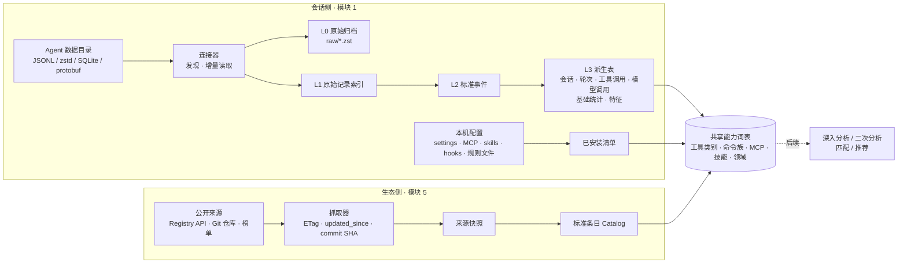
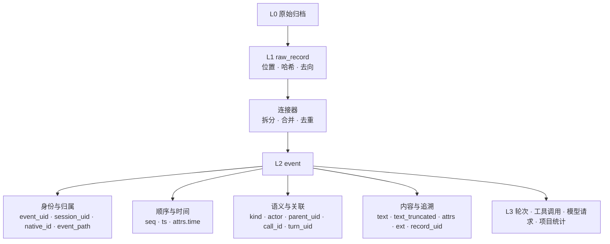

# Tandem 数据获取与标准化方案（模块 1 + 模块 5）

> 状态：2026-10-02 起持续迭代。按团队已确定的模块划分，本轮完成模块 1 与模块 5 的**数据获取、标准化、基础统计与存储**，包含 L3 派生与规则特征提取，供后续深入分析与二次分析复用；诊断、画像、匹配、推荐、AI 辅助由后续模块负责。
>
> 依据：`yhyfhgs` 本机 2026-10-01 的只读实测（只看字段结构，不读内容），以及对开源项目、标准与公开市场的调研。外部信息以文末链接为准，标注「未核实」的条目需要在实现前再确认。

## 0. 结论先行

1. **两边各自独立采集，在同一套「能力词表」上汇合。** 会话侧把各 Agent 的日志标准化成统一事件；生态侧把 Skills、Plugins、MCP、Hooks、规则、工作流、模型成绩标准化成统一条目。两边都抽取同一套特征（工具类别、命令族、MCP 服务、技能名、文件类型、领域标签），后续匹配只需在特征层做连接。
2. **本机实测推翻了 Demo 里的三处假设**：Gemini 侧实际是 Google Antigravity（明文转录在 `brain/<id>/…/transcript_full.jsonl`，模型与 token 藏在 protobuf 里），不是 `~/.gemini/tmp`；Copilot 没有 `~/.copilot/history`，本机只剩会话元数据；DeepSeek Harness 的会话是 zstd 压缩的事件流，需要解压并合并流式分片。另外 Claude Code 不止 `~/.claude` 一个根目录（第二账号、桌面版本地 Agent 模式），桌面版还有一份会话索引。
3. **必须自建原始归档。** Claude Code 默认只保留 30 天会话（本机最早的转录停在 2026-09-02），Copilot 本机的会话表是空的。Tandem 首次运行全量回填，之后增量归档原始字节，否则 Demo 的 90 天视图和长期趋势都无法成立。
4. **「不丢信息」用四层结构保证**：L0 原始字节归档 → L1 原始记录索引（每行都有去向）→ L2 标准事件（未映射字段进 `ext`）→ L3 派生表（会话、轮次、工具调用、模型调用、基础统计与特征，可随时重算）。每个连接器都要通过「记录全记账」测试。
5. **去重是正确性的核心。** 实测确认：Claude Code 一次模型响应会拆成多行（多数 2–3 行，主会话最多 16 行），每行重复同一份 usage（不去重会多算约 2.5–3.1 倍，因字段而异）；分叉与后台会话会复制历史（830 个 uuid 出现在多个文件）；Codex 子代理会重放父会话历史；Codex 还导入了 50 个 Claude Code 会话。
6. **MVP 先接 Claude Code、Codex、DeepSeek Harness**（本机数据量最大、格式已摸清），pi 与 Antigravity 的明文转录顺手接入；OpenCode、Hermes Agent 已有源码级调研，用安装后生成的样本接入；Copilot 与其他 Agent 留接口。生态侧先接官方 MCP Registry、Claude 官方插件市场、`anthropics/skills`、`openai/skills` 与 Codex 官方插件、models.dev。
7. **存储用 SQLite + zstd 归档**：`tandem.db`（会话侧）、`catalog.db`（生态侧，可由团队定期构建成快照分发）、`raw/`（原始归档）。数据库表结构就是模块之间的契约，三人可以并行开发。

### 需求对照

| 需求 | 在本文哪里 |
| --- | --- |
| 模块 1：获取各 Agent 的本地 session，参考额度统计与反代类开源项目的对接方式 | 3.1 本机实测、3.2 各 Agent 接入要点、3.4 补充通道（反代、额度）、3.6 参考的开源项目；源码级细节见 [docs/research/agent-sessions](../research/agent-sessions/) |
| 模块 2：标准化，按项目、按模型分类（不按 Agent 分类） | 4.5「分类维度」「项目归属」「模型与思考档位」 |
| 模块 5.1 规则和 Prompts | 5.1「规则、子代理、工作流、指南」，6.1 `rule`、`command` |
| 模块 5.2 Skills | 5.1 Skills，5.2「Skill 目录」 |
| 模块 5.3 Plugins | 5.1 插件与市场，5.2 插件清单格式 |
| 模块 5.4 MCP 接入：有哪些软件 | 5.1 MCP 服务与「有哪些软件」，6.1 `mcp_server` 的 `software` 字段 |
| 模块 5.5 Hooks 脚本 | 5.1 Hooks，5.2 各 Agent 的 Hook 事件表 |
| 模块 5.6 Model + Thinking 的 Benchmark 成绩 | 5.1「模型、价格与成绩」，6.2 模型成绩的身份规则 |
| 模块 5.7 Workflows 经验 | 5.1「规则、子代理、工作流、指南」，6.1 `workflow`、`guide` |
| session 轨迹不遗漏信息的标准化（适配不同 harness） | 4.1–4.6 |
| Skills、Plugins 等索引数据库的管理，便于后续与 session 分析匹配 | 6.1–6.4，存储见 7 |
| 结合 Demo | 2「Demo 各页需要的数据与来源」，3.1「Demo 假设」一列 |

## 1. 范围与原则

| 在范围内 | 不在范围内 |
| --- | --- |
| 模块 1：发现并读取各 Agent 的本地会话与配置 | 模块 3、7、10、11：深入分析与二次分析、诊断、画像、匹配、推荐、AI 辅助 |
| 模块 5：抓取公开的 Skills、Plugins、MCP、Hooks、规则、工作流、模型成绩 | 模块 8：一键安装（只记录安装方式，不执行） |
| 模块 2、6 的数据层部分：标准化、去重、项目归属、基础统计、规则特征提取与存储 | 模块 4、9：前端交互 |

原则：

- **本地优先、只读。** 连接器只读 Agent 的数据目录，不写、不改、不删；SQLite 以只读方式打开。生态抓取只下载公开数据，不上传任何用户数据。
- **不丢信息。** 原始字节保留，每条原始记录都有去向，标准化时没用上的字段进 `ext`，解析器升级后可以从归档重算。
- **增量与幂等。** 事件 ID 由来源位置确定性生成，重复导入不产生重复数据。
- **凭据不碰。** 连接器使用路径白名单，并显式排除凭据文件（见 3.5）。
- **够用即可。** 不做通用 ETL 框架；每个 Agent 一个连接器，一个文件能写完就不拆。新 Agent 按需接入。

## 2. 总体结构



Demo 各页需要的数据与来源：

| Demo 页面 | 需要的数据 | 来自 |
| --- | --- | --- |
| A1 概览、A3 会话与轨迹 | 会话起止、轮次、事件时间线、模型、token | `session`、`turn`、`event`、`model_call` |
| A4 工具调用 | 工具明细、失败原因、耗时、审批负担、MCP 与子代理 | `tool_call`、`event(kind=permission.*)`、子代理链接 |
| A5 项目习惯 | 项目归属、规则覆盖（AGENTS.md / Hooks / Skills / MCP / 子代理） | `project`、已安装清单 |
| A6 情绪与语义 | 用户原话（仅人类输入）、纠偏与打断 | `event(kind=message.user, origin=human)` |
| A7 建议、A8 资源库 | 生态条目、兼容 Agent、许可、安装方式、热度 | `catalog.db` |
| A10 设置 | 数据源、索引状态、脱敏规则、存储位置 | `source`、`source_file`、配置 |
| 菜单栏、悬浮组件（实时状态） | 会话是否运行、是否在等审批、上下文占用 | 文件监听与运行状态信号（3.3）；等待审批需要 Hooks（3.4） |

## 3. 模块 1：本地会话数据获取

### 3.1 本机实测（2026-10-01，规模于 10-02 复核）

| Agent | 本机版本 | 会话位置 | 格式 | 本机规模 | Demo 假设 |
| --- | --- | --- | --- | --- | --- |
| Claude Code | 转录里的 `version` 为 2.1.247–2.1.285；绝大多数来自 Claude 桌面版（`entrypoint=claude-desktop`） | `~/.claude/projects/<编码 cwd>/<sessionId>.jsonl`；第二账号 `~/.claude-account2/projects/`；桌面版另有会话索引与本地 Agent 模式目录（3.2） | JSONL，20 余种记录类型 | 127 + 4 个主会话、355 个子代理文件；JSONL 约 1.4 GB（子代理约 1.0 GB，主会话约 29% 的字节是内联的 base64 图片），另有图片与 PDF 约 0.2 GB | 成立，另有第二账号目录 |
| Codex | rollout 中的 `cli_version` 为 0.98–0.159，以 Codex Desktop 为主 | `~/.codex/sessions/YYYY/MM/DD/rollout-*.jsonl`、`~/.codex/archived_sessions/`；索引 `state_5.sqlite`；投影 `thread_history_1.sqlite` | JSONL + SQLite | 432 + 474 个 rollout，3.7 GB；threads 表 890 行 | 部分成立：还要读归档目录和 SQLite |
| Gemini 侧 | Antigravity 桌面版与 `agy` CLI；未见 Gemini CLI 的 `~/.gemini/tmp` | `~/.gemini/antigravity{,-cli}/brain/<id>/.system_generated/logs/transcript_full.jsonl`、`conversation_summaries.db`、`conversations/<id>.db` | 明文 JSONL 转录 + SQLite；模型与 token 在 protobuf 里 | 27 + 1 个对话，65 MB | 不成立 |
| Copilot | Copilot 桌面 App（以 server 模式启动 CLI） | `~/.copilot/session-state/<id>/workspace.yaml`、`data.db` | YAML + SQLite | 43 个会话目录，只有元数据；`data.db` 的 sessions 表为空 | 不成立：没有 `~/.copilot/history` |
| DeepSeek Harness | `@deepseek-ai/dsh` 0.1.1-rc.2（MIT） | `~/.dsh/sessions/--<规范化 cwd>--/<sessionId>/session.jsonl.zstd` | zstd 帧拼接的 JSONL 事件流，含打包的流式分片 | 79 个会话，41 MB | 路径成立，需解压与合并分片 |
| pi | 0.99.1 | `~/.pi/agent/sessions/--<cwd>--/<时间戳>_<uuid>.jsonl` | JSONL，`id/parentId` 树 | 2 个会话 | Demo 未列出 |

保留期实测：Claude Code 最早的主会话文件是 2026-09-02，与默认 30 天清理一致；Codex 最早的 rollout 是 2026-02-08，全部保留；Copilot 本机已无事件明细。

### 3.2 各 Agent 接入要点

本节只列连接器需要的结论。pi、Hermes Agent、DeepSeek Harness、OpenCode、Codex、Claude Code 六个 Agent 的源码级分析（存储布局、记录 schema、写入时机、压缩与分支的数据表现，附源码 permalink）见 [docs/research/agent-sessions](../research/agent-sessions/)。

#### Claude Code（P0）

- **数据根目录不止一个**：`${CLAUDE_CONFIG_DIR:-~/.claude}`、同级的 `~/.claude*`（本机有 `~/.claude-account2`）、Claude 桌面版的本地 Agent 模式 `~/Library/Application Support/Claude/local-agent-mode-sessions/**/.claude/projects`（本机 1 个会话）。Tandem 要支持登记多个根目录（ccusage 等工具允许在 `CLAUDE_CONFIG_DIR` 里用逗号列出多个目录，这是工具的约定，不是 Claude Code 本身的行为）。
- **桌面版会话索引**：`~/Library/Application Support/Claude/claude-code-sessions/<id>/<id>/local_<id>.json`（本机 118 个），字段有 `cliSessionId`（对应转录文件的 `sessionId`）、`cwd / originCwd`、`createdAt / lastActivityAt`、`model`、`effort`、`title / titleSource`、`isArchived`、`permissionMode`、`enabledMcpTools`、`completedTurns`；另有 `deleted_<id>` 删除标记（237 个）与 `scheduled-tasks.json`。用于补标题、归档状态和会话级设置，不含正文。
- **文件布局**：主会话 `<proj>/<sessionId>.jsonl`；子代理 `<proj>/<sessionId>/subagents/agent-<id>.jsonl` 与同名 `.meta.json`（`agentType`、`description`、`toolUseId`、`spawnDepth`）；Workflow 子代理 `<proj>/<sessionId>/subagents/workflows/wf_<id>/agent-<id>.jsonl` 与 `journal.jsonl`、`<sessionId>/workflows/wf_<id>.json`；超长工具输出落在 `<sessionId>/tool-results/`；`custom-title.json`；项目记忆 `<proj>/memory/*.md`。
- **目录名是有损编码**（`/`、空格、`.` 都变成 `-`），项目归属必须用记录里的 `cwd`，不能反解目录名。
- **记录类型**（实测）：`assistant`、`user`、`attachment`、`system`、`last-prompt`、`custom-title`、`ai-title`、`agent-name`、`queue-operation`、`pr-link`、`file-history-snapshot/delta`、`mode`、`permission-mode`、`cost-state`、`relocated`，以及 `atis-latch`、`bridge-session`、`frame-link`、`artifact-*` 等界面状态。
- **关键字段**：`uuid / parentUuid / logicalParentUuid`（消息树）、`sessionId`、`isSidechain`、`cwd`、`gitBranch`、`version`、`entrypoint`、`timestamp`、`requestId`、`promptId`、`effort / perTurnEffort`（思考档位）、`permissionMode`、`origin.kind`（`human` / `task-notification` / `peer`）、`isMeta`、`attributionSkill / attributionMcpServer / attributionMcpTool`（工具调用由哪个技能或 MCP 引起）、`toolDenialKind`、`hookInfos / hookErrors`。
- **内容块**：`text`、`thinking`（带 `signature`）、`tool_use`、`tool_result`、`image`；结构化工具结果在 `toolUseResult`（`stdout / stderr / interrupted / structuredPatch / filePath / durationMs` 等）。
- **用量**：`message.usage` 含 `input / output / cache_creation / cache_read`、`output_tokens_details.thinking_tokens`、`server_tool_use`（搜索与抓取次数）、`service_tier`、`speed`；`cost-state` 记录给出按模型的 `costUSD`、`totalLinesAdded / Removed`、`totalAPIDuration / totalToolDuration`。
- **系统事件**：`system.subtype` 有 `compact_boundary`（`compactMetadata.trigger / preTokens / postTokens`）、`api_error`（含重试）、`turn_duration`、`stop_hook_summary`、`local_command`。
- **审批与打断**（实测）：`toolDenialKind` 取 `user-rejected`（用户拒绝）、`permission-rule`（规则拦截）、`automode-blocked / automode-unavailable`（自动模式分类器拦截或不可用）、`interrupted`；被拒绝时工具结果是固定提示文本；打断标记为 `[Request interrupted by user]` 与 `[Request interrupted by user for tool use]`。转录里没有审批等待时长。
- **坑**：
  - 一次 API 响应按内容块拆成多行，每行重复同一份 usage（实测 4546 条多行消息的 usage 全部相同）→ 用 `message.id + requestId` 去重后再累计。
  - `--fork-session`、后台续接、Desktop 的分支会把历史复制进新文件；普通 `--resume` 沿用原 `sessionId`（`--resume --bg` 遇到会话被占用时会开副本）。本机 830 个重复 uuid 来自 3 对文件：两对 Desktop 前缀副本、一对 CLI 转入后台续接；`/btw` 旁支会用新的 `requestId` 重放父消息 → 按 `uuid` 去重，后出现的副本标记为重放。排队的命令以没有 `uuid` 的 attachment 保存，需要合成 ID。
  - `type=user` 不等于人类输入：要排除 `isMeta`、压缩摘要、只含 `tool_result` 的消息、`<command-name>` / `<local-command-stdout>` 包装，并结合 `origin.kind` 区分人类、任务通知与对等 Agent；`[Request interrupted by user…]` 是打断信号。
  - 30 天自动清理（`cleanupPeriodDays`，Desktop 会话另有 `desktopSessionCleanupPeriodDays`）；桌面版的临时工作区路径 `~/Library/Application Support/Claude/scratch-workspaces/…` 应归入「临时工作区」。
  - 子代理文件里约 88% 的响应只有占位用量（`stop_reason` 为空，`output_tokens` 中位数 8），组内取最大值也救不回来。子代理的用量以父会话记录为准：Agent 工具结果的 `usage / totalTokens`、`queued_command.usage`、Workflow 汇总，或父会话 `cost-state.modelUsage`（已含子代理）。`cost-state` 是会话级累计（恢复会话时接着累加，`/clear` 清零）。
  - 文件内顺序不单调：会话起止取全部 `timestamp` 的最小与最大值，不取首行末行；轮次按 `promptId` 分组；`system(turn_duration)` 只见于 CLI 入口（本机 Desktop 文件里一条都没有），Desktop 会话的轮次结束只能由 `end_turn` 与下一条真人输入推断。
  - 不要只沿「最新叶子 → 根」回溯重建对话：源码调研实测这样会丢 17% 的工具结果。按文件顺序读全部消息、按 `message.id` 合并、按工具 ID 配对，再用 `parentUuid` 图区分三种分叉：同一 `message.id` 下的并行侧枝（正常）、prompt 层级的分叉（rewind 或编辑重发）、`api_error` 旁的分叉（重试）。
  - 单文件可达 81 MB（子代理 125 MB），必须流式解析；`prompt_snapshot`、`Edit.originalFile`、`Read` 结果等大字段延迟解析或截断。
  - 版本更新很快（实测两天内两个小版本），新字段会持续出现，靠 4.2 的漂移检测兜底。
- **现成的参照**：`~/.claude/usage-data/` 是 `/insights` 生成的逐会话统计（`session-meta`：工具次数、打断次数、响应间隔、工具错误分类、会弹审批的命令数等）和标签（`facets`：目标、结果、摩擦类型、满意度）。可作为我们派生指标的对照答案，不作为主数据源。

#### Codex（P0）

- **以 SQLite 为索引、JSONL 为正文。** `state_5.sqlite.threads` 有每个线程的 `rollout_path`、`cwd`、`title`、`model`、`reasoning_effort`、`tokens_used`、`git_sha / git_branch / git_origin_url`、`thread_source`、`agent_nickname / agent_role / agent_path`、`archived`、`project_id`；`thread_spawn_edges` 给出父子线程；`projects / project_roots` 是 Codex 自己的项目分组。`thread_history_1.sqlite` 是 Codex 按字节偏移增量投影的条目表（`thread_items`、`thread_turns`、`thread_history_projection_state.next_rollout_byte_offset`），可作对照，但不保证覆盖全部原始信息，正文仍以 rollout 为准。
- **rollout 记录**（实测新格式）：顶层 `ordinal / timestamp / type / payload / metadata`；`type` 有 `session_meta`、`turn_context`、`response_item`、`event_msg`、`compacted`、`token_usage_record`、`world_state`、`inter_agent_communication_metadata`。`event_msg` 下有 `item_completed`（条目类型 `Reasoning / CommandExecution / AgentMessage / Extension(web.search) / UserMessage / SubAgentActivity / FileChange / ImageView / McpToolCall`）、`task_started / task_complete`、`token_count`、`thread_settings_applied`、`turn_aborted`；`response_item` 下有 `message`（`user / assistant / developer`）、`reasoning`（`summary` 与 `encrypted_content`）、`function_call / custom_tool_call` 及其输出、`compaction`。
- **用量**：优先用 `token_usage_record`（每个 `response_id` 一条，含 `cached_input / cache_write_input / reasoning_output`，实测无重复）；旧文件只有 `token_count` 时用 `last_token_usage`，并跳过累计值未变化的重复事件（实测 2397 条中 8 条重复）；上下文超限时 Codex 会写一条合成的 `token_count`（总量等于上下文窗口、其余为 0），不能当作用量，`threads.tokens_used` 也会被它带偏。`rate_limits` 快照可用于额度展示。
- **坑**：
  - `thread_spawn` 派生的子代理会先重放父会话历史，真正属于自己的部分从 `subagent_history_start_ordinal` 开始（抽样中每个重放数条到数十条）→ 之前的记录标记为重放。**这条规则不适用于 guardian 评审文件**：本机 413 个 guardian 文件里的回合都是它自己的评审（只有自己的 `session_meta`，5,528 个 turn_id 中只有 1 个出现在其他文件），其中 410 个的起点序号恰好等于最大序号 + 1，照搬规则会把内容全部当重放丢掉。继承前缀是过滤过的（保留 system / developer / user 消息、`final_answer`、`compacted`、`event_msg` 等，去掉推理、工具调用、`token_usage_record`），不能拿它与父 rollout 逐行比对。
  - `thread_source` 区分 `user`、`subagent`、`guardian_review`（自动审批评审）、`automation`、`realtime_voice`；本机 890 个线程里，用户发起的只有 241 个，`guardian_review` 241 个、`subagent` 385 个，使用 `codex-auto-review` 模型的线程有 413 个 → 会话类型必须分开，否则人格与习惯统计会被系统线程污染。
  - `external_agent_session_imports.json` 记录了 Codex 导入的 50 个 Claude Code 会话（`source_path`、`content_sha256`、`imported_thread_id`）→ 这些线程标记为导入并链接到原 Claude 会话，默认不重复计入。
  - 思考档位取值有 `low / medium / high / xhigh / max / ultra`，模型名随版本变化（实测有 `gpt-5.6-sol`、`gpt-6-astra` 等）→ 原值保留，另做归一（4.5）。
  - `archived_sessions/` 是扁平目录，与 `sessions/` 的日期目录要一起扫描；归档会把一个线程的全部文件一起移走，本机没有两边重复的情况；但 revert 会给同一线程再生成新的 rollout 文件（本机 12 个线程各有 2–4 个，共享线程 ID，靠 `history_base`、`forked_from_ordinal_exclusive` 衔接），所以要按文件分别解析，不能按线程 ID 简单去重。`logs_2.sqlite`（346 MB）是运行日志，不是会话正文，默认不读；`~/.codex/sqlite/` 下的 `codex-dev.db` 等是 Codex Desktop 自有的闭源库，暂不读。
  - 恢复会话会改写 `cli_version`，不能按版本号分支解析逻辑，要按记录形状判断；早期会话没有 `turn_context`，模型未知；`codex-auto-review` 是服务端别名，看不到真实模型。
  - 额度快照 `rate_limits` 按 `window_minutes` 判断是 5 小时窗口还是周窗口，不要按 `primary / secondary` 槽位判断（2026-07 起周窗口移到了 `primary`）。
  - **同一信息有两套表示**：`response_item` 与 `item_completed`、`token_usage_record` 与 `token_count`、`compacted.replacement_history` 与原始行、子代理继承前缀与父 rollout。每类只取一种视角：消息与工具以 `item_completed` 为准（`response_item:message` 里混有 harness 注入的 user 消息，不能直接计数），用量以 `token_usage_record` 为准。
  - Codex 会把 rollout 原地改写：迁移器改写旧文件，压缩会换成 `.jsonl.zst`，归档会移到 `archived_sessions/`。水位要记 `(路径, inode, size, mtime, 最后 ordinal, 字节偏移)`，变化时整文件重扫；迁移与压缩期间 Codex 持有 `.tmp/rollout-maintenance.lock`，文件可能正被整体替换，这一轮先跳过；`thread/delete` 会直接删除 rollout 与状态行，同样需要及时归档；单行可达 16 MB（内联的 base64 图片），流式读取并设单行上限。`CommandExecution.cwd` 与 `ImageView.path` 是 `file://` URI，要先转成路径（`session_meta / turn_context` 里的 cwd 是普通路径）。
  - 审批不直接落盘：策略在 `turn_context.approval_policy / approvals_reviewer / sandbox_policy`，被拒绝的命令是 `status=declined`（`exit_code` 为 −1），guardian 自动审批是独立子线程。
  - 工具成败以 `item_completed` 的 `status / exit_code` 为准（`function_call_output` 不带成败标志）；Code Mode 下嵌套工具条目的 id 是 `exec-<uuid>`，与外层 `exec` 的 `call_id` 无关，只能按 `turn_id` 与行序归属（源码调研实测约 11% 的嵌套条目写在 `exec` 输出之后）。
  - `world_state` 里有当时生效的 AGENTS.md 全文（`agents_md.text`），可直接用于 Demo A5 的「规则覆盖」；导入会话的 `token_count` 只是按字节估算的值，用量标为估算；标题取 `threads.name` > `session_index.jsonl` 最后一条 > `threads.title / preview`（`threads.name` 可能是用户改名，也可能是 TUI 用模型自动生成的，数据上分不出来）；`threads` 里的 `creator_user_id / creator_account_id` 是账号标识，不入库。

#### DeepSeek Harness（P0）

- 官方格式文档在本机 npm 包内：`~/.local/lib/node_modules/@deepseek-ai/dsh/node_modules/@deepseek-ai/dsh-session-persistence-jsonl/README.md`（MIT，源码仓库 `deepseek-ai/deepseek-harness`）。
- 每个会话一个目录、一个只追加的逻辑日志；文件由多个独立的 zstd 帧拼接（第一帧只含会话头，之后每次批量写入一帧），任何标准 zstd 解码器都能整体解压。
- 第一行是会话头：`type=session`、`version`、`id`、`cwd`、`createdAt`、`parentSession`、`seedLength`、`origin`、`delegationDepth`、`agentPreset`；之后每行一个事件，`seq` 连续。
- 事件类型（实测）：`user/message`、`assistant/message`（含 `usage`）、`tool/call`、`tool/result`、`step/start / step/end`、`turn/start / turn/end`、`approval/asked / approval/decided / approval/policy`、`permission/preset`、`sandbox/mode`、`subagent/descriptor`、`agent/inbox/spliced`、`todo/write`、`session/title`、`request/header`、`request/context`、`web/deepseek-search-llm-request` 等。
- **流式分片**（旧版 v0）：`assistant/chunk` 增量事件会被打包成 `text-chunks / reasoning-chunks / tool-call-chunks` 行（`seq0 / time0 + dt[]` 可无损还原每个分片的序号和时间）。统计与正文以 `assistant/message`、`tool/call` 等完整事件为准（`assistant/message` 的内容块里有明文 `reasoning`，签名或加密推理在 `source.replayState`），分片只用于还原首字延迟和流式时长，标记为已折叠。
- **坑**：根目录可由 `DSH_HOME` 覆盖；关闭压缩时文件是明文 `session.jsonl`，按 zstd 魔数判断而不是按扩展名；目录名同时存在 `<uuid>` 与 `session-<uuid>` 两种（本机 54 / 25），不能据此判断是否子代理（ACP 顶层会话也是裸 uuid），以会话头的 `parentSession / delegationDepth` 为准；目录名是有损规范化的 cwd，以会话头的 `cwd` 为准；文件末尾可能有未写完的帧，读到不完整的帧时保留已解码记录并在下次重读；`compaction/summary` 是单独计费的压缩调用；HEAD 的 `replayState` 可带可选的 `responseModel`（本机 v0 没有），否则取 `source.model`；图片与文件以内容寻址存到 `$DSH_HOME/attachments/v1`，日志里只留引用；多供应商（`openrouter`、`kimi-coding`、`openai-codex`、`xai`），模型名不统一；不记录成本。
- **新旧两代格式**（据源码调研，HEAD 为 0.2.0-rc.2）：新版日志文件是 `session.v4.jsonl.zstd`，旧代文件保留；会话头改为必填的 `isSeeded`，继承切点由最后一个 `session/end-seed{inherited:true}` 推出（旧版用 `seedLength`）；流式增量不再是独立的 `assistant/chunk` 事件，而是内嵌在 `assistant/message.stream / assistant/attempt.stream` 里；新增 `session.lock` 文件锁；超大工具输出外置的预算从 50,000 字节改为约 12,500 个估算 token。连接器按会话头的 `version` 选择解析逻辑，两代都要支持，同一会话目录里两代文件并存时以新版为准、旧版按重复处理。
- 另有 `dsh-session-telemetry-otel` 可把事件流导出为 OpenTelemetry 日志，可作补充通道；轨迹可视化组件 `dsh-client-ui-trajectory` 留给模块 3 参考。

#### pi（P1，顺手接入）

- 每个会话一个 JSONL：会话头 `type=session`（`version`、`cwd`），之后 `message`、`model_change`、`thinking_level_change`、`compaction`、`custom_message`、`context_edit`（重试时省略失败回合）、`usage`（缓存保温）、`label`、`session_info` 等条目，以 `id / parentId` 构成树（可分支，当前分支是从最后一个叶子回溯到根的路径；连接器保留全部分支，不只当前分支）。
- `message.role` 有 `user / assistant / toolResult / system`；内容块 `text / thinking / toolCall`；`usage` 自带 `input / output / cacheRead / cacheWrite / reasoning / cost`，`thinkingLevel` 与 `provider / model` 都在消息上。格式简单，适合作为连接器模板。
- 根目录可由 `PI_CODING_AGENT_DIR` 覆盖；文件懒创建，出现第一条 user 或 assistant 消息时才一次性写出缓冲，之后每条消息完成时追加（流式增量不落盘）；`/fork` 复制 entry 并保留原 id，按 id 识别副本；pi 没有内置子代理。
- **身份与配对**：会话头的 `id` 跨文件不唯一（`/export` 再 `/import` 会原样复制），会话要按（`id`，文件路径）识别；工具调用 ID 不一定是供应商原值，部分供应商没给 ID 时存空字符串，只能按顺序配对；运行中可能插入 `model_change`、扩展写入的条目等，配对一律按 `toolCallId`，不按相邻。
- **fork 与时间**：fork 出的文件立即写出，复制的 entry 保留源会话的时间戳（早于新会话头），会话起点要取第一条非复制的 user 消息；0.30.0 的旧会话在 `<agentDir>/*.jsonl`，启动时迁移，可能有残留，也要扫描；`/resume` 列表里 Ctrl+D 会删除会话文件，同样需要及时归档。

#### OpenCode（P1，本机未安装，依据源码）

- **位置**：`$XDG_DATA_HOME/opencode`（macOS 也是 `~/.local/share/opencode`，不是 `~/Library`）下的 SQLite `opencode.db`；非正式渠道为 `opencode-<channel>.db`，`OPENCODE_DB` 可覆盖。不要用 `opencode db` 子命令读取，它会以读写方式打开数据库并先跑迁移。
- **表**：默认运行时写 V1 表 `session / message / part`，另有事件日志 `event / event_sequence`；V2 投影表（`session_message`、`session_input`、`session_context_epoch`，会话行仍在 `session` 表）只有通过 V2 接口 `/api/session/*` 提交的客户端才写（如 2.0 预览版 CLI；默认的 `opencode serve` 也挂载了 V2 接口）；更早的版本是 `storage/` 下的 JSON 文件。连接器按表是否存在判断版本，三种布局都要能读。ID 的 48 位时间前缀约 795 天回绕一次，不要按 ID 排序或推算时间。
- **用量**：最细粒度在 `step-finish` part（每次模型调用一条，`tokens{input, output, reasoning, cache{read, write}}` 与 `cost`，`input` 已减去缓存读写）；message 上的 `tokens` 只是最后一步的值、每步都会被覆盖，不能累加；`session` 表的累计值不可靠（旧会话由迁移回填、并发时可能丢一次累加、fork 会把复制的 step-finish 重新累加），以自己汇总的 step-finish 为准，fork 会话先去掉复制段。父会话的用量不含子会话，需要递归汇总。
- **项目归属**：按 assistant 消息的 `path.cwd / path.root`；`session.directory` 会被 `/move` 改写成当前目录，`project` 表按远程地址把多个克隆合成一行，都不能直接当项目键。
- **子代理**：`task` 工具新建子会话（`parent_id` 指向父会话），父会话中该工具调用的 `state.metadata.sessionId` 指向子会话。
- **压缩与回退**：压缩写一条带 `compaction` part 的 user 消息和一条 `summary: true` 的摘要 assistant，被压缩的历史不删除；`prune` 只给旧工具输出打 `time.compacted` 标记，原文仍在库里。`revert` 提交后会删除撤销点（含）之后的消息行（整条撤销时连同该轮的 user 消息），并从会话累计中扣回它们的用量，所以必须在删除前完成归档（以 L0 的按行快照为准；事件日志不可靠，历史上的迁移清空过它）。`fork` 复制历史到一个**不设 `parent_id`** 的新会话（标题带 `(fork #N)`），需要按复制的内容去重。
- **其他**：流式时 assistant 行会被原地改写，按「主键 + 行哈希」判断变化；TUI 里用户直接执行的 `!cmd` 会写成一条 synthetic user 消息加一个 `bash` 工具调用（成本为 0），归类为用户自己执行的命令，不算 Agent 的工具调用。
- **敏感表**：`account`、`control_account`、`credential`、`session_share.secret`，以及数据目录下的 `auth.json`、`mcp-auth.json`，连接器不读。

#### Hermes Agent（P1，本机未安装，依据源码）

- **位置**：`$HERMES_HOME`（默认 `~/.hermes`，可加 `HERMES_DATA_DIR_SUFFIX`）；命名 profile 在 `profiles/<name>/`，**每个 profile 一个独立的 `state.db`**，都要登记为数据源。
- **权威来源只有 `state.db`**（SQLite；日志模式默认 WAL，但链接的 SQLite 有 WAL 缺陷时会保持 DELETE 模式，两种都要支持，WAL 模式下必须连同 `-wal` 一起读）：`sessions`（含 `parent_session_id`、`model`、`model_config`、`end_reason`、token 与成本）、`messages`、`session_model_usage`（按会话 × 模型 × 供应商 × 计费方式 × 任务累计；`task=''` 是主循环，其余是压缩、标题生成等辅助调用，正好对应 `model_call.purpose`）。`sessions/*.json(l)`、`pending_messages/` 只在故障时出现，作补充。
- **顺序与身份**：一律按 `messages.id` 排序（时间戳可能回退）；会话 ID 形如本地时区的 `YYYYMMDD_HHMMSS_<hex>`（ACP 会话为 uuid4），只当标识用，时间取 `sessions.started_at`，不要从 ID 解析；`message_uid` 在压缩代际、分支拷贝中保持不变，是跨行去重的键；工具调用 ID 可能重复，用 `tool_call_uid` 区分。
- **压缩、回退、分支都保留旧行**：就地压缩把被摘要替代的旧行改为 `active=0, compacted=1`，保留下来的尾部原行改为 `active=0, compacted=0` 并以同 `message_uid` 的新行重新插入，再加一条摘要行；rewind、编辑、重新生成把分歧后的行软删除（`active=0`）；`/branch` 新建子会话并拷贝完整历史（新 `id`、同 `message_uid`）。连接器要读**包括非活跃行在内的全部行**，分别映射为 `context.compaction` 与 `branch`，这样才不丢信息。
- **子代理**：`delegate_task` 新建子会话（`parent_session_id` 与 `model_config._delegate_from` 指向父会话；`source` 取自会话上下文，消息平台下是 `subagent`，TUI、Desktop、kanban 下会继承父会话的来源，所以以 `_delegate_from` 判断；压缩轮转出的延续会话也带着指向最初父会话的 `_delegate_from`，要与 `parent_session_id` 比对），用量记在子会话上；异步委派完成时以一条 user 消息写回父会话。
- **审批**：不落事件。用户拒绝的命令是普通的工具结果 `{"status": "blocked", "user_summary": …}`，`permission.decision` 要从工具结果推断。
- **跨 Agent 导入**：Hermes 能导入 Claude Code 与 Codex 的会话，与 Codex 一样要识别导入会话并链接原会话，避免重复计入。导入只保留文本（工具调用压成 `[ran tool: <name>]`），CLI 导入不查重，所以要按文本内容与原会话比对。
- **其他**：`sessions.auto_prune` 默认开启，已结束且 90 天不活跃的会话会被删除，和 Claude Code 的 30 天清理一样需要提前归档；超大工具输出放在 `cache/spillover/<tool_call_id>.txt`，24 小时后过期，需要及时归档；`logs/agent.log` 有每次 API 调用的耗时与 token，可作补充；`$HERMES_HOME/.env` 存密钥，连接器不读。

#### Antigravity（P1：明文转录 + 摘要库；P2：protobuf 用量）

- IDE 数据在 `~/.gemini/antigravity/`，CLI（`agy`）数据在 `~/.gemini/antigravity-cli/`。
- **明文转录**：`brain/<id>/.system_generated/logs/transcript_full.jsonl`（本机 28 份；另有按块切分的 `chunks/transcript_full/0000000N.jsonl` 和精简版 `transcript.jsonl`），每行一个步骤：`step_index / source（USER_EXPLICIT / MODEL / SYSTEM）/ type（USER_INPUT / PLANNER_RESPONSE / CHECKPOINT …）/ status / created_at / content / thinking / tool_calls`；`INVOKE_SUBAGENT` 表示子代理，`CHECKPOINT` 表示压缩。SpecStory 的 `ANTIGRAVITY-FORMAT.md` 有完整说明。
- `conversation_summaries.db` 可直接读出标题、步骤数、工作区、最后修改时间、父对话与嵌套深度、状态。
- **模型与 token** 只在 `conversations/<id>.db` 的 `gen_metadata`（protobuf）里，`steps.step_payload` 也是 protobuf（实测首字节 `0x08`）。tokscale 记录了 `gen_metadata` 的字段编号（并注明 agy 1.1.17 → 1.1.18 布局变过），agentsview 有通用的 protobuf 遍历器；更旧的版本是 AES 加密的 `.pb` 文件。
- MVP 读转录与摘要库；用量解码放到 P2，版本变化时以样本回归测试兜底。

#### Copilot（P2）

- Copilot CLI 的标准位置是 `${COPILOT_HOME:-~/.copilot}/session-state/<id>/events.jsonl`（旧版是扁平的 `<id>.jsonl`），事件有 `session.start`、`user.message`、`assistant.message`、`assistant.reasoning`、`tool.execution_start / complete`、`session.model_change`、`session.shutdown`（按模型的累计用量，恢复会话时会重发，需要相邻快照做差）；按请求的用量在 `session-store.db` 的 `assistant_usage_events`；也可能有 OTel 文件 `otel/**/*.jsonl`。输入含缓存、输出含思考；模型名写法（如 `claude-sonnet-4.6`）与价目表不一致。
- 本机用的是 Copilot 桌面 App：只有 `session-state/<id>/workspace.yaml`（`id / cwd / git_root / repository / branch / client_name / created_at / updated_at`）和 `checkpoints/index.md`，没有 `events.jsonl`；`data.db` 的 `sessions` 表结构完整（模型、思考档位、各类 token、上下文占用），但没有行。连接器按上面的位置依次探测，本机先只读元数据。

#### 其他 Agent（本机未安装，按开源项目的解析器整理，接入前用真实样本核实）

| Agent | 位置 | 格式 | 用量 | 注意 |
| --- | --- | --- | --- | --- |
| Gemini CLI | `~/.gemini/tmp/<项目哈希或名称>/chats/session-*.json(l)`，`projects.json` 映射路径；`GEMINI_CLI_HOME` / `GEMINI_DIR` 覆盖 | 旧版单个 JSON，v0.40 起为 JSONL 操作日志（`$set`、`$rewindTo`、`message_update`，同 `id` 后者覆盖前者） | `tokens.{input, output, cached, thoughts}` | 会话有 `kind: main / subagent` |
| Cursor IDE | `~/Library/Application Support/Cursor/User/globalStorage/state.vscdb` 的 `cursorDiskKV` 表 | `composerData:<id>`（会话）+ `bubbleId:<会话>:<消息>`（消息，`_v ≥ 3` 时工具数据在 `toolFormerData`） | 磁盘上没有可靠 token | 库常有数百 MB 且持续写入；`ItemTable` 里有登录令牌，绝不导出；项目归属要结合 `workspaceStorage` |
| Cursor CLI | `~/.cursor/projects/<编码路径>/agent-transcripts/`、`~/.cursor/chats/<md5>/<id>/store.db` | 文本转录 + 内容寻址的 blob 树 | 无 | 细节有限 |
| Kilo CLI / Kilo Code 新版 | `~/.local/share/kilo/kilo.db` | 与 OpenCode 同一套表结构 | 同 OpenCode | 复用 OpenCode 连接器 |
| Amp | `~/.local/share/amp/threads/T-<uuid>.json` | 每线程一个 JSON，持续改写 | `messages[].usage`（含缓存读写）、credits | OpenAI 模型的未缓存输入记在「缓存写入」 |
| Factory Droid | `~/.factory/sessions/**/<id>.jsonl` + `<id>.settings.json` | JSONL 消息 | `settings.json` 的累计 `tokenUsage` | 累计值原地改写；模型名是自定义字符串 |
| Kimi CLI | `~/.kimi/sessions/…/wire.jsonl`、`~/.kimi-code/sessions/…/agents/<agent>/wire.jsonl` | JSONL | `StatusUpdate` / `usage.record` | 日志不记录模型 |
| Qwen Code | `~/.qwen/projects/<cwd>/chats/<id>.jsonl` | 与 Claude 相似的 `uuid / parentUuid` | `usageMetadata` | 压缩记为 `system/chat_compression`；跳过 `.ledger.jsonl` 等旁路文件 |
| Cline / Roo / Kilo（插件版） | 各 VS Code 系编辑器的 `globalStorage/<扩展 ID>/tasks/<id>/` | `api_conversation_history.json` + `ui_messages.json` | `ui_messages` 中 `api_req_started` 的 `tokensIn / tokensOut / cacheReads / cacheWrites / cost` | 要扫描 Code、Cursor、Windsurf 等所有编辑器 |
| Goose | `~/.local/share/goose/sessions/sessions.db` | SQLite | `usage_ledger`（含成本、是否压缩） | 旧库只有会话总量 |
| Crush | `~/.local/share/crush/projects.json` → 各项目 `.crush/crush.db` | SQLite | 只有成本 | 子代理会话名为 `<uuid>$$<toolCallId>` |
| Kiro | `~/.kiro/sessions/`、`~/Library/Application Support/kiro-cli/data.sqlite3` | JSON(L) + SQLite | 常为 0，按 credits 计费 | — |
| Aider | 各仓库的 `.aider.chat.history.md` | Markdown | 无 | 无逐条时间戳；需要有限深度地遍历项目目录 |

### 3.3 发现、增量读取与监听

**发现**

- 每个连接器声明候选根目录和环境变量覆盖（如 `CLAUDE_CONFIG_DIR`、`CODEX_HOME`），并扫描同类的多份配置（本机有 `~/.claude` 与 `~/.claude-account2`）。每个根目录登记为一个 `source`。
- 首次启动列出发现结果，由用户勾选启用；之后检测到新的数据源只提示，不自动接入（对应 Demo 的「发现新数据源」通知）。

**增量读取**

| 来源形态 | 水位（watermark） | 变化判定 | 处理 |
| --- | --- | --- | --- |
| 只追加的 JSONL | 已处理的字节偏移 + 最后一行的哈希 | `dev / inode / size / mtime_ns` 变化 | 从偏移继续读；末行不完整时下次重读 |
| zstd 帧拼接 | 已处理的帧数与解压后的行号 | 同上 | 从下一帧继续；不完整帧下次重读 |
| SQLite | 表的 `updated_at` / rowid 游标；行会被原地改写时按「主键 + 行哈希」比对 | 目录内 `db / -wal` 的变化（WAL 会被删除重建，所以监听目录而不是文件） | 以只读方式打开（`mode=ro`，不要用 `immutable=1`），设 `busy_timeout` 与 `query_only`，在一个读事务内读完；目录不可写或缺少 `-shm` 时，在 Agent 空闲时把 `db / -wal / -shm` 一起复制到临时目录再读 |
| 文件被改写或截断 | 当前 `generation` + 已处理字节区间的哈希 | 已处理区间变化、文件变小或 inode 变化；前 4 KB 哈希只作快速检查 | 确认替换后新建代次归档；重新解析，并在事务中替换旧代次的 L1 与受影响的 L2 / L3，不能只 upsert |
| 文件消失 | — | 上游清理 | `source_file.status = gone_upstream`，归档和已入库的数据保留 |

- **确定性 ID**：先按原生 ID 的作用域确定逻辑身份，再按事件类型与内容路径派生 `event_uid`（4.3「L2 事件结构、身份与顺序」）。同一原始记录拆出的多个事件有不同 ID；跨文件的重放副本复用原事件身份。pi 的 entry id 只在单文件内唯一，会话头 id 也可能被导入复制，身份必须包含会话与文件代次；没有原生 ID 时用来源、文件相对路径、代次与原生记录序号兜底。重放副本只在 L1 标 `replayed`，追溯方式见 4.2。
- **监听**：macOS 用 FSEvents 监听各根目录，事件合并 1–2 秒后触发增量解析；另每 10 分钟做一次全量 `stat` 兜底。
- **判断会话是否在运行**（菜单栏与悬浮组件用，只观察、不加锁）：Claude Code 看 `~/.claude/sessions/<pid>.json`（不要读同目录的 `.key` 文件）；Codex 看 `thread-writer-locks/<id>.lock` 是否存在（写入方释放时删除，崩溃可能残留，所以结合 `threads.updated_at_ms`；不要尝试加锁，那会让 Codex 自己拿锁失败）；DeepSeek Harness 新版有 `session.lock`；其余 Agent 看会话文件最近是否在写入。
- **首次回填**：本机约 5 GB 文本日志（Codex 3.7 GB、Claude 1.4 GB），按文件并行、流式解析，不把整个文件读进内存；先处理最近 30 天，再补更早的。

**原始归档（L0）**

- 每个被跟踪的文本文件按代次在 `raw/` 下归档：首次 `generation = 0`，同一代次只把新增字节压成新帧追加；改写、截断或轮换后新建 `generation + 1` 的完整归档，旧代次保留，替换内容不能追加到旧归档。代次清单记录来源、相对路径、代次号、归档路径与哈希，重算时显式选择代次。SQLite 来源按行导出为 JSONL 再归档，行版本规则见 4.3。
- 新代次归档与清单落盘后，在一个事务中替换该文件旧代次的 L1，按受影响会话的全部当前记录重建 L2 / L3，并更新 `source_file.generation`、归档指针、水位和跨文件引用。这样既移除旧代次多出的记录，也保留其他文件仍提供的事实；L1 / L2 / L3 默认反映当前代次，旧代次可从 L0 单独重建。事务失败时保留旧投影，同一替换的重试复用已归档的代次号。
- 图片、PDF 等独立的二进制文件默认只记路径、大小和哈希，不复制（Claude 目录里约 0.2 GB）；需要时在设置里打开。
- 实测 zstd 默认级别的压缩率：Codex 约 5 倍，Claude 约 2.4 倍（主会话约 29% 的字节是内联的 base64 图片，几乎压不动）；本机 5.1 GB 文本日志归档后约 1.3 GB。把内联图片抽出按哈希去重存放（4.6 第 5 条）还能再省一部分。

### 3.4 补充通道（可选，非 MVP）

| 通道 | 能补什么 | 代价 | 建议 |
| --- | --- | --- | --- |
| Hooks（Claude Code、Codex 等） | 实时状态：会话开始结束、等待审批、通知、压缩前；审批等待的精确时长 | 要写入用户配置，必须走 Demo 的「预览 → 确认 → 可撤销」流程 | P1：菜单栏「需要关注」状态依赖它 |
| OpenTelemetry（本地 OTLP 接收端） | 模型请求耗时、工具决策来源（自动 / 用户批准 / 拒绝）、精确成本 | 用户需开启各 Agent 的遥测并指向本机端口 | P1：用于校准日志推算的指标 |
| 反代（Proxy） | 完整请求与响应、系统提示词、工具定义 | 侵入性强，可能影响订阅登录，隐私风险高 | MVP 不做；以后可导入用户已有代理的日志（见下） |
| 额度 | 剩余额度与重置时间 | 读 OAuth 令牌调用官方接口会触碰凭据 | 只用日志里已有的快照（Codex `rate_limits`、Claude `quotaLimits`），不调用接口 |

**反代能补什么、缺什么。** 反代能拿到日志里没有的系统提示词与工具定义、压缩后实际发送的完整上下文、重试与失败的请求、首字延迟、429 等错误、实际服务的模型；但拿不到工作目录与 Git 状态、审批与打断，也覆盖不了无法改走代理的客户端（如 Cursor IDE）。代价是要改各客户端的 base URL 或信任本地 CA，会遇到 OAuth、签名请求的兼容问题，并且会落盘密钥与隐私数据。所以：

- 本地日志始终是主数据源。
- 用户已经在跑的代理（cc-switch 的 `proxy_request_logs`、better-ccflare 的 SQLite），以后可以作为可选的导入连接器，按 `session_id` + 时间 + token 数关联到会话。
- 「深度捕获」（claude-tap 式的本地反代，把完整请求写成 JSONL）只作为高级选项，永不默认开启。

**额度。** CodexBar 的额度来自带凭据的官方接口：Claude 用 OAuth 令牌请求 `api.anthropic.com/api/oauth/usage`，Codex 用 `~/.codex/auth.json` 请求 `chatgpt.com/backend-api/wham/usage`，Copilot、Gemini 也类似。这些都要读凭据和联网，与 Tandem「不碰凭据、不调用云端」的原则冲突。默认只用日志里已有的快照（Codex `rate_limits`、Claude `quotaLimits`）；需要实时额度时，作为用户显式开启的独立功能再做。

### 3.5 本机配置快照（已安装清单）

推荐模块需要知道「已经装了什么、哪些装了没用过」（Demo 的「移除闲置的 figma MCP」）。连接器同时扫描配置，生成已安装清单：

| Agent | 扫描内容 |
| --- | --- |
| Claude Code | `settings.json`（`permissions`、`hooks`、`enabledPlugins`、`extraKnownMarketplaces`、`model`）、`~/.claude.json` 中的 `mcpServers`（全局与按项目；这个文件还含账号信息，只抽取 `mcpServers` 并脱敏 `env / headers`，其余字段不读不存）、`skills/`、`agents/`、`commands/`、`plugins/installed_plugins.json`、`plugins/known_marketplaces.json`；项目内 `.claude/`、`.mcp.json`、`CLAUDE.md` |
| Codex | `config.toml` 的 `mcp_servers`、`plugins`、`marketplaces`、`skills.config`、`features`、`projects`；`skills/`、`rules/`、`plugins/cache/`；定时任务 `automations/<id>/automation.toml`（`name / prompt / rrule / model / reasoning_effort / cwds / status`，对应 `thread_source=automation` 的会话） |
| Claude 桌面版 | `claude-code-sessions/…/scheduled-tasks.json`（定时任务）、会话索引中的 `enabledMcpTools` |
| 通用 | `~/.agents/AGENTS.md`、`~/.agents/skills/`、`~/.agents/plugins/marketplace.json`；各项目根目录的 `AGENTS.md`、`GEMINI.md`、`.cursor/rules`、`.github/copilot-instructions.md` |
| 其他 | Antigravity `config/mcp_config.json` 与 `config/plugins/`；Copilot `installed-plugins/`；DeepSeek Harness `settings.yaml` 与 `profiles/`；Hermes `config.yaml`（各 profile 各一份） |

定时任务也进已安装清单：它们是用户已经在用的「可执行工作流」，后续推荐 headless 与定时检查类建议时要先看这里（Demo 的「长时间采集改为 headless + 定时检查」）。

**凭据黑名单**（连接器永不打开）：`~/.codex/auth.json`、`~/.dsh/.credentials.yaml`、`~/.pi/agent/auth.json`、`~/.gemini/*oauth*`、`~/.claude/.credentials*`、`~/.claude/sessions/*.key`、`~/.claude/backups/`、`$HERMES_HOME/.env`、OpenCode 数据目录下的 `auth.json` 与 `mcp-auth.json`（以及库里的 `account`、`control_account`、`credential` 表）、钥匙串、任何 `.env`。配置中的 `env`、`headers`、`token` 类字段入库前替换为 `<redacted>`。

### 3.6 参考的开源项目

以下数据为 2026-10-01 从 GitHub 读取（stars 与最近推送时间来自 `gh api`），解析规则以各项目源码为准。

| 项目 | 规模与许可 | 覆盖 | 借鉴什么 |
| --- | --- | --- | --- |
| [kenn-io/agentsview](https://github.com/kenn-io/agentsview) | 6.0k ★，MIT，Go | 约 70 个 Agent，含 DeepSeek Harness、Antigravity、Cursor、Kiro、Crush、Goose、Aider | **最完整的多 Agent 参照**：声明式的 Agent 注册表（环境变量覆盖、多个根目录、监听目录、「没有逐条 token」标记）、增量解析、SQLite / WAL 指纹、Antigravity 的 protobuf 遍历与解密 |
| [ccusage/ccusage](https://github.com/ccusage/ccusage) | 18.8k ★，MIT，Rust | 18 个适配器 | 每个 Agent 一个 crate，README 写明 token 含义与去重规则，是写连接器时的首要对照 |
| [junhoyeo/tokscale](https://github.com/junhoyeo/tokscale) | 5.6k ★，MIT，Rust | 约 60 个客户端 | 路径表（根目录 + 相对路径 + glob）；按解析器版本失效缓存；Antigravity `gen_metadata` 字段编号；`dsh.rs` |
| [specstoryai/getspecstory](https://github.com/specstoryai/getspecstory) | 1.3k ★，Apache-2.0，Go | 14 个 | 每个 Agent 一份 `*-FORMAT.md` 格式说明（Antigravity、Cursor IDE、OpenCode、pi、Qwen Code 等），可直接当文档读 |
| [steipete/CodexBar](https://github.com/steipete/CodexBar) | 22.1k ★，MIT，Swift | 数十家额度；Claude、Codex、pi 的本地成本 | 额度获取的多级回退；钥匙串的安全读取；按文件身份缓存成本 |
| [jazzyalex/agent-sessions](https://github.com/jazzyalex/agent-sessions) | 889 ★，MIT，Swift | 约 18 个 | 最接近我们的 macOS 应用：多个 `~/.claude*` 根目录的发现、从 Codex JSONL 读额度窗口 |
| [Piebald-AI/splitrail](https://github.com/Piebald-AI/splitrail) | 222 ★，MIT，Rust | 19 个 | 文件监听驱动的实时统计；Cline 系 `ui_messages` 的用量解析 |
| [farion1231/cc-switch](https://github.com/farion1231/cc-switch) | 139k ★，MIT，Rust（Tauri） | Claude、Codex、Gemini、OpenCode、pi 等 | 增量扫描的水位表 `session_log_sync`；代理日志与本地日志并存的表设计 |
| [liaohch3/claude-tap](https://github.com/liaohch3/claude-tap) | 3.3k ★，MIT，Python | 15 个以上 | 本地反代把完整请求写成 JSONL 的做法（3.4） |
| [harbor-framework/harbor](https://github.com/harbor-framework/harbor) | 5.8k ★，Apache-2.0，Python | 30 多个 Agent → ATIF | 转换器有损，只作对照测试（4.6） |
| [deepseek-ai/deepseek-harness](https://github.com/deepseek-ai/deepseek-harness) | 242k ★，MIT，TypeScript | DeepSeek Harness 自身 | 会话格式文档、分片无损编解码、崩溃修复语义；`dsh-client-ui-trajectory` 留给模块 3 |

**许可注意**：

- 可以移植或复用（保留版权声明）：上表中 MIT 与 Apache-2.0 的项目；Apache-2.0 需保留 LICENSE / NOTICE 并标注改动。CodexBar 的 `Vendored/` 目录需逐个文件确认来源。
- **不要参考代码：Dicklesworthstone/coding_agent_session_search（cass）。** 它的「MIT + OpenAI/Anthropic 附加条款」不授予 Anthropic、OpenAI 及代其行事者任何权利，并把「分析代码、输入自动化或机器学习流程」算作使用，违反即终止许可。我们用 Claude 开发，风险太高；它记录的文件路径等事实，从上面的 MIT 项目里取。
- 没有许可证的仓库只看思路，不复制代码。

## 4. 轨迹标准化：适配不同 harness，不丢信息

### 4.1 分层

| 层 | 内容 | 是否可重建 |
| --- | --- | --- |
| L0 原始归档 | 原始字节（zstd） | 不可重建，是唯一真相 |
| L1 原始记录 | 当前代次中每行 / 每帧行 / 每条 SQL 行一条索引：位置、哈希、原生类型、去向 | 可从所选代次的 L0 重建 |
| L2 标准事件 | 统一的事件类型与字段，保留原生树结构和未映射字段 | 可从 L0 重建（解析器升级时重跑） |
| L3 派生表 | 会话、轮次、工具调用、模型调用、项目归属、基础统计与会话特征 | 可从 L2 重建 |

L3 的基础统计与规则特征提取从一开始就做，供概览展示、后续深入分析与二次分析复用。统计需明确粒度、计数口径、来源与数据覆盖范围，沿用 L2 的缺失与估算标记；L2 明细持续保留，支持重新分组、调整指标与下钻核对。实现先用现有表、SQL 查询或视图，按需缓存。

### 4.2 「不丢信息」的四条契约

1. **每条原始记录都有去向。** L1 的 `disposition` 只能是 `mapped`（生成了一个或多个事件）、`folded`（并入其他事件，如流式分片）、`replayed`（重放的历史副本）、`duplicate`（同一信息的重复表示）、`ignored`（界面状态等，需写明原因）、`unparsed`（解析失败，保留原文并告警）之一。`folded / replayed / duplicate` 不生成新事件，用 `ref_event_uid` 指向承接它的事件；一条副本对应多个原事件时，在 `note` 中保存全部 `event_uid`，`ref_event_uid` 指向其中按 `seq` 排序的第一条。`mapped` 记录的事件集合通过 `event.record_uid` 查询，不把原始记录数当作事件数。
2. **没用上的字段不丢。** 解析器记录自己读取了哪些键，剩余的键原样写入事件的 `ext`（JSON）。这样既不丢信息，也能发现新字段。
3. **全记账测试。** 每个连接器用脱敏后的样本文件做回归测试：记录数 = 各去向计数之和；`unparsed` 为 0；`ext` 中出现新键时测试给出提示。
4. **格式漂移告警。** 按「Agent × 版本 × 原生类型」统计键集合指纹。新版本出现新类型或新键时，在设置页提示「Claude Code 2.1.29x 出现了未识别字段」，再决定是否扩展映射。

### 4.3 统一实体

| 实体 | 粒度 | 关键字段 |
| --- | --- | --- |
| `source` | 一个 Agent 数据根目录 | `agent`、`root_path`、`label`（账号） |
| `session` | 一个会话（含子代理会话） | `session_uid`、`kind`、父会话与根会话、派生它的工具调用、`forked_from`（分叉或恢复自哪个会话）、`imported_from`、`project_id`、`cwd`、Git 信息、入口（CLI / 桌面 / IDE / exec）、版本、标题、起止时间、时区与时区来源、状态 |
| `turn` | 一次「输入 → 完成」 | 触发者（人类 / 排队消息 / 通知 / 对等 Agent / 自动化）、起止、状态（完成 / 打断 / 失败）、首条与末条事件 |
| `event` | 一条标准事件 | `event_uid`、`session_uid`、`event_path`、`kind`、`actor`、可空的 `ts`、`seq`、`turn_uid`、`parent_uid`、`call_id`、`text`、`text_truncated`、`attrs`、`ext`、`record_uid`、`native_id` |
| `tool_call` | 一次工具调用（调用与结果配对） | 原名与归一名、类别、MCP 服务与工具、技能、子代理会话、命令头、涉及文件、状态、退出码、错误类别、耗时、审批结果与等待、归因 |
| `model_call` | 一次模型请求 | 供应商、原始模型名与归一模型、思考档位（原值与归一）、各类 token、成本与成本来源、延迟、首字延迟、停止原因、用途（主对话 / 子代理 / 分类器 / 标题 / 评审 / 压缩） |
| `project` | 一个项目 | 归属键（Git 远程 / Git 根目录 / 路径）、显示名、包含的路径、用户手动合并拆分 |
| `link` | 外部关联 | PR、commit、artifact 与会话、轮次的对应 |

`session.kind` 取值：`main`、`subagent`、`workflow_agent`、`review`（如 Codex guardian）、`automation`、`import`、`auxiliary`（标题生成等）。统计默认只看 `main`，子代理计入其根会话。

#### L2 事件结构、身份与顺序

L2 保存统一的事实与追溯入口，L3 再生成轮次、配对后的工具调用、模型请求与项目统计。`turn_uid` 是可重建的关联，首次写入事件时可为空，轮次派生后补齐。



**一条原始记录可以拆出多个事件。** 例如一个 assistant 记录包含 thinking、text、两个 tool call 和 usage，可分别生成 `reasoning`、`message.assistant`、两个 `tool.call` 与一条 `model.usage`。这些事件共享原始记录入口，分别保留自己的内容路径；多个流式分片也可以合成一个事件，其余 L1 记录标 `folded`。两套表示先按字段合并：例如 Codex 从 `response_item` 取参数、从 `item_completed` 取状态和退出码，合成同一组工具事件，避免去重时丢掉互补字段。

**事件 ID 按逻辑身份派生，不能直接把一条原始记录的 ID 当成所有子事件的 ID。**

| 原生身份作用域 | `native_key` 的组成 | 注意 |
| --- | --- | --- |
| 来源内可跨文件识别，如 Claude `uuid`、Hermes `message_uid` | `[source_id, native_id]` | 重放或压缩携带的副本先指回正本，再派生其事件 ID |
| 只在单个会话文件内唯一，如 pi entry id | `[source_id, session_uid, 文件相对路径, generation, native_id]` | `session_uid` 包含来源；pi 另包含会话头 id 与文件路径。fork 复制段通过血缘与父文件比对，复用父事件 ID |
| 没有稳定原生 ID | `[source_id, 文件相对路径, generation, 原生记录序号]` | 序号是代次内的来源位置，不用导入时刻或 L2 `seq` |

- `event_uid = hash([native_key, kind, event_path])`，输入采用固定的结构化编码，不能直接拼接字符串。`event_path` 是连接器约定的内容路径，例如 `message.content[0].thinking`、`message.content[1].tool_use`、`message.usage`；它不依赖扫描顺序或标准化后剩余事件的数量。
- 同一请求在多条记录中重复的 usage，先改用请求身份作为 `native_key`（Claude 的 `message.id`、Codex 的 `response_id`，均带 `source_id`），再派生唯一的 `model.usage`。内容事件仍按各自记录与内容路径保留。合成事件在 `event_path` 中使用固定名称，例如 `derived.turn.start`。
- SQLite 的累计行被原地改写时，每次变化先归档为新的行版本，L1 使用归档中的版本序号区分 `record_uid`；快照事件以该 `record_uid` 作为版本身份参与 `native_key`。重复读取未变化的行复用已归档版本，重算时沿用归档顺序，既保留连续快照，也不凭每次扫描的时刻生成新 ID。
- 文本来源的 `record_uid = hash([source_id, 文件相对路径, generation, 原生记录序号])`；SQLite 行版本使用归档版本身份。事件的 `record_uid` 指向承接事件的正本记录，其他参与合并的记录通过 L1 的引用追溯；`native_id` 保留正本的原生 ID。`parent_uid` 保留原生树的关联，拆分不能仅因为 `seq` 相邻就制造父子关系；原生父 ID、逻辑父 ID 与多重来源关系仍保留在 `attrs` 或 `ext` 中。
- 解析器调整了拆分、合并或 ID 规则时，从归档重建受影响会话的 L2 与 L3，在一个事务中替换旧事件集合；不能只 upsert 新 ID 而遗留旧映射。

**`seq` 是会话内的稳定投影顺序。** 连接器先确定来源顺序（Codex `ordinal`、DSH `seq`、Hermes `messages.id`、JSONL 行序；多文件按原生血缘衔接），再按内容块顺序和固定的合成事件位置展开，给每个保留事件分配唯一的整数 `seq`。同一来源、同一映射版本重复导入的 ID 与顺序必须一致。新增历史或映射升级可能重排 `seq`，因此 ID 不依赖它。

OpenCode V2 用原生 `seq`；V1 缺少完整写入顺序时，按消息 `(time_created, id)` 与消息内 part 的稳定顺序构造投影，在 `attrs.order` 标 `quality=derived` 并记录 `basis`。这种顺序只能保证稳定展示，不能据此推断并发完成先后。父会话与子代理各自保持内部 `seq`，通过派生与调用关系连接，不建立跨会话的全局序号。

### 4.4 标准事件类型

| kind | 含义 | Claude Code | Codex | DeepSeek Harness | pi |
| --- | --- | --- | --- | --- | --- |
| `session.meta` | 会话级设置与元数据 | 记录上的 `cwd / version / entrypoint / gitBranch`，`mode`、`permission-mode` | `session_meta`、`turn_context`、`thread_settings_applied` | 会话头、`sandbox/mode`、`approval/policy`、`permission/preset` | 会话头 |
| `session.title` | 标题 | `custom-title`、`ai-title`、`agent-name`（优先级：自定义 > AI 生成 > 最后一条 prompt > 摘要 > 首条 prompt） | threads 表 `name / title`、`session_index.jsonl` | `session/title` | `session_info.name` |
| `setting.change` | 中途切换模型、思考档位、权限模式 | `attachment(model / auto_mode)`、`effort` 变化 | `turn_context` 变化 | `sandbox/mode` 等变化 | `model_change`、`thinking_level_change` |
| `turn.start` / `turn.end` | 轮次边界 | 由人类输入（`promptId`）推出；CLI 另有 `system(turn_duration)` | `task_started` / `task_complete`、`turn_aborted` | `turn/start` / `turn/end` | 由人类输入推出 |
| `message.user` | 用户或注入的输入，`attrs.origin` 区分来源 | `type=user` 文本（结合 `origin.kind`、`isMeta`） | `item_completed(UserMessage)`（`response_item` 里的 user 消息多为注入，见 3.2） | `user/message` | `role=user` |
| `message.assistant` | 可见回复，`attrs.phase` 区分过程说明与最终答复 | `text` 块 | `AgentMessage`、`agent_message`（`phase`） | `assistant/message` | `text` 块 |
| `reasoning` | 思考；可能是明文、摘要或加密 | `thinking` 块（`signature`） | `reasoning`（`summary`、`encrypted_content`） | `assistant/message` 中的 `reasoning` 块 | `thinking` 块 |
| `tool.call` / `tool.result` | 工具调用与结果 | `tool_use` / `tool_result` + `toolUseResult` | `function_call`、`custom_tool_call`、`CommandExecution`、`McpToolCall`、`FileChange`、`web.search` 及输出 | `tool/call` / `tool/result` | `toolCall` / `toolResult` |
| `model.usage` | 模型用量：单次请求或累计快照，以 `attrs.usage_scope / measurement` 区分 | 去重后的 `message.usage`；`cost-state` 为累计快照 | `token_usage_record` 为单次；旧版 `token_count` 同时含单次值与累计值 | `assistant/message.usage` | `message.usage`，另有 `usage` 条目（缓存保温）、`compaction / branch_summary` 与 `toolResult` 上的用量 |
| `context.inject` | 注入的上下文：规则文件、技能清单、MCP 说明、环境、日期、附件 | `attachment`（`skill_listing`、`instructions`、`environment`、`mcp_instructions_delta` 等） | `developer` 消息、`base_instructions`、环境上下文、`world_state`（含当时生效的 AGENTS.md） | 非 `user` 来源的 `user/message`（`runtime-context`、`skill-catalog`、`agent-instructions` 等）、`system/message`（v3 起）、`developer/message`（v4）；v0 的系统提示词与工具 schema 在 `request/header` | `system` 消息的分段 |
| `context.compaction` | 上下文压缩 | `system(compact_boundary)` + 压缩摘要 | `compaction`、`compacted`、`contextCompaction` | `compaction/summary` | `compaction` 条目 |
| `permission.request` / `permission.decision` | 审批请求与决定（决定、来源、等待时长） | `toolDenialKind`、拒绝提示文本、`permissionMode`；等待时长只有 OTel 有 | 不直接落盘：`turn_context` 中的审批策略、`status=declined` 的命令、guardian 子线程；精确决策来源只有 OTel 的 `tool_decision` | `approval/asked`、`approval/decided` | 无审批 |
| `branch` | 分叉、回退、回滚、恢复 | `parentUuid` 树的分支、`/rewind`、恢复会话 | `forked_from_id`；revert 生成的新 rollout（`history_base`、`forked_from_ordinal_exclusive`） | `parentSession` | `id / parentId` 树的分支 |
| `hook.run` | Hook 执行 | `system(stop_hook_summary)`、`attachment(hook_success / hook_additional_context)` | Hook 事件不落盘（只有 `HookPrompt` 条目会落盘，本机未出现） | `hook/invoked`、`hook/result` | — |
| `subagent.spawn` / `subagent.result` | 子代理派生与回传 | `Agent / Task` 工具 + `subagents/*.meta.json` | `spawn_agent`、`SubAgentActivity`、`thread_spawn_edges` | `subagent/catalog`、`subagent/descriptor`、父会话的 `tool/call{name:'subagent'}`、`user/message{kind: subagent-settled}`（新版子代理主动发来的消息是 `agent-message`，旧日志里叫 `subagent-report`）、`agent/inbox/spliced` | — |
| `plan.update` | 计划或待办 | `TodoWrite` | `update_plan` | `todo/write` | — |
| `file.change` | 文件改动或快照 | `structuredPatch`、`file-history-*` | `FileChange` | `write / edit` 工具参数 | 工具参数 |
| `link` | PR、commit、artifact 关联 | `pr-link` | Git 信息 | — | — |
| `queue` | 排队或插话消息 | `queue-operation` | `queue_1.sqlite` | — | — |
| `error` | API 错误、重试、中断、崩溃修复 | `system(api_error)`、`isApiErrorMessage`、`isAbortedMidStream` | 失败的轮次与条目 | 错误与修复闭合事件 | `errorMessage` |
| `ui.state` | 只与界面有关的状态（归档，不参与统计） | `atis-latch`、`bridge-session`、`frame-link`、`artifact-*`、`last-prompt` | — | — | — |
| `unknown` | 未识别记录（保留并计入漂移告警） | — | — | — | — |

OpenCode 与 Hermes 的映射要点（逐类映射表见 [调研总览](../research/agent-sessions/) 第 6.3 节）：

- **OpenCode**：`part.type` 决定事件——`text`（`synthetic: true` 为注入，进 `context.inject` 或 `origin=injected`）、`reasoning`（签名或加密内容在 `metadata`）、`tool`（`state.status` 为 `pending / running / completed / error`，映射 `tool.call / tool.result`）、`step-start / step-finish`（`model.usage`）、`patch`（`file.change`）、`compaction` 与 `summary: true` 的 assistant（`context.compaction`）、`agent / subtask`（`subagent.spawn`）、`file`（附件，内联的 base64 移到附件区）；`session.revert` 与 fork 映射为 `branch`。
- **Hermes Agent**：`messages` 按 `id` 顺序映射为 `message.* / tool.* / reasoning`；`active=0, compacted=1` 的旧行加摘要行 → `context.compaction`；`active=0, compacted=0` 且同会话里没有同 `message_uid` 活跃副本的行 → `branch`（rewind / edit），有活跃副本的是压缩时携带的原行或被取代的副本，标 `duplicate`；`/branch` 子会话 → `branch(fork)`；`delegate_task` 子会话 → `subagent.*`；`session_model_usage` → `model.usage(usage_scope=session_model_snapshot, measurement=cumulative)`（`task` 字段给出用途，不生成虚构的逐次模型请求）。

每种 `kind` 的 `attrs` 字段在实现时写成 JSON Schema，作为连接器与分析模块的契约。

### 4.5 关键归一规则

**身份与去重**

| 情况 | 识别 | 处理 |
| --- | --- | --- |
| 同一响应拆成多行（Claude） | 相同 `message.id + requestId`（跨文件也按 `message.id` 去重，本机有 175 个出现在多个主文件） | 内容块按顺序合并；usage 只记一次 |
| 分叉或后台会话复制历史（Claude） | 同一 `uuid` 出现在多个文件 | 最早出现的为正本；其余记录标 `replayed` 并指向原事件，新会话记 `forked_from`；SDK 的 `fork_session` 会重映射 uuid，改用 `forkedFrom.messageUuid` 对应 |
| 子代理重放父历史（Codex，只限 `thread_spawn` 子代理，guardian 文件不适用） | `subagent_history_start_ordinal` 之前的记录（旧文件以首个不在父会话中的 turn、或 `trigger_turn=true` 的跨 Agent 通信为界） | 标 `replayed`，不计入子代理统计 |
| 种子事件（DeepSeek Harness） | 旧版：会话头的 `parentSession + seedLength`；新版：`isSeeded` + 最后一个 `session/end-seed{inherited:true}` | 切点之前是从父会话复制的种子，标 `replayed` |
| 分叉复制（pi、Hermes、OpenCode） | pi `/fork` 保留原 entry id；Hermes `/branch` 保留 `message_uid`；OpenCode fork 无 `parent_id`、标题带 `(fork #N)` | Hermes 按来源内稳定 ID 识别；pi 按 fork 血缘与父文件 entry 比对，OpenCode 按内容哈希与源会话比对；复制段标 `replayed` 并指回原事件，新会话记 `forked_from` |
| 跨 Agent 导入（Codex 导入 Claude 会话） | `external_agent_session_imports.json` | 会话标 `kind=import`，链接到原会话，默认不计 |
| token 重复事件（Codex 旧格式） | `total_token_usage` 累计值未变化 | 累计部分标 `duplicate`；同一记录仍含新的 `last_token_usage` 时保留单次事件，不能因累计未变就跳过整条记录 |
| 同一信息两套表示（Codex） | `response_item` 与 `item_completed`、`token_usage_record` 与 `token_count`、`replacement_history` 与原始行 | 每类只映射一种视角，另一种标 `duplicate` 并记下对应关系 |

**分类维度**

按团队确定的口径，统计按**项目**和**模型**分类，不按 Agent 分类：

- Agent 只作为来源属性保留（用于去重、兼容性判断和标注数据来自哪里），不作为分组维度。
- 同一个模型经不同 Agent、不同供应商路由（直连、OpenRouter、Kimi Coding、OpenAI Codex 等）调用时，归到同一个规范模型；路由与供应商记在 `model_call.provider`，需要时再细分。
- 思考档位是模型之下的第二层（模型 × 思考档位），不同厂商的档位分开展示。
- 项目与模型都在 L3 派生，规则调整后可整体重算。

**项目归属**

1. 取会话中的 `cwd`（Claude 每条记录都有，中途可能变化；Codex 在 `session_meta / turn_context`；其他在会话头）。
2. 向上查找 `.git`；`.git` 是文件时说明是 worktree，按 `gitdir` 找到主仓库，同一仓库的多个 worktree 归为一个项目。
3. 归属键优先级：规范化的 Git 远程地址（`github.com/owner/repo`）> 主仓库根目录 > `cwd`。路径已不存在时，用会话里记录的 Git 信息（Codex 有 `git_origin_url`）。
4. 特殊目录：Claude 桌面版的临时工作区、Codex 的 `~/Documents/Codex/<日期>/…` 归入「临时工作区」；家目录归入「其他」。
5. 用户可在设置中合并或拆分项目，规则存在 `project_override` 表，重算 L3 时生效。

**模型与思考档位**

- 保留 `model_raw`，另映射出 `provider`、`model_id`（规范名）、`family`；映射表以 models.dev 与 LiteLLM 的模型清单为底，未识别的模型标出来。
- 思考档位保留原值 `effort_raw`，另给出各厂商内部的序号 `effort_rank`；不同厂商的档位不可直接比较，展示时按厂商分组。Claude 的思考 token 在 `output_tokens_details.thinking_tokens`，Codex 在 `reasoning_output_tokens`，pi 在 `usage.reasoning`，OpenCode 在 `step-finish.tokens.reasoning`。

**token 与成本**

- 统一字段：`input_tokens`（不含缓存）、`cache_read_tokens`、`cache_write_tokens`、`output_tokens`（含思考）、`reasoning_tokens`（输出中的思考部分）；各家口径的换算见 4.6。
- 成本来源按优先级：Agent 原生给出（Claude `cost-state`、pi `usage.cost`、OpenCode `step-finish.cost`、Hermes `session_model_usage`）→ 按价目表计算（记录价目表版本）→ 未知。订阅用户的成本是「按 API 价格折算」，界面上要注明。

`model.usage` 必须声明计量粒度；字段缺失用 `null` 或省略，不能补零。原始用量与成本字段保留在 `attrs.reported`，归一后各 token 分桶的含义见 4.6。

| `attrs` 字段 | 取值或含义 | 契约 |
| --- | --- | --- |
| `usage_scope` | `call`、`session_snapshot`、`session_model_snapshot` | 分别是一次请求、会话累计、会话内按模型等维度累计 |
| `measurement` | `delta`、`cumulative` | `call` 必须是 `delta`；两种 snapshot 必须是 `cumulative` |
| `request_id` | 原生请求 ID，可空 | `call` 无请求 ID 时用稳定的 assistant 或 step 身份关联；snapshot 不填写虚构请求 ID |
| `snapshot_key` | 累计口径的稳定键，仅 snapshot 必填 | 包含来源、会话、scope、模型、provider、purpose 与原生计费维度；不同口径不得做差 |
| `coverage` | `self`、`root_tree`、`unknown` | 明确是否已包含子代理；只有覆盖范围明确且一致的值才能对照或替代 |

来源映射：Claude `message.usage`、Codex `token_usage_record`、DSH step usage、pi 的单次用量和 OpenCode `step-finish` 为 `call / delta`；Codex `token_count.total_token_usage` 为 `session_snapshot / cumulative`；Hermes `session_model_usage` 与 Claude `cost-state` 的按模型值为 `session_model_snapshot / cumulative`。Claude `cost-state` 已含子代理，标 `coverage=root_tree`，不能再把子代理累计加一遍。

- 同一批 Codex 数据有 `token_usage_record` 时，以它生成单次事件；`token_count.last_token_usage` 的重复表示只记账，累计值保留为快照用于核对。旧格式只有 `token_count` 时，连接器分别映射可确认请求归属的 `last_token_usage` 与累计快照，两者使用不同 `event_path`。
- 只有 `call / delta` 且能确认请求边界的事件进入 L3 `model_call`；Hermes 等只有累计值的来源可以报告会话或模型总量，但逐次 token、调用次数、延迟由其他可用证据提供，缺失时记为不可用。
- 汇总对每个指标选择覆盖范围一致的一套口径：完整的逐次值可求和，累计值取同一 `snapshot_key` 与同一计数周期内来源顺序上的最后可信快照；不能将覆盖同一范围的快照与逐次值相加。订阅内金额为 0 与成本未知要分别保留。
- 连续观测快照时，只有口径一致、计数周期未重置且两个观测点都可定位，才可计算区间增量；首次快照不能把全部历史用量归到导入当天，也不能把区间增量伪装成一次模型调用。计数回退有明确重置证据时开新周期，否则保留快照并告警，不输出负用量或补零；观测中断、计数周期不明时不推断区间用量。

累计快照的 `ts` 表示原生快照更新时间；来源没有该时间则为空，采集时间只记在采集元数据中。它不表示累计用量全部发生在该时刻。

**工具归一**

| 类别 | 各 Agent 的原名（举例） |
| --- | --- |
| `shell` | `Bash`、`exec / exec_command / CommandExecution`、`bash` |
| `file.read` | `Read`、`read`、`read_file`、`view_image` |
| `file.edit` | `Edit`、`MultiEdit`、`apply_patch / FileChange`、`edit`、`str_replace_editor` |
| `file.write` | `Write`、`write`、`write_file` |
| `search` | `Grep`、`Glob`、`grep`、`find`、`glob` |
| `web.search` / `web.fetch` | `WebSearch`、`web.search`、`WebFetch`、`web_fetch` |
| `mcp` | `mcp__<服务>__<工具>`（Claude）、`McpToolCall(server, tool)`（Codex） |
| `subagent` | `Agent / Task`、`spawn_agent / send_message / wait`、`subagent` |
| `skill` | `Skill`、`skill` |
| `plan` | `TodoWrite`、`update_plan`、`todo_write` |
| `ask_user` | `AskUserQuestion`、`request_user_input`、`ask_user_question` |
| `browser` / `computer` | `mcp__Claude_Browser__*`、computer use 类工具 |
| `other` | 其余；原名保留 |

- shell 命令额外抽取「命令头」（如 `git status`、`npx wrangler pages deploy`、`latexmk`），Codex 自带的 `parsed_cmd` 直接用。命令头是后续与 Hooks、规则匹配的主要特征。
- MCP 调用拆出服务名与工具名；Claude 的 `attributionSkill / attributionMcpServer` 一并保存，用于判断已安装的技能或 MCP 是否真的被用过。

**人类输入与打断**

- `message.user.attrs.origin` 取值：`human`、`queued`（排队插话）、`notification`（任务完成通知）、`peer`（其他 Agent 发来）、`automation`、`injected`（系统注入）。情绪、纠偏与满意度只看 `human`。
- 打断：Claude 的 `[Request interrupted by user…]` 与 `toolUseResult.interrupted`；Codex 的 `turn_aborted`；DeepSeek Harness 的审批取消与修复闭合事件；OpenCode 的 `MessageAbortedError`；Hermes 的 `display_metadata.interrupted` 与补写的 `effect_disposition='none'` 工具行（同一标记也用于被插件或护栏拦截的调用，要结合上下文区分）。

**时间、时区与质量**

- `event.ts` 一律存 UTC 毫秒整数，允许 `null`。缺失、非法或无法确定时区的时间不填导入时刻、文件 mtime 或 0；仍保留该事件与原始字段，并记录时间质量。没有时间的事件按 `seq` 展示和参与消息、工具等计数，按日期统计时单独标为时间未知。
- 按连接器与字段声明的单位转换，不能靠数值长度猜秒或毫秒。ISO 字符串解析其 UTC/offset；epoch 秒（含小数）按 `round(seconds * 1000)` 转换；epoch 毫秒直接保留。无 offset 的字符串只有来源时区可确定时才解析。原始时间保留在 `attrs.time.reported`。
- `ts` 取该事件最相关的原生时刻，例如工具调用的开始、结果的完成；只有落盘时间可用时，明确标 `semantics=written`。pi 的 entry 与 message 两套时间都保留，不能把请求开始和落盘完成混成一个时间。来源字段的具体映射写进各连接器的 Schema 与样本。

| 来源 | 原生字段与单位 | 归一时的注意事项 |
| --- | --- | --- |
| Claude Code | `timestamp`，ISO UTC | 多为内容块完成或落盘时刻；原生 `durationMs` 等优先用于时长 |
| Codex | 行 `timestamp` 为 ISO UTC；`started_at / completed_at` 为秒；`*_ms` 为毫秒 | 工具、轮次优先取原生起止字段；行级时间只表示写入 |
| DeepSeek Harness | 事件 `time`、会话 `createdAt` 为毫秒 | 工具结果按模型顺序提交，时间差只能估算耗时上界 |
| pi | entry `timestamp` 为 ISO；`message.timestamp` 为毫秒 | 保留创建或请求开始与写入两种语义，fork 副本的旧时间不算新会话起点 |
| OpenCode | 消息与工具 `time` 字段为毫秒 | 开始、完成、原地更新时间分开；不用 ID 的时间前缀推算 |
| Hermes Agent | `timestamp / started_at / ended_at` 为 epoch 秒，可能带小数 | 不从会话 ID 解析时间，顺序按 `messages.id` |

所有事件共用 `attrs.time` 契约：

| 字段 | 取值或含义 |
| --- | --- |
| `source_field` | 用于 `ts` 的原生字段路径；估算时写所依据的字段；无来源时为 `null` |
| `semantics` | `created`、`request_start`、`started`、`completed`、`written`、`unknown` |
| `quality` | `reported`（原生时间可直接换算）、`estimated`（有依据的估算）、`missing`（不可用） |
| `reported` | 原生时间字段和值的对象；保留未选作 `ts` 的其他原生时间 |
| `timezone / timezone_source` | 事件自带或覆盖会话设置的时区及来源，可省略以沿用会话；来源枚举同下文 |

`ts=null` 必须对应 `quality=missing`；非空 `ts` 必须有 `source_field` 与 `reported / estimated` 质量。时间戳只是落盘时刻也可以是 `reported`，是否真实动作时刻由 `semantics` 区分。以下为时间缺失的标准事件示例（ID 为占位符）：

```json
{
  "event_uid": "event-example",
  "session_uid": "session-example",
  "event_path": "message.content[0].text",
  "seq": 12,
  "ts": null,
  "kind": "message.assistant",
  "actor": "assistant",
  "text": "示例回复",
  "text_truncated": 0,
  "attrs": {
    "time": {
      "source_field": null,
      "semantics": "unknown",
      "quality": "missing",
      "reported": {}
    }
  },
  "record_uid": "record-example"
}
```

会话另存 `timezone` 与 `timezone_source`：`reported` 为原生提供的时区（如 Codex `turn_context.timezone`），`local_inferred` 为采集时本机时区的推定，`unknown` 对应时区为空。优先保存 IANA 名称，只有固定 offset 时保留 offset，不凭它猜城市。`local_inferred` 不能冒充历史会话的原生时区；epoch 与带 offset 的时间转 UTC 不依赖这个推定。中途时区变化保留在 `session.meta / setting.change`，相关事件可在 `attrs.time` 覆盖，界面显示时区可以另行选择。

时长优先级：原生 `duration_ms / turn_duration` → 同一时钟下的原生起止时间 → 配对事件时间差。在相关事件的 `attrs` 中记录 `duration_source=reported / native_bounds / event_difference / unknown` 与 `duration_quality=reported / estimated / missing`；事件差为 `estimated`，原生端点有估算或批次提交语义时也标估算，L3 工具调用保留这两个字段。缺少端点、时钟回退或跨时钟无法比较时，时长为 `null`，不取绝对值或补零。并行工具结果按调用顺序落盘时，只能报告估算上界；审批等待没有原生证据时同样为空。pi fork 的起点取第一条非复制的 user 消息，其他来源也排除重放历史后再派生新会话起止。

### 4.6 与外部标准的关系

没有一个现成标准能无损表达编码 Agent 的轨迹：ATIF 只有线性步骤和一段思考文本；OpenTelemetry GenAI 语义约定仍未发布、以 span 为形状；ACP 稳定版没有逐次调用的用量，而且是实时协议；Codex app-server 是厂商私有格式。所以 **Tandem 自己持有标准事件日志，外部标准只作为词表来源和导出目标**：

| 标准 | 现状（2026-10） | 我们借用什么 |
| --- | --- | --- |
| ATIF（Harbor，Apache-2.0） | v1.8；已有 30 多个 Agent 的转换器（Claude Code、Codex、Gemini CLI、Copilot CLI、Cursor CLI、OpenCode、pi、Qwen Code、Kimi CLI、Goose、Cline、OpenHands 等） | **主要导出格式**：L2 → ATIF 轨迹文件，用 Harbor 的校验器验证；它的转换器是有损的（如把子代理压平、只留 Codex 的思考摘要），只拿来在相同样本上做对照测试 |
| OpenTelemetry GenAI（Development，未发布） | 有 `invoke_agent`、`execute_tool`、推理请求等 span，用量拆成输入、缓存读、缓存写、输出、思考 | **字段命名**：模型、用量、工具、会话 ID 的属性名；钉住某个提交并维护映射表，因为名字仍在变 |
| Claude Code / Codex 自带的 OTel 导出 | Claude Code 有 `api_request`（含成本）、`tool_decision`（批准来源：配置 / Hook / 用户 / 拒绝）、`tool_result`、`compaction`，测试版 trace 里的 `tool.blocked_on_user` 记录审批等待时长；`message.uuid` 与 JSONL 的 `uuid` 一致。Codex 有 `codex.tool_decision`、`codex.sse_event`、`turn_cost`、`skill_invocation` | **补充通道**（3.4）：本地 OTLP 接收端写入 L0（`format=otlp`），按 `message.uuid / prompt.id / tool_use_id / request_id` 或 `conversation.id + call_id` 关联到日志事件；审批等待与决策来源只有这里有 |
| ACP（Agent Client Protocol，Apache-2.0） | 稳定版 1.24.1，v2 为 alpha | **事件类型与状态枚举**：工具类别 `read / edit / delete / move / search / execute / think / fetch / switch_mode / other`，状态 `pending / in_progress / completed / failed`，审批选项 `allow_once / allow_always / reject_once / reject_always`；回放界面可以用 ACP 风格的更新流驱动 |
| Codex app-server v2（Apache-2.0） | Thread / Turn / ThreadItem，与本机 `thread_history` 的条目类型一致 | **工具条目的划分**；它的 `build_turns_from_rollout_items` 处理了回滚、压缩、中止轮次与多 Agent，是写 Codex 连接器的现成参照 |
| OpenInference（Arize，Apache-2.0） | 思考内容带 `signature`、`data`（被遮蔽的思考）、`id` | **不透明思考内容的存法** |
| OpenHands SDK 事件（MIT） | `Condensation{forgotten_event_ids, summary}`、带拒绝来源的拒绝事件 | **压缩的无损表达**：记录哪些事件被「遗忘」 |
| Agent Trace（v0.1.0 RFC，CC BY 4.0） | 代码行级归属：commit → 文件 → 行范围 → 会话 | 以后把会话关联到 commit 与代码行时的输出格式；不影响本轮存储 |

据此对 4.4、4.5 补充五条规则：

1. **按来源顺序排序，不按时间戳。** `event.seq` 按 4.3 的展开规则生成，每个会话内唯一；缺失、回退或并发交错的时间不改变轨迹顺序。没有原生顺序的来源标明投影依据；跨会话通过父子与调用关系连接。`ts` 的时间语义、质量与可空规则见 4.5。
2. **token 统一成互斥分桶。** `input_tokens` 不含缓存，`cache_read_tokens`、`cache_write_tokens` 单列，`output_tokens` 含思考，`reasoning_tokens` 是其中的思考部分；原始字段原样保存在 `attrs.reported`。注意各家口径不同：Anthropic 的 `input_tokens` 不含缓存；OpenAI / Codex、Copilot 的输入包含缓存命中部分，需要先减去；OpenCode、DeepSeek Harness 记录的输入已不含缓存。导出 ATIF 或 OTel 时再按对方口径相加。
3. **思考内容分格式保存。** `reasoning.attrs.format` 取 `text / summary / encrypted / redacted`；Anthropic 的 `signature`、OpenAI 的 `encrypted_content`、Gemini 的 `thoughtSignature` 都作为不透明数据保存，永不展示，也不参与检索。
4. **分支与审批单独成类。** 表 4.4 中的 `branch`（`fork / rewind / rollback / resume`，来源：Claude 的 `parentUuid` 树与 `/rewind`、pi 的 `id / parentId` 树、Codex 的回滚）与 `permission.request / permission.decision`（`decision`、`source = config / hook / user / auto_review`、`wait_ms`）就是按这条加的；Claude 的 `toolDenialKind` 映射为 `source`：`user-rejected → user`、`permission-rule → config`、`automode-* → auto_review`。
5. **附件内容寻址。** 内联的 base64 图片等移到按哈希存放的附件区，事件里只留哈希、类型和大小，避免事件表膨胀。

脱敏同样是派生视图：L0 永远保存原文，L2 的 `text` 是脱敏后的副本，规则更新后可以重算。

### 4.7 隐私与脱敏

- 原始归档与数据库都放在 `~/Library/Application Support/Tandem/`，文件权限 `0600`，不进任何同步目录。
- L2 的 `text` 字段写入前做密钥检测（常见 API Key、令牌、私钥格式），命中处替换为 `<redacted:类型>`；原文只在 L0 归档中保留，供用户本人查看。
- 任何需要发给本机 Agent 的内容（模块 10、11）都从 L2 取脱敏后的文本，并逐项预览。

## 5. 模块 5：生态数据获取

2026-10-01 至 10-02 用 `curl`、`gh api` 和官方文档实测，数量是当时的实测值；标「未核实」的条目接入前再确认。

### 5.1 来源总表

**MCP 服务**

| 来源 | 获取方式 | 关键字段 | 限制与条款 | 规模 | 优先级 |
| --- | --- | --- | --- | --- | --- |
| 官方 MCP Registry | `GET https://registry.modelcontextprotocol.io/v0.1/servers?limit=100&cursor=&updated_since=&version=latest`；单条 `/v0.1/servers/{name}/versions/{ver}` | `server.json`：`name`（反向域名）、`title`、`description`、`version`、`repository{url, id, subfolder}`、`packages[]{registryType, identifier, version, transport, environmentVariables[]}`、`remotes[]{type, url}`；`_meta["io.modelcontextprotocol.registry/official"]{status, publishedAt, updatedAt, isLatest}` | 无需认证，`limit` 最大 100；预览阶段可能重置数据；数据为 CC0 | 最新版本约 3.8 万条（npm 1.05 万、pypi 4128、mcpb 1389、oci 1034）；约 2.4 万条有远程地址 | P0 |
| GitHub MCP Registry | `GET https://api.mcp.github.com/v0.1/servers` | 同上，另有 `stargazerCount`、`license`、`topics`、`pushedAt` | 限流较严 | 339 条精选 | P0（精选与热度） |
| Docker MCP Catalog | `docker/mcp-registry` 仓库的 `servers/*/server.yaml` | 镜像、分类、密钥与环境变量、部分有 `tools.json` | MIT | 328 条 | P1 |
| Smithery | `GET https://registry.smithery.ai/servers?q=&page=&pageSize=` | `qualifiedName`、`useCount`、`verified`；详情含 `tools[]` | 单次查询最多返回 500 条，需按关键词分片；条款未核实 | 约 1.8 万条 | P1（工具清单、使用量） |
| Glama、PulseMCP、mcp.so | API 需申请密钥或没有公开 API | — | Glama 要求逐条署名 | — | P2 |

**「MCP 接入：有哪些软件」怎么回答。** 每个 MCP 条目额外归一出 `software`（它对接的软件或服务），依据由强到弱：官方 Registry 的反向域名命名空间（厂商自己发布的服务用自己的域名）、远程地址的域名（厂商托管的远程 MCP 通常在自己的域名下）、仓库所有者、Docker 目录的分类与标题、名称与描述里的品牌词。同一软件的官方实现与社区实现并列，官方优先（`_meta` 的官方状态、GitHub Registry 的精选）。这样就能列出「哪些软件提供了 MCP」，后续也能从会话里的命令头（例如 `wrangler` 对应 Cloudflare、`gh` 对应 GitHub）和已安装清单反查可用的 MCP。`software` 与命令头的对应关系放在能力词表（6.3）里维护。

**插件与市场**

| 来源 | 获取方式 | 格式 | 条款 | 规模 | 优先级 |
| --- | --- | --- | --- | --- | --- |
| `anthropics/claude-plugins-official` | `.claude-plugin/marketplace.json` | Claude 市场清单（`plugins[]{name, source, category, version, strict, …}`、`renames`） | 清单 Apache-2.0，各插件自有许可 | 315 个插件（`url` 164、`git-subdir` 98、相对路径 53） | P0 |
| `anthropics/claude-plugins-community` | 同上 | 同上 | 未核实 | 2282 个 | P0（只入索引） |
| `openai/plugins`（Codex 官方精选） | `.agents/plugins/marketplace.json`；插件内 `.codex-plugin/plugin.json` | `plugins[]{name, source, policy{installation, authentication}, category}` | 仓库无许可证，只存元数据与链接 | 65 个插件，内含 536 个 SKILL.md | P0 |
| `github/awesome-copilot` | `.github/plugin/marketplace.json` 与目录树 | Copilot 插件；另有 `.agent.md`、`.instructions.md`、skills、hooks | MIT | 170 个插件、222 个子代理、194 条规则、444 个 Skill | P0 |
| Gemini CLI 扩展库 | `GET https://geminicli.com/extensions.json`（单文件） | `fullName, stars, extensionName, extensionVersion, hasMCP, hasHooks, hasSkills, hasCustomCommands, licenseKey` | 带 ETag，每日更新 | 2066 个 | P0 |
| `cursor/plugins` | `.cursor-plugin/marketplace.json` | Cursor 插件（规则、Skills、子代理、命令、MCP、Hooks） | 无许可证 | 96 个 | P1 |
| GitHub 代码搜索 | `gh api search/code`，按 `filename:marketplace.json path:.claude-plugin` 等分片 | 发现新市场 | 需认证，单查询上限 1000 条 | `.claude-plugin/marketplace.json` 约 3.9 万处命中（含重复与测试样例） | P1（每周发现） |
| claude-plugins.dev、claudemarketplaces.com、claude.com 插件页 | 站点 API 或网页 | 安装量、星数 | robots.txt 禁止抓取 `/api/`，未经许可不用 | 5.3 万插件 / 2736 个市场 | P2 |

**Skills**

| 来源 | 获取方式 | 关键字段 | 条款 | 规模 | 优先级 |
| --- | --- | --- | --- | --- | --- |
| Agent Skills 规范（`agentskills/agentskills`） | `agentskills.io/specification.md` | frontmatter：`name`（≤64，小写字母数字与连字符，须与目录同名）、`description`（≤1024）、`license`、`compatibility`、`metadata`、`allowed-tools`；目录 `scripts/ references/ assets/`；有校验器 `skills-ref validate` | Apache-2.0 | — | P0（标准化目标） |
| `anthropics/skills`、`openai/skills`（`skills/.curated`、`skills/.system`） | 目录树 + 原文 | SKILL.md | 仓库无统一许可证，按单个 Skill 的 `license` 判断 | 20 / 44 个 | P0 |
| awesome-copilot、openai/plugins、`vercel-labs/agent-skills` | 目录树 | SKILL.md | MIT / 无 / 无 | 444 / 536 / 9 个 | P0 / P1 |
| skills.sh（`npx skills`） | `GET https://skills.sh/api/search?q=&limit=` | `owner/repo/skillId`、`installs` | 只有搜索接口；条款未核实 | — | P1（安装热度） |
| ClawHub | `GET https://clawhub.ai/api/v1/skills?limit=&cursor=` | `slug, displayName, summary, latestVersion, stats` | 限流未核实 | 未核实 | P1 |
| SkillsMP、LobeHub | — | — | robots.txt 禁止或未核实 | — | P2 |

**Hooks**：没有专门的注册表，来源是插件里的 `hooks/hooks.json`、awesome-copilot 的 `hooks/` 目录（MIT）和 awesome-claude-code 的资源表 `THE_RESOURCES_TABLE_NEW.csv`（212 行，列 `ID, Display Name, Category, Sub-Category, Link, Author Name, Author Link, Active, Date Added, Last Checked, Description, Stale`，只存元数据与链接）。各 Agent 的事件名见 5.2。

**规则、子代理、工作流、指南**（只做了轻量核实）

- 规则：`agentsmd/agents.md`（MIT）、awesome-copilot `instructions/`、`PatrickJS/awesome-cursorrules`（CC0）、`cursor/community-plugins`（原 cursor.directory）。
- Prompts：可复用的提示词以「命令」的形式存在，来源是各插件的 `commands/` 目录（本机缓存的 52 个官方相对路径插件中有 13 个带命令）和各 Agent 的命令目录；Demo 里「开场模板：先写完成条件」这类模板作为 `rule` 条目人工录入。
- 子代理：`wshobson/agents`（MIT）、`VoltAgent/awesome-claude-code-subagents`（MIT）、awesome-copilot `agents/`。
- 可执行的工作流：Claude 插件的 `workflows` 组件；awesome-copilot 的 `workflows/*.md`（GitHub Agentic Workflows，8 个，frontmatter 有 `on`（触发计划）、`permissions`、`safe-outputs`）；用户本机的定时任务也属于这一类，见 3.5。
- 工作流框架（作为 `workflow` 条目人工录入，记录 README 哈希）：`obra/superpowers`、`github/spec-kit`、`Fission-AI/OpenSpec`、`gsd-build/get-shit-done`、`bmad-code-org/BMAD-METHOD`、`EveryInc/compound-engineering-plugin`、`SuperClaude-Org/SuperClaude_Framework`、`eyaltoledano/claude-task-master`。
- 官方指南：`code.claude.com/docs/llms.txt`（含每周更新页）、`agentskills.io/llms.txt`；Claude Code、Codex、Gemini CLI、Cursor 的文档页都能直接取 `.md`，按周取哈希比对变化。

**模型、价格与成绩**

| 来源 | 获取方式 | 关键字段 | 条款 | 规模 | 优先级 |
| --- | --- | --- | --- | --- | --- |
| models.dev | `GET https://models.dev/api.json` | 供应商 → 模型：`family`、`canonical_model_id`、`reasoning`、`reasoning_options`（思考档位）、`cost{input, output, cache_read, cache_write}`（美元 / 百万 token）、`limit{context, output}` | MIT，每日更新 | 225 个供应商、8353 个模型 | P0 |
| LiteLLM 价目表 | `model_prices_and_context_window.json` 原文 | 分档价格（如超过 20 万 token）、缓存写入分 5 分钟 / 1 小时、`supports_reasoning` | MIT（未核实） | 4439 条 | P0（分档与缓存价格） |
| OpenRouter | `GET https://openrouter.ai/api/v1/models` | `canonical_slug`、`pricing`、`supported_parameters`（含 `reasoning`） | 条款未核实 | 463 个 | P1 |
| SWE-bench 榜单 | `SWE-bench/swe-bench.github.io` 仓库的 `data/leaderboards.json` | `model_display, agent, resolved, cost, reasoning_effort, date` | 许可未核实 | Verified 180 条等 | P0（带思考档位） |
| Aider polyglot | `aider/website/_data/polyglot_leaderboard.yml` | `pass_rate_2, reasoning_effort, thinking_tokens, total_cost` | Apache-2.0（未核实） | 69 条，最新为 2025-10，已不更新 | P2 |
| Artificial Analysis | `GET https://artificialanalysis.ai/api/v2/data/llms/models` | 未核实 | 需要 API Key，署名要求未核实 | — | P1 |
| Terminal-Bench、Epoch AI、LMArena、LiveBench | 数据位置未核实 | — | — | — | P2 |

### 5.2 各 Agent 的扩展格式

- **插件清单**：Claude 用 `.claude-plugin/plugin.json` 与 `.claude-plugin/marketplace.json`；Codex 用 `.codex-plugin/plugin.json` 与 `.agents/plugins/marketplace.json`（用户自己的市场在 `~/.agents/plugins/marketplace.json`）；Cursor 用 `.cursor-plugin/`；Copilot 用 `.github/plugin/`；Gemini 用 `gemini-extension.json`。另有跨 Agent 的 [Agent Plugins](https://agent-plugins.org) 规范（根目录 `plugin.json` + `extensions{<反向域名>: …}`），Copilot 与 Cursor 已支持；Antigravity 的插件格式未核实。
- **Claude 插件的 `source`**：相对路径、`github{repo, ref, sha}`、`url{url, ref, sha}`、`git-subdir{url, path, ref, sha}`、`npm`、`archive{url, sha256}`；插件 ID 是 `<插件名>@<市场名>`。官方市场把外部插件钉在具体 `sha` 上，所以按 `sha` 变化就能判断插件更新。
- **Claude 插件的组成**：`skills`、`commands`、`agents`、`hooks`（默认 `hooks/hooks.json`）、`mcpServers`（`.mcp.json`）、`lspServers`、`outputStyles`、`workflows`、`monitors`、`bin/`、默认 `settings.json`、`userConfig`、`dependencies`。本机缓存的 52 个官方相对路径插件中，含 Skills 的 17 个、命令 13 个、MCP 13 个、子代理 8 个、Hooks 7 个。
- **Codex 插件清单**：`name, version, description, author, repository, license, keywords, skills, hooks, mcpServers, apps, interface{displayName, shortDescription, category, capabilities, defaultPrompt, …}`。
- **Hook 事件**（取自各家文档，可能不全）：

| Agent | 配置位置 | 事件 |
| --- | --- | --- |
| Claude Code | `settings.json` 的 `hooks`；插件 `hooks/hooks.json` | PreToolUse、PostToolUse、PostToolUseFailure、UserPromptSubmit、PermissionRequest、PermissionDenied、Notification、Stop、SubagentStart / Stop、PreCompact / PostCompact、SessionStart / End、FileChanged、CwdChanged、InstructionsLoaded、WorktreeCreate / Remove 等，处理器类型有 command、http、mcp_tool、prompt、agent |
| Codex | `config.toml` 的 `[hooks.<事件>]` 或 `hooks.json` | SessionStart / End、UserPromptSubmit、PreToolUse、PostToolUse、PermissionRequest、PreCompact / PostCompact、SubagentStart / Stop、Stop |
| Gemini CLI | `settings.json`（未核实） | BeforeTool、AfterTool、BeforeAgent、AfterAgent、BeforeModel、AfterModel、BeforeToolSelection、SessionStart / End、Notification、PreCompress |
| Cursor | `.cursor/hooks.json`（未核实） | sessionStart / End、preToolUse、postToolUse、beforeShellExecution、afterShellExecution、beforeMCPExecution、afterFileEdit、beforeSubmitPrompt、preCompact、stop 等 |
| Copilot | 插件 `hooks.json` | sessionStart / End、userPromptSubmitted、preToolUse、postToolUse、permissionRequest、errorOccurred、agentStop、subagentStop、preCompact、notification |

  入库时保留原事件名 `event_native`，另归一为 `event_norm`：`session_start / session_end / prompt_submit / pre_tool / post_tool / post_tool_failure / permission / stop / subagent_start / subagent_stop / pre_compact / post_compact / notification / file_change / other`。会话侧的 `hook.run` 事件用同一套归一名，两边才能对上。
- **Skill 目录**：Agent Skills 规范建议 `<项目>/.<客户端>/skills`、`<项目>/.agents/skills`、`~/.<客户端>/skills`、`~/.agents/skills`，很多客户端也扫描 `.claude/skills`；Cursor 用 `~/.cursor/skills/`。本机实测：Claude `~/.claude/skills/`、Codex `~/.codex/skills/`、通用 `~/.agents/skills/`。

### 5.3 抓取顺序与刷新

首次构建（约 1300 次 GitHub API 调用，低于认证用户每小时 5000 次）：

1. 官方 MCP Registry 全量（`version=latest`，约 381 页，串行约 30 分钟），之后每小时用 `updated_since=<上次最大 updatedAt>` 增量；带 `updated_since` 时已删除条目也会返回，可同步下架状态。
2. GitHub MCP Registry（4 页）与 Docker 目录。
3. 约 9 个插件市场清单（Anthropic 官方、社区、knowledge-work、skills，openai/plugins，cursor/plugins，awesome-copilot）。重抓前先比对默认分支的 head SHA，没变就跳过。
4. 官方与精选插件的组成（约 700 个）：每个源仓库一次 `git/trees/<sha>?recursive=1`，再取 `plugin.json`、SKILL.md、子代理、`hooks.json`、`.mcp.json` 原文。社区市场的 2282 个插件先只入索引。
5. Skills：约 1050 个 SKILL.md，逐个按 Agent Skills 规范校验；安装热度用限速的 skills.sh 搜索补充。
6. Gemini `extensions.json`（按 ETag 条件请求）。
7. Hooks：awesome-claude-code 资源表、awesome-copilot `hooks/`、第 4 步拆出来的 Hooks。
8. 规则、子代理、工作流：awesome-copilot、wshobson/agents、VoltAgent、awesome-cursorrules；8 个工作流框架人工录入。
9. 模型与成绩：models.dev、LiteLLM（只在该文件有新提交时重取）、OpenRouter、SWE-bench、Aider，每日一次。
10. 指南：`llms.txt` 索引与各页 `.md`，每周取哈希比对。

| 来源 | 增量依据 | 频率 |
| --- | --- | --- |
| MCP Registry | `updated_since` | 每小时（App 内可降为每日） |
| Git 仓库类来源 | 默认分支 head SHA；插件看清单里钉住的 `sha` | 每日 |
| 单文件 JSON（Gemini、models.dev、LiteLLM） | ETag / Last-Modified；或该文件的最新提交 | 每日 |
| 新市场发现（代码搜索、话题） | 分片搜索结果与已知集合做差 | 每周 |
| 指南文档 | 内容哈希 | 每周 |

### 5.4 许可与条款

- 全文（SKILL.md 正文、规则正文、Hook 脚本）只在许可宽松（MIT、Apache-2.0、CC0、CC-BY）时入库，并保留署名；没有许可证的仓库（如 `anthropics/skills` 根目录、`openai/skills`、`openai/plugins`、`cursor/plugins`）只存元数据、哈希和链接，用户在本机预览或安装时再按需拉取原文。
- robots.txt 禁止抓取接口的站点（claude-plugins.dev、claudemarketplaces.com、SkillsMP）未经许可不用；Glama 的数据要求逐条署名；官方 MCP Registry 的数据是 CC0。
- 成绩数据逐条记录来源与链接；需要 API Key 的来源（Artificial Analysis）不进 MVP。

### 5.5 本机已有的生态数据

不联网也能先跑起来：各 Agent 已经在本机缓存了官方市场。

| 位置 | 内容 |
| --- | --- |
| `~/.claude/plugins/marketplaces/claude-plugins-official/.claude-plugin/marketplace.json` | Claude 官方市场清单（本机缓存 314 个插件，其中 52 个相对路径插件的源码也在本地） |
| `~/.claude/plugins/marketplaces/anthropic-agent-skills/` | `anthropics/skills` 市场 |
| `~/.codex/.tmp/bundled-marketplaces/openai-bundled/.agents/plugins/marketplace.json` | Codex 内置市场 |
| `~/.codex/plugins/cache/{openai-curated, openai-curated-remote, openai-bundled, openai-primary-runtime}/` | 已下载的 Codex 插件（每个插件一个版本目录，内含 `.codex-plugin/plugin.json`） |
| `~/.claude/skills/`、`~/.codex/skills/`、`~/.agents/skills/` | 已安装的 Skills |

构建脚本先读这些本地缓存，解析器就能离线测试；已安装清单（3.5）也能马上链接到条目。

## 6. 生态索引数据库（Catalog）

### 6.1 实体

| 表 | 内容 | 说明 |
| --- | --- | --- |
| `catalog_source` | 每个抓取来源 | 类型（Registry API / 插件市场清单 / Git 仓库 / 资源列表 / 榜单 / 本机缓存）、地址、条款摘要、增量游标、上次抓取时间 |
| `catalog_item` | 规范条目，一物一行 | 类型、名称、简介、作者、仓库与路径、许可、兼容 Agent、标签、安装方式、热度、是否官方、状态、首次与最近出现时间 |
| `item_source` | 条目在每个来源里的原始记录 | 原样保存来源 JSON，生态侧同样不丢信息；一个条目可对应多个来源 |
| `item_version` | 条目的内容版本 | commit SHA、内容哈希、清单（`SKILL.md` frontmatter、`plugin.json`、`server.json`、`hooks.json`）、正文（许可允许时）、风险标记（执行命令、联网、需要密钥、写文件） |
| `item_component` | 插件的组成 | 插件 → 其中的 Skills、Hooks、MCP、子代理、命令 |
| `item_relation` | 条目之间的关系 | 重复、复制自、依赖、可替代 |
| `item_feature` | 条目的特征 | 与会话侧共享的能力词表（6.3），记录来源：声明、抽取或模型标注 |
| `model_info` | 模型清单 | 规范 ID、别名、上下文长度、价格、支持的思考档位；会话侧算成本也用它 |
| `benchmark_result` | 模型成绩 | 模型 × 思考档位 × harness × 基准 × 版本 → 分数、日期、来源 |

`type` 取值：`skill`、`plugin`、`marketplace`、`mcp_server`、`hook`、`subagent`、`command`、`rule`、`workflow`、`guide`、`output_style`、`lsp_server`。各类型在 `item_version.manifest` 里保存自己的规范化字段：

| 类型 | 规范化字段 |
| --- | --- |
| `plugin` | `format`（claude / codex / cursor / copilot / agent-plugins / gemini-extension）、清单路径、版本、组成（skill、command、agent、hook、mcp、lsp、output_style、workflow、bin、app、rule、settings …）、`userConfig`、依赖、各市场条目（市场、分类、`strict`、`policy`、解析后的 `source`）、各 Agent 的安装命令 |
| `marketplace` | 名称、格式、所有者、仓库、清单路径、插件数、`renames`、head SHA |
| `skill` | 规范字段 `name / description / license / compatibility / allowed_tools / metadata`、各 Agent 的扩展字段、是否带 `scripts / references / assets`、正文 token 数、规范校验结果 |
| `mcp_server` | 规范名与各注册表别名、`software`（对接的软件或服务，5.1）、版本列表、包（类型、标识、版本、传输方式、环境变量及是否为密钥）、远程地址、仓库、工具清单（来自 Smithery / Docker）、认证方式、官方状态 |
| `hook` | Agent、`event_native`、`event_norm`（5.2）、matcher、处理器（类型、命令 / URL / 提示词、超时）、作用域（用户 / 项目 / 插件）、风险标记 |
| `rule` | 文件类型（AGENTS.md、CLAUDE.md、GEMINI.md、`.mdc`、`.instructions.md`）、适用范围（`globs`、`applyTo`、`alwaysApply`）、按标题切分的段落与主题 |
| `subagent` / `command` | Agent、名称、描述、参数提示、可用工具、模型、权限模式、正文哈希 |
| `workflow` | `form`：`methodology`（方法论框架，如 superpowers、spec-kit）或 `executable`（可执行定义，如插件的 `workflows`、GitHub Agentic Workflows）；仓库、星数、许可、安装方式（插件 / npx / uvx / CLI）、包含的 Skills / 命令 / 子代理 / Hooks、适用 Agent、阶段划分或触发计划 |
| `guide` | 地址、发布方、标题、日期、内容哈希、要点列表（每条：陈述、适用的条目类型与 Agent、原文锚点） |

「工作流经验」以 `workflow`（方法论仓库）和 `guide`（官方最佳实践文档）两类入库：正文只存摘要与要点，链接原文。

### 6.2 统一身份与去重

| 类型 | 规范 ID | 去重依据 |
| --- | --- | --- |
| 来自 Git 仓库的条目（Skill、插件、Hook、子代理、规则） | `<type>:<host>:<数字仓库 ID>:<路径>`，另存可读的 `owner/repo` | 用 GitHub 的数字仓库 ID（`gh api repos/o/r --jq .id`，Registry 的 `repository.id` 也有），仓库改名后不变；删库重建会换 ID，能识别「同名冒充」。内容哈希相同 → 复制或分叉，归并到规范条目 |
| MCP 服务 | 官方 Registry 的 `name`（`io.github.<用户>/…` 表示命名空间经过 GitHub 验证） | 跨注册表用并查集合并，连接键由强到弱：`repository.id` → 规范化仓库地址 + 子目录 → 包身份（`npm:@scope/pkg`、`pypi:<规范化名>`、`oci:<不带 tag 的镜像>`、`mcpb:<fileSha256>`）→ 远程地址；键冲突的簇标出来人工看 |
| 插件 | 解析 `source` 后的 `(仓库 ID, 路径)`；`<插件名>@<市场名>` 只作别名 | 同一插件可上架多个市场；按各市场的 `renames` 映射处理改名 |
| 聚合站条目 | 不做主键 | skills.sh 的 `owner/repo/skillId`、ClawHub 的 `ownerHandle/slug`、Smithery 的 `qualifiedName` 等只存进 `item_source`，作为热度与出处 |
| 模型 | models.dev 的 `<供应商>/<模型>` | 别名表：去掉 LiteLLM 的 `bedrock/`、`vertex_ai/` 等前缀，映射 OpenRouter 的 `canonical_slug`，解析榜单显示名里的「(32k thinking)」「(high)」。**思考档位不属于模型身份** |
| 模型成绩 | `(模型, 归一后的思考档位, harness, 基准, 基准版本)` | 多个来源报同一成绩时都保留，展示时注明来源 |

- **内容哈希**：单文件先规范化（统一换行、去首尾空白、frontmatter 解析后重新序列化）再算 SHA-256；目录（如一个 Skill 带 `scripts/`）对排序后的文件哈希再算一次（Merkle 哈希）。
- **近似重复**：内容不完全相同但名称相同、描述与正文的 MinHash 相近的，标为 `alternative_to` 或疑似复制，不自动合并。
- **选规范条目**：厂商官方 > 市场清单指向的源仓库 > 首次提交最早的仓库 > 聚合站副本。

Skill 的 `name` 并不唯一，大量仓库互相复制，所以一定要用内容哈希聚类，否则资源库里会出现几十个同名条目。

### 6.3 基础特征提取与后续匹配：共享能力词表

本轮在会话侧的 L3 生成 `session_feature`（会话 × 特征 × 次数），生态侧生成 `item_feature`，两边用同一套词表，供后续深入分析、二次分析与匹配复用：

| 特征 | 会话侧怎么得到 | 生态侧怎么得到 |
| --- | --- | --- |
| `agent` | 会话所属 Agent（只用于兼容性判断，不作分类维度） | 兼容的 Agent |
| `tool_kind` | 工具归一类别 | `allowed-tools`、Hook 的 matcher |
| `command` | shell 命令头（`git`、`gh pr`、`wrangler`、`latexmk`） | Hook 脚本与 Skill 正文里出现的命令 |
| `mcp_server` | 实际调用的 MCP 服务 | MCP 条目自身、插件包含的 MCP |
| `software` | 由命令头、MCP 服务与项目依赖推出（如 `wrangler` → Cloudflare） | MCP 条目的 `software`（5.1）、插件与 Skill 的描述 |
| `skill` | 实际调用的 Skill（含归因字段） | Skill 条目自身 |
| `hook_event` | 会话中出现的 Hook 执行（按 `event_norm`） | Hook 声明的事件与 matcher（如 `PostToolUse:Edit\|Write`） |
| `file_type` | 改动或读取的文件扩展名 | 规则的 `globs`、Skill 描述 |
| `domain` | 由命令、文件与项目标签推出（如 `deploy.cloudflare`、`git.pr`、`latex.paper`） | 由名称、描述、分类推出 |

`friction`（重复失败、审批负担、压缩后丢约定等）属于分析结果，本轮只在词表里预留，生态条目可以人工标注「能缓解哪类摩擦」。词表本身是一张静态表，随 `catalog.db` 一起发布。

### 6.4 与已安装清单的连接

已安装清单（3.5）中的每一项尝试链接到 `catalog_item`：插件按 `<插件名>@<市场名>`，MCP 按启动命令里的包名或远程地址，Skill 按目录内容哈希，其余按名称近似匹配并标注置信度。链接后才能回答「已装未用」「有更新」「同类更好的替代」这类问题。

## 7. 存储

### 7.1 文件布局

```text
~/Library/Application Support/Tandem/     # 权限 0700，文件 0600
  tandem.db          # 会话侧：source、source_file、raw_record、session、event、L3 派生表、已安装清单
  catalog.db         # 生态侧：条目、来源、版本、特征、模型、成绩；可整体替换为新快照
  raw/<source_id>/<文件路径哈希>/<generation>.zst   # L0，代次内帧追加，旧代次保留
  raw/<source_id>/<文件路径哈希>/generations.json  # 代次清单与归档哈希
  cache/             # 临时复制的 SQLite、下载的快照
```

- **SQLite**：单文件、可嵌入，Swift（GRDB）、Node（内置 `node:sqlite` 或 better-sqlite3）、Python 都能直接用；开启 WAL、外键、JSON1、FTS5（事件文本与条目全文检索）。数据量在百万行以内，不需要服务端数据库；重型统计需要时用 DuckDB 只读挂载 SQLite。
- **两个库分开**：会话库只在本机生成；生态库是公开数据，可由团队定期构建快照分发给所有用户，替换时不影响会话数据。两个库通过 `ATTACH` 联合查询。
- **控制体积**：L2 的工具输出只存前 8 KB（`text_truncated = 1`），全文通过 `record_uid` 回到 L0 读取；按本机规模估算 `tandem.db` 在 100–300 MB（待实测）。
- **迁移**：`PRAGMA user_version` 记录结构版本，迁移脚本放仓库；L2、L3 结构变化时直接从 L0 / L2 重算，不写复杂的数据迁移。
- **导出**：L3 表导出 CSV（Demo 的「导出报告与 CSV」）；L2 按会话导出 JSONL，与外部标准对齐见 4.6。

### 7.2 核心表结构（草图）

```sql
-- ===== tandem.db =====
CREATE TABLE source (
  source_id     TEXT PRIMARY KEY,              -- 'claude_code:~/.claude'
  agent         TEXT NOT NULL,                 -- claude_code | codex | dsh | pi | antigravity | copilot | ...
  root_path     TEXT NOT NULL,
  label         TEXT,                          -- 账号或配置名
  enabled       INTEGER NOT NULL DEFAULT 1,
  discovered_at INTEGER NOT NULL
) STRICT;

CREATE TABLE source_file (
  file_id       INTEGER PRIMARY KEY,
  source_id     TEXT NOT NULL REFERENCES source,
  path          TEXT NOT NULL,                 -- 相对于 source.root_path 的规范路径
  generation    INTEGER NOT NULL DEFAULT 0 CHECK (generation >= 0), -- 当前文件代次
  role          TEXT NOT NULL,                 -- transcript | subagent_transcript | subagent_meta | index_db | config
  format        TEXT NOT NULL,                 -- jsonl | jsonl_zstd | json | sqlite | sqlite_protobuf | yaml
  dev INTEGER, inode INTEGER, size INTEGER, mtime_ns INTEGER,
  head_sha256   TEXT,                          -- 前 4 KB 哈希，快速检查
  watermark     TEXT,                          -- JSON：offset / frames / cursor；文本另记已处理区间哈希
  archive_path  TEXT,
  status        TEXT NOT NULL DEFAULT 'active',-- active | gone_upstream | error
  last_scan_at  INTEGER,
  UNIQUE (source_id, path)
) STRICT;

CREATE TABLE raw_record (                      -- L1
  record_uid    TEXT PRIMARY KEY,
  file_id       INTEGER NOT NULL REFERENCES source_file,
  ordinal       INTEGER NOT NULL,
  byte_offset   INTEGER, byte_len INTEGER,
  sha256        TEXT NOT NULL,
  native_type   TEXT NOT NULL,                 -- 'assistant' | 'event_msg:token_count' | 'tool/call' ...
  harness_version TEXT,
  ts            INTEGER,
  disposition   TEXT NOT NULL,                 -- mapped | folded | replayed | duplicate | ignored | unparsed
  ref_event_uid TEXT,                          -- folded / replayed / duplicate 时指向承接它的事件
  note          TEXT,                          -- 原因；多事件副本保存 {"event_uids":[...]} 的 JSON
  UNIQUE (file_id, ordinal)
) STRICT;

CREATE TABLE project (
  project_id    TEXT PRIMARY KEY,
  key_type      TEXT NOT NULL,                 -- git_remote | git_root | path | bucket
  key           TEXT NOT NULL UNIQUE,
  name          TEXT NOT NULL,
  git_remote    TEXT,
  paths         TEXT NOT NULL DEFAULT '[]'
) STRICT;

CREATE TABLE session (
  session_uid   TEXT PRIMARY KEY,              -- 按 source_id + 原生 ID 派生；pi 另带文件身份
  source_id     TEXT NOT NULL REFERENCES source,
  native_id     TEXT NOT NULL,
  kind          TEXT NOT NULL,                 -- main | subagent | workflow_agent | review | automation | import | auxiliary
  parent_uid    TEXT, root_uid TEXT, spawn_call_uid TEXT,
  depth         INTEGER NOT NULL DEFAULT 0,
  forked_from   TEXT, imported_from TEXT,      -- 分叉或恢复自；跨 Agent 导入自
  project_id    TEXT REFERENCES project,
  cwd           TEXT, git_branch TEXT, git_sha TEXT,
  client        TEXT,                          -- cli | desktop | ide | exec | web
  harness_version TEXT,
  title         TEXT, title_source TEXT,
  started_at    INTEGER, ended_at INTEGER,
  timezone      TEXT,                          -- IANA 名称或原生固定 offset；未知为空
  timezone_source TEXT NOT NULL DEFAULT 'unknown', -- reported | local_inferred | unknown
  status        TEXT                           -- active | completed | interrupted | unknown
) STRICT;

CREATE TABLE event (                           -- L2
  event_uid     TEXT PRIMARY KEY,
  session_uid   TEXT NOT NULL REFERENCES session,
  event_path    TEXT NOT NULL,                 -- 原生内容路径或固定合成路径，参与 ID 派生
  seq           INTEGER NOT NULL,              -- 会话内稳定的展开顺序，不参与 ID 派生
  ts            INTEGER,                       -- UTC 毫秒；未知为空，质量与语义在 attrs.time
  kind          TEXT NOT NULL,                 -- 见 4.4
  actor         TEXT NOT NULL,                 -- human | assistant | system | tool | hook | subagent | harness
  turn_uid      TEXT,
  parent_uid    TEXT,                          -- 原生树结构
  call_id       TEXT,                          -- 工具调用配对
  text          TEXT,                          -- 脱敏、截断后的可检索文本
  text_truncated INTEGER NOT NULL DEFAULT 0,
  attrs         TEXT NOT NULL DEFAULT '{}',    -- 共有 time 契约 + 按 kind 约定的标准字段
  ext           TEXT,                          -- 未消费的原生字段
  record_uid    TEXT NOT NULL REFERENCES raw_record,
  native_id     TEXT
) STRICT;
CREATE UNIQUE INDEX event_by_session ON event(session_uid, seq);
CREATE INDEX event_by_call ON event(session_uid, call_id);

-- L3（可重建）
CREATE TABLE turn (turn_uid TEXT PRIMARY KEY, session_uid TEXT NOT NULL, idx INTEGER NOT NULL,
  trigger TEXT, status TEXT, started_at INTEGER, ended_at INTEGER,
  first_event_uid TEXT, last_event_uid TEXT) STRICT;
CREATE TABLE tool_call (call_uid TEXT PRIMARY KEY, session_uid TEXT NOT NULL, turn_uid TEXT,
  call_event_uid TEXT, result_event_uid TEXT,
  name_raw TEXT NOT NULL, kind TEXT NOT NULL, mcp_server TEXT, mcp_tool TEXT, skill TEXT,
  subagent_session_uid TEXT, command_head TEXT, files TEXT,
  status TEXT, exit_code INTEGER, error_class TEXT,
  started_at INTEGER, ended_at INTEGER, duration_ms INTEGER,
  duration_source TEXT, duration_quality TEXT, -- 原生 / 端点 / 事件差与 reported / estimated / missing
  approval TEXT, approval_wait_ms INTEGER, attribution TEXT) STRICT;
CREATE TABLE model_call (call_uid TEXT PRIMARY KEY, session_uid TEXT NOT NULL, turn_uid TEXT,
  request_id TEXT, provider TEXT, model_raw TEXT, model_id TEXT, effort_raw TEXT, effort_rank INTEGER,
  purpose TEXT, input_tokens INTEGER, cache_read_tokens INTEGER, cache_write_tokens INTEGER,
  output_tokens INTEGER, reasoning_tokens INTEGER, cost_usd REAL, cost_source TEXT,
  latency_ms INTEGER, ttft_ms INTEGER, stop_reason TEXT, ts INTEGER) STRICT;
CREATE TABLE link (session_uid TEXT, turn_uid TEXT, kind TEXT, ref TEXT, ts INTEGER) STRICT;
CREATE TABLE session_feature (session_uid TEXT, feature TEXT, value TEXT, n INTEGER,
  PRIMARY KEY (session_uid, feature, value)) STRICT;
CREATE TABLE project_override (pattern TEXT PRIMARY KEY, project_id TEXT NOT NULL) STRICT;
CREATE TABLE inventory_item (inv_id TEXT PRIMARY KEY, agent TEXT, scope TEXT, project_id TEXT,
  type TEXT, name TEXT, config_path TEXT, config TEXT, content_hash TEXT, enabled INTEGER,
  catalog_item_id TEXT, match_confidence REAL, seen_at INTEGER) STRICT;

-- ===== catalog.db =====
CREATE TABLE catalog_source (source_id TEXT PRIMARY KEY, kind TEXT NOT NULL, url TEXT NOT NULL,
  terms TEXT, cursor TEXT, fetched_at INTEGER, status TEXT) STRICT;
CREATE TABLE catalog_item (item_id TEXT PRIMARY KEY, type TEXT NOT NULL, name TEXT NOT NULL,
  title TEXT, summary TEXT, author TEXT, repo_url TEXT, repo_path TEXT, homepage TEXT, license TEXT,
  agents TEXT NOT NULL DEFAULT '[]', tags TEXT NOT NULL DEFAULT '[]',
  install TEXT NOT NULL DEFAULT '{}', popularity TEXT NOT NULL DEFAULT '{}',
  official INTEGER NOT NULL DEFAULT 0, status TEXT NOT NULL DEFAULT 'active', canonical_of TEXT,
  first_seen INTEGER, last_seen INTEGER, latest_version TEXT) STRICT;
CREATE TABLE item_source (source_id TEXT NOT NULL, native_id TEXT NOT NULL, item_id TEXT NOT NULL,
  raw TEXT NOT NULL, fetched_at INTEGER NOT NULL, PRIMARY KEY (source_id, native_id)) STRICT;
CREATE TABLE item_version (version_id TEXT PRIMARY KEY, item_id TEXT NOT NULL, version TEXT,
  commit_sha TEXT, content_hash TEXT NOT NULL, manifest TEXT, body TEXT,
  risk TEXT NOT NULL DEFAULT '{}', fetched_at INTEGER NOT NULL) STRICT;
CREATE TABLE item_component (parent_id TEXT, child_id TEXT, rel_path TEXT,
  PRIMARY KEY (parent_id, child_id)) STRICT;
CREATE TABLE item_relation (a TEXT, b TEXT, relation TEXT, PRIMARY KEY (a, b, relation)) STRICT;
CREATE TABLE item_feature (item_id TEXT, feature TEXT, value TEXT, weight REAL, origin TEXT,
  PRIMARY KEY (item_id, feature, value)) STRICT;
CREATE TABLE feature_vocab (feature TEXT, value TEXT, label TEXT, synonyms TEXT,
  PRIMARY KEY (feature, value)) STRICT;
CREATE TABLE model_info (model_id TEXT PRIMARY KEY, provider TEXT, family TEXT, aliases TEXT,
  context_window INTEGER, max_output INTEGER, price TEXT, reasoning_levels TEXT,
  released_at TEXT, source TEXT, as_of TEXT) STRICT;
CREATE TABLE benchmark_result (model_id TEXT, effort TEXT, harness TEXT, benchmark TEXT,
  benchmark_version TEXT, score REAL, unit TEXT, measured_at TEXT, source_id TEXT, url TEXT,
  PRIMARY KEY (model_id, effort, harness, benchmark, benchmark_version, source_id)) STRICT;
```

`attrs` 的字段约定（共有 `time` 契约与每种 `kind` 一份 JSON Schema）与上面的 DDL 一起放进仓库，作为连接器、分析、前端三方的契约。M0 必须校验 `ts` 与时间质量的对应关系、时区与时区来源的对应关系，以及 `model.usage` 的 scope、measurement、snapshot_key 组合；SQL 草图允许空时间，语义约束由 Schema 与导入校验共同执行。

## 8. 实施计划

### 8.1 MVP 范围

- **会话侧**：Claude Code（含子代理、第二账号与桌面版索引）、Codex（含归档目录与子代理）、DeepSeek Harness；pi 作为最简单的连接器模板一并接入；Antigravity 读明文转录与摘要库；OpenCode 与 Hermes Agent 本机未安装，按源码调研写连接器，安装后跑一次生成样本再测试。
- **生态侧**：官方 MCP Registry、Claude 官方插件市场与 `anthropics/skills`、`openai/skills` 与 Codex 官方插件、models.dev（模型清单与价格）。Hooks、子代理、命令先从这些来源的插件内容里拆出来。
- **暂不做**：Hooks 与 OpenTelemetry 补充通道、反代、Antigravity 的 protobuf 用量解码、用模型给条目打标签、向量检索。
- **实现形态**：采集与标准化做成独立于界面的本地进程（命令行 + 常驻监听），只负责写数据库；Mac App 只读数据库，界面技术不影响数据层。采集进程用 TypeScript（Node ≥ 24）：与 DeepSeek Harness 同栈，可以直接复用它 MIT 许可的分片解码代码（`@deepseek-ai/dsh-session` 的 `decodeStorageRecord`）；Node 自带 zstd 解压（本机 Node 26.8 已验证 `zlib.zstdDecompressSync`）和 `node:sqlite`，不引入原生依赖，功能不够时再换 better-sqlite3。先写最小原型验证 Claude Code 与 Codex 两个连接器，遇到性能或打包问题再调整。

### 8.2 步骤

| 步骤 | 产出 | 验收 |
| --- | --- | --- |
| M0 契约 | 7.2 的表结构、共有时间契约、每种 `kind` 的 `attrs` JSON Schema、各 Agent 的脱敏样本文件 | 样本覆盖本机出现过的全部记录类型；校验可空时间、时区来源、拆分身份和用量粒度组合 |
| M1 连接器 | Claude Code、Codex、DeepSeek Harness、pi、Antigravity → L0 / L1 / L2；随后 OpenCode、Hermes Agent；命令行 `tandem ingest` | 全记账测试通过；一条记录拆出多个事件无 ID 或 seq 冲突；同一数据重复导入零差异；同路径改写 / 截断后无旧代次残留，旧归档可独立重建；两个数据根的同名相对路径可同时入库 |
| M2 派生与基础统计 | L3 各表、项目归属、按会话 / 项目 / 模型的基础统计、`session_feature` | 与 Claude `/insights` 的 `session-meta` 对照：工具次数、打断次数一致；覆盖范围一致的主模型 token 与 `cost-state` 的累计值误差 < 1%（主会话加子代理以父会话 Agent 工具结果计，`cost-state` 已含子代理，不再额外相加；不进转录的辅助调用单独核对）；累计快照不生成虚构 `model_call`；相同 L2 与统计口径下重复计算零差异 |
| M3 生态 | Catalog 构建脚本、P0 来源、已安装清单、规则抽取的特征 | 抽检 50 条去重结果；本机已安装项全部能链接或给出未链接原因 |
| M4 增量 | FSEvents 监听、原始归档、漂移告警；Demo 的 A1、A3、A4 接真实数据 | 新会话写入后 5 秒内可见 |

每个连接器的测试样本从本机数据截取后脱敏，只保留结构与少量占位文本，放在仓库的 `fixtures/` 下，不提交真实会话内容。

L2 契约的回归样本至少覆盖：

- 一条 assistant 同时有思考、文本、多个工具调用和重复 usage；拆分 ID 唯一、内容路径可追溯、用量只记一次；副本对应多个事件时能完整追溯。
- 相同原生 ID 的跨文件重放、pi 相同头 id 或 entry id 的独立文件、fork 复制段；既不误合并独立会话，也不重复计复制历史。
- 时间缺失、非法、相同毫秒、时钟回退、秒与毫秒混合、pi 两套时间及 fork 旧时间；`seq` 稳定，未知时间不归到导入当天，负时长不被改成正值或 0。
- 原生时区、本机推定、未知及中途时区变化；持久化来源标记，UTC 转换与显示时区分别校验。
- 单次用量、累计快照、重复累计但仍有单次信息的记录、明确重置、无法解释的计数回退与观测中断；按口径汇总，覆盖同一范围的快照与单次值不重复相加，缺失指标不补零。

## 9. 风险与默认做法

| 风险 | 影响 | 应对 |
| --- | --- | --- |
| 各 Agent 格式变化快 | 连接器失效或漏读字段 | 漂移告警 + 样本回归测试；未映射字段进 `ext` |
| Antigravity 的模型与 token 只在 protobuf 里 | 读不到用量 | 先读明文转录与摘要库，用量解码放到 P2 |
| Copilot 本机没有事件明细 | 无法分析 Copilot 会话 | 先读元数据，确认新版事件文件位置后再接 |
| 原始归档含敏感内容 | 隐私 | 只存本机、权限 0600、可一键清除，不进同步目录；连接器不读凭据文件 |
| 归档占用磁盘 | 用户顾虑 | 设置里可关闭或设保留期；图片等二进制默认不复制 |
| 生态来源的条款与许可 | 不能随意转载正文 | 默认只存元数据与链接；正文仅在许可允许时保存；成绩数据注明出处 |
| GitHub API 限流 | 抓取慢 | 构建脚本在 CI 上用令牌运行，App 只下载快照 |
| 模型名持续变化 | 成本与对比失真 | 未识别模型单独标出；价目表带版本号 |

默认做法（实现中遇到反例再调整）：

1. 接入顺序：Claude Code → Codex → DeepSeek Harness → pi → Antigravity → OpenCode、Hermes Agent → 其他（见 8.1）。
2. 采集进程：TypeScript 命令行 + 常驻监听，写 SQLite（见 8.1）。
3. 原始归档默认开启、不设保留期；图片等二进制只记引用；设置里可以关闭或清除。
4. 生态快照先在本机用构建脚本生成；本仓库是私有仓库，对外分发快照时再选公开托管位置。
5. Hooks 与 OpenTelemetry 不进 MVP；菜单栏的实时状态先用 3.3 的只读信号判断（Claude 的 `sessions/<pid>.json`、Codex 的写锁、会话文件是否在写入），「等待审批」状态等接入 Hooks 后再做。
6. 能力词表放在仓库里的一个 YAML 文件，随 PR 维护。

## 参考

**本机格式文档**

- DeepSeek Harness 会话持久化：`~/.local/lib/node_modules/@deepseek-ai/dsh/node_modules/@deepseek-ai/dsh-session-persistence-jsonl/README.md`；OTel 导出：同目录下的 `dsh-session-telemetry-otel/README.md`。

**连接器参照（源码）**

- ccusage 适配器说明：[claude](https://github.com/ccusage/ccusage/blob/main/rust/adapters/claude/src/README.md)、[codex](https://github.com/ccusage/ccusage/blob/main/rust/adapters/codex/src/README.md)、[pi](https://github.com/ccusage/ccusage/blob/main/rust/adapters/pi/src/README.md)、[opencode](https://github.com/ccusage/ccusage/blob/main/rust/adapters/opencode/src/README.md)、[amp](https://github.com/ccusage/ccusage/blob/main/rust/adapters/amp/src/README.md)、[copilot](https://github.com/ccusage/ccusage/blob/main/rust/adapters/copilot/README.md)、[antigravity](https://github.com/ccusage/ccusage/blob/main/rust/adapters/antigravity/README.md)
- agentsview 解析器：[claude.go](https://github.com/kenn-io/agentsview/blob/main/internal/parser/claude.go)、[claude_lineage.go](https://github.com/kenn-io/agentsview/blob/main/internal/parser/claude_lineage.go)、[codex.go](https://github.com/kenn-io/agentsview/blob/main/internal/parser/codex.go)、[gemini.go](https://github.com/kenn-io/agentsview/blob/main/internal/parser/gemini.go)、[copilot.go](https://github.com/kenn-io/agentsview/blob/main/internal/parser/copilot.go)、[cursor_ide.go](https://github.com/kenn-io/agentsview/blob/main/internal/parser/cursor_ide.go)、[antigravity_cli.go](https://github.com/kenn-io/agentsview/blob/main/internal/parser/antigravity_cli.go)、[deepseek_harness.go](https://github.com/kenn-io/agentsview/blob/main/internal/parser/deepseek_harness.go)
- tokscale：[codex.rs](https://github.com/junhoyeo/tokscale/blob/main/crates/tokscale-core/src/sessions/codex.rs)、[dsh.rs](https://github.com/junhoyeo/tokscale/blob/main/crates/tokscale-core/src/sessions/dsh.rs)、[antigravity_cli.rs](https://github.com/junhoyeo/tokscale/blob/main/crates/tokscale-core/src/sessions/antigravity_cli.rs)
- SpecStory 格式说明：[ANTIGRAVITY-FORMAT.md](https://github.com/specstoryai/getspecstory/blob/dev/specstory-cli/pkg/providers/antigravitycli/ANTIGRAVITY-FORMAT.md)、[CURSORIDE-FORMAT.md](https://github.com/specstoryai/getspecstory/blob/dev/specstory-cli/pkg/providers/cursoride/CURSORIDE-FORMAT.md)、[OPENCODE-FORMAT.md](https://github.com/specstoryai/getspecstory/blob/dev/specstory-cli/pkg/providers/opencode/OPENCODE-FORMAT.md)、[PI-FORMAT.md](https://github.com/specstoryai/getspecstory/blob/dev/specstory-cli/pkg/providers/piagent/PI-FORMAT.md)、[QWEN-FORMAT.md](https://github.com/specstoryai/getspecstory/blob/dev/specstory-cli/pkg/providers/qwencode/QWEN-FORMAT.md)
- CodexBar 额度说明：[claude.md](https://github.com/steipete/CodexBar/blob/main/docs/claude.md)、[codex.md](https://github.com/steipete/CodexBar/blob/main/docs/codex.md)

**轨迹标准**

- ATIF：[harbor `rfcs/0001-trajectory-format.md`](https://github.com/harbor-framework/harbor/blob/main/rfcs/0001-trajectory-format.md)，转换器在 `src/harbor/agents/installed/`
- OpenTelemetry GenAI 语义约定：[open-telemetry/semantic-conventions-genai](https://github.com/open-telemetry/semantic-conventions-genai)
- Claude Code 遥测：[code.claude.com/docs/en/monitoring-usage](https://code.claude.com/docs/en/monitoring-usage)
- ACP：[agentclientprotocol/agent-client-protocol](https://github.com/agentclientprotocol/agent-client-protocol)
- Codex app-server 协议：openai/codex 仓库 `codex-rs/app-server-protocol/src/protocol/v2/`
- Agent Trace：[agent-trace.dev](https://agent-trace.dev/)

**生态来源**

- [官方 MCP Registry API](https://registry.modelcontextprotocol.io/v0.1/servers)、[GitHub MCP Registry API](https://api.mcp.github.com/v0.1/servers)
- [anthropics/claude-plugins-official](https://github.com/anthropics/claude-plugins-official)、[anthropics/skills](https://github.com/anthropics/skills)、[openai/plugins](https://github.com/openai/plugins)、[openai/skills](https://github.com/openai/skills)、[github/awesome-copilot](https://github.com/github/awesome-copilot)、[cursor/plugins](https://github.com/cursor/plugins)
- [Agent Skills 规范](https://agentskills.io/specification)、[Agent Plugins 规范](https://agent-plugins.org)、[Gemini CLI 扩展清单](https://geminicli.com/extensions.json)
- [awesome-claude-code 资源表](https://github.com/hesreallyhim/awesome-claude-code/blob/main/THE_RESOURCES_TABLE_NEW.csv)
- [models.dev](https://models.dev/api.json)、[LiteLLM 价目表](https://github.com/BerriAI/litellm/blob/main/model_prices_and_context_window.json)、[SWE-bench 榜单数据](https://github.com/SWE-bench/swe-bench.github.io/blob/master/data/leaderboards.json)
