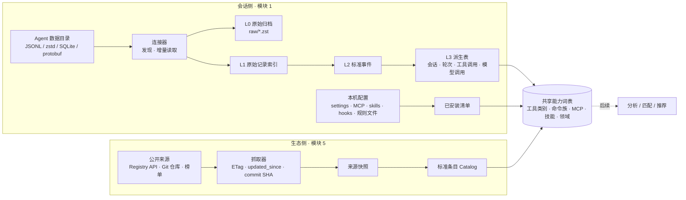

# Tandem 数据获取与标准化方案（模块 1 + 模块 5）

> 状态：2026-10-02 起持续迭代。按团队已确定的模块划分，本轮完成模块 1 与模块 5 的**数据获取、标准化与存储**；分析、匹配、推荐、AI 辅助不在本轮范围。
>
> 依据：`yhyfhgs` 本机 2026-10-01 的只读实测（只看字段结构，不读内容），以及对开源项目、标准与公开市场的调研。外部信息以文末链接为准，标注「未核实」的条目需要在实现前再确认。

## 0. 结论先行

1. **两边各自独立采集，在同一套「能力词表」上汇合。** 会话侧把各 Agent 的日志标准化成统一事件；生态侧把 Skills、Plugins、MCP、Hooks、规则、工作流、模型成绩标准化成统一条目。两边都抽取同一套特征（工具类别、命令族、MCP 服务、技能名、文件类型、领域标签），后续匹配只需在特征层做连接。
2. **本机实测推翻了 Demo 里的三处假设**：Gemini 侧实际是 Google Antigravity（明文转录在 `brain/<id>/…/transcript_full.jsonl`，模型与 token 藏在 protobuf 里），不是 `~/.gemini/tmp`；Copilot 没有 `~/.copilot/history`，本机只剩会话元数据；DeepSeek Harness 的会话是 zstd 压缩的事件流，需要解压并合并流式分片。另外 Claude Code 不止 `~/.claude` 一个根目录（第二账号、桌面版本地 Agent 模式），桌面版还有一份会话索引。
3. **必须自建原始归档。** Claude Code 默认只保留 30 天会话（本机最早的转录停在 2026-09-02），Copilot 的会话表已被清空。Tandem 首次运行全量回填，之后增量归档原始字节，否则 Demo 的 90 天视图和 7 天效果追踪都无法成立。
4. **「不丢信息」用四层结构保证**：L0 原始字节归档 → L1 原始记录索引（每行都有去向）→ L2 标准事件（未映射字段进 `ext`）→ L3 派生表（会话、轮次、工具调用、模型调用，可随时重算）。每个连接器都要通过「记录全记账」测试。
5. **去重是正确性的核心。** 实测确认：Claude Code 一次模型响应被拆成 1–6 行且每行重复同一份 usage（不去重会把 token 算多 2–3 倍）；恢复会话会复制历史（830 个 uuid 出现在多个文件）；Codex 子代理会重放父会话历史；Codex 还导入了 50 个 Claude Code 会话。
6. **MVP 先接 Claude Code、Codex、DeepSeek Harness**（本机数据量最大、格式已摸清），pi 与 Antigravity 的明文转录顺手接入；Copilot 与其他 Agent 留接口。生态侧先接官方 MCP Registry、Claude 官方插件市场、`anthropics/skills`、`openai/skills` 与 Codex 官方插件、models.dev。
7. **存储用 SQLite + zstd 归档**：`tandem.db`（会话侧）、`catalog.db`（生态侧，可由团队定期构建成快照分发）、`raw/`（原始归档）。数据库表结构就是模块之间的契约，三人可以并行开发。

## 1. 范围与原则

| 在范围内 | 不在范围内 |
| --- | --- |
| 模块 1：发现并读取各 Agent 的本地会话与配置 | 模块 3、7、10、11：分析、推荐、AI 辅助 |
| 模块 5：抓取公开的 Skills、Plugins、MCP、Hooks、规则、工作流、模型成绩 | 模块 8：一键安装（只记录安装方式，不执行） |
| 模块 2、6 中与入库有关的部分：标准化、去重、项目归属、存储 | 模块 4、9：前端交互 |

原则：

- **本地优先、只读。** 连接器只读 Agent 的数据目录，不写、不改、不删；SQLite 以只读方式打开。生态抓取只下载公开数据，不上传任何用户数据。
- **不丢信息。** 原始字节保留，每条原始记录都有去向，标准化时没用上的字段进 `ext`，解析器升级后可以从归档重算。
- **增量与幂等。** 事件 ID 由来源位置确定性生成，重复导入不产生重复数据。
- **凭据不碰。** 连接器使用路径白名单，并显式排除凭据文件（见 3.5）。
- **够用即可。** 不做通用 ETL 框架；每个 Agent 一个连接器，一个文件能写完就不拆。新 Agent 按需接入。

## 2. 总体结构



Demo 各页需要的数据与来源：

| Demo 页面 | 需要的数据 | 来自 |
| --- | --- | --- |
| A1 概览、A3 会话与轨迹 | 会话起止、轮次、事件时间线、模型、token | `session`、`turn`、`event`、`model_call` |
| A4 工具调用 | 工具明细、失败原因、耗时、审批负担、MCP 与子代理 | `tool_call`、`event(kind=approval)`、子代理链接 |
| A5 项目习惯 | 项目归属、规则覆盖（AGENTS.md / Hooks / Skills / MCP / 子代理） | `project`、已安装清单 |
| A6 情绪与语义 | 用户原话（仅人类输入）、纠偏与打断 | `event(kind=message.user, origin=human)` |
| A7 建议、A8 资源库 | 生态条目、兼容 Agent、许可、安装方式、热度 | `catalog.db` |
| A10 设置 | 数据源、索引状态、脱敏规则、存储位置 | `source`、`source_file`、配置 |
| 菜单栏、悬浮组件（实时状态） | 会话是否运行、是否在等审批、上下文占用 | 文件监听 + 可选 Hooks（3.4） |

## 3. 模块 1：本地会话数据获取

### 3.1 本机实测（2026-10-01）

| Agent | 本机版本 | 会话位置 | 格式 | 本机规模 | Demo 假设 |
| --- | --- | --- | --- | --- | --- |
| Claude Code | 2.1.281–2.1.284；绝大多数来自 Claude 桌面版（`entrypoint=claude-desktop`） | `~/.claude/projects/<编码 cwd>/<sessionId>.jsonl`；第二账号 `~/.claude-account2/projects/` | JSONL，20 余种记录类型 | 124 + 4 个主会话，251 个子代理文件，1.3 GB（多为 PDF 页图） | 成立，另有第二账号目录 |
| Codex | 0.146–0.154，以 Codex Desktop 为主 | `~/.codex/sessions/YYYY/MM/DD/rollout-*.jsonl`、`~/.codex/archived_sessions/`；索引 `state_5.sqlite`；投影 `thread_history_1.sqlite` | JSONL + SQLite | 432 + 474 个 rollout，3.4 GB；threads 表 890 行 | 部分成立：还要读归档目录和 SQLite |
| Gemini 侧 | Antigravity 桌面版与 `agy` CLI；未见 Gemini CLI 的 `~/.gemini/tmp` | `~/.gemini/antigravity{,-cli}/brain/<id>/.system_generated/logs/transcript_full.jsonl`、`conversation_summaries.db`、`conversations/<id>.db` | 明文 JSONL 转录 + SQLite；模型与 token 在 protobuf 里 | 27 + 1 个对话，65 MB | 不成立 |
| Copilot | Copilot 桌面 App（以 server 模式启动 CLI） | `~/.copilot/session-state/<id>/workspace.yaml`、`data.db` | YAML + SQLite | 43 个会话目录，只有元数据；`data.db` 的 sessions 表为空 | 不成立：没有 `~/.copilot/history` |
| DeepSeek Harness | `@deepseek-ai/dsh` 0.1.1-rc.2（MIT） | `~/.dsh/sessions/--<规范化 cwd>--/<sessionId>/session.jsonl.zstd` | zstd 帧拼接的 JSONL 事件流，含打包的流式分片 | 79 个会话，39 MB | 路径成立，需解压与合并分片 |
| pi | 0.99.1 | `~/.pi/agent/sessions/--<cwd>--/<时间戳>_<uuid>.jsonl` | JSONL，`id/parentId` 树 | 2 个会话 | Demo 未列出 |

保留期实测：Claude Code 最早的主会话文件是 2026-09-02，与默认 30 天清理一致；Codex 保留到 2026-04；Copilot 本机已无事件明细。

### 3.2 各 Agent 接入要点

#### Claude Code（P0）

- **数据根目录不止一个**：`${CLAUDE_CONFIG_DIR:-~/.claude}`（可能是逗号分隔的多个目录）、同级的 `~/.claude*`（本机有 `~/.claude-account2`）、Claude 桌面版的本地 Agent 模式 `~/Library/Application Support/Claude/local-agent-mode-sessions/**/.claude/projects`（本机 1 个会话）。
- **桌面版会话索引**：`~/Library/Application Support/Claude/claude-code-sessions/<组织>/<账号>/local_<id>.json`（本机 118 个），字段有 `cliSessionId`（对应转录文件的 `sessionId`）、`cwd / originCwd`、`createdAt / lastActivityAt`、`model`、`effort`、`title / titleSource`、`isArchived`、`permissionMode`、`enabledMcpTools`、`completedTurns`；另有 `deleted_<id>` 删除标记（237 个）与 `scheduled-tasks.json`。用于补标题、归档状态和会话级设置，不含正文。
- **文件布局**：主会话 `<proj>/<sessionId>.jsonl`；子代理 `<proj>/<sessionId>/subagents/agent-<id>.jsonl` 与同名 `.meta.json`（`agentType`、`description`、`toolUseId`、`spawnDepth`）；Workflow 子代理 `<proj>/<sessionId>/subagents/workflows/wf_<id>/agent-<id>.jsonl` 与 `journal.jsonl`、`<sessionId>/workflows/wf_<id>.json`；超长工具输出落在 `<sessionId>/tool-results/`；`custom-title.json`；项目记忆 `<proj>/memory/*.md`。
- **目录名是有损编码**（`/`、空格、`.` 都变成 `-`），项目归属必须用记录里的 `cwd`，不能反解目录名。
- **记录类型**（实测）：`assistant`、`user`、`attachment`、`system`、`last-prompt`、`custom-title`、`agent-name`、`queue-operation`、`pr-link`、`file-history-snapshot/delta`、`mode`、`permission-mode`、`cost-state`、`relocated`，以及 `atis-latch`、`bridge-session`、`frame-link`、`artifact-*` 等界面状态。
- **关键字段**：`uuid / parentUuid / logicalParentUuid`（消息树）、`sessionId`、`isSidechain`、`cwd`、`gitBranch`、`version`、`entrypoint`、`timestamp`、`requestId`、`promptId`、`effort / perTurnEffort`（思考档位）、`permissionMode`、`origin.kind`（`human` / `task-notification` / `peer`）、`isMeta`、`attributionSkill / attributionMcpServer / attributionMcpTool`（工具调用由哪个技能或 MCP 引起）、`toolDenialKind`、`hookInfos / hookErrors`。
- **内容块**：`text`、`thinking`（带 `signature`）、`tool_use`、`tool_result`、`image`；结构化工具结果在 `toolUseResult`（`stdout / stderr / interrupted / structuredPatch / filePath / durationMs` 等）。
- **用量**：`message.usage` 含 `input / output / cache_creation / cache_read`、`output_tokens_details.thinking_tokens`、`server_tool_use`（搜索与抓取次数）、`service_tier`、`speed`；`cost-state` 记录给出按模型的 `costUSD`、`totalLinesAdded / Removed`、`totalAPIDuration / totalToolDuration`。
- **系统事件**：`system.subtype` 有 `compact_boundary`（`compactMetadata.trigger / preTokens / postTokens`）、`api_error`（含重试）、`turn_duration`、`stop_hook_summary`、`local_command`。
- **审批与打断**（实测）：`toolDenialKind` 取 `user-rejected`（用户拒绝）、`permission-rule`（规则拦截）、`automode-blocked / automode-unavailable`（自动模式分类器拦截或不可用）、`interrupted`；被拒绝时工具结果是固定提示文本；打断标记为 `[Request interrupted by user]` 与 `[Request interrupted by user for tool use]`。转录里没有审批等待时长。
- **坑**：
  - 一次 API 响应按内容块拆成多行，每行重复同一份 usage（实测 4546 条多行消息的 usage 全部相同）→ 用 `message.id + requestId` 去重后再累计。
  - `--resume`、`--fork-session`、后台会话会把历史复制进新文件（830 个 uuid 出现在多个文件）；`/btw` 旁支会用新的 `requestId` 重放父消息 → 按 `uuid` 去重，后出现的副本标记为重放。排队的命令以没有 `uuid` 的 attachment 保存，需要合成 ID。
  - `type=user` 不等于人类输入：要排除 `isMeta`、压缩摘要、只含 `tool_result` 的消息、`<command-name>` / `<local-command-stdout>` 包装，并结合 `origin.kind` 区分人类、任务通知与对等 Agent；`[Request interrupted by user…]` 是打断信号。
  - 30 天自动清理（`cleanupPeriodDays`）；桌面版的临时工作区路径 `~/Library/Application Support/Claude/scratch-workspaces/…` 应归入「临时工作区」。
  - 版本更新很快（实测两天内两个小版本），新字段会持续出现，靠 4.2 的漂移检测兜底。
- **现成的参照**：`~/.claude/usage-data/` 是 `/insights` 生成的逐会话统计（`session-meta`：工具次数、打断次数、响应间隔、工具错误分类、会弹审批的命令数等）和标签（`facets`：目标、结果、摩擦类型、满意度）。可作为我们派生指标的对照答案，不作为主数据源。

#### Codex（P0）

- **以 SQLite 为索引、JSONL 为正文。** `state_5.sqlite.threads` 有每个线程的 `rollout_path`、`cwd`、`title`、`model`、`reasoning_effort`、`tokens_used`、`git_sha / git_branch / git_origin_url`、`thread_source`、`agent_nickname / agent_role / agent_path`、`archived`、`project_id`；`thread_spawn_edges` 给出父子线程；`projects / project_roots` 是 Codex 自己的项目分组。`thread_history_1.sqlite` 是 Codex 按字节偏移增量投影的条目表（`thread_items`、`thread_turns`、`thread_history_projection_state.next_rollout_byte_offset`），可作对照，但不保证覆盖全部原始信息，正文仍以 rollout 为准。
- **rollout 记录**（实测新格式）：顶层 `ordinal / timestamp / type / payload / metadata`；`type` 有 `session_meta`、`turn_context`、`response_item`、`event_msg`、`token_usage_record`、`world_state`、`inter_agent_communication_metadata`。`event_msg` 下有 `item_completed`（条目类型 `Reasoning / CommandExecution / AgentMessage / Extension(web.search) / UserMessage / SubAgentActivity / FileChange / ImageView / McpToolCall`）、`task_started / task_complete`、`token_count`、`thread_settings_applied`、`turn_aborted`；`response_item` 下有 `message`（`user / assistant / developer`）、`reasoning`（`summary` 与 `encrypted_content`）、`function_call / custom_tool_call` 及其输出、`compaction / compacted`。
- **用量**：优先用 `token_usage_record`（每个 `response_id` 一条，含 `cached_input / cache_write_input / reasoning_output`，实测无重复）；旧文件只有 `token_count` 时用 `last_token_usage`，并跳过累计值未变化的重复事件（实测 2397 条中 8 条重复）。`rate_limits` 快照可用于额度展示。
- **坑**：
  - 子代理与分叉线程会先重放父会话历史，真正属于自己的部分从 `subagent_history_start_ordinal` 开始（实测近 120 个文件中 106 个是子代理或分叉，每个重放 1–55 条）→ 之前的记录标记为重放。
  - `thread_source` 区分 `user`、`subagent`、`guardian_review`（自动审批评审）、`automation`、`realtime_voice`；本机 890 个线程里，用户发起的只有 241 个，`guardian_review` 241 个、`subagent` 385 个，使用 `codex-auto-review` 模型的线程有 413 个 → 会话类型必须分开，否则人格与习惯统计会被系统线程污染。
  - `external_agent_session_imports.json` 记录了 Codex 导入的 50 个 Claude Code 会话（`source_path`、`content_sha256`、`imported_thread_id`）→ 这些线程标记为导入并链接到原 Claude 会话，默认不重复计入。
  - 思考档位取值有 `low / medium / high / xhigh / max / ultra`，模型名随版本变化（实测有 `gpt-5.6-sol`、`gpt-6-astra` 等）→ 原值保留，另做归一（4.5）。
  - `archived_sessions/` 是扁平目录，与 `sessions/` 的日期目录要一起扫描；同一个会话可能两边都有，按 `session_meta.id` 去重、以 `sessions/` 中的为准。`logs_2.sqlite`（346 MB）是运行日志，不是会话正文，默认不读。
  - 恢复会话会改写 `cli_version`，不能按版本号分支解析逻辑，要按记录形状判断；早期会话没有 `turn_context`，模型未知；`codex-auto-review` 是服务端别名，看不到真实模型。
  - 额度快照 `rate_limits` 按 `window_minutes` 判断是 5 小时窗口还是周窗口，不要按 `primary / secondary` 槽位判断（2026-07 起周窗口移到了 `primary`）。

#### DeepSeek Harness（P0）

- 官方格式文档在本机 npm 包内：`~/.local/lib/node_modules/@deepseek-ai/dsh/node_modules/@deepseek-ai/dsh-session-persistence-jsonl/README.md`（MIT，源码仓库 `deepseek-ai/deepseek-harness`）。
- 每个会话一个目录、一个只追加的逻辑日志；文件由多个独立的 zstd 帧拼接（第一帧只含会话头，之后每次批量写入一帧），任何标准 zstd 解码器都能整体解压。
- 第一行是会话头：`type=session`、`version`、`id`、`cwd`、`createdAt`、`parentSession`、`seedLength`、`origin`、`delegationDepth`、`agentPreset`；之后每行一个事件，`seq` 连续。
- 事件类型（实测）：`user/message`、`assistant/message`（含 `usage`）、`tool/call`、`tool/result`、`step/start / step/end`、`turn/start / turn/end`、`approval/asked / approval/decided / approval/policy`、`permission/preset`、`sandbox/mode`、`subagent/descriptor`、`agent/inbox/spliced`、`todo/write`、`session/title`、`request/header`、`request/context`、`web/deepseek-search-llm-request` 等。
- **流式分片**：`assistant/chunk` 增量事件会被打包成 `text-chunks / reasoning-chunks / tool-call-chunks` 行（`seq0 / time0 + dt[]` 可无损还原每个分片的序号和时间）。统计与正文以 `assistant/message`、`tool/call` 等完整事件为准，分片只用于还原首字延迟和流式时长，标记为已折叠。
- **坑**：根目录可由 `DSH_HOME` 覆盖；关闭压缩时文件是明文 `session.jsonl`，按 zstd 魔数判断而不是按扩展名；目录名同时存在 `<uuid>` 与 `session-<uuid>` 两种（54 / 25）；目录名是有损规范化的 cwd，以会话头的 `cwd` 为准；文件末尾可能有未写完的帧，读到不完整的帧时保留已解码记录并在下次重读；`compaction/summary` 是单独计费的压缩调用；实际响应模型以 `replayState.response.responseModel` 为准；多供应商（`openrouter`、`kimi-coding`、`openai-codex`、`xai`），模型名不统一；不记录成本。
- 另有 `dsh-session-telemetry-otel` 可把事件流导出为 OpenTelemetry 日志，可作补充通道；轨迹可视化组件 `dsh-client-ui-trajectory` 留给模块 3 参考。

#### pi（P1，顺手接入）

- 每个会话一个 JSONL：会话头 `type=session`（`version`、`cwd`），之后 `message`、`model_change`、`thinking_level_change`、`compaction` 等条目，以 `id / parentId` 构成树（可分支，当前分支是从最后一个叶子回溯到根的路径）。
- `message.role` 有 `user / assistant / toolResult / system`；内容块 `text / thinking / toolCall`；`usage` 自带 `input / output / cacheRead / cacheWrite / reasoning / cost`，`thinkingLevel` 与 `provider / model` 都在消息上。格式简单，适合作为连接器模板。
- 根目录可由 `PI_CODING_AGENT_DIR` 覆盖；首次助手回复前不落盘；分叉会话会重放父会话前缀；`subagent-artifacts/` 下的文件与主会话重复，跳过。

#### Antigravity（P1：明文转录 + 摘要库；P2：protobuf 用量）

- IDE 数据在 `~/.gemini/antigravity/`，CLI（`agy`）数据在 `~/.gemini/antigravity-cli/`。
- **明文转录**：`brain/<id>/.system_generated/logs/transcript_full.jsonl`（本机 28 份；另有按块切分的 `chunks/transcript_full/0000000N.jsonl` 和精简版 `transcript.jsonl`），每行一个步骤：`step_index / source（USER_EXPLICIT / MODEL / SYSTEM）/ type（USER_INPUT / PLANNER_RESPONSE / CHECKPOINT …）/ status / created_at / content / thinking / tool_calls`；`INVOKE_SUBAGENT` 表示子代理，`CHECKPOINT` 表示压缩。SpecStory 的 `ANTIGRAVITY-FORMAT.md` 有完整说明。
- `conversation_summaries.db` 可直接读出标题、步骤数、工作区、最后修改时间、父对话与嵌套深度、状态。
- **模型与 token** 只在 `conversations/<id>.db` 的 `gen_metadata`（protobuf）里，`steps.step_payload` 也是 protobuf（实测首字节 `0x08`）。tokscale 记录了 `gen_metadata` 的字段编号（并注明 agy 1.1.17 → 1.1.18 布局变过），agentsview 有通用的 protobuf 遍历器；更旧的版本是 AES 加密的 `.pb` 文件。
- MVP 读转录与摘要库；用量解码放到 P2，版本变化时以样本回归测试兜底。

#### Copilot（P2）

- Copilot CLI 的标准位置是 `${COPILOT_HOME:-~/.copilot}/session-state/<id>/events.jsonl`（旧版是扁平的 `<id>.jsonl`），事件有 `session.start`、`user.message`、`assistant.message`、`assistant.reasoning`、`tool.execution_start / complete`、`session.model_change`、`session.shutdown`（按模型的累计用量，恢复会话时会重发，需要相邻快照做差）；按请求的用量在 `session-store.db` 的 `assistant_usage_events`；也可能有 OTel 文件 `otel/**/*.jsonl`。输入含缓存、输出含思考；模型名写法（如 `claude-sonnet-4.6`）与价目表不一致。
- 本机用的是 Copilot 桌面 App：只有 `session-state/<id>/workspace.yaml`（`id / cwd / git_root / repository / branch / client_name / created_at / updated_at`）和 `checkpoints/index.md`，没有 `events.jsonl`；`data.db` 的 `sessions` 表结构完整（模型、思考档位、各类 token、上下文占用），但没有行。连接器按上面的位置依次探测，本机先只读元数据。

#### 其他 Agent（本机未安装，按开源项目的解析器整理，接入前用真实样本核实）

| Agent | 位置 | 格式 | 用量 | 注意 |
| --- | --- | --- | --- | --- |
| Gemini CLI | `~/.gemini/tmp/<项目哈希或名称>/chats/session-*.json(l)`，`projects.json` 映射路径；`GEMINI_CLI_HOME` / `GEMINI_DIR` 覆盖 | 旧版单个 JSON，v0.40 起为 JSONL 操作日志（`$set`、`$rewindTo`、`message_update`，同 `id` 后者覆盖前者） | `tokens.{input, output, cached, thoughts}` | 会话有 `kind: main / subagent` |
| Cursor IDE | `~/Library/Application Support/Cursor/User/globalStorage/state.vscdb` 的 `cursorDiskKV` 表 | `composerData:<id>`（会话）+ `bubbleId:<会话>:<消息>`（消息，`_v ≥ 3` 时工具数据在 `toolFormerData`） | 磁盘上没有可靠 token | 库常有数百 MB 且持续写入；`ItemTable` 里有登录令牌，绝不导出；项目归属要结合 `workspaceStorage` |
| Cursor CLI | `~/.cursor/projects/<编码路径>/agent-transcripts/`、`~/.cursor/chats/<md5>/<id>/store.db` | 文本转录 + 内容寻址的 blob 树 | 无 | 细节有限 |
| OpenCode / Kilo CLI | `${XDG_DATA_HOME:-~/.local/share}/opencode/opencode.db`（Kilo 为 `kilo/kilo.db`） | v2：`session_v2` + `session_message`；v1.2：`session / message / part`；更早是 `storage/` 下的 JSON | `tokens{input, output, cache{read, write}}`、`cost` | 分叉会复制父会话的行；流式时助手行会被原地改写；同库有凭据表 |
| Amp | `~/.local/share/amp/threads/T-<uuid>.json` | 每线程一个 JSON，持续改写 | `messages[].usage`（含缓存读写）、credits | OpenAI 模型的未缓存输入记在「缓存写入」 |
| Factory Droid | `~/.factory/sessions/**/<id>.jsonl` + `<id>.settings.json` | JSONL 消息 | `settings.json` 的累计 `tokenUsage` | 累计值原地改写；模型名是自定义字符串 |
| Kimi CLI | `~/.kimi/sessions/…/wire.jsonl`、`~/.kimi-code/sessions/…/agents/<agent>/wire.jsonl` | JSONL | `StatusUpdate` / `usage.record` | 日志不记录模型 |
| Qwen Code | `~/.qwen/projects/<cwd>/chats/<id>.jsonl` | 与 Claude 相似的 `uuid / parentUuid` | `usageMetadata` | 压缩记为 `system/chat_compression`；跳过 `.ledger.jsonl` 等旁路文件 |
| Cline / Roo / Kilo（插件版） | 各 VS Code 系编辑器的 `globalStorage/<扩展 ID>/tasks/<id>/` | `api_conversation_history.json` + `ui_messages.json` | `ui_messages` 中 `api_req_started` 的 `tokensIn / tokensOut / cacheReads / cacheWrites / cost` | 要扫描 Code、Cursor、Windsurf 等所有编辑器 |
| Goose | `~/.local/share/goose/sessions/sessions.db` | SQLite | `usage_ledger`（含成本、是否压缩） | 旧库只有会话总量 |
| Crush | `~/.local/share/crush/projects.json` → 各项目 `.crush/crush.db` | SQLite | 只有成本 | 子代理会话名为 `<uuid>$$<toolCallId>` |
| Kiro | `~/.kiro/sessions/`、`~/Library/Application Support/kiro-cli/data.sqlite3` | JSON(L) + SQLite | 常为 0，按 credits 计费 | — |
| Aider | 各仓库的 `.aider.chat.history.md` | Markdown | 无 | 无逐条时间戳；需要有限深度地遍历项目目录 |

### 3.3 发现、增量读取与监听

**发现**

- 每个连接器声明候选根目录和环境变量覆盖（如 `CLAUDE_CONFIG_DIR`、`CODEX_HOME`），并扫描同类的多份配置（本机有 `~/.claude` 与 `~/.claude-account2`）。每个根目录登记为一个 `source`。
- 首次启动列出发现结果，由用户勾选启用；之后检测到新的数据源只提示，不自动接入（对应 Demo 的「发现新数据源」通知）。

**增量读取**

| 来源形态 | 水位（watermark） | 变化判定 | 处理 |
| --- | --- | --- | --- |
| 只追加的 JSONL | 已处理的字节偏移 + 最后一行的哈希 | `dev / inode / size / mtime_ns` 变化 | 从偏移继续读；末行不完整时下次重读 |
| zstd 帧拼接 | 已处理的帧数与解压后的行号 | 同上 | 从下一帧继续；不完整帧下次重读 |
| SQLite | 表的 `updated_at` / rowid 游标；行会被原地改写时按「主键 + 行哈希」比对 | 目录内 `db / -wal` 的变化（WAL 会被删除重建，所以监听目录而不是文件） | 以只读方式打开（`mode=ro`，不要用 `immutable=1`），设 `busy_timeout` 与 `query_only`，在一个读事务内读完 |
| 文件被改写或截断 | 前 4 KB 的哈希 | 哈希不符、文件变小或 inode 变化 | 整个文件重新解析；事件 ID 是确定性的，重复写入会被覆盖 |
| 文件消失 | — | 上游清理 | `source_file.status = gone_upstream`，归档和已入库的数据保留 |

- **确定性 ID**：`event_uid = hash(source_id, 原生 ID 或 文件相对路径 + 序号)`。有原生 uuid（Claude、pi）就用原生 uuid，保证跨文件的重放副本能对上。
- **监听**：macOS 用 FSEvents 监听各根目录，事件合并 1–2 秒后触发增量解析；另每 10 分钟做一次全量 `stat` 兜底。正在写入的会话文件可以据此判断「运行中」。
- **首次回填**：本机约 5 GB 原始日志，按文件并行、流式解析，不把整个文件读进内存；先处理最近 30 天，再补更早的。

**原始归档（L0）**

- 每个被跟踪的文本文件在 `raw/` 下有一个对应归档：首次整份 zstd 压缩，之后只把新增的字节压成新帧追加（与 DeepSeek Harness 的做法相同）。SQLite 来源按行导出为 JSONL 再归档。
- 图片、PDF 页图等二进制默认只记路径、大小和哈希，不复制（Claude 的 1.3 GB 主要是这些）；需要时在设置里打开。
- 文本日志压缩率估计在 8–15 倍，本机 5 GB 原始日志归档后约 0.4–0.6 GB（待实测）。

### 3.4 补充通道（可选，非 MVP）

| 通道 | 能补什么 | 代价 | 建议 |
| --- | --- | --- | --- |
| Hooks（Claude Code、Codex 等） | 实时状态：会话开始结束、等待审批、通知、压缩前；审批等待的精确时长 | 要写入用户配置，必须走 Demo 的「预览 → 确认 → 可撤销」流程 | P1：菜单栏「需要关注」状态依赖它 |
| OpenTelemetry（本地 OTLP 接收端） | 模型请求耗时、工具决策来源（自动 / 用户批准 / 拒绝）、精确成本 | 用户需开启各 Agent 的遥测并指向本机端口 | P1：用于校准日志推算的指标 |
| 反代（Proxy） | 完整请求与响应、系统提示词、工具定义 | 侵入性强，可能影响订阅登录，隐私风险高 | 不做，仅在文档中说明 |
| 额度 | 剩余额度与重置时间 | 读 OAuth 令牌调用官方接口会触碰凭据 | 只用日志里已有的快照（Codex `rate_limits`、Claude `quotaLimits`），不调用接口 |

**反代能补什么、缺什么。** 反代能拿到日志里没有的系统提示词与工具定义、压缩后实际发送的完整上下文、重试与失败的请求、首字延迟、429 等错误、实际服务的模型；但拿不到工作目录与 Git 状态、审批与打断，也覆盖不了无法改走代理的客户端（如 Cursor IDE）。代价是要改各客户端的 base URL 或信任本地 CA，会遇到 OAuth、签名请求的兼容问题，并且会落盘密钥与隐私数据。所以：

- 本地日志始终是主数据源。
- 用户已经在跑的代理（cc-switch 的 `proxy_request_logs`、better-ccflare 的 SQLite），以后可以作为可选的导入连接器，按 `session_id` + 时间 + token 数关联到会话。
- 「深度捕获」（claude-tap 式的本地反代，把完整请求写成 JSONL）只作为高级选项，永不默认开启。

**额度。** CodexBar 的额度来自带凭据的官方接口：Claude 用 OAuth 令牌请求 `api.anthropic.com/api/oauth/usage`，Codex 用 `~/.codex/auth.json` 请求 `chatgpt.com/backend-api/wham/usage`，Copilot、Gemini 也类似。这些都要读凭据和联网，与 Tandem「不碰凭据、不调用云端」的原则冲突。默认只用日志里已有的快照（Codex `rate_limits`、Claude `quotaLimits`）；需要实时额度时，作为用户显式开启的独立功能再做。

### 3.5 本机配置快照（已安装清单）

推荐模块需要知道「已经装了什么、哪些装了没用过」（Demo 的「移除闲置的 figma MCP」）。连接器同时扫描配置，生成已安装清单：

| Agent | 扫描内容 |
| --- | --- |
| Claude Code | `settings.json`（`permissions`、`hooks`、`enabledPlugins`、`extraKnownMarketplaces`、`model`）、`~/.claude.json` 中的 `mcpServers`（全局与按项目）、`skills/`、`agents/`、`commands/`、`plugins/installed_plugins.json`、`plugins/known_marketplaces.json`；项目内 `.claude/`、`.mcp.json`、`CLAUDE.md` |
| Codex | `config.toml` 的 `mcp_servers`、`plugins`、`marketplaces`、`skills.config`、`features`、`projects`；`skills/`、`rules/`、`plugins/cache/` |
| 通用 | `~/.agents/AGENTS.md`、`~/.agents/skills/`；各项目根目录的 `AGENTS.md`、`GEMINI.md`、`.cursor/rules`、`.github/copilot-instructions.md` |
| 其他 | Antigravity `config/mcp_config.json` 与 `config/plugins/`；Copilot `installed-plugins/`；DeepSeek Harness `settings.yaml` 与 `profiles/` |

**凭据黑名单**（连接器永不打开）：`~/.codex/auth.json`、`~/.dsh/.credentials.yaml`、`~/.pi/agent/auth.json`、`~/.gemini/*oauth*`、`~/.claude/.credentials*`、钥匙串、任何 `.env`。配置中的 `env`、`headers`、`token` 类字段入库前替换为 `<redacted>`。

### 3.6 参考的开源项目

以下数据为 2026-10-01 从 GitHub 读取（stars 与最近推送时间来自 `gh api`），解析规则以各项目源码为准。

| 项目 | 规模与许可 | 覆盖 | 借鉴什么 |
| --- | --- | --- | --- |
| [kenn-io/agentsview](https://github.com/kenn-io/agentsview) | 6.0k ★，MIT，Go | 约 70 个 Agent，含 DeepSeek Harness、Antigravity、Cursor、Kiro、Crush、Goose、Aider | **最完整的多 Agent 参照**：声明式的 Agent 注册表（环境变量覆盖、多个根目录、监听目录、「没有逐条 token」标记）、增量解析、SQLite / WAL 指纹、Antigravity 的 protobuf 遍历与解密 |
| [ccusage/ccusage](https://github.com/ccusage/ccusage) | 18.8k ★，MIT，Rust | 18 个适配器 | 每个 Agent 一个 crate，README 写明 token 含义与去重规则，是写连接器时的首要对照 |
| [junhoyeo/tokscale](https://github.com/junhoyeo/tokscale) | 5.6k ★，MIT，Rust | 约 60 个客户端 | 路径表（根目录 + 相对路径 + glob）；按解析器版本失效缓存；Antigravity `gen_metadata` 字段编号；`dsh.rs` |
| [specstoryai/getspecstory](https://github.com/specstoryai/getspecstory) | 1.3k ★，Apache-2.0，Go | 14 个 | 每个 Agent 一份 `*-FORMAT.md` 格式说明（Antigravity、Cursor IDE、OpenCode、pi、Qwen Code 等），可直接当文档读 |
| [steipete/CodexBar](https://github.com/steipete/CodexBar) | 22.1k ★，MIT，Swift | 数十家额度；Claude、Codex、pi 的本地成本 | 额度获取的多级回退；钥匙串的安全读取；按文件身份缓存成本 |
| [jazzyalex/agent-sessions](https://github.com/jazzyalex/agent-sessions) | 889 ★，MIT，Swift | 约 18 个 | 最接近我们的 macOS 应用：多个 `~/.claude*` 根目录的发现、从 Codex JSONL 读额度窗口 |
| [Piebald-AI/splitrail](https://github.com/Piebald-AI/splitrail) | 222 ★，MIT，Rust | 19 个 | 文件监听驱动的实时统计；Cline 系 `ui_messages` 的用量解析 |
| [farion1231/cc-switch](https://github.com/farion1231/cc-switch) | 139k ★，MIT，Rust（Tauri） | Claude、Codex、Gemini、OpenCode、pi 等 | 增量扫描的水位表 `session_log_sync`；代理日志与本地日志并存的表设计 |
| [liaohch3/claude-tap](https://github.com/liaohch3/claude-tap) | 3.3k ★，MIT，Python | 15 个以上 | 本地反代把完整请求写成 JSONL 的做法（3.4） |
| [harbor-framework/harbor](https://github.com/harbor-framework/harbor) | 5.8k ★，Apache-2.0，Python | 30 多个 Agent → ATIF | 转换器有损，只作对照测试（4.6） |
| [deepseek-ai/deepseek-harness](https://github.com/deepseek-ai/deepseek-harness) | 242k ★，MIT，TypeScript | DeepSeek Harness 自身 | 会话格式文档、分片无损编解码、崩溃修复语义；`dsh-client-ui-trajectory` 留给模块 3 |

**许可注意**：

- 可以移植或复用（保留版权声明）：上表中 MIT 与 Apache-2.0 的项目；Apache-2.0 需保留 LICENSE / NOTICE 并标注改动。CodexBar 的 `Vendored/` 目录需逐个文件确认来源。
- **不要参考代码：Dicklesworthstone/coding_agent_session_search（cass）。** 它的「MIT + OpenAI/Anthropic 附加条款」不授予 Anthropic、OpenAI 及代其行事者任何权利，并把「分析代码、输入自动化或机器学习流程」算作使用，违反即终止许可。我们用 Claude 开发，风险太高；它记录的文件路径等事实，从上面的 MIT 项目里取。
- 没有许可证的仓库只看思路，不复制代码。

## 4. 轨迹标准化：适配不同 harness，不丢信息

### 4.1 分层

| 层 | 内容 | 是否可重建 |
| --- | --- | --- |
| L0 原始归档 | 原始字节（zstd） | 不可重建，是唯一真相 |
| L1 原始记录 | 每行 / 每帧行 / 每条 SQL 行一条索引：位置、哈希、原生类型、去向 | 可从 L0 重建 |
| L2 标准事件 | 统一的事件类型与字段，保留原生树结构和未映射字段 | 可从 L0 重建（解析器升级时重跑） |
| L3 派生表 | 会话、轮次、工具调用、模型调用、项目归属等汇总 | 可从 L2 重建 |

### 4.2 「不丢信息」的四条契约

1. **每条原始记录都有去向。** L1 的 `disposition` 只能是 `mapped`（生成了事件）、`folded`（并入其他事件，如流式分片）、`replayed`（重放的历史副本）、`duplicate`（同一响应的重复行）、`ignored`（界面状态等，需写明原因）、`unparsed`（解析失败，保留原文并告警）之一。
2. **没用上的字段不丢。** 解析器记录自己读取了哪些键，剩余的键原样写入事件的 `ext`（JSON）。这样既不丢信息，也能发现新字段。
3. **全记账测试。** 每个连接器用脱敏后的样本文件做回归测试：记录数 = 各去向计数之和；`unparsed` 为 0；`ext` 中出现新键时测试给出提示。
4. **格式漂移告警。** 按「Agent × 版本 × 原生类型」统计键集合指纹。新版本出现新类型或新键时，在设置页提示「Claude Code 2.1.29x 出现了未识别字段」，再决定是否扩展映射。

### 4.3 统一实体

| 实体 | 粒度 | 关键字段 |
| --- | --- | --- |
| `source` | 一个 Agent 数据根目录 | `agent`、`root_path`、`label`（账号） |
| `session` | 一个会话（含子代理会话） | `session_uid`、`kind`、父会话与根会话、派生它的工具调用、`forked_from`、`imported_from`、`project_id`、`cwd`、Git 信息、入口（CLI / 桌面 / IDE / exec）、版本、标题、起止时间、状态 |
| `turn` | 一次「输入 → 完成」 | 触发者（人类 / 排队消息 / 通知 / 对等 Agent / 自动化）、起止、状态（完成 / 打断 / 失败）、首条与末条事件 |
| `event` | 一条标准事件 | `kind`、`actor`、`ts`、`seq`、`parent_uid`、`call_id`、`text`、`attrs`、`ext`、`record_uid`、`replay_of` |
| `tool_call` | 一次工具调用（调用与结果配对） | 原名与归一名、类别、MCP 服务与工具、技能、子代理会话、命令头、涉及文件、状态、退出码、错误类别、耗时、审批结果与等待、归因 |
| `model_call` | 一次模型请求 | 供应商、原始模型名与归一模型、思考档位（原值与归一）、各类 token、成本与成本来源、延迟、首字延迟、停止原因、用途（主对话 / 子代理 / 分类器 / 标题 / 评审 / 压缩） |
| `project` | 一个项目 | 归属键（Git 远程 / Git 根目录 / 路径）、显示名、包含的路径、用户手动合并拆分 |
| `link` | 外部关联 | PR、commit、artifact 与会话、轮次的对应 |

`session.kind` 取值：`main`、`subagent`、`workflow_agent`、`review`（如 Codex guardian）、`automation`、`import`、`auxiliary`（标题生成等）。统计默认只看 `main`，子代理计入其根会话。

### 4.4 标准事件类型

| kind | 含义 | Claude Code | Codex | DeepSeek Harness | pi |
| --- | --- | --- | --- | --- | --- |
| `session.meta` | 会话级设置与元数据 | 记录上的 `cwd / version / entrypoint / gitBranch`，`mode`、`permission-mode` | `session_meta`、`turn_context`、`thread_settings_applied` | 会话头、`sandbox/mode`、`approval/policy`、`permission/preset` | 会话头 |
| `session.title` | 标题 | `custom-title`、`agent-name` | threads 表 `title`、`session_index.jsonl` | `session/title` | — |
| `setting.change` | 中途切换模型、思考档位、权限模式 | `attachment(model / auto_mode)`、`effort` 变化 | `turn_context` 变化 | `sandbox/mode` 等变化 | `model_change`、`thinking_level_change` |
| `turn.start` / `turn.end` | 轮次边界 | 由人类输入与 `system(turn_duration)` 推出 | `task_started` / `task_complete`、`turn_aborted` | `turn/start` / `turn/end` | 由人类输入推出 |
| `message.user` | 用户或注入的输入，`attrs.origin` 区分来源 | `type=user` 文本（结合 `origin.kind`、`isMeta`） | `message(role=user)`、`UserMessage` | `user/message` | `role=user` |
| `message.assistant` | 可见回复，`attrs.phase` 区分过程说明与最终答复 | `text` 块 | `AgentMessage`、`agent_message`（`phase`） | `assistant/message` | `text` 块 |
| `reasoning` | 思考；可能是明文、摘要或加密 | `thinking` 块（`signature`） | `reasoning`（`summary`、`encrypted_content`） | `reasoning-chunks` 合并结果 | `thinking` 块 |
| `tool.call` / `tool.result` | 工具调用与结果 | `tool_use` / `tool_result` + `toolUseResult` | `function_call`、`custom_tool_call`、`CommandExecution`、`McpToolCall`、`FileChange`、`web.search` 及输出 | `tool/call` / `tool/result` | `toolCall` / `toolResult` |
| `model.usage` | 一次模型请求的用量与耗时 | 去重后的 `message.usage`；`cost-state` | `token_usage_record`（旧版 `token_count`） | `assistant/message.usage` | `message.usage` |
| `context.inject` | 注入的上下文：规则文件、技能清单、MCP 说明、环境、日期、附件 | `attachment`（`skill_listing`、`instructions`、`environment`、`mcp_instructions_delta` 等） | `developer` 消息、`base_instructions`、环境上下文 | `request/context`、`request/header` | `system` 消息的分段 |
| `context.compaction` | 上下文压缩 | `system(compact_boundary)` + 压缩摘要 | `compaction`、`compacted`、`contextCompaction` | `compaction/summary` | `compaction` 条目 |
| `permission.request` / `permission.decision` | 审批请求与决定（决定、来源、等待时长） | `toolDenialKind`、拒绝提示文本、`permissionMode`；等待时长只有 OTel 有 | 审批请求事件与 `tool_decision`（待核实本机样本） | `approval/asked`、`approval/decided` | 无审批 |
| `branch` | 分叉、回退、回滚、恢复 | `parentUuid` 树的分支、`/rewind`、恢复会话 | `forked_from_id`、回滚 | `parentSession` | `id / parentId` 树的分支 |
| `hook.run` | Hook 执行 | `system(stop_hook_summary)`、`attachment(hook_success / hook_additional_context)` | 待核实 | 待核实 | — |
| `subagent.spawn` / `subagent.result` | 子代理派生与回传 | `Agent / Task` 工具 + `subagents/*.meta.json` | `spawn_agent`、`SubAgentActivity`、`thread_spawn_edges` | `subagent/descriptor`、`agent/inbox/spliced` | — |
| `plan.update` | 计划或待办 | `TodoWrite` | `update_plan` | `todo/write` | — |
| `file.change` | 文件改动或快照 | `structuredPatch`、`file-history-*` | `FileChange` | `write / edit` 工具参数 | 工具参数 |
| `link` | PR、commit、artifact 关联 | `pr-link` | Git 信息 | — | — |
| `queue` | 排队或插话消息 | `queue-operation` | `queue_1.sqlite` | — | — |
| `error` | API 错误、重试、中断、崩溃修复 | `system(api_error)`、`isApiErrorMessage`、`isAbortedMidStream` | 失败的轮次与条目 | 错误与修复闭合事件 | `errorMessage` |
| `ui.state` | 只与界面有关的状态（归档，不参与统计） | `atis-latch`、`bridge-session`、`frame-link`、`artifact-*`、`last-prompt` | `world_state` | 打包分片行（`folded`） | — |
| `unknown` | 未识别记录（保留并计入漂移告警） | — | — | — | — |

每种 `kind` 的 `attrs` 字段在实现时写成 JSON Schema，作为连接器与分析模块的契约。

### 4.5 关键归一规则

**身份与去重**

| 情况 | 识别 | 处理 |
| --- | --- | --- |
| 同一响应拆成多行（Claude） | 相同 `message.id + requestId` | 内容块按顺序合并；usage 只记一次 |
| 恢复或分叉复制历史（Claude） | 同一 `uuid` 出现在多个文件 | 最早出现的为正本，其余标 `replay_of` |
| 子代理重放父历史（Codex） | `subagent_history_start_ordinal` 之前的记录 | 标 `replayed`，不计入子代理统计 |
| 种子事件（DeepSeek Harness） | 会话头的 `parentSession + seedLength` | 前 `seedLength` 条标 `replayed`（待核实语义） |
| 跨 Agent 导入（Codex 导入 Claude 会话） | `external_agent_session_imports.json` | 会话标 `kind=import`，链接到原会话，默认不计 |
| token 重复事件（Codex 旧格式） | 累计值未变化的 `token_count` | 丢弃，标 `duplicate` |

**项目归属**

1. 取会话中的 `cwd`（Claude 每条记录都有，中途可能变化；Codex 在 `session_meta / turn_context`；其他在会话头）。
2. 向上查找 `.git`；`.git` 是文件时说明是 worktree，按 `gitdir` 找到主仓库，同一仓库的多个 worktree 归为一个项目。
3. 归属键优先级：规范化的 Git 远程地址（`github.com/owner/repo`）> 主仓库根目录 > `cwd`。路径已不存在时，用会话里记录的 Git 信息（Codex 有 `git_origin_url`）。
4. 特殊目录：Claude 桌面版的临时工作区、Codex 的 `~/Documents/Codex/<日期>/…` 归入「临时工作区」；家目录归入「其他」。
5. 用户可在设置中合并或拆分项目，规则存在 `project_override` 表，重算 L3 时生效。

**模型与思考档位**

- 保留 `model_raw`，另映射出 `provider`、`model_id`（规范名）、`family`；映射表以 models.dev 与 LiteLLM 的模型清单为底，未识别的模型标出来。
- 思考档位保留原值 `effort_raw`，另给出各厂商内部的序号 `effort_rank`；不同厂商的档位不可直接比较，展示时按厂商分组。Claude 的思考 token 在 `output_tokens_details.thinking_tokens`，Codex 在 `reasoning_output_tokens`，pi 在 `usage.reasoning`。

**token 与成本**

- 统一字段：`input_tokens`（不含缓存）、`cache_read_tokens`、`cache_write_tokens`、`output_tokens`（含思考）、`reasoning_tokens`（输出中的思考部分）；各家口径的换算见 4.6。
- 成本来源按优先级：Agent 原生给出（Claude `cost-state`、pi `usage.cost`）→ 按价目表计算（记录价目表版本）→ 未知。订阅用户的成本是「按 API 价格折算」，界面上要注明。

**工具归一**

| 类别 | 各 Agent 的原名（举例） |
| --- | --- |
| `shell` | `Bash`、`exec / exec_command / CommandExecution`、`bash` |
| `file.read` | `Read`、`read`、`read_file`、`view_image` |
| `file.edit` | `Edit`、`MultiEdit`、`apply_patch / FileChange`、`edit`、`str_replace_editor` |
| `file.write` | `Write`、`write`、`write_file` |
| `search` | `Grep`、`Glob`、`grep`、`find`、`glob` |
| `web.search` / `web.fetch` | `WebSearch`、`web.search`、`WebFetch`、`web_fetch` |
| `mcp` | `mcp__<服务>__<工具>`（Claude）、`McpToolCall(server, tool)`（Codex） |
| `subagent` | `Agent / Task`、`spawn_agent / send_message / wait`、`subagent` |
| `skill` | `Skill`、`skill` |
| `plan` | `TodoWrite`、`update_plan`、`todo_write` |
| `ask_user` | `AskUserQuestion`、`request_user_input`、`ask_user_question` |
| `browser` / `computer` | `mcp__Claude_Browser__*`、computer use 类工具 |
| `other` | 其余；原名保留 |

- shell 命令额外抽取「命令头」（如 `git status`、`npx wrangler pages deploy`、`latexmk`），Codex 自带的 `parsed_cmd` 直接用。命令头是后续与 Hooks、规则匹配的主要特征。
- MCP 调用拆出服务名与工具名；Claude 的 `attributionSkill / attributionMcpServer` 一并保存，用于判断已安装的技能或 MCP 是否真的被用过。

**人类输入与打断**

- `message.user.attrs.origin` 取值：`human`、`queued`（排队插话）、`notification`（任务完成通知）、`peer`（其他 Agent 发来）、`automation`、`injected`（系统注入）。情绪、纠偏与满意度只看 `human`。
- 打断：Claude 的 `[Request interrupted by user…]` 与 `toolUseResult.interrupted`；Codex 的 `turn_aborted`；DeepSeek Harness 的审批取消与修复闭合事件。

**时间**

- 一律存 UTC 毫秒整数，另存会话时区（Codex `turn_context.timezone`；其他取本机时区）；时长由事件时间差计算，原生给出的时长（`duration_ms`、`turn_duration`）优先。

### 4.6 与外部标准的关系

没有一个现成标准能无损表达编码 Agent 的轨迹：ATIF 只有线性步骤和一段思考文本；OpenTelemetry GenAI 语义约定仍未发布、以 span 为形状；ACP 稳定版没有逐次调用的用量，而且是实时协议；Codex app-server 是厂商私有格式。所以 **Tandem 自己持有标准事件日志，外部标准只作为词表来源和导出目标**：

| 标准 | 现状（2026-10） | 我们借用什么 |
| --- | --- | --- |
| ATIF（Harbor，Apache-2.0） | v1.8；已有 30 多个 Agent 的转换器（Claude Code、Codex、Gemini CLI、Copilot CLI、Cursor CLI、OpenCode、pi、Qwen Code、Kimi CLI、Goose、Cline、OpenHands 等） | **主要导出格式**：L2 → ATIF 轨迹文件，用 Harbor 的校验器验证；它的转换器是有损的（如把子代理压平、只留 Codex 的思考摘要），只拿来在相同样本上做对照测试 |
| OpenTelemetry GenAI（Development，未发布） | 有 `invoke_agent`、`execute_tool`、推理请求等 span，用量拆成输入、缓存读、缓存写、输出、思考 | **字段命名**：模型、用量、工具、会话 ID 的属性名；钉住某个提交并维护映射表，因为名字仍在变 |
| Claude Code / Codex 自带的 OTel 导出 | Claude Code 有 `api_request`（含成本）、`tool_decision`（批准来源：配置 / Hook / 用户 / 拒绝）、`tool_result`、`compaction`，测试版 trace 里的 `tool.blocked_on_user` 记录审批等待时长；`message.uuid` 与 JSONL 的 `uuid` 一致。Codex 有 `codex.tool_decision`、`codex.sse_event`、`turn_cost`、`skill_invocation` | **补充通道**（3.4）：本地 OTLP 接收端写入 L0（`format=otlp`），按 `message.uuid / prompt.id / tool_use_id / request_id` 或 `conversation.id + call_id` 关联到日志事件；审批等待与决策来源只有这里有 |
| ACP（Agent Client Protocol，Apache-2.0） | 稳定版 1.24.1，v2 为 alpha | **事件类型与状态枚举**：工具类别 `read / edit / delete / move / search / execute / think / fetch / switch_mode / other`，状态 `pending / in_progress / completed / failed`，审批选项 `allow_once / allow_always / reject_once / reject_always`；回放界面可以用 ACP 风格的更新流驱动 |
| Codex app-server v2（Apache-2.0） | Thread / Turn / ThreadItem，与本机 `thread_history` 的条目类型一致 | **工具条目的划分**；它的 `build_turns_from_rollout_items` 处理了回滚、压缩、中止轮次与多 Agent，是写 Codex 连接器的现成参照 |
| OpenInference（Arize，Apache-2.0） | 思考内容带 `signature`、`data`（被遮蔽的思考）、`id` | **不透明思考内容的存法** |
| OpenHands SDK 事件（MIT） | `Condensation{forgotten_event_ids, summary}`、带拒绝来源的拒绝事件 | **压缩的无损表达**：记录哪些事件被「遗忘」 |
| Agent Trace（v0.1.0 RFC，CC BY 4.0） | 代码行级归属：commit → 文件 → 行范围 → 会话 | 以后把会话关联到 commit 与代码行时的输出格式；不影响本轮存储 |

据此对 4.4、4.5 补充五条规则：

1. **按来源顺序排序，不按时间戳。** `event.seq` 取原始顺序；时间戳可能缺失、回退或并发交错（子代理），只作展示与时长计算。
2. **token 统一成互斥分桶。** `input_tokens` 不含缓存，`cache_read_tokens`、`cache_write_tokens` 单列，`output_tokens` 含思考，`reasoning_tokens` 是其中的思考部分；原始字段原样保存在 `attrs.reported`。注意各家口径不同：Anthropic 的 `input_tokens` 不含缓存，OpenAI / Codex 的输入包含缓存命中部分，需要先减去。导出 ATIF 或 OTel 时再按对方口径相加。
3. **思考内容分格式保存。** `reasoning.attrs.format` 取 `text / summary / encrypted / redacted`；Anthropic 的 `signature`、OpenAI 的 `encrypted_content`、Gemini 的 `thoughtSignature` 都作为不透明数据保存，永不展示，也不参与检索。
4. **补两类事件。** `branch`（`fork / rewind / rollback / resume`，来源：Claude 的 `parentUuid` 树与 `/rewind`、pi 的 `id / parentId` 树、Codex 的回滚）；审批拆成 `permission.request` 与 `permission.decision`（`decision`、`source = config / hook / user / auto_review`、`wait_ms`），表 4.4 的 `approval` 即指这两类。
5. **附件内容寻址。** 内联的 base64 图片等移到按哈希存放的附件区，事件里只留哈希、类型和大小，避免事件表膨胀。

脱敏同样是派生视图：L0 永远保存原文，L2 的 `text` 是脱敏后的副本，规则更新后可以重算。

### 4.7 隐私与脱敏

- 原始归档与数据库都放在 `~/Library/Application Support/Tandem/`，文件权限 `0600`，不进任何同步目录。
- L2 的 `text` 字段写入前做密钥检测（常见 API Key、令牌、私钥格式），命中处替换为 `<redacted:类型>`；原文只在 L0 归档中保留，供用户本人查看。
- 任何需要发给本机 Agent 的内容（模块 10、11）都从 L2 取脱敏后的文本，并逐项预览。

## 5. 模块 5：生态数据获取

<!-- RESEARCH:ECOSYSTEM -->

## 6. 生态索引数据库（Catalog）

### 6.1 实体

| 表 | 内容 | 说明 |
| --- | --- | --- |
| `catalog_source` | 每个抓取来源 | 类型（Registry API / 插件市场清单 / Git 仓库 / 资源列表 / 榜单 / 本机缓存）、地址、条款摘要、增量游标、上次抓取时间 |
| `catalog_item` | 规范条目，一物一行 | 类型、名称、简介、作者、仓库与路径、许可、兼容 Agent、标签、安装方式、热度、是否官方、状态、首次与最近出现时间 |
| `item_source` | 条目在每个来源里的原始记录 | 原样保存来源 JSON，生态侧同样不丢信息；一个条目可对应多个来源 |
| `item_version` | 条目的内容版本 | commit SHA、内容哈希、清单（`SKILL.md` frontmatter、`plugin.json`、`server.json`、`hooks.json`）、正文（许可允许时）、风险标记（执行命令、联网、需要密钥、写文件） |
| `item_component` | 插件的组成 | 插件 → 其中的 Skills、Hooks、MCP、子代理、命令 |
| `item_relation` | 条目之间的关系 | 重复、复制自、依赖、可替代 |
| `item_feature` | 条目的特征 | 与会话侧共享的能力词表（6.3），记录来源：声明、抽取或模型标注 |
| `model_info` | 模型清单 | 规范 ID、别名、上下文长度、价格、支持的思考档位；会话侧算成本也用它 |
| `benchmark_result` | 模型成绩 | 模型 × 思考档位 × harness × 基准 × 版本 → 分数、日期、来源 |

`type` 取值：`skill`、`plugin`、`mcp_server`、`hook`、`subagent`、`command`、`rule`、`workflow`、`output_style`、`lsp_server`。「工作流经验」也作为 `workflow` 条目入库：来源是官方最佳实践文档或社区方法论仓库，正文存摘要与要点，并链接原文。

### 6.2 统一身份与去重

| 类型 | 规范 ID | 去重依据 |
| --- | --- | --- |
| 来自 Git 仓库的条目（Skill、插件、Hook、子代理、规则） | `<type>:<host>/<owner>/<repo>:<路径>` | 规范化内容哈希相同 → 复制或分叉，归并到规范条目（优先官方，其次 stars 多、出现早的） |
| MCP 服务 | 官方 Registry 的反向域名名称（如 `io.github.owner/server`） | 没有 Registry 名称时用包身份（`npm:@scope/pkg`、`pypi:pkg`、`oci:image`）或远程地址；同一仓库、同一个包视为同一服务 |
| 插件 | `<type>:<源仓库>:<路径>`；同时保存各市场里的 `<插件名>@<市场名>` | 同一插件可上架多个市场，按源仓库与路径归并 |
| 模型成绩 | 模型规范 ID + 思考档位 + harness + 基准 + 版本 | 多个来源报同一成绩时都保留，展示时注明来源 |

Skill 的 `name` 并不唯一，大量仓库互相复制，所以一定要用内容哈希聚类，否则资源库里会出现几十个同名条目。

### 6.3 为后续匹配预留：共享能力词表

会话侧在 L3 生成 `session_feature`（会话 × 特征 × 次数），生态侧生成 `item_feature`，两边用同一套词表：

| 特征 | 会话侧怎么得到 | 生态侧怎么得到 |
| --- | --- | --- |
| `agent` | 会话所属 Agent | 兼容的 Agent |
| `tool_kind` | 工具归一类别 | `allowed-tools`、Hook 的 matcher |
| `command` | shell 命令头（`git`、`gh pr`、`wrangler`、`latexmk`） | Hook 脚本与 Skill 正文里出现的命令 |
| `mcp_server` | 实际调用的 MCP 服务 | MCP 条目自身、插件包含的 MCP |
| `skill` | 实际调用的 Skill（含归因字段） | Skill 条目自身 |
| `hook_event` | 会话中出现的 Hook 执行 | Hook 声明的事件与 matcher（如 `PostToolUse:Edit|Write`） |
| `file_type` | 改动或读取的文件扩展名 | 规则的 `globs`、Skill 描述 |
| `domain` | 由命令、文件与项目标签推出（如 `deploy.cloudflare`、`git.pr`、`latex.paper`） | 由名称、描述、分类推出 |

`friction`（重复失败、审批负担、压缩后丢约定等）属于分析结果，本轮只在词表里预留，生态条目可以人工标注「能缓解哪类摩擦」。词表本身是一张静态表，随 `catalog.db` 一起发布。

### 6.4 与已安装清单的连接

已安装清单（3.5）中的每一项尝试链接到 `catalog_item`：插件按 `<插件名>@<市场名>`，MCP 按启动命令里的包名或远程地址，Skill 按目录内容哈希，其余按名称近似匹配并标注置信度。链接后才能回答「已装未用」「有更新」「同类更好的替代」这类问题。

## 7. 存储

### 7.1 文件布局

```text
~/Library/Application Support/Tandem/     # 权限 0700，文件 0600
  tandem.db          # 会话侧：source、source_file、raw_record、session、event、L3 派生表、已安装清单
  catalog.db         # 生态侧：条目、来源、版本、特征、模型、成绩；可整体替换为新快照
  raw/<source_id>/<文件路径哈希>.zst   # L0 原始归档（zstd 帧追加）
  cache/             # 临时复制的 SQLite、下载的快照
```

- **SQLite**：单文件、可嵌入，Swift（GRDB）、Node（better-sqlite3）、Python 都能直接用；开启 WAL、外键、JSON1、FTS5（事件文本与条目全文检索）。数据量在百万行以内，不需要服务端数据库；重型统计需要时用 DuckDB 只读挂载 SQLite。
- **两个库分开**：会话库只在本机生成；生态库是公开数据，可由团队定期构建快照分发给所有用户，替换时不影响会话数据。两个库通过 `ATTACH` 联合查询。
- **控制体积**：L2 的工具输出只存前 8 KB（`text_truncated = 1`），全文通过 `record_uid` 回到 L0 读取；按本机规模估算 `tandem.db` 在 100–300 MB（待实测）。
- **迁移**：`PRAGMA user_version` 记录结构版本，迁移脚本放仓库；L2、L3 结构变化时直接从 L0 / L2 重算，不写复杂的数据迁移。
- **导出**：L3 表导出 CSV（Demo 的「导出报告与 CSV」）；L2 按会话导出 JSONL，与外部标准对齐见 4.6。

### 7.2 核心表结构（草图）

```sql
-- ===== tandem.db =====
CREATE TABLE source (
  source_id     TEXT PRIMARY KEY,              -- 'claude_code:~/.claude'
  agent         TEXT NOT NULL,                 -- claude_code | codex | dsh | pi | antigravity | copilot | ...
  root_path     TEXT NOT NULL,
  label         TEXT,                          -- 账号或配置名
  enabled       INTEGER NOT NULL DEFAULT 1,
  discovered_at INTEGER NOT NULL
) STRICT;

CREATE TABLE source_file (
  file_id       INTEGER PRIMARY KEY,
  source_id     TEXT NOT NULL REFERENCES source,
  path          TEXT NOT NULL UNIQUE,
  role          TEXT NOT NULL,                 -- transcript | subagent_transcript | subagent_meta | index_db | config
  format        TEXT NOT NULL,                 -- jsonl | jsonl_zstd | json | sqlite | sqlite_protobuf | yaml
  dev INTEGER, inode INTEGER, size INTEGER, mtime_ns INTEGER,
  head_sha256   TEXT,                          -- 前 4 KB 哈希，识别改写
  watermark     TEXT,                          -- JSON：{"offset":…} | {"frames":…} | {"cursor":…}
  archive_path  TEXT,
  status        TEXT NOT NULL DEFAULT 'active',-- active | gone_upstream | error
  last_scan_at  INTEGER
) STRICT;

CREATE TABLE raw_record (                      -- L1
  record_uid    TEXT PRIMARY KEY,
  file_id       INTEGER NOT NULL REFERENCES source_file,
  ordinal       INTEGER NOT NULL,
  byte_offset   INTEGER, byte_len INTEGER,
  sha256        TEXT NOT NULL,
  native_type   TEXT NOT NULL,                 -- 'assistant' | 'event_msg:token_count' | 'tool/call' ...
  harness_version TEXT,
  ts            INTEGER,
  disposition   TEXT NOT NULL,                 -- mapped | folded | replayed | duplicate | ignored | unparsed
  note          TEXT,
  UNIQUE (file_id, ordinal)
) STRICT;

CREATE TABLE project (
  project_id    TEXT PRIMARY KEY,
  key_type      TEXT NOT NULL,                 -- git_remote | git_root | path | bucket
  key           TEXT NOT NULL UNIQUE,
  name          TEXT NOT NULL,
  git_remote    TEXT,
  paths         TEXT NOT NULL DEFAULT '[]'
) STRICT;

CREATE TABLE session (
  session_uid   TEXT PRIMARY KEY,              -- '<agent>:<原生 ID>'
  source_id     TEXT NOT NULL REFERENCES source,
  native_id     TEXT NOT NULL,
  kind          TEXT NOT NULL,                 -- main | subagent | workflow_agent | review | automation | import | auxiliary
  parent_uid    TEXT, root_uid TEXT, spawn_call_uid TEXT,
  depth         INTEGER NOT NULL DEFAULT 0,
  forked_from   TEXT, imported_from TEXT,
  project_id    TEXT REFERENCES project,
  cwd           TEXT, git_branch TEXT, git_sha TEXT,
  client        TEXT,                          -- cli | desktop | ide | exec | web
  harness_version TEXT,
  title         TEXT, title_source TEXT,
  started_at    INTEGER, ended_at INTEGER,
  status        TEXT                           -- active | completed | interrupted | unknown
) STRICT;

CREATE TABLE event (                           -- L2
  event_uid     TEXT PRIMARY KEY,
  session_uid   TEXT NOT NULL REFERENCES session,
  seq           INTEGER NOT NULL,
  ts            INTEGER NOT NULL,              -- UTC 毫秒
  kind          TEXT NOT NULL,                 -- 见 4.4
  actor         TEXT NOT NULL,                 -- human | assistant | system | tool | hook | subagent | harness
  turn_uid      TEXT,
  parent_uid    TEXT,                          -- 原生树结构
  call_id       TEXT,                          -- 工具调用配对
  text          TEXT,                          -- 脱敏、截断后的可检索文本
  text_truncated INTEGER NOT NULL DEFAULT 0,
  attrs         TEXT NOT NULL DEFAULT '{}',    -- 按 kind 约定的标准字段
  ext           TEXT,                          -- 未消费的原生字段
  record_uid    TEXT NOT NULL REFERENCES raw_record,
  native_id     TEXT,
  replay_of     TEXT
) STRICT;
CREATE INDEX event_by_session ON event(session_uid, seq);
CREATE INDEX event_by_call ON event(call_id);

-- L3（可重建）
CREATE TABLE turn (turn_uid TEXT PRIMARY KEY, session_uid TEXT NOT NULL, idx INTEGER NOT NULL,
  trigger TEXT, status TEXT, started_at INTEGER, ended_at INTEGER,
  first_event_uid TEXT, last_event_uid TEXT) STRICT;
CREATE TABLE tool_call (call_uid TEXT PRIMARY KEY, session_uid TEXT NOT NULL, turn_uid TEXT,
  call_event_uid TEXT, result_event_uid TEXT,
  name_raw TEXT NOT NULL, kind TEXT NOT NULL, mcp_server TEXT, mcp_tool TEXT, skill TEXT,
  subagent_session_uid TEXT, command_head TEXT, files TEXT,
  status TEXT, exit_code INTEGER, error_class TEXT,
  started_at INTEGER, ended_at INTEGER, duration_ms INTEGER,
  approval TEXT, approval_wait_ms INTEGER, attribution TEXT) STRICT;
CREATE TABLE model_call (call_uid TEXT PRIMARY KEY, session_uid TEXT NOT NULL, turn_uid TEXT,
  request_id TEXT, provider TEXT, model_raw TEXT, model_id TEXT, effort_raw TEXT, effort_rank INTEGER,
  purpose TEXT, input_tokens INTEGER, cache_read_tokens INTEGER, cache_write_tokens INTEGER,
  output_tokens INTEGER, reasoning_tokens INTEGER, cost_usd REAL, cost_source TEXT,
  latency_ms INTEGER, ttft_ms INTEGER, stop_reason TEXT, ts INTEGER) STRICT;
CREATE TABLE link (session_uid TEXT, turn_uid TEXT, kind TEXT, ref TEXT, ts INTEGER) STRICT;
CREATE TABLE session_feature (session_uid TEXT, feature TEXT, value TEXT, n INTEGER,
  PRIMARY KEY (session_uid, feature, value)) STRICT;
CREATE TABLE project_override (pattern TEXT PRIMARY KEY, project_id TEXT NOT NULL) STRICT;
CREATE TABLE inventory_item (inv_id TEXT PRIMARY KEY, agent TEXT, scope TEXT, project_id TEXT,
  type TEXT, name TEXT, config_path TEXT, config TEXT, content_hash TEXT, enabled INTEGER,
  catalog_item_id TEXT, match_confidence REAL, seen_at INTEGER) STRICT;

-- ===== catalog.db =====
CREATE TABLE catalog_source (source_id TEXT PRIMARY KEY, kind TEXT NOT NULL, url TEXT NOT NULL,
  terms TEXT, cursor TEXT, fetched_at INTEGER, status TEXT) STRICT;
CREATE TABLE catalog_item (item_id TEXT PRIMARY KEY, type TEXT NOT NULL, name TEXT NOT NULL,
  title TEXT, summary TEXT, author TEXT, repo_url TEXT, repo_path TEXT, homepage TEXT, license TEXT,
  agents TEXT NOT NULL DEFAULT '[]', tags TEXT NOT NULL DEFAULT '[]',
  install TEXT NOT NULL DEFAULT '{}', popularity TEXT NOT NULL DEFAULT '{}',
  official INTEGER NOT NULL DEFAULT 0, status TEXT NOT NULL DEFAULT 'active', canonical_of TEXT,
  first_seen INTEGER, last_seen INTEGER, latest_version TEXT) STRICT;
CREATE TABLE item_source (source_id TEXT NOT NULL, native_id TEXT NOT NULL, item_id TEXT NOT NULL,
  raw TEXT NOT NULL, fetched_at INTEGER NOT NULL, PRIMARY KEY (source_id, native_id)) STRICT;
CREATE TABLE item_version (version_id TEXT PRIMARY KEY, item_id TEXT NOT NULL, version TEXT,
  commit_sha TEXT, content_hash TEXT NOT NULL, manifest TEXT, body TEXT,
  risk TEXT NOT NULL DEFAULT '{}', fetched_at INTEGER NOT NULL) STRICT;
CREATE TABLE item_component (parent_id TEXT, child_id TEXT, rel_path TEXT,
  PRIMARY KEY (parent_id, child_id)) STRICT;
CREATE TABLE item_relation (a TEXT, b TEXT, relation TEXT, PRIMARY KEY (a, b, relation)) STRICT;
CREATE TABLE item_feature (item_id TEXT, feature TEXT, value TEXT, weight REAL, origin TEXT,
  PRIMARY KEY (item_id, feature, value)) STRICT;
CREATE TABLE feature_vocab (feature TEXT, value TEXT, label TEXT, synonyms TEXT,
  PRIMARY KEY (feature, value)) STRICT;
CREATE TABLE model_info (model_id TEXT PRIMARY KEY, provider TEXT, family TEXT, aliases TEXT,
  context_window INTEGER, max_output INTEGER, price TEXT, reasoning_levels TEXT,
  released_at TEXT, source TEXT, as_of TEXT) STRICT;
CREATE TABLE benchmark_result (model_id TEXT, effort TEXT, harness TEXT, benchmark TEXT,
  benchmark_version TEXT, score REAL, unit TEXT, measured_at TEXT, source_id TEXT, url TEXT,
  PRIMARY KEY (model_id, effort, harness, benchmark, benchmark_version, source_id)) STRICT;
```

`attrs` 的字段约定（每种 `kind` 一份 JSON Schema）与上面的 DDL 一起放进仓库，作为连接器、分析、前端三方的契约。

## 8. 实施计划

### 8.1 MVP 范围

- **会话侧**：Claude Code（含子代理、第二账号与桌面版索引）、Codex（含归档目录与子代理）、DeepSeek Harness；pi 作为最简单的连接器模板一并接入；Antigravity 读明文转录与摘要库。
- **生态侧**：官方 MCP Registry、Claude 官方插件市场与 `anthropics/skills`、`openai/skills` 与 Codex 官方插件、models.dev（模型清单与价格）。Hooks、子代理、命令先从这些来源的插件内容里拆出来。
- **暂不做**：Hooks 与 OpenTelemetry 补充通道、反代、Antigravity 的 protobuf 用量解码、用模型给条目打标签、向量检索。
- **实现形态**：采集与标准化做成独立于界面的本地进程（命令行 + 常驻监听），只负责写数据库；Mac App 只读数据库，界面技术不影响数据层。采集进程用 TypeScript（Node ≥ 24）：与 DeepSeek Harness 同栈，可以直接复用它 MIT 许可的分片解码代码（`@deepseek-ai/dsh-session` 的 `decodeStorageRecord`）；Node 自带 zstd 解压（本机 Node 26.8 已验证 `zlib.zstdDecompressSync`）和 `node:sqlite`，不引入原生依赖，功能不够时再换 better-sqlite3。先写最小原型验证 Claude Code 与 Codex 两个连接器，遇到性能或打包问题再调整。

### 8.2 步骤

| 步骤 | 产出 | 验收 |
| --- | --- | --- |
| M0 契约 | 7.2 的表结构、每种 `kind` 的 `attrs` JSON Schema、各 Agent 的脱敏样本文件 | 样本覆盖本机出现过的全部记录类型 |
| M1 连接器 | Claude Code、Codex、DeepSeek Harness、pi、Antigravity → L0 / L1 / L2；命令行 `tandem ingest` | 全记账测试通过；同一数据重复导入零差异 |
| M2 派生 | L3 各表、项目归属、`session_feature` | 与 Claude `/insights` 的 `session-meta` 对照：工具次数、打断次数一致；按模型的 token 与 `cost-state` 误差 < 1% |
| M3 生态 | Catalog 构建脚本、P0 来源、已安装清单、规则抽取的特征 | 抽检 50 条去重结果；本机已安装项全部能链接或给出未链接原因 |
| M4 增量 | FSEvents 监听、原始归档、漂移告警；Demo 的 A1、A3、A4 接真实数据 | 新会话写入后 5 秒内可见 |

每个连接器的测试样本从本机数据截取后脱敏，只保留结构与少量占位文本，放在仓库的 `fixtures/` 下，不提交真实会话内容。

## 9. 风险与默认做法

| 风险 | 影响 | 应对 |
| --- | --- | --- |
| 各 Agent 格式变化快 | 连接器失效或漏读字段 | 漂移告警 + 样本回归测试；未映射字段进 `ext` |
| Antigravity 内容是 protobuf | 读不到对话正文 | 先读摘要库和步骤输出文本 |
| Copilot 本机没有事件明细 | 无法分析 Copilot 会话 | 先读元数据，确认新版事件文件位置后再接 |
| 原始归档含敏感内容 | 隐私 | 只存本机、权限 0600、可一键清除，不进同步目录；连接器不读凭据文件 |
| 归档占用磁盘 | 用户顾虑 | 设置里可关闭或设保留期；图片等二进制默认不复制 |
| 生态来源的条款与许可 | 不能随意转载正文 | 默认只存元数据与链接；正文仅在许可允许时保存；成绩数据注明出处 |
| GitHub API 限流 | 抓取慢 | 构建脚本在 CI 上用令牌运行，App 只下载快照 |
| 模型名持续变化 | 成本与对比失真 | 未识别模型单独标出；价目表带版本号 |

默认做法（实现中遇到反例再调整）：

1. 接入顺序：Claude Code → Codex → DeepSeek Harness → pi → Antigravity → 其他（见 8.1）。
2. 采集进程：TypeScript 命令行 + 常驻监听，写 SQLite（见 8.1）。
3. 原始归档默认开启、不设保留期；图片等二进制只记引用；设置里可以关闭或清除。
4. 生态快照先在本机用构建脚本生成；本仓库是私有仓库，对外分发快照时再选公开托管位置。
5. Hooks 与 OpenTelemetry 不进 MVP；菜单栏的实时状态先用「会话文件是否在写入」判断，「等待审批」状态等接入 Hooks 后再做。
6. 能力词表放在仓库里的一个 YAML 文件，随 PR 维护。

## 参考

<!-- DRAFT:REFS -->
