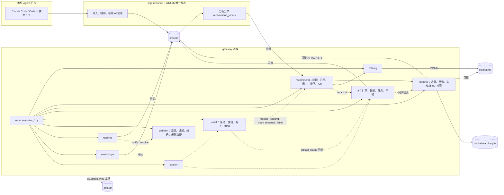

# Orbit 后端扩建记录：资源库、特征、推荐、AI、安装与平台（Q1–Q7）

> 状态：实现记录（集成分支未合入 main，不等同 main 能力） · 维护者 `yhyfhgs` · 2026-10-02 · 分支 `wip/yhyfhgs-backend`（`28e42bf`）

> 本文回答 `yhyfhgs` 提出的 Q1–Q7：每个模块改造前是什么样、怎么设计、集成分支上已经实现了什么（路径、端点、表、算法、实测数字）、还剩什么。依据是两轮实现的本机工作笔记（各区域设计稿、第 1 轮实现结果、第 2 轮接线与补缺结果、端点清单），代码只做了低成本核对。feature ID 与阶段以 [feature-map.md](feature-map.md) §6 为准；算法的完整定义在 [recommendation-module.md](recommendation-module.md)、[ai-module.md](ai-module.md)、[evaluation-module.md](evaluation-module.md) 与 [module-contract.md](module-contract.md)。
>
> 实测数字均来自合成数据与本机 M 系列机器，多数在其他实现任务并行占满 CPU 时测得（负载均值 36–100），只说明量级，不是验收值。下文 `BE/` = `packages/backend/src/orbit_backend/`，`CAT/` = `packages/catalog/src/orbit_catalog/`。

> 真实数据验收见 [real-data-validation.md](real-data-validation.md)：本机真实日志只读导入（1,895 个会话、77.2 万事件）后，逐页核对分析、推荐、安装与 AI 上下文包，记录性能热点、缺陷和修复分支（基线 `wip/yhyfhgs-backend-r4`），只含聚合结果。

> 2026-10-03 更新：集成状态已变化，`wip/yhyfhgs-backend@4862c6c6` 经 PR #49 进入 main，之后的提交走 v0.0.1 发布分支 `feat/macos-app`；round 5–6 的集成过程与前端依赖的接口约定见 §9。上文的状态与 §8 的数字仍是第 1–3 轮的记录。

## 0. 结论

1. 两轮共合入六个区域（catalog、features、recommend、ai、install、platform）、五条接线分支，以及四个补缺包（realtime、evalrun、eval-suites、session-ops）。网关按模块挂载 9 个路由文件，app.db 新增 8 个模块的 38 张表。
2. 资源库存储从约 42 KB/条降到约 8 KB/条（5k 条 40.2 MB），检索 p95 从 984 ms（3k 条）降到 9.19 ms（5k 条）。20k 条构建能否控制在 40 s 内还没有复测。
3. 推荐从「每个根会话 × 已审核条目」的离线匹配，改成问题层 → 9 路召回 → 13 道闸门 → 打分 → MMR → 落库保留的完整链路。离线回放 hit@3 = 1.0、nDCG@3 = 0.8108；命中缓存的读取 p95 为 4.8 ms。
4. AI 模组从零实现，覆盖本机 Claude Code / Codex headless、API key、Fake 四种引擎，以及授权、上下文包预览、任务注册、预算、生成与自检、问答。默认关闭（`mode=stats`），AI 自己产生的会话在导入时剔除。
5. 一键安装覆盖探测、落点、预览、风险、原子写、账本、撤销和下载校验全链路。在 2.2 MB 的 `~/.claude.json` 上，apply 155 ms、revert 6.5 ms；Claude Code 与 Codex 的往返评测共 61 项检查全部通过。
6. 平台层补齐了遥测、ETag、健康、诊断、日志、维护、通知、实时状态、采集暂停和评测运行器。第 3 轮又合入导出、额度、采集类 hooks、七个 v1 AI 任务、推荐时间切分评测和端到端测试，均有缺口（见 §8）。
7. 全量 pytest 在正常负载下的结果见 §8.2「验证」；高负载下只剩计时类失败。UI 接线全部只在夹具模式下跑过，没有对真实网关验收。

## 1. 架构：数据库分工与 app.db 单写者规则

### 1.1 为什么要单独的 app.db

| 库 | 内容 | 写者 | 可否重建 |
| --- | --- | --- | --- |
| `orbit.db` | 采集投影：L1–L3、会话、tool_call、inventory 快照 | 只有 ingest-worker | 可以，按原始归档重投影 |
| `catalog.db` | 资源库：条目、版本、特征、向量、模型、成绩 | CatalogService 的同步作业（进程内一把写锁） | 可以，重新同步 |
| `app.db` | 用户状态与模块产物：标签、曝光、推荐 run、安装账本、授权、AI 作业与产物、通知、遥测、评测记录、会话排除 | 网关进程，经 `gw.appdb.write()` 串行写入 | **不可以**，丢了就丢用户决定 |
| `cache/search.sqlite` | 检索派生索引（trigram） | features 检索模块 | 可以，随时丢弃 |

拆库的理由有三条：

- **生命周期不同。** orbit.db 会因映射规则变化被整库重投影；如果标签、安装账本、授权与它同库，重建就会丢失用户的决定，或者要做复杂的保留迁移。
- **写竞争。** 导入是长写事务；用户点「不适用」或「安装」必须毫秒级落库，不能排在导入后面等。
- **单写者可验证。** 每个库只有一个写入口，崩溃恢复与并发语义都只需要在一处保证。

### 1.2 规则

- **orbit.db 只由 ingest-worker 写。** 网关只能经 `gw.reads.read()`（每线程 `mode=ro` 连接池）读取。重计算放在 worker 的分析分节里（例如推荐的 `recommend_inputs`），产物进快照缓存，网关进程不跑分析。orbit.db 的 ANALYZE / VACUUM 也必须由 worker 新增维护操作来做（§8 剩余项）。
- **app.db 只经 `gw.appdb.write()` 写。** 实现在 `BE/appdb/store.py`：WAL、`synchronous=NORMAL`、`busy_timeout=5000`、一把进程内锁串行化写入；读走每线程只读连接。文件头 `application_id = TAPP`，防止把 orbit.db 或 catalog.db 误当成 app.db 打开。
- **每个模块一份幂等 DDL**，位于 `BE/appdb/schema/<module>.sql`，全部是 `CREATE … IF NOT EXISTS … STRICT`。启动时按文件 sha256 与 `module_schema` 表比对，文件改了就重放。加列由模块自己守卫（例如 `install.store.ensure_columns()`）。
- **跨库读取由 features 的 QueryHub 负责**：主库为 app.db，`ATTACH` orbit.db 为 `t`、catalog.db 为 `c`，全部只读；文件晚出现时下次取连接再补挂。
- **新路由的接入方式**：新建 `services/routes_<pkg>.py`，再在 `Gateway.app()` 的 import 列表与 `for module in (...)` 元组里各加一行。多个包并行开发时，合并冲突只会出现在这两处的单行上。

| app.db 模块 | 表 |
| --- | --- |
| `features.sql` | `feat_vocab`、`sess_feat`、`sess_feat_state`、`feat_profile`、`inv_link`、`inv_size` |
| `recommend.sql` | `rec_run`、`rec_candidate`、`rec_state`、`rec_exposure`、`label`、`rec_top`、`tracking`、`rec_outcome` |
| `ai.sql` | `ai_setting`、`ai_consent`、`ai_consent_log`、`ai_engine`、`ai_job`、`ai_usage`、`ai_cache`、`ai_facet`、`ai_artifact` |
| `install.sql` | `install_plan`、`install_ledger`（触发器禁止 UPDATE / DELETE）、`install_state` |
| `platform.sql` | `platform_kv`、`metric_minute`、`metric_hour`、`maintenance_run`、`storage_report` |
| `platform_notify.sql` | `notification`、`notification_policy`、`notification_snooze`、`collection_pause` |
| `eval.sql` | `eval_run`、`eval_check` |
| `sessionops.sql` | `session_exclusion` |

### 1.3 模块边界

箭头表示调用或读写方向；虚线表示懒加载调用，被调方缺失时降级、不报错。



边界约定：

- ai 不 import recommend 和 install。它读 recommend 的结果时直接查 app.db 的 `rec_candidate` 表；install 读 AI 产物时直接查 `ai_artifact` 表。
- recommend 只产出 InstallSpec，不 import install；install 只被调用，不反向驱动推荐。
- 所有跨区域调用（`platform.timed / record / notify`、`features.*`、`recommend.register_tracking` 等）都是懒加载加 try/except，对方模块缺失时退化为空操作或诊断信息。

## 2. Q1 资源库数据模块：性能与存储

**改造前**

- `packages/catalog` 已有 schema v2 骨架：source → stage → publish、FTS5 + E5 向量 + 特征三路 RRF、14 类 type、10 条种子。
- 合成 3000 条（正文均约 6 KB）实测：publish 17.7 s（5.9 ms/条，20k 约 2 分钟），库 128 MB（约 42 KB/条，20k 约 850 MB），search p50 329 ms、p95 984 ms。
- 原因：
  - 正文在 `item_source`、`sync_stage`、`item_version`、`resource_chunk`、`chunk_fts` 中约存 7 份，raw 不压缩；
  - FTS 全量 OR 查询后在 Python 去重，资格过滤是逐行 EXISTS；
  - 向量逐 chunk 存 fp32，每次查询全表 `fetchmany`；
  - publish 每个 chunk 5 次以上单行 INSERT；
  - GitHub 连接器在 head 变化时整仓重读。
- 功能缺口：列表 / 筛选 / 游标、详情（RC-09.1）、facets、去重与关系、风险标记、本地条目（DT-12.2）、模型身份对齐。

**设计**

1. **存储 v3**：`blob(sha, codec, size, data) WITHOUT ROWID`，正文、元数据、raw、分块文本统一 zlib 压缩并按 sha256 去重；`chunk_fts` 改为 contentless（只存倒排，文本按需从版本重算）；向量只保留 `embedding_cache` 的 fp16；每个条目最多 5 个版本。
2. **写入**：比较 `res_sha / body_sha`，未变化就跳过；`executemany` 批量写、单事务；结束后执行 `PRAGMA optimize`。
3. **读取**：`CatalogIndex` 内存快照按 `generation` 失效，用 numpy 列式掩码代替逐行 EXISTS；词法路只发一次 `MATCH … ORDER BY bm25 LIMIT K`；向量路分块把 fp16 转 fp32 做精确余弦，不用 ANN。
4. **列表**：三种排序键各有一组部分索引，keyset 游标。
5. **去重与关系**：内容哈希相同的条目选一个 canonical，其余用 `canonical_of` 指向它；`item_relation` 记录 duplicate / depends / alternative_to；`risk.py` 做静态启发式风险分级。
6. **同步**：HTTP 缓存放 SQLite 并 zlib 压缩，支持 ETag / If-Modified-Since、TTL、离线；多来源并发；GitHub 按 blob sha 增量。

**已实现**

- 代码：
  - 存储与读取：`CAT/store.py`（`SCHEMA_VERSION = 3`）、`index.py`、`query.py`、`search.py`、`vectors.py`（fp16 精确余弦）、`risk.py`；
  - 同步与模型：`network.py`（`http-cache.db`，同一 URL 的并发请求合并为一次）、`sync.py`（`concurrency` 默认 3，失败按来源隔离）、`models.py`（`canonical_model_id`、`normalize_effort`、`resolve_benchmark_model`）、`sources/github.py`（每页 60 个、12 线程、按 blob sha 复用）、`sources/structured.py`（`config.file` 离线导入）；
  - 网关接线：`BE/services/routes_catalog.py`。
- 端点：
  - `GET /v1/catalog/items`、`/items/{id}`、`/search`、`/facets`、`/models`、`/models/{canonical_id}`、`/benchmarks`，全部带 ETag；令牌由 catalog generation、data_rev、inventory_rev 组成。
  - `POST /v1/catalog/sync`：新增 `concurrency` 1–8、`offline`、`ttl`。
  - `POST /v1/catalog/local`、`DELETE /v1/catalog/local/{id}`。
- 卡片的「已安装」状态改用 `features.linked_inventory()` 的真实形状；`metadata.body_sha256` 供 features 做哈希连接。catalog.db 损坏或不是 Orbit 的库时，网关照常启动，只是缺少资源库路由。
- 实测（5k 条，负载均值 36）：

| 项 | 改造前（3k 条） | 现在（5k 条） |
| --- | --- | --- |
| 库体积 | 128 MB（约 42 KB/条） | 40.2 MB（约 8 KB/条） |
| 无变更重发布 | 全量重写 | 0.40 s（stage 0.73 s） |
| 词法检索 p50 / p95 | 329 / 984 ms | 4.99 / 9.19 ms |
| 混合检索 p50 / p95 | — | 5.51 / 7.64 ms |
| 列表 / 深分页 / facets / 详情 p95 | — | 1.27 / 0.32 / 0.45 / 1.08 ms |
| 内存索引构建 | — | 162 ms |
| GitHub 200 文件仓库改 1 个文件 | 200 次下载 | 1 次下载 |

**剩余**

- 20k 条构建「≤ 40 s」未确认。5k 条首次 publish 墙钟 51.6 s，但整次运行的用户态 CPU 只有 17.7 s，墙钟被负载拉高；20k 的 151 s / 160 MB 是 rowid / fp16 优化之前的数字。需要在空闲机器上复测。
- 详情的 `scan` 字段恒为 null，因为 install 没有按单个目录条目扫描的接口。
- 成绩到模型的解析只做精确名匹配；`import-file` 会把 `config.file` 留在来源配置里。
- 内容侧：默认不联网同步，种子只有 10 条 skill。资源库能否「有货」取决于首次同步策略（见 §7.3）。

## 3. Q2 推荐数据与本地会话、已装组件的统一管理

**改造前**

- orbit.db 的 `session_feature` 只有 5 类特征；`inventory_item` 出于隐私不存 URL 和正文，它的 `content_hash` 是原始字节的 sha256，与 catalog 的规范化 JSON 哈希不是同一个量，不能直接比较。
- 推荐侧的 `features.py` 是候选打分特征，不是用户画像，用户侧特征与条目侧特征不在同一个 id 空间。
- 没有跨库查询层和并行执行器；`event_fts` 建了但没有查询，unicode61 分词也无法命中中文子串。
- 改造前实测（5k 会话 / 50 万事件 / 15 万 tool_call / 9.7 万 session_feature，库 209 MB）：
  - `session_feature` 全量聚合 130 ms，tool_call 按 skill / MCP 聚合 10–13 ms，files JSON 聚合 170 ms；
  - 8 个混合查询单线程 838 ms、4 线程 376 ms（SQLite 执行时释放 GIL）。
  - 结论：热路径不需要给 orbit.db 加索引，贵的是每次请求都重新聚合，所以应当物化并按 rev 缓存。

**设计与已实现**

| 部件 | 实现（`BE/features/`） | 实测 |
| --- | --- | --- |
| 特征词表 DT-13 | `vocab.py`：统一 id `ns:value`（约 15 个命名空间：tool、cmd、cmdfam、cmdcls、lang、ftype、mcp、skill、err、friction…）；`from_session_feature()` 与 `from_catalog_feature()` 把两侧映射进同一空间，`to_catalog_pairs()` 反向生成 `item_feature` 条件，所以条目侧不需要物化；命令按表驱动分为 readonly / write / destructive / network 四类和十个族；6 类摩擦定义 | `GET /v1/features/vocab`（ETag） |
| 会话特征物化 | `sessfeat.py`：写入 app.db `sess_feat`（WITHOUT ROWID）；签名为 `ended_at \| tool_calls \| vocab`，只重算变化的会话；另从 tool_call 派生 `err:*`、路径标记、6 类摩擦（tool_error、retry_same_call、approval_wait、readonly_prompted、destructive_cmd、long_tool_wait）；每 500 个会话一个写事务 | 全量 0.70–0.82 s，单会话增量 11–12 ms；app.db 9.5 MB（5k 会话） |
| 用户画像 | `profile.py`：权重 `(1+ln n)·ln((N+1)/(sess+0.5))`，下限 0.05、按最大值归一；输出 tags / vector top 256 / groups / coverage、128 维确定性哈希质心（条目侧用同一个 `hash_vector`）和证据会话；`service.py` 两级缓存（内存 LRU 16 + app.db `feat_profile`，gzip），数据过期时先返回旧版、后台单飞重建 | 冷算 78–85 ms，内存命中 0.03 ms，app.db 命中 0.3 ms |
| 条目匹配 RC-09 | `match.py`：画像 top 64 id → `item_feature` 对 → 一个 `VALUES` CTE 加权 JOIN `feature_lookup`，在 SQL 里 SUM | 19 对 6.9 ms；病态稠密词表（约 70% 条目命中）89 ms |
| 实体连接 DT-09 / AN-11 | `linked.py`：已装组件 ↔ 目录条目 ↔ 使用量；置信度依次为人工确认 > 安装账本 1.0 > `body_sha256` 0.95 > 规范化名称 + 类型 0.8 > `name@market` 拆名 0.6；使用量按 agent 归因（skill → `tool_call.skill`，MCP → `tool_call.mcp_server`）；常驻开销按 `content_hash` 缓存到 `inv_size`；`installed_unused` = 启用 ∧ 可归因 ∧ 90 天零调用 ∧ 数据跨度 ≥ 30 天 | 230 个组件 / 2 万条目：冷 70 ms，热 0.3 ms |
| 统一查询层 | `hub.py` QueryHub：app.db + `t` + `c` 只读挂载，4 线程 `gather(**calls)`，异常作为值返回、不互相拖垮 | 8 个混合查询 41 ms，串行 144 ms（3.5 倍） |
| 统一检索 DT-23 | `search_index.py`：派生 trigram 索引，按 kind 分 4 张 FTS 表；按 rowid 水位增量，投影变化时全量重建。`search.py`：6 个来源在 4 线程上并行，请求总时限 150 ms，超时的来源进 `partial`；RRF 加时间衰减融合 | 6.5 万文档全量 2.9 s、80 MB，单会话增量 13 ms；整体 p95 6.4 ms，中文 3–4 字 p95 < 2 ms |

身份键与连接关系（统一管理的核心）：

| 实体 | 键 | 所在库 | 与谁连接 |
| --- | --- | --- | --- |
| 会话 | `session_uid` | orbit.db | `sess_feat`、`session_exclusion`、推荐证据、AI facet |
| 已装组件 | `inv_id`（最新 inventory 快照） | orbit.db | `inv_link` → `catalog_item_id`；`install_ledger.inv_id`（`action='link'` 行） |
| 目录条目 | `item_id`（含 `canonical_of`） | catalog.db | `inv_link`、推荐 catalog 召回、`install_ledger.catalog_item_id` |
| 推荐候选 | `rec_key` / `candidate_id` | app.db | `rec_state`、`rec_exposure`、`label`、`tracking.install_id` |
| 安装 | `install_id` | app.db | `install_state`、`tracking`、`rec_outcome`、`ai_artifact.install_id` |

接线：

- 推荐新增 `recall/feature_route.py`：用 `friction:<type>` 信号调用 `features.profile()` 和 `match_items()`，结果作为 RC-09 的 `feature_overlap`。
- install apply 时在账本里记下 `catalog_item_id`；inventory 扫描到新组件后，再追加一条 `link` 行把 `inv_id` 与 `catalog_item_id` 配对，供 features 用 `method=ledger` 连接。
- 检索的 recommendation 来源直接读取 `rec_candidate`。

**剩余**

- hook 使用量只有 agent 级总数，因为 `hook.run` 事件里没有稳定的 hook 名，条目级状态为 `unknown_usage`。这一项依赖第 3 轮的 collect-hooks 包。
- inventory 不存 URL，按仓库地址匹配不可用。
- `features.*` 遥测名不在 platform 的 METRICS 里，只有计数和总和，没有毫秒直方图。
- 真实库超过 100 万 tool_call 时，需要数据侧加部分索引（例如 `tool_call(skill) WHERE skill IS NOT NULL`）。
- 集成测试 `test_ledger_from_real_install_tables` 失败（§8）。

## 4. Q3 推荐：多路召回、闸门、打分与结果保留

**改造前**

- 只做「根会话 × 已审核条目」的 P0 匹配，共 4–5 路召回。`dense` 是空壳；7 个 family 的 JSON envelope 都是空的，可推的只有 12 条旧种子。
- 没有问题层，也没有机制表。
- 推荐随整份分析在 `analyze_context()` 里计算，每次约 10 s，不落库；曝光、标签、追踪、Top N 快照全部缺失。
- 卡片形状与 A7 需要的 16 个字段对不上。

**设计**

```
worker 分节 recommend_inputs（复用分析 memo + SQL 事实，≤ 200 KB）
 → problems（信号 / 事实 / 清单 → 问题，Wilson 下界升级）
 → 9 路召回 → 加权 RRF(k=60) → 13 道闸门（true / false / n/a + 中文原因）
 → priority = 100·max(0, B·c·p·f/(1+cost) − 0.1·risk) × personal × decay
 → MMR λ=0.8 + 配额 → 解释、试用法、A7 ui 对象 → app.db rec_run / rec_candidate
```

其中 B = 1 − exp(−周节省分钟 / 30)，c = Wilson 下界，p = 按类别的 Beta 先验（由标签和效果回写），f = 融合分、上下文与偏好。

**已实现**（`BE/recommend/`，引擎版本 `rec-engine-v2`）

| 环节 | 路径与要点 |
| --- | --- |
| 知识库 RC-01 | `BE/data/recommend/remedies.v1.json`：17 条 Orbit 自写模板，覆盖 10 类 MVP 问题，其中 3 条通用；`kb.py` 用 pydantic `extra=forbid` 校验，拒绝重复 id 和悬空引用，版本号为 `kb-v1@<sha8>` |
| 问题层 | `problems.py`：n < 5 记为 insufficient；k ≥ 3 且 Wilson 下界 ≥ 0.05 记为 active；`problem_id = sha256(scope_hash\|type\|key)[:16]`；被静音的问题类型跳过 |
| 机制表 RC-06 | `mechanism.py`：MVP 第 1、2、11、12、13 行；同一问题已装 rule 但仍活跃时，hook 前移 |
| 多路召回 RC-02 | `recall/multi.recall_all()`，9 路：kb、catalog（每个活跃问题一个 MatchRequest，4 线程、每波 2 s 时限，失败降级到旧种子 BM25）、dense（512 维 blake2b 签名哈希兜底，向量未就绪时启用）、graph（`pairs_with` + 已装标签 Jaccard）、subtract RC-07（`removal:<inv_id>`）、template RC-16、model RC-08 轻量版、generative（`generate:<kind>:<key>`）、generic RC-11（主会话 < 10 时）；接线后新增 feature 路。每路单独 try/except，失败写入 diagnostics |
| 闸门 RC-03 | `ranking/gates.py`：13 道检查，每道给 true / false / `n/a` 和中文原因；高风险阻断，中风险强制 L3 逐行预览；无许可证只给链接；pi 不推 MCP 和子代理 |
| 打分与个性化 RC-04 / RC-17 | `ranking/rank.py`：按上式计算，另存 `score.utility`（截断前的值）作为同分裁决与 MMR 相关度；个人权重限制在 [0.5, 1.5]；曝光衰减 0.85^(shown−1)、下限 0.5，在读取时应用，证据变化 ≥ 20% 或发生安装 / 打开时重置 |
| 去重与多样性 RC-05 | `ranking/slate.py`：MMR λ=0.8；每个问题 ≤ 2 张，skill ≤ 2、removal ≤ 2、builtin ≤ 1、generate ≤ 1；同问题同维度的第二张折叠进 `alternatives`；没入选的卡片写明 `excluded` 原因 |
| 解释与关系 RC-15 / RC-03.1 | `narrate.py` 生成模板解释，过不了可读性检查就回退为保底句，`ui()` 恰好输出 A7 的 16 个字段；`relations.py` 判定重复、冲突、互补 |
| 结果保留 RC-05 / RC-10 / RC-13 | `store.py` / `runs.py`：run 按 `(scope_hash, inputs_digest)` 复用；digest 包含 data / inventory rev、rules、引擎与知识库版本、catalog generation、memory_rev、ai_generate；每个范围保留 20 个 run，已安装的 run 置 pinned 永久保留；被闸门挡下的候选只存紧凑形；同一个 view 按 (rec_key, surface) 6 小时只计一次，snooze 14 天；`rec_top` 给 A1、Lite、菜单栏提供 24 小时不抖动的快照 |
| 标签与反馈 EV-10 | `POST /v1/labels`、`DELETE /v1/labels/{id}`；不适用 / 稍后 / 静音都作用在 `rec_state` 上，撤销时重放剩余的曝光与标签；Beta 后验 α = useful + 正向效果，β = not_useful + 2 × 撤销 |
| 追踪与效果 RC-13 / EV-07 | `outcomes.py`：install 成功后调用 `register_tracking`，状态转为 observing；7 天和 28 天两个窗口只在满期后出结果，比例差用 Newcombe 混合区间（已对照文献值），均值差用 Welch 区间；状态为 tracking / insufficient / positive / neutral / negative / reverted，护栏指标升高 > 20% 记为 guardrail_hit |
| 交接 RC-15.1 | `handoff.py`：L0 模板，包含当前任务、最近 10 个改动文件和改动后是否跑过验证 |
| AI 接入 | `rerank.fit` 只写 `display_rank` 和 `ai_fit`，不改 priority；生成卡带 `generate.available` |

端点：

- 读取：`GET /v1/recommendations`（参数 surface、dim、level、audience、limit、wait_ms），以及 `/runs`、`/relations`、`/handoff/{uid}`、`/metrics`（EV-05 漏斗）、`/{candidate_id}`。
- 写入：`POST /recompute`、`/{id}/exposure`、`/exposures`、`/{id}/tracking`。
- 其他：`GET/PUT /v1/recommendations/settings`、`GET /v1/outcomes/{install_id}`。

实测：

| 项 | 结果 |
| --- | --- |
| `recall_all`（10 个问题、17 条规则、假 1 万条目录，不含目录延迟） | p50 2.1 ms / p95 3.3 ms；无目录时 3.0 / 6.3 ms |
| 200 个候选经闸门、打分、编排、叙述 | 中位 7.6 ms / p95 7.9 ms（目标 30 ms） |
| `GET /v1/recommendations` 命中缓存 | p95 4.8 ms；label 写入 0.04 ms；run 复用时 recompute 0.43 ms |
| 存储 | 30 张旧卡每个 run 约 36 KB；新引擎卡的设计估算约 110 KB/run，上限 20 run × 5 个范围 ≈ 11 MB |
| 离线回放（12 个合成用例） | hit@3 1.0、nDCG@3 0.8108（门槛 0.9 / 0.75）；可按单路消融 |

UI 接入（`wip/yhyfhgs-ui-live-backend`，只在夹具模式下验证）：

- A7 完整列表，记录 view / open / preview / copy 曝光；详情页的 7 天前后对比、关系标签；「不适用」带 5 种原因加 8 秒撤销；重新计算。
- A1「本周建议」、Lite「本周最值得做的一件事」、菜单栏 Top 1 各自读对应 surface 的快照。

**剩余**

- `rerank.fit` 在 GET 路径里同步执行，接上真实引擎时最长可能阻塞 30 s。应改为后台作业加缓存（下一轮）。
- catalog 向量状态不在 digest 里；生成卡只标记可用，不会自动生成。
- RC-08 只做了「只读会话建议 medium 档位」一条；`mixed_sessions` 谓词依赖可选的 `task_types`；`Problem.scene` 恒为 None；`requirements_ok` 只看 `profile.tools`。
- 失败调用的 status / error_class 取值还没有对照真实连接器确认。
- UI：A7 没有会话数和常驻 token 字段（后端没给）；Lite 没有标签入口；小组件和 HUD 没有推荐；从未对真实网关跑过。

## 5. Q4 AI 模组

**改造前**

- `BE/ai/` 不存在，`routes_ai.py` 是空路由，也没有 `ai.sql`。AI-01 至 AI-13、EV-11、EV-14 全部处于计划状态。
- 可以复用的 L0 积木：`privacy.redact()`、`narrative.explain()`、`readability.evaluate_text()`、`v_human_message` / `event_fts` / `inventory_item`。
- 本机只核对过 CLI 的 `--help`，没有真实调用过模型。

**设计**

```
routes_ai → AIService(gw) ─ consent ─ engines(claude_code | codex | api_key | fake)
              │                          └ 隔离：agent-cwd + .orbit-ai 标记 + 首行 marker + 不落会话 + 环境变量白名单
              ├ pack.build（只读组包 → 第二遍脱敏 → 逐项 token → preview_digest）
              ├ registry：TASKS 字典（分析类 + 生成类）
              └ runner：每个引擎一条串行队列 → 缓存 → 引擎 → JSON Schema + 任务自校验 → 重试 1 次 → 降级
```

**已实现**（`BE/ai/`，表见 §1.2）

| 能力 | 实现 |
| --- | --- |
| 引擎 AI-01 | `engines.py`：<br>• `ClaudeCodeEngine` / `CodexEngine` 以 headless 方式调用用户自己已登录的 CLI：无工具、只读沙箱、不读用户配置；prompt 走 stdin，不进 argv；stdout 上限 4 MB；进程组隔离，取消时先 SIGTERM，1.5 s 后 SIGKILL。<br>• 可选参数按本机 CLI 的 `--help` 探测后才加。<br>• Codex 的 usage 从 `turn.completed` 事件累加，成本按 `prices.py` 计算。<br>• `ApiKeyEngine` 只在设置了 `ANTHROPIC_API_KEY` 时注册（stdlib urllib）；`FakeEngine` 供测试使用。 |
| 能力探测 AI-02 | `capabilities.py`：版本、参数、登录状态三项并行探测，各 3 s 超时，不消耗 token；结果缓存 24 h，读缓存 < 5 ms |
| 授权与上下文包预览 AI-08 | `consent.py`：<br>• `mode` 分 `stats`（默认，AI 全关）/ `agent` / `api` 三档；授权粒度为引擎 × 数据类（summary / snippets / rules / raw）。<br>• `raw` 对任何引擎都不可授权；撤销授权会取消该引擎排队中和运行中的作业；每次变更写 `ai_consent_log`。<br>`pack.py` + `redact.py`：<br>• 按 C4 键表只读组包，每项给出 token 数、脱敏命中数和不超过 8 行的预览，全包算出 `preview_digest`；提交时重算 digest，不一致返回 409。<br>• 第二遍脱敏把邮箱、`/Users/<名>`、本机用户名、内网主机分别替换为 `[email]`、`~`、`[user]`、`[host]`。 |
| 任务注册与预算 AI-11 | `registry.py` 懒加载两组 TASKS：生成类 8 个（`generate.rule/glue/hook/skill/subagent/command`、`diagnose.workflow`、`rerank.fit`），分析类 3 个（`facet.session`、`narrate.overview`、`ask.question`）。<br>`runner.py`：缓存键为 sha256(task、prompt / schema 版本、system、prompt)；每次调用写一行 `ai_usage`；每日上限默认 $2，超出返回 409 `budget_exhausted`；启动时把遗留作业标为 `interrupted`；清理 90 天前的作业，`ai_cache` 保留 2000 行。 |
| 生成 AI-06 / AI-07 / AI-13 | `generate/`：<br>• 仓库模板用内容哈希固定，模型只填有类型约束的槽位，落点符号由代码渲染。<br>• 6 个只依赖 stdlib 的 hook 模板（retry-breaker、verify-before-commit、post-edit-check、stop-verify、compaction-reminder、scope-guard），核心逻辑是纯函数 `decide(event, config, state)`；另有 rule、skill、subagent、command 的 Markdown 模板。<br>• 三道自检：lint（frontmatter、命名冲突、3-gram 重复与冲突）、静态扫描（元字符、URL、凭据路径、破坏性命令、提权、脚本哈希）、进程内历史回放（recall、false_block）。<br>• 产物按 `content_hash` 去重写入 `ai_artifact`，形状对齐 install 的 InstallSpec，`files[].lines` 带 `+` / `ai` 标记和证据。 |
| 问本地 Agent AI-09 | `ask.py`：L0 预置问题覆盖 8 个页面上下文，每个 3 个基础问题，加 1 个由数据触发的条件问题；模板回答里的数字全部来自查询；开场建议服务 POP-11。<br>`ask.question`：plan 调用 → 按 `queries.py` 白名单（10 个只读 API，参数用 JSON Schema 约束，每次 ≤ 20 行）执行查询 → answer 调用，校验引用和数字都必须来自查询结果；超出范围的问题回固定句并给出页面跳转。 |
| 分析任务 AI-03 / AI-05.1 / AI-10 / AI-12 | `facet.session`：每批 8 个会话，单项失败重试，同批过半失败则中止，丢弃外来证据 id；`narrate.overview`：校验证据、数字与可读性，失败退回「做得好 / 卡在哪 / 立刻可做」模板；`diagnose.workflow`：结果可交给生成工坊；`rerank.fit`：只调整顺序 |
| 不污染采集数据 | 固定 cwd `<home>/agent-cwd`（含 `.orbit-ai` 标记文件）、首行 `[orbit-analysis v1 …]`、`--no-session-persistence` / `--ephemeral`；数据侧 `orbit_data.pipeline.exclude_orbit_ai_sessions()` 在 rebuild 时删除这类会话的 L2 / L3，并把孤立的 L1 标为 ignored；组包时也会排除它们 |
| 可观测 | 遥测 `ai.tokens`、`ai.cost_usd`、`ai.job`；用户发起的作业完成时发出 `ai_job_done` 通知；`auto_facet_new(gw)` 已导出，供调度调用 |

端点：

- 引擎与授权：`GET /v1/ai/engines`、`GET/PUT /v1/ai/consent`。
- 作业：`POST /v1/ai/preview`、`POST/GET /v1/ai/jobs`、`GET /v1/ai/jobs/{id}`、`POST /v1/ai/jobs/{id}/cancel`。
- 产物与 facet：`GET/PATCH /v1/ai/artifacts[/{id}]`、`GET /v1/ai/facets`。
- 问答与用量：`GET /v1/ai/ask/presets`、`POST /v1/ai/ask`、`GET /v1/ai/usage`。

实测：

| 项 | 结果 |
| --- | --- |
| 命中缓存的提交 | < 50 ms |
| 取消运行中的作业 | < 2 s |
| 组包（2000 会话夹具） | < 250 ms |
| 单个 hook 的渲染 + lint + 扫描 | < 30 ms |
| 回放 8 会话 × 200 次调用 | < 300 ms |
| 24 会话合成 Codex 库：组包 + 全部查询 + 全部预置回答 | 约 0.3 s（不含 jieba 首次加载的 1–2 s） |
| AI 测试 | 129 个通过；账本评测估算误差中位 0.20 / p90 0.25 |

模块化边界：

- recommend 经 `ai.service(gw).run("rerank.fit")` 调用 AI，`AIUnavailable` 记为诊断。
- install 不 import ai：planner 直接查 `ai_artifact`，产物状态经路由注入的 `artifact_status` 回调回写。
- AI 读推荐结果时直接查 `rec_candidate`，查资源库时调用 `features.search(kinds=['catalog'])`。

UI 接入（夹具模式）：

- A9 生成工坊：引擎、预览、作业进度、日志、产物行、四道自检、停止、历史。
- ASK：预置问题与自由提问。
- 设置：AI 通道授权、模式、每日预算。

**剩余**

- 评测发现两处真实缺陷：
  - 每日上限只比较「今日已花费 ≥ 上限」，不比较下一个作业的估算，所以会超支的作业仍然会调用引擎（EV-11 `cap.estimate_refused` 失败）；
  - 脱敏漏掉 AWS key 和 SSH 私钥（EV-14：14 个植入项只命中 12 个）。
- strict 模式的交叉检查和 judge（AI-07.4）仍输出 skipped；facet v1 扩展字段和长会话分块（AI-03.1）未做。
- `auto_facet_new` 未接入调度；额度 `quota` 恒为 unknown（第 3 轮 quota 包）。
- 真实 CLI 只核对过 help，从未真实调用；`MIN_VERSIONS` 和 Codex 参数待验证。

## 6. Q5 一键安装

**改造前**

- inventory 只做只读观测，回答「装了什么」，不回答「往哪写、写什么格式」。
- `resource_fetch.py` 只能拉取单个 Markdown，`urlopen` 写死，无法注入。
- `routes_install.py` 是空路由，安装相关表只存在于文档中。
- UI `51-install.js` 全部是模拟：按原始行勾选（取消 JSON 中间行会产生非法 JSON），落点写死且与真实落点不符，备份和撤销都是演示。

**设计**

```
InstallSpec ── plan.py ──> resolve_targets(IN-01) ──> targets[] ──> 风险 + 成本 + guard_hash ──> preview_digest
   ▲ 来源：candidate | catalog 条目(+fetch) | ai_artifact | 直接 spec       │
                                                     apply(digest) ──> 备份 → 原子写 → ledger
```

**已实现**（`BE/install/`）

| 环节 | 实现 |
| --- | --- |
| 结构探测 DT-22 | `env.py`：<br>• 只用 `stat` / `scandir`，不读文件正文；尊重 `CLAUDE_CONFIG_DIR` / `CODEX_HOME`；managed 层只读。<br>• 二进制从固定候选目录查找（macOS GUI 进程的 PATH 很短），`--version` 在最小环境下以 3 s 超时、4 个 worker 并行探测，按 (path, mtime, size) 缓存 24 h。<br>• 已装计数用一条 SQL 读最新 inventory 快照；项目按最近会话活动排序。<br>• dsh / pi / hermes / opencode / kimi 为 `read_only`。 |
| 落点表 IN-01 | `targets.py`：9 类 × Claude Code / Codex × user / project，见下表。拒绝写入：managed 层、项目 `.claude/settings.json`（团队共享）、Agent 根目录之外的路径、符号链接逃逸 |
| 预览 IN-02 | `ops.py` + `diff.py`：<br>• 按语义单元勾选（数组元素、键、段落、文件），渲染时保留缩进、键序和末尾换行，所以预览 diff 与实际写入的字节一致。<br>• merge_json 的 `guard_hash` 只哈希指针所在的容器，`~/.claude.json` 里其他键被改不会误报过期。<br>• `preview_digest` 绑定所选单元、禁用目标、各目标 guard 和风险等级。 |
| 风险闸门 IN-05 | `risk.py`：管道进 shell、破坏性命令、凭据路径、网络外发、放宽权限（`Bash(*)`、写类前缀进 allow、bypassPermissions）、元字符和 eval、提示注入短语、字面量密钥、缺少许可或校验和、lethal trifecta；分为 safe / caution / dangerous；dangerous 默认返回 403，需要 `override_risk`；hook 至少为 caution |
| 原子写与备份 IN-03 | `applier.py`：<br>• 按文件 `flock` 加锁，锁内重读文件；只有 guard 仍然匹配才重新合并，否则报 stale。<br>• 备份到 `home/backups/<install_id>/`（0700，带 meta），写同目录临时文件，fsync 后 `os.replace`，再 fsync 目录。<br>• 任一目标失败就按逆序从备份还原，全成或全无。 |
| 账本与撤销 IN-04 | `store.py` + `service.py`：<br>• 账本只追加（install_begin → install / install_failed，另有 revert、revert_refused、reconcile、link）；启动时 reconcile 处理崩溃遗留。<br>• 撤销：文件未被改过时字节级还原；merge_json 和标记块按单元反向移除；用户改过的单元拒绝撤销，并返回三方 diff 和手工步骤；重复撤销是幂等的；支持批量。 |
| 下载校验 IN-08 | `fetch.py`：只在用户触发时联网；主机白名单，重定向也只允许白名单；先把 ref 解析成 40 位 commit 再下载 codeload tarball，逐个成员校验，不用 `extractall`；限额 ≤ 200 个文件、单文件 1 MB、解包 5 MB、压缩包 8 MB；内容寻址缓存 `objects/aa/<sha>`，LRU 200 MB；许可缺失或为 NOASSERTION 时只给链接（`link_only`） |
| 计划与来源 RC-12 | `plan.py`：来源可以是 spec、candidate、catalog（catalog detail 映射为 install 形状，MCP 从 registry manifest 推出 npx / uvx / remote）或 AI 产物（`{orbit.hooks}` 解析为 `<agent 根>/hooks/orbit`）；`plan_id` 由输入决定，相同输入得到相同计划 |
| 生命周期 IN-06 | `lifecycle.py`：installed / observing / kept / idle / reverted / archived；来自推荐的安装进入 observing 并登记追踪；平台每天执行 `install_sweep` 维护任务（闲置判定、备份保留 50 次或 90 天、计划保留 30 天、下载缓存 GC） |

| kind | claude_code | codex |
| --- | --- | --- |
| permission_rule | `settings.json` `/permissions/allow`（项目：`settings.local.json`） | `~/.codex/rules/orbit-<id>.rules`（语法待验证 V6） |
| rule | `CLAUDE.md` 标记块 | `~/.codex/AGENTS.md` 标记块 |
| skill | `skills/<n>/…` | 探测到的 skills 目录（`~/.agents/skills` 或 `~/.codex/skills`） |
| subagent / command | `agents/<n>.md` / `commands/<n>.md` | command → `prompts/<n>.md`；subagent 不可映射 |
| hook | `settings.json` `/hooks/<Event>` + 0755 脚本 | `hooks.json` + 脚本，`requires_trust` |
| mcp | `~/.claude.json` `/mcpServers/<n>` | `config.toml` `[mcp_servers.<n>]` |
| plugin | `enabledPlugins` + `extraKnownMarketplaces` | 不可映射 |

端点：

- 环境与计划：`GET /v1/install/environment`、`POST /v1/install/plans`、`GET/POST /v1/install/plans/{id}/preview`、`POST /v1/install/preview`。
- 写入与撤销：`POST /v1/install/apply`、`POST /v1/install/{id}/revert`、`POST /v1/install/revert`。
- 查询与生命周期：`GET /v1/install/ledger`、`GET /v1/install/state`、`POST /v1/install/{id}/lifecycle`、`GET /v1/install/{id}`、`POST /v1/install/fetch`。
- CLI：`orbit install environment`、`orbit install ledger`。

实测（2.2 MB `~/.claude.json`，同一个 MCP spec 同时装到 Claude Code 和 Codex）：

| 项 | 结果 |
| --- | --- |
| plan | 14 ms |
| preview | 冷 42 ms / 热 26 ms |
| apply | 155 ms |
| revert | 6.5 ms |
| environment（热） | 约 1 ms |

- preview 原先在这个文件上要约 6 s：difflib 在重复内容上是二次复杂度。现在先裁掉公共首尾行再比较。
- EV-13 往返评测：rule、permission、hook、skill、mcp 五类在两个 Agent 上，共 61 项检查全部通过，用时约 1.8 s。
- 存储量：plan 2–10 KB/条，账本约 1 KB/目标。

UI 接入（夹具模式）：

- A8 安装面板：环境 → 计划（需要时 fetch）→ 预览 → 按单元或文件勾选 → 确认 → 应用；遇到 409 stale 时重新预览，不写入。
- 风险越过、`link_only`、撤销被拒时展示手工步骤、已安装列表。
- Lite 有精简版。

**剩余**

- `MIN_VERSIONS` 是占位值；Codex 的 `.rules` 语法、skills 目录和支持的 hook 事件仍待验证（V6）。
- TOML 不支持按键勾选；MCP 常驻成本是固定估计 400 token（AN-11 的实测值未接入）；`create_file` 的三方 diff 没有「ours」一侧。
- oci 等非 npm / pypi 的 MCP 无法安装；subagent 和 command 没有对应的 inventory 类型，无法连接。
- `install.real_smoke` 只是占位；采集类安装（IN-07）在第 3 轮 collect-hooks 包里。
- UI：没有项目选择器；推荐卡的安装仍走演示流程；Lite 不能按单元勾选。

## 7. Q6 平台

**改造前**

- `/health` 只看进程是否存活；没有请求计时、日志文件、指标和遥测。
- `/v1/sessions|projects|sources|inventory` 每次都查库，没有 ETag。
- 没有通知通道和采集暂停；快照缓存没有命中率统计，也没有维护入口。

**已实现**（`BE/platform/`、`BE/realtime/`、`BE/evalrun/`、`BE/sessionops/`）

| 能力 | 实现与数字 |
| --- | --- |
| 遥测 FE-18 底座 | `telemetry.py`：本机记录，默认关闭；在内存中按分钟聚合 count / sum / min / max，毫秒类指标另有 15 个对数桶；分钟数据保留 6 h 后卷成小时，小时数据保留 14 天；每表最多 6 万行，每个指标最多 200 组标签。`record()` 开启时 0.67 µs，关闭时约 0.3 µs；flush 2000 条序列 4.6 ms |
| 计时与 ETag | `middleware.py`：每个响应带 Server-Timing 和 X-Request-Id；注册路径的 GET / HEAD 使用弱 ETag `W/"<boot>-<rev>-<crc32>"`，匹配时在进入路由前直接返回 304；中位开销 0.0035 ms。已注册的路径有会话、项目、来源、清单、资源库、features 和排除名单；`register_etag` / `bump_rev` 对其他区域开放 |
| 健康与诊断 SB-08 / GL-06 | `health.py`：检查 app / orbit / cache 三个库、磁盘、worker、事件总线、同步循环、维护和日志；浅检查缓存 5 s；`deep=1` 时做 quick_check。`diagnostics.py`：导出 0600 zip，密钥类字段脱敏、路径替换为 `~` 或 sha8，不含 prompt、环境变量和会话正文；保留最近 5 份 |
| 日志 | `logs.py`：JSON 日志写入 `home/logs/orbit.log`，2 MB × 5 份轮转；脱敏 Bearer、`sk-`、邮箱和 `/Users/<名>`；慢请求只记路由模板，不记 query |
| 存储报告 SET-15 | `storage.py`：按组件统计体积并标注可否重建，保留 30 份历史 |
| 维护 DT-15 | `maintenance.py`：单线程，5 s tick；有作业运行时只做 metrics_flush。任务与周期：metrics_flush 60 s、wal_checkpoint 5 min（超过 64 MB 时 TRUNCATE）、optimize 1 h、snapshot_compact 10 min、storage_report 1 h（磁盘不足时发通知）、retention 1 天、telemetry_export 1 天、integrity 7 天、install_sweep 1 天；每次执行记入 `maintenance_run` |
| 通知与关注队列 FE-18.1 / AN-13.1 | `notify.py`：决策链依次为 disabled → muted → snooze → 冷却去重 → 勿扰（跨午夜）→ 横幅限流 → 通道矩阵；被抑制的事件也落库并写明原因；冷却期内同一 key 合并计数；关注队列按优先级排序。每次 emit 远小于 1 ms |
| 采集暂停 DT-02.1 | `collection.py`：暂停区间落库，重启后仍然有效；恢复时提交补扫导入，遇到 JobConflict 就保留 `catch_up_pending` 等下轮重试；`_sync_loop` 在暂停期间跳过同步类导入；`/v1/status` 带 `collection.paused` 和 `badge` |
| 实时状态 AN-13 / DT-14.1 / EV-15 | `realtime/`：只读 orbit.db，不新增表；状态为 running / awaiting_approval / failing / just_finished / idle，另有 context_pressure 标记；阈值是模块常量，标为待验证；进入状态时 notify，离开时 resolve，暂停采集时不发；SSE 只在内容哈希变化时推送，15 s 保活；上下文窗口表支持用 `platform_kv` 覆盖。2 万会话库上刷新 30 个活跃会话 < 200 ms，且查询计划里没有 `SCAN event`；8 个回放用例全部通过，误报 0 |
| 评测运行器 EV-12 | `evalrun/`：<br>• suite 由 pkgutil 自动发现，每个 suite 在独立 tempdir 里运行；崩溃记为失败；skip 不影响通过；`fail_under` 含端点。<br>• `orbit eval list/run/history`，退出码 0 / 1 / 2；结果写入 `eval_run` / `eval_check`，保留 200 次。<br>• 共 10 个 suite：pipeline、probe、readability、recommend_replay、install_roundtrip、privacy、ai_ledger、facet_quality、realtime、insights。<br>• `orbit label` 标注 CLI；标签精度汇总带 Wilson 区间。 |
| 会话运维 AN-16.1 / DT-24 / AN-01.2 | `sessionops/`：<br>• 排除名单持久化，`analytics_scope` 合并已持久化的排除；排除变化时 `bump_rev` 并发 `data` 帧。<br>• resume 命令模板经 shlex 引号处理，全部标 `verified=false`。<br>• tool_call 下钻：keyset 游标，参数摘要脱敏后截到 200 字，不读工具输出。<br>• 原始日志定位：只有落在来源根目录内的路径才可以在 Finder 中显示。 |

端点：

- 平台：
  - `GET /v1/platform/health`、`/metrics`；
  - `GET/PUT /v1/platform/telemetry`、`DELETE /v1/platform/telemetry/data`、`GET/PUT /v1/platform/flags`；
  - `GET /v1/platform/storage`、`GET /v1/platform/maintenance`、`POST /v1/platform/maintenance/run`；
  - `GET /v1/platform/diagnostics`、`POST /v1/platform/diagnostics/export`；
  - `GET/PUT /v1/platform/recommend`。
- 通知与采集：
  - `GET /v1/notifications`、`/attention`、`POST /v1/notifications/{id}/ack`、`/ack_all`；
  - `GET/POST/DELETE /v1/notifications/snooze`、`POST /v1/notifications/test`、`GET/PUT /v1/notifications/policy`；
  - `GET /v1/platform/collection`、`POST /v1/platform/collection/pause|resume`（`/v1/app/collection/*` 为别名）。
- 实时状态：`GET /v1/analytics/realtime`、`/realtime/stream`（SSE）、`POST /v1/analytics/realtime/{uid}/dismiss`。
- 评测：`GET /v1/eval/suites`、`POST/GET /v1/eval/runs`、`GET /v1/eval/runs/{id}`、`GET /v1/eval/labels/summary`。
- 会话运维：`POST/DELETE /v1/sessions/{uid}/exclude`、`GET /v1/sessions/excluded`、`/v1/sessions/{uid}/resume`、`/v1/sessions/{uid}/source_location`、`GET /v1/analytics/tool_calls`。
- SSE：`/v1/events` 默认订阅 `notify`。

UI 接入（夹具模式）：

- 设置页的通知矩阵、勿扰预设、全局稍后、测试通知、存储、采集暂停、健康卡和诊断卡。
- 通知帧驱动横幅、HUD 和菜单栏角标。

**导出**（AN-14 / FE-19）第 3 轮已合入：表白名单（tool_calls / sessions / model_calls）与单快照 CSV 流式输出（RFC 4180、公式注入防护、脱敏、范围过滤、默认排除 `session_exclusion`）、按分析分节组装的 Markdown / JSON 报告、`report_snapshot` 表、分享卡载荷和 `/v1/export/*` 路由；24 个测试。缺口：`report_snapshot` 的 `weekly` / `menubar` 类型不在 CHECK 列表中，`persona_fixed` / `rec_top` 还没有生产端点。

**剩余**

- orbit.db 的 ANALYZE / optimize 需要 ingest-worker 新增维护操作；WAL 超过 512 MB 时目前只告警。
- 维护任务的周期表是写死的，外部模块无法注册任务，因此 `auto_facet_new` 和资源库定时同步都没有被调度。
- 网关关闭时不调用 `Realtime.close()`，守护线程最多会多跑约 30 s；`outcome` 恒为 null；每个会话的泳道只取最新 200 个事件。
- 系统级横幅和角标的实际投递要由 macOS 宿主消费 SSE 帧来完成；实时状态的阈值、`permission.request` 的命令字段名、insights 的 token 口径都需要在真实数据上验证。
- 集成测试 `test_close_releases_area_services` 失败（§8）。

## 8. Q7 覆盖表与下一轮缺口

### 8.1 feature 覆盖（集成分支 `wip/yhyfhgs-backend`）

状态用语：

- **已实现**：代码与测试都在分支上，未在真实数据上验收；
- **部分**：主体已有，但有写明的缺口；
- **计划**：本分支未涉及。

DT、AN 两行只列本分支触及的项，其余数据与分析 feature 的现状以 feature-map §6 为准。

| 模块 | 已实现 | 部分 | 计划 |
| --- | --- | --- | --- |
| DT | DT-02.1、DT-12.2、DT-13、DT-14.1、DT-22、DT-23、DT-24 | DT-11（不默认联网，内容少）、DT-12（详情 `scan` 为空）、DT-14（成绩只做精确匹配）、DT-16（仅 Claude Code 只读 hooks 与 Codex notify）、DT-17（额度窗口为代理口径）、DT-18（只读对照器仅供评测） | DT-01.1、DT-06.1 |
| AN | AN-01.2、AN-13、AN-13.1、AN-16.1 | AN-11（hook 只有 agent 级用量，MCP 常驻开销未知）、AN-14（快照类型 weekly / menubar 缺，persona_fixed / rec_top 无端点） | AN-05 / 06 / 09 / 12 / 15 / 19 由 `MistyHuang03` 推进，本分支不改 |
| RC | RC-01、RC-02、RC-03、RC-03.1、RC-04（新公式）、RC-05、RC-06（MVP 行）、RC-07、RC-09、RC-09.1、RC-10、RC-11、RC-12、RC-13、RC-15、RC-15.1、RC-17 | RC-08（仅轻量一条）、RC-14（只按 agent / model，无任务类型维度）、RC-16（`mixed_sessions` 依赖可选字段） | — |
| AI | AI-01、AI-02、AI-03、AI-04.1–AI-04.4、AI-05.1–AI-05.4、AI-06.1、AI-06.3–AI-06.7、AI-07.1–AI-07.3、AI-08、AI-09、AI-10、AI-12、AI-13 | AI-05.3（`narrate.weekly` 单次调用，未分节）、AI-11（每日上限不比较下一作业估算；自动回填未调度） | AI-03.1、AI-06.8、AI-07.4 |
| EV | EV-01.1、EV-02.1、EV-04.1、EV-05、EV-05.1（合成快照）、EV-07、EV-10、EV-12、EV-13、EV-15 | EV-02（只有汇总，没有标注数据）、EV-03（适配到运行器）、EV-05.1（真实历史回放缺清单历史，V7）、EV-05.2（只能按召回路消融）、EV-06（judge 为 skipped）、EV-11（上限估算检查失败）、EV-14（漏 AWS / SSH 两类）、跨模块端到端（推荐卡片无安装规格的链路未通） | EV-01.2、EV-04、EV-04.2、EV-06.1、EV-07.1、EV-08、EV-09.1 |
| IN | IN-02、IN-03、IN-04、IN-05、IN-06、IN-08 | IN-01（Codex 落点待验证 V6，`MIN_VERSIONS` 为占位）、IN-07（Codex 只接 notify，已有 notify 时拒绝覆盖） | — |
| FE（后端侧） | FE-18.1、FE-19（导出）、FE-22（用量 payload） | UI 接线 FE-09 / 10 / 11 / 12 / 13 / 15 / 17 / 18 在 `wip/yhyfhgs-ui-live-backend` 上，只在夹具模式验证 | FE-20 |

### 8.2 验证

最终验证按以下通道在集成分支上跑过：

| 通道 | 结果 |
| --- | --- |
| ruff check（`check.sh` 的全部路径）与 `ruff format --check` data | 干净 |
| 后端全量 pytest | 第一次 2564 通过 / 1 跳过 / 1 失败（`Gateway.close` 重复关闭，已修）；修复后最近一次在高负载机器（load 67–99，耗时 732 s，正常 167 s）上为 2561 通过、4 失败 |
| 连接器（`pnpm`） | typecheck、35 个 node 测试、tsc build 通过；并发下有 1 个计时抖动，单独运行通过 |
| Swift catalog-macos | 验证已运行，具体结果未在本文记录 |
| 端到端（`tests/integration/test_backend_e2e.py`） | 2 个测试通过：合成会话 → 导入 → 特征 → 推荐 → 曝光 / 标签 / 撤销 → 由 v2 资源库候选生成安装计划 |

剩余失败及原因：

- 4 个 services worker 计时测试（`test_analytics_flow` 等）仅在极端高负载下失败，单独运行通过；属计时断言，不是逻辑缺陷。
- `test_engine::test_perf_200_candidates` 等性能断言在并发下偶发超时，同样是环境因素。
- 之前的两例确定性失败（账本链接解析、`Gateway.close` 重复关闭）已在验证中修复。
- `tests/integration/test_modular_pipeline.py` 需要先执行 `pnpm --dir packages/connectors build`。
- 真实网关验收仍未做：UI 接线、hooks 与 Codex notify 都只在夹具或临时 HOME 下测试过。
- 后端在真实数据上的只读验证已单独成文，见 [real-data-validation.md](real-data-validation.md)；其中的修复分支合入后还需在真实数据上重跑。

### 8.3 下一轮缺口（按优先级）

1. **补齐端到端**：知识库来源的推荐卡片（如 `kb:retry-breaker`、`kb:systematic-debugging`）还没有安装规格或模板，不能从候选直接安装；「推荐 → 安装 → 追踪 → 撤销」与「生成 → 安装」两条链还要补完。
2. **`rerank.fit` 移出 GET 路径**：改为后台作业加 run 级缓存，GET 只读取结果。
3. **修复评测发现的两处缺陷**：脱敏补上 AWS key 和 SSH 私钥（EV-14）；提交作业前按估算判断是否超出每日上限（EV-11）。
4. **平台维护扩展点**：允许各区域注册维护任务（`auto_facet_new`、资源库定时同步）；网关关闭时调用 `Realtime.close()`；ingest-worker 新增 orbit.db 维护操作。
5. **真实环境验证清单**：Codex `.rules` 语法、skills 目录与 hook 事件（V6）；`MIN_VERSIONS`；resume 参数；实时状态阈值与 `permission.request` 字段名；连接器 status / error_class 的真实取值；insights 的 token 口径。每项都应在 EV 运行器里有 `--real` 冒烟检查。
6. **资源库内容与复测**：确定默认来源和首次同步策略，在空闲机器上复测 20k 条构建与检索；成绩到模型的模糊对齐。
7. **UI 对真实网关验收**：两版原型在 live 模式下逐页对接真实网关；补齐 A7 的会话数和常驻 token 字段、Lite 标签入口、HUD 和小组件推荐、安装面板的项目选择。
8. **第 3 轮合入后的补接线**：export 补 `weekly` / `menubar` 快照类型并接菜单栏 MB-06；quota 补任务类型维度（依赖 AN-12）；collect-hooks 接 hook 级使用量（AN-11）和审批等待（HUD-03），Codex 改用 hooks.json 并处理已有 notify；`narrate.weekly` 分节调用与 weekly_report 可读性场景预算；AI-03.1、AI-06.8、AI-07.4 未做。

## 9. round 5–6 与 v0.0.1 集成

> 记录 2026-10-03 凌晨 round 5–6 在 `wip/yhyfhgs-backend` 上的集成，以及前端依赖的新接口约定。真实规模复测见 [real-data-validation.md](real-data-validation.md) §8。时间为本地时间（10-03）；round 6 的 SHA 取自集成日志，round 5 取自提交历史。

### 9.1 集成时间线

| 时间 | 集成分支头 | 合入内容 | 全量 pytest |
| --- | --- | --- | --- |
| 00:18–01:45 | `abbe6f6c` … `1b671070` | round 4 对照修复与报告、活跃日志导入修复；round 5：资料库种子与同步、uiview 接线、推荐去重、测试修复、v0.0.1 会话报告的四个后端问题；`report-merge` | 日志未记录 |
| 01:58 | `fe8b6457` | app-journey（J02 / J11 / J15） | 针对性用例通过 |
| 02:03 | `7f377fc6` | install | 2987 通过 / 0 失败 |
| 02:12–02:17 | `3b9af5de` | recs-plumbing；`wip/yhyfhgs-merge-be-perf@1d4fe81`（来自 `feat/yhyfhgs-dev` 的分析与导入性能，第一轮） | 3246–3247 通过；1 个计时抖动单独通过 |
| 02:35 | `72f38bff` | release-recs（发布旅程 R1 / R2 / J18） | 769 个针对性用例通过 |
| 02:45 | `0784f931` | data-reduce | 3403 通过 / 5 失败（4 个合入前已存在，1 个计时抖动） |
| 02:59 | `da05aa78` | data-projects-query、data-connectors | 3423 通过 / 5 失败（同上 4 个，另 1 个已修） |
| 03:09 | `4862c6c6` | legacy-gateway、metrics-routes、ai-pack、analysis-text | 3428 通过 / 0 失败；最后两处修复只重跑了相关文件 |
| 03:28 | `5f1b294d` | recs-quality | 3453 通过 / 0 失败；1 个计时抖动重跑通过 |
| 03:36 | main `ba441a25` | **PR #49**（`feat/macos-app`）合入 main，带入 `wip/yhyfhgs-backend@4862c6c6` | — |
| 03:38 | `66c45835` | perf2（`wip/yhyfhgs-merge-be-perf2@4346dfb`，即 `feat/yhyfhgs-dev@8dca571` 的导入与分析性能第二轮） | 3454 通过 / 1 个计时抖动 |
| 03:42 | `b65663eb` | search-v8（v8 `event_search` 事件命中） | 78 个 feature 用例通过 |
| 04:04 | `710e381f` | perf3（`wip/yhyfhgs-merge-be-perf3@79c28e7`，即 `feat/yhyfhgs-dev@8a28fcf` 的第三轮数据层性能） | 3471 通过；延迟用例改为串行 |
| 04:42 | `2c66362b` | r6-perf（首开自动窗口、渐进扩窗、进度与明确错误） | 3508 通过 / 0 失败；1 个抖动重跑通过 |

- **去向**：PR #49 只带进了 `4862c6c6`；`5f1b294d` 及之后的提交不在 main 里，随 v0.0.1 发布分支 `feat/macos-app` 走（`63854111` 已合入到 `2c66362b`），之后的 SHA 也继续合入这条分支。
- **旧库重建**：数据层现为 `MAPPER_VERSION` 1.3.6、`REDUCER_VERSION` 1.2.4，分析读取版本 `analysis-input-reader-1.1`；版本变化会让旧库重新派生、旧分析缓存失效。

### 9.2 前端依赖的接口约定

- **窗口与进度（`days`、`meta.window`、`meta.progress`）**
  - `days` 取 7、30、90 或 0（全时段），其他值 422；与 `from_ts` / `until_ts` 同用也是 422。所有 `/v1/analytics/*` 都接受，`POST /v1/analytics/recompute` 的 scope 里也可用。窗口从 UTC 日界起算，同一 UTC 日内 `scope_hash` 不变。
  - 不带窗口参数是自动首开模式，适用于 `/v1/uiview/{facts,overview,persona,persona/reveal}` 与 `/v1/analytics/overview`：优先给已新鲜的最宽窗口（全时段 → 30 → 7 天），其次给最宽的旧快照，都没有就现算最小的有事件窗口并排队更宽窗口。`/v1/analytics/overview` 不带参数不再等于全时段，要全时段传 `days=0`。
  - `meta.window = {days, requested: "auto"|n, wider: [{days, state, scope_hash}]}`，`state` 为 ready / stale / computing / queued / failed / absent；200、stale、202 都带，uiview 的 overview 与 persona 在 `payload.meta.window`。更宽窗口变 ready 时（`scope_hash` 与 SSE `analysis.ready` 对应），用 `days=<n>` 重新请求；此前 persona（90 天）与 overview（30 天）只覆盖 7 天，前端按 `meta.window` 切换。
  - 202 带 `meta.progress = {status: queued|running, attempt, events, last_error, queue_position | elapsed_s, budget_s, rss_bytes}`；`GET /v1/analytics/jobs/{job_id}` 查 202 背后的作业（queued / running / completed / failed，含耗时、超时与错误）。
  - `POST /v1/analytics/warmup` 只入队，返回 `{status, queued, job_ids, data_rev}`；首次导入前返回 409 `no_projection`。
- **422 / 503 错误状态**：熔断打开，或已记录客户端错误且没有快照可给时，analytics 与 uiview 统一返回 503 `analysis_unavailable`（带 `Retry-After`）或 422 `analysis_scope_too_large`，不再返回 `job_id=null` 的 202。422 也表示超出封顶的时间预算（900 s）或 worker 内存上限，处理办法是缩小窗口。按需（旧版）分节失败一次就不再重派，到数据版本变化或 `POST /v1/analytics/recompute` 才恢复。`/v1/analytics/*` 的未声明查询参数返回 422 `invalid_request`（`weekday`、`hour`、`query`、`q`、`agent` 的信息写明不支持，`agent_ids` 已生效）。
- **`sample_files`**：分析分节只带 `sample_boundary = {file_count, files_digest}`；完整文件清单走 `GET /v1/analytics/sample_files?offset&limit`，不预热。
- **文本截断**：`/v1/sessions/{id}/events` 的文本默认 `max_chars=8000`，`/v1/evidence/{id}` 默认 64000。过长的 `text` / `details` 被截断，并带 `truncated`、`truncated_fields`、`text_range{offset,length,total}`；剩余部分用 `?text_offset=&max_chars=` 取（上限 4,000,000）。`/v1/evidence` 的 404 使用网关错误形状 `{error:{code:not_found}}`。
- **安装计划状态**：
  - 不可映射的 target 都带中文 `reason_text`，前端直接展示，不显示原始码；同名但内容不同的 MCP 报 `mcp_exists` 冲突。
  - 不可安装的目录条目（mcp、plugin、hook、workflow）返回 `link_only` 计划，带 `links` 与 `link_reason`（`needs_plugin` / `no_install_declaration` / `kind_not_installable`），不再是 422；`GET /v1/catalog/items` 接受 `?type=` 作为 `?kind=` 的别名。
  - 撤销时若用户改过我们装入的条目，返回 `modified` 并带三方 diff，不执行；推荐卡含未填写的槽位时，即使用通用措辞展示，也拒绝一键安装。
- **检索 `partial_reasons`**：`/v1/search` 每个来源的期限从它开始运行时起算，整个请求硬上限 2 s；检索有独立的 16 线程池，排队加运行不超过 64 个任务，超出的标 `overloaded`。响应新增 `partial_reasons`（`timeout` / `queued_timeout` / `overloaded` / `error` / `index_building`）、`complete`、`counts_at_least`，空结果一定附原因，前端按 `complete=false` 提示，不显示「无结果」。事件来源改读 v8 `event_search`，短查询走有界 LIKE 窗口。
- **会话、项目与缺失值**：
  - `GET /v1/sessions` 新增 `kind`（默认 `main`；`all` 或逗号列表；非法值 422 `invalid_kind`），条目带 `kind`、`agent` 与真实 `model`（未知为 `unknown`），`X-Total-Count` 随过滤变化。`/v1/projects` 的 `sessions` 只数主会话，另有 `sessions_all`；无会话的项目默认隐藏（`include_empty=true` 显示），重名加父目录后缀。
  - 没有价格的模型，成本为 `null`，前端显示「未知」而不是 0；工具成功率 / 失败率在已知结果覆盖不足一半时为 `null`，并带 `status_coverage` 与 `rate_reason`；无工具调用的会话 `tool_call_count` 为 0。
