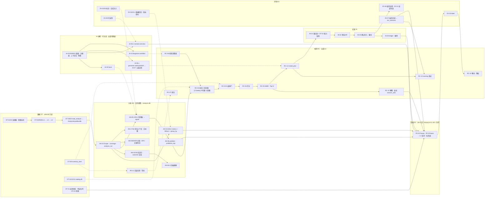

# Orbit 功能映射与分工（feature-map）

> 状态：方案（不等同当前能力） · 维护者 `yhyfhgs` · 核对版本 main `0c96334` · 适用：Advance / Lite（另注明处除外）

> 2026-10-02。依据：四份模块文档最终版（`docs/plans/analysis-module.md`、`docs/plans/recommendation-module.md`、`docs/plans/ai-module.md`、`docs/plans/evaluation-module.md`）、模块契约 [`contract.md`](module-contract.md) 第 2 版（本机工作文件，第 3 版条目见各模块文档末节）、数据契约 `docs/plans/data-acquisition.md` 与 `docs/contracts/analysis-inputs.md`、Demo 功能清单 [`feature-map.md`](feature-map.md) §5（309 条）与八组映射行 本机工作文件…8.json`、已合入 main 的 `docs/audits/backend-gap.md`（PR #36）。现状基线 origin/main `4ffa506`。成员一律用 GitHub 账号指代；版本名 Lite / Advance（历史材料中的 Advanced 指 Advance）。
>
> 本文只做映射与分工，不定义算法：feature 的输入 → 处理 → 输出、MVP 与迭代、复杂度与 token 成本在各模块文档；表与端点在契约；本文负责「哪条界面功能由哪些 feature 串起来、谁做、什么时候做、前端要改什么」。

## 1. 怎么用

**一句话**：把 Demo 的 309 条前端功能逐条映射到 161 个后端 feature（DT / AN / RC / AI / EV / IN / FE），给出三人分工与三个里程碑、10 条核心功能的端到端链路、以及去重后的 UI 迭代清单；它是开工分工与后续增删改的唯一总表。

**阅读路径**

| 想知道 | 看 |
| --- | --- |
| 某个按钮或面板背后要做什么、现在做到哪 | §5（按页面分节，309 行） |
| 我负责哪些 feature、要和谁对接口、先做什么 | §3 |
| 一个用户功能如何串起 DT → AN → AI → RC → EV → IN → FE | §4（10 条核心链路） |
| 某个 feature 的阶段、现状、负责人、reviewer、被多少界面用到 | §6（161 行，含 20 个新增与 1 个废弃） |
| 前端下一步改什么、优先级 | §7（P0 9 项、P1 13 项、P2 10 项、明确拒绝 10 项） |
| 后端集成分支 `wip/yhyfhgs-backend` 上资源库、特征、推荐、AI、安装、平台各做到哪、实测性能与剩余缺口 | [backend-buildout.md](backend-buildout.md)（Q1–Q7） |
| 后端在本机真实日志上能否还原各页、推荐/安装/AI 的实测效果、性能与缺陷修复分支（只含聚合结果） | [real-data-validation.md](real-data-validation.md) |
| Lite 8 页与 Advance 页面的对应、哪些后端共用 | §8 |

**增删改规则**

| 规则 | 内容 |
| --- | --- |
| ID 永不复用 | feature ID（`<模块>-<序号>[.<子序号>]`）与 UI 条目 ID（`A7-15`、`SET-12` 等）只增不改；含义变了就把旧 ID 标「（废弃）」留在 §6.9，再登记新 ID。 |
| 废弃与不进产品 | 废弃的 feature 保留在 §6.9；不进产品的 UI 条目保留在 §5.18 并写处理办法，不从 §5 删行。 |
| 改负责人 | 只改两处：本文 §6 的负责人 / reviewer 列，和对应模块文档功能清单的同一行；其他文档不写负责人。UI 条目（§5）的负责人 = 其 feature 链里最关键 feature 的 owner，随 §6 变化，不单独维护。 |
| 新增功能 | 顺序固定：① 在 §5 对应页面加映射行（`ui_id`、功能、后端怎么实现、feature 链）；② 链里缺 feature 时在 §6.8 登记新 ID（挂到最近的模块，写阶段、负责人、复杂度与 token）；③ 回模块文档功能清单写该 feature 的输入 → 处理 → 输出。先有界面需求再有 feature，不反过来。 |
| 阶段 | 只在本文 §6 与模块文档改；MVP 判定规则（Lite 8 页需要的数据 + Advance 三张安装闭环卡）不因单条条目调整。 |
| 现状 | PR 合入后由 PR 作者更新本文相关行的现状列（含 §5 受影响条目），不等 reviewer。 |
| 与 `docs/audits/backend-gap.md` | 缺口文档的 G 编号只作核对清单，开工与分工按本文 feature ID；对照与三处口径差异见 §6.10。 |

**CSV 版**：`docs/plans/feature-map.csv` 由 §5 的映射表生成，用于导入表格或看板；两者不一致时以本文为准，不手工编辑 CSV。生成命令（在仓库根目录）：

```sh
python3 - <<'EOF'
import re, csv
out, on = [], False
for l in open('docs/plans/feature-map.md', encoding='utf-8'):
    if l.startswith('### 5.1 '): on = True
    if l.startswith('### 5.18'): break
    if on and re.match(r'\| [A-Z0-9]+-\d+ \|', l):
        out.append([c.strip().replace('\\|', '|') for c in l.strip().strip('|').split(' | ')])
w = csv.writer(open('docs/plans/feature-map.csv', 'w', newline='', encoding='utf-8'))
w.writerow(['ui_id', '功能', '后端怎么实现', 'feature链', '负责人', '阶段', '现状']); w.writerows(out)
print(len(out), 'rows')
EOF
```

**术语**：「benchmark」只指公开模型成绩 `benchmark_result`（DT-14）；Orbit 自己的检验叫「评测 EV」；用户与自己过去的比较叫「上期对比」（AN-12）；Lite 标题里的「个人协作 Benchmark」是产品名。卡片措辞只有四种：已计数 / 估计 / 未测 / 数据不足（契约 §0.5）。

## 2. 总览

现状基线：origin/main `4ffa506`（2026-10-02；PR #31 安装清单、PR #34 真实会话解析与重算进度、PR #36 `docs/audits/backend-gap.md` 已合入）；开放 PR：#27 `feat/feature-display-metrics`（genius-FXC）、#32 `feat/analytics-products`、#33 `feat/data-app-integration`、#35 `feat/indexed-trajectories`（yhyfhgs）。现状取值：**已实现**（main 有可用代码）/ **部分**（main 有基础，口径或接口未齐）/ **PR 中**（开放 PR 或未合入分支）/ **计划**（无代码）。阶段取值按契约 §2.1：MVP = Lite 8 页需要的数据 + Advance 三张安装闭环卡；只服务 Advance 独有界面的 feature 一律 v1。

### 2.1 feature 规模

| 模块 | feature 数 | 其中 MVP | 已实现 | 部分 | PR 中 | 计划 | 被 UI 条目引用（条） | 定义所在 |
| --- | --- | --- | --- | --- | --- | --- | --- | --- |
| 数据 DT | 29 | 22 | 7 | 11 | 2 | 9 | 134 | [`contract.md`](module-contract.md) §2.2、`docs/plans/data-acquisition.md`、本文 §6.8 |
| 分析 AN | 25 | 21 | 3 | 12 | 2 | 8 | 174 | `docs/plans/analysis-module.md` §7 |
| 推荐 RC | 20 | 15 | 1 | 6 | 0 | 13 | 69 | `docs/plans/recommendation-module.md` §11 |
| AI | 29 | 14 | 0 | 0 | 0 | 29 | 97 | `docs/plans/ai-module.md` §8 |
| 评测 EV | 26 | 19 | 1 | 4 | 0 | 21 | 204 | `docs/plans/evaluation-module.md` §10 |
| 安装 IN | 8 | 7 | 0 | 1 | 0 | 7 | 36 | 契约 §2.7 |
| 前端 FE | 24 | 17 | 0 | 20 | 1 | 3 | 309 | 契约 §2.8、本文 §6.8 |
| **合计** | **161** | **115** | 12 | 54 | 5 | 90 | 309 | — |

### 2.2 UI 条目规模（309 条，全部已映射）

| 维度 | 分布 |
| --- | --- |
| 阶段 | MVP 228（含「MVP + v1 分段」的条目）· v1 / v2 / P1 76 · 不进产品 / 删除 / 不做 5 |
| 现状 | 已实现 5 · PR 中 32 · 部分 107 · 计划 99 · 仅前端（无后端）66 |
| 负责人（UI 条目） | yhyfhgs 110 · MistyHuang03 86 · genius-FXC 113 |
| 引用最多的 feature | AN-01（55）、FE-01（51）、AN-16（49）、EV-01.2（44）、FE-17（39）、EV-01（38）、FE-15（34）、AN-08.2（34） |

### 2.3 模块串联



读法：实线 = MVP 必经链路；虚线 = 可关闭或非阻塞的横切介入。单向依赖 DT → AN → RC → IN；AI 与 EV 只横向介入，无 AI 时所有产物仍能产出（契约 §1）。

## 3. 三人分工

### 3.1 原则

沿用契约 §6：已合入实现的 feature，owner = 该实现的分支作者；新建 feature 按角色分——`yhyfhgs` 产品输入输出、workflow、总体架构、数据契约与连接器（DT）、安装落点（IN）、知识库与机制决策（RC-01 / RC-06 / RC-12）、外壳（FE-01）；`MistyHuang03` 分析引擎与特征族（AN）、评测（EV）、推荐算法侧（闸门 / 打分 / 追踪 / 减法 / workflow 模板）、AI 通道与判定侧（AI-01…04、AI-07、AI-11）；`genius-FXC` 前端（FE-02…FE-22）、推荐呈现与策展侧（RC-02…05 的现有实现、RC-09 / RC-10 / RC-15）、AI 内容侧（叙述、生成模板与槽位、上下文包预览、问答与诊断交互）、读者与路演。每个 feature 一个 owner、一个 reviewer（来自另一位成员）；跨模块的功能卡由 RC 侧 owner 牵头、各模块出一段；merge 只由 `yhyfhgs` 决定（仓库 `AGENTS.md`）。对齐的提醒：`yhyfhgs` 避免过度抽象；`MistyHuang03` 优先实现、用原型验证；`genius-FXC` 持续质疑需求、不单方面加 feature。

### 3.2 按人

阶段列：MVP / v1+（v1、v2、P1、P2）；现状列同 §2。「共担」= 契约 §6 写明两人分担的 DT-11 / DT-12 / DT-14（来源清单与条目审核归 genius-FXC，抓取与 `catalog.db` 实现归 yhyfhgs）。

#### yhyfhgs

| 模块 | 负责的 feature（阶段 · 现状） |
| --- | --- |
| 数据 DT（26） | DT-01 MVP · 已实现；DT-01.1 v1+ · 计划；DT-02 MVP · 部分；DT-02.1 MVP · 计划；DT-03 MVP · 部分；DT-04 MVP · 已实现；DT-05 MVP · 部分；DT-06 MVP · 已实现；DT-06.1 v1+ · 计划；DT-07 MVP · 部分；DT-08 MVP · 部分；DT-09 MVP · 已实现；DT-10 MVP · 部分；DT-12.2 v1+ · 计划；DT-13 MVP · 部分；DT-14.1 v1+ · 计划；DT-15 MVP · 已实现；DT-16 v1+ · 计划；DT-17 v1+ · 部分；DT-18 MVP · 计划；DT-19 MVP · 已实现；DT-20 MVP · 已实现；DT-21 MVP · PR 中；DT-22 MVP · 计划；DT-23 MVP · PR 中；DT-24 v1+ · 计划 |
| 分析 AN（5） | AN-11 MVP · 部分；AN-13 v1+ · 计划；AN-13.1 v1+ · 计划；AN-16 MVP · 部分；AN-16.1 MVP · 计划 |
| 推荐 RC（3） | RC-01 MVP · 部分；RC-06 MVP · 计划；RC-12 MVP · 计划 |
| 评测 EV（4） | EV-01 MVP · 部分；EV-01.1 MVP · 计划；EV-12 MVP · 部分；EV-13 MVP · 计划 |
| 安装 IN（4） | IN-01 MVP · 计划；IN-03 MVP · 计划；IN-04 MVP · 计划；IN-07 v1+ · 计划 |
| 前端 FE（2） | FE-01 MVP · 部分；FE-23 MVP · PR 中 |
| **合计** | 44 个 feature（MVP 34；现状「计划」20，其中 MVP 11）；UI 条目 110 条（仅前端 33） |

作为 reviewer：DT-11、DT-12、DT-14、AN-01、AN-01.1、AN-01.2、AN-02、AN-05.1、AN-06、AN-10、AN-15、AN-17、RC-07、RC-08、RC-09.1、RC-11、RC-13、RC-14、RC-16、AI-01、AI-02、AI-03、AI-03.1、AI-04.1、AI-04.2、AI-04.3、AI-04.4、AI-07.1、AI-07.2、AI-07.3、AI-07.4、AI-11、EV-01.2、EV-02、EV-03、EV-04、EV-04.1、EV-05.1、EV-06、EV-07、EV-07.1、EV-11、EV-14、EV-15、IN-02、IN-05、IN-06、IN-08、FE-02、FE-09、FE-12、FE-14、FE-15、FE-16、FE-18.1、FE-21（56 个）。

#### MistyHuang03

| 模块 | 负责的 feature（阶段 · 现状） |
| --- | --- |
| 分析 AN（15） | AN-01 MVP · 部分；AN-01.2 MVP · 计划；AN-02 MVP · 部分；AN-03 MVP · 部分；AN-05.1 MVP · 部分；AN-06 MVP · 计划；AN-07 v1+ · 计划；AN-08.1 MVP · 已实现；AN-09 MVP · 计划；AN-10 MVP · 部分；AN-12 MVP · 部分；AN-14 MVP · 部分；AN-15 v1+ · 计划；AN-17 MVP · 已实现；AN-18 MVP · 已实现 |
| 推荐 RC（7） | RC-07 MVP · 计划；RC-08 v1+ · 计划；RC-11 v1+ · 计划；RC-13 MVP · 计划；RC-14 v1+ · 计划；RC-16 MVP · 计划；RC-17 MVP · 计划 |
| AI（15） | AI-01 MVP · 计划；AI-02 MVP · 计划；AI-03 MVP · 计划；AI-03.1 v1+ · 计划；AI-04.1 v1+ · 计划；AI-04.2 v1+ · 计划；AI-04.3 v1+ · 计划；AI-04.4 v1+ · 计划；AI-07.1 MVP · 计划；AI-07.2 MVP · 计划；AI-07.3 MVP · 计划；AI-07.4 v1+ · 计划；AI-11 MVP · 计划；AI-12 v1+ · 计划；AI-13 v1+ · 计划 |
| 评测 EV（18） | EV-01.2 MVP · 计划；EV-02 MVP · 计划；EV-02.1 MVP · 计划；EV-03 MVP · 部分；EV-04 v1+ · 计划；EV-04.1 MVP · 计划；EV-04.2 v1+ · 计划；EV-05.1 v1+ · 计划；EV-05.2 v1+ · 计划；EV-06 MVP · 计划；EV-06.1 v1+ · 计划；EV-07 MVP · 计划；EV-07.1 v1+ · 计划；EV-08 MVP · 计划；EV-09 MVP · 已实现；EV-11 MVP · 计划；EV-14 MVP · 计划；EV-15 v1+ · 计划 |
| 安装 IN（1） | IN-05 MVP · 计划 |
| **合计** | 56 个 feature（MVP 36；现状「计划」44，其中 MVP 24）；UI 条目 86 条（仅前端 0） |

作为 reviewer：DT-01、DT-01.1、DT-02、DT-02.1、DT-03、DT-04、DT-05、DT-06、DT-06.1、DT-07、DT-08、DT-09、DT-10、DT-13、DT-14.1、DT-15、DT-16、DT-17、DT-18、DT-19、DT-20、DT-21、DT-22、AN-04、AN-05.2、AN-08.2、AN-11、AN-13、AN-16、AN-16.1、AN-19、RC-02、RC-03、RC-03.1、RC-04、RC-05、RC-09、RC-10、RC-15、RC-15.1、AI-05.1、AI-05.2、AI-05.3、AI-05.4、AI-06.1、AI-06.3、AI-06.4、AI-06.5、AI-06.6、AI-06.7、AI-06.8、AI-08、AI-09、AI-10、EV-01、EV-01.1、EV-05、EV-09.1、EV-10、EV-10.1、EV-12、EV-13、IN-01、IN-03、IN-04、IN-07、FE-03、FE-04、FE-05、FE-06、FE-07、FE-08、FE-10、FE-11、FE-13、FE-17、FE-18、FE-19、FE-20、FE-22（80 个）。

#### genius-FXC

| 模块 | 负责的 feature（阶段 · 现状） |
| --- | --- |
| 数据 DT（3） | DT-11 MVP · 部分；DT-12 MVP · 部分；DT-14 MVP · 部分 |
| 分析 AN（5） | AN-01.1 MVP · PR 中；AN-04 MVP · 部分；AN-05.2 MVP · 部分；AN-08.2 MVP · PR 中；AN-19 MVP · 部分 |
| 推荐 RC（10） | RC-02 MVP · 部分；RC-03 MVP · 部分；RC-03.1 v1+ · 计划；RC-04 MVP · 已实现；RC-05 MVP · 部分；RC-09 MVP · 部分；RC-09.1 MVP · 计划；RC-10 MVP · 计划；RC-15 MVP · 部分；RC-15.1 v1+ · 计划 |
| AI（14） | AI-05.1 MVP · 计划；AI-05.2 v1+ · 计划；AI-05.3 v1+ · 计划；AI-05.4 v1+ · 计划；AI-06.1 MVP · 计划；AI-06.3 MVP · 计划；AI-06.4 MVP · 计划；AI-06.5 v1+ · 计划；AI-06.6 v1+ · 计划；AI-06.7 MVP · 计划；AI-06.8 v1+ · 计划；AI-08 MVP · 计划；AI-09 v1+ · 计划；AI-10 MVP · 计划 |
| 评测 EV（4） | EV-05 MVP · 计划；EV-09.1 MVP · 部分；EV-10 MVP · 计划；EV-10.1 MVP · 计划 |
| 安装 IN（3） | IN-02 MVP · 计划；IN-06 MVP · 计划；IN-08 MVP · 部分 |
| 前端 FE（22） | FE-02 MVP · 部分；FE-03 MVP · 部分；FE-04 MVP · 部分；FE-05 MVP · 部分；FE-06 MVP · 部分；FE-07 MVP · 部分；FE-08 MVP · 部分；FE-09 MVP · 部分；FE-10 MVP · 部分；FE-11 v1+ · 部分；FE-12 MVP · 部分；FE-13 v1+ · 部分；FE-14 MVP · 部分；FE-15 MVP · 部分；FE-16 v1+ · 部分；FE-17 v1+ · 部分；FE-18 v1+ · 部分；FE-18.1 v1+ · 计划；FE-19 MVP · 部分；FE-20 MVP · 计划；FE-21 MVP · 部分；FE-22 v1+ · 计划 |
| **合计** | 61 个 feature（MVP 45；现状「计划」26，其中 MVP 15）；UI 条目 113 条（仅前端 33） |

作为 reviewer：DT-11、DT-12、DT-12.2、DT-14、DT-23、DT-24、AN-03、AN-07、AN-08.1、AN-09、AN-12、AN-13.1、AN-14、AN-18、RC-01、RC-06、RC-12、RC-17、AI-12、AI-13、EV-02.1、EV-04.2、EV-05.2、EV-06.1、EV-08、EV-09、FE-01、FE-23（28 个）。


**需要与他人对接的接口**（每条只有一个提供方；形状以契约 §3 为准，变更先改契约再改代码）

| 接口 | 提供方 → 消费方 | 形状 / 文件 | 里程碑 |
| --- | --- | --- | --- |
| `AnalysisInputBundle`（canonical） | yhyfhgs（AN-16 `canonical_bundle()` 读 `orbit_data.analysis_input.read_analysis()`）→ MistyHuang03（AN-01 … AN-19 全部） | `analysis-input-v1`；`meta{coverage, selection, versions, freshness}`；`GET /v1/analytics/status` | M1 |
| `metrics` 响应与 `basis` | MistyHuang03（AN-01 / AN-10）→ genius-FXC（FE-20 全站渲染、FE-03 / FE-07） | `metrics[{metric, bucket, group, value, n, lo, hi, basis, status}]`；`GET /v1/analytics/metrics?metric[]&bucket&group_by` | M1 |
| `signal` / `problem` / `problems_top[]` | MistyHuang03（AN-05.1 / AN-06）+ genius-FXC（AN-05.2）→ genius-FXC（RC-02 `problem` 适配、AI-05.1）、FE-03 | 契约 §3.2 (b)；`problem.key` 全称 `<signal.kind>:<子键>`；`evidence_session_uids` | M1 |
| `outcome` 四态与验证字段 | genius-FXC（AN-19 合成器）→ MistyHuang03（AN-02 行、`completed_rate`）、FE-05 结果卡 | `outcome ∈ completed / partially_completed / abandoned / unknown` + `outcome_basis`、`verify_*` | M1 |
| `candidate` 批次 | genius-FXC（RC-02 … RC-05、RC-15）→ yhyfhgs（RC-12）、FE-09 / FE-03 | `candidate(batch_id, gates, score, evidence.session_uids, explain, rank, status)`；`GET /v1/recommendations?include_gated&problem_id[]&session_uid&q&status[]` + `counts{}` | M1 |
| `install_plan` 与 `preview_digest` | yhyfhgs（RC-12 渲染器 + IN-01 落点表）→ genius-FXC（IN-02 预览、FE-12）；yhyfhgs（IN-03 / IN-04）读回 `preview_digest` | `install_plan(targets[{agent, path, action, content, mappable, reason, requires_trust}], rendered_by, preview_digest, risk_scan)`；`POST /v1/install/{preview,apply}`、`POST /v1/install/{id}/revert` | M1 |
| `tracking` / `rec_outcome` | MistyHuang03（RC-13 登记、EV-07 四态）→ genius-FXC（A7-15 / Lite「预期效果」） | `tracking(metrics[{metric, layer, direction, must_be_zero}], baseline_*, follow_days, scope_filter, min_sessions)`；`GET /v1/outcomes/{install_id}` → `rec_outcome[] + conclusion` | M1 登记 / M2 四态 |
| `label` | genius-FXC（EV-10 `POST /v1/labels`、EV-10.1 组件）→ MistyHuang03（EV-02 精度、AN-08 「不像我」率）、genius-FXC（RC-10 降权 v1） | `label(target_kind, target_id, label, reason)`；原因枚举 = recommendation.md §3.9 的 5 项 | M1 |
| `inventory_item` | yhyfhgs（DT-09，已合入）→ yhyfhgs（AN-11 事实）、genius-FXC（RC-03 闸门 6 / 7）、MistyHuang03（AI-07.1 名称冲突、IN-05） | `inventory_item(type, name, path, content_hash, enabled, catalog_item_id)`；`GET /v1/inventory` | M1 |
| 能力矩阵 | yhyfhgs（DT-22）→ yhyfhgs（IN-01 `mappable`）、genius-FXC（RC-02 ③ builtin 版本探测、FB-02 列表） | `source.harness_version` + `{hooks, skills, mcp, subagent, headless}` 支持矩阵 | M1 |
| `ai_request / ai_response` 信封、`TASKS` 注册表、`FakeEngine` | MistyHuang03（AI-01 / AI-02 / AI-11）→ genius-FXC（AI-05.1、AI-06.x、AI-08、AI-10） | 契约 §3.6；`POST /v1/ai/{preview,jobs}`、`GET /v1/ai/jobs/{id}`（SSE `{stage, progress, tokens, message}`） | M2 |
| 会话详情时间线数据 | MistyHuang03（AN-03 / AN-09）+ genius-FXC（AN-05.2 位置）→ genius-FXC（FE-05 `ui/vizkit` 换数据源） | `GET /v1/analytics/sessions/{id}` 的 `segments / key_moments / signals / tool_sequence`；`GET /v1/sessions/{id}/events?from_seq&to_seq` | M2 |
| 统一检索 | yhyfhgs（DT-23）→ genius-FXC（FE-14、A3-05、A9-05） | `GET /v1/search?q&scope…` → `{kind, id, title, snippet(highlight), session_uid}` | M2 |
| 应用状态与作业 | yhyfhgs（DT-21 / AN-16 `analysis_run`）→ genius-FXC（FE-15、FE-16、GL-06）、MistyHuang03（EV-12 读 `.local/evaluation/*.json` 以外无依赖） | `/v1/app/*`、`GET /v1/status`、`GET /v1/analytics/status` | M1 最小 / M2 全量 |
| 评测入口 | yhyfhgs（EV-12 `orbit evaluate --fail-under` 接回 `pnpm check`）↔ MistyHuang03（各 suite 实现）、yhyfhgs（EV-13 `install`、EV-01） | 退出码；`.local/evaluation/<suite>-<ran_at>.json` | M1 → M3 |
| 实时事件 | yhyfhgs（AN-13 SSE、AN-13.1 关注队列）→ genius-FXC（FE-17、FE-18.1） | `GET /v1/analytics/realtime`（SSE，带 `session_uid`、`kind`、优先级） | v1 |

### 3.3 工作量是否均衡与调整

**按模块文档原始分工的问题**：MVP 阶段「现状 = 计划」的 feature 过度集中在 `MistyHuang03`（原 26 个，分布在 AN 3、RC 4、AI 7、EV 11、IN 1；另有 11 个「部分」待补齐），其中 AN-16 canonical 适配是所有分析工作的前置，与 `yhyfhgs` 已合入的 PR #34（真实会话解析、重算进度与大库分析）和 PR #9 / #14 的 `read_analysis()` 同一处代码；`genius-FXC` 的 60 个 feature 里 27 个「部分」是两版 Demo 的页面接线，数量多但每项是改数据源，不是新算法；`yhyfhgs` 的 DT 侧 7 个已实现、11 个部分，MVP 新建 14 个且多为迁移（PR #33 的 `application.py` 迁入 `packages/backend`）与小端点。

**调整（已写入 §6，模块文档的功能清单同步改这 5 行）**

| feature | 原 owner → 新 owner（reviewer） | 理由 |
| --- | --- | --- |
| AN-16 分析输入适配与范围 | MistyHuang03 → yhyfhgs（MistyHuang03） | `canonical_bundle()` 读的是 `yhyfhgs` 写的 `read_analysis()`，`analysis_run` 进度已在他合入的 PR #34；由数据侧封口这条 DT → AN 的缝，`MistyHuang03` 可以立即从 AN-01 开始而不是先做适配器。`Scope` / `select()` 的统计语义仍由 `MistyHuang03` 以 reviewer 身份把关 |
| AN-11 已装未用、常驻开销 | MistyHuang03 → yhyfhgs（MistyHuang03） | `installed_unused / rule_coverage / rule_file_stats` 直接读他刚合入的 DT-09 清单；`resident_tokens_median` 是 `model_call` 首条的一行聚合 |
| EV-12 评测运行方式 | MistyHuang03 → yhyfhgs（MistyHuang03） | `--fail-under` 与接回 `pnpm check` 改的是 PR #28 他整理的 `scripts/check.sh` 与 CLI 入口；各 suite 的内容仍归各 suite 的 owner |
| EV-10 标签入口（后端） | MistyHuang03 → genius-FXC（MistyHuang03） | `POST /v1/labels` 与 `label` 表的唯一写入方是 RC-10 与 EV-10.1 组件（都是 `genius-FXC`）；读方 EV-02 / AN-08 不变 |
| EV-05 曝光评估 | MistyHuang03 → genius-FXC（MistyHuang03） | 采纳 / 不适用 / 撤销率完全由 RC-10 的曝光日志与 `label` 算出，与 `remedy_rule × surface` 的分组口径由同一人维护；指标定义仍由 `MistyHuang03` review |

**调整后**（只数 MVP）：`yhyfhgs` 待建 14 + 待补齐 13；`MistyHuang03` 待建 24 + 待补齐 8；`genius-FXC` 待建 17 + 待补齐 27（其中 14 项为页面接线、3 项为共担的 Catalog 来源）。`MistyHuang03` 仍是新代码最多的人，但其 24 项里 EV-04.1 / EV-11 / EV-14 / EV-02.1 / EV-08 / IN-05 复杂度均为 S，且 AI-01 / AI-02 可用 `FakeEngine` 与 AN 并行、不互相阻塞；他的全部 v1 评测项（EV-04、EV-04.2、EV-05.1 / 05.2、EV-06.1、EV-07.1）在三个里程碑内都不排期。`genius-FXC` 的 Advance 独有界面（FE-11 / 13 / 16 / 17 / 18）按 MVP 判定规则整体 v1，Lite 8 页之外的接线不占 M1。`yhyfhgs` 同时承担 PR 审批与契约维护，所以他的新建项都选了小端点与迁移类工作。再次调整的触发条件：M1 结束时任一人的 MVP 待建项剩余 > 其他两人之和，则把 EV-02.1 CLI（`orbit label`，与 `orbit-data` CLI 同栈）移给 `yhyfhgs`，把 RC-07 减法推荐（读 DT-09 与 AN-11 事实）移给 `yhyfhgs`。

### 3.4 三个里程碑

每个里程碑的验收取自模块文档已写定的标准；三人交付的顺序以 §4 核心链路中的依赖为准（AN-16 → AN-01 → AN-05 / AN-06 → RC-02 → RC-12 → IN）。全程 0 token 直到 M2 的 AI MVP。

| 里程碑 | 目标与验收 | yhyfhgs | MistyHuang03 | genius-FXC |
| --- | --- | --- | --- | --- |
| **M1 跑通真实数据最小闭环** | 三人本机 `orbit.db` → Lite 概览 / 会话与轨迹 / 工具调用三页的每个数字都来自 `/v1/analytics/{overview, metrics, sessions, tools}`，每个比例带 n 与 Wilson 区间（EV-01.2 覆盖 Lite 约 20 项）；功能卡「只读命令自动放行」从 `problem` → 候选 → 预览 → 确认写入 → 撤销走通一次，EV-13 `install` suite 100%、撤销后 sha256 一致；100k 事件冷算 ≤ 10 s、热查询 ≤ 1 s（契约 V4）；`human_origin` 覆盖 ≥ 50%（V11） | AN-16 `canonical_bundle()` + `analysis_run` + `GET /v1/analytics/status`；DT-21 最小集迁入 `packages/backend`（`app-state.json`、导入作业队列）；DT-22 能力探测；DT-23 FTS5 子串版；RC-01 12–15 条 + RC-06 第 1 / 2 / 11 / 12 / 13 行；RC-12 渲染器（claude_code、codex × `permission_rule` / `rule`）；IN-01 / IN-03 / IN-04；EV-13；EV-12 `--fail-under` 接回 `pnpm check`；AN-11 `rule_coverage / installed_unused` 事实 | AN-01 `metrics` 端点 + AN-10（Wilson、`insufficient`）；AN-02 补 `verify_* / autonomy_steps`；AN-05.1 四个检测器转 `signal` 行；AN-06 升级 + `problems_top[]`；AN-12 `group_by ∈ {project, model_effort, source}`；EV-01.2 金标（Lite 约 20 项）；EV-03 三张卡用例与 `would_prompt / retry_loop` 一正一反注入；RC-13 `tracking` 登记；EV-07 四态在线计算 | AN-19 合成器（约 60 行）；AN-05.2 `would_prompt` 与 `retry_loop`（`retry_links` 适配器）；AN-08.2 Wilson 版（PR #27 收口合入）；RC-02 `problem` 适配 + RC-03 `gates.py` 8 道 + RC-15 显式 `session_uids`；Lite 概览 / 会话 / 工具三页改读端点，全站 FE-20 `basis / n / 区间` 渲染（§7 P0-1 … P0-5）；IN-02 预览 diff + FE-12 接 `/v1/install/*`（P0-6）；EV-10 `POST /v1/labels` + EV-10.1 组件 |
| **M2 Advance 主要页面接真数据 + AI MVP** | Advance A1–A8 的每个数字可回到端点，Lite 8 页全部接真；三张卡全部走通（含 `retry-breaker` hook 与 `generate.rule` 规则卡）；facet 回填 200 个会话 ≤ 10 分钟、`failed` 率 < 5%、打包一致率 ≥ 0.9（契约 V5）；EV-14 `privacy` suite 命中 = 0；两张生成卡的 EV-06 三道自检 100%；账本误差 ≤ 30% | DT-21 全量（设置持久化、存储统计、带确认词的清除、备份）；AN-16.1 排除名单与日志定位；DT-10 用户可编辑脱敏规则；FE-01 `ui/shell` 合入 + FE-23 MVP 部分（helper、Finder、编辑器）；IN-01 补 hook / skill 落点与 Codex「已安装、未信任」提示；EV-01.1 `/insights` 对照；AN-13 起步（若 M2 内有余量） | AI-01（Claude Code、Codex、`FakeEngine`、能力探测）、AI-02（`TASKS` + gate）、AI-03（用户触发回填）、AI-11（估算、封顶、只处理新会话）+ EV-11 + EV-14；AI-07.1 / 07.2 / 07.3；AN-09 五类规则时刻；AN-03 `work_block`；AN-01.2；EV-02 标注（每人每检测器 30 条）+ EV-02.1 CLI；EV-06；RC-07 两条减法；RC-16 两条 workflow 模板；RC-17 水平闸门；EV-08 读 AN-12 表；IN-05 扫描规则 | Advance A1–A8 接真数据与 §7 P0 全部、P1 大部分；AI-05.1 `narrate.overview`（降级模板版同时上）；AI-06.1 / 06.3 / 06.4 / 06.7 + AI-08 上下文包 + Lite「用本地 Agent 生成」入口（P0-9）；AI-10 单次版（A7-03 findings）；RC-09 接线 + RC-09.1 条目详情；RC-10 曝光与 `first_shown_at`；IN-06 状态机；IN-08 写入目标路径；EV-05 曝光统计；EV-09.1 读者轮材料 |
| **M3 评测与路演** | evaluation.md §5.4 路演前清单 8 项全绿：七个 MVP suite `--fail-under` 退出码 0；EV-02 四类检测器各 n ≥ 30 且 P ≥ 0.7、`problem` 前 20 条精确率 ≥ 0.8；三张卡每人本机端到端 + `--real` 冒烟；至少一条真实安装显示四态之一且 n 与区间正确；读者轮 6 + 9 案例有 `acceptance.decision`；facet 预估 vs 实际偏差 ≤ 30%、幻觉率 = 0；`/insights` 对照差异逐项有解释；V4 / V11 实测记录 | EV-12 七个 suite 全绿与 CI；EV-13 `--real` 冒烟；V4 / V11 实测写入契约 §7；契约第 3 版正式入库（`docs/`）并同步本文现状列；三人真实库的脱敏演示快照 | EV-02 汇总与 `detector-summary.json`；EV-07 至少一条真实安装四态；EV-11 账本偏差；EV-04.1 facet Schema 有效率 / 幻觉率；性能回归（V4）；AN v1 项不排期 | EV-09.1 读者轮执行与 `acceptance.decision`；FE-21 Lite / Advance 演示切换与路演脚本；§7 P1 收尾；A9 外壳（v1）只在有余量时做；路演材料、Demo 录屏与讲稿 |

## 4. 核心功能串联

10 条用户功能，每条按 DT → AN → AI → RC → EV → IN → FE 写出 feature 链、每步的输入 → 输出、负责人、token 与评测。表里只写本链路真正用到的 feature；某段「无」就写明原因。契约 §4.2 的九段功能卡（只读命令自动放行）是链 8 的展开写法，三张卡的 AN / RC / AI / EV 段分别在 `analysis.md` §8、`recommendation.md` §12、`ai.md` §9、`evaluation.md` §7。

### 4.1 概览结论卡：做得好 / 卡在哪 / 立刻可做 + AI 一句话

用户看到：A1-07 … A1-11 三段结论与一句话画像，每段带来源标签（模板版 / AI 版 · 引擎 · `prompt_version` · 生成时间 · 本次 token），「证据」按钮携带会话 ID 集合跳 A3；Lite 概览「AI 一句话」与「本周建议」同源。

| 段 | feature | 输入 → 输出 | 负责人 | token | 评测 |
| --- | --- | --- | --- | --- | --- |
| DT | DT-05、DT-06、DT-19 / DT-20 | L2 真人消息（`v_human_message`）、L3 `tool_call`、`outcome.validation_runs` → `read_analysis()` → `AnalysisInputBundle` | yhyfhgs | 0 | EV-01 数据回归 |
| AN | AN-16 → AN-01 / AN-10 → AN-19 → AN-05.1 / AN-05.2 → AN-06 | `Scope` + `coverage` → `metrics`（`completed_rate / verify_pass_rate / correction_signal_rate`，Wilson）→ `outcome` 四态 → `signal` → `problem` 与 `problems_top[]`（≥ 3 会话 ∧ `wilson_lo ≥ 0.05`，`repeated_instruction` 为 2） | AN-16 yhyfhgs；AN-01 / 05.1 / 06 MistyHuang03；AN-05.2 / 19 genius-FXC | 0 | EV-01.2 金标；EV-02 `problem` 前 20 条精确率 ≥ 0.8 才进「卡在哪」；EV-03 注入 |
| AI | AI-05.1 `narrate.overview`（AI-02 路由、AI-11 预算） | 汇总指标（带 `n / lo / hi / basis`）+ `problems_top ≤ 5`（每条 ≤ 3 条 facet summary，由代码挑选）+ `profile.code` + RC-05 Top 3 的 title / `problem_id` → 三段 `findings[]`，只能引用 `problem_id / candidate_id`，数字白名单；缓存键 `(scope_hash, metrics_hash, prompt_version)`；无 AI 降级 `narrative.explain()` | genius-FXC（AI-05.1）；MistyHuang03（AI-02 / 11） | 1 次 L3 ≈ 8K 入 + 0.6K 出（≈ $0.02）；数字不变不重算，≤ 7 次 / 周 | EV-09 规则检查（`error` 即退回模板）；EV-09.1 读者轮盲评模板版 vs AI 版；EV-11 记账 |
| RC | RC-02 → RC-03 → RC-04 → RC-05 → RC-17 | 当前批次 → 过闸 → 打分 → 去重 + MMR → 水平闸门 → 未安装前 3；「卡在哪」按 `recommendations?problem_id[]` 反查候选 | genius-FXC（RC-02 … 05）；MistyHuang03（RC-17） | 0 | EV-05 曝光与采纳率 |
| EV | EV-01.2、EV-02、EV-03、EV-09、EV-09.1、EV-11 | 见上 | MistyHuang03；EV-09.1 genius-FXC | 0 | — |
| IN | 无 | 本功能只跳转，不写文件 | — | — | — |
| FE | FE-03、FE-20 | 来源标签；证据按钮携带 `evidence_session_uids` 作 `root_session_uids` 跳 A3（不覆盖已有筛选）；分母 < 5 整段「数据不足」；「做得好」改为 `verify_pass / completed` 等可数事件 | genius-FXC | — | — |

UI 条目：A1-07 … A1-11、A1-25、Lite 概览；§7 P0-2。MVP：模板版三段 + 可开 AI 版 + Top 3 读当前批次；v1：AN-12 `change_flags` 与 AN-15 进「卡在哪」、RC-05 `rec_top` 周快照、AI-05.4 人格旁白。复杂度：AN 一次扫描 O(事件数)，查询现算带 `analysis_digest` LRU。

### 4.2 协作人格（四轴 Wilson 版）

用户看到：A1-21 / A2 / Lite 画像的四字母码——每轴占比条 + Wilson 区间 + 字母或 `?`（尚未定型），证据行是单位计数（「31 / 84 个轮次 Agent 连续 ≥ 5 步」），整页标「实验性」；逐月演变；「不像我」反馈。

| 段 | feature | 输入 → 输出 | 负责人 | token | 评测 |
| --- | --- | --- | --- | --- | --- |
| DT | DT-05、DT-06、DT-07 | 真人消息 `ts`（活跃天、工作段）、`turn / tool_call`（真人触发轮次的自主步数）、`project`（项目级画像） | yhyfhgs | 0 | EV-01 |
| AN | AN-02、AN-03、AN-17、AN-08.1 → AN-08.2（AN-10） | `autonomy_steps`（D 轴单位）、`work_block.interleaved`（M 轴）、`verify_requested` / 规划 / 结构化开场（P / V 轴）、`observations` → 每轴 `{value, lo, hi, n_units, unit, letter}`：区间整体在 50% 一侧才给字母，否则 `?` + `experimental`；门槛 `n_units ≥ 30 ∧ 活跃天 ≥ 10`；`profile?month` 按窗口现算 | AN-08.2 genius-FXC（PR #27）；AN-02 / 03 / 17 / 08.1 / 10 MistyHuang03 | 0 | EV-01.2 四轴金标（占比与字母手算）；EV-02 抽检 `verify_requested` 与规划识别精度 |
| AI | AI-05.4 `narrate.persona`（v1） | `profile.axes / observations` + 前 3 类摩擦 → headline、traits（绑定指标名与数值）、tradeoffs、blind_spots（绑定 `problem`）、caveats；MVP 用类型文案库 + 模板量化旁白 | genius-FXC | MVP 0；v1 1 次 L3 ≈ 6K / 画像变化 | EV-09；EV-10 「不像我」率 |
| RC | 无直接候选 | 人格不进推荐（契约 §0.10）；A2-15 盲点「→ 建议」按该摩擦的 `problem_id` 反查候选（经 AN-06，不经人格）；RC-03 `profile_evidence` 只对有 `dimension` 的问题读 AN-08.1 | — | 0 | — |
| EV | EV-01.2、EV-02、EV-10 | 金标；信号精度；`label(not_me, reason = axis_*)` → AN-08 「不像我」率；v1 分半信度 | MistyHuang03；EV-10 genius-FXC | 0 | — |
| IN | 无 | 不写文件 | — | — | — |
| FE | FE-04、FE-03 A1-21、FE-20、EV-10.1 | 占比 + 区间 + 字母 / `?`；证据行单位计数与活跃天；删除「全体用户」对照与契合度分；`?` 显示「尚未定型」；「不像我」写 `label` | genius-FXC | — | — |

UI 条目：A1-21、A2-01 … A2-16、A5-08、Lite 协作画像、EXP-04 / 05、WG-02、REV-*；§7 P1（UG-AN-07）。MVP：Wilson 版四轴 + 文案库 + 逐月现算（依赖 AN-02 `autonomy_steps` 与 AN-03 `work_block` 先落地）；v1：AI-05.4、按天 bootstrap、权重按 `label.not_me` 校准、`profile_history` 表、揭晓动画与分享卡快照。复杂度 O(轮次)。

### 4.3 会话时间线与关键时刻

用户看到：A3 列表（结果徽章、工具条形码、纠偏数）与详情的泳道时间轴、编号关键时刻、回放与缩放；Lite 的关键任务时间轴 4 个节点。

| 段 | feature | 输入 → 输出 | 负责人 | token | 评测 |
| --- | --- | --- | --- | --- | --- |
| DT | DT-05、DT-06、DT-23 | L2 `event(seq, attrs.time)`、`tool_call(kind, command_head, exit_code, duration)`、`link`（子代理）、`context.compaction` → `GET /v1/sessions/{id}/events?from_seq&to_seq`；会话检索 | yhyfhgs | 0 | EV-01 事件夹具 |
| AN | AN-02、AN-03、AN-05.1 / 05.2、AN-19、AN-09 | `tool_sequence`；任务分段（`segment_tasks()`）与工作段；信号位置；`validation_runs`；五类规则时刻 delivery / correction / failure_streak / verify_pass / compaction（每会话 ≤ 8，带 `event_uid`）→ `GET /v1/analytics/sessions/{id}` 的 `segments / key_moments / signals / tool_sequence` | AN-03 / 09 / 02 MistyHuang03；AN-05.2 / 19 genius-FXC | 0 | EV-02 规则时刻精确率 ≥ 0.8 才画实心；EV-03 注入；EV-01 泳道计数夹具 |
| AI | AI-03 facet（可关）；AI-05.2（v1） | 列表摘要 `goal / summary`、A3-13 悬停的 `candidates[]` 类别；v1 `key_moments(deviation)` 空心紫色标记带引用；单会话复盘 `lessons[]` | MistyHuang03（AI-03）；genius-FXC（AI-05.2） | 计入 facet 回填（每会话 ≈ 3.5K 入，8 会话打包）；v1 复盘 10K + 1K / 次 | EV-04.1 facet 质量；EV-10 「不准确」 |
| RC | RC-15；`recommendations?session_uid` | A3-18 启示 = 模板句 + 两张安装卡（规则 / `retry-breaker`）；经 `problem.evidence_session_uids` 反查候选，无命中显示「此会话未参与任何问题」 | genius-FXC | 0 | EV-03 |
| EV | EV-01、EV-02、EV-03、EV-10 | 见上 | MistyHuang03 | 0 | — |
| IN | 经 A3-18 卡进入链 4.8 | — | — | — | — |
| FE | FE-05 | 沿用 `ui/vizkit` 的密度泳道 / 关键时刻簇 / minimap / 回放组件，只换数据源；保留 8 秒回放、拖动播放头、⌘ / Ctrl 缩放；指标条「Agent 步数」= `autonomy_steps`，上下文峰值无观测不显示；`outcome` 徽章带 `basis`；阶段带（AN-03 phase）与情绪泳道（AN-07）v1，上下文线 v2 | genius-FXC | — | — |

UI 条目：A3-01 … A3-19、Lite 会话与轨迹（4 节点 = 任务分段 + 时刻聚合）；§7 P0-3。MVP：密度泳道 + 规则时刻 + 任务分段；v1：阶段、情绪泳道、AI 时刻、复盘、相似会话 B、运行中（AN-13）；v2：上下文线。复杂度 O(事件) / 会话。

### 4.4 摩擦与瓶颈 → 问题

用户看到：A1-16 摩擦率 KPI（`basis = proxy`，带区间）、A6-08 摩擦分类条、A1-10「卡在哪」、A2-15 盲点；一律称「候选」。

| 段 | feature | 输入 → 输出 | 负责人 | token | 评测 |
| --- | --- | --- | --- | --- | --- |
| DT | DT-05、DT-06、DT-13、DT-09 | 真人消息（`direct_user_text`）、`tool_call(argument_digest, status_scope, approval, command_head)`、词表（`command.readonly`、破坏性命令、命令族）、已装 `permissions.allow`（扣除） | yhyfhgs | 0 | EV-01 |
| AN | AN-17 → AN-05.1 + AN-05.2 → AN-06 | 语义检测 `correction`（带 `dimension`）/ `requirement` / `explanation_revision` / `long_response` / `unexplained_terms` / `subjective_feedback` + 非语义 `retry_loop`（`retry_links`）/ `would_prompt` / `permission_denied` / `missing_verification` / `interruption` / `risky_command`，每会话每类型计 1 次 → `signal(kind, friction_type, problem_type, unit, evidence)` → 按 `(problem_type, key, scope)` 聚合、`min_sessions` ∧ `wilson_lo ≥ 0.05` → `problem(type ∈ 12 类, key 全称, sessions, denom, wilson_lo, weekly_count, evidence_session_uids)`；`friction_type` 只留在 `signal` 供 A6-08 | AN-05.1 / 06 / 17 MistyHuang03；AN-05.2 genius-FXC | 0 | EV-02 每人每检测器 30 条，P ≥ 0.7；EV-03 每类 `signal.kind` 一正一反，`exact_cases` 100%；EV-01.1 `would_prompt_count` 与 `/insights bash_would_prompt_count` 对照 |
| AI | AI-03 facet `candidates[]` / `friction_types`；AI-04.1（v1） | 只判 L0 定位好的短候选 → `{is_correction, feedback_kind, friction_type, confidence}`；EV-04.1 κ ≥ 0.6 后才计入会话计数并标「含 AI 判定 n 条」；`wrong_approach / excessive_changes / buggy_output` 细分来自 facet | MistyHuang03 | 计入 facet 回填；v1 `classify.feedback` ≈ 0.15M / 周 | EV-04.1；EV-02 |
| RC | RC-02（输入） | `problem` 是候选生成的唯一输入（recommendation.md §3.1 映射）；证据不足 → RC-11「再积累 N 个会话」（v1） | genius-FXC；RC-11 MistyHuang03 | 0 | — |
| EV | EV-02、EV-03、EV-01.1、EV-04.1 | 见上 | MistyHuang03；EV-01.1 yhyfhgs | 0 | — |
| IN | 无 | — | — | — | — |
| FE | FE-03、FE-08、FE-04、FE-02 | KPI 带 proxy 角标与区间；`friction_type_mix`（含 `other` 与 `type_source`）；点类别跳 A3 按 `friction_types` 筛选（AN-16 `Scope` 扩展）；`passed = false` 的类型标「未校准」 | genius-FXC | — | — |

UI 条目：A1-16、A1-10、A6-07、A6-08、A2-15、A4-13、Lite 纠偏率与摩擦类型；§7 P1（UG-AN-08）。MVP：6 + 6 类检测器、12 类 `problem`；v1：`frustration / runaway_loop / edit_churn / mid_task_compaction / duplicate_prompt / parallel_conflict / quota_hit / workflow_pattern`、`severity` 与上游去重、AN-15。复杂度 O(事件) 扫描。

### 4.5 工具调用诊断（矩阵、失败原因、审批 → 只读白名单）

用户看到：A4 明细表（含「未知状态」列）、转移矩阵与三步链结论句、失败原因分组、审批负担卡「N 次只读命令可自动放行」+ 一键生成白名单、MCP 常驻与闲置。

| 段 | feature | 输入 → 输出 | 负责人 | token | 评测 |
| --- | --- | --- | --- | --- | --- |
| DT | DT-06、DT-05、DT-13、DT-10、DT-16（P1） | `tool_call(name_raw, kind, command_head, exit_code, error_class, duration_*, approval, is_wrapper)` 与 `event.seq`；`permission.*`（Codex 缺 kind，契约 V12）；只读词表；脱敏输出；等待时长（有 Hooks 时） | yhyfhgs | 0 | EV-01 |
| AN | AN-01、AN-04、AN-05.2、AN-06、AN-01.2、AN-11 | `tools.by_tool / by_kind / by_command_head`（含 `unknown_status_count`）；`transitions` 按 `(name_raw, kind)`（> 20 类归并，每格 n）、`three_step_chains[0]`、`by_error_class`、`subagent_relations`；`would_prompt / retry_loop`；`permission_friction:readonly_shell`；行级下钻；MCP `installed_unused / resident_tokens_median` | AN-04 / 05.2 genius-FXC；AN-01 / 01.2 MistyHuang03；AN-11 yhyfhgs | 0 | EV-01.2 聚合金标；EV-03 重复链、12 次 `git status` → problem、`rm -rf` 不进白名单 |
| AI | 无必需调用；AI-04.2（v1）、AI-04.4（v1 可选） | 失败簇命名 ≤ 30 条 / 次；单次失败原因推断 ≤ 1K；A4-03 可自动化清单是 L0（AN-04 三步链 + `would_prompt / retry_loop` + 闲置 MCP → 候选卡入口） | MistyHuang03 | MVP 0；v1 ≈ 2K / 批 | EV-04.2（v1） |
| RC | RC-06 #13 → RC-02 ① + ③ → RC-03 → RC-12；RC-07 | `readonly-allowlist`（`permission_rule`）+ `/fewer-permission-prompts`（builtin）；已含前缀不推；渲染 `permissions.allow` / execpolicy；A4-14 减法（常驻 ≥ 2,000 token 标黄 MVP，闲置 v1） | yhyfhgs（06、12）；genius-FXC（02、03）；MistyHuang03（07） | 0 | EV-06 白名单回放交集 = 0 |
| EV | EV-01.2、EV-03、EV-06、EV-13、EV-07 | 装前回放；`merge_json` 到 `/permissions/allow` 往返；装后 `would_prompt_count:readonly_shell ↓`、`denied_count` 不升、`destructive_allowed_count = 0` | MistyHuang03；EV-13 yhyfhgs | 0 | — |
| IN | IN-01 → IN-02 → IN-03 → IN-04 | claude_code `~/.claude/settings.json`（scope user）`merge_json` 6 项；codex `~/.codex/rules/orbit-readonly.rules`（语法待验证 V6）；键级 diff；备份 + 原子写；按值撤销 | yhyfhgs；IN-02 genius-FXC | 0 | EV-13 |
| FE | FE-06、FE-12 | 「未知状态」列并按 `kind / command_head / mcp_server` 切换；矩阵每格 n；审批卡次数口径，等待时长只在 DT-16 有数据时显示；失败按 `error_class` 分组可跳会话；成功率只在已知成功 + 失败中算 | genius-FXC | — | — |

UI 条目：A4-01 … A4-15、A1-24、Lite 工具调用；§7 P0-4、P1（UG-AI-06、UG-RC-08）。MVP：聚合 + 矩阵 + 分组 + 白名单卡；v1：闲置判定、并行度、簇命名；P1：等待时长分布（DT-16）。复杂度 O(调用数)。

### 4.6 项目习惯与配置覆盖

用户看到：A5 项目表（会话、时长、Agent 构成、项目级人格）、无回归线的散点、规则与配置覆盖五格（来源与扫描时间）、识别到的工作流、起草规则与封装 Skill 入口。

| 段 | feature | 输入 → 输出 | 负责人 | token | 评测 |
| --- | --- | --- | --- | --- | --- |
| DT | DT-07、DT-09、DT-06 | `project(key_type ∈ git_remote / git_root / path)`、`project_override`、按文件夹聚合；`inventory_item`（项目层 + 用户层：规则文件、hooks、skills、MCP、子代理；PR #31）；`tool_call.files` 扩展名 | yhyfhgs | 0 | EV-01（PR #31 的 `test_inventory_*`） |
| AN | AN-01 / AN-12、AN-19、AN-08.2、AN-11、AN-04（v1）、AN-17 | `group_by = project`（`autonomy_steps_median`、`correction_signal_rate`、`observed_span`，项目 n ≥ 5 才出点）；`outcome_mix`（`unknown` 占比 < 50% 才显示完成度）；项目级人格（≥ 8 会话）；`rule_coverage[]`（存在 / 行数 / 最近修改 / 是否被 `context.inject` 注入，已配置 vs 用过 vs 未扫描）与 `rule_file_stats`（> 200 行、> 32 KiB、常驻 token）；`workflow_pattern` 变体（support ≥ 3）；`domain` 众数 → tags | AN-01 / 12 / 19 MistyHuang03（AN-19 genius-FXC）；AN-11 yhyfhgs；AN-04 genius-FXC | 0 | EV-01.2 项目聚合金标；EV-02 `outcome` 标注 |
| AI | AI-08 + AI-06.1（A5-03）；AI-06.4（A5-11，v1 识别后）；AI-10（v1） | `goal_source = project` 证据包 → 规则片段；`goal_source = workflow` 打包 `example_turn_uids` 的 `tool_sequence`（≤ 3 轮）→ SKILL.md | genius-FXC | 同链 4.9 | 同链 4.9 |
| RC | RC-07、RC-16、RC-06 #4 / #12 | 减法候选（规则 > 200 行拆分、常驻 ≥ 2,000 标黄；闲置停用、重叠合并 v1）；workflow 模板；修改已有规则（AI-06.8 v1）；「查看建议」带 `candidate_id` 跳 A7 | MistyHuang03（07、16）；yhyfhgs（06） | 0 | EV-07 护栏 `resident_tokens_median` 不升 |
| EV | EV-01、EV-01.2、EV-07 | 见上 | yhyfhgs；MistyHuang03 | 0 | — |
| IN | IN-03 `remove_pointer / trim_block`（减法） | 写前备份、可撤销 | yhyfhgs | 0 | EV-13 |
| FE | FE-07、FE-20 | 项目表加 `identity_quality / outcome_mix / tags`；散点只画点与 n；工作流卡 v1 前「样本不足」；覆盖五格显示 `inventory_item` 来源与扫描时间，无清单「未扫描」；列出 CLAUDE.md / GEMINI.md 等而不只认 AGENTS.md | genius-FXC | — | — |

UI 条目：A5-01 … A5-12、SB-07、A4-14、Lite 项目分析；§7 P1（UG-AN-09）、P2（UG-RC-13）。MVP：聚合 + 覆盖 + 减法两条；v1：工作流变体与 Skill 封装、成对指标、闲置 / 合并。复杂度 O(项目 × 指标) + 扫描 O(配置文件数)。

### 4.7 情绪与语义（主题簇、高频反馈语、情绪 v1）

用户看到：A6 语言占比、摩擦分类、主题卡「簇 #k · n 个会话」、高频反馈语（带出处）、情绪曲线与前因（v1，实验性）；仅统计模式下 L0 部分照常显示。

| 段 | feature | 输入 → 输出 | 负责人 | token | 评测 |
| --- | --- | --- | --- | --- | --- |
| DT | DT-05、DT-10 | 真人消息脱敏文本（`direct_user_text`，8 KiB 截断前先测量）；短语脱敏 | yhyfhgs | 0 | EV-14 抽查 |
| AN | AN-18、AN-17、AN-05.1、AN-07（v1）、AN-16 | 字符 2–4 gram TF-IDF → SVD → cosine DBSCAN（≥ 4 样本）→ `clusters / coordinates / top_terms / novelty`（簇不命名；代表会话同主题 ≥ 70% 才显示簇卡）；`phrases_top[]`（交付后 ≤ 40 字真人消息规范化分组、按会话去重、sessions ≥ 2、≤ 3 条 `evidence`）；`friction_type_mix`、`human_language_mix`；情绪 6 个打标函数等权投票（\|score\| < 0.3 不计，按日 ≥ 5 条才画点）；`Scope.cluster_ids` | MistyHuang03 | 0 | EV-02 主题标注与反馈语精度 |
| AI | AI-03（可关）；AI-04.3、AI-04.1（v1） | facet `friction_types`、`candidates[].feedback_kind`；`cluster.topic_names`（top terms + 代表会话摘要 → `{cluster_id, name, kind, confidence}`，标「AI 命名」）；「不准确」复判 | MistyHuang03 | MVP 计入 facet 回填；v1 命名 ≈ 1–2K / 批 | EV-04.1；EV-04.2（v1） |
| RC | `recommendations?problem_id[]`；A6-03 → 链 4.9 | 「相关建议」按摩擦类型的 `problem_id` 反查；「把高频纠偏写成规则」目标 = `phrases_top[]` 前 4 条 + `problem_id` | genius-FXC | 0 | — |
| EV | EV-02、EV-04.1、EV-04.2、EV-10 | 见上 | MistyHuang03 | 0 | — |
| IN | 无（经链 4.9） | — | — | — | — |
| FE | FE-08、FE-02 | 摩擦分类读 `friction_type_mix`；反馈语附 ≤ 3 条出处可跳 A3；簇卡「簇 #k」+ top_terms（v1「AI 命名」）；主题卡点击设全局 `cluster_ids` 筛选；情绪曲线与前因 v1 并标实验性；页面写明「纠偏不等同于负面情绪」；仅统计模式只隐藏 AI 字段 | genius-FXC | — | — |

UI 条目：A6-01 … A6-11、A1-14、Lite 情绪与语义；§7 P1（UG-AN-08）、P2（UG-AI-11）。MVP：簇 + 反馈语 + 摩擦分类 + 语言占比；v1：情绪曲线与前因、簇命名、复判、`similar_sessions`。复杂度：TF-IDF / SVD 已实现秒级。

### 4.8 本周最值得做 → 一键安装 → 7 天效果追踪（三张安装闭环卡）

用户看到：A1-25 / A7 建议卡（主数字 = 可计数量 + basis、机制、依据 N 个会话、兼容 Agent）→ 预览（按 Agent 分组的 targets 与键级 diff）→ 确认写入（备份路径、变更行数）→ 10 秒撤销 → 效果追踪 Tab（前窗 28 天 / 后窗 7 天、每项 before / after / n / 区间、四态结论、护栏、混杂）。三张卡：只读命令自动放行（`permission_rule`）、重复失败熔断（`hooks/retry-breaker@1`）、高频纠偏 → 规则（`append_block`）。

| 段 | feature | 输入 → 输出 | 负责人 | token | 评测 |
| --- | --- | --- | --- | --- | --- |
| DT | DT-09、DT-13、DT-22、DT-12 | 已装清单（闸门 6 / 7、扣除已放行）；词表；能力矩阵（`targets.mappable`）；条目元数据（来源 / 许可） | yhyfhgs | 0 | EV-01 |
| AN | AN-06、AN-01（§2.13 追踪注册表）、AN-12、AN-10 | `problem` → 候选输入；`allow_rule_matches:<rule_id>`、`would_prompt_count:<key>`、`hook_runs:<hook_id>`、`false_block_count:<hook_id>`、`retry_loop_count`、`correction_signal_rate:<dimension>`、护栏 `destructive_allowed_count = 0`、`tokens_per_session`；日序列；区间 | MistyHuang03 | 0 | EV-01.2 |
| AI | AI-06.3（熔断卡）、AI-06.1（规则卡）；只读放行卡无 | `generate.hook` 只填 `threshold ∈ [2, 5]`、`message ≤ 120 字`、`command_heads ⊆ 证据命令头`，脚本体 = 仓库模板（哈希固定）；`generate.rule` ≤ 5 条原话 + `existing_rules` + 模板；关闭 AI 时模板默认值标「未个性化」 | genius-FXC | 熔断 ≈ 10K + 1K；规则 ≈ 12K + 1K（≈ $0.04 / 次）；只读放行 0 | EV-06；EV-14 |
| RC | RC-06 → RC-02 → RC-03 → RC-04 → RC-05 → RC-15 → RC-12 → RC-13 → RC-10 | 决策表（#13 只读审批 → `permission_rule`；#2 必须每次成立 → `hook`；#1 纠正 ≥ 2 次 → `rule`）→ 召回（① 知识库 `readonly-allowlist` / `retry-breaker` / 规则模板、③ builtin `/fewer-permission-prompts`、④ 填槽请求）→ 8 道闸门（含 `n/a`，未过闸保留原因）→ `score_candidate`（`confidence = wilson_lo`、kind 先验常数、L 级成本）→ 去重 + MMR（每 problem 一条，其余 `alternatives`）→ 模板解释 + 显式 `session_uids` → `install_plan`（`template_id@version` 确定性渲染，`targets[]` 按 Agent，不可映射列出，`preview_digest`）→ 确认安装时登记 `tracking`（默认指标、基线 28 天、follow 7 天、`min_sessions 5`、`confounders_watch`）→ 曝光与 `label` | genius-FXC（02 … 05、10、15）；yhyfhgs（01、06、12）；MistyHuang03（13、17） | 0 | EV-03 每条条目一个触发用例 + 闸门消融 + 6 组成对候选次序 6 / 6；EV-05 |
| EV | EV-03、EV-06、EV-13、EV-07、EV-05、EV-09 | 装前（词表交集 = 0、`hooks.schema.json`、历史 `tool_call` stdin 回放 `false_block = 0`、`evaluate_text`）写 `install_plan.risk_scan`，失败即阻止安装；安装往返（临时 `HOME` × action：预览 diff = 写入差异、撤销后 sha256 一致、幂等、`preview_digest` 不符拒绝、用户改过标记块拒绝自动撤销）；装后触发 / 机械 / 护栏 + 四态 `positive / no_change / negative / insufficient`，`GET /v1/outcomes/{install_id}`；`triggered` 不可观测（规则卡）时结论只能是 `no_change / insufficient` | MistyHuang03；EV-13 yhyfhgs；EV-05 genius-FXC | 0 | — |
| IN | IN-01 → IN-02 → IN-03 → IN-04 → IN-06 | 落点表（MVP claude_code、codex）：白名单 `merge_json` 到 `/permissions/allow`；hook `merge_json` 到 `/hooks/PreToolUse` + 脚本 `~/Library/Application Support/Orbit/hooks/retry-breaker@1.sh`（Codex `hooks.json` 写入后「已安装、未信任」）；规则 `append_block` 到 `AGENTS.md` + `CLAUDE.md` 的 `@AGENTS.md` 引用 → 预览（键级 / 标记块级 diff、常驻与触发成本、风险、证据回链、逐项取消）→ 确认（绑定 `preview_digest`、写前备份、原子写、Orbit 标记块、只写用户层 / local 层）→ append-only ledger、10 秒 toast / ⌘Z / 详情撤销、用户改过的块不自动撤销 → 状态机 | yhyfhgs；IN-02 / 06 genius-FXC | 0 | EV-13 |
| FE | FE-03、FE-09、FE-12、FE-20 | 主数字 `problem.weekly_count`（已计数）+ 三行分解（触发证据 `wilson_lo` 与会话数、先验 kind、成本 L 级与常驻 token）；「为什么没推荐」折叠区；预览 Tab 按 Agent 分组、安装范围进计划；效果追踪 Tab 四态 + n + 区间 + 护栏 + 混杂，撤销 / 保留按结论启用；未安装显示「未测」 | genius-FXC | — | — |

UI 条目：A1-25、A7-01 … A7-17、INST-01 … INST-08、A4-13、A3-18、A6-03、POP-07、WG-05、Lite 优化建议；§7 P0-5 … P0-7。MVP：三张卡 × claude_code / codex；v1：其余 Agent 落点、频控与 `rec_top` 快照、降权、分钟当量、Beta 回写、行为层 DiD。复杂度：召回 O(P × R) ≤ 50 × 50；dry-run O(历史 shell 调用) ≤ 1 s；EV-07 O(安装 × 指标 × 天)；导入后增量重算。

### 4.9 生成式 skill / hook / 规则（含与专家 skills / plugins 的粘合）

用户看到：Lite 优化建议「Agent 定制草稿 → 用本地 Agent 生成」：选目标与证据会话 → 生成 → 预览（`+` 模板行 / `✦` AI 行悬停依据、三道自检三行）→ 安装；Advance 的 A6-03 / A3-18 / A5-03 / A7-11 / A7-16 入口与 A9 工坊外壳（v1）。

| 段 | feature | 输入 → 输出 | 负责人 | token | 评测 |
| --- | --- | --- | --- | --- | --- |
| DT | DT-10、DT-09、DT-06、DT-12、DT-22、DT-12.2（v1） | 两遍脱敏（L2 + `direct_user_text`）；已装清单（名称冲突、`existing_rules` 段落）；历史 `tool_call`（回放）；Catalog 条目（`uses_catalog_items`）；执行者能力；本地条目写入 | yhyfhgs | 0 | EV-14 |
| AN | AN-17、AN-06、AN-05.2、AN-04（v1）、AN-02 | 证据：`phrases_top[]` 前 4 条 + `problem.evidence_session_uids`；`retry_loop` 命令头；`workflow_pattern` 的 `example_turn_uids`；`tool_sequence`（≤ 3 轮） | MistyHuang03；AN-05.2 / 04 genius-FXC | 0 | EV-02 |
| AI | AI-08 → AI-02 → AI-06.1 / 06.3 / 06.4 / 06.7 → gate → AI-07.1 → AI-07.2 → AI-07.3；AI-01、AI-11 | 组包（入口 → 证据包表；≤ 5 条原话、`existing_rules`、模板；逐项 token、脱敏命中、原始片段逐条确认、`preview_digest`）→ 路由 L3 → 填有类型的槽位：规则 ≤ 5 条可验证祈使句；hook 六模板的 matcher / 阈值 / 提示语 / 命令头；SKILL.md 的 name / description / steps / dont / verify / allowed_tools；粘合「遇到 X 时使用 `<skill>`」→ 代码 gate → lint（schema、重复 / 冲突）→ 静态扫描（元字符、URL、凭据路径、破坏性命令、权限扩大）→ 历史回放 dry-run（`false_block = 0`）；任一失败退回模板默认或不展示；缓存键 `(candidate_id, evidence_hash, template_id@version, prompt_version)`；通道 Claude Code `--safe-mode --tools "" --no-session-persistence --json-schema --max-budget-usd` / Codex `exec --ephemeral --sandbox read-only --ignore-user-config --output-schema`；「预计 N 次 · X token」 | genius-FXC（06.x、08）；MistyHuang03（01、02、07.x、11） | 1 次 L3 ≈ 12K 入 + 1.5K 出 ≈ $0.04（Opus 5.5 ≈ $0.08）；v1 judge + 2 × 8K | EV-06（skill 只过 ①②）；EV-06.1 description 触发（v1）；EV-14 包内命中 = 0、取消勾选项不进 `FakeEngine` 请求；EV-04 judge 校准（v1）；EV-11 账本误差 ≤ 30% |
| RC | RC-06 → RC-02 ④ / RC-09 → RC-12 → RC-13 | #1 规则、#2 hook、#3 流程第 3 次 → skill；检索优先：RC-02 ② / RC-09 有审查过的条目或模板就不生成，槽位能用默认值填满也不生成；填槽请求 → `install_plan`（`ai_filled_slots`、`risk_scan`）→ 与推荐卡同一 `tracking` | yhyfhgs（06、12）；genius-FXC（02、09）；MistyHuang03（13） | 0 | EV-03 |
| EV | EV-06、EV-06.1、EV-14、EV-04、EV-13、EV-07 | 见上；装后 `hook_runs / skill_invocations / 同 key 纠偏次数 ↓` | MistyHuang03；EV-13 yhyfhgs | 0 | — |
| IN | IN-01 → IN-02 → IN-03 → IN-04；IN-05 | 规则 `append_block`（AGENTS.md + `@AGENTS.md`）；hook `merge_json` + 脚本文件；skill `create_dir + create_file`；预览 `+ / ✦` 行；风险分级 | yhyfhgs；IN-02 genius-FXC；IN-05 MistyHuang03 | 0 | EV-13 |
| FE | FE-09（Lite 入口）、FE-11（A9，v1）、FE-12 | 选目标与证据会话 → 生成 → 预览 → 安装；无引擎时保留「复制草稿」；A9：类型单选（运行中禁用）、目标与来源、上下文包勾选与 token 估算、执行者、六步状态、逐行预览区分模板行与 `✦` 行、可失败的自检清单、安装 / 打开 / 存入资源库 | genius-FXC | — | — |

UI 条目：A9-01 … A9-18、A6-03、A3-18、A5-03、A5-11、A7-11、A7-16、ASK-07、Lite「Agent 定制草稿」；§7 P0-9、P2（UG-AI-08 / UG-EV-04、UG-AI-09）。MVP：规则、hook、SKILL.md、粘合规则 × claude_code / codex，三道自检，Lite 入口；v1：子代理、command、教程、revise、judge、A9 外壳、`ai_artifact` 草稿、本地条目入库；v2：`eval.plugin_eval`（唯一 L4）。复杂度：组包 O(证据)；回放 O(历史 shell 调用)；每产物 1 次 L3。

### 4.10 模型 × 思考档位与 workflow 改造建议

用户看到：A7「模型与思考」Tab 的分层表（每格 n 与区间、不下结论）；A7-03「深度诊断」的结构化 findings（改哪一步 / 为什么 / 怎么改 / 怎么验证）；A7-14 教程 Tab 的 workflow 模板；A5-11 工作流卡双入口。

| 段 | feature | 输入 → 输出 | 负责人 | token | 评测 |
| --- | --- | --- | --- | --- | --- |
| DT | DT-07、DT-08、DT-14（v1）、DT-17（v1） | `model_raw → model_id`、`effort_raw → effort_rank`（列存在，数据计划）；token 分桶；`model_info / benchmark_result` 先验；额度（RC-14） | yhyfhgs | 0 | EV-01 |
| AN | AN-12、AN-19、AN-04、AN-03、AN-06、AN-05.2、AN-15（v1） | `group_by = model_effort`（`completed_rate / correction_signal_rate / tokens_per_session / verify_pass_rate`，每格 n 与区间）；`outcome`；`transitions` 前 15 / 变体前 5 / `wait_side`（v1）；任务数；`problems`；`missing_verification` 与 main `acceptance_evidence_gap`；质量下降诊断 | MistyHuang03；AN-04 / 19 genius-FXC | 0 | EV-01.2 |
| AI | AI-10 `diagnose.workflow`；AI-12 `pair_with`（v1） | 单次 L3 ≤ 12K：`problems` + `transitions` + 变体 + 任务数 / 验证率 + 已装清单 → `findings[{改哪一步, 为什么, 怎么改, 怎么验证}]`，代码 gate 校验 step 词表、metric 注册表、`evidence_session_uids` 存在；MVP 只展示；v1 findings 经 RC-06 校正 kind → `candidate(match_basis = ai_diagnosis)` 入列并过全部闸门 | genius-FXC（AI-10）；MistyHuang03（AI-12） | 按点击 1 次 ≈ 12K + 1.5K（≈ $0.04）；v1 ≤ 20K | EV-11；EV-04 judge 校准（v1） |
| RC | EV-08 表（MVP）→ RC-08（v1）；RC-16；RC-14（v1）；RC-06 | 模型 Tab MVP 直接读 AN-12 分层表；`candidate(kind = model)` 用 `benchmark_result` 先验 Beta 收缩与 P(更好)（v1）；workflow 规则型模板 MVP 两条——验证阶梯（`acceptance_evidence_gap`）、大杂烩会话拆分（`task_contexts()` 任务数），v1 完成契约开场、并行 worktree、长任务进度文件、计划模式 + AI-10 入列；跨 Agent 额度分配「这类任务本周交给 X」只建议 | MistyHuang03（08、14、16） | 0 | EV-08 MVP 表 / v1 公开榜单（SWE-bench Verified、Terminal-Bench、LMArena、models.dev）与任务类型映射、N-of-1 档位交替试验；EV-07 workflow 建议 `triggered` 不可观测 → 结论限 `no_change / insufficient` |
| EV | EV-08、EV-04、EV-07、EV-11 | 见上 | MistyHuang03 | 0 | — |
| IN | MVP 无（workflow 建议「只建议」，教程 Tab）；v1 IN-03 `set_key` | 模型 / 档位建议写 `settings.json` 的 `model / effort` 键，可撤销 | yhyfhgs | 0 | EV-13 |
| FE | FE-09、FE-07 | 分层表（n、区间、无结论句）；findings 列表 + 每条「交给生成工坊」（v1「转为建议」）；教程 Tab 编号步骤与可复制命令；A5-11 双入口「查看 workflow 建议」/「封装为 Skill」 | genius-FXC | — | — |

UI 条目：A7-03、A7-04（模型维）、A7-14、A5-11、ASK-05、Lite 优化建议「模型」Tab；§7 P1（UG-AI-05）、P2（UG-RC-13）。MVP：分层表 + 两条 workflow 模板 + 单次诊断只展示；v1：RC-08 候选、AI-10 入列、RC-14、N-of-1；先不做：bandit、跨用户常模。复杂度：一次 `metrics` 查询；0 token（诊断按点击）。

## 5. 前端 → 后端映射总表

309 条 Demo 功能逐条映射（ID 与功能描述取自 [`feature-map.md`](feature-map.md) §5）。列说明：**后端怎么实现** = 数据来源、口径、是否用 AI、评测方式，末尾「备注」为与 Demo 示例逻辑的差距或已知 bug；**feature 链**按 DT → AN → AI → RC → EV → IN → FE 排列，含 §6.8 新增 ID；**阶段** 保留原分段写法（如「MVP（次数）；P1（等待时长）」）；**现状**取 §2 的四档加「仅前端」（不需要后端）。映射行写于 PR #31 合入之前，文中「随 PR #31」「分支 `feat/local-inventory`」均已在 main `4ffa506`。

### 5.1 全局：侧边栏、筛选栏、窗口与交互（SB、FB、GL）

21 条：MVP 20、v1+ 1；仅前端 8、已实现 1、PR 中 2、部分 8、计划 2。

| ui_id | 功能 | 后端怎么实现 | feature 链 | 负责人 | 阶段 | 现状 |
| --- | --- | --- | --- | --- | --- | --- |
| SB-01 | 窗口红绿灯：关闭 / 最小化只隐藏主窗口，绿灯全屏，⌘O 恢复。 | 仅前端：原生 NSWindow 行为。关闭主窗口不退出 App、不影响采集守护（DT-02 常驻进程），因此无需任何后端接口。备注：Demo toast 写「⌘1 重新打开」但只有 ⌘O 生效（BUG 实测），统一为 ⌘O 或绑定 ⌘1。 | FE-01 | yhyfhgs | MVP | 仅前端 |
| SB-02 | 侧边栏收起为图标栏（按钮或显示菜单 ⌃⌘S）。 | 仅前端：布局状态存本机界面偏好，无后端。备注：⌃⌘S 未绑定（实测）；与 MB-08「侧边栏」勾选同源。 | FE-01 | yhyfhgs | MVP | 仅前端 |
| SB-03 | 搜索入口：点击或 ⌘K 打开命令面板，检索会话、项目与建议。 | 命令面板调 `GET /v1/search?q`：会话与真人消息走 DT-15 的 FTS5 `event_fts`（BM25），项目来自 DT-07 `project`，建议走 `GET /v1/recommendations?q&status[]` 并带 RC-10 状态标记。所有查询带 AN-16 `Scope`（时间范围、`source_ids`、`excluded_session_uids`），修 PAL-05「忽略时间范围与停用来源」。不调 AI；EV-01 增加检索回归（停用来源 / 不计入分析的会话不得出现）。备注：`event_fts` 已在 main `packages/data` 迁移中；`/v1/search` 端点与 Scope 透传为计划。 | DT-15、DT-07、DT-23、AN-16、RC-10、EV-01、FE-14、FE-01 | yhyfhgs | MVP | 部分 |
| SB-04 | 页面导航（洞察 6 + 行动 3），点击或快捷键切页。 | 仅前端：路由切换，各页数据由对应页面的端点提供。备注：窗口菜单标 ⌥1–9、键盘表说 App 内 ⌘1–9，需统一。 | FE-01 | yhyfhgs | MVP | 仅前端 |
| SB-05 | 导航计数与状态徽标：会话数、待处理建议数、生成任务状态随筛选 / 安装 / 生成实时变化。 | 会话数 = AN-16 `Scope` 选中集合的 `meta.selection` 计数（与 A1 页头同口径，AN-01 `session_count`）；待处理建议 = RC-10 `counts.pending`（可见 − 已安装 − 不适用，状态落 `candidate.status / label`），已安装状态来自 IN-06；生成任务徽标 = AI-02 `ai/jobs` 作业状态（SSE）。不调模型；EV-01 加口径一致断言（侧栏数 = A1 页头数 = A7 Tab 计数）。备注：会话数可由 main `analytics/overview` 先接；`counts.pending` 需 RC-10 状态落库后才能跨重启一致（Demo 只在内存）。 | AN-16、AN-01、RC-10、AI-02、EV-01、IN-06、FE-01、FE-09 | genius-FXC | MVP（会话数、待处理建议）；v1（生成任务徽标，随 A9 外壳） | 部分 |
| SB-06 | Agents 来源列表：显示已检测 Agent 与会话数，点击只看该 Agent、⌥点击多选，停用者提示去设置。 | DT-01 discovery 给出已检测 Agent 与 `source` 启停（`GET /v1/sources`、`PATCH /v1/sources/{id}`）；每个 Agent 的会话数 = AN-12 `group_by = source` 计数；点击只改 AN-16 `Scope.source_ids`。停用来源必须从所有计数（含菜单栏面板、小组件）中排除，修 BUG-48。不调 AI；EV-01 回归：停用某来源后所有端点计数不含该来源。备注：main `packages/data/discovery.py` 与七个 connector 已有；`/v1/sources` 端点、`Scope.source_ids` 为计划（AN-16 已列）。 | DT-01、AN-16、AN-12、EV-01、FE-01、FE-02 | yhyfhgs | MVP | 部分 |
| SB-07 | 置顶项目：列出置顶项目与会话数，点击进入 A5 并选中该项目。 | 项目来自 DT-07 `project`（git remote > 主仓库根 > cwd，支持 `project_override`）；会话数 = AN-12 `group_by = project`（main `analytics/projects` 已有项目聚合）。置顶标记是界面偏好，存本机设置，不进分析库；点击只选中 A5 项目、不改全局 `Scope`。不调 AI；数据口径由 EV-01 项目归并回归覆盖。备注：置顶标记按前端偏好存储，不新增后端 feature。 | DT-07、AN-12、EV-01、FE-01、FE-07 | yhyfhgs | MVP | 部分 |
| SB-08 | 隐私与索引状态卡：上传字节、脱敏规则数、索引总数 / 模式 / 最近同步 / 失败数，点击进设置 › 隐私。 | `GET /v1/status` 汇总：索引总数与最近同步取 DT-15 `projection_run`，失败数取 DT-04 `ingest_issue`，模式（FSEvents 监听 / 轮询降级 / 暂停）取 DT-02 守护状态，脱敏规则数取 DT-10 规则表；「上传字节」= AI-11 / EV-11 自身账本里发往模型的上下文包累计字节（AI 关闭时恒为 0）。不调 AI；EV-14 断言上下文包外无原文、字节数与账本一致。备注：`projection_run`、`ingest_issue`、`privacy` 已在 main `packages/data`；`/v1/status` 与 EV-11 账本为计划。Demo 开匿名贡献后仍写 0 B（SET-14 已删，该项不再存在）。 | DT-02、DT-04、DT-10、DT-15、DT-02.1、AI-11、EV-11、EV-14、FE-01、FE-15 | yhyfhgs | MVP | 部分 |
| SB-09 | 用户卡：本机用户标识与当前协作人格，齿轮进设置。 | 无账号，用户标识取本机用户名（脱敏显示）。人格 = AN-08.2 四轴（Wilson 区间整体偏一侧才给字母，否则 `?`），侧栏用固定口径（近 30 天、全部启用来源）的 AN-14 `report_snapshot(kind = persona_fixed)`，v1 前按固定 `Scope` 现算；人格名称与一句话用 AI-05.4 类型文案库（MVP 用静态 TYPES，不调模型）。EV-01.2 用金标夹具核对四轴计数。备注：PR #27 `presentation/profile.py`（collaboration-profile-v1）未合入；快照表为计划。卡上需标口径「近 30 天 · 全部来源」，不随主窗口筛选变化。 | AN-08.2、AN-10、AN-14、AI-05.4、EV-01.2、FE-01、FE-04 | genius-FXC | v1（Advance 外壳）；AN-08.2 本身 MVP | PR 中 |
| FB-01 | 切换分析时间窗口（默认值在设置里改），全站按会话开始时间重算。 | 数据来自 L3 `session.started_at`（UTC 存储）；AN-16 的 `Scope.from_ts / until_ts / display_timezone` 把窗口下发给所有分析端点，查询现算，窗口前的原话只作上下文、不进计数（main `select()` 的未来返回隔离）。不涉及 AI。评测：EV-01.2 金标含跨午夜、时间未知单列的窗口边界用例。备注：main `analytics/inputs.py` 的 Scope 已有 from_ts / until_ts；默认窗口只存前端设置，不进后端。 | DT-06、AN-16、AN-01、EV-01.2、FE-02 | MistyHuang03 | MVP | 已实现 |
| FB-02 | 多选要纳入分析的 Agent，全取消时自动恢复全部。 | 选项来自 DT-01 登记的 `source`（每个 Agent 一个连接器）；选择结果作为 `Scope.source_ids` 下发，各端点按来源过滤后现算。main 的 Scope 尚无 `source_ids`（PR #27 用 `agent_ids`、PR #32 用 `source_ids`，合并时统一为 `source_ids`）。不涉及 AI。评测：EV-01 契约夹具验证多来源过滤后计数等于各来源之和。备注：Agent 只作来源筛选，不作画像维度（DA §4.5）；Antigravity / Copilot / Kimi 连接器未实现，列表只含已登记来源。 | DT-01、DT-22、AN-16、EV-01、FE-02 | MistyHuang03 | MVP | PR 中 |
| FB-03 | 单选一个项目（或「全部项目」），列表显示各项目会话数。 | 项目身份来自 DT-07 `project(key_type ∈ git_remote/git_root/path/bucket)`，按 Git 远程 > 主仓库根 > cwd 归属，`project_override` 处理合并 / 拆分；选择结果作为 `Scope.project_ids`，会话数取 AN-01 `projects[].session_count`。main 只有 cwd 摘要 `legacy_project_id`，canonical `project_id` 随 AN-16 适配接入。不涉及 AI。评测：EV-01 归属键与 worktree 归并回归。备注：PR #9 `project` / `project_override` 已有；PR #11 `project.ts` 未实现 override；legacy 库只能按 cwd 区分。 | DT-07、AN-16、AN-01、EV-01、FE-02 | yhyfhgs | MVP | 部分 |
| FB-04 | 按会话主题或会话结果追加二级筛选，每类单选。 | 主题 = AN-18 文本聚类 `cluster_id`（MVP 显示「簇 #k · n 个会话」+ 前 5 个 top_terms，命名由 AI-04.3 在 v1 给出）；结果 = AN-19 `outcome` 四态。二级筛选先经 `GET /v1/analytics/sessions?cluster_id&outcome` 解析成会话集合，再用 `root_session_uids / selection_id` 让其他端点重算，不扩 Scope（analysis.md §1.2）。评测：EV-02 结果四态与主题标注精度；EV-04.2 簇命名评测（v1）。备注：AN-18 已实现、AN-19 合成器计划（负责人 genius-FXC）；sessions 端点的 cluster_id / outcome 参数为新增。摩擦、时段芯片同一机制（friction_type、weekday / hour）。 | AN-18、AN-19、AN-16、AI-04.3、EV-02、EV-04.2、FE-02 | MistyHuang03 | MVP | 部分 |
| FB-05 | 以芯片展示已生效筛选，点 × 移除单个筛选。 | 纯前端：芯片就是当前查询参数的可视化，点 × 删掉对应参数后重新请求；后端无新增。 | FE-02 | genius-FXC | MVP | 仅前端 |
| FB-06 | 筛选条件跨页面保持，并按页面规则生效。 | 统一查询参数 = AN-16 Scope（窗口、source_ids、project_ids、excluded_session_uids）+ 二级筛选解析出的 `selection_id`（24 小时有效）；所有分析端点共用，并在响应 `meta.scope` 回显口径。生效范围固定：A2 只认窗口 + 来源 + 项目，A7–A9 不受二级筛选影响（analysis.md §1.2）。不涉及 AI。评测：EV-01.2 检查同一 Scope 下各端点数字一致。备注：main Scope 已有 root_session_uids / excluded_session_uids；selection_id 与 meta.scope 回显为计划。Demo「刷新丢失」可改为用 selection_id 恢复。 | AN-16、EV-01.2、FE-02 | MistyHuang03 | MVP | 部分 |
| GL-01 | 窄屏（≤ 900px）下侧栏收为抽屉，汉堡按钮开合、Esc 关闭。 | 纯前端布局与交互，无后端。备注：分支 ui/shell 由 yhyfhgs 负责外壳。 | FE-01 | yhyfhgs | MVP | 仅前端 |
| GL-02 | 鼠标悬停或键盘聚焦时显示数值、样本量与指标定义提示。 | 纯前端：提示内容随图表数据下发（含 `n / lo / hi / basis`），指标定义文本与 AN-01 `feature_dictionary` 同源，前端不另算。 | FE-01、FE-20 | yhyfhgs | MVP | 仅前端 |
| GL-03 | 操作后弹出提示条，限时内可撤销（如安装、标记不适用）。 | 提示条本身是前端；撤销动作落到后端：安装撤销走 IN-04 append-only `install_ledger` + 写前备份恢复（用户改过的文件不自动撤销）；「不适用 / 不像我」等反馈在 8 秒内撤回对应 `label`（EV-10）。不涉及 AI。评测：EV-13 安装往返断言撤销后 sha256 一致。备注：两个 Demo 的撤销只改浏览器 localStorage。 | EV-10、EV-13、IN-04、FE-01 | yhyfhgs | MVP | 计划 |
| GL-04 | 页面级快捷键：切页、返回、页内搜索、主操作、图表↔表格、回放、撤销安装、重新索引。 | 纯前端键位映射；快捷键触发的后端动作沿用对应功能的接口（⌥R → A1-02 增量索引，⌘Z → GL-03 / IN-04 撤销），不新增后端。备注：⌘F 页内搜索在 A3 / A8 之外落到命令面板（FE-14，后端 FTS5 search 另见 PAL 组）。 | FE-01 | yhyfhgs | MVP | 仅前端 |
| GL-05 | 带 hash 的地址可直达某页面。 | 纯前端路由；App 内深链由外壳定义 URL scheme。需要携带筛选时只传 AN-16 的 `selection_id`，不把会话 ID 或原文放进 URL。 | FE-01 | yhyfhgs | MVP | 仅前端 |
| GL-06 | 显示加载中、数据过期、分析失败等状态与数据新鲜度。 | 新鲜度来自 DT-02 增量水位与 `projection_run`；分析状态来自 AN-16 `analysis_run(stage, status, progress{done,total}, error)`，经 `GET /v1/analytics/status`（SSE）推送，响应 `meta.freshness` 带 run id，失败时保留上次结果并返回错误。AI 作业状态另走 AI-02 `/v1/ai/jobs`。评测：契约 V4 性能预算（100k 事件冷算 ≤ 10 s、热查询 ≤ 1 s，待验证）。备注：MVP 只有首次冷算进度；分阶段事件 v1。Demo `.stale` 为固定延时模拟。 | DT-02、AN-16、FE-20、FE-01 | MistyHuang03 | MVP | 计划 |

### 5.2 数据示例与前端自算（DM）

7 条：MVP 7、v1+ 0；仅前端 0、已实现 0、PR 中 1、部分 5、计划 1。

| ui_id | 功能 | 后端怎么实现 | feature 链 | 负责人 | 阶段 | 现状 |
| --- | --- | --- | --- | --- | --- | --- |
| DM-01 | Demo 用示例生成器造出每个会话的起止、Agent、项目、消息数、工具、错误、纠偏、结果、验证、情绪、主题、摩擦、标题与 token。 | 真实版每个主会话一行 AN-02 会话事实（main `session_features()`），底层是 DT-06 L3 `session / turn / tool_call / model_call` 与 DT-08 五个 token 分桶；纠偏来自 AN-05.1，验证请求来自 AN-17，主题来自 AN-18，结果来自 AN-19，情绪是 AN-07（v1，实验性）。标题用 AI-03 facet `summary`，未跑 facet 时用首条真人消息截断。评测：EV-01 数据层回归、EV-02 结果与检测器精度、EV-03 注入用例。备注：AN-02 仍缺 outcome / verify_* / autonomy_steps / signals_summary；Demo 合成的 mood 字段 MVP 不出。 | DT-06、DT-08、AN-02、AN-05.1、AN-17、AN-18、AN-19、AN-07、AI-03、EV-01、EV-02、EV-03、FE-05 | MistyHuang03 | MVP | 部分 |
| DM-02 | Demo 内置 Agent 注册表（名称、根目录、账号、版本与能力）。 | DT-01 每个 Agent 一个连接器，登记 `source(agent, root_path)`，凭据文件黑名单永不打开、账号不入库；PR #9 有六个 mapper（Hermes / OpenCode 为 partial），Antigravity / Copilot / Kimi 未实现。版本与 headless / 结构化输出能力探测目前只在 AI-01 `GET /v1/ai/capabilities` 对 Claude Code、Codex 做（服务 AI 通道）；会话侧版本取 `session.harness_version`。评测：EV-01 connector 回归（packages/connectors 35 项）。备注：非 AI 用途的 Agent 版本 / 能力表（供 IN-01 落点映射）缺失，见 §6.8。 | DT-01、DT-22、AI-01、EV-01、FE-15 | yhyfhgs | MVP | 部分 |
| DM-03 | Demo 内置项目注册表与手填的项目参数（标签、工作流、规则覆盖）。 | 身份由 DT-07 `project(key_type, paths)` + `project_override`（合并 / 拆分、显示名）给出；项目参数改为派生：AN-01 `projects[]` 聚合与 `tags`（`by_file_language` 前 2 + `domain` 众数）、AN-04 工作流模式（`workflow_patterns` v1）、AN-11 规则 / 配置覆盖（读 DT-09 `inventory_item`，随 PR #31）。工作流的叙述性诊断归 AI-10，MVP 页面不依赖。评测：EV-01 归属回归、EV-01.2 聚合金标。备注：无清单时覆盖显示「未扫描」；Demo 支持度 61% 等手填值废弃。 | DT-07、DT-09、AN-01、AN-04、AN-11、AI-10、EV-01、EV-01.2、FE-07 | yhyfhgs | MVP | 部分 |
| DM-04 | Demo 在前端自算核心指标（子代理并入、只计真人消息、token 去重）。 | 统一由 AN-01 指标引擎按 Scope 现算：子代理用量归根会话（AN-16 `include_children`）、只计 DT-05 `origin = human` 的 `message.user`、token 只收 `call / delta` 且累计快照不相加（DT-08）；分母 < 5 输出 insufficient，5–30 带 AN-10 Wilson 区间。全确定性，无 AI。评测：EV-01.2 约 30 个构造会话手算金标 + 「Demo 数字 → 端点」映射检查。备注：main features.py 八族已实现但无区间、无 group_by；替换 Demo `stats()` 的「工具 × 1.54」等常数。 | DT-05、DT-08、AN-16、AN-01、AN-10、EV-01.2、FE-20 | MistyHuang03 | MVP | 部分 |
| DM-05 | Demo 在前端用常数公式算四维人格与 16 型。 | AN-08.2 四轴按单位计数：D = autonomy_steps ≥ 5 的真人轮次占比（AN-02）、P = 结构化开场或规划的任务占比（AN-17）、M = 存在交错工作段的天占比（AN-03 work_block）、V = 验证要求的任务占比；AN-10 Wilson 区间整体在 50% 一侧才给字母，否则「?」，版本号 `collaboration-profile-v1`。类型解读文案 MVP 用文案库，AI-05.4 v1。评测：EV-10「不像我」标签率；分半信度 v1（EV-02）。备注：PR #27 `presentation/profile.py`；界面标「实验性」；Demo 45–55 缓冲带与项目参数充当轴证据的做法废弃。 | AN-02、AN-03、AN-17、AN-10、AN-08.2、AI-05.4、EV-10、EV-02、FE-04 | genius-FXC | MVP | PR 中 |
| DM-06 | Demo 的时间锚点与日 / 小时 / 周分桶规则。 | DT-05 `event.ts` 以 UTC 存储并带 `attrs.time.quality`；AN-16 `Scope.display_timezone` 决定日 / 小时 / ISO 周分桶，时间未知单列 `time_unknown_n`；AN-01 `activity()` 与 AN-12 序列共用同一分桶。不涉及 AI。评测：EV-01.2 金标含跨午夜与跨时区用例。备注：契约无「会话自身时区」字段，目前统一按显示时区分桶，见 §6.8。 | DT-05、DT-06.1、AN-16、AN-01、AN-12、EV-01.2、FE-02 | MistyHuang03 | MVP | 部分 |
| DM-07 | Demo 中看似实时计算、实为静态常量的数字（工具表、转移矩阵、建议收益、资源库匹配度等）。 | 每项改由后端按 Scope 现算：分析数字走 AN-01 / AN-04 / AN-06，建议与收益走 RC-02 / RC-04（主数字 = `problem.weekly_count`），资源库走 RC-09（`packages/catalog`）与 DT-12 条目。不新增 AI。评测：EV-01.2 的「Demo 数字 → 端点映射检查」逐项确认没有遗留常数，EV-03 管线回归。备注：这是汇总条目，各常数的具体替换见对应页面条目。 | DT-12、AN-01、AN-04、AN-06、RC-02、RC-04、RC-09、EV-01.2、EV-03、FE-20 | MistyHuang03 | MVP | 计划 |

### 5.3 A1 概览

25 条：MVP 23、v1+ 2；仅前端 3、已实现 2、PR 中 2、部分 14、计划 4。

| ui_id | 功能 | 后端怎么实现 | feature 链 | 负责人 | 阶段 | 现状 |
| --- | --- | --- | --- | --- | --- | --- |
| A1-01 | 页头显示当前窗口与会话数。 | AN-01 `sessions / main_sessions` 按 Scope 现算（主会话数只作规模，不作分母），`meta.scope` 回显窗口与筛选。不涉及 AI。评测：EV-01.2 金标。备注：main `overview.counts` 已有。 | AN-16、AN-01、EV-01.2、FE-03 | MistyHuang03 | MVP | 已实现 |
| A1-02 | 显示最近同步时间与新增 / 失败数，可手动重新索引。 | DT-02 增量读取（头尾检查点、FSEvents 合并、10 分钟兜底）给出最近同步时间与新增数，DT-04 `ingest_issue` 给出失败数，DT-19 把 staging 桥接进 canonical；重新索引触发增量导入后由 AN-16 起一次 `analysis_run` 重算并推送进度。不涉及 AI。评测：EV-01 全记账恒等式（记录数 = 各去向之和）。备注：PR #11 `ingest.ts / watch.ts` 有监听与增量；PR #9 `scan` 为手动整文件快照；analysis_run 为计划。 | DT-02、DT-04、DT-19、DT-21、AN-16、EV-01、FE-03 | yhyfhgs | MVP | 部分 |
| A1-03 | 导出可选章节、跟随筛选的 Markdown 报告并复制。 | AN-14 MVP 复用 `application/reports.py`、`cli report` 与 PR #32 同源导出；章节内容取同一 Scope 下的 AN-01 指标与 `projects[]`、AN-08.2 画像、AN-06 `problems_top`、RC-05 Top 3；概览段嵌入 AI-05.1 已缓存的叙述，不额外调用模型。导出文案先过 EV-09 `readability-v2` 检查。备注：固定口径 `report_snapshot` 表 v1；章节勾选作为导出参数传给后端。 | AN-01、AN-06、AN-08.2、AN-14、RC-05、AI-05.1、EV-09、FE-19 | MistyHuang03 | MVP | 部分 |
| A1-04 | 打开问答浮层，以概览为上下文问本地 Agent（3 个预置问题 + 自由输入）。 | MVP 只有预置问题的 L0 模板回答（Demo `askAnswer` 逻辑，读 AN 已算好的数）。v1 走 AI-09 两步：`ask.plan`（L2）把问题分类成 ≤ 3 个只读查询意图，由代码执行查询，`ask.answer`（L3）写一次 ≤ 300 字回答并逐个校验 refs；上下文包由 AI-08 脱敏构建，AI-11 预算封顶，不接自由对话 agent。评测：EV-14 上下文包隐私、EV-11 token 账本、EV-09 可读性。备注：ASK 属 Advance 独有界面，按 MVP 判定规则为 v1；MVP 保留模板回答。 | AN-01、AN-06、AI-01、AI-02、AI-08、AI-09、AI-11、EV-14、EV-11、EV-09、FE-13 | genius-FXC | v1 | 计划 |
| A1-05 | 「⋯」更多操作菜单。 | 纯前端菜单，条目复用 A1-02 重新索引与 A4-02 等已有接口，无新增后端。 | FE-03 | genius-FXC | MVP | 仅前端 |
| A1-06 | 开关「对比上一周期」，KPI 显示与上期的差值。 | AN-12 `compare_previous`：同长度紧邻上一窗口、同 Scope，输出 `current / previous / delta / delta_lo / delta_hi`，比例差用 Newcombe 区间（AN-10，v1）；`previous.n < 5` 显示「无可比上期」，基期为零不出百分比。不涉及 AI。评测：EV-01.2 金标。备注：PR #32 已有计数差（无区间）；Lite 无上期对比，按 MVP 判定规则为 v1。 | AN-10、AN-12、EV-01.2、FE-03 | MistyHuang03 | v1 | PR 中 |
| A1-07 | AI 一句话画像，随筛选缓存与失效。 | AI-05.1 `narrate.overview`（L3，一次调用）只吃汇总：AN-01 指标（带 n / lo / hi / basis）、AN-06 `problems_top` ≤ 5（每条 ≤ 3 条 facet summary，由代码挑选不调模型）、AN-08.2 `profile.code`、RC-05 Top 3 的 title / problem_id；缓存键 `(scope_hash, metrics_hash, prompt_version)`，数字不变不重算。未开 AI 时降级 `narrative.explain()` 模板。评测：EV-09 规则检查、EV-09.1 读者轮盲评模板版 vs AI 版、EV-11 记账。备注：降级模板 `narrative.explain()` 已实现；AI 版计划。卡片需显示来源标签（模板版 / AI 版 · 引擎 · prompt_version）。 | AN-01、AN-06、AN-08.2、RC-05、AI-02、AI-05.1、AI-11、EV-09、EV-09.1、EV-11、FE-03 | genius-FXC | MVP | 部分 |
| A1-08 | 点「重新生成」重写 AI 解读，可取消、限频。 | 「重新生成」= 显式失效 AI-05.1 缓存，经 AI-02 作业 `POST /v1/ai/jobs` 重跑（SSE 进度、可取消）；执行前由 AI-11 显示「预计 N 次、约 X token」并限频。界面显示引擎、prompt_version、生成时间、本次 token。评测：EV-11 记账；「有用 / 没用」经 EV-10.1 组件写 `label(target_kind = narrative)`（EV-10）。备注：Demo 从 3 条预置文案随机选。 | AI-02、AI-05.1、AI-11、EV-10、EV-10.1、EV-11、FE-03 | genius-FXC | MVP | 计划 |
| A1-09 | 「做得好」一段，点证据跳 A3 并设结果 = 完成。 | 事实来自 AN-19 会话结果（显式反馈 > 验证通过 > facet > 结构）与 AN-17 `verify_requested` 验证请求识别；AI-05.1 只允许引用 `basis = measured` 的指标写一句，分母 < 5 不入句。证据按钮携带 `outcome = completed` 的会话 ID 集合（root_session_uids）跳 A3。评测：EV-02 结果四态标注、EV-09 文案检查。备注：`outcome` 客观验证与显式反馈已实现，合成器计划；跳 A3 用 ID 集合修 BUG-11 / BUG-27。 | AN-17、AN-19、AN-02、AI-05.1、EV-02、EV-09、FE-03 | genius-FXC | MVP | 部分 |
| A1-10 | 「卡在哪」一段，点证据跳 A3 并按最多的摩擦类型筛选。 | AN-05.1 / AN-05.2 检测器产 `signal`，AN-06 按 `(problem_type, key, scope)` 聚合，≥ 3 个会话（repeated_instruction 为 2）且 Wilson 下界达阈值升级为 `problem`，输出带 `evidence_session_uids / weekly_count` 的 `problems_top[]`。AI-05.1「卡在哪」必须引用 problem_id；跳 A7 用 `recommendations?problem_id[]` 反查候选。评测：EV-02 problem 前 20 条精确率 ≥ 0.8 才进本卡，否则只在 A3 显示候选；EV-03 注入用例。v1 增加 AN-12 `change_flags` 与 AN-15 质量下降诊断。备注：AN-06 为计划（analytics/signals.py），检测器部分已有；Demo 用 countBy(fric) 取首。 | AN-05.1、AN-05.2、AN-10、AN-06、AN-12、AN-15、RC-02、AI-05.1、EV-02、EV-03、FE-03 | MistyHuang03 | MVP | 计划 |
| A1-11 | 「立刻可做」一段，链接到 A7 对应建议。 | RC-02 当前批次候选经 RC-03 闸门、RC-04 打分（`score_breakdown`）、RC-05 去重 + MMR，再由 RC-17 水平闸门过滤，取未安装前 3；AI-05.1 的「立刻可做」只能引用输入中的 `candidate_id`，不另造建议。评测：EV-05 曝光与采纳 / 不适用率。备注：main `ranking/score.py`、`diversity.py` 已有；problem 适配为计划。 | AN-06、RC-02、RC-03、RC-04、RC-05、RC-17、AI-05.1、EV-05、FE-03 | genius-FXC | MVP | 部分 |
| A1-12 | 会话数 KPI 卡，含走势，点卡进 A3，悬停看定义。 | AN-01 `sessions` 窗口计数 + AN-12 序列（MVP 日序列 `metrics?bucket=day`，周序列 v1，末桶标 `partial_bucket`）；定义文本取 AN-01 `feature_dictionary`。不涉及 AI。评测：EV-01.2 金标。备注：计数已有；带区间的 metrics 端点与周序列（PR #32）待合入。 | AN-01、AN-12、EV-01.2、FE-03 | MistyHuang03 | MVP | 部分 |
| A1-13 | 协作时长 KPI 卡，点卡进 A3。 | MVP 显示 AN-01 `observed_span_minutes`（首末事件差，明确标注不是工作时长）；v1 换 `active_minutes`（可靠工具区间并集 + ≤ 10 分钟真人间隙、折叠空闲，`basis = estimated`）；替代口径为 AN-03 工作段个数与中位时长。原生时长取 DT-06 `duration_source / duration_quality`。不涉及 AI。评测：EV-01.2 金标。备注：可靠区间并集已有；空闲折叠计划。Demo 用会话时长之和。 | DT-06、AN-01、AN-03、EV-01.2、FE-03 | MistyHuang03 | MVP | 部分 |
| A1-14 | 「你发出的消息」KPI 卡，点卡进 A6。 | 只计 DT-05 `attrs.origin = human` 的 `message.user`（视图 `v_human_message`），平台块、引用、问答回执由 DT-10 `direct_user_text()` 剥离；AN-01 `human_messages` 按 Scope 现算，附 `human_chars_per_turn`。canonical 库的 human_origin 覆盖由 AN-16 核对（契约 V11，待验证）。不涉及 AI。评测：EV-01 / EV-01.2。备注：main `activity()` 已按 legacy 库计算；canonical 适配闭环后需重新核对覆盖。 | DT-05、DT-10、AN-16、AN-01、EV-01、EV-01.2、FE-03 | MistyHuang03 | MVP | 已实现 |
| A1-15 | 自主比 KPI 卡（Agent 每轮自主步数），点卡进 A2。 | AN-02 新增 `autonomy_steps_median / p90`：每个真人触发轮次（DT-06 `turn.trigger = human`）内 tool_call 数 + 非进度 assistant 回复数，替代 Demo「工具 × 1.54 ÷ 消息」；AN-01 汇总中位数。不涉及 AI。评测：EV-01.2 构造会话手算。备注：雏形 `profiling/portrait.interaction.recorded_steps_per_request`（按任务）、PR #32 `journey`（按轮次）。 | DT-06、AN-02、AN-01、EV-01.2、FE-03 | MistyHuang03 | MVP | 部分 |
| A1-16 | 摩擦率 KPI 卡，点卡进 A6。 | MVP 用 AN-05.1 纠偏规则（两条助手回复之间 5–200 字真人消息命中纠偏词表），输出会话级 `correction_signal_rate`（AN-10 Wilson 区间，`basis = proxy`）；AI-03 facet 的摩擦候选只在 EV-04.1 字段 κ ≥ 0.6 后计入并标「含 AI 判定 n 条」，AI-04.1 细分 v1。评测：EV-02 检测器精度、EV-03 一正一反注入。备注：main `correction_terms()` 已有；Demo 为「纠偏 ÷ 消息」且无置信度。 | AN-05.1、AN-10、AI-03、AI-04.1、EV-02、EV-03、EV-04.1、FE-03 | MistyHuang03 | MVP | 部分 |
| A1-17 | 按 Agent 堆叠的使用趋势柱状图。 | AN-12 `metrics?bucket=day&group_by=source`（DT-01 `source.agent`）按 display_timezone 分桶，桶内带 n；周桶 v1。analysis.md 建议默认按项目 / 模型 × 档位分组，Agent 只作来源维度。不涉及 AI。评测：EV-01.2 金标。备注：main `activity().by_day` 已有；group_by 计划，PR #32 有 bucket 参数。 | DT-01、AN-01、AN-12、EV-01.2、FE-03 | MistyHuang03 | MVP | 部分 |
| A1-18 | 趋势图度量在会话 / 时长 / Tokens 间切换。 | 会话与时长来自 AN-01；Tokens 来自 DT-08 五个互斥分桶（input 不含缓存、output 含 reasoning），AN-01 只收 `call / delta` 的 model_call，累计快照不相加，任一桶缺失总量为 null 并给 `known_subtotal`；三类单位不相加。不涉及 AI。评测：EV-01 `normalize_usage()` 回归、EV-01.2。备注：main `cost_time/tokens.usage()` 已有；按日分组计划。 | DT-08、AN-01、AN-12、EV-01、EV-01.2、FE-03、FE-22 | MistyHuang03 | MVP | 部分 |
| A1-19 | 趋势图与数据表格互切。 | 纯前端：同一份序列数据换表格渲染，无后端。 | FE-03 | genius-FXC | MVP | 仅前端 |
| A1-20 | 图例点选只看某 Agent，⌥ 多选，显示合计。 | 纯前端：在 A1-17 已下发的分组序列上做显隐与合计，无后端。 | FE-03 | genius-FXC | MVP | 仅前端 |
| A1-21 | 协作人格卡（四字母码与类型名），点卡进 A2。 | 读 AN-08.2 `profile.axes / code / experimental`：四轴 Wilson 区间（AN-10）整体偏向一侧才给字母，否则显示「?」与「尚未定型」；类型名与一句话 MVP 用类型文案库，AI-05.4 解读 v1。评测：EV-10「不像我」标签率。备注：PR #27 `presentation/profile.py`；卡片标「实验性」。 | AN-10、AN-08.2、AI-05.4、EV-10、FE-03 | genius-FXC | MVP | PR 中 |
| A1-22 | 星期 × 小时活跃节律热力图，悬停看数值。 | AN-01 按真人消息时刻（DT-05 `ts`，display_timezone）聚合 `human_messages_by_hour × weekday`，强度 `log(1 + n) / log(1 + max)`，时间未知单列；深夜纠偏率 `correction_rate:h`（AN-05.1 信号 + AN-10 Beta-Binomial 收缩）为 v1。不涉及 AI。评测：EV-01.2 金标。备注：main `activity()` 有 by_hour / weekday；PR #32 有联合热力。Demo 用会话开始时刻 × 整段消息数，口径错误。 | DT-05、DT-06.1、AN-01、AN-05.1、AN-10、EV-01.2、FE-03 | MistyHuang03 | MVP | 部分 |
| A1-23 | 点热力格下钻到该星期 + 小时的会话。 | 按 analysis.md §1.2：`GET /v1/analytics/sessions?weekday&hour` 解析成会话集合，再以 `root_session_uids / selection_id` 跳 A3；下钻同时保留星期与小时。不涉及 AI。评测：EV-01.2 下钻集合与热力格计数一致。备注：修 BUG-10（下钻丢星期）；weekday / hour 参数为新增。 | AN-16、AN-02、EV-01.2、FE-03 | MistyHuang03 | MVP | 计划 |
| A1-24 | 工具调用 Top 6，点行进 A4 并展开该工具。 | DT-06 把工具名归一到 `TOOL_KINDS` 并抽 `command_head`；AN-01 `tools.by_tool / by_kind` 按 Scope 给出 `call_count / known_success / known_failure / unknown_status`，成功率只在已知成功 + 失败中算。不涉及 AI。评测：EV-01.2 工具计数金标。备注：main `respond/calls.tool_summary()` 已有；按 kind / command_head 聚合计划。 | DT-06、AN-01、EV-01.2、FE-03 | MistyHuang03 | MVP | 部分 |
| A1-25 | 本周建议 Top 3，标新旧，主按钮按类型分流到安装 / 复制 / 教程 / 生成工坊。 | MVP 取 RC-02 当前批次经 RC-03 / RC-04 / RC-05 排序后的未安装前 3；v1 由 RC-05 写 `report_snapshot(rec_top)`，一周内不随查询抖动；「新」标记来自 RC-10 `first_shown_at`。主按钮按 RC-12 `install_plan.targets[].action` 分流：安装 → IN-01…IN-04 预览、确认、撤销；复制 / 教程 → RC-15；交给 A9 → AI-06 生成。评测：EV-05 曝光与采纳率、EV-13 安装往返。备注：MVP 无周期快照，「本周」= 当前批次；Demo 取目录顺序前 3。A9 外壳本身为 v1。 | AN-06、RC-02、RC-03、RC-04、RC-05、RC-10、RC-12、RC-15、AI-06.1、EV-05、EV-13、IN-01、IN-02、IN-03、IN-04、FE-03 | genius-FXC | MVP | 部分 |

### 5.4 A2 协作人格

16 条：MVP 14、v1+ 2；仅前端 2、已实现 0、PR 中 6、部分 3、计划 5。

| ui_id | 功能 | 后端怎么实现 | feature 链 | 负责人 | 阶段 | 现状 |
| --- | --- | --- | --- | --- | --- | --- |
| A2-01 | 切换画像周期（自然月 / 近 90 天 / 全部）并显示「基于 N 个会话 · M 个 Agent」 | 前端把周期换成 Scope 的 from_ts / until_ts，画像只认窗口 + source_ids + project_ids，不随主题 / 结果 / 摩擦 / 时段二级筛选变化（analysis.md §1.2）。后端按该窗口现算 AN-08.2 四轴与单位计数，响应 meta.scope 回显会话数、Agent 数与生效筛选，月份列表取数据中实际存在的自然月。不用 AI；EV-01.2 用固定夹具核对同一窗口的四轴与计数。备注：修 Demo 两处问题：月份写死；隐藏的二级筛选仍生效却不显示。A2 明确不吃二级筛选，页头写清口径。 | AN-16、AN-08.2、AN-10、EV-01.2、FE-02、FE-04 | genius-FXC | MVP | PR 中 |
| A2-02 | 打开算法说明浮层，查看四轴定义、信号、判定方法和 16 型说明 | 后端在 profile 响应里回传 rules_version、每轴的 unit（turn / task / day）、判定条件（如 D 轴 autonomy_steps ≥ 5）、门槛（n_units ≥ 30 ∧ 活跃天 ≥ 10）与「Wilson 95% 区间整体在 50% 一侧才给字母」规则；浮层按这些字段渲染，不再写死公式。16 型名称是前端展示映射。不用 AI；不单独评测，口径随 EV-01.2 夹具锁定。备注：Demo 未说明 I、V 轴实际取自项目参数；真实版 I 轴 = 结构化开场或规划的任务占比，V 轴 = 明确要求验证的任务占比，说明里写明单位。 | AN-08.2、AN-10、AN-16、FE-04 | genius-FXC | MVP | PR 中 |
| A2-03 | 导出 1080×1350 协作画像分享卡（深浅色、可隐藏数字） | 本地渲染 PNG，直接复用当前 A2 页面已取到的 profile 响应，不新增后端计算、不联网、不用 AI。备注：周期跟随 A2。侧栏 / 小组件用的固定口径分享卡（近 30 天）是另一条：AN-14 report_snapshot(share_card)，v1。样本不足时应在卡内显示「尚未定型」，而不是只弹 toast。 | FE-19 | genius-FXC | MVP | 仅前端 |
| A2-04 | 让本地 Agent 以第一人称写一份协作画像自述（问答浮层，上下文 = 协作画像） | MVP 不调模型：3 个预置问题（为什么是这个类型 / 换方式会更好吗 / 盲点怎么补）按 axes、observations 前 5 条与前 3 类 problem 套模板回答（L0，即 Advance Demo 53-ask.js 的逻辑）。v1 由 AI-05.4 narrate.persona 生成：AI-08 只组汇总数字与 ≤ 3 条脱敏摘要，AI-02 路由到 L3、AI-11 封顶，输出数字须在指标白名单内，并引用 evidence_ids。自由提问走 AI-09。文案过 EV-09 可读性检查，出 error 时退回模板；token 记入 EV-11，上下文包隐私由 EV-14 校验。备注：Demo 按钮写「自述」，浮层里却没有对应选项；真实版把「写一份自述」作为第一个预置问题。 | AN-08.2、AN-08.1、AN-06、AI-08、AI-02、AI-01、AI-11、AI-05.4、AI-09、EV-09、EV-11、EV-14、FE-13、FE-04 | genius-FXC | v1（MVP 只有预置问题的模板回答） | 计划 |
| A2-05 | 样本不足时显示环形进度 n/30 和「再积累 N 个会话后揭晓」，并可一键清除筛选 | AN-08.2 对每轴检查 n_units ≥ 30 ∧ 活跃天 ≥ 10（契约 V2），不足时返回 status = insufficient、各轴 n_units / 门槛与缺口；AN-16 的 meta.scope 回显哪个筛选（项目 / Agent / 窗口）把样本压到门槛以下，界面据此指出原因。纯阈值判断，不用 AI；EV-01.2 夹具覆盖门槛边界（29 / 30）。备注：Demo 不指出是哪个筛选导致样本少；门槛按单位（轮次 / 任务 / 天）分轴给出，环形进度显示最差的一轴。 | AN-16、AN-08.2、AN-10、EV-01.2、FE-20、FE-04 | genius-FXC | MVP | PR 中 |
| A2-06 | 4 个类型字母、极名称和强度，「?」表示未定型；悬停看维度与信号，点击滚到维度卡 | AN-08.2 每轴返回 {value, lo, hi, n_units, unit, letter}：value 是满足条件的单位占比（D = autonomy_steps ≥ 5 的真人触发轮次占比；P = 开场结构化或有规划的任务占比；M = 有交错工作段的活跃天占比；V = 明确要求验证的任务占比），Wilson 区间整体在 50% 一侧才给字母，否则为 `?` 并标 experimental。强度显示占比与区间，不再用 0–100 常数公式。不用 AI；EV-01.2 金标核对占比与字母，EV-10 的「不像我」率作上线后的观察指标。备注：PR #27 presentation/profile.py 已有任务等权与 D 轴门槛；AN-02 的 autonomy_steps 与 AN-03 的 work_block 仍是计划，所以 D / M 轴依赖这两项先落地。 | AN-02、AN-03、AN-17、AN-08.2、AN-10、EV-01.2、EV-10、FE-04 | genius-FXC | MVP（Wilson 版） | PR 中 |
| A2-07 | 显示类型中英文名、类型描述和量化旁白（每会话消息、单轮步数、验证率） | MVP：后端只回传 code，类型名与描述由前端类型文案库（Advance Demo TYPES 表）映射；量化旁白用模板填入 AN-02 汇总值（human_messages_per_session、autonomy_steps_median、verify_ran_rate），每个数字带 n。v1 由 AI-05.4 narrate.persona 写个性化描述，输入为 axes 与 observations 前 5 条，数字只能来自白名单，过 EV-09 后才显示，否则退回模板。备注：Demo 的旁白模板写死；「?」型显示「尚未定型」而不是去套最近的类型。 | AN-02、AN-08.2、AI-05.4、EV-09、FE-04 | genius-FXC | MVP（文案库 + 模板旁白）；v1（AI-05.4） | 部分 |
| A2-08 | 显示特质标签（高吞吐、边做边想、多线程、验收严格、中英混用等） | MVP 由规则生成：在 axes 区间和 AN-01 指标上设阈值（如 V 轴下界 > 60% → 验收严格；human_language_mix.mixed 占比 → 中英混用，按 CJK 字符占比判定，阈值待验证 V-A13），每个标签附上触发它的指标名与数值；去掉「AI 撰写」字样。v1 由 AI-05.4 生成标签措辞，悬停显示依据指标，数字只能取自白名单；EV-09 检查文案。备注：Demo 标为「AI 撰写」，实际是 ≥ 55 / ≤ 45 阈值规则，「中英混用」也是写死的；human_language_mix 仍是计划指标。 | AN-01、AN-08.2、AI-05.4、EV-09、FE-04 | genius-FXC | MVP（规则标签）；v1（AI 措辞） | 计划 |
| A2-09 | 「不像我？」反馈：选一个原因（具体到哪一轴）并记录 | EV-10.1 反馈组件写一条 label(target_kind = profile, kind = not_me, reason = axis_D/P/M/V \| other)，经 POST /v1/labels 落 analysis.db，并保留 8 秒撤销。AN-08.2 汇总「不像我」率作上线后的口径健康度；v1 在 EV-02 标注集上检验各信号与 not_me 的一致性后再调权重，AI-05.4 下次生成时把该反馈写入 caveats。MVP 不改计算。备注：Demo 只弹 toast 不存储，也不记录具体维度；原因枚举按 evaluation.md §2.7。 | AN-08.2、AI-05.4、EV-10.1、EV-10、EV-02、FE-04 | MistyHuang03 | MVP（写入）；v1（权重校准） | 计划 |
| A2-10 | 按月演变：列出最近各月的类型代码，点击月份切换到该月 | 每个自然月一份 axes / code，按月窗口用同一 rules_version 现算，最近 12 个月；某月 n_units < 30 时显示「数据不足」而不是硬给字母。MVP 不建 profile_history 表，v1 再由 AN-14 物化快照。不用 AI；EV-01.2 夹具覆盖跨月切分。备注：PR #27 有 monthly_trend，PR #32 有 profile_history。Demo 月份写死，也不显示维度数值的变化；真实版显示每轴占比的月度变化与 n。 | AN-16、AN-08.2、AN-10、AN-14、EV-01.2、FE-04 | genius-FXC | MVP（现算）；v1（物化） | PR 中 |
| A2-11 | 协作指纹图：内核 = 四维度，中环 = 24 小时节律，外环每点 = 一个会话；点击会话跳到 A3 | 内核花瓣读 AN-08.2 axes；中环读 AN-01 human_messages_by_hour（按消息时刻计，log 强度）；外环读 AN-02 sessions[] 行（started_at、observed_span、human_messages、source），analysis.md §9.1 规定坐标改用 AN-18 的 embedding_x,y。点击带 session_uid 跳 A3。不用 AI；数字口径由 EV-01.2 锁定。备注：session_features() 与 analytics/text.py 已在 main，组合端点仍为计划。点密集时会重叠，也不能用键盘操作（FE 侧问题）。 | DT-06、AN-01、AN-02、AN-18、AN-08.2、EV-01.2、FE-04 | MistyHuang03 | MVP | 部分 |
| A2-12 | 重播画像揭晓动画 | 纯前端动画，复用当前页面数据，没有后端计算。 | FE-04 | genius-FXC | v1（Advance 独有界面） | 仅前端 |
| A2-13 | 四个维度卡：每轴左右极、位置条、强度和证据行 | 每轴位置条 = AN-08.2 的占比与 Wilson 区间；证据行 = 单位计数（如「31 / 84 个轮次 Agent 连续 ≥ 5 步」）、活跃天数，以及来自 AN-08.1 的 observations 与 opening_structured_rate、planning_rate、verify_requested_rate。各信号等权，MVP 不拟合权重。不用 AI；EV-01.2 核对计数，EV-02 抽检 verify_requested 与规划识别的精度。备注：Demo 的 I 轴证据「规划型项目占 32% 时长」只是项目参数的派生，并非行为信号，必须替换；整页标「实验性」。 | AN-02、AN-03、AN-17、AN-08.1、AN-08.2、AN-10、EV-01.2、EV-02、FE-20、FE-04 | genius-FXC | MVP | 部分 |
| A2-14 | 对照组：在轴上画「过去的我」（上一期位置）的细线 | 「过去的我」= 上一个等长窗口（自然月对上月；近 90 天对前 90 天）用同一 rules_version 现算的 AN-08.2 axes，两期都要过样本门槛，否则不画；「全体用户」对照删除，因为 Orbit 没有服务端，不做跨用户常模（契约 §隐私、analysis.md §2.11）。不用 AI。备注：删除「全体用户」分段（契约 FE-04 已注明）；「全部」周期没有可比上期，隐藏对照。 | AN-16、AN-08.2、AN-10、FE-04 | genius-FXC | MVP（过去的我） | PR 中 |
| A2-15 | 优势与盲点：列出做得好的地方和前 3 类摩擦，点「→ 建议」跳到 A7 对应建议 | 盲点 = AN-06 在当前窗口升级出的 problems_top 前 3（problem.type、sessions / denom 与 Wilson 下界、evidence_session_uids）；优势只用可数事件（verify_pass 率、AN-19 completed_rate、覆盖度高的 AN-08.1 维度），不再出「节奏稳定」这类恒真句。「→ 建议」调 GET /v1/recommendations?problem_id[] 反查 RC-02 候选，按 RC-04 排序、RC-15 给解释。MVP 文案用模板；v1 由 AI-05.4 把盲点和画像维度联系起来解释。评测：EV-02 problem 精确率 ≥ 0.8 才进列表，EV-05 记录这条入口的曝光与点击。备注：推荐引擎（PR #26）已在 main，AN-06 的 signals.py 仍为计划。证据跳转用 problem 的显式 session_uid 集合（修 BUG-27）。 | AN-05.1、AN-05.2、AN-06、AN-19、AN-08.1、RC-02、RC-04、RC-15、AI-05.4、EV-02、EV-05、FE-04、FE-09 | MistyHuang03 | MVP | 计划 |
| A2-16 | 按 Agent 并列显示完成率、纠偏率和会话数（替代 0–100 契合度分）；点击切到只看该 Agent | 删除 Demo 的 fitOf() 合成分（analysis.md §2.11 不做「契合度」与 Agent 排名），改为 AN-12 metrics?group_by=source 的描述性对比：completed_rate、correction_signal_rate、tool_failure_rate、会话数，每格带 n 与 Wilson 区间，n < 5 显示「数据不足」，并加固定混杂提示（任务类型分布按组并列）。点击只改写 A2 / A3 的 Scope.source_ids，并明示筛选范围。不用 AI；EV-01.2 核对分组计数。备注：原「契合度」功能删除。AN-01 的 group_by 尚未实现；点击后筛选在离开页面后仍生效的问题由 FE-02 处理。 | AN-19、AN-05.1、AN-12、AN-10、EV-01.2、FE-02、FE-04 | MistyHuang03 | MVP（描述性对比） | 计划 |

### 5.5 A3 会话与轨迹

20 条：MVP 17、v1+ 3；仅前端 4、已实现 0、PR 中 4、部分 9、计划 3。

| ui_id | 功能 | 后端怎么实现 | feature 链 | 负责人 | 阶段 | 现状 |
| --- | --- | --- | --- | --- | --- | --- |
| A3-01 | 页头显示「N 个会话 · 近 30 天 · K 个运行中」 | 会话总数取自 GET /v1/analytics/sessions 在当前 Scope + 二级筛选下的 total（与侧栏同一口径，今天的会话不绕过筛选）；运行中数量 v1 来自 AN-13 realtime（基于 DT-02 watch 的最后观测状态，不能证明进程存活）。不用 AI；EV-01 断言列表总数与 overview.counts 一致。备注：Demo 写死「1 个运行中」，且总数 188 与侧栏 186 不一致（今天的会话没走筛选）。 | DT-02、AN-16、AN-02、AN-13、EV-01、FE-05 | MistyHuang03 | MVP（总数）；v1（运行中） | 部分 |
| A3-02 | 切换单个 / 对比模式，对比时自动选一个会话作为 B | MVP：B = 同项目、开始时间最近的另一主会话（PR #32 products/compare 已提供对比组合）。v1：AN-18 similar_sessions(session_uid, k = 5)，用 SVD 向量做余弦近邻，优先同项目、同 task_type，返回相似度与共同 top_terms 作为选 B 的理由。不用 AI；v1 由 EV-02 顺带人工抽检 top-1 的合理率。备注：Demo 只按同项目最近挑 B，不是按任务相似。 | AN-02、AN-18、AN-01.1、EV-02、FE-05 | MistyHuang03 | MVP（同项目最近）；v1（相似会话） | 部分 |
| A3-03 | 回放 / 暂停会话时间线 | 纯前端：沿用 ui/vizkit 回放工具栏，按已取到的事件 ts / seq 播放约 8 秒，不需要后端计算。备注：USER-OVERRIDES 第 3 条：保留 8 秒回放。 | FE-05 | genius-FXC | MVP | 仅前端 |
| A3-04 | 让本地 Agent 复盘这次会话（3 个预置问题 + 自由输入） | MVP 不调模型：预置问题（卡在哪 / 怎么开场 / 写条规则）用 AN-02 行、signals 与 key_moments 套模板回答，回答引用具体 event_uid 和时刻。v1 由 AI-05.2 narrate.session_review 生成：AI-08 组包，内容为该会话 AI-03 facet + AN-02 行 + signals + key_moments + 同项目近 5 个会话的摘要（约 1,200 字预算，L3 单次调用）；输出 lessons[] ≤ 3，每条带 mechanism 与 evidence_ids，可直接作为 A3-18 生成入口。自由提问走 AI-09。EV-09 检查文案；EV-04 用 judge 校准（v1）检查 lessons 是否有证据；EV-11 记 token；EV-14 校验上下文包隐私。备注：Demo 的回答不引用具体事件或时刻；真实版每条结论必须带可点的 event_uid。 | AN-02、AN-05.1、AN-05.2、AN-09、AI-03、AI-08、AI-02、AI-01、AI-11、AI-05.2、AI-09、EV-09、EV-04、EV-11、EV-14、FE-13、FE-05 | genius-FXC | v1（MVP 为模板回答） | 计划 |
| A3-05 | 搜索会话（标题、项目、Agent，以及消息、命令、文件的全文） | MVP 先在 sessions 端点上按标题 / 项目 / Agent 字段过滤；全文检索用 PR #9 的 event_fts（SQLite FTS5，BM25 排序，索引的是 DT-10 脱敏后的文本），新增 GET /v1/search?q，按 Scope 过滤，返回命中的 session_uid 与高亮片段。不用 AI；EV-01 加检索夹具（命中 / 不命中 / 脱敏文本不泄露）。备注：event_fts 在 PR #9 中；/v1/search 端点没有对应的后端 feature 编号，见 §6.8。 | DT-10、DT-15、DT-23、AN-16、EV-01、FE-14、FE-05 | yhyfhgs | MVP | PR 中 |
| A3-06 | 会话列表按日分组；每行显示 Agent、标题、结果、项目、时长、工具数、纠偏数和工具条形码 | GET /v1/analytics/sessions 按 Scope + 二级筛选分页（每页 ≤ 200 行，超出时返回 selection_id）。每行包括：AN-02 行（observed_span、tool 计数、tool_sequence 的 ts，用来画条形码）、AN-19 outcome 与 basis、AN-05.1 correction 计数；标题用 AN-17 的任务目标，开启 AI 时用 AI-03 facet 的 goal / summary 作摘要。规则部分不用 AI；EV-01 断言列表与筛选口径一致，EV-01.1 将 outcome 与 /insights 对照作参考。备注：Demo 只渲染前 120 行，没有加载更多；今天的会话绕过筛选（实测按摩擦筛选得 23 条，其中 2 条无摩擦）；条形码位置是随机的。 | DT-06、AN-16、AN-02、AN-05.1、AN-17、AN-19、AI-03、AI-03.1、EV-01、EV-01.1、FE-05 | MistyHuang03 | MVP | 部分 |
| A3-07 | 点击选择会话查看详情；对比模式下点击设为 B | GET /v1/analytics/sessions/{id} 返回 AN-02 行 + tool_sequence + signals + key_moments（时间线数据面见 analysis.md §3.3），事件分页另走 GET /v1/sessions/{id}/events?from_seq&to_seq。不用 AI；EV-01 对详情做契约夹具对照。备注：对比模式下不能直接更换 A，属前端交互问题。 | DT-05、AN-02、AN-09、EV-01、FE-05 | MistyHuang03 | MVP | 部分 |
| A3-08 | 会话头部：Agent、模型与思考档位、项目路径、标题、开始时间与时长、结果、纠偏数、「不计入分析」标签 | Agent、项目与 Git 分支来自 DT-06 / DT-07 的 session 与 project 归属（Git 远程 > 主仓库根 > cwd）；模型与档位按该会话的 model_call 归一（model_raw → model_id、effort_raw → effort_rank），中途切换时列出全部组合，并标出 setting.change 事件。结果用 AN-19 outcome + basis；纠偏数来自 AN-05.1；「不计入分析」来自 AN-16 的排除名单。不用 AI。备注：Demo 按 Agent 写死模型（Claude Code 固定 opus · thinking high），也不显示 Git 分支和日志位置。 | DT-06、DT-07、AN-02、AN-05.1、AN-19、AN-16、EV-01、FE-05 | yhyfhgs | MVP | PR 中 |
| A3-09 | 在 Agent 中继续：显示「cd 项目 && resume 命令」，支持复制和在终端打开 | 需要 Agent 原生会话 ID（DT-06 session_identity / native_id）与 cwd（DT-07），再按各 Agent 的 resume 命令模板拼命令；只生成命令供复制，不由 Orbit 执行，运行中的会话禁用。各 Agent 的 resume 参数需逐个核实（待验证）。不用 AI。备注：命令模板表没有 feature 编号，见 §6.8。Demo 的 ID 是 Orbit 自造的（去掉 sess- 前缀），不能用于 resume。 | DT-06、DT-07、DT-24、FE-05、FE-23 | yhyfhgs | v1（Advance 独有） | 计划 |
| A3-10 | 更多操作：复制会话 ID、在 Finder 中显示日志、标记为不计入分析（或重新计入） | 复制 ID 用 session_uid / native_id（DT-06）；定位日志经 event.record_uid → raw_record → source_file 得到原文件路径（DT-01 / DT-04）。排除写入持久的排除名单，作为 Scope.excluded_session_uids 注入所有端点（同时按根会话生效），全站重算并可在 SET-20 逐个恢复。不用 AI；EV-01 断言排除后所有端点的计数一致减少，恢复后还原。备注：main 的 Scope 已有 excluded_session_uids，但排除名单的持久化没有落点（见 §6.8）。BUG-19：Demo 中被排除的会话从列表消失，只能去设置里「全部恢复」；Finder 也只定位到 Agent 根目录。 | DT-01、DT-04、DT-06、AN-16、AN-16.1、EV-01、FE-05、FE-15、FE-23 | MistyHuang03 | MVP | 部分 |
| A3-11 | 会话指标条：你的消息、Agent 步数、工具调用、错误、纠偏、上下文峰值、Tokens；点击可在时间轴高亮对应事件 | 消息 = 确认真人消息数；Agent 步数 = autonomy_steps（每个真人触发轮次内的 tool_call 数加非进度助手消息数，替代 Demo 的工具 × 1.54）；错误只数状态已知的失败；纠偏来自 AN-05.1；Tokens = AN-01 token_buckets（只算 usage_scope = call ∧ delta，任一桶缺失时总量为 null 并给出 known_subtotal）；上下文峰值没有观测数据时不显示（v2）。高亮通过 events 端点按 kind / signal 过滤得到 event_uid 集合。不用 AI；EV-01.2 金标核对。备注：autonomy_steps 仍是计划（雏形为 portrait.interaction.recorded_steps_per_request）。Demo 的步数、上下文峰值和 Tokens 不能高亮，也没有成本。 | DT-08、AN-02、AN-05.1、AN-01、EV-01.2、FE-05 | MistyHuang03 | MVP（上下文峰值 v2） | 部分 |
| A3-12 | 泳道时间轴：关键时刻、阶段、你、Agent、读取 / 编辑 / 命令 / 网络、子代理、上下文、情绪 | 沿用 ui/vizkit 的密度泳道组件，只换数据源：真人消息 ts、按 kind 分桶的 tool_call 数与失败数、子代理（DT-06 link）、context.compaction、signals 位置、key_moments，都来自 GET /v1/analytics/sessions/{id} 与 events 分页。阶段带（AN-03 phase）与情绪泳道（AN-07 弱标注投票）是 v1；上下文线只在有观测时画（v2），不用累计 token 冒充。MVP 不用 AI；EV-01 对事件与泳道计数做夹具对照。备注：Demo 只有精选会话是手写的，其余都是合成数据（阶段名按主题、时间随机）。没有事件列表，也看不到原文 / diff。 | DT-05、DT-06、AN-02、AN-05.2、AN-09、AN-03、AN-07、EV-01、FE-05 | MistyHuang03 | MVP（密度泳道）；v1（阶段带、情绪泳道）；v2（上下文线） | 部分 |
| A3-13 | 悬停事件查看时间、泳道、失败标记、命令、结果和文本；你的消息还显示纠偏类别 | GET /v1/evidence/{event_id} 返回脱敏文本（DT-10）、tool_call 的退出码、耗时与 status_scope；原文需用户确认后走 …/raw（PR #9 Store.read_raw）。消息的纠偏类别来自 AN-05.1；开启 AI 时附 AI-03 candidates[] 的类别与 confidence，用紫色标记区分。情绪分是 v1。EV-14 / DT-10 测试保证悬停文本不含密钥。备注：/v1/evidence 已在 main；canonical 原文读取在 PR #9。Demo 只显示截断文本，不能固定、复制或跳原文。 | DT-05、DT-06、DT-10、AN-05.1、AI-03、EV-14、FE-05 | yhyfhgs | MVP | 部分 |
| A3-14 | 切换横轴：时间 / 步数 | 纯前端，按已取到事件的 ts 或 seq 投影。备注：步数模式下刻度全空（实测 bug）。默认用活跃时间投影，折叠 > 10 分钟的空闲。 | FE-05 | genius-FXC | MVP | 仅前端 |
| A3-15 | 缩放时间轴（按钮、⌘ / Ctrl + 滚轮，1–6×） | 纯前端交互。 | FE-05 | genius-FXC | MVP | 仅前端 |
| A3-16 | 拖动播放头，读数显示已发生事件数、错误数和最近事件 | 纯前端，读数基于已取到的事件计数。备注：拖动不吸附事件，也不能用键盘逐个事件步进。 | FE-05 | genius-FXC | MVP | 仅前端 |
| A3-17 | 关键时刻：时间轴上的编号点与列表；点击跳到该时刻，悬停看说明 | AN-09 用规则生成 5 类实心时刻：delivery（任务开始与最终交付，来自 AN-03 task 分段）、correction（AN-05.1）、failure_streak（AN-05.2 retry_loop 首次成立处）、verify_pass（AN-19 validation_runs 中最后一次编辑后的首个通过）、compaction；每会话最多 8 个，每个带 event_uid。AI 推断的偏离时刻（deviation）来自 AI-03 facet，画空心紫色并带引用（ai.md 记为 v1）。EV-02 规则时刻精确率 ≥ 0.8 才画实心，EV-03 用注入集回归，EV-10 记录「不准确」反馈。备注：Demo 的精选会话是手写的，其余只有首条目标、纠偏、连续失败和结尾，没有语义时刻。 | AN-03、AN-05.1、AN-05.2、AN-19、AN-09、AI-03、EV-02、EV-03、EV-10、FE-05 | MistyHuang03 | MVP（规则 5 类）；v1（AI 时刻、permission_denied / quota_hit） | 计划 |
| A3-18 | 这次会话的启示：给出建议文字，提供「生成规则」「加 Hook：重复失败提醒」和「不准确」 | MVP 启示 = 模板句（AN-02 行 + 本会话 signals，如 missing_verification、retry_loop、correction）；「查看相关建议」调 GET /v1/recommendations?session_uid，经 AN-06 problem.evidence_session_uids 反查候选，没有命中时显示「此会话未参与任何问题」。按钮由 RC-03 闸门控制：没有 retry_loop 就不出「加 Hook」。生成规则走 AI-06.1 generate.rule（证据包 ≤ 5 条原话），过 AI-07.1 lint 与 AI-07.2 扫描；Hook 用 RC-01 的 retry-breaker 条目（必要时由 AI-06.3 生成）。之后 RC-12 生成 install_plan，经 IN 预览、确认、写入、可撤销，RC-13 登记 7 天追踪。评测：EV-06 装前校验，EV-13 往返，EV-07 装后效果，EV-10 记录「不准确」。v1 由 AI-05.2 的 lessons[].mechanism 直接决定入口。备注：推荐引擎（PR #26）已在 main，install、追踪和 AN-06 仍为计划。Demo 的「生成规则」装的是目录里固定的建议；没有失败的会话也显示「加 Hook」；反馈不落库。 | AN-02、AN-05.1、AN-05.2、AN-06、RC-01、RC-02、RC-03、RC-15、RC-12、RC-13、AI-06.1、AI-06.3、AI-07.1、AI-07.2、AI-05.2、EV-06、EV-13、EV-07、EV-10、EV-10.1、IN-01、IN-02、IN-03、IN-04、FE-05、FE-12 | genius-FXC | MVP（模板启示 + 两张安装卡）；v1（AI-05.2 lessons） | 部分 |
| A3-19 | A / B 对比：两条精简时间轴同尺度并列，附指标表（时长、消息、工具、错误、纠偏、自主比、差异） | 取两个 GET /v1/analytics/sessions/{id} 并列（PR #32 products/compare 组合），指标表用 AN-02 行字段（observed_span、human_messages、tool 计数、已知失败、correction、autonomy_steps_median），差异列 = 差值，只在两侧都有值时显示；同尺度由前端按 ts 统一投影。不用 AI；EV-01.2 核对指标。备注：Demo 的差异列多数为空，且只能比 2 个会话。 | AN-02、AN-05.1、AN-01.1、EV-01.2、FE-05 | MistyHuang03 | MVP | PR 中 |
| A3-20 | 运行中会话：实时计时与闪烁色点，可点开查看 | DT-02 watch（FSEvents 合并 + 尾部增量）提供最后观测状态；AN-13 用 GET /v1/analytics/realtime（SSE，带 session_uid）推送运行中、空闲、failing、stalled、刚完成，failing 由尾部增量的 retry_loop 判定。session.status 来自轮次闭合，不能证明进程存活，界面标「最后观测」。不用 AI；EV-01 用回放写入夹具检查状态流转。备注：PR #32 有「最后观测状态」，packages/connectors 的 watch.ts 只做采集。Demo 固定 1 个运行中，时间线仍是合成的，和菜单栏 / 悬浮组件之间没有跳转。 | DT-02、AN-05.2、AN-13、EV-01、EV-15、FE-05、FE-17 | yhyfhgs | v1 | PR 中 |

### 5.6 A4 工具调用

15 条：MVP 15、v1+ 0；仅前端 0、已实现 2、PR 中 1、部分 10、计划 2。

| ui_id | 功能 | 后端怎么实现 | feature 链 | 负责人 | 阶段 | 现状 |
| --- | --- | --- | --- | --- | --- | --- |
| A4-01 | 页头显示当前范围内的调用总数、工具种类数与 MCP 服务数 | 从 L3 tool_call 按 Scope 取行，工具种类 = DT-06 归一后的 (name_raw, kind) 去重数，MCP 数 = by_mcp_server 去重数；纯计数不调 AI。评测随 EV-01.2 指标金标（夹具上的手算值对照）。备注：main respond/calls.tool_summary() 已有 by_tool；by_mcp_server 按服务聚合为计划。 | DT-06、AN-16、AN-01、EV-01.2、FE-06 | MistyHuang03 | MVP | 部分 |
| A4-02 | 把工具明细表导出为 CSV（工具、次数、错误率、失败数、平均耗时、审批率） | 与 A4-09 同一 tools 响应同源导出（AN-14），列为 by_tool 的 call_count / failure_rate / known_failure / median_duration_ms / approval_rate；不调 AI。EV-01.2 校验导出值与页面值一致。备注：main application/reports.py 与 cli report 已有报告导出；PR#32 同源导出。建议导出列加 agent / project 维度（Demo 不含）与 unknown_status_count。avg_duration 改为中位数，口径随 AN-01。 | AN-01、AN-05.2、AN-14、EV-01.2、FE-19 | MistyHuang03 | MVP | 部分 |
| A4-03 | 一键列出可自动化的操作（重复命令序列、反复审批的只读命令、同参数重试、闲置 MCP），每条连到候选卡 | 确定性清单（ai.md §4.7，MVP 不调模型）：AN-04 three_step_chains（≥ 3 会话）、AN-05.2 would_prompt / retry_loop、AN-11 installed_unused 经 AN-06 升级为 problem，再由 RC-06 决策表选机制、RC-02 召回、RC-03 闸门过滤，返回 GET /v1/recommendations?surface=tools&kind=hook,skill,permission_rule,removal,builtin；无种子条目的序列露出「交给生成工坊」（AI-06.4）。v1 由 AI-12 rerank.fit 给每条加一句解释。评测走 EV-05 问题覆盖率与曝光日志。备注：Demo 只有问答浮层且移除 figma 后答案不更新；真实版 refs = candidate_id，状态随推荐与安装刷新。对应 UG-AI-06。 | AN-04、AN-05.2、AN-11、AN-06、RC-06、RC-02、RC-03、RC-07、AI-06.4、AI-12、EV-05、FE-06、FE-13 | genius-FXC | MVP（确定性清单）；v1（AI-12 解释） | 计划 |
| A4-04 | 切换「仅看失败」，表格只保留有失败的工具并改显示失败次数 | 后端 by_tool 已带 known_failure；筛选与列切换在前端完成，不调 AI。口径评测随 EV-01.2。备注：后端字段已在 main tool_summary()；前端筛选未接。Demo 不影响 KPI 与其他卡片，建议同步作用于 A4-12。 | AN-01、FE-06 | MistyHuang03 | MVP | 已实现 |
| A4-05 | KPI：工具调用总数与每会话平均次数 | tool_call 一次逻辑调用一行（DT-06 配对），call_count 求和 ÷ 主会话数；不调 AI；EV-01.2 金标。备注：main tool_summary() 已出 call_count；每会话分母取主会话（include_children 由 Scope 控制）。 | DT-06、AN-01、EV-01.2、FE-06 | MistyHuang03 | MVP | 已实现 |
| A4-06 | KPI：错误率、失败次数与命令类工具失败占比 | failure_rate = known_failure ÷ (known_success + known_failure)，未知状态单列；带 AN-10 Wilson 区间；「命令占比」= by_kind(shell) 失败 ÷ 全部失败。不调 AI；EV-01.2 金标 + EV-03 注入失败用例。备注：裸值已有，区间与 by_kind 聚合为计划。实测未知状态 55.88%，界面须显示未知占比（FE-20），Demo 的「77%」写死。 | DT-06、AN-01、AN-10、EV-01.2、EV-03、FE-06 | MistyHuang03 | MVP | 部分 |
| A4-07 | KPI：需要你审批的次数、平均等待与被打断时长 | 审批次数来自 L2 permission.request / decision 与 tool_call.approval，AN-05.2 产 approval_count、denied_count、would_prompt_count；等待时长只在有 approval_wait_ms 端点时给中位数（Claude Code 需 DT-16 Hooks / OTel 补充通道），否则不显示。不调 AI；EV-03 构造用例校验计数。备注：main 已有 permission_request_count；Demo 38 s 与「约 12 小时」写死，真实版没有端点就不估算。 | DT-05、DT-16、AN-05.2、EV-03、FE-06 | genius-FXC | MVP（次数）；P1（等待时长） | 部分 |
| A4-08 | KPI：子代理派发次数、平均时长与最多并行数 | tool_call.kind = subagent 且有 spawn_call_uid 的子会话去重计数（subagent_spawn_count），时长取子会话可靠区间，最多并行 = 同父会话重叠区间的最大并发（parallel_degree）。不调 AI；EV-03 合成并行用例。备注：main respond/relations.build_execution_relations() 与 subagent_spawn_count 已有；并行度与平均时长写死于 Demo。 | DT-06、AN-04、AN-01、EV-03、FE-06 | genius-FXC | MVP（次数与关系）；v1（并行度） | 部分 |
| A4-09 | 可排序的工具明细表：次数、错误率、耗时、审批比例、近 30 天迷你线 | AN-01 by_tool / by_kind / by_command_head 给次数、failure_rate、duration 分位（带 duration_quality），审批比例来自 AN-05.2，迷你线 = AN-12 按工具的 by_day 序列；排序在前端。不调 AI；EV-01.2 金标。备注：by_tool 与 cost_time/durations 已有；按工具 group_by 的日序列与审批比例为计划。Demo 迷你线是随机数，表格需加 unknown_status_count 列与按 Agent 拆分。 | DT-06、AN-16、AN-01、AN-05.2、AN-12、EV-01.2、FE-06 | MistyHuang03 | MVP | 部分 |
| A4-10 | 展开某工具最近 5 次调用（时间、命令摘要、退出码、耗时），可跳到所在会话 | 从 L3 tool_call 按工具与 Scope 取最近 N 行，参数只给 DT-10 脱敏后的摘要（argument_digest + 截断文本），带 session_uid / event_uid 供跳 A3。不调 AI；EV-14 抽查摘要不含密钥。备注：main legacy_bundle 已按 (session_id, call_id) 配对；按工具取最近 N 条的查询端点缺失（见 §6.8）。Demo 从示例命令随机抽，不能跳会话。 | DT-06、DT-10、AN-16、AN-01.2、EV-14、FE-06、FE-05 | yhyfhgs | MVP | 部分 |
| A4-11 | 工具转移矩阵 P(下一步\|当前) 与「最常见三步链」结论句 | AN-04 以 (name_raw, kind) 为节点算会话内相邻对计数与 P(next\|current)，> 20 类归并「其他」，每格带 n；结论句取 three_step_chains[0]（支持会话 ≥ 3），失败后原样重试由 AN-05.2 retry_links 标注。不调 AI；EV-03 合成注入重复链。备注：main respond/sequence.workflow() 已有 transitions；三步链在 PR#27 / PR#32。缺序或重复 seq 的会话整体不参与。 | DT-06、AN-04、AN-05.2、AN-01.2、EV-03、FE-06 | genius-FXC | MVP | 部分 |
| A4-12 | 失败原因分类条与典型输出，点开看示例 | MVP 按 tool_call.error_class / exit_code 规则分组（by_error_class），典型输出取脱敏后的前 200 字；v1 由 AI-04.2 cluster.failure_names（L2 cheap，≤ 30 条/次）给组内细分命名，gate 校验 member_ids 存在。评测：MVP 分组随 EV-01.2，v1 命名走 EV-04.2（lint、同名率、inaccurate 率）。备注：PR#27 failure_reasons；legacy 无 error_class。Demo 只看 Copilot 时仍显示 wrangler 示例，真实版示例须随 Scope。 | DT-06、DT-10、AN-04、AN-01.2、AI-04.2、EV-04.2、EV-10、FE-06 | genius-FXC | MVP（分组）；v1（命名） | PR 中 |
| A4-13 | 审批负担：等待时长分布 + 「N 次只读命令可自动放行」+ 一键生成白名单 | AN-05.2 would_prompt（shell、非包装、command_head ∈ DT-13 只读词表、未被已装 allow 覆盖）计数，AN-06 在 ≥ 3 会话且 Wilson 下界 ≥ 0.05（待验证）时升级为 permission_friction:readonly_shell；RC-06 #13 → RC-02 ① readonly-allowlist 模板，RC-03 闸门排除已含前缀，RC-12 渲染 permissions.allow / execpolicy 的 install_plan。不调 AI（AI-06.2 已废弃，说明句用模板）。评测：EV-03 注入（12 次 git status 升级、rm -rf 不进白名单）、EV-06 历史回放交集 = 0、EV-13 安装往返、EV-07 装后 would_prompt 下降。等待分布只在 DT-16 有数据时显示。备注：Demo 叫「Hook」，实际落点是权限白名单（remedy.kind = permission_rule），并列 /fewer-permission-prompts builtin。依赖 V12（PR#11 Schema 缺 permission.request、permission_mode 保留）。Demo 212 与 268 写死。 | DT-05、DT-13、DT-09、DT-16、AN-05.2、AN-06、RC-06、RC-02、RC-03、RC-12、EV-03、EV-06、EV-13、EV-07、IN-01、IN-02、IN-03、IN-04、FE-06、FE-12 | genius-FXC | MVP（次数 + 白名单安装）；P1（等待时长分布） | 计划 |
| A4-14 | MCP 服务列表：调用次数、失败率、常驻 token；闲置的可一键移除 | DT-09 inventory_item 列出已装 MCP，AN-01 by_mcp_server 给调用次数与失败率，AN-11 给 installed_unused（只说「本次记录未观察到使用」）与 resident_tokens_median；RC-07 产 removal 候选（MVP 按常驻，v1 按 14 天且 10 会话闲置），RC-12 生成删除配置项的 install_plan。不调 AI。评测：EV-13 删除往返与撤销、EV-07 护栏 resident_tokens_median 不升。备注：inventory_item 扫描在 PR#31（分支 feat/local-inventory，七个 Agent）；Demo 两行写死，资源库并无 figma 可重装——重装链接仅在 DT-09 条目已链接 catalog_item 时显示。；PR #31 已合入 main（4ffa506） | DT-09、DT-12、AN-01、AN-11、RC-07、RC-12、EV-13、EV-07、IN-02、IN-03、IN-04、FE-06、FE-12 | MistyHuang03 | MVP（常驻）；v1（闲置判定） | 部分 |
| A4-15 | 子代理并行度分布与「高并行派发被中途停止」占比 | AN-04 subagent_relations 给派发批次与同时运行数（只认明确 spawn-join），中止取 AN-05.2 interruption（turn.status = interrupted），按并行度分组算中止率并给 AN-10 Wilson 区间。不调 AI；EV-03 合成并行用例。备注：关系已在 main；并行度与「40% 被停止」为计划，谁打断不推断。 | DT-06、AN-04、AN-05.2、AN-10、EV-03、FE-06 | genius-FXC | MVP（关系）；v1（并行度） | 部分 |

### 5.7 A5 项目习惯

12 条：MVP 10、v1+ 2；仅前端 1、已实现 0、PR 中 3、部分 4、计划 4。

| ui_id | 功能 | 后端怎么实现 | feature 链 | 负责人 | 阶段 | 现状 |
| --- | --- | --- | --- | --- | --- | --- |
| A5-01 | 页头显示项目数、总协作时长与排序方式 | AN-01 projects[] 聚合（session_count、可靠区间并集时长），按 AN-16 Scope（含全局项目筛选）过滤。不调 AI；EV-01.2 金标。备注：main 已有 projects[] 与 union_duration()；canonical 项目键随 PR#9。 | DT-07、AN-16、AN-01、AN-10、FE-07 | MistyHuang03 | MVP | 部分 |
| A5-02 | 进入 / 退出对比模式，在表格或散点点选项目 B | 纯前端交互；对比数据由 A5-09 的 project_compare 提供。备注：Demo 对比中无法更换 A，需退出重选；数据侧见 A5-09。 | FE-07 | genius-FXC | MVP | 仅前端 |
| A5-03 | 为当前项目起草规则，带该项目证据跳生成工坊 | 入口 goal_source = project：AI-08 证据包 = 该项目 problems_top[] ≤ 3 条 × 每条 ≤ 2 片段（AN-06）+ 已有规则 existing_rules（DT-09），脱敏后交 AI-06.1 generate.rule（L3，≤ 12K，模板填槽），经 AI-07.1 lint（重复 / 冲突 / 长度）与 AI-07.2 扫描，RC-12 渲染为 AGENTS.md / CLAUDE.md 标记块。0 命中时只用模板默认值并标「未个性化」。评测 EV-06 装前、EV-11 记账、EV-07 装后。备注：修 Demo「目标只有摩擦名，不带证据会话」。 | DT-09、AN-16、AN-06、RC-12、AI-08、AI-06.1、AI-07.1、AI-07.2、AI-11、EV-06、EV-11、EV-07、IN-01、IN-02、IN-03、FE-07、FE-11 | genius-FXC | MVP | 计划 |
| A5-04 | 切换按项目 / 按文件夹聚合，查看路径归属并合并或拆分 | DT-07 按 Git 远程 > 主仓库根 > cwd 归并，worktree 归并到主仓库，project_override 支持手动合并拆分；按文件夹模式直接按 cwd 分组并标 identity_quality。不调 AI；EV-01 回归夹具校验归并。备注：PR#9 project(key_type) 与 project_override；PR#11 project.ts 有 worktree 归并、无 override；main 只有 cwd 摘要。Demo 文件夹数据伪造（72% / 28%）。 | DT-07、AN-16、AN-01、EV-01、FE-07 | yhyfhgs | MVP | PR 中 |
| A5-05 | 项目表：会话、时长、Agent 构成、此处人格 | AN-01 projects[]（session_count、时长、sessions_by_source），人格列取 AN-08.2 项目内四轴（≥ 8 会话才显示，否则 —）；与整体不同的轴由区间是否重叠判定而非写死。不调 AI；EV-01.2 金标，人格不像我率随 EV-10。备注：projects[] 已在 main；项目内画像随 PR#27 presentation/profile.py。Demo 加粗判断写死「DIMV」。 | DT-07、AN-01、AN-08.2、AN-10、FE-07 | MistyHuang03 | MVP | 部分 |
| A5-06 | 跨项目散点：自主比 × 摩擦率，气泡面积 = 时长 | AN-12 metrics?group_by=project 输出每项目 autonomy_steps_median（AN-02 待补）与 correction_signal_rate 及 n，只出点与 n（项目 n ≥ 5），不出回归线与残差护栏建议（内部资料 X18）。不调 AI；散点旁固定「相关不等于因果」。备注：Demo regress() 与「适合先加护栏」删除，散点不再连到推荐。AN-01 尚无 group_by。 | AN-02、AN-05.1、AN-01、AN-12、FE-07 | MistyHuang03 | MVP | 计划 |
| A5-07 | 项目头部卡：名称、路径与 Git 远程、标签；在 Finder 显示 / 打开规则文件 | DT-07 给项目名、主路径、规范化 remote；标签为规则生成 = by_file_language 前 2 + AN-17 domain 众数（不调 AI）；规则文件位置来自 DT-09 inventory_item，无文件时不显示「打开」按钮。Finder / 打开文件是 App 壳的本地动作。备注：inventory 原标 ai，按模块文档标签为规则产物，不调 AI。修 Demo「无 AGENTS.md 也显示打开」与只认 AGENTS.md（应含 CLAUDE.md、GEMINI.md 等）。 | DT-07、DT-09、AN-01、AN-17、FE-07、FE-01、FE-23 | yhyfhgs | MVP | PR 中 |
| A5-08 | 此项目里的人格及与整体的差异 | AN-08.2 用项目 Scope 重算四轴（Wilson 版，门槛同 §2.8），与整体对比只在区间不重叠时说「不同」；差异来源列出 AN-08.1 该项目 observations 中贡献最大的 1–2 个维度。MVP 文案用类型文案库，v1 由 AI-05.4 narrate.persona 解读（数字白名单）。评测 EV-10「不像我」率。备注：PR#27 collaboration-profile-v1；Demo persona(xs,8) 为示例算法，不解释差异来源。 | AN-08.1、AN-08.2、AN-10、AI-05.4、EV-10、FE-07 | genius-FXC | MVP（Wilson 版）；v1（AI 解读） | PR 中 |
| A5-09 | 此项目 vs 整体 / 项目 B 的 6 项成对指标 | metrics 端点传两个 Scope（项目 / 整体或项目 B），同口径并列 project_compare；比例差用 Newcombe 区间、n < 5 显示「无可比」。不调 AI；EV-01.2 校验同口径。备注：Demo 无显著性、日均口径未说明；MVP 可先只显示项目自身值。 | AN-16、AN-01、AN-02、AN-12、AN-10、FE-07 | MistyHuang03 | v1 | 计划 |
| A5-10 | 项目内各 Agent 的会话占比（Agent 分工） | AN-01 sessions_by_source 按 project_id 分组，给会话数与占比；v1 可加时长与 outcome_mix 分 Agent 对比（AN-19）。不调 AI。备注：按 project_id 计数已有；按模型分组随 AN-16。 | DT-01、AN-01、AN-19、FE-07 | MistyHuang03 | MVP | 部分 |
| A5-11 | 识别项目里反复出现的工作流步骤串，可一键封装为 Skill | AN-04 轮次级变体 workflow_pattern（游程折叠后哈希，support_sessions ≥ 3）给步骤、支持度、纠偏率，AN-05.1 duplicate_prompt 补「重复开场」；AN-06 升级为 repeated_workflow，RC-06 选 skill，RC-02 先检索 RC-09 资源库，无匹配时 AI-08 以 goal_source = workflow 打包 example_turn_uids 的 tool_sequence（≤ 3 轮），AI-06.4 generate.skill 填 SKILL.md 模板；步骤命名不调模型（用活动词表）。评测 EV-06 lint / 扫描、v1 EV-06.1 description 触发。备注：Demo 步骤手填、支持度 61% 与「少说约 4 条指令」写死；节省估算 v1 只给次数，不估分钟。 | AN-04、AN-05.1、AN-06、RC-06、RC-09、RC-16、RC-12、AI-08、AI-06.4、AI-07.1、AI-07.2、EV-06、EV-06.1、IN-02、IN-03、FE-07、FE-11 | genius-FXC | v1（识别）；MVP（生成工坊入口） | 计划 |
| A5-12 | 项目的规则与配置覆盖（规则文件、Hooks、Skills、MCP、子代理），可跳到对应建议 | DT-09 扫描项目层与用户层配置得 inventory_item，AN-11 出 rule_coverage[]（存在、行数、最近修改、是否被 context.inject 注入，区分已配置 / 日志中用过 / 未扫描）与 rule_file_stats（> 200 行、> 32 KiB、常驻 token）；RC-07 产减法候选，「查看建议」带 candidate_id 跳 A7。不调 AI；EV-01 回归夹具。备注：无清单时显示「未扫描」；须列出 CLAUDE.md、GEMINI.md 等而不只认 AGENTS.md。；PR #31 已合入 main（4ffa506） | DT-09、AN-11、RC-07、EV-01、FE-07、FE-09、FE-23 | MistyHuang03 | MVP（随 PR #31） | 部分 |

### 5.8 A6 情绪与语义

11 条：MVP 8、v1+ 3；仅前端 0、已实现 0、PR 中 1、部分 3、计划 7。

| ui_id | 功能 | 后端怎么实现 | feature 链 | 负责人 | 阶段 | 现状 |
| --- | --- | --- | --- | --- | --- | --- |
| A6-01 | 你的消息语言占比（中文 / 英文 / 混合） | 对确认真人消息（human_origin 规则）按 CJK 字符占比判定 zh / en / mixed，输出 human_language_mix{zh,en,mixed,n}；阈值待验证（V-A13）。不调 AI；EV-02 抽样标注校验。备注：Demo 写死且不随筛选；与 Lite 程序语言排行（by_file_language）分开标注（UG-AN-06）。 | DT-10、AN-16、AN-17、EV-02、FE-08 | MistyHuang03 | MVP | 计划 |
| A6-02 | 浮层说明情绪如何计算（只看你的消息、−1 到 +1、置信度门槛、纠偏定义），可去分析设置 | 文案由 AN-01 dictionary.py 的指标定义渲染（与 AN-07 打标函数、权重、0.3 / 0.6 阈值同源），设置入口改 AI-02 引擎与 AN-07 开关；不调 AI。备注：main analytics/dictionary.py 已有八族指标字典，情绪口径随 AN-07 补入；Demo 置信度过滤未体现。 | AN-01、AN-07、AI-02、FE-08、FE-15 | MistyHuang03 | v1 | 计划 |
| A6-03 | 把高频纠偏写成规则草稿，带原话证据进生成工坊 | AN-05.1 correction 信号与 AN-17 phrases_top[] 前 4 条（每条 ≤ 3 个 event_uid）+ AN-06 repeated_instruction problem_id 组成 AI-08 证据包（goal_source = phrases），AI-06.1 generate.rule（≤ 5 条原话 + existing_rules + 模板），AI-07.1 lint 与 AI-07.2 扫描，v1 加 AI-07.4 规则反事实 judge；RC-06 第 1 行、RC-12 渲染。评测 EV-06、EV-07 装后同 key 纠偏率。备注：Demo 目标文本写死，不随实际短语变化。 | DT-09、AN-05.1、AN-17、AN-06、RC-06、RC-12、AI-08、AI-06.1、AI-07.1、AI-07.2、AI-07.4、AI-11、EV-06、EV-07、IN-02、IN-03、IN-04、FE-08、FE-11 | genius-FXC | MVP | 计划 |
| A6-04 | 引擎为「仅统计」时的降级显示与「去设置开启」 | AI-02 在引擎 = none 时对所有 AI 任务返回降级标记，前端据 ai/capabilities 只隐藏情绪曲线与 AI 细分，簇、correction_terms、短语、摩擦规则类型照常显示。备注：inventory 标 frontend-only，但依赖后端能力探测；Demo 整页隐藏，连计数也不显示（UG-AI-07）。 | AI-02、AI-11、FE-08、FE-15 | MistyHuang03 | MVP | 计划 |
| A6-05 | 本地处理声明：显示当前引擎、原文不离开本机、最近分析时间 | AI-01 能力探测给当前引擎 / 模型，AI-08 声明只发脱敏片段（DT-10），最近分析时间取 ai_job 记录；不调 AI。评测 EV-14 上下文包隐私检查。备注：Demo 称「由本地 Agent 完成」不准确：原文不离开本机，脱敏文本经引擎发往其服务商，须如实写出。 | DT-10、AI-01、AI-08、EV-14、FE-08 | MistyHuang03 | MVP | 计划 |
| A6-06 | 按日 / 周的情绪曲线，低点标注纠偏会话数，悬停看引语 | AN-07 弱标注投票（纠偏、挫败、接受、重复、感叹 等 5–6 个打标函数，\|score\| < 0.3 或只命中 1 个不计），v1 可把 AI-03 facet.sentiment 作一个打标函数；AN-12 按日 / 周汇总，每日 ≥ 5 条判定才画点，标「实验性」；引语取真实消息脱敏摘录。评测 EV-02 情绪标注（v1）与 EV-10 不准确标签。备注：雏形 outcome_subjective.classify_feedback().signal；PR#32「情绪表达趋势」。Demo 引语随机、不可下钻当天会话。Lite 不做，页面写明「纠偏不等同于负面情绪」。 | DT-10、AN-05.1、AN-07、AN-12、AI-03、EV-02、EV-10、FE-08、FE-20 | MistyHuang03 | v1 | 计划 |
| A6-07 | 与情绪曲线同轴的纠偏次数柱 | AN-05.1 correction 检测（纠偏词表，剥离引用与围栏）按日计数，叠加 classify_message_intents() 意图分布；v1 由 AI-04.1 产确认标注。评测 EV-02 检测器精度、EV-03 注入用例。备注：main interaction/rules.correction_terms 与 features.activity() 已有；signal 表与按日 signal 计数为计划。 | AN-05.1、AN-12、AI-04.1、EV-02、EV-03、FE-08 | MistyHuang03 | MVP | 部分 |
| A6-08 | 摩擦分类会话数条形，点类别跳 A3 按该摩擦筛选 | AN-05.1 / AN-05.2 检测器在 signal 上带 friction_type，规则直接产 9 类，wrong_approach / excessive_changes / buggy_output 细分由 AI-03 facet friction_types（MVP，用户开启语义时）或 AI-04.1（v1）补，type_source 标 rule / facet，另列 other；一会话可多类。评测 EV-02 精度、EV-04.1 facet κ、passed = false 的类标「未校准」。备注：main profiling/bottlenecks.diagnose() 已有部分类别；friction_type_mix 为计划。Demo 7 类每会话 1 类、无 other 与置信度。 | AN-05.1、AN-05.2、AI-03、AI-04.1、EV-02、EV-04.1、EV-10、FE-08、FE-05 | MistyHuang03 | MVP | 部分 |
| A6-09 | 语义主题卡（会话数、平均情绪），点击设为全局主题筛选 | AN-18 字符 2–4 gram TF-IDF → SVD → cosine DBSCAN 聚类（≥ 4 样本），MVP 卡显示「簇 #k · n 个会话」+ 前 5 个 top_terms，v1 由 AI-04.3 cluster.topic_names 命名（标「AI 命名」）；平均情绪随 AN-07（v1）。全局筛选需 Scope 增加簇维度。评测 EV-02 主题标注：代表会话同主题 ≥ 70% 才显示簇卡，v1 加 EV-04.2。备注：main analytics/text.py 已实现聚类（不命名）；Scope 无簇字段。Demo 固定 7 类，真实簇数不定且有噪声点。 | AN-16、AN-18、AN-07、AI-04.3、EV-02、EV-04.2、FE-08、FE-02 | MistyHuang03 | MVP（簇 + top_terms）；v1（命名、情绪） | 部分 |
| A6-10 | 高频反馈语（脱敏、次数、类别），点短语看最近 3 次出处并跳 A3 | AN-17 phrases_top[]：交付后 ≤ 40 字真人消息规范化分组，按会话去重，只展示 sessions ≥ 2，每条带 ≤ 3 个 evidence event_uid；类别由 subjective_feedback 与 AI-03 candidates[].feedback_kind 给出；「不准确」写 label 并在 v1 触发 AI-04.1 复判。评测 EV-02 精度、EV-10 标签。备注：PR#32「高频反馈语」（附消息 ID）；main summarize_subjective_outcomes() 已有接受 / 返工计数。修 Demo 出处与短语无关。 | DT-10、AN-05.1、AN-17、AI-03、AI-04.1、EV-02、EV-10、EV-10.1、FE-08、FE-05 | MistyHuang03 | MVP | PR 中 |
| A6-11 | 情绪的前因：4 个特征的情绪均值差与区间，附「相关不等于因果」 | 对 AN-02 会话事实中的 4 个二元特征（> 90 分钟、retry_loop、首条无结构、mid_task_compaction）分组比较 AN-07 情绪均值，AN-10 给效应量与区间，每组 n ≥ 10 才显示；不调 AI。因果判断只在 EV-07.1，界面固定免责文案。备注：PR#32「反馈关联」（每会话一票）为雏形；Demo DRIVERS 写死且无样本量。 | AN-02、AN-05.2、AN-07、AN-10、EV-02、FE-08 | MistyHuang03 | v1 | 计划 |

### 5.9 A7 优化建议

17 条：MVP 17、v1+ 0；仅前端 0、已实现 0、PR 中 0、部分 6、计划 11。

| ui_id | 功能 | 后端怎么实现 | feature 链 | 负责人 | 阶段 | 现状 |
| --- | --- | --- | --- | --- | --- | --- |
| A7-01 | 页头显示建议条数、排序口径与本批次更新时间。 | 数据来自 RC 批次元信息：GET /v1/analytics/recommendations 返回体增加 batch_id、computed_at、kb_version、rules_version、counts{}。条数 = 过闸候选数，次序 = RC-04 priority_score 经 RC-05 去重与 MMR 后的 rank；不经 AI。评测：EV-05 曝光统计按 batch_id 分组，EV-03 注入集断言 6 组成对候选次序一致。备注：main recommend.service.recommend() 已产出排序卡片，但无 batch_id 持久化与 computed_at；Demo「按预计收益排序」实为目录顺序，文案改为「按优先级排序」，不写收益。 | RC-02、RC-04、RC-05、EV-05、FE-09 | genius-FXC | MVP | 部分 |
| A7-02 | 手动触发建议引擎重算并刷新列表与更新时间。 | POST /v1/recommendations/recompute {scope}：按 AN-16 Scope 读当前 L3 数据，重跑 AN-06 problem 升级，再走 RC-02 召回 → RC-03 闸门 → RC-04 打分 → RC-05 去重，写新 batch_id。全程 L0 确定性、0 token；导入 / rebuild 后也自动增量重算。评测：EV-03 合成注入集回归（同输入同批次内容）。备注：main 推荐管线可直接重跑，recompute 端点与批次持久化为新增；v1 同时写 report_snapshot(rec_top)。注意 BUG-67（重算完成整页重绘夺焦点）。 | AN-16、AN-06、RC-02、RC-03、RC-04、RC-05、EV-03、FE-09 | genius-FXC | MVP | 部分 |
| A7-03 | 让本地 Agent 对当前建议做深度诊断（投入产出排序、哪些可一起装、还有什么方向）。 | MVP 改为 AI-10 diagnose.workflow 单次 L3 调用：AI-08 构建 ≤12K 上下文包（AN-06 problems、AN-04 transitions 前 15 / 变体前 5、任务数与验证率、DT-09 已装清单），AI-01 headless 通道 + AI-11 预算封顶，输出结构化 findings[]（改哪一步 / 为什么 / 怎么改 / 怎么验证），代码 gate 校验 step 词表、metric 注册表、evidence_session_uids 存在。「按投入产出排序」直接用 RC-04 结果，「哪些可一起装」是 AI-12 pair_with（v1）。v1 findings 经 RC-06 校正 kind 后作为 candidate(match_basis = ai_diagnosis) 入列并过全部闸门。评测：EV-11 记账、EV-04 judge 校准（v1）。备注：Demo 为模板回答且结果不能入列；UG-AI-05：改成结构化 findings + 每条「交给生成工坊」。不做自由问答（自由问答归 AI-09 / FE-13，v1）。 | DT-09、AN-04、AN-06、RC-04、RC-06、RC-03.1、AI-08、AI-01、AI-02、AI-10、AI-11、AI-12、EV-11、EV-04、FE-09 | genius-FXC | MVP（单次只展示）；v1（入列、pair_with） | 计划 |
| A7-04 | 按优化维度（规则与 Prompt、Skills、Hooks、插件/MCP、子代理、模型与思考、工作流）切换并显示各维计数。 | 维度 = 候选的 remedy.kind（由 RC-06 决策表选出，条目在 RC-01 中声明 family），kind → 8 个 Tab 是固定映射表；计数来自批次 counts 按 kind 聚合，与难度筛选联动由后端参数 kind / level 过滤。纯规则，不经 AI。评测：EV-03 每条知识库条目一个触发用例，断言 kind 正确。备注：main recommend/ 已有七个 family（rules_prompts、skills、hooks、mcp、plugins、model_configs、workflows）；RC-06 决策表计划。「模型与思考」Tab MVP 直接读 AN-12 分层表，RC-08 候选 v1。 | RC-01、RC-06、RC-02、RC-08、EV-03、EV-08、FE-09 | yhyfhgs | MVP | 部分 |
| A7-05 | 按难度 L1 一键 / L2 文件 / L3 需配置 / L4 架构调整多选过滤建议。 | 难度按安装动作定义而不是按类型：由 RC-12 install_plan.targets[].action 推出（merge_json / append_block / set_key / clipboard → L1，create_file / create_dir → L2，run_command / 需凭据 / requires_trust → L3，tutorial → L4），同时作为 RC-04 的 friction.setup_cost 常数（0.05 / 0.2 / 0.6 / 1.0）。后端参数 level[] 过滤。不经 AI。评测：EV-13 夹具断言 action 与 L 级一致。备注：Demo L 级与实际动作不符（deploy-target 标 L1 却是复制片段）：复制类 L1 但主按钮为「复制」。 | RC-01、RC-12、RC-04、EV-13、FE-09 | yhyfhgs | MVP | 计划 |
| A7-06 | 选择「我的水平」（新手 / 进阶 / 专家），只显示适合该水平的建议并调整说明深度。 | MVP：FE-15 设置里保存 audience，RC-03 闸门 12 audience_ok 过滤 audience_min > audience 的候选，RC-15 按水平换说明模板（新手多一句「这是什么」）。v1：RC-17 排序偏置 × (1 − 0.2 × 差值)；用 DT-09 清单（已装 hook、自写 skill、用 worktree）只给「建议切到进阶 / 专家」提示，不自动改设置。不经 AI。评测：EV-05.2（v1）对 RC-17 做消融。备注：Demo 只在前端按 aud 过滤、说明不变；BUG-80：从其他入口打开专家级建议会静默改掉水平与难度筛选，应改为提示而不是改设置。 | DT-09、RC-17、RC-03、RC-15、EV-05.2、FE-09、FE-15 | MistyHuang03 | MVP（水平闸门）；v1（偏置、推断提示） | 计划 |
| A7-07 | 显示已应用与不适用条数，可恢复被标为不适用的建议。 | 计数来自批次 counts{pending, installed, not_applicable}：installed 读 IN-06 install_state，not_applicable 读 RC-10 写入的 label。恢复 = 删除对应 label（按条或全部），候选重新过 RC-03 闸门 8。不经 AI。评测：EV-05 采纳率 / 不适用率的分母与分子同口径。备注：Demo 只在内存（S.installed / S.recs.gone）且只能全部恢复；后端支持按条恢复，前端增加「不适用列表」。 | RC-10、RC-03、RC-02、EV-10、EV-05、IN-06、FE-09 | genius-FXC | MVP | 计划 |
| A7-08 | 建议卡片按「高收益·低成本」「值得投入·需要配置」两组展示类型、难度、主数字、标题、原因、依据数、兼容 Agent 与主按钮或追踪进度。 | 数据链：AN-05 信号 → AN-06 problem（weekly_count、wilson_lo，AN-10 Wilson 下界）→ RC-02 召回知识库 / 内置候选 → RC-03 8 道闸门 → RC-04 score_candidate（confidence = wilson_lo）→ RC-05 去重 + MMR → RC-15 模板解释。卡片主数字只用 problem.weekly_count（标「已计数」），分组按 L 级（L1–L2 / L3–L4），兼容 Agent = RC-12 targets[].mappable。MVP 0 token；v1 AI-12 rerank.fit 只替换 explain.reason。文案入界面前过 EV-09，EV-05 记录曝光。备注：main 已有 recommendation-pipeline-v1 卡片（priority_score、score_breakdown、evidence、explanation、effect_status = unmeasured）；problem 适配与知识库条目计划。Demo 收益百分比写死，真实版不写「提速 X%」；卡片需可键盘选中（BUG-61）。 | AN-05.1、AN-05.2、AN-06、AN-10、RC-01、RC-02、RC-03、RC-04、RC-05、RC-15、RC-12、AI-12、EV-09、EV-05、FE-09、FE-20 | genius-FXC | MVP | 部分 |
| A7-09 | 点击「依据 N 个会话」跳到 A3，只列出支撑这条建议的会话。 | RC-15 在 candidate.evidence 中写显式集合 session_uids（来自 AN-06 problem.evidence_session_uids，按根会话树），A3 用 root_session_uids 精确过滤而非按摩擦 / 主题 / 项目推断筛选；卡片上的 N 与该集合长度同源。不经 AI。评测：EV-03 evidence_checks 断言证据 ID 存在且计数一致。备注：main 卡片已有 evidence[]，显式 session 集合与 A3 过滤参数计划；修 BUG-27（依据 9 个跳转后 16 个），跳转不应覆盖用户已有筛选。 | AN-02、AN-06、RC-15、EV-03、FE-09、FE-05 | genius-FXC | MVP | 部分 |
| A7-10 | 把建议标为不适用（选原因），8 秒内可撤销。 | POST /v1/recommendations/{id}/feedback {action = not_applicable, reason ∈ 已有等价 / 不想改 / 判断错误 / 环境不符 / 其他} 写 label（EV-10 统一入口），RC-03 闸门 8 隐藏 90 天；撤销 = 删除该 label。「判断错误」另写 label(target = problem, inaccurate) 供 EV-02 精度。v1 RC-10 降权（同条目 priority_score × 0.5、某 kind 连续 3 次 × 0.7）。不经 AI。评测：EV-05 不适用率按 remedy_rule × surface。备注：Demo 不问原因、只在内存隐藏；BUG-26（撤销后选中丢失）、BUG-65（双击划掉两条）。 | RC-10、RC-03、RC-17、EV-10、EV-02、EV-05、EV-10.1、FE-09 | genius-FXC | MVP（label）；v1（降权） | 计划 |
| A7-11 | 主按钮按建议类型分流：安装类进安装闭环、复制类写剪贴板、教程类开教程 Tab、生成类交给 A9。 | 分流依据是 RC-12 install_plan.targets[].action（merge_json / append_block / create_file / run_command → 安装闭环；clipboard → 复制；tutorial → 教程；有必填槽位的 generate_request → A9），不再按按钮文案正则。安装类走 IN-01…IN-03 并在确认后由 RC-13 登记 tracking；生成类由 AI-08 组证据包（≤5 条片段）、AI-06.x 填槽、AI-07 三道自检，结果仍回到 RC-12 渲染。评测：EV-06 装前评测、EV-13 安装往返。备注：Demo recPrimaryBtn 按文案正则分流，改文案即失效；BUG-25：复制 / 教程类可被 ⌘↩ 或 A3 按钮「安装」并开始追踪。 | RC-06、RC-12、RC-13、AI-08、AI-06.1、AI-06.3、AI-06.4、AI-07.1、AI-06.8、EV-06、EV-13、IN-01、IN-02、IN-03、FE-09、FE-11、FE-12 | yhyfhgs | MVP | 计划 |
| A7-12 | 说明 Tab 展示原因、主数字与估算口径、适合人群、难度、兼容 Agent、为什么是这种机制、试用方法与局限。 | RC-15 模板渲染 explain.reason / capability / trial / limitation / mechanism（决策表命中行 + 触发证据数），估算口径来自 RC-04 score_breakdown 与 AN-06 计数（weekly_count、wilson_lo，AN-10 区间）。MVP 0 token；v1 AI-12 只替换 explain.reason 并保留 template_reason，只能引用 problem_id 与计数。文案过 EV-09 evaluate_text(scene = recommendation)，error 级退回模板。备注：main recommend/explain.py、legacy.trial_method()、narrative.explain() 已实现；mechanism 字段计划。Demo 估算口径只有一句话。 | AN-06、AN-10、RC-04、RC-06、RC-15、AI-12、EV-09、FE-09、FE-20 | genius-FXC | MVP | 部分 |
| A7-13 | 预览 Tab 显示将写入的路径、新建 / 修改状态、安装范围（全局 / 当前项目）、其他 Agent 转换说明与带 + / ✦ / − 标记的内容。 | POST /v1/install/preview {candidate_id, scope, selected_targets}：RC-12 按 template_id@version 确定性渲染 targets[]（每个 Agent 一项，不可映射项 mappable = false + reason），IN-01 查 kind × agent × scope 落点表，IN-02 读目标文件现状（结合 DT-09 清单）生成键级 / 标记块级 diff 并区分新建与修改；✦ 行来自 AI-06 槽位（ai_filled_slots，悬停显示依据片段），risk_scan 来自 AI-07 / IN-05。评测：EV-06 装前评测、EV-13 断言预览 diff = 实际写入。备注：BUG-22：安装范围不传给安装流程；BUG-23：新建 SKILL.md 标为「修改」。scope 必须进 plan 并改变 preview_digest。 | DT-09、DT-22、RC-12、AI-06.1、AI-06.3、AI-06.4、AI-07.2、EV-06、EV-13、IN-01、IN-02、IN-05、FE-09 | yhyfhgs | MVP（claude_code、codex × 规则 / 权限 / hook / skill）；v1（其余 Agent） | 计划 |
| A7-14 | 教程 Tab 展示编号步骤与可复制命令。 | MVP 教程来自 RC-01 条目的 action.tutorial / steps（L4 workflow 类由 RC-16 规则模板提供，如验证阶梯、大杂烩拆分），命令只来自条目内白名单。v1 AI-06.6 generate.workflow_tutorial 按 workflow/tutorial@1 模板填 steps ≤ 6，command 只能从模板命令清单选。文案过 EV-09。备注：Demo 承诺命令可复制、外链可打开但步骤里没有；条目需带 command 与 source URL。 | RC-01、RC-16、AI-06.6、EV-09、FE-09 | yhyfhgs | MVP（静态步骤）；v1（AI 教程） | 计划 |
| A7-15 | 效果追踪 Tab 显示追踪进度、安装前后指标对比、样本数与区间、四态结论，并可撤销或保留。 | IN-03 写入成功时 RC-13 按 orbit.track 登记 tracking（kind 默认指标、基线 = 安装前 28 天从历史日志回算、follow_days 7、min_sessions 5、confounders_watch）；EV-07 读 AN-01 指标与 AN-12 日序列，用 AN-10 小样本统计算 rec_outcome（触发 / 机械 / 护栏），四态 positive / neutral / negative / insufficient（未满 7 天为 tracking），GET /v1/outcomes/{install_id} 返回 n、区间与混杂列表；RC-13 回写 effect_status。「保留」写 label(useful)，「撤销」走 IN-04。不经 AI。备注：Demo 对比值静态、结论恒「有效」、无 n 与区间、「保留」不影响权重；基线从 Demo 的 7 天改为 28 天。「快进 7 天」仅演示，正式版移除。UG-RC-04 / UG-EV-01 前端只做一次。 | AN-01、AN-10、AN-12、RC-13、RC-10、EV-07、EV-07.1、IN-04、FE-09、FE-20 | MistyHuang03 | MVP（简版三层 + 四态）；v1（DiD、先验回写） | 计划 |
| A7-16 | 详情底栏显示条目来源与许可证、复制内容，并可「交给 Agent 定制」进入 A9。 | 来源 / 许可 / 版本来自 DT-12 catalog 实体（item_version、license、source）经 RC-01 条目引用，风险等级来自 IN-05；「交给 Agent 定制」以 goal_source = candidate 打开 A9，AI-08 组证据包（problem.evidence_session_uids 前 5 个会话各 1 条脱敏片段），AI-06 填槽后回 RC-12 渲染。评测：AI 路径走 EV-06 与 EV-14 隐私夹具。备注：Demo 来源与许可写死「Orbit 模板库 · MIT」；BUG-39：A9 运行中再从此入口进入会静默丢弃当前运行。 | DT-12、RC-01、RC-09.1、AI-08、AI-06.7、EV-14、IN-05、FE-09、FE-11 | yhyfhgs | MVP | 计划 |
| A7-17 | 撤销已安装的建议：从备份恢复、记历史、提示；⌘Z 撤销最近一次。 | IN-04 读 append-only install_ledger：校验目标文件当前 sha256 是否等于写入后哈希，一致则按键 / 标记块反向撤销（remove_pointer、trim_block）或从备份恢复；不一致（用户已改动）拒绝自动撤销并展示三方 diff 让用户选择。成功后 ledger 追加 revert 记录（幂等），IN-06 状态改撤销，RC-13 终止追踪，RC-10 写 label(not_useful)。评测：EV-13 断言撤销后 sha256 与安装前一致、用户改过的标记块拒绝自动撤销。备注：Demo 只删 S.installed，未处理安装后文件被修改；BUG-24：同一安装可撤销两次。 | RC-10、RC-13、EV-13、IN-04、IN-06、FE-09、FE-12 | yhyfhgs | MVP | 计划 |

### 5.10 A8 资源库

10 条：MVP 9、v1+ 0，不进产品 1；仅前端 1、已实现 0、PR 中 0、部分 8、计划 1。

| ui_id | 功能 | 后端怎么实现 | feature 链 | 负责人 | 阶段 | 现状 |
| --- | --- | --- | --- | --- | --- | --- |
| A8-01 | 在资源库中输入关键词即时检索条目（⌘F 聚焦）。 | 调用 packages/catalog 的 /v1/catalog 检索（search.py：FTS5 bm25 + 向量召回，RRF / MMR 融合），检索范围覆盖名称、描述、README 分块、作者与兼容 Agent；条目来自 DT-11 抓取与 DT-12 去重入库。不经 AI（向量为本地编码）。评测：PR #29 已有构造验收；v1 EV-05.2 对检索调参做评测。备注：检索后端已在 main（PR #29 packages/catalog/search.py），A8 接线计划；Demo 只做名称 + 描述 + 类型子串匹配；BUG-32：中文输入法无法输入。 | DT-11、DT-12、DT-13、RC-09、EV-05.2、FE-10 | genius-FXC | MVP | 部分 |
| A8-02 | 打开已安装清单：区分 Orbit 安装（可撤销）与手动安装，计数一致。 | 手动安装项来自 DT-09 本机清单扫描（orbit_data/inventory，七个 Agent 的规则、skills、hooks、MCP、插件、子代理，版本化快照，可链接 catalog_item_id）；Orbit 安装项来自 IN-04 install_ledger 与 IN-06 状态，可撤销。新增 GET /v1/inventory 返回 inventory_item[] 与 AN-11 常驻 token 标记（闲置标记 v1）。按钮计数与浮层同源。不经 AI。评测：packages/data inventory 验收测试 + EV-01 回归汇总。备注：扫描已随 PR #31 合入 main（packages/data/src/orbit_data/inventory/）；/v1/inventory 端点与 ledger 计划。BUG-29：按钮与浮层计数不一致；浮层应可定位文件、对 Orbit 安装项撤销。 | DT-09、AN-11、EV-01、IN-04、IN-06、FE-10 | yhyfhgs | MVP | 部分 |
| A8-03 | 切换浏览方式：为你推荐 / 本地生成（同类型用户在用、热门两种调整）。 | 「为你推荐」= RC-09 catalog_match（purpose = library，按 session_feature 与 item_feature 加权重合 + trust，v1 加 friction），热度只作并列次序；「本地生成」= A9 存入资源库的生成产物（AI-06 产物经 RC-12 渲染、带 template_id@version）列表。「同类型用户在用」按契约 §0.10 删除（人格不进推荐、无匿名聚合后端）；「热门」不再单列，改为排序选项内的并列次序。评测：v1 EV-05.2 消融。备注：Demo 同类与热门依赖匿名贡献后端，为示例；本地生成产物的去重与存储（BUG-36 重复存入）需随 A9-18 落地。 | DT-12、DT-13、DT-12.2、RC-09、RC-12、AI-06.4、EV-05.2、FE-10 | genius-FXC | MVP（为你推荐、本地生成） | 部分 |
| A8-04 | 按条目类型（Skill、Hook、插件、子代理、MCP，补规则与工作流）单选过滤。 | 条目 kind 来自 DT-12 catalog_item 类型，检索请求用 packages/catalog MatchRequest.types 过滤（已支持）；补 rule / workflow 两类以容纳 A9 产物。不经 AI。评测：catalog 构造验收覆盖类型过滤。备注：后端 types 过滤已在 main，A8 接线计划；Demo 缺规则与工作流两类。 | DT-12、RC-09、FE-10 | genius-FXC | MVP | 部分 |
| A8-05 | 前 3 个精选资源卡：来源 / 许可、描述、匹配度环、两条推荐理由、兼容 Agent、不感兴趣与获取 / 安装。 | RC-09 返回 catalog_match(item_id, score, parts, matched_features)，RC-05 MMR 保证多样性，取前 3；推荐理由由 matched_features 套模板（「你近 30 天在 N 个会话用到 X」，DT-13 session_feature 计数），v1 用 AI-12 rerank.fit 生成 ≤60 字个性化理由并带 unfit 降序；元数据（来源、许可、版本、权限、更新时间）来自 DT-12。v1 RC-09 加 AN-06 friction 标注。评测：EV-05 曝光与获取率、v1 EV-05.2。备注：Demo LIB 12 条静态、无详情页（README、版本、作者、权限、安全审查、更新时间），建议用 DT-12 item_version 补详情抽屉；安装量只作并列次序。 | DT-12、DT-13、AN-06、RC-09、RC-05、RC-15、RC-09.1、AI-12、EV-05、FE-10 | genius-FXC | MVP（接线 + 模板理由）；v1（friction、AI 理由） | 部分 |
| A8-06 | 悬停查看匹配度构成（分项分数），可键盘聚焦。 | 分项改为 RC-09 的 parts = {feature_overlap, friction, trust}（删除 Demo 的「社区效果 ×0.2」），每项可展开到 matched_features 及其支撑会话（DT-13 session_feature）。不经 AI。评测：v1 EV-05.2 对分项权重做消融。备注：Demo 分项静态（行为 0.5 + 痛点 0.3 + 社区 0.2），不能展开到证据。 | DT-13、RC-09、EV-05.2、FE-10、FE-20 | genius-FXC | MVP（feature_overlap、trust）；v1（friction） | 部分 |
| A8-07 | 把资源标为不感兴趣并隐藏，8 秒内可撤销，之后可找回。 | 写 label(target_kind = catalog_item, not_useful)（EV-10 统一入口），RC-09 检索时把这些 id 放进 MatchRequest.excluded_ids（已支持）；撤销 = 删 label，找回入口读 label 列表。v1 RC-10 按条目类型降权，并作为 RC-09 评测输入。不经 AI。备注：Demo 从数组删除、无处找回，列表行无按钮；BUG-31：不感兴趣会改变「和你相似的人」统计（该面板删除后消失）。 | RC-10、RC-09、EV-10、EV-05、EV-10.1、FE-10 | genius-FXC | MVP（写入）；v1（降权、评测） | 计划 |
| A8-08 | 获取 / 安装资源：下载校验后按类型写入目标路径并开始追踪。 | IN-08 用 resource_fetch（固定 commit、blob sha、sha256、SPDX license、≤250 KB）下载并校验，无许可证只给链接；IN-05 静态扫描（第三方 skill 入库先扫，safe / caution / dangerous）；RC-12 按条目自身 install 字段与 IN-01 落点表渲染 install_plan（不再借用关联建议的文件），再走 IN-02 预览 → IN-03 写入，RC-13 登记 tracking。评测：EV-06 ② 扫描、EV-13 往返。备注：main resource_fetch 已实现下载 + 校验，写入目标路径计划；BUG-28：资源库「获取」预览与安装的是关联建议；BUG-30：⌘↩ 安装的是 LIB[0]。 | DT-11、DT-12、RC-12、RC-13、EV-06、EV-13、IN-08、IN-05、IN-01、IN-02、IN-03、FE-10、FE-12 | genius-FXC | MVP | 部分 |
| A8-09 | 第 4 项起的更多匹配列表，可获取、悬停看匹配度并排序。 | 同 A8-05 的 RC-09 catalog_match 结果第 4 项之后（limit 分页），支持按匹配度 / 更新时间 / 安装量排序（安装量只作并列次序时的显式排序选项）。不经 AI。评测同 A8-05。备注：Demo 不能排序，列表行无「不感兴趣」。 | DT-12、DT-13、RC-09、RC-05、RC-09.1、FE-10 | genius-FXC | MVP | 部分 |
| A8-10 | 「和你相似的人」：按人格类型的匿名用户聚合展示常见配置。 | 无后端数据通路：Orbit 本地运行、无匿名贡献服务，且契约 §0.10 规定人格不进推荐。该面板删除，不映射任何后端 feature；若后续要做，需要新增跨用户匿名聚合服务（见 §6.8）。备注：Demo 1,240 与占比写死，未开启贡献也展示；BUG-31 随删除消失。 | FE-10 | genius-FXC | 删除 | 仅前端 |

### 5.11 A9 生成工坊

18 条：MVP 16、v1+ 2；仅前端 1、已实现 0、PR 中 0、部分 0、计划 17。

| ui_id | 功能 | 后端怎么实现 | feature 链 | 负责人 | 阶段 | 现状 |
| --- | --- | --- | --- | --- | --- | --- |
| A9-01 | 顶部横幅说明生成由本机 Agent 执行，并可预览将要发送的上下文包 | 横幅显示 AI-01 能力探测得到的当前引擎（Claude Code / Codex）与通道类型；「预览发送内容」调用 POST /v1/ai/preview（AI-08）返回真实包与逐项 token。无模型参与；EV-14 断言预览包内敏感命中 = 0。备注：文案须改为「原文不离开本机，脱敏文本经 <引擎> 发往其服务商」，只有 Ollama 通道可称完全离线（ai.md §1.3）；Demo「Orbit 自己不调用任何云端模型」易被误读。 | DT-10、AI-01、AI-08、EV-14、FE-11 | MistyHuang03 | MVP | 计划 |
| A9-02 | 「历史产物」浮层列出已安装、已撤销与草稿产物 | 安装 / 撤销记录来自 IN-04 install_ledger；生成作业记录来自 ai_job（AI-02/AI-11）。打开、重装、比较版本需要产物内容与版本，ai_job 只存状态列，缺产物存储（见 §6.8）。无模型参与；EV-13 验证从历史重装的往返一致。备注：Demo 条目不能打开、重装或比较版本；依赖新增的生成产物与草稿存储（§6.8）。 | AI-02、AI-13、EV-13、IN-04、FE-11 | yhyfhgs | MVP（ledger 列表）；v1（打开、重装、版本比较） | 计划 |
| A9-03 | 选择生成流程模板：标准 / 快速草稿 / 严格模式 | 模板 = AI-02 注册表里的流程配置：标准走六步全流程；快速草稿跳过 AI-07.3 历史回放；严格模式在 v1 加 AI-07.4 judge 并用另一引擎交叉检查。配置写入 ai_job，不调用额外模型（严格模式除外）；EV-06 按模板分别统计自检通过率。备注：Demo 选择不影响步骤（BUG-81）；快速草稿的产物须在 A9-15 标「未回放」。 | AI-02、AI-07.3、AI-07.4、EV-06、FE-11 | MistyHuang03 | MVP（标准、快速草稿）；v1（严格模式） | 计划 |
| A9-04 | 选择要生成的产物类型（Skill / Hook / 规则 / 子代理 / 工作流） | 类型决定 AI-06 的任务与模板（generate.rule / hook / skill，v1 subagent / command / workflow_tutorial），模型只填有类型的槽位，文件由 RC-12 渲染器按 IN-01 落点表拼出。类型切换须在运行中禁用。EV-06 按类型选择校验规则（hooks.schema.json、SKILL.md 规范长度）。备注：MCP、插件、模型预设不生成，走 A8 资源库（RC-09）与 RC-08；Demo 运行中可切换类型导致 SKILL.md 变 settings.json，须修。 | RC-12、AI-06.1、AI-06.3、AI-06.4、AI-06.7、AI-06.5、AI-06.6、EV-06、IN-01、FE-11 | genius-FXC | MVP（规则、Hook、Skill、粘合）；v1（子代理、命令、教程） | 计划 |
| A9-05 | 编辑生成目标，并显示目标来自哪个入口（A5 / A6 / A7 / 问答） | 目标文本与来源写入 ai_job.goal_source（project / workflow / candidate / ask / manual），AI-08 按「入口 → 证据包」表决定取哪些证据：手输目标用 event_fts BM25 前 5 条真人消息 + ≤ 2 条 problem 关键词匹配，0 命中标「未个性化」。无模型参与；AV15 人工判相关 ≥ 3/5。备注：清单标为 frontend-only，但目标与来源决定证据包，故映射到 AI-08；来源应可回跳到原建议 / 项目。 | DT-15、DT-23、AN-06、AI-08、FE-11 | genius-FXC | MVP | 计划 |
| A9-06 | 勾选上下文包内容（会话摘要、摩擦统计、规则文件、原始片段、脱敏）并看 token 估算 | AI-08 只读组包：会话摘要取 AI-03 facet 缓存或 L3 统计行，摩擦统计取 AN-06 problem 与证据，规则文件取 existing_rules 相关段落，原始片段经 Store.read_raw 且逐条确认；第二遍脱敏用 privacy.direct_user_text()。AI-11 用注册表 input_budget 估 token。EV-14 断言取消勾选项不进入 FakeEngine 请求。备注：Demo 包项不随目标变化、逐条确认未实现；真实版包项随 goal_source 变化（UG-AI-09）。 | DT-10、AN-02、AN-06、AI-03、AI-08、AI-11、EV-14、FE-11 | genius-FXC | MVP | 计划 |
| A9-07 | 预览将要发送的完整上下文包 JSON 并可复制 | POST /v1/ai/preview 返回实际发送文本（非描述）、逐项 token、脱敏命中数与 preview_digest；生成作业提交时绑定该 digest，内容变了须重新预览。无模型参与；EV-14 校验预览与 FakeEngine 实际收到的请求一致。备注：Demo 显示描述性占位，不是实际文本。 | DT-10、AI-08、EV-14、FE-11 | genius-FXC | MVP | 计划 |
| A9-08 | 选择执行生成的本地 Agent 与模型 | GET /v1/ai/capabilities：按引擎执行 --version、对照支持矩阵（--json-schema、--max-budget-usd 等）、一次极小探测确认登录，缓存 24 h；额度 MVP 只显示（Codex rate_limits、Claude cachedUsageUtilization 只读），v1 由 DT-17 重建窗口。模型槽位由 AI-02 决定。无 headless 能力的 Agent 显示「暂不支持」。备注：Demo 列出 Gemini / DeepSeek / Copilot 且不检查能力、含已停用来源；MVP 只开放 Claude Code 与 Codex。 | DT-17、DT-22、AI-01、AI-02、FE-11 | MistyHuang03 | MVP（Claude Code、Codex）；v1（pi、Hermes、API Key） | 计划 |
| A9-09 | 开始或重新生成产物（⌘↩），仅统计模式下拦截 | POST /v1/ai/jobs 提交作业（task_id、goal_source、preview_digest、流程模板）；后端执行：组包（AI-08）→ 读 facet 缓存 → 模型填槽（AI-06，L3 一次调用 ≤ 12K）→ 代码 gate → 自检（AI-07）→ RC-12 渲染。AI-11 先显示「预计 N 次、约 X token」并设 --max-budget-usd；EV-11 记账。引擎未启用时返回 engine_off，前端给「去设置」。备注：「重新生成」= 显式失效 (goal_hash, evidence_hash, template, prompt_version) 缓存。 | RC-12、AI-01、AI-02、AI-06.1、AI-08、AI-11、EV-11、FE-11 | MistyHuang03 | MVP | 计划 |
| A9-10 | 把当前产物存为草稿，之后可在历史中找回 | 草稿 = 未安装的生成产物（槽位 JSON + 渲染后文件 + preview_digest + 来源），需要新增产物存储；ai_job 仅记录作业状态。无模型参与。备注：Demo 草稿写入历史后无法再打开；依赖 §6.8。 | AI-02、AI-13、FE-11 | MistyHuang03 | v1 | 计划 |
| A9-11 | 显示运行状态，可停止；完成时系统通知「去审阅」 | GET /v1/ai/jobs/{id}（SSE）推送 {stage, progress, tokens, message}；POST /v1/ai/jobs/{id}/cancel 终止子进程，已完成的步骤与部分产物保留为草稿；完成事件驱动 FE-18 通知。AI-11 串行执行、可取消。EV-11 记录取消作业的实际 token。备注：Demo 停止后草稿找不回；保留部分产物依赖 §6.8。 | AI-01、AI-02、AI-11、AI-13、EV-11、FE-11、FE-18 | MistyHuang03 | MVP | 计划 |
| A9-12 | 展示生成的 6 个步骤及各自状态与耗时 | 六步 = 组包 → 读 facet 缓存 → 填槽 → lint / 扫描 → 回放 → 等你审阅，由 AI-02 作业 stage 字段驱动，耗时为真实计时；文案中的数量（如「从 N 个会话提炼」）取自 AI-08 实际证据数。自检步骤结果来自 AI-07 / EV-06。备注：Demo 文案与耗时写死（「从 46 个会话提炼 5 条规则」）。 | AI-02、AI-08、AI-07.1、AI-07.3、EV-06、FE-11 | MistyHuang03 | MVP | 计划 |
| A9-13 | 实时滚动显示生成日志 | 后端不解析 stream-json：作业 SSE 的 message 字段按 stage 输出摘要行（组包项数、token、gate 结果、自检结论）；前端保留逐行出现动画。完整日志（⌘L）读 ai_job 关联的阶段日志。备注：按 ai.md §11.1：后端一次返回结果，动画由前端做（USER-OVERRIDES 第 4 条）；⌘L 未实现。 | AI-02、FE-11 | MistyHuang03 | MVP | 计划 |
| A9-14 | 逐行预览生成的文件，区分模板行与 AI 填写行 | 产物 = 仓库模板（template_id@version）+ AI-06 填的有类型槽位 + 代码填的证据与落点；RC-12 渲染器输出 install_plan.targets[]，每行标注 + 模板 / ✦ AI 槽位 / − 删除，✦ 行可悬停看证据 event_uid。已有同名文件时给块级 diff。EV-06 评测槽位 schema 通过率。备注：Demo 不可编辑、不与现有文件 diff（UG-AI-08）。 | RC-12、AI-06.1、AI-13、EV-06、IN-02、FE-11 | genius-FXC | MVP | 计划 |
| A9-15 | 显示产物自检清单（结构、命名冲突、触发描述、危险命令、回放） | AI-07.1 lint（schema、长度、规则重复 / 冲突）、AI-07.2 静态安全扫描（DT-13 危险命令词表、IN-05 风险分级）、AI-07.3 历史回放 dry-run（用历史 tool_call 测 hook / allowlist 的 false_block），名称冲突对照 DT-09 已装清单；文案过 EV-09 evaluate_text。全部 L0 不调模型，judge（AI-07.4）v1。任一失败即禁用「安装」并写 install_plan.risk_scan。备注：Demo 永远通过、「已安装的 14 项」与资源库计数不一致（UG-EV-04 = UG-AI-04）；DT-09 依赖分支 feat/local-inventory 的 inventory_item。 | DT-09、DT-13、AI-07.1、AI-07.2、AI-07.3、AI-07.4、EV-06、EV-09、IN-05、FE-11 | MistyHuang03 | MVP（①②③）；v1（judge、description 触发评测） | 计划 |
| A9-16 | 把生成的产物安装到对应 Agent | 生成物与推荐卡走同一 install_plan：IN-01 落点、IN-02 预览、IN-03 绑定 preview_digest 的确认与原子写、IN-04 ledger 可撤销；安装后 RC-13 登记 tracking 进入 7 天效果追踪（EV-07）。无模型参与；EV-13 做安装往返测试。备注：Demo 安装后不进入 7 天追踪。 | RC-12、RC-13、EV-07、EV-13、IN-01、IN-02、IN-03、IN-04、FE-11、FE-12 | yhyfhgs | MVP | 计划 |
| A9-17 | 在默认编辑器中打开产物文件 | App 外壳把渲染好的文件写到临时目录并用系统默认编辑器打开，不需要后端算法。备注：Demo 只 toast。 | FE-11、FE-23 | genius-FXC | MVP | 仅前端 |
| A9-18 | 把产物存入资源库的「本地生成」分组 | 写入 catalog_item(origin = local)，去重键 = 渲染后内容哈希，kind 与生成类型一一对应（规则 → rule、工作流 → workflow）；之后 A8 与 RC-09 检索可见。写入前产物已过 AI-07 自检。需要本地条目写入接口（见 §6.8）。备注：Demo Skill 去重键与写入 id 不一致会重复存入，规则 → Skill、工作流 → 插件的类型映射不当；依赖 §6.8。 | DT-12、DT-12.2、RC-09、AI-07.2、AI-13、FE-10、FE-11 | yhyfhgs | v1 | 计划 |

### 5.12 外壳：菜单栏、菜单栏面板、悬浮组件、桌面小组件、系统通知、模拟事件、主窗口与浮层（MB、POP、HUD、WG、NT、SIM、WIN、OV）

60 条：MVP 15、v1+ 42，不进产品 3；仅前端 23、已实现 0、PR 中 3、部分 13、计划 21。

| ui_id | 功能 | 后端怎么实现 | feature 链 | 负责人 | 阶段 | 现状 |
| --- | --- | --- | --- | --- | --- | --- |
| MB-01 | 菜单栏条：App 菜单与 Orbit 状态项。 | 仅前端：真实产品用 SwiftUI MenuBarExtra / NSStatusItem，App 菜单只在主窗口激活时出现，无后端。备注：Demo 窄屏折叠成「菜单」不符合 macOS（critique-shell P1）。 | FE-01 | yhyfhgs | MVP | 仅前端 |
| MB-02 | 菜单与下拉通用行为：开关、键盘导航、执行后关闭。 | 仅前端：原生 NSMenu 自带，无后端。备注：Demo 打开菜单时移到相邻标题不会切换，原生实现自然解决。 | FE-01 | yhyfhgs | MVP | 仅前端 |
| MB-03 | 关于 Orbit / 偏好设置 ⌘,。 | 仅前端：关于面板显示版本与构建号，取 main 现有 `GET /health` 的版本字段；偏好设置打开设置窗口并停在上次 Tab。备注：「关于 Orbit」与 SET-24 两套内容，真实 App 用标准关于面板。 | FE-01、FE-15 | yhyfhgs | MVP | 仅前端 |
| MB-04 | 暂停 / 恢复采集（与设置 › 数据源开关同一状态）。 | 切换 DT-02 采集守护（main `packages/connectors` `watch.ts`）的 FSEvents 监听与增量解析；暂停期间不写 L1–L3、记录暂停区间；恢复后按水位（头尾检查点 + 代次）补扫，Agent 本地日志仍在即无丢失。AN-16 `meta.coverage` 标注暂停窗口，避免把空白当「没有使用」；暂停时 AN-13 实时与非强制通知同时停。不调 AI；EV-01 回归：暂停 → 新会话写入 → 恢复后计数与不暂停时一致。备注：`watch.ts` 已有监听与降级轮询，暂停接口与区间记录未定义，见 §6.8。 | DT-02、DT-15、DT-02.1、AN-16、AN-13、EV-01、FE-01、FE-15 | yhyfhgs | MVP（开关 + 补扫）；v1（暂停区间进 coverage） | 部分 |
| MB-05 | 退出 Orbit ⌘Q（Demo 只 toast）。 | 采集是独立常驻进程（DA §8.1），退出 UI 不停 DT-02 采集守护；是否连同守护一起退出由设置决定。无分析或 AI 参与。备注：需定义「关闭主窗口 / 退出 App / 停止采集」三者区别及与 SET-04 登录时启动的关系。 | DT-02、FE-01 | yhyfhgs | MVP | 计划 |
| MB-06 | 文件菜单：导出报告、导出分享卡、导出工具明细 CSV。 | 报告 = AN-14 MVP 复用 main `application/reports.py` / `cli report` 生成 Markdown；工具明细 CSV = AN-01 `tools.by_tool` 经 `GET /v1/export/csv?table`（底层 DT-15 `orbit-data export`）；分享卡 = AN-14 `report_snapshot(share_card)` + AN-08.2 人格（v1）。文字段经 EV-09 可读性检查；可选 AI-05.3 周报叙述（v1，失败降级为模板文案）。备注：main 已有 `application/reports.py` 与 `cli report`；`/v1/export/*` 端点为计划。Demo 无会话 JSONL 导出，可直接用 DT-15 `export --table`。 | DT-15、AN-01、AN-08.2、AN-14、AI-05.3、EV-09、FE-19、FE-01 | MistyHuang03 | MVP（报告、CSV）；v1（分享卡快照、AI 叙述） | 部分 |
| MB-07 | 外观三选一：跟随系统 / 浅色 / 深色。 | 仅前端：外观偏好存本机设置。备注：命令面板只能在浅色 / 深色间切换，回不到跟随系统。 | FE-01、FE-15 | yhyfhgs | MVP | 仅前端 |
| MB-08 | 切换悬浮组件、桌面小组件、侧边栏与全屏。 | 仅前端：控制 HUD、WidgetKit 小组件与窗口状态的显示，无后端。备注：「全屏」实为铺满桌面缩放（WIN-02）；⌃⌘S 未绑定。 | FE-01、FE-17 | yhyfhgs | v1（HUD / 小组件）；MVP（侧栏、全屏） | 仅前端 |
| MB-09 | 窗口菜单：主窗口、命令面板、设置与 9 个页面。 | 仅前端：路由与窗口恢复，无后端。备注：标 ⌘1 实际是 ⌘O；页面快捷键 ⌥ / ⌘ 不一致。 | FE-01、FE-14 | yhyfhgs | MVP | 仅前端 |
| MB-10 | 帮助菜单：快捷键、重新播放首次启动、人格揭晓、关于。 | 仅前端：打开对应浮层。首次启动里的来源选择持久化走 OB 流程的 DT-01 `PATCH /v1/sources`，不属于本菜单。备注：「重新播放首次启动」会改写已选来源（OB-04），菜单无提示；缺帮助搜索与文档链接。 | FE-01、FE-16 | yhyfhgs | MVP | 仅前端 |
| MB-11 | 窄屏「菜单」合集（≤900px 折叠四组菜单）。 | 仅前端：Demo 舞台的响应式行为，真实 macOS 菜单栏不随窗口宽度折叠，产品中删除。备注：缺窗口菜单（实测）。 | FE-01 | yhyfhgs | 不进产品 | 仅前端 |
| MB-12 | 演示菜单：触发模拟事件、首次启动、人格揭晓、问本地 Agent、重置演示数据。 | 仅前端（演示专用）：真实事件来源由 AN-13 实时状态与 FE-18 通知提供，见 SIM-*。备注：菜单标题紫色带箭头不符合 macOS（critique-shell P2）。 | FE-01 | yhyfhgs | 不进产品 | 仅前端 |
| MB-13 | Orbit 状态项与角标：运行中 / 刚完成 / 等你确认 / 即将压缩 / 连续失败，点击开关面板。 | AN-13 `GET /v1/analytics/realtime`（SSE，带 `session_uid`）聚合：运行中 = DT-02 监听到源文件仍在追加且轮次未闭合；刚完成 = 轮次闭合且一段时间无写入；连续失败 = 对尾部增量跑 AN-05.2 `retry_loop`；即将压缩 = 上下文观测（V-A9 待验证）或 DT-05 `context.compaction`；等待审批 = DT-16 Hooks（P1）。多会话按固定优先级（审批 > 失败 > 压缩 > 完成 > 运行中）只出一个角标。不调 AI；EV-03 构造写入中 / 失败串 / 压缩事件流，断言状态与优先级。备注：`watch.ts` 只采集；PR #11 `session.status` 来自轮次闭合，不能证明进程存活。角标颜色应随运行中的 Agent 变化（Demo 固定 Claude 色）。 | DT-02、DT-05、DT-16、AN-05.2、AN-13、AN-13.1、EV-03、EV-15、FE-17、FE-01 | yhyfhgs | v1（运行中 / 完成 / 失败 / 压缩）；P1（等待审批） | 计划 |
| MB-14 | 系统状态区与时钟（Wi‑Fi、电池、时钟）。 | 仅前端：Demo 舞台装饰，系统自带，产品中不存在。备注：「周四」写死，跨天不变。 | FE-01 | yhyfhgs | 不进产品 | 仅前端 |
| POP-01 | 面板开关与定位：点状态项 / ⌃⌥T / 命令面板打开，点外部或 Esc 关闭。 | 仅前端：MenuBarExtra(.window) 面板，位置由系统对齐状态项。备注：Demo 面板 right:120px 写死未对齐状态项；打开后焦点不进面板。 | FE-17 | genius-FXC | v1 | 仅前端 |
| POP-02 | 标题行：今日会话数与时长、「刚刚完成 / N 件事」徽标、通知设置入口。 | 今日会话数 / 时长 = AN-01 `session_count`、活跃时长（AN-10 `union_duration()` 合并并行会话），按 `display_timezone` 当天、`Scope` 排除停用来源（修 BUG-48），运行中会话时长由 AN-13 实时补齐；「需要关注」= AN-13 关注事件队列（去重、忽略计时、会话结束即过期）。不调 AI；EV-03 构造事件流断言去重、忽略与过期。备注：AN-01 会话特征与 `union_duration()` 已在 main；关注队列语义未定义，见 §6.8。 | DT-02、AN-16、AN-01、AN-10、AN-13、AN-13.1、EV-03、FE-17、FE-18 | yhyfhgs | v1 | 部分 |
| POP-03 | 运行中会话卡：Agent、项目、已运行时长、当前工具、上下文占用条与压缩刻度，可跳 A3 或暂停提醒。 | AN-13：运行中由 DT-02 监听判定；当前工具 = 尾部最新 `tool_call`（DT-06 跨 Agent 归一 `name_raw / kind`）。上下文占用：Codex = `token_count.last_token_usage ÷ model_context_window`（main `normalize.ts` 已读该字段），Claude Code = 最近一次 usage 输入总量 ÷ 模型窗口（窗口取 DT-14 `model_info`），口径待验证（V-A9），无观测不显示。不调 AI；EV-03 构造用例核对占用比。「暂停提醒」只改本机通知偏好。备注：各 Agent / 模型的压缩阈值无数据来源，见 §6.8；Demo 上下文固定 62%。 | DT-02、DT-06、DT-08、DT-14、DT-14.1、AN-13、EV-03、EV-15、FE-17、FE-05 | yhyfhgs | v1（运行中、当前工具）；v2（上下文占用，随 `context_pressure`） | 计划 |
| POP-04 | 等你确认卡：显示待审批命令与等待时长，「在终端中处理」跳到对应终端（Orbit 不代批）。 | 日志里无法实时得到审批（Codex 审批不落盘，Claude Code 交互式允许无独立记录），只能走 DT-16 Hooks：Claude Code `PermissionRequest` / `Notification(permission_prompt)`、Codex `PermissionRequest` hook 写本机事件，作为 IN-07 采集类安装项（预览 → 确认 → 撤销）装入；DSH 直接读日志 `permission.request`（DT-05）。等待时长 = 当前 − 请求时刻，决策到达即出队。不调 AI；EV-13 验 hook 安装往返，EV-03 构造请求 / 决策流。备注：「定位并激活会话所在终端」无对应 feature，见 §6.8；PR #11 事件 Schema 缺 `permission.request`（V12）。 | DT-05、DT-16、AN-13、EV-03、EV-13、IN-07、FE-17、FE-23 | yhyfhgs | P1 | 计划 |
| POP-05 | 最近完成会话行：今日已结束会话（时间、时长、结果），点击跳 A3。 | AN-16 当天 `Scope` 下的 `session` 按 `ended_at` 倒序（DT-06），结果徽章 = AN-19 `outcome` 四态 + `outcome_basis`（显式反馈 > 验证通过 > facet > 结构），失败 / 放弃也列出，不把「声称完成」当完成；时长取 AN-01。默认不调 AI，用户开启 AI-03 facet 后 `outcome_basis` 可为 facet。EV-02 用标注集核对 outcome 精度。备注：main `analytics/outcome/` 与 `outcome_subjective/` 已实现，合成器计划。Demo 只 1 条写死。 | DT-06、AN-16、AN-01、AN-19、AI-03、EV-02、FE-17、FE-05 | genius-FXC | v1（面板）；AN-19 合成器 MVP | 部分 |
| POP-06 | 近 7 天迷你柱：按日会话数（含今天），悬停看日期与数量。 | AN-12 `metrics?bucket=day`（`session_count`）取近 7 天含今天，固定 `Scope` = 全部启用来源，面板标口径、不随主窗口筛选变化；v1 由 AN-14 `report_snapshot(kind = menubar)` 缓存。不调 AI；EV-01.2 金标核对日计数（时区边界）。备注：main `cost_time/activity()` 已有日序列；快照表计划。柱子可加点击下钻到 A1 当日。 | AN-01、AN-12、AN-14、EV-01.2、FE-17 | MistyHuang03 | v1 | 部分 |
| POP-07 | 本周最值得做：Top 1 建议及收益，预览跳 A7 预览 Tab。 | 取 RC-05 每周固定窗口的 `report_snapshot(rec_top)` 第一条：AN-06 `problem` → RC-02 召回 → RC-03 闸门 → RC-04 打分 → RC-05 去重 + MMR，排除 RC-10 已装 / 不适用；面板内可标「不适用」写 `label`。收益显示已计数的 `problem.weekly_count`，不写百分比。不调 AI；EV-05 评估曝光与采纳。备注：main `recommend/ranking/{filters,score,diversity}.py` 已有；`rec_top` 快照与周期刷新为计划。Demo 只取目录第一条（BUG-80 跳转会改筛选）。 | AN-06、RC-02、RC-03、RC-04、RC-05、RC-10、EV-05、FE-17、FE-09 | genius-FXC | v1 | 部分 |
| POP-08 | 底栏：当前人格码与名称，「打开 Orbit ⌘O」恢复主窗口。 | 人格 = AN-08.2 四轴结果的 AN-14 `report_snapshot(kind = persona_fixed)`（近 30 天、全部启用来源），与 SB-09 同源；文案取 AI-05.4 类型库（MVP 静态）。「打开 Orbit」纯前端。EV-01.2 核对四轴计数。备注：Demo 人格随主窗口筛选变化（筛项目后显示项目人格）且不标口径，改为固定口径快照。 | AN-08.2、AN-14、AI-05.4、EV-01.2、FE-17 | genius-FXC | v1 | PR 中 |
| POP-09 | 连续失败卡：同一命令连续失败 N 次、可能原因，可去终端、打开会话或忽略 1 小时。 | AN-13 对运行中会话尾部增量跑 AN-05.2 `retry_loop`（main `retry_links` 适配器：同 `command_head` + 同 `argument_digest` 连续失败 ≥ 3 次，排除预期失败测试），v1 加 `runaway_loop`；工具名经 DT-06 跨 Agent 归一。「可能原因」MVP 用 AN-04 `by_error_class` 规则统计 N 次输出的错误类占比（如 401 → 认证），不调模型。忽略 1 小时进 AN-13 关注队列。EV-03 合成注入失败串回归。备注：`retry_links` 已在 main；实时化与关注队列为计划。AI 推断原因无注册任务、终端定位无 feature，见 §6.8。可加「→ 建议」链到 `tool_env_failure` 对应的 `hooks/retry-breaker`。 | DT-02、DT-06、AN-04、AN-05.2、AN-13、AN-13.1、AI-04.4、EV-03、FE-17、FE-05、FE-23 | genius-FXC | v1 | 部分 |
| POP-10 | 上下文即将压缩卡：占用百分比，复制「先总结进度」提示语或忽略。 | 压缩事件来自 DT-05 `context.compaction`（Codex `compacted` 行已由 main `normalize.ts` 映射；Claude Code `compact_boundary`）；「即将」需上下文占用 `used ÷ window`（DT-08 usage + DT-14 窗口，AN-05.2 `context_pressure` v2，可得性待验证 V-A9），由 AN-13 推送。提示语为固定文案，与 RC-01 `summary-compact` 规则条目同源，不调 AI；实时 PreCompact 提醒走 AI-06.3 `compaction-reminder` hook 模板（安装后才有）。EV-03 构造压缩事件回归。备注：压缩事件映射已在 main；占用观测与阈值表缺数据来源（见 §6.8）。Demo 78% 会话不在任何列表里，需带 `session_uid`。 | DT-05、DT-08、DT-14、DT-14.1、AN-05.2、AN-13、AN-13.1、RC-01、RC-15.1、EV-03、FE-17 | yhyfhgs | v1（压缩事件）；v2（占用比例触发） | 部分 |
| POP-11 | 空闲 / 暂停状态：昨日摘要、近 7 天柱、开场建议；暂停态可恢复采集。 | 昨日摘要 = 固定 `Scope`（昨天）下 AN-01 会话数与时长、AN-05.1 纠偏数、AN-06 摩擦率、AN-19 完成 x / y；开场建议 = L0 规则：最近项目 top-1 活跃 `problem` 对应候选的 RC-15 `trial` 句（AI-09 预置模板，不调模型）；「比上周少约 30%」类对比需 AN-12 `compare_previous`（v1，带区间，样本不足不说）。暂停态即 MB-04，恢复后 DT-02 按水位补扫。EV-09 检查文案可读性。备注：AN-01 / AN-05.1 / `reporting/narrative.explain()` 已在 main；Demo「纠偏少了约 30%」为写死文案，真实版无 `change_flags` 时不出对比句。 | DT-02、DT-02.1、AN-01、AN-05.1、AN-06、AN-12、AN-19、RC-15、AI-09、EV-09、FE-17 | genius-FXC | v1 | 部分 |
| HUD-01 | 悬浮组件可由快捷键、菜单、设置、命令面板或卡片「隐藏」切换显示，空闲或暂停采集时自动隐藏。 | 开关本身是 App 层偏好；「自动隐藏」订阅 AN-13 `GET /v1/analytics/realtime`（SSE）的 running / idle 状态，状态来自 DT-02 `watch` 事件与 `source_file.watermark`。暂停采集时 DT-02 不再推送，AN-13 置 idle。无 AI。评测：AN-13 目前没有对应 EV（见 §6.8），先用 EV-01 回归里的 watch 夹具人工核对。备注：只服务 Advance 外壳，按 MVP 判定规则为 v1。PR #11 `watch.ts` 只采集；`session.status` 由轮次闭合推断，不能证明进程存活，running 判定阈值（最近 N 分钟有事件）待验证。 | DT-02、AN-13、EV-15、FE-17 | yhyfhgs | v1 | 计划 |
| HUD-02 | 运行中胶囊显示当前工具调用、最近几分钟活动密度与今日其他会话数，点击展开、可拖动。 | DT-02 尾部增量把新事件写入 L2/L3（DT-05 `event`、DT-06 `tool_call`），AN-13 在 SSE 里给出 `current_tool`、按分钟的事件计数（活动密度）与今日 running/finished 会话数。今日会话数复用 AN-01 `metrics(session_count)` 加 `Scope(from=今日)`。无 AI。评测：密度与计数用 EV-01.2 指标金标同口径构造会话核对。备注：活动密度是事件数而非 token，避免与 AN-01 用量口径混淆。 | DT-02、DT-06、AN-13、AN-01、EV-01.2、EV-15、FE-17 | yhyfhgs | v1 | 计划 |
| HUD-03 | 有会话等待审批时显示「等你确认」胶囊，「去处理」提示批准仍需在终端完成。 | 实时审批只有 Hooks 能拿到：DT-16 作为可撤销的采集类安装项（IN-07）注册 Claude Code `PermissionRequest / Notification` 与 Codex `PermissionRequest`，写入 DT-05 `permission.request` 事件；AN-13 据此给出 `awaiting_approval` 状态与已等待时长。纯日志尾随只能事后看到审批，不能实时显示。无 AI。评测：EV-13 安装往返覆盖采集 hook 的装 / 撤；等待时长准确性待验证。备注：Orbit 不代批准，只提醒。未安装采集 hook 时该胶囊不出现，不用日志推测。 | DT-16、DT-05、AN-13、EV-13、IN-07、FE-17 | yhyfhgs | v1（P1，依赖 DT-16） | 计划 |
| HUD-04 | 运行中出现连续失败或上下文吃紧时显示胶囊，可查看原因（打开菜单栏面板）或复制提示语。 | 失败：AN-13 对尾部增量跑 AN-05.2 `retry_loop`（main `retry_links` 适配）与 `runaway_loop`，命中即置 `failing`，原因取 AN-04 `by_error_class` 规则分类。上下文：AN-05.2 `context_pressure`（used/window > 0.9，依赖契约 C9 上下文观测）。提示语为 L0 模板，不实时调模型。评测：EV-03 合成注入覆盖 retry_loop / runaway_loop，EV-02 精度版标注。备注：context_pressure 依赖契约 V-A9 / C9 上下文观测，为 v2。「复制提示语」的模板没有归属 feature，见 §6.8。 | DT-02、AN-05.2、AN-04、AN-13、AN-13.1、RC-15.1、EV-03、EV-02、FE-17 | yhyfhgs | v1（失败）；v2（上下文） | 计划 |
| HUD-05 | 会话完成时显示完成胶囊，「查看」打开 A3 中该会话。 | AN-13 以「文件停止写入 + 轮次闭合（`session.status`）+ 可选 Stop Hook（DT-16）」判定 `just_finished`；胶囊摘要取 AN-02 会话行（时长、步数）与 AN-19 `outcome`（带 basis）。点击用 `session_uid` 跳 FE-05。无 AI。评测：结束判定没有现成 EV（见 §6.8）。备注：无 Stop Hook 时只能用静默超时判定，超时阈值待验证。 | DT-02、DT-16、AN-13、AN-02、AN-19、FE-17、FE-05 | yhyfhgs | v1 | 计划 |
| HUD-06 | 点击胶囊或按 ↩ / Space 展开运行中会话卡片，Esc 或拖动时收起。 | 卡片数据 = AN-13 SSE 中运行中会话的 `session_uid` 加 AN-02 `sessions/{id}` 的部分行（项目、Agent、模型、已用时）。开合、快捷键属 FE。无 AI，评测随 AN-02 / EV-01.2。 | AN-13、AN-02、FE-17 | yhyfhgs | v1 | 计划 |
| HUD-07 | 卡片内显示运行中会话最近 20 分钟的活动泳道（真人消息、工具调用、工具错误）与累计计数。 | AN-13 从 DT-05 / DT-06 取该会话最近 20 分钟事件，按 `origin = human`（DT-05 `envelope()` 补的 origin）、`tool_call`、`tool_call.status = error` 三条泳道输出时间点，累计计数与 A3 同口径；`agent_turn_s_median` 来自 AN-01（v1）。无 AI。评测：`human_origin` 覆盖率由 AN-16 / 契约 V11 核对，计数用 EV-01.2 金标。备注：legacy 库 human_origin 只认原生回执，覆盖不足时真人泳道标「部分」。 | DT-05、DT-06、AN-16、AN-13、AN-01、EV-01.2、FE-17 | yhyfhgs | v1 | 计划 |
| HUD-08 | 上下文占用接近上限时提示，可复制交接提示语，或「不再提示此类」。 | 阈值规则 = AN-05.2 `context_pressure`（`used_tokens / context_window_tokens > 0.9`，阈值可配），数据依赖契约 C9 上下文观测（或 DT-16 PreCompact Hook）；AN-13 推送 `context_used_ratio`。提示语默认 L0 模板（当前任务 + 最近改动文件 + 未完成项）；已有 AI-03 facet 缓存时取 `goal` 填入，不为此即时调模型。「不再提示此类」写入通知偏好。评测：EV-03 构造上下文观测夹具。备注：context_pressure 在 analysis.md 为 v2（契约 V-A9）。提示语模板与「不再提示此类」的偏好存储均无归属 feature，见 §6.8。 | DT-16、DT-14.1、AN-05.2、AN-13、RC-15.1、AI-03、EV-03、FE-17、FE-18.1 | genius-FXC | v2 | 计划 |
| HUD-09 | 卡片底部列出今日另外的会话并提供打开轨迹、去处理、暂停提醒（可恢复）与隐藏。 | 今日其他会话 = AN-13 当前 running / just_finished 集合加 AN-02 `sessions?Scope=今日` 行；「打开轨迹」用 `session_uid` 跳 FE-05。「暂停提醒」是通知投递策略里的静音计时，不影响采集。无 AI。备注：暂停提醒依赖缺失的投递策略模块，见 §6.8。 | AN-13、AN-02、AN-13.1、FE-18、FE-17、FE-05、FE-18.1 | yhyfhgs | v1 | 计划 |
| HUD-10 | 拖动悬浮组件并吸附到最近锚点，按住 ⌥ 自由放置，位置持久化。 | 纯窗口位置偏好，真实 App 存 UserDefaults，无后端、无 AI、无评测。备注：critique-shell 指出默认吸附右下会遮挡主窗口内容，需前端调整默认位置。 | FE-17 | genius-FXC | v1 | 仅前端 |
| WG-01 | 桌面小组件的显示开关与模式，全屏时隐藏，点击跳转后关闭浮层。 | WidgetKit 扩展只读 App 写出的快照文件（App Group 容器），快照内容来自 AN-14 `report_snapshot(kind = menubar / persona_fixed)` 与 RC-05 `rec_top`；开关与显示模式本身是前端偏好，无 AI、无评测。备注：数据提供方见 WG-02…WG-05。 | FE-17 | genius-FXC | v1 | 仅前端 |
| WG-02 | 小号小组件显示协作人格码，点击打开 A2。 | AN-08.2 用 Wilson 版四轴（AN-10）在固定口径（近 30 天、全部已启用来源）上现算人格码，AN-14 写 `report_snapshot(kind = persona_fixed)` 保证与侧栏用户卡、分享卡一致、不随筛选抖动。人格短文案 MVP 用类型文案库，v1 可由 AI-05.4 `narrate.persona` 生成。评测：EV-01.2 对四轴占比与 Wilson 区间做金标；带 `?` 的轴显示「尚未定型」。备注：四轴在 PR #27 `presentation/profile.py`；`report_snapshot` 表为 v1。四轴为实验性，口径待验证。 | AN-10、AN-08.2、AN-14、AI-05.4、EV-01.2、FE-17、FE-04 | genius-FXC | v1 | PR 中 |
| WG-03 | 小号小组件显示今日会话数、时长和运行中会话的开始时间，点击打开 A3。 | 今日会话数与时长 = AN-01 `metrics(session_count, active_duration)` 在 `Scope(from=今日)` 上计算，时长用 `union_duration()` 去重叠；运行中会话开始时间取 AN-13。App 定时写 AN-14 `menubar` 快照供 WidgetKit 读取。无 AI。评测：EV-01.2 金标覆盖 union_duration。备注：AN-01 计数与时长在 main 可算；快照与 realtime 为计划。 | AN-10、AN-01、AN-13、AN-14、EV-01.2、FE-17、FE-05 | MistyHuang03 | v1 | 部分 |
| WG-04 | 中号小组件显示本周聚合指标与环比，点击打开 A1。 | AN-12 `metrics?bucket=week`（ISO 周、末桶标 `partial_bucket`）加 `compare_previous`（Newcombe 区间，AN-10）与 `change_flags`；AN-14 写 `report_snapshot(kind = weekly)` 固定本周数字。无 AI。评测：EV-01.2 金标覆盖周桶与 compare_previous。备注：PR #32 已有 `bucket=week` 与计数差版 compare_previous；区间与快照表为 v1 计划。环比在样本不足时显示「样本不足」而非百分比。 | AN-01、AN-10、AN-12、AN-14、EV-01.2、FE-17、FE-03 | MistyHuang03 | v1 | 部分 |
| WG-05 | 中号小组件显示「本周最值得做」的 Top 1 建议，点击打开 A7 并选中该建议。 | AN-06 升级的 `problem` 进入 RC-02 候选生成 → RC-03 闸门 → RC-04 打分 → RC-05 去重 + MMR，取未安装候选第 1 名写 `report_snapshot(kind = rec_top, batch_id)`，一周内不随查询抖动；理由句用 RC-15 模板。曝光写 RC-10，EV-05 评估曝光与覆盖率。MVP 不调 AI。备注：main 有 `ranking/diversity.py`；`rec_top` 快照（契约建议 C7）为 v1。无候选时显示目录第一条并标「通用」。 | AN-06、RC-02、RC-03、RC-04、RC-05、RC-15、RC-10、EV-05、FE-17、FE-09 | genius-FXC | v1 | 部分 |
| WG-06 | 隐私开关打开后小组件只显示数字，不显示项目名与文本。 | 统一的「录屏 / 演示隐私」开关（SET-03）由前端在所有展示面隐藏项目名、会话标题等文本字段，快照数据不变。无后端、无 AI。备注：与 DT-10 脱敏无关：DT-10 处理入库文本，此开关只影响显示。 | FE-15、FE-17 | genius-FXC | v1 | 仅前端 |
| NT-01 | 系统通知横幅：主按钮执行动作，次按钮或 × 关闭，悬停时不消失。 | 真实 App 用 UNUserNotificationCenter + UNNotificationAction，前台时实现 willPresent，点击后按通知携带的路由跳页面。无后端、无 AI。 | FE-18、FE-18.1 | genius-FXC | v1 | 仅前端 |
| NT-02 | 演示用欢迎通知，可播放首次启动引导。 | 演示专用；真实 App 由首次运行检测（无已登记来源、无导入记录）决定是否进入 OB-01 引导，不发通知。无后端计算、无 AI。备注：真实 App 可删除该通知。 | FE-18、FE-16 | genius-FXC | v1 | 仅前端 |
| NT-03 | 后台生成任务完成后通知，「去审阅」打开 A9。 | AI-02 作业（`POST /v1/ai/jobs`，`ai_job.status` 变为 done / failed）的完成事件经 SSE 推给 App，FE-18 发系统通知并带 `job_id` 跳 FE-11。产物在通知前已过 AI-07.1 lint 与 AI-07.2 静态扫描，失败也通知但标「未通过自检」。token 用量记 EV-11 账本。备注：生成能力（AI-06）是 MVP，但通知只服务 Advance 外壳，按判定规则为 v1；MVP 在 A7 / A9 页面内显示作业状态即可。 | AI-02、AI-07.1、AI-07.2、AI-13、EV-11、FE-18、FE-11、FE-18.1 | MistyHuang03 | v1 | 计划 |
| NT-04 | 首次分析完成、协作画像生成后通知，「查看」打开 A2。 | AN-16 `analysis_run`（stage ∈ select / rows / signals / problems / profile）到达 profile 阶段完成时发阶段事件（`GET /v1/analytics/status` SSE），FE-18 据此发通知；画像本身由 AN-08.2 现算。不依赖 AI（语义阶段若开启由 `ai_job` 接续，不阻塞此通知）。评测：冷算性能按契约 V4（100k 事件 ≤ 10 s）测。备注：MVP 的 analysis_run 只给进度（供 Lite 同步状态与 OB 进度条），阶段事件 v1。 | AN-16、AN-08.2、FE-18、FE-04、FE-18.1 | MistyHuang03 | v1 | 计划 |
| NT-05 | 设置里发送测试通知，未授权时引导到系统设置。 | 读取 UNUserNotificationCenter 授权状态，未授权时打开系统设置对应面板。无后端、无 AI。 | FE-18、FE-15、FE-18.1 | genius-FXC | v1 | 仅前端 |
| SIM-01 | 会话完成且超过 10 分钟时通知，横幅含「查看轨迹」与「稍后」。 | AN-13 判定 `just_finished`（停止写入 + 轮次闭合，可选 DT-16 Stop Hook），并按会话时长 ≥ 10 分钟过滤；结束摘要取 AN-02 会话行（时长、步数）与 AN-19 `outcome`，提交数需从 DT-13 命令族 `git commit` 推出（当前无字段）。投递经通知策略去重。无 AI。备注：「提交数」无对应字段，见 §6.8。 | DT-02、DT-16、DT-13、AN-13、AN-02、AN-19、EV-15、FE-18、FE-05、FE-18.1 | yhyfhgs | v1 | 计划 |
| SIM-02 | 有会话等待审批时发横幅，可「在终端中处理」或「稍后」。 | 同 HUD-03：DT-16 Hooks（Claude Code `PermissionRequest / Notification`、Codex `PermissionRequest`）实时捕获审批请求写 DT-05 `permission.request`，AN-13 给出 `awaiting_approval` 与等待时长；DeepSeek Harness 日志里的 approval/asked 只能事后统计。无 AI。评测：EV-13 采集 hook 往返。备注：事后统计的审批次数属 A4-07 / A4-13（AN-05.2），与此实时提醒分开。 | DT-16、DT-05、AN-13、EV-13、IN-07、FE-18、FE-18.1 | yhyfhgs | v1（P1，依赖 DT-16） | 计划 |
| SIM-03 | 同一命令连续失败时发横幅，可「查看原因」打开面板或「忽略 1 小时」。 | AN-13 对 DT-02 尾部增量增量跑 AN-05.2 `retry_loop`（同轮次、同参数、≥ 3 次失败，排除预期失败测试），`key` = `command_head`；原因取 AN-04 `by_error_class` 规则归类，v1 可用 AI-04.2 给失败簇命名。面板可附 RC-02 的「重复失败熔断」hook 候选。评测：EV-03 合成注入 + EV-02 精度标注。备注：retry_links 在 main 已实现，实时化与 signal 适配器为计划。「忽略 1 小时」依赖投递策略模块。 | DT-02、AN-05.2、AN-04、AN-13、AN-13.1、RC-02、AI-04.2、AI-04.4、EV-03、EV-02、FE-18、FE-18.1 | yhyfhgs | v1 | 计划 |
| SIM-04 | 上下文即将压缩时发横幅，可复制交接提示语。 | 两条路径：DT-16 注册 PreCompact Hook（Claude Code / Codex 都有）得到确切的压缩前时刻；或按契约 C9 上下文观测由 AN-05.2 `context_pressure` 估算占用 > 阈值。AN-13 推送后 FE-18 发横幅。提示语为 L0 模板，可复用已缓存 AI-03 facet.goal。评测：EV-03 构造夹具。备注：与 AI-06.3 的 `compaction-reminder` hook 模板不同：那是装进 Agent 的提醒，这里是 Orbit 自己的通知。提示语模板无归属 feature。 | DT-16、AN-05.2、AN-13、RC-15.1、AI-03、EV-03、FE-18、FE-18.1 | yhyfhgs | v2（Hook 路径 P1） | 计划 |
| SIM-05 | 每周报告生成后发横幅，「查看报告」打开导出页。 | 每周一 09:00 定时任务（App 内调度或 launchd）触发 AN-14 写 `report_snapshot(kind = weekly)`：内容为 AN-12 周序列与上期对比、AN-06 问题变化、AN-08.2 人格周对比、EV-07 已装建议效果。叙述 v1 由 AI-05.3 `narrate.weekly`（scene `weekly_report`，map 每节一次 + reduce 一次）生成，未开 AI 时降级为 `analysis_reports.py` 模板。EV-09 做「说人话」检查，EV-01.2 金标覆盖周桶。备注：main 已有 `cli report` / `application/reports.py`；快照表、定时与 AI 叙述为 v1 计划。 | AN-12、AN-06、AN-08.2、AN-14、AI-05.3、EV-07、EV-09、EV-01.2、FE-18、FE-19、FE-18.1 | MistyHuang03 | v1 | 部分 |
| SIM-06 | 发现新的数据来源时发横幅，可添加为来源或忽略。 | DT-01 `discover` 定期扫描各连接器声明的候选根目录（路径白名单），新来源只提示、不自动导入；用户确认后登记 `source` 并由 DT-02 开始增量读取。凭据文件走黑名单永不打开（如 Cursor `state.vscdb` 同库的登录令牌键）。无 AI、无评测（随 EV-01 数据层回归）。备注：PR #9 `discovery.py` 只列不导入；定期扫描与提示为计划。Demo 示例的 Cursor 来源不在 DT-01 连接器计划内，见 §6.8。 | DT-01、DT-10、DT-02、EV-01、FE-18、FE-15、FE-18.1 | yhyfhgs | v1 | PR 中 |
| SIM-07 | 在空闲与有会话运行中之间切换：空闲时清空关注项、隐藏悬浮组件、角标消失，运行中恢复。 | AN-13 以「任一来源有文件在写入且最近 N 分钟有事件」判定 running，否则 idle，并对每个 `session_uid` 给出结束判定；DT-02 提供写入与水位。各展示面（菜单栏、HUD、角标）订阅同一 SSE。无 AI。备注：N 的取值待验证；只靠日志无法证明进程存活。 | DT-02、AN-13、AN-13.1、EV-15、FE-17 | yhyfhgs | v1 | 计划 |
| SIM-08 | 事件按投递矩阵、暂停提醒和暂停采集决定是否以及从哪个渠道送达。 | 事件源是 AN-13 SSE 与 AI-02 / AN-14 完成事件；投递策略（事件类型 × 渠道 × 静音 / 勿扰 × 去重与冷却）在 App 层执行，偏好存本地。现有四大类中没有对应 feature，不硬套。无 AI。备注：需新增投递策略模块，见 §6.8。 | AN-13、FE-18、FE-18.1 | genius-FXC | v1 | 计划 |
| SIM-09 | 演示菜单重置演示数据（主题、悬浮组件位置、#hash）并刷新。 | 演示专用，无后端、无 AI。真实 App 的「清除全部数据」是 SET-17，对应 DT-15 存储清除与 IN-04 撤销提示，不在此行。备注：真实 App 不保留。 | FE-01 | yhyfhgs | MVP | 仅前端 |
| WIN-01 | 主窗口关闭或最小化后可从 toast、⌘O、面板或窗口菜单恢复。 | 原生窗口管理；关窗后 App 常驻菜单栏。无后端、无 AI。备注：Dock 图标策略由 FE-01 决定。 | FE-01 | yhyfhgs | MVP | 仅前端 |
| WIN-02 | 主窗口进入 / 退出全屏与缩放。 | 原生窗口行为，无后端、无 AI。 | FE-01 | yhyfhgs | MVP | 仅前端 |
| WIN-03 | Demo 的桌面舞台与窗口层级模拟。 | 演示外壳；真实 App 的层级由系统管理，无后端、无 AI。 | FE-01 | yhyfhgs | MVP | 仅前端 |
| OV-01 | 模态浮层可用 ×、遮罩、Esc 或底部按钮关闭，打开时聚焦第一个可聚焦元素。 | 纯前端组件，无后端、无 AI。备注：初始焦点常落在 ×，建议改为主操作或标题。 | FE-01 | yhyfhgs | MVP | 仅前端 |
| OV-02 | 各处「复制」按钮写入剪贴板。 | 真实 App 用 NSPasteboard，无需兜底。无后端、无 AI。 | FE-01 | yhyfhgs | MVP | 仅前端 |

### 5.13 设置（SET）

24 条：MVP 17、v1+ 6，不进产品 1；仅前端 6、已实现 0、PR 中 1、部分 12、计划 5。

| ui_id | 功能 | 后端怎么实现 | feature 链 | 负责人 | 阶段 | 现状 |
| --- | --- | --- | --- | --- | --- | --- |
| SET-01 | 从 ⌘,、菜单、侧栏齿轮等 8 个入口打开设置窗口，Esc 或红黄灯关闭。 | 窗口与入口是纯前端；设置值落在桌面服务的应用状态文件（分支 feat/data-app-integration：`DesktopService.settings()` 原子写 `app-state.json`，`PATCH /v1/app/settings`），多窗口同步由前端读 `GET /v1/app/state` 后广播。无 AI。评测：ui/shell `tests/shell.spec.mjs` 覆盖入口与 Esc，设置往返由分支 `tests/test_desktop_app.py` 覆盖。备注：持久化层无 feature ID，见 §6.8「应用状态与桌面服务」；分支实现未合入。 | DT-21、FE-15、FE-01 | genius-FXC | MVP | 部分 |
| SET-02 | 切换外观（浅色 / 深色 / 跟随系统）与各组件显示开关。 | 纯前端状态，存前端偏好或应用状态文件即可，不经分析 / 推荐 / AI。评测只做前端快照测试。 | FE-15、FE-17 | genius-FXC | MVP | 仅前端 |
| SET-03 | 小组件只显示数字（隐藏文字说明）。 | 纯前端渲染开关，与 WG-06 同一状态；小组件数字本身来自 AN-14 快照（v1），本开关不改数据。备注：小组件为 Advance 独有界面，按 MVP 判定规则归 v1。 | FE-17、FE-15 | genius-FXC | v1 | 仅前端 |
| SET-04 | 登录时启动 Orbit，登录后只起菜单栏与采集进程。 | 由 macOS 宿主（分支 feat/data-app-integration 的 `apps/macos/Tandem.swift`）用 SMAppService 注册登录项；登录后只拉起 Python helper 的采集部分（DT-02 监听 / 轮询），不做分析冷算。无 AI。评测：手工冒烟（macOS 13+ 登录项可见、注销重登后 helper 存活）。备注：原生登录项注册无对应 feature，见 §6.8「macOS 宿主原生能力」。 | DT-02、FE-15、FE-17、FE-23 | yhyfhgs | v1 | 计划 |
| SET-05 | 设置默认时间范围，并跳转查看全部快捷键（HLP-01）。 | 默认范围就是各页 `Scope.from_ts / until_ts` 的初值，存应用状态（分支 `settings.recent_days = 90` 已有同义字段）；后端只按传入 `Scope` 计算。无 AI、无评测项。备注：分支的 `recent_days` 只限定分析范围，不截断 L0 归档。 | DT-21、FE-02、FE-15 | genius-FXC | MVP | 仅前端 |
| SET-06 | 列出已检测到的 Agent，显示解析状态、会话数、最近同步时间与格式漂移告警。 | 来源发现用 main `packages/data` `discovery.candidates()`（路径白名单，含 Claude Desktop、`CODEX_HOME` 回退），登记到 `source(agent, root_path, label, enabled)`；分支 `DesktopService.discover()` 只读文件名与 stat 计 transcript 数，权限失败标 `permission_denied`。解析状态与漂移告警取 L1 `ingest_issue` 与 connector `format_fingerprint / diagnostic`，最近同步取作业 `finished_at` 或 `source_file.watermark`。无 AI；评测靠 EV-01（connector 构造回归 + 真实样本 SHA 对账）。备注：Agent 版本探测（`harness_version`）与漂移告警的界面汇总尚未实现；Antigravity / Copilot 未有 connector。 | DT-01、DT-02、DT-04、DT-21、EV-01、FE-15 | yhyfhgs | MVP | 部分 |
| SET-07 | 停用 / 启用某来源：停用后数据在所有页面隐藏但不删除，停止监听。 | `source.enabled` 已在 main `migrations/001.sql`；分支 `configure(agent, root, enabled)` 写入并让轮询只扫已启用来源。所有页面隐藏需要 AN-16 在 `Scope` 增 `source_ids`（或读 `enabled`）后由 `read_analysis()` 过滤——当前 `AnalysisScope` 无此字段。无 AI；评测：停用后各端点会话数与 L0 行数断言（EV-01 加一条）。备注：分析侧过滤是 AN-16 的计划项（MistyHuang03）。 | DT-01、DT-02、DT-21、AN-16、EV-01、FE-02 | yhyfhgs | MVP | 部分 |
| SET-08 | Cursor 未检测到时点「指定…」，预填 Cursor 路径与 SQLite 格式手动添加。 | 手动根目录走 DT-01 来源登记（分支 `configure()` 已拒绝用户主目录与 Orbit 存储目录）；但 Cursor 没有 connector，DT-01 的 P2 名单也未列 Cursor，需新增 mapper（会话存于 SQLite，表结构待验证）。无 AI；评测随新 connector 加构造夹具。备注：见 §6.8「Cursor connector」。 | DT-01、FE-15 | yhyfhgs | v2 | 计划 |
| SET-09 | 添加 / 移除自定义来源，切换格式时保留已填内容，位置为空时提示。 | 已支持 Agent 的非默认路径：分支 `POST /v1/app/sources`（`configure()` 校验目录存在、非主目录），之后按 DT-02 增量、DT-07 项目归属处理。未知格式需要通用导入器（格式嗅探 + 时间 / 角色 / 工具调用字段映射 → L2），当前没有。移除来源 = `enabled = 0` 加延迟清理任务（计划）。无 AI；评测：EV-01 对通用导入器加映射夹具。备注：通用导入器见 §6.8。 | DT-01、DT-02、DT-07、DT-01.1、EV-01、FE-15 | yhyfhgs | MVP（已支持格式的自定义路径）；v1（通用导入器） | 部分 |
| SET-10 | 查看工具名映射表（工具类别、MCP 工具名拆分）。 | main `packages/data` `reduce.py` 的 `TOOL_KINDS` 把原始工具名归一为 shell / file.* / web.* / mcp / subagent / skill / ask_user / other，并拆出 `mcp_server`；界面只读展示这张表与各类计数（`session_feature(feature = tool_category / mcp)`）。命令族词表（DT-13 `feature_vocab`）随版本维护，用户可编辑留 v1。无 AI；EV-01 的归一夹具保证映射稳定。备注：可编辑映射会改变 L3，需随 `rebuild` 重算。 | DT-06、DT-13、EV-01、FE-15 | yhyfhgs | MVP（只读）；v1（可编辑） | 部分 |
| SET-11 | 选择索引方式（实时 / 定时 / 手动）、暂停索引、重新索引并在概览转圈后提示新增会话数。 | 实时：main `packages/connectors` `watch.ts`（FSEvents 合并 1 s、10 min 兜底、不可用时 2 s 轮询）与 `ImportService.watch()`；分支 `sync_mode = live` 每 15 s 提交增量作业。重新索引 = 作业队列提交导入，必要时 `orbit-data rebuild` 全量重算，作业结果给出新增会话数；概览转圈读 AN-16 `analysis_run` 状态（`GET /v1/analytics/status`）。低电量暂停需宿主检测。无 AI；评测：EV-01 增量与重建一致性。备注：作业队列在分支未合入；低电量检测见 §6.8「macOS 宿主原生能力」。 | DT-02、DT-15、DT-02.1、DT-21、AN-16、EV-01、FE-15、FE-01、FE-23 | yhyfhgs | MVP | 部分 |
| SET-12 | 开关各条脱敏规则，侧栏「脱敏规则 N 条生效」同步。 | 脱敏引擎为 main `packages/data` `privacy.redact() / sanitize()`（`REDACTION_VERSION = 1.1.1`）与 connector `privacy.ts`；用户可开关的规则表是 DT-10 计划项，规则或版本变化后 `pipeline.rebuild()` 重洗 L2 并更新 `schema_manifest.redaction_version`。AI 上下文包复用同一规则。评测：EV-01 注入密钥夹具 0 泄漏，EV-14 检查 AI 包不含被脱敏内容。备注：固定规则已实现；用户可编辑规则表与关闭默认规则的约束待定（凭据类规则不可关闭）。 | DT-10、AI-08、EV-01、EV-14、FE-15 | yhyfhgs | MVP | 部分 |
| SET-13 | 输入样例文本，实时预览脱敏结果。 | 新增一个只读预览接口，直接调用 DT-10 `privacy.redact()` 返回替换后文本与命中位置，不落库。无 AI。评测：与 EV-01 共用同一组密钥夹具，保证预览与写入结果一致。备注：函数已有，HTTP 预览接口计划。 | DT-10、EV-01、FE-15 | yhyfhgs | MVP | 部分 |
| SET-14 | 开关匿名贡献统计。 | 不实现：契约 §0 第 10 条把匿名贡献上传列为不进 MVP 且无数据通路，FE-15 已删除 SET-14。产品承诺「默认无网络上传」，界面移除该开关。备注：与 OB-02「默认无网络上传」承诺冲突，删除。 | FE-15 | genius-FXC | 不做 | 仅前端 |
| SET-15 | 显示数据存储位置与分项占用，点「在 Finder 中显示」。 | 存储根为 `ORBIT_HOME` 或 `~/Library/Application Support/Orbit`（main `paths.default_home()`），`orbit-data stats` 给表计数；分支 `DesktopService.storage()` 返回 `schema_version`、投影状态、各表行数、`archive_bytes`、`database_bytes`、备份目录。`catalog.db`、`analysis.db` 分项待它们落地后补。Finder 选中由宿主 `NSWorkspace` 完成。无 AI、无评测项。备注：Finder 选中见 §6.8「macOS 宿主原生能力」。 | DT-15、DT-03、DT-21、FE-15、FE-23 | yhyfhgs | MVP | 部分 |
| SET-16 | 导出全部数据（JSON / CSV），写文件而不是剪贴板。 | main `orbit-data export --table session\|turn\|tool_call\|model_call\|usage_snapshot\|session_feature --format jsonl\|csv` 已能导出 L3；还需补 L2 按会话 JSONL、应用设置与 `install_ledger`。分支 `GET /v1/app/export` 导出当前范围的脱敏分析 JSON，经宿主保存面板写文件，原始归档不经 UI 导出。无 AI；评测：导出行数 = 库内行数（EV-01 加断言）。备注：IN-04 为计划；设置导出依赖应用状态文件。 | DT-15、DT-21、AN-14、EV-01、IN-04、FE-19、FE-15 | yhyfhgs | MVP | 部分 |
| SET-17 | 输入确认词后清除全部数据。 | 顺序：取消进行中作业并停监听（DT-02）→ 删除 `orbit.db`、`raw/`、`analysis.db`、`catalog.db` 缓存、`backups/` 与应用状态（DT-03 / DT-15「一键清除」计划项）。不碰 Agent 原始日志与 Agent 配置；已安装项仍在 Agent 配置里，清除前提示先撤销或导出 `install_ledger`（IN-04）。无 AI；评测：清除后目录为空、重启进入首次启动（EV-01 加用例）。备注：清除不是撤销安装；需在确认框写明。 | DT-02、DT-03、DT-15、DT-21、EV-01、IN-04、FE-15 | yhyfhgs | MVP | 计划 |
| SET-18 | 选择分析引擎（仅统计 / 本地 Agent / Ollama）与执行者（Agent · 模型）。 | `GET /v1/ai/capabilities` 执行 `claude --version`、`codex --version`，用一次封顶探测调用确认登录与结构化输出，结果缓存 24 h（AI-01）；注册表只记模型槽位，具体模型名由探测写入 `ai_engine` 配置（AI-02）。「仅统计」= AI 关闭，所有页面走 L0 规则；开启后显示「预计 N 次调用 · 约 X token」并封顶（AI-11），每次调用写 `ai_usage`，设置页显示今日 / 本周账本（EV-11）。MVP 只有 Claude Code、Codex 通道，Ollama 为 v2。备注：Demo 列出 5 个执行者，MVP 其余显示「暂不支持 headless」；切换引擎后旧 facet 保留并标 `model_id`，全量重抽需确认并先估算。 | AI-01、AI-02、AI-11、EV-11、FE-15 | MistyHuang03 | MVP | 计划 |
| SET-19 | 查看协作人格规则版本与计算方法，跳转 HLP-03。 | 规则说明从 AN-08.2 的 `rules_version` 与参数读：四轴各自的单位（turn / task / day）、门槛 `n_units ≥ 30 ∧ 活跃天 ≥ 10`、Wilson 95% 区间整体偏一侧才给字母，否则 `?` 并标实验性；区间由 AN-10 计算。无 AI。评测：EV-02 用「不像我」标注（`label.not_me`）检验各信号，v1 再据此调权重。备注：PR#27 `presentation/profile.py` 为实现起点；Demo `15-derive.js::persona` 为示例算法，需替换。 | AN-08.2、AN-10、EV-02、FE-15、FE-04 | genius-FXC | MVP | PR 中 |
| SET-20 | 查看并恢复「不计入分析」的会话，恢复后所有页面重算。 | 排除用 `Scope.excluded_session_uids`（main `analytics/inputs.py` 与 `packages/data` `AnalysisScope` 均已有）；排除列表需持久化到 `analysis.db`（或应用状态）并在每次查询注入 `Scope`。恢复后清掉进程内 LRU（`analysis_digest` 含 scope，自然失效）并触发 `analysis_run`。无 AI；评测：恢复前后会话数差 = 恢复条数（EV-01.2 金标加用例）。备注：修 BUG-19（会话从列表消失但无处恢复）。 | AN-16、AN-16.1、EV-01.2、FE-02、FE-15 | MistyHuang03 | MVP | 部分 |
| SET-21 | 开关每周报告（每周一自动生成并通知）。 | MVP 无定时：用 main `reporting/analysis_reports.py` 模板按需生成。v1：调度器每周一 09:00 写 `report_snapshot(kind = weekly)`（AN-14），含周序列与 `change_flags`（AN-12），可选 `narrate.weekly` 叙述（AI-05.3，≤ 10K token，无 AI 时降级为模板），文本过 EV-09 `weekly_report` 场景可读性检查，完成后发通知（FE-18）。备注：调度器无 feature ID，见 §6.8「应用状态与桌面服务」中的定时任务。 | DT-21、AN-14、AN-12、AI-05.3、EV-09、FE-18、FE-15 | MistyHuang03 | v1 | 部分 |
| SET-22 | 按事件 × 渠道（系统通知 / 菜单栏 / 悬浮组件）勾选投递矩阵。 | 需要新增通知策略存储与事件路由：事件源为 AI-02 作业完成、AN-14 周报完成、AN-13 运行状态（failing / stalled / 刚完成，v1）；路由按矩阵投递到系统通知或 FE-17 组件。无 AI。评测：事件 → 渠道的路由单测。备注：事件路由无 feature ID，见 §6.8「通知策略与事件路由」。 | AN-13、AN-14、AI-02、FE-18、FE-17、FE-18.1 | genius-FXC | v1 | 计划 |
| SET-23 | 暂停提醒 30 分钟（与悬浮组件同一状态）、发送测试通知。 | 静音计时是前端 / 宿主状态；系统通知授权与专注模式联动由 macOS 宿主读取。不经分析 / AI。备注：通知授权见 §6.8「macOS 宿主原生能力」。 | FE-18、FE-17、FE-18.1、FE-23 | genius-FXC | v1 | 仅前端 |
| SET-24 | 查看版本信息与打开相关浮层，检查更新。 | 版本信息读 `GET /v1/app/state`（分支：`contract = orbit-app-v1`）与 `schema_manifest`（契约、mapper、redaction 版本）；更新检查与通道方案未定。不经分析 / AI。备注：更新通道见 §6.8「macOS 宿主原生能力」。 | FE-15、FE-23 | genius-FXC | MVP（版本信息）；v1（更新） | 仅前端 |

### 5.14 安装闭环（INST）

8 条：MVP 8、v1+ 0；仅前端 0、已实现 0、PR 中 0、部分 0、计划 8。

| ui_id | 功能 | 后端怎么实现 | feature 链 | 负责人 | 阶段 | 现状 |
| --- | --- | --- | --- | --- | --- | --- |
| INST-01 | 统一安装入口：A7、A1 本周建议、A8 获取、A9 安装产物、⌘↩ 均进入同一安装流程；已安装项再次进入则打开效果追踪。 | 安装对象抽象为 {kind, id(candidate / catalog_item / artifact), target_agent, scope}，由 RC-12 生成 install_plan、IN-01 按 kind × agent × scope 查落点表决定写入方式（merge_json / append_block / create_file / run_command / clipboard / tutorial）；IN-06 读 install_state，已安装 → 返回 tracking 与 rec_outcome。只有 action 属于写入类时才允许进入闭环。不经 AI。评测：EV-13 覆盖每种入口对象 × action。备注：Demo openInstall 只认 RECS，资源库 / 工坊借用建议 key（BUG-22/23/24/25/28/29/30/37）；面板与小组件的「预览」先到 A7。 | RC-12、EV-13、IN-01、IN-06、FE-12 | yhyfhgs | MVP | 计划 |
| INST-02 | 变更预览：步骤条、目标路径、+N / −M 行、带行号的绿 / 红 / ✦ 标记内容，确认前不改任何文件。 | POST /v1/install/preview：IN-02 读取目标文件现状，JSON / TOML 做键级结构化合并、Markdown 按 Orbit 标记块追加到指定小节；结合 DT-09 清单识别重复项与冲突（同键已存在、已有等价规则）；附 AN-11 常驻 token 增量与 IN-05 风险标注；✦ 行来自 AI-06 槽位；返回 preview_digest。评测：EV-13 断言预览 diff = 实际写入差异、未知键保留。备注：Demo 内容是建议自带完整模板，不读用户现有文件；BUG-64：双击「下一步」关闭整个浮层。 | DT-09、AN-11、RC-12、AI-06.1、EV-13、IN-01、IN-02、IN-05、FE-12 | genius-FXC | MVP | 计划 |
| INST-03 | 逐项取消勾选新增 / ✦ 内容，实时更新行数；全部取消时禁用下一步。 | 取消粒度改为语义单元（JSON 数组元素 / 键、TOML 键、Markdown 列表项或段落），前端回传 selected_units，RC-12 重新渲染并生成新 preview_digest，保证 JSON 逗号、YAML 缩进等语法正确；权限白名单类对剩余前缀再做 DT-13 只读命令词表与 IN-05 写操作前缀校验。不经 AI。评测：EV-13 夹具断言任意子集裁剪后仍可解析。备注：Demo 按原始行裁剪，取消 JSON 中间行会产生非法 JSON。 | DT-13、RC-12、EV-13、IN-02、IN-05、FE-12 | genius-FXC | MVP | 计划 |
| INST-04 | 确认写入页：显示写入路径、备份路径与变更行数，可返回、取消或确认写入。 | POST /v1/install/apply 必须回传 preview_digest：IN-03 先比对目标文件哈希与预览时一致（不一致 = 外部已改动 → 退回重新预览），再写带元数据的备份（~/Library/Application Support/Orbit/backups/）、临时文件 + rename 原子写、Orbit 标记块；处理只读文件与权限错误；只写用户层 / local 层，不写托管层与团队共享层。不经 AI。评测：EV-13 断言 digest 不符拒绝写入、不写托管层。备注：Demo 备份路径用演示时钟拼出；返回预览时保留勾选。 | RC-12、EV-13、IN-03、FE-12 | yhyfhgs | MVP | 计划 |
| INST-05 | 勾选「同时应用到 Codex」，写入 Codex 等价配置，不可转换的给出说明。 | RC-12 在 install_plan.targets[] 中为 codex 生成独立一项，IN-01 按落点表转换：规则 → 同一 AGENTS.md 标记块、权限 → ~/.codex/rules/orbit-<id>.rules、hook → ~/.codex/hooks.json + 同一脚本（requires_trust → 「已安装、未信任」）、skill → .agents/skills/、MCP → config.toml [mcp_servers]；不可映射项 mappable = false 并给原因。是否显示由 DT-09 检测本机 Codex 存在决定。不经 AI。评测：EV-13 Codex 夹具与 --real 冒烟。备注：Demo 只在历史记「（含 Codex）」且统一说写 config.toml，与按 kind 的实际落点不符。 | DT-09、DT-22、RC-12、EV-13、IN-01、IN-03、FE-12 | yhyfhgs | MVP（claude_code、codex）；v1（kimi、pi、hermes、opencode、dsh） | 计划 |
| INST-06 | 确认写入后提示已应用并开始效果追踪，10 秒内可撤销，写入历史。 | IN-03 执行写入，IN-04 追加 install_ledger（条目 id、版本、template_id@version、目标路径、备份、content_hash、时间、Agent），IN-06 状态 → 已安装 / 观察中；RC-13 读 orbit.track 登记 tracking，基线 = 安装前 28 天由 AN-01 指标回算；RC-10 让该候选退出列表并更新 counts.pending。EV-07 在追踪期按日计算。评测：EV-13 往返，EV-07 结果。备注：Demo 只写 S.installed 与 localStorage，追踪从 days:1 起算且无基线。 | AN-01、RC-13、RC-10、EV-07、EV-13、IN-03、IN-04、IN-06、FE-12 | yhyfhgs | MVP | 计划 |
| INST-07 | 通过 toast（10 秒内）、⌘Z 或 A7 详情撤销安装，从备份恢复并终止追踪。 | IN-04 按 ledger 找到对应安装（不限最近一次），检查目标文件当前哈希是否等于写入后哈希：一致则键级 / 标记块反向撤销或从备份恢复；被再次修改则拒绝自动撤销并给三方 diff。追加 revert 记录（幂等，重复撤销无效），IN-06 → 已撤销，RC-13 终止追踪，RC-10 写 label(not_useful)。不经 AI。评测：EV-13 断言撤销后逐字节恢复。备注：Demo undoInstall 只记 LAST_INSTALL；BUG-24 可撤销两次。 | RC-10、RC-13、EV-13、IN-04、IN-06、FE-12 | yhyfhgs | MVP | 计划 |
| INST-08 | 没有绑定建议的条目，按条目类型与目标 Agent 推断安装位置与内容。 | 目标位置由 DT-12 条目的 install 字段（kind、组件、目标 Agent）经 IN-01 落点表决定，内容由 IN-08 下载真实文件而不是生成占位 frontmatter；RC-12 渲染为 install_plan，不可映射或无许可证的条目只给链接。不经 AI。评测：EV-13 落点契约（如 MCP 写 ~/.claude.json mcpServers 子树或项目 .mcp.json）。备注：Demo instInfo() 写死 MCP → ~/.claude/mcp.json、插件 → ~/.claude/plugins/<id>/plugin.json，与真实落点不符（插件应 run_command: claude plugin install）。 | DT-12、DT-22、RC-12、EV-13、IN-01、IN-08、FE-12 | yhyfhgs | MVP | 计划 |

### 5.15 命令面板与问本地 Agent（PAL、ASK）

14 条：MVP 12、v1+ 2；仅前端 4、已实现 0、PR 中 2、部分 2、计划 6。

| ui_id | 功能 | 后端怎么实现 | feature 链 | 负责人 | 阶段 | 现状 |
| --- | --- | --- | --- | --- | --- | --- |
| PAL-01 | ⌘K 等入口打开 / 关闭命令面板 | 纯前端交互。备注：⌘K 会顶掉安装预览等浮层，应改为叠加或禁止；最近使用记录存本机即可。 | FE-14 | genius-FXC | MVP | 仅前端 |
| PAL-02 | 输入即搜索页面、项目、会话、建议与操作 | 后端提供统一检索 GET /v1/search?q&scope：会话与消息原文走 event_fts（PR#9 FTS5），中文子串用 FTS5 trigram 分词（https://www.sqlite.org/fts5.html#the_trigram_tokenizer），项目、建议、命令头与文件名各自建索引后合并；遵守 Scope（时间范围、已停用来源）。排序 = bm25 + 时间衰减。无模型参与；用 EV-01 构造夹具测召回。备注：event_fts 在 PR#9；统一检索端点无 feature 承接（§6.8）；拼音匹配 v1。 | DT-06、DT-15、DT-23、AN-16、EV-01、FE-14 | yhyfhgs | MVP（FTS5 子串）；v1（拼音、范围前缀） | PR 中 |
| PAL-03 | 搜索结果中的页面项，执行即切页 | 纯前端交互。 | FE-14 | genius-FXC | MVP | 仅前端 |
| PAL-04 | 搜索结果中的项目项，执行后在 A5 选中该项目 | 项目来自 DT-07 project 表（Git 远程 > 主仓库根 > cwd，project_override），按名称与路径匹配；过渡期用 main analytics/projects。无模型参与。备注：main 已有 analytics/projects（legacy）；canonical project 表在 PR#9。只选中、不设全局筛选与侧栏置顶项目行为一致。 | DT-07、DT-23、AN-16、FE-14、FE-07 | yhyfhgs | MVP | 部分 |
| PAL-05 | 搜索结果中的会话项，执行后在 A3 单会话模式选中 | 会话标题、项目名与消息原文经统一检索（event_fts bm25 + 时间衰减）排序；空查询列最近会话，运行中标记取 AN-13（v1）。必须按 Scope 排除已停用来源与时间范围外的会话。备注：Demo 忽略时间范围与已停用来源；依赖 §6.8。 | DT-06、DT-15、DT-23、AN-13、AN-16、FE-14、FE-05 | yhyfhgs | MVP | PR 中 |
| PAL-06 | 搜索结果中的建议项，执行后在 A7 选中 | GET /v1/analytics/recommendations?q&status[] 在候选标题、kind、explain 文本上全文匹配，每条带 RC-10 状态（已安装 / 不适用 / 待处理）；不重算推荐。无模型参与；EV-05 曝光评估把面板跳转计入曝光来源。备注：main 已有 recommendations 端点，缺 q 与 status 参数；Demo 已安装 / 不适用的建议无状态标记。 | RC-05、RC-10、RC-15、EV-05、FE-14、FE-09 | genius-FXC | MVP | 部分 |
| PAL-07 | 执行 15 项快捷操作（切主题、导出、问本地 Agent、重新索引等） | 面板只做分发，各操作由目标功能实现（导出 → FE-19 / AN-14，重新索引 → DT-02，问本地 Agent → ASK-01）。备注：「问本地 Agent」按当前页决定上下文，见 ASK-01。 | FE-14 | genius-FXC | MVP | 仅前端 |
| ASK-01 | 从各页 AI 按钮或命令面板打开问答浮层，按当前页确定上下文 | 页面 → 上下文映射到 AI-09 的只读 views（metrics / problems / profile / candidates / session_detail / tools / inventory / projects / text / catalog），A5、A6、A8 也有专属 view；发送前的包由 AI-08 构建，全部取 L2 脱敏文本，可预览。MVP 只用于预置问题的 L0 模板回答，v1 才把包发给引擎。EV-14 校验包隐私。备注：Demo 看不到将要发送的上下文；其他页面回落到概览，真实版按 views 补齐。 | DT-10、AN-16、AI-08、AI-09、EV-14、FE-13 | genius-FXC | MVP（L0 上下文）；v1（发送给引擎） | 计划 |
| ASK-02 | 每个上下文给 3 个预置问题，点击得到回答 | 预置问题由代码按数据生成，不调模型：AN-12 change_flags（如纠偏率上升才出现「为什么上升」）、AN-06 problems_top、AN-11 installed_unused；回答用模板填当前数（Demo askAnswer 逻辑即 L0 版），文案过 EV-09。备注：Demo 问题固定；change_flags 为 AN-12 v1 项，MVP 先用 problems_top 与 installed_unused。 | AN-06、AN-11、AN-12、AI-09、EV-09、FE-13 | genius-FXC | MVP | 计划 |
| ASK-03 | 自由输入问题并发送 | 不是自由对话：ask.plan（L2，≤ 2K）把问题分类为 ≤ 3 个结构化只读查询 → 代码执行查询并组包 ≤ 12K → ask.answer（L3）输出 {answer ≤ 300 字, refs[], next}；越界问题回答固定句并给页面跳转。AI-01 处理超时、取消、未登录与额度不足，AI-11 封顶，EV-11 记账。备注：MVP 自由提问灰显并注明 v1；不做多轮，每次覆盖上一个回答是有意设计，须加取消按钮。 | AI-01、AI-02、AI-08、AI-09、AI-11、EV-11、FE-13 | genius-FXC | v1 | 计划 |
| ASK-04 | 流式显示回答，概览上下文回答变化、优先事项与摩擦率 | 回答中的数字全部来自代码查询（AN-01 指标、AN-12 上期对比、AN-06 问题），模型只组织文字；ask.answer 的 refs[] 逐个校验存在，会话引用可点击跳 A3。前端做逐字动画。EV：引用存在率 100%、evaluate_text 通过。备注：Demo 回答无会话引用、数字出处不可追溯。 | AN-01、AN-06、AN-12、AI-09、EV-09、FE-13、FE-05 | genius-FXC | MVP（模板回答）；v1（模型回答带引用） | 计划 |
| ASK-05 | 人格、建议、会话、工具上下文下的专门回答（类型取舍、可否一起装、开场模板、熔断建议等） | 人格回答取 AN-08.2 四轴信号与区间；建议回答按 RC-04 分数与 RC-06 机制排序，「不建议同时启用」取 RC-03 冲突闸门；会话回答取 AN-09 关键时刻与 AN-05 信号，「写一条规则」走 AI-06.1；工具回答用 A4-03 可自动化清单（AN-04 三步链、AN-05.2 would_prompt / retry_loop、AN-11 闲置 MCP）。MVP 为模板，v1 由 AI-09 生成，「新方向」由 AI-10 单次诊断提供。备注：「你过去这样开场时纠偏少了约 30%」等写死文案须删除或改为已计数数字；「可以一起装」需要候选协同关系（§6.8）。 | AN-04、AN-05.2、AN-08.2、AN-09、AN-11、RC-03、RC-04、RC-06、RC-03.1、AI-06.1、AI-09、AI-10、EV-09、FE-13 | genius-FXC | MVP（模板）；v1（AI-09 生成、冲突闸门） | 计划 |
| ASK-06 | 复制回答，并声明上下文只在本机进程间传递 | 复制由 App 外壳写系统剪贴板；后端只需保证上下文通过 stdin 或本地临时文件传给引擎子进程（AI-01），不经 Orbit 自己的网络。备注：声明须改为「上下文经本机进程交给 <引擎>，再由其发往服务商」；复制只复制已显示部分。 | AI-01、FE-13 | genius-FXC | MVP | 仅前端 |
| ASK-07 | 把问答交给生成工坊，预填目标与来源 | 生成作业以 goal_source = ask 进 AI-06，目标 = answer，证据 = refs[] 解析到的 ≤ 5 条片段（AI-08）；产物类型按 ask.answer.next 与 RC-06 机制决定（工具上下文多为 hook），不固定为规则。备注：Demo 类型固定为规则、截断 160 字可能断句；MVP 可先传预置问题模板回答。 | RC-06、AI-06.1、AI-08、AI-09、FE-13、FE-11 | genius-FXC | v1 | 计划 |

### 5.16 导出、帮助、首次启动、人格揭晓（EXP、HLP、OB、REV）

19 条：MVP 10、v1+ 9；仅前端 5、已实现 0、PR 中 6、部分 7、计划 1。

| ui_id | 功能 | 后端怎么实现 | feature 链 | 负责人 | 阶段 | 现状 |
| --- | --- | --- | --- | --- | --- | --- |
| HLP-01 | 键盘快捷键表 | 纯前端交互。备注：与菜单标注不一致（⌘1 vs ⌘O 等），以 FE-01 的键位表为唯一来源。 | FE-01 | yhyfhgs | MVP | 仅前端 |
| HLP-02 | 关于这个 Demo（能操作 / 模拟 / 未定的说明与画布链接） | 演示专用，无后端。正式 App 改为「关于」：显示 App 版本与各组件版本（rules_version、feature_schema_version、prompt_version）。备注：「还没定的」三项已由团队确认，Demo 文案需同步。 | FE-01 | yhyfhgs | MVP | 仅前端 |
| HLP-03 | 说明协作人格四轴如何计算、16 型含义，并标出当前类型 | 说明内容由后端 profile 结果自带：AN-08.2 返回每轴的信号、单位计数、Wilson 区间（AN-10）、门槛（n_units ≥ 30 ∧ 活跃天 ≥ 10）与 rules_version，前端按此渲染，保证说明与实现同版本；类型描述 MVP 用 TYPES 文案库，v1 由 AI-05.4 生成解读。v1 用 EV-02 标注（label.not_me）校准信号权重。备注：Demo 公式（D = 50 + (自主比 − 8) × 5.8）与信号列表对不上，真实版删除线性公式，改为单位计数 + 区间；presentation/profile.py 在 PR#27。 | AN-08.2、AN-10、AI-05.4、EV-02、EV-09、FE-04 | genius-FXC | MVP（实验性，Wilson 版） | PR 中 |
| EXP-01 | 打开导出报告浮层，勾选章节即重新生成，复制 Markdown 或存文件 / PDF。 | 复用 main `application/reports.py::build_report()` 与 `cli report`（`report.md / profile / bottlenecks / process` + `evidence/` 快照），PR#32 同源导出补 HTML / CSV；按勾选章节拼装，数字口径与 `metrics` 端点一致。叙述段默认用 `reporting/narrative.explain()` 模板，开启 AI 时用 `narrate.overview`（AI-05.1）。评测：EV-09 可读性检查，EV-01.2 保证报告数字 = 页面数字；PDF 由宿主打印。备注：入口来自 ⌘⇧E、文件菜单、A1、命令面板、周报通知。 | AN-14、AN-01、RC-15、AI-05.1、EV-09、EV-01.2、FE-19 | MistyHuang03 | MVP | 部分 |
| EXP-02 | 报告正文：指标、人格、项目、摩擦分类、建议状态。 | 各段直接取端点：`overview / metrics`（AN-01）、项目归属（DT-07）、`problems_top[]` 与摩擦分类（AN-05 → AN-06）、`profile`（AN-08.1 明确要求覆盖 + AN-08.2 四轴，标实验性）、建议状态（RC-13 `effect_status`，未测写「未测」）。叙述可选 AI-05.1。评测：EV-01.2 数字金标、EV-09 可读性。备注：AN-06、RC-13 为计划；摩擦分类只出已校准类型，其余标「候选」。 | DT-07、AN-01、AN-06、AN-08.2、RC-13、AI-05.1、EV-01.2、EV-09、FE-19 | MistyHuang03 | MVP | 部分 |
| EXP-03 | 导出工具调用明细 CSV（复制或存文件）。 | 原始明细：main `orbit-data export --table tool_call --format csv`；页面同口径的聚合（次数、失败率、耗时、`error_class`）来自 `/v1/analytics/tools`（AN-01），PR#32 `analytics/products/tools.py` 已有同源 CSV 导出。无 AI；评测：CSV 合计 = A4 页面数字（EV-01.2）。备注：Lite Demo 已有真实 CSV 下载（前端示例）。 | DT-06、AN-01、AN-01.1、EV-01.2、FE-19、FE-06 | MistyHuang03 | MVP | 部分 |
| EXP-04 | 打开分享卡浮层；样本不足时拦截。 | MVP 用当前 `Scope` 现算的 `profile.axes / code`（AN-08.2）与周期统计（AN-01）；拦截条件由「样本 < 30」改为 AN-08.2 门槛（任一轴 `n_units < 30` 或活跃天 < 10 → 数据不足）。v1 改读固定口径快照 `report_snapshot(kind = share_card / persona_fixed)`（近 30 天、全部已启用来源，AN-14）。无 AI；评测：EV-02「不像我」率。备注：人格算法在 PR#27；带 `?` 的代码显示「尚未定型」，不出分享卡。 | AN-01、AN-08.2、AN-10、AN-14、EV-02、FE-19 | genius-FXC | MVP（现算画像）；v1（固定口径快照） | PR 中 |
| EXP-05 | 分享卡内容：人格码、类型名、文案与下载二维码。 | `code` 来自 AN-08.2；16 型名称与文案 MVP 用 Advance Demo `TYPES` 式静态文案库，v1 可由 `narrate.persona`（AI-05.4）生成并标「AI 撰写 · 数字来自指标」。下载落地页与二维码无服务端，不做。评测：EV-09 文案可读性。备注：二维码 / 落地页删除或改为静态仓库链接。 | AN-08.2、AI-05.4、EV-09、FE-19 | genius-FXC | MVP（文案库）；v1（AI 文案） | 部分 |
| EXP-06 | 切换外观、隐藏数字后重绘，复制分享文案。 | 纯前端重绘与剪贴板，数据沿用 EXP-04 已取到的结果。 | FE-19 | genius-FXC | MVP | 仅前端 |
| EXP-07 | 保存 1080×1350 PNG 到「下载」或调用系统分享菜单。 | 前端离屏渲染（canvas / SVG 转 PNG），宿主负责写入「下载」或打开系统分享菜单。不经后端分析。备注：Lite Demo 已真实下载 SVG；系统分享菜单见 §6.8「macOS 宿主原生能力」。 | FE-19、FE-23 | genius-FXC | MVP | 仅前端 |
| OB-01 | 首次启动浮层与入口（欢迎通知、帮助菜单、命令面板等），可跳过或 Esc 关闭。 | 首次运行判断：应用状态 `settings.onboarded = false` 或库内无会话（分支 `DesktopService` 已有 `onboarded` 字段与 `projection_run` 检查）；引导进度写同一状态文件，中途退出可续。无 AI、无评测项。备注：首次启动为 Advance 独有界面，按 MVP 判定规则归 v1；分支 feat/data-app-integration 已接 Advance 开屏。 | DT-15、DT-21、FE-16、FE-01 | yhyfhgs | v1 | PR 中 |
| OB-02 | 欢迎页三项承诺：只读本机、默认不上传、AI 只经本地 Agent。 | 每条承诺对应可测的技术保证：凭据黑名单与路径白名单（DT-01：不读 `auth.json`、`.key`、`logs_*.sqlite`）、写入前脱敏（DT-10）、helper 只绑 `127.0.0.1` 且页面禁外部资源（分支）、AI 只走 headless 本机 Agent 且默认关闭（AI-01）。评测：EV-14 AI 包隐私夹具，EV-01 断言 discovery 不打开凭据文件。备注：承诺本身是 MVP 约束，只有欢迎页界面随首次启动归 v1。 | DT-01、DT-10、AI-01、EV-01、EV-14、FE-16 | yhyfhgs | v1 | 部分 |
| OB-03 | 勾选数据源，合计会话数实时变化；一个都没选时禁用「开始分析」。 | `GET /v1/app/discovery`（分支）合并 `discovery.candidates()` 候选根目录、环境变量覆盖与已配置来源，只读文件名与 stat 计 transcript 数，默认不勾选；最早时间可用文件 mtime 最小值快速估计（计划，标「估计」）。多账号按不同根目录登记为多个 `source`。无 AI。评测：EV-01 discovery 夹具（空目录、无权限、多根）。备注：预扫描数是文件数，不等于会话数，界面应如实标注。 | DT-01、DT-21、EV-01、FE-16 | yhyfhgs | v1 | PR 中 |
| OB-04 | 点「开始分析」把勾选结果写回来源设置并启动导入。 | 逐个 `POST /v1/app/sources` 写 `enabled`（分支 `configure()`），再 `POST /v1/app/jobs` 提交导入作业；`source.enabled`（main 001.sql）同步初始化。无 AI；评测：分支 `tests/test_desktop_app.py`。 | DT-01、DT-02、DT-21、FE-16 | yhyfhgs | v1 | PR 中 |
| OB-05 | 渐进式分析：回填 → 统计 → 语义 → 人格分阶段显示进度，可放到后台并在完成时通知。 | 导入阶段用作业队列（分支：`queued / running / completed / partial / cancelled / failed / interrupted`，可取消、原范围重试，进度为真实文件计数）；之后 AN-16 `analysis_run` 按 `select → rows → signals → problems → profile` 推送阶段（`GET /v1/analytics/status` SSE）。语义阶段 AI 默认关闭，如实显示「未开启，预计 N 次调用」，用户开启后由 AI-03 facet 接续并受 AI-11 封顶、写 EV-11 账本。完成后发 NT-04（FE-18）。备注：导入作业在分支已实现；`analysis_run` 为计划。Demo 四步都显示「完成」需改。 | DT-02、DT-19、DT-21、AN-16、AN-08.2、AI-03、AI-11、EV-11、FE-16、FE-18 | MistyHuang03 | v1 | 部分 |
| OB-06 | 展示人格结果与建议计数，并引导导出分享卡、查看画像或播放揭晓动画。 | 人格取 AN-08.2（门槛不足显示「数据不足」）；建议计数取当前推荐批次 Top N（RC-05），会话 < 10 时只给通用起步包 `candidate(generic = 1)`（RC-11）。无 AI。评测：EV-05 曝光记录（起步包单独分组）。备注：recommendation.md 已把 OB-06 映射到 RC-11（v1）。 | AN-08.2、RC-11、RC-05、EV-05、FE-16、FE-19 | MistyHuang03 | v1 | 计划 |
| REV-01 | 从帮助菜单、A2 重播、首次启动第 4 步等进入人格揭晓；样本不足时拦截。 | MVP 用当前范围现算的 AN-08.2 `code / axes`，拦截用 AN-08.2 门槛（`n_units ≥ 30 ∧ 活跃天 ≥ 10`）替代「样本 < 30」；v1 改读固定口径 `report_snapshot(kind = persona_fixed)`（近 30 天、全部已启用来源，AN-14）。无 AI；评测：EV-02「不像我」反馈。备注：揭晓为 Advance 独有界面。 | AN-08.2、AN-10、AN-14、EV-02、FE-04 | genius-FXC | v1 | PR 中 |
| REV-02 | 约 3 秒的五段揭晓动画（协作指纹 → 四轴 → 人格码）。 | 指纹点用会话开始时刻分布（`by_hour × weekday`，main `cost_time/activity()`，AN-01），四轴强度用 AN-08.2 `axes{value, lo, hi}`；动画本身纯前端。无 AI、无评测项。备注：带 `?` 的轴在动画中显示为未定型。 | AN-01、AN-08.2、FE-04 | genius-FXC | v1 | 部分 |
| REV-03 | 跳过动画直达终态，终态可导出分享卡或查看完整画像，Esc 关闭。 | 纯前端交互，跳转到 EXP-04 / A2，不新增后端调用。 | FE-04 | genius-FXC | v1 | 仅前端 |

### 5.17 导航、键盘、初始化（NAV、KB、INIT）

12 条：MVP 10、v1+ 2；仅前端 8、已实现 0、PR 中 0、部分 3、计划 1。

| ui_id | 功能 | 后端怎么实现 | feature 链 | 负责人 | 阶段 | 现状 |
| --- | --- | --- | --- | --- | --- | --- |
| NAV-01 | ⌘[ / ⌥[ 返回上一页（不在输入框时）。 | 前端路由历史，无后端。 | FE-01 | yhyfhgs | MVP | 仅前端 |
| NAV-02 | ⌘↩ 执行当前页主操作（安装建议、开始生成、导出报告等）。 | 前端按当前页分发到各页主按钮；后端调用与对应按钮相同（如 A1 → EXP-01，A4 → EXP-03，A7 → 安装闭环），本条不新增后端。备注：A9、A3 继续会话等目标随各自阶段（A9 为 v1）。 | FE-01 | yhyfhgs | MVP | 仅前端 |
| NAV-03 | 生成工坊开始或 ⌘↩ 前检查引擎是否可用。 | 调用 AI-01 能力探测缓存（已安装 / 版本 / 已登录 / 支持结构化输出）；引擎为「仅统计」或探测失败时拦截并引导到 SET-18；预算超出 AI-11 封顶时同样拦截并显示预估。无评测新增，复用 AI-01 探测的单测。备注：A9 工坊外壳为 Advance 独有，归 v1；能力探测本身是 MVP（SET-18、Lite「用本地 Agent 生成」也用）。 | AI-01、AI-11、FE-11 | MistyHuang03 | v1 | 计划 |
| KB-01 | 按键分发优先级（命令面板 → 问答 → 下拉 → 揭晓 → Esc 链 → 全局组合键 …）。 | 纯前端键盘分发，无后端。备注：ui/shell 分支 `85-keyboard.js` 与 `shell.spec.mjs` 覆盖。 | FE-01 | yhyfhgs | MVP | 仅前端 |
| KB-02 | Esc 每按一次关闭一层（首次启动 / 揭晓 → 模态 → 下拉 → 面板 → 设置 → 抽屉）。 | 纯前端层级栈，无后端。 | FE-01 | yhyfhgs | MVP | 仅前端 |
| KB-03 | 全局组合键唤出菜单栏面板、悬浮组件、命令面板、设置、分享卡、报告。 | App 内组合键为前端；App 不在前台时唤出面板需宿主注册系统级热键并处理冲突（实现方式待验证）。无后端分析。备注：系统级热键见 §6.8「macOS 宿主原生能力」。 | FE-01、FE-17、FE-23 | yhyfhgs | MVP（App 内）；v1（系统级热键） | 仅前端 |
| KB-04 | 窗口级快捷键（⌘Z 撤销安装、⌘F 搜索、⌥1–9 切页、⌥R 重新索引、⌥T 图表↔表格等）。 | 前端快捷键；其中 ⌘Z 调用 IN-04 撤销、⌥R 调用 SET-11 重新索引、⌘F 走 FE-14 搜索，后端与对应按钮相同，本条不新增后端。 | FE-01 | yhyfhgs | MVP | 仅前端 |
| KB-05 | 菜单 ↑↓ 循环、↩ 执行、Esc 关闭；胶囊 ↩ / Space 展开收起。 | 纯前端键盘操作，无后端。 | FE-01、FE-17 | yhyfhgs | MVP（菜单）；v1（悬浮组件） | 仅前端 |
| INIT-01 | App 启动顺序：读设置与窗口状态、启动采集、检查迁移、决定是否进入首次启动。 | 宿主启动 Python helper（只绑 127.0.0.1、每次启动随机令牌）；`DesktopService` 取单实例锁、读 `app-state.json`、把上次未完成作业标为 `interrupted`、无 `projection_run` 时先 `rebuild`、启动轮询（分支）。迁移由 `Store` 按 `PRAGMA user_version` 顺序执行 `migrations/001–005.sql`（main）。`onboarded = false` 时进入首次启动。评测：EV-01 迁移回归与分支 `scripts/check-desktop.py` 冒烟。备注：迁移已在 main；应用生命周期在分支 feat/data-app-integration 未合入，且该分支基于旧目录布局需 rebase。 | DT-15、DT-02、DT-21、EV-01、FE-01、FE-16 | yhyfhgs | MVP | 部分 |
| INIT-02 | 时钟与运行中会话的实时计数。 | 采集侧 DT-02（`watch.ts` 通知合并、分支 15 s 轮询）产生变更；AN-13 由轮次是否闭合与最后事件时间推断运行状态，经 `GET /v1/analytics/realtime`（SSE，带 `session_uid`）推给前端；PR#32 已有「最后观测状态」雏形。无 AI；评测：运行 / 空闲判定的构造夹具（v1）。备注：推送方式定为 SSE（analysis.md §6.2）；时钟本身是前端。 | DT-02、AN-13、FE-01、FE-17 | yhyfhgs | v1 | 部分 |
| INIT-03 | 窗口尺寸变化时重排布局。 | 纯前端响应式布局，无后端。备注：ui/shell 分支已做可调整大小的主窗口。 | FE-01 | yhyfhgs | MVP | 仅前端 |
| INIT-04 | 设置、安装记录、排除列表、投递矩阵、引导进度在重启后保留。 | 分两处落：应用状态（设置、来源、引导进度、作业，分支 `app-state.json` 原子写 0600）与 `analysis.db`（`install_ledger / install_state / label / tracking / ai_usage` 与排除列表，契约补充约定）。`orbit.db` 只放采集数据，不写用户状态（PR#9 `rebuild` 会整表删除 L2 / L3）。评测：EV-13 安装往返、重启后状态一致的冒烟。备注：应用状态层与投递矩阵无 feature ID，见 §6.8；`analysis.db` 为计划。 | DT-15、DT-21、AN-16、AN-16.1、EV-13、IN-04、FE-15 | yhyfhgs | MVP | 部分 |

### 5.18 未映射与不进产品的条目

未映射：0 条（309 / 309 均有映射行；比对脚本：`inventory-slim.json` 的 ID 集合与 `map-*.json` 的 `ui_id` 集合差集为空）。下列条目有映射行但**不进产品**，处理办法如下：

| ui_id | 条目 | 处理办法 | 理由 |
| --- | --- | --- | --- |
| A8-10 | 「和你相似的人」匿名用户聚合 | 删除面板；A8-03 的「同类型用户在用」Tab 一并删除 | 需要跨用户匿名聚合服务（opt-in、最小样本、差分隐私），与本地运行、人格不进推荐（契约 §0.10）冲突；Demo 数字写死 |
| SET-14 | 匿名贡献统计开关 | 删除 | 契约 §0 第 10 条不做上传；与 OB-02「默认无网络上传」承诺冲突 |
| EXP-05（部分） | 分享卡下载落地页与二维码 | 二维码改为静态仓库链接或删除；人格码与文案保留 | 无服务端 |
| MB-11、MB-12、MB-14 | 窄屏菜单合集、演示菜单、系统状态区 | 不进产品（Demo 舞台专用）；真实 App 由 macOS 提供菜单栏与系统区 | 原生宿主能力（FE-23） |
| SIM-06 / SET-08 的 Cursor 示例 | Cursor 作为「发现新数据源」与「指定路径」示例 | 演示来源换成 DT-01 已计划的 Antigravity；Cursor 不进 DT-01 名单（P2 候补，`state.vscdb` 同库含登录令牌，接入前需键前缀白名单与 DT-10 黑名单，表结构待验证） | 不扩大 MVP 范围 |

## 6. 后端 feature 总表

全部 161 个 feature（含 §6.8 新增 20 个），按模块列出。**被使用**列 = 引用该 feature 的 UI 条目数（§5 的 feature 链统计）；0 表示 CLI / 基础设施类，没有直接界面入口。**依赖**只列直接上游。负责人以本表为准（§3.3 的 4 处调整已写入；模块文档对应行随本表同步）。

### 6.1 数据 DT（29 个）

定义：[`contract.md`](module-contract.md) §2.2与 `docs/plans/data-acquisition.md`；新增项见 §6.8。

| ID | 名称 | 阶段 | 现状 | 现状说明 | 负责人 | reviewer | 依赖 | 被使用 | 备注 |
| --- | --- | --- | --- | --- | --- | --- | --- | --- | --- |
| DT-01 | 连接器与数据源发现 | MVP：Claude Code、Codex、DSH、pi；P1：OpenCode、Hermes；P2：Antigravity、Copilot、Kimi Code | 已实现 | main `packages/data/connectors/`（七个 mapper，含 Kimi）+ `packages/connectors`（Codex TS）；Antigravity / Copilot 未实现；Cursor 不进名单（P2 候补） | yhyfhgs | MistyHuang03 | — | 14 | PR #9 / #11 / #14 已合入 |
| DT-01.1 | **新增** 通用自定义来源导入器 | v1 | 计划 | 格式嗅探（JSONL / SQLite）+ 字段映射 → L2；分支 `configure()` 只接受已注册 mapper | yhyfhgs | MistyHuang03 | DT-01、DT-02、DT-07 | 1 | 服务 SET-09「自定义格式」 |
| DT-02 | 增量读取、监听与运行状态 | MVP | 部分 | `packages/connectors` `ingest.ts / watch.ts`（Codex 增量 + FSEvents）；Python 端 `ImportService.watch` 2 s 轮询；运行中判定归 AN-13 | yhyfhgs | MistyHuang03 | DT-01 | 30 |  |
| DT-02.1 | **新增** 采集暂停区间与恢复补扫 | MVP（开关 + 补扫）；v1（暂停区间进 `meta.coverage`） | PR 中（wip/yhyfhgs-backend）：`platform/collection.py` | 暂停 / 恢复接口、`collection_pause(started_at, ended_at)` 持久化、恢复后按水位补扫 | yhyfhgs | MistyHuang03 | DT-02、AN-16 | 4 | 服务 MB-04、POP-11、SET-11、SB-08 |
| DT-03 | L0 原始归档 | MVP | 部分 | `archive.ts / zstd.ts`、`archive_blob + source_revision` 已实现；关闭与一键清除计划 | yhyfhgs | MistyHuang03 | DT-02 | 2 |  |
| DT-04 | L1 原始记录索引与全记账 | MVP | 已实现 | `raw_record.disposition`、`record_event`、`ingest_issue`、`v_raw_record_ledger` | yhyfhgs | MistyHuang03 | DT-03 | 4 |  |
| DT-05 | L2 标准事件 | MVP | 部分 | PR #9 27 种 kind（含 `permission.request`）；PR #11 26 种（缺 `permission.request`，契约 V12） | yhyfhgs | MistyHuang03 | DT-04 | 15 |  |
| DT-06 | L3 派生表与归一规则 | MVP | 已实现 | `reduce.py`（工具归一、配对质量、时长质量）+ `v_analysis_*` 视图；`normalize.ts` | yhyfhgs | MistyHuang03 | DT-05 | 30 | 扩展：`session.commits_n`（v1，供 SIM-01，口径 = `git commit` 退出码 0，待验证） |
| DT-06.1 | **新增** 会话本地时区字段 | v1 | 计划 | `session.utc_offset_min` + `tz_source ∈ {native, inferred, unknown}`；各 Agent 日志是否携带时区待验证 | yhyfhgs | MistyHuang03 | DT-06、AN-16 | 2 | AN-16 增 `bucket_tz ∈ {display, session}`，默认 display |
| DT-07 | 项目归属与模型归一 | MVP | 部分 | `project(key_type)`、`project_override`、`model_alias`（表空）；`effort_rank` 列存在无数据 | yhyfhgs | MistyHuang03 | DT-06 | 13 |  |
| DT-08 | token 与成本 | MVP（分桶）；v1（价目、5m/1h、额度） | 部分 | `normalize_usage()` 六方言分桶、`usage_snapshot`；价目表折算计划（依赖 DT-14） | yhyfhgs | MistyHuang03 | DT-06、DT-14 | 6 |  |
| DT-09 | 已安装清单 | MVP | 已实现 | main `packages/data/src/orbit_data/inventory/`（PR #31 已合入 `4ffa506`：七个 Agent、六类条目、版本化快照）；agent / command 类型与「由 Orbit 安装」标记随 IN-04 | yhyfhgs | MistyHuang03 | DT-01 | 14 |  |
| DT-10 | 脱敏 | MVP | 部分 | `privacy.py`（data）、`privacy.ts`、main `privacy.redact() / direct_user_text()`；用户可编辑规则表计划 | yhyfhgs | MistyHuang03 | DT-05 | 18 |  |
| DT-11 | 生态来源抓取 | MVP：P0 来源；v1：其余 | PR 中（wip/yhyfhgs-backend）：`orbit_catalog/network.py`、`sync.py`、`sources/github.py` | main `packages/catalog`（PR #29：来源同步、checkpoint、FTS5、E5 向量）+ `resource_fetch.py`；默认不联网，种子 10 条 | genius-FXC（来源清单）/ yhyfhgs（抓取实现 DT-11.1） | yhyfhgs / genius-FXC | — | 2 |  |
| DT-12 | Catalog 实体与去重 | MVP | PR 中（wip/yhyfhgs-backend）：`orbit_catalog/store.py`（v3）、`risk.py` | `catalog.db`（`catalog_item / item_version / item_feature`）已建；12 类定义、`item_relation`、风险标记计划 | genius-FXC（条目审核）/ yhyfhgs（`catalog.db` DT-12.1） | yhyfhgs / genius-FXC | DT-11 | 11 |  |
| DT-12.2 | **新增** 本地 Catalog 条目写入 | v1 | PR 中（wip/yhyfhgs-backend）：`POST /v1/catalog/local` | `POST /v1/catalog/local` 写 `catalog_item(origin = local)`：去重键 = 渲染后内容哈希，kind 与生成类型一一对应，附 AI-07 自检结果与来源 job；`generic = 0` 可进 RC-09 召回 | yhyfhgs | genius-FXC | DT-12、AI-13、AI-07 | 2 | 服务 A8-03「本地生成」、A9-18；修 BUG-36 |
| DT-13 | 共享能力词表与特征 | MVP | PR 中（wip/yhyfhgs-backend）：`features/vocab.py` | `session_feature`、`item_feature` 已有；`feature_vocab`、命令族表（含 `command.readonly`、破坏性命令）计划 | yhyfhgs | MistyHuang03 | DT-06 | 10 |  |
| DT-14 | 模型清单与公开成绩 | MVP：models.dev、LiteLLM、SWE-bench；v1：其余 | PR 中（wip/yhyfhgs-backend）：`orbit_catalog/models.py`、`/v1/catalog/models` | `packages/catalog` 表已建；数据导入计划 | genius-FXC（来源）/ yhyfhgs（实现） | yhyfhgs / genius-FXC | DT-11 | 2 |  |
| DT-14.1 | **新增** 上下文窗口与自动压缩阈值表 | v2（随契约 V-A9） | PR 中（wip/yhyfhgs-backend）：`realtime/context_windows.py` | 按 Agent × 模型的 `context_window_tokens`、`auto_compact_ratio`，供占用换算与压缩刻度 | yhyfhgs | MistyHuang03 | DT-14、DT-08 | 3 | 服务 POP-03、POP-10、HUD-08 |
| DT-15 | 存储、迁移与导出 | MVP | 已实现 | `~/Library/Application Support/Orbit/{orbit.db, raw/}`、`user_version = 5`、`event_fts`、`orbit-data export / verify / stats` | yhyfhgs | MistyHuang03 | — | 15 |  |
| DT-16 | 补充通道：Hooks 与 OTel | P1（不进 MVP） | 部分（wip/yhyfhgs-backend）：`install/collect`，Claude Code 只读 hooks，Codex 仅 notify | 审批等待时长、实时「等待审批」；作为可撤销的采集类安装项（IN-07） | yhyfhgs | MistyHuang03 | IN-07 | 10 |  |
| DT-17 | 额度快照 | v1 | 部分（wip/yhyfhgs-backend）：`quota/`，额度窗口为代理口径 | PR #11 保留 Codex `rate_limits` 于 attrs；L3 化与跨 Agent 计划 | yhyfhgs | MistyHuang03 | DT-08 | 1 |  |
| DT-18 | 本机 `/insights` 产物对照读取 | MVP（只读对照） | PR 中（wip/yhyfhgs-backend）：`evalrun/insights_reader.py`（仅评测对照） | 只读 `~/.claude/usage-data/{session-meta,facets}`，供 EV-01.1 | yhyfhgs | MistyHuang03 | — | 0 |  |
| DT-19 | staging → canonical 桥接 | MVP | 已实现 | `bridge.import_connector()`、`connector_checkpoint`、`connector_record_link` | yhyfhgs | MistyHuang03 | DT-03、DT-04 | 2 |  |
| DT-20 | legacy 库适配（过渡） | MVP（过渡） | 已实现 | main `analytics/inputs.py::legacy_bundle()`；canonical 接入后退役 | yhyfhgs | MistyHuang03 | — | 0 |  |
| DT-21 | **新增** 应用状态与桌面服务 | MVP | PR 中 | 分支 `feat/data-app-integration`（PR #33）：`application.py`、`app_api.py` `/v1/app/*`、`app_contracts.py`——`app-state.json` 原子写、单实例锁、导入作业队列（queued / running / … / interrupted，可取消、原范围重试）、存储统计、备份、定时任务；需迁到 `packages/backend` | yhyfhgs | MistyHuang03 | DT-02、DT-15 | 16 | 服务 SET-01/05/06/07/11/15/16/21、OB-01/03/04/05、INIT-01/04；也是 backend-gap G-D10 用户状态库的落点 |
| DT-22 | **新增** 来源版本与能力探测 | MVP | PR 中（wip/yhyfhgs-backend）：`install/env.py` | 按 source 记录 `harness_version`（最近会话或 `--version`）与支持矩阵（hooks / skills / MCP / 子代理 / headless），缓存 24 h | yhyfhgs | MistyHuang03 | DT-01 | 6 | 供 IN-01 / RC-12 判 `targets.mappable`、FB-02、DM-02；AI-01 的 headless 探测只覆盖 Claude Code / Codex |
| DT-23 | **新增** 统一本地检索 `GET /v1/search` | MVP（FTS5 子串）；v1（拼音首字母、`s:` 范围前缀） | PR 中（wip/yhyfhgs-backend）：`features/search.py`、`search_index.py` | `event_fts` 已建但无查询（backend-gap G-D9）；分支 `feat/indexed-trajectories`（PR #35）做索引式存储。合并会话标题 / 消息原文（`event_fts` BM25）、项目（DT-07）、建议（候选标题与 explain）、命令头与文件名（DT-06）；中文子串用 FTS5 trigram；排序 = bm25 + 时间衰减；遵守 Scope；返回 `session_uid` 与脱敏片段高亮 | yhyfhgs | genius-FXC | DT-15、DT-07、DT-10、AN-16 | 6 | 服务 SB-03、A3-05、PAL-02/04/05、FE-14；AI-08 `goal_source = manual` 的 BM25 证据；配 EV-01 检索夹具；0 token |
| DT-24 | **新增** 各 Agent resume 命令模板 | v1 | PR 中（wip/yhyfhgs-backend）：`sessionops/resume.py` | 输入 `session_identity.native_id` + cwd，输出可复制命令；运行中会话禁用；不执行；各 Agent 参数待验证 | yhyfhgs | genius-FXC | DT-06、DT-07 | 1 | 服务 A3-09；= backend-gap G-B12 的命令模板部分 |

### 6.2 分析 AN（25 个）

定义：`docs/plans/analysis-module.md` §7；AN-05 / AN-08 已拆为 .1 / .2，AN-01.1、AN-19 为该文新增。

| ID | 名称 | 阶段 | 现状 | 现状说明 | 负责人 | reviewer | 依赖 | 被使用 | 备注 |
| --- | --- | --- | --- | --- | --- | --- | --- | --- | --- |
| AN-01 | 指标引擎 | MVP | 部分 | main `analytics/features.py`、`service.py`、八族 `dictionary.py`；缺区间、`basis`、`group_by`、`GET /v1/analytics/metrics` | MistyHuang03 | yhyfhgs | AN-16、AN-10 | 55 |  |
| AN-01.1 | 组合层（presentation / products） | MVP | PR 中 | PR #27 `analytics/presentation/`（genius-FXC）；PR #32 `analytics/products/`（yhyfhgs）；先合入者为底 | genius-FXC | yhyfhgs | AN-01 | 3 |  |
| AN-01.2 | **新增** 工具调用明细下钻查询 | MVP | PR 中（wip/yhyfhgs-backend）：`sessionops/toolcalls.py` | 按工具 / 命令头 + Scope 取最近 N 条 `tool_call`（脱敏参数摘要、`exit_code`、`duration`、`session_uid / event_uid`） | MistyHuang03 | yhyfhgs | DT-06、DT-10、AN-16 | 3 | 服务 A4-10 展开、A4-11 / A4-12 点格跳会话；现有契约只有 `sessions/{id}/events` 与聚合端点 |
| AN-02 | 会话事实 | MVP | 部分 | main `session_features()` + `bottleneck_features / subjective_outcomes`；缺 `outcome / verify_* / autonomy_steps / signals_summary` | MistyHuang03 | yhyfhgs | AN-16、AN-19、AN-05 | 28 | v1 增 `commits_n`（SIM-01） |
| AN-03 | 分段 | MVP（任务 + 工作段）；v1（阶段、HMM） | 部分 | main `segment_tasks()`；PR #32 `products/journey`；工作段计划 | MistyHuang03 | genius-FXC | AN-16、AN-17 | 6 |  |
| AN-04 | 过程挖掘 | MVP（DFG、三步链、子代理关系）；v1（变体、wait_side、Declare） | 部分 | main `respond/sequence.workflow()`、`respond/relations`；PR #27 / #32 调用级矩阵与三步链 | genius-FXC | MistyHuang03 | AN-16 | 13 |  |
| AN-05.1 | 语义检测 | MVP（6 类）；v1（`frustration`） | 部分 | main `interaction/rules.correction_terms`、`profiling/feedback`、`bottlenecks.diagnose()`、`outcome_subjective`；转 `signal` 行计划 | MistyHuang03 | yhyfhgs | AN-16、AN-17 | 23 |  |
| AN-05.2 | 非语义检测 | MVP（6 类）；v1（其余 8 类） | 部分 | main `respond/sequence.retry_links`、`outcome/validation.py`、`permission_request_count`；适配器与 `would_prompt` 计划 | genius-FXC | MistyHuang03 | AN-16、DT-13、DT-09 | 25 |  |
| AN-06 | 问题升级 | MVP | 计划 | `analytics/signals.py` 计划；雏形 `_preferences().cross_project_candidate`、PR #27 `diagnostics.findings` | MistyHuang03 | yhyfhgs | AN-05、AN-10 | 30 |  |
| AN-07 | 情绪弱标注 | v1（Advance 独有） | 计划 | 雏形 `outcome_subjective.classify_feedback().signal`；PR #32 情绪表达趋势 | MistyHuang03 | genius-FXC | AN-05、AN-17 | 6 |  |
| AN-08.1 | 明确要求覆盖与偏好 | MVP | 已实现 | main `profiling/portrait.profile()`、`analytics/preference/`、`analytics/instruction/` | MistyHuang03 | genius-FXC | AN-17 | 4 |  |
| AN-08.2 | 四轴与逐月画像（实验性） | MVP（Wilson 版） | PR 中 | PR #27 `presentation/profile.py`（任务等权、D 轴门槛）；Demo `15-derive.js::persona` 为示例 | genius-FXC | MistyHuang03 | AN-02、AN-03、AN-10、AN-08.1 | 34 |  |
| AN-09 | 关键时刻 | MVP（规则 5 类）；v1（AI 时刻等） | 计划 | `analytics/signals.py` 计划；Demo A3-17 为合成 | MistyHuang03 | genius-FXC | AN-03、AN-05、AN-19 | 5 |  |
| AN-10 | 小样本统计库 | MVP（Wilson、`insufficient`）；v1（Newcombe、EB、bootstrap） | 部分 | main `profiling/analysis.wilson_interval()`、`union_duration()`、`features.quantile()` | MistyHuang03 | yhyfhgs | — | 34 |  |
| AN-11 | 已装未用、常驻开销与缓存浪费 | MVP（`resident_tokens`、清单项）；v1（缓存重复计费、返工税） | PR 中（wip/yhyfhgs-backend）：`features/linked.py` | DT-09 已合入可直接接 `installed_unused / rule_coverage / rule_file_stats`；`resident_tokens_median` 计划 | yhyfhgs | MistyHuang03 | DT-09、DT-08、AN-16 | 8 | 负责人调整见 §3.3（原 MistyHuang03） |
| AN-12 | 趋势与对比 | MVP（`group_by`、日序列）；v1（周序列、`compare_previous`、`change_flags`） | 部分 | main `cost_time/activity()`；PR #32 `model_effort / bucket / compare_previous` | MistyHuang03 | genius-FXC | AN-01、AN-10 | 22 |  |
| AN-13 | 实时状态 | v1（只服务菜单栏 / HUD） | PR 中（wip/yhyfhgs-backend）：`realtime/` | PR #32「最后观测状态」；`watch.ts` 只采集 | yhyfhgs | MistyHuang03 | DT-02 | 28 |  |
| AN-13.1 | **新增** 实时关注事件队列 | v1 | PR 中（wip/yhyfhgs-backend）：`platform/notify.py` | 事件 key（`session_uid + kind`）去重、忽略计时（如 1 小时）、会话结束即过期、多事件优先级、状态项角标单一来源；约 80 行规则 | yhyfhgs | genius-FXC | AN-13 | 8 | 服务 POP-02/09/10、MB-13、HUD；修 BUG-74 |
| AN-14 | 固定口径快照与报告 | MVP（导出）；v1（`report_snapshot` 表） | 部分（wip/yhyfhgs-backend）：`exporting/`，`report_snapshot` 缺 weekly / menubar，persona_fixed / rec_top 无端点 | main `application/reports.py`、`cli report`；PR #32 同源导出 | MistyHuang03 | genius-FXC | AN-01、AN-06、AN-08 | 17 |  |
| AN-15 | 质量下降诊断 | v1 | 计划 | `change_flags` 触发后依次查模型 / 档位、harness 版本、压缩、上下文、skill 移除 | MistyHuang03 | yhyfhgs | AN-12、AN-06、DT-09 | 1 |  |
| AN-16 | 分析输入适配与范围 | MVP（第一件事） | 部分 | main `analytics/inputs.py`（`Scope`、`legacy_bundle`、`select`）、`data_access/store.py`；PR #32 `context.py`；PR #34 重算进度与大库分析已合入；**canonical 适配闭环（`canonical_bundle()`）计划** | yhyfhgs | MistyHuang03 | DT-19、DT-20 | 49 | 负责人调整见 §3.3；Scope 扩展：`source_ids`、`cluster_ids`（A6-09）、`friction_types / signal_types`（A6-08 → A3）、`bucket_tz`（v1） |
| AN-16.1 | **新增** 会话排除名单持久化与日志定位 | MVP | PR 中（wip/yhyfhgs-backend）：`sessionops/exclusion.py`、`locate.py` | `session_exclusion` 表（或 `label(target_kind = session, kind = excluded)`）+ `POST /v1/sessions/{id}/exclude` + `GET /v1/sessions/{id}/source_files` | yhyfhgs | MistyHuang03 | AN-16、DT-04、DT-21 | 3 | 服务 A3-10、SET-20；配 EV-01「排除 / 恢复」断言；修 BUG-19 |
| AN-17 | 任务上下文与明确要求 | MVP | 已实现 | main `profiling/feedback.py`、`analytics/instruction/`、`analytics/task/taxonomy.py` | MistyHuang03 | yhyfhgs | AN-16 | 10 |  |
| AN-18 | 无监督文本表示 | MVP | 已实现 | main `analytics/text.py`、`task/representation.py` | MistyHuang03 | genius-FXC | AN-16 | 5 |  |
| AN-19 | 会话结果判定 | MVP（合成器约 60 行） | 部分 | main `analytics/outcome/`、`analytics/outcome_subjective/` 已实现；合成器计划 | genius-FXC | MistyHuang03 | AN-16、AN-05 | 13 |  |

### 6.3 推荐 RC（20 个）

定义：`docs/plans/recommendation-module.md` §11；RC-16 / RC-17 为该文新增。

| ID | 名称 | 阶段 | 现状 | 现状说明 | 负责人 | reviewer | 依赖 | 被使用 | 备注 |
| --- | --- | --- | --- | --- | --- | --- | --- | --- | --- |
| RC-01 | 问题 → 解法知识库 | MVP（12–15 条）；v1（其余） | PR 中（wip/yhyfhgs-backend）：`data/recommend/remedies.v1.json`、`recommend/kb.py` | main `data/recommend/*.json`（空 envelope）+ `legacy_catalog.py` 旧种子 12 条 | yhyfhgs | genius-FXC | DT-12 | 7 |  |
| RC-02 | 候选生成 | MVP（①③④ 规则 / hook / skill / 粘合）；v1（④ 子代理 / command / revise） | PR 中（wip/yhyfhgs-backend）：`recommend/recall/multi.py` | main `recommend/recall/*`、`state.py`、`service.py`（PR #26）；`problem` 适配与 ③ 计划 | genius-FXC | MistyHuang03 | RC-01、AN-06、RC-06 | 16 |  |
| RC-03 | 闸门 | MVP（8 道）；v1（`conflict_ok`、IN-05 扫描） | PR 中（wip/yhyfhgs-backend）：`recommend/ranking/gates.py` | main `ranking/filters.py` + `legacy.py`；`gates.py` 计划 | genius-FXC | MistyHuang03 | DT-09、RC-10 | 13 |  |
| RC-03.1 | **新增** 候选间协同 / 冲突关系查询 | v1 | PR 中（wip/yhyfhgs-backend）：`recommend/relations.py` | `GET …/recommendations/relations?candidate_id[]` → `{pair, relation ∈ conflicts / complements / duplicates, reason}`，由规则表与 `item_relation` 推出，不调模型 | genius-FXC | MistyHuang03 | RC-03、DT-12 | 2 | 服务 ASK-05「可以一起装」、A7-03 `pair_with` 的 L0 版 |
| RC-04 | 打分与排序 | MVP（沿用）；v1（分钟当量、Beta 回写） | 已实现 | main `ranking/score.py`；只替换 `confidence = wilson_lo` 与 L 级常数 | genius-FXC | MistyHuang03 | AN-06、AN-10 | 13 |  |
| RC-05 | 去重、MMR 与 Top N 快照 | MVP（去重 + MMR）；v1（频控、`rec_top` 快照） | PR 中（wip/yhyfhgs-backend）：`recommend/ranking/slate.py`、`runs.py` | main `ranking/diversity.py` | genius-FXC | MistyHuang03 | RC-04、RC-10 | 13 |  |
| RC-06 | 机制选择决策表 | MVP（第 1、2、11、12、13 行）；v1（其余） | PR 中（wip/yhyfhgs-backend）：`recommend/mechanism.py` | 计划 | yhyfhgs | genius-FXC | AN-05、DT-09 | 10 |  |
| RC-07 | 减法推荐 | MVP（行数、常驻）；v1（闲置、合并） | PR 中（wip/yhyfhgs-backend）：`recommend/recall/`（subtract 路） | DT-09 清单已合入；候选逻辑计划（A4-14） | MistyHuang03 | yhyfhgs | DT-09、AN-11 | 3 |  |
| RC-08 | 模型与思考档位建议 | v1 | PR 中（wip/yhyfhgs-backend）：`recommend/recall/`（model 路，轻量） | main `recommend/model_configs/benchmarks.py` 合同；MVP「模型」Tab 直接读 AN-12 | MistyHuang03 | yhyfhgs | DT-14、AN-12、EV-08 | 1 |  |
| RC-09 | 资源库匹配 | MVP（接线）；v1（`friction` 标注、IDF 调参） | PR 中（wip/yhyfhgs-backend）：`recommend/recall/feature_route.py` | main `packages/catalog`（PR #29）、`recommend/recall/sparse.py` | genius-FXC | MistyHuang03 | DT-12、DT-13 | 10 |  |
| RC-09.1 | **新增** 条目详情读取接口 | MVP | PR 中（wip/yhyfhgs-backend）：`GET /v1/catalog/items/{id}` | `GET /v1/catalog/items/{id}`：DT-12 元数据（README、版本哈希、作者、许可、权限、更新时间）+ IN-05 扫描结果 + 常驻 token 估计 | genius-FXC | yhyfhgs | DT-12、IN-05 | 3 | 服务 A8-05 / A8-09 详情面板（UG-RC-09）；`/v1/catalog/items/detail` 已有雏形 |
| RC-10 | 曝光与反馈日志 | MVP（`label` + 两列时间）；v1（降权、`rec_exposure`） | PR 中（wip/yhyfhgs-backend）：`recommend/store.py` | Advance `S.recs.gone` 只在内存；Lite localStorage | genius-FXC | MistyHuang03 | EV-10 | 13 |  |
| RC-11 | 冷启动 | v1 | PR 中（wip/yhyfhgs-backend）：`recommend/recall/`（generic 路） | main `narrative.explain()`「证据不足」分支 | MistyHuang03 | yhyfhgs | RC-01 | 1 |  |
| RC-12 | install_plan 生成 | MVP（claude_code、codex × 规则 / 权限 / hook / skill）；v1（其余 Agent） | PR 中（wip/yhyfhgs-backend）：`install/plan.py` | Advance `51-install.js`、Lite `configCode()` 为示意 | yhyfhgs | genius-FXC | IN-01、AI-06（可选） | 23 |  |
| RC-13 | 效果追踪登记与先验回写 | MVP（登记 + `effect_status`）；v1（先验回写） | PR 中（wip/yhyfhgs-backend）：`recommend/outcomes.py` | main `evaluation_plan` 雏形 | MistyHuang03 | yhyfhgs | EV-07、IN-03 | 9 |  |
| RC-14 | 跨 Agent 额度与任务分配建议 | v1 | 部分（wip/yhyfhgs-backend）：`quota/advice`，只按 agent / model | 计划 | MistyHuang03 | yhyfhgs | DT-17 | 0 |  |
| RC-15 | 试用方法与推荐解释 | MVP | PR 中（wip/yhyfhgs-backend）：`recommend/narrate.py` | main `recommend/explain.py`、`legacy.trial_method()`、`narrative.explain()`；`mechanism` 与显式证据集合计划 | genius-FXC | MistyHuang03 | EV-09、AI-12（可选） | 12 |  |
| RC-15.1 | **新增** 交接 / 压缩前提示语模板 | v1 | PR 中（wip/yhyfhgs-backend）：`recommend/handoff.py` | L0：由 AN-02 当前任务、最近改动文件、AN-19 `verify_*` 未完成项拼出可粘回 Agent 的交接文本；有 AI-03 facet 缓存时填 `goal`；不即时调模型 | genius-FXC | MistyHuang03 | AN-02、AN-19、AI-03（可选） | 4 | 服务 HUD-04、HUD-08、SIM-04、POP-10「复制提示语」 |
| RC-16 | workflow 改造建议（规则型模板） | MVP（验证阶梯、大杂烩拆分）；v1（4 条 + AI-10 入列） | PR 中（wip/yhyfhgs-backend）：`recommend/recall/`（template 路） | Advance `worktree / headless`、Lite `worktree / session-handoff` 为示意 | MistyHuang03 | yhyfhgs | AN-05、RC-06 | 2 |  |
| RC-17 | 个性化权重 | MVP（水平闸门、项目落点默认）；v1（偏置、降权、收缩） | PR 中（wip/yhyfhgs-backend）：`recommend/ranking/rank.py` | Advance `S.recs.aud`、Lite 适配筛选（前端） | MistyHuang03 | genius-FXC | RC-10 | 3 |  |

### 6.4 AI（29 个）

定义：`docs/plans/ai-module.md` §8；AI-12 为该文新增，AI-06.2 废弃（见 §6.9）。

| ID | 名称 | 阶段 | 现状 | 现状说明 | 负责人 | reviewer | 依赖 | 被使用 | 备注 |
| --- | --- | --- | --- | --- | --- | --- | --- | --- | --- |
| AI-01 | 调用通道与安全参数 | MVP | PR 中（wip/yhyfhgs-backend）：`ai/engines.py` | Claude Code / Codex headless 最小开销配方、`FakeEngine`、能力与登录探测、marker + 专用 cwd；pi / Hermes / API Key v1，Ollama v2 | MistyHuang03 | yhyfhgs | DT-02、DT-10 | 15 |  |
| AI-02 | 任务注册表与分级路由 | MVP | PR 中（wip/yhyfhgs-backend）：`ai/registry.py`、`capabilities.py` | `TASKS` 常量字典、模型槽位、代码 gate、重试与降级；YAML v1 | MistyHuang03 | yhyfhgs | AI-01 | 21 |  |
| AI-03 | 逐会话 facet（`facet.session`） | MVP（可关闭） | PR 中（wip/yhyfhgs-backend）：`ai/tasks_analysis.py` | 用户触发回填 ≤ 200、七项 schema、5–10 会话打包、精确缓存 | MistyHuang03 | yhyfhgs | AN-02、AN-05、AN-16、AI-01、AI-02、AI-08、AI-11 | 14 |  |
| AI-03.1 | 长会话分块摘要 | v1 | 计划 | > 30,000 字符分块 + facet v1 扩展字段 | MistyHuang03 | yhyfhgs | AI-03、AN-07、AN-09 | 1 |  |
| AI-04.1 | 反馈语 / 情绪分类（`classify.feedback`） | v1 | PR 中（wip/yhyfhgs-backend）：`classify.feedback` | 歧义候选复判、A6-10「不准确」复判 | MistyHuang03 | yhyfhgs | AN-05、AN-17 | 4 |  |
| AI-04.2 | 失败簇命名（`cluster.failure_names`） | v1 | PR 中（wip/yhyfhgs-backend）：`cluster.failure_names` | 按 `error_class` 分组取簇名 | MistyHuang03 | yhyfhgs | AN-04、DT-06 | 2 |  |
| AI-04.3 | 主题簇命名（`cluster.topic_names`） | v1 | PR 中（wip/yhyfhgs-backend）：`cluster.topic_names` | 在 AN-18 簇上命名，纯展示层 | MistyHuang03 | yhyfhgs | AN-18、AI-03 | 2 |  |
| AI-04.4 | **新增** 失败原因即时推断（`classify.failure_cause`，可选） | v1 | PR 中（wip/yhyfhgs-backend）：`classify.failure_cause` | 仅当 AN-04 `error_class = unknown` 且用户开启 AI：取 ≤ 4 次失败输出尾部（脱敏、≤ 1K token）→ `{cause ≤ 20 字, confidence}`；评测并入 EV-04.1 | MistyHuang03 | yhyfhgs | AI-02、AN-04、AN-13 | 2 | 服务 POP-09「可能原因」；AI-04.2 是离线簇命名，不覆盖单次实时推断 |
| AI-05.1 | 概览叙述（`narrate.overview`） | MVP | PR 中（wip/yhyfhgs-backend）：`ai/tasks_analysis.py` | 降级 = main `narrative.explain()` | genius-FXC | MistyHuang03 | AN-01、AN-06、AN-12、RC-05、AI-03 | 8 |  |
| AI-05.2 | 单会话复盘（`narrate.session_review`） | v1 | PR 中（wip/yhyfhgs-backend）：`narrate.session_review` | `lessons[]` 绑定机制直通 AI-06 | genius-FXC | MistyHuang03 | AI-03、AN-09 | 2 |  |
| AI-05.3 | 周报叙述（`narrate.weekly`） | v1 | 部分（wip/yhyfhgs-backend）：`narrate.weekly` 单次调用，未分节 | 降级 = main `analysis_reports.py` | genius-FXC | MistyHuang03 | AN-14、EV-07、EV-09 | 3 |  |
| AI-05.4 | 人格解读文案（`narrate.persona`） | v1 | PR 中（wip/yhyfhgs-backend）：`narrate.persona` | MVP 用类型文案库 | genius-FXC | MistyHuang03 | AN-08、AN-06 | 13 |  |
| AI-06.1 | 规则片段生成（`generate.rule`） | MVP | PR 中（wip/yhyfhgs-backend）：`ai/generate/` | ≤ 5 条可验证祈使句 + 标记块；入口 → 证据包 | genius-FXC | MistyHuang03 | RC-01、RC-06、RC-12、AI-08 | 12 |  |
| AI-06.3 | Hook 生成（`generate.hook`） | MVP | PR 中（wip/yhyfhgs-backend）：`ai/generate/` | 六个 hook 模板的 matcher / 阈值 / 提示语 / 命令头；脚本体 = 仓库模板 | genius-FXC | MistyHuang03 | RC-01、RC-12、AI-07.3 | 4 |  |
| AI-06.4 | SKILL.md 生成（`generate.skill`） | MVP | PR 中（wip/yhyfhgs-backend）：`ai/generate/` | `skills/procedure@1`；RC 侧检索优先，无匹配才露出 | genius-FXC | MistyHuang03 | RC-06、RC-02、AI-08 | 6 |  |
| AI-06.5 | 子代理定义生成（`generate.subagent`） | v1 | PR 中（wip/yhyfhgs-backend）：`ai/generate/` | 只读默认的评审 / 核查类子代理 | genius-FXC | MistyHuang03 | RC-06 | 1 |  |
| AI-06.6 | slash command 与工作流教程生成 | v1 | PR 中（wip/yhyfhgs-backend）：`ai/generate/` | 命令正文、参数提示；教程步骤只用白名单命令 | genius-FXC | MistyHuang03 | RC-06、RC-16 | 2 |  |
| AI-06.7 | 与专家 skills / plugins 组合（`glue`） | MVP（最小形态） | PR 中（wip/yhyfhgs-backend）：`ai/generate/` | `generate.rule` 的 glue 变体，校验 `uses_catalog_items`；lethal trifecta 警告 | genius-FXC | MistyHuang03 | RC-02 ②、RC-09、IN-08、IN-05 | 2 |  |
| AI-06.8 | 修改已有文件（`generate.revise`） | v1 | 计划 | `keep / replace / move / delete` 编辑操作带 `anchor_hash`；MVP 由 RC-12 确定性拆分 | genius-FXC | MistyHuang03 | RC-06、RC-07、RC-12、AI-08 | 1 |  |
| AI-07.1 | 规范校验 lint | MVP | PR 中（wip/yhyfhgs-backend）：`ai/generate/checks.py` | 槽位 schema、文件 lint、名称冲突、与已有规则重复 / 冲突 | MistyHuang03 | yhyfhgs | DT-09、AI-06 | 8 |  |
| AI-07.2 | 静态安全扫描 | MVP | PR 中（wip/yhyfhgs-backend）：`ai/generate/checks.py` | 元字符、URL、凭据路径、破坏性命令、脚本哈希、权限扩大 | MistyHuang03 | yhyfhgs | IN-05 | 8 |  |
| AI-07.3 | 历史回放 dry-run | MVP | PR 中（wip/yhyfhgs-backend）：`ai/generate/hooks_replay.py` | 六个 hook 模板的 stdin 回放、白名单回放、`false_block = 0` | MistyHuang03 | yhyfhgs | DT-06、AI-06.3 | 3 |  |
| AI-07.4 | LLM-as-judge | v1 | 计划 | 与生成模型不同的 judge、交换顺序、issues 闭集 | MistyHuang03 | yhyfhgs | EV-04 | 3 |  |
| AI-08 | 上下文包构建与预览 | MVP | PR 中（wip/yhyfhgs-backend）：`ai/pack.py`、`redact.py` | 只读组包、第二遍脱敏、逐项 token、「入口 → 证据包」表、`preview_digest` | genius-FXC | MistyHuang03 | DT-10、AN-16 | 20 |  |
| AI-09 | 问本地 Agent | v1（L0 预置问题与开场建议 MVP） | PR 中（wip/yhyfhgs-backend）：`ai/ask.py`、`queries.py` | `ask.plan`（≤ 3 个只读查询）→ 代码执行 → `ask.answer` | genius-FXC | MistyHuang03 | AI-08、AI-02、AN-12 | 10 |  |
| AI-10 | 高层次 workflow 诊断（`diagnose.workflow`） | MVP（单次、只展示）；v1（经 RC-06 映射为候选） | PR 中（wip/yhyfhgs-backend）：`ai/generate/diagnose.py` | `transitions` 来源 = main `respond/sequence.py workflow()` | genius-FXC | MistyHuang03 | AN-04、AN-06、DT-09、RC-06 | 3 |  |
| AI-11 | 预算、封顶与不污染数据 | MVP | PR 中（wip/yhyfhgs-backend）：`ai/runner.py` | 调用前估算、`--max-budget-usd`、只处理新会话、首次回填 ≤ 200、串行与取消；后台调度 v1 | MistyHuang03 | yhyfhgs | AI-01、DT-17（v1） | 17 |  |
| AI-12 | 候选适配判断与个性化解释（`rerank.fit`） | v1 | PR 中（wip/yhyfhgs-backend）：`ai/generate/rerank.py` | `fit / reasons / explain / pair_with`；不改 priority | MistyHuang03 | genius-FXC | RC-02…RC-05、RC-15、AI-03 | 5 |  |
| AI-13 | **新增** 生成产物与草稿存储（`ai_artifact`） | v1 | PR 中（wip/yhyfhgs-backend）：`ai_artifact`（`ai/runner.py`） | `ai_artifact(artifact_id, job_id, kind, template_id@version, slots_json, rendered_files[], preview_digest, status ∈ draft / ready / installed / discarded, parent_artifact_id, created_at)`；经 `artifact_id` 关联 IN-04 ledger | MistyHuang03 | genius-FXC | AI-02、IN-04 | 6 | 服务 A9-02 打开 / 重装 / 版本比较、A9-10 存草稿、A9-11 停止后保留草稿、A9-18；`ai_job` 只有状态列 |

### 6.5 评测 EV（26 个）

定义：`docs/plans/evaluation-module.md` §10；EV-12 … EV-14 为该文新增。

| ID | 名称 | 阶段 | 现状 | 现状说明 | 负责人 | reviewer | 依赖 | 被使用 | 备注 |
| --- | --- | --- | --- | --- | --- | --- | --- | --- | --- |
| EV-01 | 数据层回归汇总 | MVP | 部分 | main `packages/backend/tests`、`packages/data/tests`、`packages/connectors` 35 项 + CI；跨包汇总断言计划 | yhyfhgs | MistyHuang03 | DT-04、DT-19 | 38 |  |
| EV-01.1 | `/insights` 只读对照 | MVP（一次性）；v1（ccusage 对账） | PR 中（wip/yhyfhgs-backend）：`evalrun/suites/insights.py` | `~/.claude/usage-data/session-meta` 与 Orbit 同会话数值对照 | yhyfhgs | MistyHuang03 | DT-18、AN-05 | 1 |  |
| EV-01.2 | 指标引擎金标 | MVP（Lite 约 20 项 + Wilson）；v1（全部） | 计划 | `tests/fixtures/metrics-gold-v1.json`、`--suite metrics` | MistyHuang03 | yhyfhgs | AN-01、AN-10、AN-12、AN-14、AN-16 | 44 |  |
| EV-02 | 分析准确性标注 | MVP（精度）；v1（κ、交叉标注） | PR 中（wip/yhyfhgs-backend）：`GET /v1/eval/labels/summary` | 每人每检测器 30 条 `confirm / inaccurate`；构造集 main `pipeline_cases.json` | MistyHuang03 | yhyfhgs | AN-05、AN-06、AN-09、AN-11、AN-18、AN-19、EV-10、EV-02.1 | 26 |  |
| EV-02.1 | `orbit label` CLI | MVP | PR 中（wip/yhyfhgs-backend）：`evalrun/labels.py` | 终端逐条显示 L2 脱敏文本与命中位置，`c / i / s` 写 `label` | MistyHuang03 | genius-FXC | EV-10 | 0 |  |
| EV-03 | 合成注入与回归集 | MVP | PR 中（wip/yhyfhgs-backend）：`evalrun/suites/pipeline.py` | main `evaluation/pipeline.py`（34 + 12 例、`evidence_checks` 8 项）；扩展计划 | MistyHuang03 | yhyfhgs | AN-05、AN-06、RC-01、RC-03、AI-02 | 25 |  |
| EV-04 | judge 校准 | v1 | 计划 | 金标 50–100 条、成对交换、Rogan–Gladen、漂移 | MistyHuang03 | yhyfhgs | AI-07 ④、EV-02 κ | 2 |  |
| EV-04.1 | facet 与 AI-04.1 质量 | MVP（0 标注项）；v1（κ） | PR 中（wip/yhyfhgs-backend）：`evalrun/suites/facet_quality.py` | Schema 有效率、幻觉率 = 0、重复一致率、`failed` 率 | MistyHuang03 | yhyfhgs | AI-03、AI-04.1、EV-02 | 2 |  |
| EV-04.2 | 簇命名评测 | v1 | 计划 | 名称 lint、同名率、`inaccurate` 率 | MistyHuang03 | genius-FXC | AI-04、AN-18 | 3 |  |
| EV-05 | 曝光评估 | MVP | PR 中（wip/yhyfhgs-backend）：`GET /v1/recommendations/metrics` | 采纳 / 不适用 / 撤销率按 `remedy_rule × surface`；问题覆盖率 | genius-FXC | MistyHuang03 | RC-10、AN-06 | 14 | 负责人调整见 §3.3（原 MistyHuang03） |
| EV-05.1 | 时间切分回放 | v1 | 部分（wip/yhyfhgs-backend）：时间切分回放用合成快照，含有 / 无 AI 重排；缺清单历史（V7） | HitRate@3 / NDCG@3；有 / 无 AI-12 | MistyHuang03 | yhyfhgs | RC-02…RC-05、AI-12 | 0 |  |
| EV-05.2 | 打分与闸门消融、RC-09 / RC-17 评测 | v1 | PR 中（wip/yhyfhgs-backend）：`replay --ablate`（仅按召回路） | 回放上逐项消融 | MistyHuang03 | genius-FXC | EV-05.1、RC-09、RC-17 | 4 |  |
| EV-06 | 生成物装前评测 | MVP（规则 / 白名单 / hook）；v1（skill、judge） | PR 中（wip/yhyfhgs-backend）：`ai/generate/checks.py`（judge 未做） | `hooks.schema.json` 等三份 Schema 已在 main `data/recommend/` | MistyHuang03 | yhyfhgs | AI-06、AI-07、IN-05、DT-13 | 13 |  |
| EV-06.1 | description 触发评测 | v1；`claude plugin eval` v2 | 计划 | 20 正 + 20 反真实引擎触发率 | MistyHuang03 | genius-FXC | EV-06、AI-01 | 1 |  |
| EV-07 | 装后效果 | MVP | PR 中（wip/yhyfhgs-backend）：`recommend/outcomes.py` | 前窗 28 天 / 后窗 7 → 28 天；触发 / 机械 / 护栏 + 四态；`GET /v1/outcomes/{install_id}` | MistyHuang03 | yhyfhgs | RC-13、AN-01、AN-10、AN-12、IN-04 | 9 |  |
| EV-07.1 | 行为层与因果 | v1 | 计划 | DiD、按天分块 bootstrap、N-of-1 | MistyHuang03 | yhyfhgs | EV-07、AN-10、AN-19 | 1 |  |
| EV-08 | 模型 × 档位 | MVP（读 AN-12 表）；v1（先验） | 计划 | MVP 不下结论 | MistyHuang03 | genius-FXC | AN-12、AN-19、DT-07、DT-14 | 1 |  |
| EV-09 | 可读性检查 | MVP | 已实现 | main `evaluation/readability.py`（readability-v2）、`POST /v1/evaluation` | MistyHuang03 | genius-FXC | — | 23 |  |
| EV-09.1 | 读者轮 | MVP（一轮） | 部分 | main `evaluation/reader.py`；真实读者轮计划 | genius-FXC | MistyHuang03 | EV-09、AI-05.1 | 1 |  |
| EV-10 | 标签入口（后端） | MVP | PR 中（wip/yhyfhgs-backend）：`POST /v1/labels` | `POST /v1/labels`、`label` 四列、原因枚举、`wrong_diagnosis` 联动 | genius-FXC | MistyHuang03 | — | 16 | 负责人调整见 §3.3（原 MistyHuang03） |
| EV-10.1 | 反馈组件（界面） | MVP | 计划 | A7-10 / A2-09 / A8-07 / A6-10 / A3-18 / A1-08 共用一个组件；8 秒撤销 | genius-FXC | MistyHuang03 | EV-10 | 6 |  |
| EV-11 | 自身 token 账本 | MVP | PR 中（wip/yhyfhgs-backend）：`ai_usage`、`evalrun/suites/ai_ledger.py` | 每次 AI 调用写 `ai_usage`；SET-18 汇总；估算误差 ≤ 30% | MistyHuang03 | yhyfhgs | AI-01、AI-02 | 14 |  |
| EV-12 | 评测运行方式 | MVP（`--fail-under`、接回 `pnpm check`）；v1（`eval_run`、runs 端点） | PR 中（wip/yhyfhgs-backend）：`evalrun/` | main `cli/commands.py evaluate`（无退出码；CI 未调用） | yhyfhgs | MistyHuang03 | — | 0 | 负责人调整见 §3.3（原 MistyHuang03） |
| EV-13 | 安装往返与落点契约 | MVP | PR 中（wip/yhyfhgs-backend）：`evalrun/suites/install_roundtrip.py` | 临时 `HOME` 夹具 × action；`--suite install`；`--real` 冒烟 | yhyfhgs | MistyHuang03 | IN-01…IN-04、RC-12 | 24 |  |
| EV-14 | AI 上下文包隐私 | MVP | PR 中（wip/yhyfhgs-backend）：`evalrun/suites/privacy.py` | 隐私夹具、`POST /v1/ai/preview` 命中 = 0、`--suite privacy` | MistyHuang03 | yhyfhgs | AI-08、DT-10、AI-01 | 14 |  |
| EV-15 | **新增** 实时状态评测（`--suite realtime`） | v1 | PR 中（wip/yhyfhgs-backend）：`realtime/replay.py` | 用录制的 watch 事件序列回放，测 AN-13 `running / idle / just_finished / failing` 判定延迟与误报，给「最近 N 分钟」「静默超时」阈值定值（待验证） | MistyHuang03 | yhyfhgs | AN-13、DT-02 | 7 | AN-13 目前无任何 EV 覆盖；HUD-*、SIM-01/03/07、MB-13 都依赖它 |

### 6.6 安装 IN（8 个）

定义：[`contract.md`](module-contract.md) §2.7；落点表见 `docs/plans/recommendation-module.md` §8.2。

| ID | 名称 | 阶段 | 现状 | 现状说明 | 负责人 | reviewer | 依赖 | 被使用 | 备注 |
| --- | --- | --- | --- | --- | --- | --- | --- | --- | --- |
| IN-01 | 目标落点解析与跨 Agent 映射 | MVP：Claude Code、Codex；v1：其余 | PR 中（wip/yhyfhgs-backend）：`install/targets.py` | 按 `remedy.kind × agent × scope` 查落点表（RC §8.2）；无法映射项列出 | yhyfhgs | MistyHuang03 | DT-09、DT-22 | 13 |  |
| IN-02 | 预览 | MVP | PR 中（wip/yhyfhgs-backend）：`install/ops.py`、`diff.py` | 键级 / 标记块级 diff、常驻与触发成本、风险标注、证据回链 | genius-FXC | yhyfhgs | RC-12、IN-01、IN-05 | 14 |  |
| IN-03 | 确认与写入 | MVP | PR 中（wip/yhyfhgs-backend）：`install/applier.py` | 绑定 `preview_digest`；写前备份；原子写；标记块；只写用户层 / local 层 | yhyfhgs | MistyHuang03 | IN-02 | 13 |  |
| IN-04 | ledger 与撤销 | MVP | PR 中（wip/yhyfhgs-backend）：`install/service.py` | append-only `install_ledger`；单条与整批撤销；用户改过的文件不自动撤销 | yhyfhgs | MistyHuang03 | IN-03 | 16 |  |
| IN-05 | 风险闸门与静态扫描 | MVP | PR 中（wip/yhyfhgs-backend）：`install/risk.py` | safe / caution / dangerous；第三方 skill 入库先扫描；lethal trifecta 警告；main `resource_fetch` 只读 Markdown 为最低安全线 | MistyHuang03 | yhyfhgs | DT-13 | 6 |  |
| IN-06 | 生命周期状态机 | MVP（状态）；v1（自动流转） | PR 中（wip/yhyfhgs-backend）：`install/lifecycle.py` | 候选 → 待批 → 已安装 → 观察中 → 保留 / 改写 / 撤销 → 闲置 → 归档 | genius-FXC | yhyfhgs | IN-04 | 7 |  |
| IN-07 | Orbit 自身采集类安装 | P1 | 部分（wip/yhyfhgs-backend）：`install/collect`，Codex 仅 notify | `cleanupPeriodDays`、statusline 包装、只读 Hooks；同样走预览 → 确认 → 撤销 | yhyfhgs | MistyHuang03 | IN-01、DT-16 | 3 |  |
| IN-08 | 资源库条目获取 | MVP | PR 中（wip/yhyfhgs-backend）：`install/fetch.py` | main `resource_fetch.GitHubSourceClient.fetch()` 已做下载 + 校验（sha、SPDX、≤ 250 KB）；写入目标路径计划 | genius-FXC | yhyfhgs | DT-11、IN-05 | 2 |  |

### 6.7 前端 FE（24 个）

定义：[`contract.md`](module-contract.md) §2.8；新增项见 §6.8。

| ID | 名称 | 阶段 | 现状 | 现状说明 | 负责人 | reviewer | 依赖 | 被使用 | 备注 |
| --- | --- | --- | --- | --- | --- | --- | --- | --- | --- |
| FE-01 | 外壳与窗口 | MVP | 部分 | Advance `20-ui / 22-window / 25-nav / 85-keyboard`；分支 `ui/shell`（未合入）；Lite 单窗口 + 抽屉侧栏 | yhyfhgs | genius-FXC | DT-21、FE-23 | 51 |  |
| FE-02 | 全局筛选与 `Scope` | MVP | 部分 | 两版 Demo 的筛选在前端重算；后端 `Scope` 参数见契约 §3.1 | genius-FXC | yhyfhgs | AN-16 | 14 |  |
| FE-03 | A1 概览 | MVP | 部分 | Advance `40-a1-overview.js`；Lite `PAGES.overview`；未接 API | genius-FXC | MistyHuang03 | AN-01、AN-06、AN-08.2、AN-12、RC-05、AI-05.1 | 24 |  |
| FE-04 | A2 协作人格 | MVP | 部分 | Advance `41-a2-persona.js`；Lite `PAGES.persona`（删「全体用户」与契合度） | genius-FXC | MistyHuang03 | AN-08.2、AN-10、EV-10 | 24 |  |
| FE-05 | A3 会话与轨迹 | MVP | 部分 | Advance `42-a3-sessions.js` + 本地 `ui/vizkit` 时间线组件；Lite `PAGES.sessions` | genius-FXC | MistyHuang03 | AN-02、AN-03、AN-09、AN-19、DT-23 | 34 |  |
| FE-06 | A4 工具调用 | MVP | 部分 | Advance `43-a4-tools.js`；Lite `PAGES.tools` | genius-FXC | MistyHuang03 | AN-01、AN-04、AN-05.2、AN-11、AN-01.2 | 15 |  |
| FE-07 | A5 项目习惯 | MVP | 部分 | Advance `44-a5-projects.js`；Lite `PAGES.projects`（A5-06 只画散点与 n） | genius-FXC | MistyHuang03 | AN-01、AN-11、AN-12、AN-19、DT-09 | 15 |  |
| FE-08 | A6 情绪与语义 | MVP（仅统计模式可降级） | 部分 | Advance `45-a6-sentiment.js`；Lite `PAGES.sentiment` | genius-FXC | MistyHuang03 | AN-05、AN-17、AN-18、AI-03 | 11 |  |
| FE-09 | A7 优化建议与详情 | MVP | 部分 | Advance `46-a7-recs.js`；Lite `PAGES.recommend` | genius-FXC | yhyfhgs | RC-02…RC-05、RC-12、RC-13、RC-15、EV-07 | 23 |  |
| FE-10 | A8 资源库 | MVP | 部分 | Advance `47-a8-library.js`；Lite `PAGES.library`（删 A8-10、「同类型用户在用」） | genius-FXC | MistyHuang03 | RC-09、RC-09.1、DT-12、IN-08 | 11 |  |
| FE-11 | A9 生成工坊 | v1（A9 外壳为 Advance 独有）；MVP 的生成入口在 Lite 建议详情（UG-AI-03） | 部分 | Advance `48-a9-studio.js`；Lite 未实现 | genius-FXC | MistyHuang03 | AI-06、AI-07、AI-08、AI-13、RC-12 | 26 |  |
| FE-12 | 安装闭环浮层 | MVP | 部分 | Advance `51-install.js`；Lite 内嵌在建议详情 | genius-FXC | yhyfhgs | IN-01…IN-06、RC-12 | 15 |  |
| FE-13 | 问本地 Agent | v1（ASK-02 预置问题 L0 版 MVP） | 部分 | Advance `53-ask.js`；Lite 无 | genius-FXC | MistyHuang03 | AI-09、AI-08 | 11 |  |
| FE-14 | 命令面板 | MVP | 部分 | Advance `52-palette.js`；Lite 全局搜索 | genius-FXC | yhyfhgs | DT-23 | 10 |  |
| FE-15 | 设置 | MVP | 部分 | Advance `57-settings.js`（删 SET-14）；Lite 只有主题 + 最小 AI 面板（UG-AI-02） | genius-FXC | yhyfhgs | DT-21、DT-22、AI-01、AI-11、EV-11 | 34 |  |
| FE-16 | 首次启动 | v1（Advance 独有） | 部分 | Advance `56-onboarding.js`；Lite 无 | genius-FXC | yhyfhgs | DT-01、DT-02、DT-21、AI-11 | 9 |  |
| FE-17 | 菜单栏面板、悬浮组件、桌面小组件 | v1（运行中 / 空闲、人格、Top 推荐）；P1（审批、压缩前） | 部分 | Advance `60-menubar-panel / 61-hud / 62-widgets`；Lite 无 | genius-FXC | MistyHuang03 | AN-13、AN-13.1、AN-14、RC-05 | 39 |  |
| FE-18 | 通知 | v1 | 部分 | Advance `70-sim.js` 模拟；Lite 无 | genius-FXC | MistyHuang03 | FE-18.1、AN-13、AI-02、AN-14 | 19 |  |
| FE-18.1 | **新增** 通知投递策略引擎 | v1 | PR 中（wip/yhyfhgs-backend）：`platform/notify.py` | 事件类型（`just_finished / failing / awaiting_approval / context_pressure / ai_job 完成 / 周报 / 新来源`）× 渠道（系统横幅 / HUD / 菜单栏角标）× 静音 / 勿扰 / 暂停提醒计时 × 去重与冷却（同 `session_uid + kind` 冷却窗口）；`notification_policy` 存 analysis.db 用户状态表；事件源 = AN-13 SSE、AI-02 作业完成、AN-14 周报完成 | genius-FXC | yhyfhgs | AN-13.1、AI-02、AN-14、DT-21 | 15 | 服务 SIM-08、SET-22 / SET-23、HUD-09「暂停提醒」、HUD-08「不再提示此类」、SIM-03「忽略 1 小时」、NT-*；AN-13 只产事件、不决定投递 |
| FE-19 | 导出与分享卡 | MVP | 部分（wip/yhyfhgs-backend）：`/v1/export/*` 后端已合入，前端未接 | Advance `55-exports.js`（文本模拟）；Lite 真实下载 Markdown / CSV / SVG | genius-FXC | MistyHuang03 | AN-14、AN-01、AN-08.2 | 14 |  |
| FE-20 | 不确定性与来源的界面语义 | MVP | 计划 | 两版 Demo 只有「样本不足」「示例」标注；`{value, n, lo, hi, basis, status}`、`coverage / freshness` 渲染计划 | genius-FXC | MistyHuang03 | AN-01、AN-10、AN-16 | 11 |  |
| FE-21 | Lite / Advance 模式 | MVP | 部分 | Lite = 8 页（FE-03…FE-10 + FE-02 / FE-14 / FE-19 子集 + 最小设置面板）；Advance = 全部 | genius-FXC | yhyfhgs | — | 0 |  |
| FE-22 | 用量与额度视图 | v1 | 部分（wip/yhyfhgs-backend）：`/v1/usage` 后端已合入，前端未接 | `metrics(tokens_*, cost_*, cache_*)`、`quota_window`（v1）；现有 `overview.usage` 可先接 | genius-FXC | MistyHuang03 | AN-01、AN-11、DT-17 | 1 |  |
| FE-23 | **新增** macOS 宿主原生能力 | MVP（helper 启停与随机令牌、目录选择、「在 Finder 中显示」、默认编辑器打开）；v1（SMAppService 登录项、系统级全局热键、通知授权与专注模式、系统分享菜单、低电量暂停索引、更新检查）；P1（会话 → 终端定位） | PR 中 | 分支 `apps/macos/Tandem.swift`（PR #33）：AppKit / WKWebView 宿主、helper 启停与随机令牌、目录选择与保存面板已有；其余缺 | yhyfhgs | genius-FXC | DT-21、DT-09（真实路径）、DT-02（pid / tty） | 14 | 服务 SET-04 / 11 / 15 / 23 / 24、KB-03、EXP-07、A5-07、A5-12、A9-17、POP-04 / POP-09「在终端中处理」（失败降级为复制命令 + 打开 cwd） |

### 6.8 本次映射新增的 feature（20 个）与不新增的建议

映射 309 条时发现现有四份模块文档与契约没有承接的能力，按「ID 只增不改、先挂到最近的模块」登记如下；它们已写入上表并加入 §5 对应条目的 feature 链。模块文档在下一次修订时补入各自的功能清单（表中「落点」列）。

| ID | 名称 | 落点 | 服务的 UI 条目 | 阶段 | 负责人 / reviewer | 复杂度 · token |
| --- | --- | --- | --- | --- | --- | --- |
| DT-01.1 | 通用自定义来源导入器 | data-acquisition.md §3 / 契约 §2.2 | SET-09 | v1 | yhyfhgs / MistyHuang03 | M · 0 |
| DT-02.1 | 采集暂停区间与恢复补扫 | 契约 §2.2 DT-02 | SB-08、MB-04、POP-11、SET-11 | MVP（开关 + 补扫）；v1（暂停区间进 `meta.coverage`） | yhyfhgs / MistyHuang03 | S · 0 |
| DT-06.1 | 会话本地时区字段 | 契约 §2.2 DT-06；analysis-inputs.md §3.2 | DM-06、A1-22 | v1 | yhyfhgs / MistyHuang03 | S · 0 |
| DT-12.2 | 本地 Catalog 条目写入 | 契约 §2.2 DT-12；recommendation.md §2.2 | A8-03、A9-18 | v1 | yhyfhgs / genius-FXC | S · 0 |
| DT-14.1 | 上下文窗口与自动压缩阈值表 | 契约 §2.2 DT-14；analysis.md C-AN-13 | POP-03、POP-10、HUD-08 | v2（随契约 V-A9） | yhyfhgs / MistyHuang03 | S · 0 |
| DT-21 | 应用状态与桌面服务 | 契约 §2.2 新行；§5.3 `/v1/app/*` | A1-02、SET-01、SET-05、SET-06、SET-07、SET-11、SET-15、SET-16、SET-17、SET-21、OB-01、OB-03、OB-04、OB-05、INIT-01、INIT-04 | MVP | yhyfhgs / MistyHuang03 | M（迁移为主）· 0 |
| DT-22 | 来源版本与能力探测 | 契约 §2.2 新行 | FB-02、DM-02、A7-13、A9-08、INST-05、INST-08 | MVP | yhyfhgs / MistyHuang03 | S · 0 |
| DT-23 | 统一本地检索 `GET /v1/search` | 契约 §2.2 新行；§5.3 `GET /v1/search` | SB-03、A3-05、A9-05、PAL-02、PAL-04、PAL-05 | MVP（FTS5 子串）；v1（拼音首字母、`s:` 范围前缀） | yhyfhgs / genius-FXC | S–M · 0 |
| DT-24 | 各 Agent resume 命令模板 | 契约 §2.2 新行 | A3-09 | v1 | yhyfhgs / genius-FXC | S · 0 |
| AN-01.2 | 工具调用明细下钻查询 | analysis.md §7 AN-01 | A4-10、A4-11、A4-12 | MVP | MistyHuang03 / yhyfhgs | S · 0 |
| AN-13.1 | 实时关注事件队列 | analysis.md §7 AN-13 | MB-13、POP-02、POP-09、POP-10、HUD-04、HUD-09、SIM-03、SIM-07 | v1 | yhyfhgs / genius-FXC | S（约 80 行）· 0 |
| AN-16.1 | 会话排除名单持久化与日志定位 | analysis.md §7 AN-16 | A3-10、SET-20、INIT-04 | MVP | yhyfhgs / MistyHuang03 | S · 0 |
| RC-03.1 | 候选间协同 / 冲突关系查询 | recommendation.md §11 RC-03 | A7-03、ASK-05 | v1 | genius-FXC / MistyHuang03 | S · 0 |
| RC-09.1 | 条目详情读取接口 | recommendation.md §11 RC-09 | A7-16、A8-05、A8-09 | MVP | genius-FXC / yhyfhgs | S · 0 |
| RC-15.1 | 交接 / 压缩前提示语模板 | recommendation.md §11 RC-15 | POP-10、HUD-04、HUD-08、SIM-04 | v1 | genius-FXC / MistyHuang03 | S · 0 |
| AI-04.4 | 失败原因即时推断（`classify.failure_cause`，可选） | ai.md §8 AI-04 | POP-09、SIM-03 | v1 | MistyHuang03 / yhyfhgs | S · ≤ 1K / 次 |
| AI-13 | 生成产物与草稿存储（`ai_artifact`） | ai.md §8 新行 | A9-02、A9-10、A9-11、A9-14、A9-18、NT-03 | v1 | MistyHuang03 / genius-FXC | S · 0 |
| EV-15 | 实时状态评测（`--suite realtime`） | evaluation.md §10 新行 | A3-20、MB-13、POP-03、HUD-01、HUD-02、SIM-01、SIM-07 | v1 | MistyHuang03 / yhyfhgs | M · 0 |
| FE-18.1 | 通知投递策略引擎 | 契约 §2.8 FE-18 | HUD-08、HUD-09、NT-01、NT-03、NT-04、NT-05、SIM-01、SIM-02、SIM-03、SIM-04、SIM-05、SIM-06、SIM-08、SET-22、SET-23 | v1 | genius-FXC / yhyfhgs | M · 0 |
| FE-23 | macOS 宿主原生能力 | 契约 §2.8 新行 | A3-09、A3-10、A5-07、A5-12、A9-17、POP-04、POP-09、SET-04、SET-11、SET-15、SET-23、SET-24、EXP-07、KB-03 | MVP（helper 启停与随机令牌、目录选择、「在 Finder 中显示」、默认编辑器打开）；v1（SMAppService 登录项、系统级全局热键、通知授权与专注模式、系统分享菜单、低电量暂停索引、更新检查）；P1（会话 → 终端定位） | yhyfhgs / genius-FXC | M · 0 |

字段扩展（不新编号，写在原 feature 备注里）：AN-02 增 `commits_n`（v1，SIM-01）；AN-16 `Scope` 增 `cluster_ids`（A6-09 全局主题筛选）、`friction_types / signal_types`（A6-08 → A3）、`bucket_tz`（v1，随 DT-06.1）。

不新增、改界面：A8-10 与 A8-03「同类型用户在用」（删除）、SET-14（删除）、EXP-05 二维码落地页（改静态链接）、Cursor connector（不进 DT-01 名单；SIM-06 / SET-08 的示例改为 Antigravity）；见 §5.18。

### 6.9 废弃 ID

| ID | 原名称 | 处理 |
| --- | --- | --- |
| AI-06.2 | 权限白名单说明 | 并入 RC-12 模板句；白名单前缀来自 DT-13 词表，不是生成任务（ai.md §8） |

### 6.10 与 `docs/audits/backend-gap.md`（PR #36）的缺口编号对照

`backend-gap.md` 用 G-D / G-A / G-R / G-B 描述「让两版 UI 接上真实数据还差什么」；本文用 feature ID 分工。两套编号一一对照如下，开工按 feature ID，缺口文档只作核对清单。三处口径差异按模块文档执行：① 四轴字母——`backend-gap` §8.1 按 UI 的 D / I / M / V，`analysis.md` AN-08.2 按契约 D/S、P/I、M/F、V/T，两者的 I 含义不同，AN-08.2 开工前以 `analysis.md` 为准统一（Demo 字母只是示例）；② 资源匹配度——`backend-gap` G-R6 为行为相似 0.6 + 痛点 0.4，本文按 `recommendation.md` §2.2 的 `parts = {feature_overlap, friction, trust}`（无社区项，`friction` v1）；③ Lite 的安装——`backend-gap` §8.5「Lite 只复制内容」，本文按模块文档：Lite 走真实 IN-02 → IN-03 → IN-04 闭环（三张卡须在 Lite 走通，Lite 是 MVP 主路径）。其余口径（人格门槛与「?」、社区数据不做、MVP 只显示 token、情绪实验性）一致。

| G 编号 | 缺口 | 对应 feature |
| --- | --- | --- |
| G-D1 | 实时增量与运行状态 | DT-02（Python 端增量）、AN-13、EV-15 |
| G-D2 | 上下文观测 | DT-14.1 + AN-05.2 `context_pressure`（v2，契约 V-A9） |
| G-D3 | 审批请求完整事件 | DT-05 `permission.*`（PR #11 缺 kind，契约 V12）、DT-16 |
| G-D4 | 会话标题 | AN-17 任务目标作标题；AI-03 `goal / summary`（可关） |
| G-D5 | 来源覆盖（Gemini、Cursor、Antigravity、Copilot） | DT-01 名单：Antigravity / Copilot P2；Gemini、Cursor 不进名单 |
| G-D6 | 安装清单进 main 并补类型 | DT-09（已合入）+ IN-04「由 Orbit 安装」标记 |
| G-D7 | MCP 常驻开销 | AN-11 `resident_tokens_median`（估算，标 estimated） |
| G-D8 | 名称归一 | DT-06 工具归一、DT-07 `model_alias`、SET-10 映射表 |
| G-D9 | 全文搜索接口 | DT-23 |
| G-D10 | 用户状态存储 | DT-21（app-state）+ analysis.db 用户状态表（`candidate / label / install_ledger / tracking / session_exclusion / notification_policy`） |
| G-D11 | 自定义来源 | DT-01.1 |
| G-D12 | 可配置脱敏 | DT-10（用户可编辑规则表） |
| G-D13 | 数据管理（占用、清除、全量导出） | DT-21 + DT-15 |
| G-D14 | 首次索引优先级 | DT-21 作业队列（先近后远） |
| G-D15 | 逐次成本 | DT-08（MVP 只显示 token；价目表 v1 随 DT-14） |
| G-D16 | 额度窗口 | DT-17 |
| G-A1 | 统计接口 | AN-01 `metrics`、AN-10、AN-12 |
| G-A2 | 语义标注层 | AN-05.1 / AN-05.2 规则版 → `signal`；AI-03 facet（可关）；标签来源 `type_source` |
| G-A3 | 会话结果判定 | AN-19 |
| G-A4 | 轨迹接口 | AN-03、AN-09、`GET /v1/analytics/sessions/{id}`（`segments / key_moments / signals / tool_sequence`）；前端沿用 `ui/vizkit` |
| G-A5 | 四轴人格与历史 | AN-08.2（Wilson 版、逐月现算） |
| G-A6 | 工具页聚合 | AN-04（`transitions / three_step_chains / by_error_class`）、AN-01.2、AN-05.2 `would_prompt` |
| G-A7 | 项目分析 | AN-12 `group_by = project`（无回归线）、AN-04 变体（v1）、AN-11 `rule_coverage` |
| G-A8 | 情绪与语义 | AN-17 `phrases_top`、AN-18 簇、AN-07（v1）、AI-04.3（v1） |
| G-A9 | 链路合并、缓存与性能 | AN-16 + analysis.md §5（查询现算、`analysis_digest` LRU、V4 性能预算） |
| G-A10 | 叙述与启示 | AI-05.1（降级 `narrative.explain()`）、RC-15、AI-05.2（v1） |
| G-A11 | 周报与快照 | AN-14（`report_snapshot` v1）、AI-05.3（v1） |
| G-R1 | 资源内容 | RC-01（12–15 条）+ DT-11 一次同步 |
| G-R2 | 推荐与资源目录接通 | RC-02 ② / RC-09（`packages/catalog`） |
| G-R3 | 卡片字段 | RC-01 `orbit` 子对象（kind / level / audience_min）、RC-12 `targets`、RC-15 |
| G-R4 | 已装过滤与已装未用 | RC-03 闸门（读 DT-09）、AN-11 |
| G-R5 | 曝光与反馈 | RC-10、EV-10 |
| G-R6 | 匹配度构成 | RC-09 `catalog_match.parts`（口径差异 ②） |
| G-R7 | 新版本提示 | IN-04 装入版本 + DT-12 `item_version`（v1） |
| G-R8 | 第三方资源安全 | IN-05、RC-09.1 详情面板 |
| G-B1 | 面向 App 的服务层 | DT-21、AN-16 `Scope`、契约 §5.3 端点表 |
| G-B2 | LLM 执行层 | AI-01、AI-02、AI-11、EV-11、EV-14 |
| G-B3 | 问本地 Agent | AI-09（v1；L0 预置问题 MVP） |
| G-B4 | 生成工坊 | AI-06.x、AI-07.x、AI-08、AI-13、RC-12；外壳 FE-11（v1），MVP 入口在 Lite 建议详情 |
| G-B5 | 安装、备份与撤销 | IN-01 … IN-04、RC-12、EV-13（Lite 也真安装，口径差异 ③） |
| G-B6 | 效果追踪 | RC-13、EV-07（前窗 28 天，不是 7 天） |
| G-B7 | 实时检测与推送 | AN-13、AN-13.1、FE-18.1、EV-15 |
| G-B8 | 全局搜索 | DT-23 + FE-14 |
| G-B9 | 导出 | AN-14 + FE-19 |
| G-B10 | 设置与持久化 | DT-21 + FE-15 |
| G-B11 | 首次启动与后台调度 | DT-21 作业调度 + FE-16（v1） |
| G-B12 | 系统动作所需数据 | DT-24、AN-16.1 `source_files`、FE-23 |

## 7. UI 迭代清单

四份模块文档共提出 40 条 UI 缺口（UG-AN-01 … 12、UG-RC-01 … 13、UG-AI-01 … 11、UG-EV-01 … 06）。去重规则：同一前端实现只保留一条，被合并的 ID 写在标题的「并 …」里；排序按「核心突出、简洁」——**P0 必做** = Lite 8 页与三张安装闭环卡接真实数据所必需，加上三件可信度基础（数字语义、证据回链、效果四态）和用户点名的生成能力；**P1 应做** = 其余 Lite 页面接真与 A7 / A8 的可解释性；**P2 可选** = 只服务 Advance 独有界面（A9、ASK、设置评测卡、标注模式）或依赖 v1 后端的项。负责人全部为 `genius-FXC`（FE-02 … FE-22 owner），依赖的后端 feature 负责人见 §6；外壳相关（FE-01 / FE-23）的改动不在本表，见 §5.12 / §5.17。

结果：P0 9 项（覆盖原 15 条）、P1 13 项（覆盖原 14 条）、P2 10 项（覆盖原 11 条）、明确拒绝 10 项。P0 与 P1 同时作为结构化返回的 `ui_backlog`。

### 7.1 P0 必做（9 项）

| ID | 页面 | 改什么 | 依赖的后端 feature | 负责人 | 复杂度 | 为什么 |
| --- | --- | --- | --- | --- | --- | --- |
| **P0-1** UG-AN-01 | 全站（Lite 8 页、A1–A6、A7 卡片主数字、侧栏） | **全站数字语义：basis / n / 区间与 coverage 横幅（并 UG-EV-03）**：每个数字按 {value, n, lo, hi, basis, status} 渲染：n 与区间小字，insufficient 显示「数据不足（n）」，estimated / proxy / 未测角标；effect_status 与 human_acceptance = pending 映射为「未测」；页顶横幅显示真人来源未知数、model_calls 不可用、projection_run 新鲜度、analysis_run 进度 | AN-01 metrics 响应形状、AN-16 meta、AN-10、RC-04 basis、EV-07 effect_status | genius-FXC | S | Demo 没有未知态与区间，真实数据多数比例分母很小；契约 §0.5 四种措辞在 Demo 无落点，用户会把估计当测量、把 null 当 0 |
| **P0-2** UG-AN-02 | A1 / Lite 概览结论卡、A7 依据链接、A3 顶部 | **概览结论卡：problems_top 卡、AI 来源标签、证据回链（并 UG-RC-03、UG-AI-01）**：「卡在哪」与「本周建议依据」改为 problems_top[] 卡（problem.type、sessions / denom 与下界、weekly_count）；「做得好」改为 verify_pass / completed 等可数事件；AI 三段每段显示来源标签（模板版 / AI 版 · 引擎 · prompt_version · 生成时间 · 本次 token），分母不足整段「数据不足」；所有证据按钮携带 evidence_session_uids 作 root_session_uids 跳 A3，A3 顶部显示「建议依据 · N」芯片不覆盖已有筛选；会话详情「查看相关建议」改为 session_uid 反查，无命中显示「此会话未参与任何问题」 | AN-06、AN-19、AI-05.1、EV-11、RC-15 evidence、GET /v1/recommendations?problem_id[]&session_uid | genius-FXC | S | 文案与证据数来自不同口径（BUG-11、BUG-27），破坏「每条结论能回到证据」；用户要能分辨哪句是模型写的 |
| **P0-3** UG-AN-03 | A3 会话与轨迹 / Lite 会话指标条与结果卡 | **A3 接真数据：vizkit 时间线换数据源 + 指标条与 outcome 徽章（并 UG-AN-04）**：密度泳道 / 关键时刻簇 / minimap / 回放播放头读 GET /v1/analytics/sessions/{id} 的 signals / key_moments / tool_sequence；保留 8 秒回放、拖动播放头、⌘/Ctrl 缩放；点击标记打开证据检查器；「Agent 步数」改为 autonomy_steps；上下文峰值无观测不显示；outcome 四态 + basis 徽章；验证状态 要求 / 跑了 / 通过 / 候选；结果卡同时显示用户接受与客观验收，不合成一个成功结论 | AN-02、AN-05、AN-09、AN-19、GET /v1/evidence | genius-FXC | S | 关键时刻与信号是分析模块核心产物，Demo 是随机合成；常数 1.54 与模拟曲线不能接真实数据；用户要求 A3 只做增量修改并保留回放 |
| **P0-4** UG-AN-05 | A4 / Lite 工具调用 | **A4 接真数据：未知状态列、后端转移矩阵、次数口径审批卡、error_class 失败分组**：明细表加「未知状态」列并按 kind / command_head / mcp_server 切换；矩阵按 (name_raw, kind) 取后端值并每格显示 n（> 20 类归并）；审批卡改为次数，等待时长只在 DT-16 有端点时显示；失败原因按 error_class 分组可跳转会话；成功率只在已知成功 + 失败中算；展开最近 N 次调用读 AN-01.2 | AN-01、AN-04、AN-05.2、AN-01.2 | genius-FXC | M | 实测 55.88% 调用状态未知；静态矩阵、38 s、212 次都接不了真实数据 |
| **P0-5** UG-RC-01 | A7 建议卡与说明 Tab、A7 列表 / Lite 优化建议 | **A7 建议卡可信化：可计数主数字 + 三行分解 + 「为什么没推荐」（并 UG-RC-02）**：主数字显示 problem.weekly_count 与 basis 标签（已计数 / 估计 / 未测），不写「提速 X%」；说明 Tab 三行：触发证据（wilson_lo、会话数）、先验（kind）、成本（L 级、常驻 token）；列表底部「为什么没推荐」折叠区列未过闸候选及原因（已安装、已拒绝、证据不足「再积累 N 个会话」、风险、needs_context 待补环境条件）；空状态区分「数据不足」与「没有问题」 | RC-04 score_breakdown、RC-03 include_gated / gated[]、RC-11 | genius-FXC | S | 收益百分比写死且不可比，用户无法判断「为什么排第一」；闸门不可见就无法解释「为什么我的问题没出建议」 |
| **P0-6** UG-RC-05 | A7 预览 Tab / 安装浮层 INST-02…05 / Lite 预览代码 | **安装预览：按目标 Agent 分组的 targets 与键级 diff**：按 Agent 分组显示路径、action、新建 / 修改、键级或标记块级 diff、不可映射原因、requires_trust（Codex hook「已安装、未信任」）；安装范围（用户 / 项目）进 install_plan 并改变 preview_digest；常驻 token 与风险标记；逐项取消勾选实时更新行数 | RC-12 install_plan、IN-01、IN-02、IN-05 | genius-FXC | M | 现在是模板全文而非对用户文件的 diff（INST-02），安装范围不生效（BUG-22），新建被标为修改（BUG-23） |
| **P0-7** UG-EV-01 | A7 效果追踪 Tab / Lite 优化建议「预期效果」 | **效果追踪四态（前窗 28 天 / 后窗 7 天）**：时间轴前窗 28 天 / 后窗 7 → 28 天；每项 before / after / n / lo / hi；四态结论句 positive / no_change / negative / insufficient；护栏行；混杂列表（期间模型从 X 换到 Y）；撤销 / 保留按钮按结论启用；未安装显示「未测」；删除「快进 7 天」演示控件 | EV-07、RC-13、GET /v1/outcomes/{install_id} | genius-FXC | M | Demo 7 天后恒「有效」与 METR 反例冲突；追踪是产品核心差异 |
| **P0-8** UG-AI-02 | 设置 › 分析（SET-18）/ Lite 最小设置面板 / A6-04 与 OB-05 未开启态 | **AI 开关、成本与未开启态：引擎探测、「开始语义分析（预计 N 次 · X token）」、账本（并 UG-AI-07）**：引擎能力探测结果（已安装 / 版本 / 已登录 / 结构化输出）、模型槽位、「开始语义分析（预计 N 次 · X token）」按钮与进度 n / N、可取消、今日 / 本周账本、「AI 默认关闭」说明；A6 仅统计模式保留 L0 部分（簇、坐标、短语、摩擦分类）只隐藏 AI 字段并给「开启并预计成本」入口；首次启动语义步骤如实显示「未开启」 | AI-01、AI-02、AI-11、EV-11 | genius-FXC | M | AI 可关闭、可控成本是产品承诺；Demo 只有三选一分段；AI 默认关闭时页面不能是空的 |
| **P0-9** UG-AI-03 | Lite 优化建议「Agent 定制草稿」（Advance 复用 A6-03 / A3-18 / A5-03 / A7-11 入口） | **用本地 Agent 生成规则 / hook / skill 并安装**：加「用本地 Agent 生成」入口：选目标与证据会话 → 生成（规则 / hook / skill / 粘合规则）→ 预览（+ 模板行与 ✦ AI 行、✦ 悬停依据、三道自检三行，失败标「已退回模板默认」并禁用安装）→ 安装；无引擎时保留「复制草稿」 | AI-06.1 / 06.3 / 06.4 / 06.7、AI-07.1–07.3、AI-08、RC-12、IN-02 | genius-FXC | M | 用户点名的核心能力：直接生成 hook 和 skills；Lite 目前只能复制草稿 |

### 7.2 P1 应做（13 项）

| ID | 页面 | 改什么 | 依赖的后端 feature | 负责人 | 复杂度 | 为什么 |
| --- | --- | --- | --- | --- | --- | --- |
| **P1-1** UG-AN-06 | Lite 概览 / A6-01 | **程序语言排行与语言占比接真实指标**：排行读 by_file_language（文件操作）并与 top_languages（提示语提及）分开标注；A6-01 读 human_language_mix | AN-01 by_file_language、AN-17 human_language_mix | genius-FXC | S | Lite 页面承诺「按涉及语言的文件操作次数排名」，现无对应指标 |
| **P1-2** UG-AN-07 | A2 / Lite 协作画像 | **四轴占比 + Wilson 区间 + 字母 / ?，逐月现算，删除对照与契合度**：占比条 + 区间 + 字母或 ?；证据行显示单位计数与活跃天数；逐月画像读 profile?month；删除「全体用户」对照（A2-14）与契合度分（A2-16，改为按 Agent 并列显示完成率 / 纠偏率 / 会话数）；「不像我」写 label（经 UG-EV-02 组件）；整页标实验性 | AN-08.2、AN-10、EV-10 | genius-FXC | M | 常数公式与 45–55 缓冲带无法解释；区间判定与单位是分析模块口径 |
| **P1-3** UG-AN-08 | A6 / Lite 情绪与语义、A3-13 悬停 | **A6 接真数据与 AI 判定统一视觉（并 UG-AI-04）**：摩擦分类读 friction_type_mix（10 类 + other，type_source 标 rule / facet）；高频反馈语附 ≤ 3 条 event_uid 出处可跳 A3；主题卡「簇 #k · n 个会话」+ top_terms（v1「AI 命名」）；AI 判定统一视觉：紫色标记 + confidence 芯片 + 「确认 / 不准确」反馈；情绪曲线与前因标实验性并 v1；仅统计模式保留摩擦分类与反馈语；页面写明「纠偏不等同于负面情绪」 | AN-05、AN-17 phrases_top、AN-18、AI-03、EV-10 | genius-FXC | M | 现在的出处与短语无关、每会话一类摩擦、仅统计模式把规则产物也藏掉；要区分事实 / 规则 / AI 推断并让反馈回流评测 |
| **P1-4** UG-AN-09 | A5 / Lite 项目 | **项目表与覆盖接真：identity_quality、outcome_mix、tags、无回归线、覆盖来源**：项目表加 identity_quality、outcome_mix、tags；散点只画点与 n，删除回归线与结论句；工作流卡 v1 前显示「样本不足」；配置覆盖显示 inventory_item 来源与扫描时间，无清单显示「未扫描」，列出 CLAUDE.md / GEMINI.md 等；完成度合成分只在 unknown 占比 < 50% 显示 | AN-01、AN-11（DT-09 已合入）、AN-19 | genius-FXC | M | 回归结论在 9 个点上不成立（内部资料 X18）；支持度写死；覆盖手填 |
| **P1-5** UG-AN-10 | A1 趋势 / 新卡 | **趋势分组切换与「用量与 token」卡**：趋势图按 group_by 切换项目 / 模型 × 档位 / Agent；新卡显示五个 token 桶、known_subtotal、常驻 token 中位数，金额标「API 等价估算」，无价目表显示未知 | AN-12 group_by、AN-01 token_buckets、AN-11 resident_tokens | genius-FXC | M | 设计 README 已把分组改为项目与模型 × 档位；用量是分析的分母，Demo 没有 |
| **P1-6** UG-RC-07 | A7 卡片 | **「机制」行与替代机制切换**：kind 标签 + 一句决策表理由（「同一约定被纠正 3 次 → 规则」）+ 「换成 hook」替代切换（alternatives） | RC-06、RC-02 alternatives | genius-FXC | S | 用户要能质疑机制选择；Demo 的 Tab 归类与真实落点不一致 |
| **P1-7** UG-RC-08 | A7 列表分组 / A4-14 | **「可以移除」分组**：新增分组（规则文件过长、常驻过高；v1 闲置、重叠），显示负常驻 token；A4-14 MCP 行读 inventory | RC-07、DT-09、AN-11 | genius-FXC | S | 做减法与加法同等重要，Demo 只有一条 remove-figma |
| **P1-8** UG-RC-09 | A8 资源库 / Lite 资源库 | **匹配度三段展示、删除社区项、条目详情面板**：「为你推荐」按 catalog_match.parts（特征重合 / 问题匹配 / 信任）显示；删除「同类型用户在用」「同人格正在用」「和你相似的人」；「热门」改为并列次序提示；条目详情面板（来源、许可、版本哈希、风险扫描、常驻 token、自带安装落点） | RC-09（packages/catalog）、RC-09.1、IN-05、IN-08 | genius-FXC | M | 现有匹配度公式含社区项且资源与建议错绑（BUG-28）；无详情无法判断安全 |
| **P1-9** UG-RC-10 | A1 本周建议 / Lite 本周建议、命令面板、侧栏计数 | **本周建议读真批次、检索带状态、待处理计数同口径**：读当前批次前 3（v1 读 rec_top 快照）；跳转定位到该候选；命令面板结果带 status，已安装 / 不适用默认不列；侧栏「待处理」= counts.pending | RC-02、GET /v1/recommendations?q&status[] 与 counts{}、DT-23 | genius-FXC | S | 「本周」现无周期依据；已安装 / 不适用的建议照样被检索；侧栏计数与 A7 不一致 |
| **P1-10** UG-RC-11 | A7 卡片（builtin） | **「零安装」卡样式**：命令可复制、版本探测结果（claude 2.1.285 ✓），不走安装浮层 | RC-02 ③、DT-22 | genius-FXC | S | 官方内置功能是最低风险的一等推荐项，Demo 没有这类卡 |
| **P1-11** UG-AI-05 | A7-03 深度诊断 | **结构化 findings 列表**：结果改为结构化 findings 列表（改哪一步 / 为什么 / 怎么改 / 怎么验证）+ 每条「交给生成工坊」；v1 加「转为建议」；不做自由对话 | AI-10、AI-08、EV-11 | genius-FXC | M | 诊断是推荐的输入，不是聊天记录 |
| **P1-12** UG-AI-06 | A4-03 找出可自动化的操作 | **确定性可自动化清单**：浮层改为确定性清单（重复序列 / 命令族 / 重试段 / 闲置条目 → 候选卡入口），每条 refs = candidate_id | AN-04、AN-05、AN-11、RC-06、RC-07 | genius-FXC | S | 分析到推荐最直接的入口，现在只剩一个问答浮层 |
| **P1-13** UG-EV-02 | A7-10、A2-09、A8-07、A6-10、A3-18、A1-08 | **统一反馈组件写 label**：一个组件：不适用（already_have / dont_understand / wont_change / wrong_diagnosis / other）、不像我（轴）、不感兴趣、不准确、有用 / 没用；都写 POST /v1/labels；8 秒撤销 toast 保留；A7-07 可恢复被标为不适用的建议 | EV-10、EV-10.1、RC-10 | genius-FXC | S | MVP 唯一的人工标签通道：EV-02 精度、RC-10 降权、AN-08 不像我率都读它；Demo 只隐藏不存储、不问原因 |

### 7.3 P2 可选（10 项）

| ID | 页面 | 改什么 | 依赖的后端 feature | 负责人 | 复杂度 | 为什么 |
| --- | --- | --- | --- | --- | --- | --- |
| **P2-1** UG-AN-11 | A1 / A5 对比上期 | **上期绝对值、差值与差值区间**：显示上期绝对值、差值与差值区间；上期 n < 5 显示「无可比上期」 | AN-12 compare_previous（v1） | genius-FXC | S | 只显示百分比会放大小样本波动；A1-06 为 Advance 独有（v1） |
| **P2-2** UG-AN-12 | 设置 · 分析 / 侧栏 | **版本可见与可恢复的排除列表**：显示 rules_version / feature_schema_version / projection_run 与最近 analysis_run；「不计入分析」改为可恢复列表（excluded_session_uids）；人格阈值说明改为单位与门槛 | AN-16 meta.versions / freshness、AN-16.1、AN-08 | genius-FXC | S | 结果可解释与可复现需要版本可见；BUG-19 排除后无法恢复 |
| **P2-3** UG-RC-12 | 设置 › 分析 / A7 筛选 | **用户水平显式设置**：设置页显式水平；A7「按我的水平」切换不再静默改筛选（BUG-80），从其他入口打开专家级建议只提示 | RC-17（audience_ok） | genius-FXC | S | 水平是闸门输入，不能只在筛选条里临时改 |
| **P2-4** UG-RC-13 | A5 识别到的工作流 | **工作流卡接 AN-04 变体并双入口**：显示支持度 n / N；双入口「查看 workflow 建议」（RC-16）与「封装为 Skill」（A9） | RC-16、AN-04（v1 变体） | genius-FXC | M | 支持度写死，无法驱动 workflow 建议；变体检测为 v1 |
| **P2-5** UG-AI-08 | A9 产物与自检（A9-14、A9-15） | **A9 真实自检结果、证据悬停、可失败并阻止安装（并 UG-EV-04）**：✦ 行悬停证据；自检五项可失败：规范、冲突、危险命令、回放 false_block、evaluate_text；失败项展开原因并禁用「安装」，标「已退回模板默认」；judge 项标 v1；逐行出现动画保留 | AI-06、AI-07、EV-06、IN-05、RC-12 | genius-FXC | M | 生成物可信度全靠检查可见；Demo 永远通过；A9 为 Advance 独有（v1），Lite 入口的自检三行在 UG-AI-03 |
| **P2-6** UG-AI-09 | A9 上下文包（A9-06、A9-07） | **随入口变化的上下文包预览**：包项随 goal_source 变化；逐项 token 堆叠条、脱敏命中高亮、原始片段逐条勾选、preview_digest | AI-08 | genius-FXC | S | 逐项预览是隐私边界的落点；清单 A9-06「包不随目标变化」 |
| **P2-7** UG-AI-10 | ASK 浮层 / POP-11 | **L0 预置问题与开场建议**：ASK-02 预置问题按 change_flags / problems_top / installed_unused 生成；A5 / A6 / A8 专属问题；POP-11 开场建议取 RC-15 trial 句；回答引用可点击跳 A3 | AI-09（v1）、AN-12、RC-15 | genius-FXC | S | 不接自由对话也能有「问」的入口；ASK 为 Advance 独有 |
| **P2-8** UG-AI-11 | A2 自述与特质（A2-07、A2-08、A2-15）、A6-09 簇卡 | **AI 来源与数字可见化**：特质悬停显示指标名与数值；自述标「AI 撰写 · 数字来自指标」；簇卡标「AI 命名」+ top terms；无 AI 时「簇 #k」 | AI-05.4、AI-04.3（v1） | genius-FXC | S | 数字白名单与 AI 来源可见化；两项均为 v1 |
| **P2-9** UG-EV-05 | 设置 › 分析 | **评测状态卡（v1）**：最近一次 orbit evaluate 各 suite 通过 / 失败、component_version、本机标注进度（每检测器 n / 30） | EV-12（eval_run、GET /v1/evaluation/runs）、EV-02 | genius-FXC | S | 用户与成员都能看到这台机器上的分析校准到什么程度；MVP 用 CLI 输出代替 |
| **P2-10** UG-EV-06 | A3 会话详情 | **标注模式（v1）**：对当前会话的信号 / 时刻逐条 confirm / inaccurate / skip，键盘 c / i / s | EV-02.1、EV-10 | genius-FXC | M | 比 CLI 直观、可带上下文看证据；MVP 只用 orbit label CLI |

### 7.4 明确拒绝（10 项）

| 条目 | 决定 | 理由 |
| --- | --- | --- |
| A8-10「和你相似的人」与 A8-03「同类型用户在用」Tab | 删除 | 需要跨用户匿名聚合服务（opt-in、最小样本、差分隐私），与本地运行、人格不进推荐（契约 §0.10）冲突；Demo 的 1,240 写死 |
| SET-14 匿名贡献统计开关 | 删除 | 契约 §0 第 10 条不做上传；与 OB-02「默认无网络上传」承诺冲突 |
| EXP-05 分享卡下载落地页与二维码 | 改为静态仓库链接或删除 | 无服务端 |
| A2-14「全体用户」对照 | 删除（保留「过去的我」细线） | 无数据来源；跨用户常模不做 |
| A2-16 Agent 契合度 0–100 分 | 改为按 Agent 并列显示完成率 / 纠偏率 / 会话数 | 合成分无法解释，契约 §0.5 不做健康分 / 契合度 |
| A5-06 回归线、r 值与「适合先加护栏」结论 | 只画点与 n，旁注「相关不等于因果」 | 回归结论在 9 个点上不成立（内部资料 X18） |
| A7 / Lite 卡片的收益百分比、「提速 X%」「同类用户 −30%」「同为 DIMV 的用户冲突减少 72%」 | 删除，主数字只用可计数量 + basis | [METR 随机对照](https://arxiv.org/abs/2507.09089)反例；无数据通路 |
| Lite 资源库「同人格正在用」 | 删除 | 人格不进推荐；无匿名聚合 |
| A7-15「快进 7 天」演示控件 | 正式版移除 | 追踪由 EV-07 在线计算，不可伪造 |
| 自由多轮对话式 Agent 分析（ASK-03 自由输入直连模型、原 L4 `ask.query`） | 不做；ASK 保留 L0 预置问题（MVP）与 `ask.plan → 只读查询 → ask.answer`（v1） | ai.md §0.8：不接自由对话、不让本机 Agent 多轮自主查询数据 |

### 7.5 原 40 条的归并对照

| 原 ID | 归并到 | 原 ID | 归并到 |
| --- | --- | --- | --- |
| UG-EV-03 | UG-AN-01 | UG-RC-03 | UG-AN-02 |
| UG-AI-01 | UG-AN-02 | UG-AN-04 | UG-AN-03 |
| UG-RC-02 | UG-RC-01 | UG-AI-07 | UG-AI-02 |
| UG-AI-04 | UG-AN-08 | UG-EV-04 | UG-AI-08 |
| UG-RC-04 / UG-RC-06（模块文档内已归并，未编号） | UG-EV-01 / UG-EV-02 | 其余 32 条 | 原 ID 保留 |

## 8. Lite 与 Advance

Lite = `genius-FXC` 的 8 页个人协作 Benchmark Demo（`prototypes/lite/orbit-benchmark-demo.html`，范围见 `docs/design/lite-review.md`），是 MVP 主路径；Advance = `yhyfhgs` 的桌面 App 设计（`prototypes/advance/src`，A1–A9 + 外壳），其独有界面按 MVP 判定规则整体 v1，作为路线图保留。两者同一套 API、同一 `Scope`、同一 `install_plan` 渲染器与安装闭环；FE-21 的模式切换只隐藏页面与入口，不改任何口径。

### 8.1 Lite 8 页 ↔ Advance 页面

| Lite 页 | 对应 Advance 条目（Lite 不含的已列出） | 两者共用的后端 feature | Lite 特有的差异 |
| --- | --- | --- | --- |
| 概览 | A1-01 … A1-25（不含 A1-04 问本地 Agent、A1-06 上期对比 v1） | AN-01、AN-10、AN-12、AN-06、AN-08.2、AN-19、RC-02 … RC-05、RC-17、AI-05.1（可关）、AN-14 导出 | 「工具 / 程序语言排行」读 `by_file_language`（与 `top_languages` 分开标注）；星期 × 小时热力为协作分钟数（AN-01 需支持时段覆盖型分桶），Advance 为消息数 |
| 协作画像 | A2-01 … A2-16（不含 A2-04 自述、A2-12 揭晓重播、A2-14 全体用户） | AN-08.1、AN-08.2、AN-10、AN-18（散点坐标）、EV-10 / EV-10.1 | 逐月画像用当前 Agent / 项目的完整历史（`profile?month` 不受顶部窗口截断）；散点 = `sessions[].embedding_x, y`（文本相似度，不是人格坐标） |
| 会话与轨迹 | A3-01 … A3-18 子集（不含 A3-02 / A3-19 对比、A3-03 / A3-16 回放、A3-04 复盘、A3-09 resume、A3-20 运行中） | AN-02、AN-03、AN-05、AN-09、AN-17、AN-19、DT-23 检索、RC-15 启示（模板）、`recommendations?session_uid` | 顶部关键任务时间轴 = AN-03 任务分段 + AN-09 时刻聚合为 4 个节点，可缩放至 300%；列表按最后聊天时间降序 |
| 工具调用 | A4-01、A4-02、A4-04 … A4-06、A4-08 … A4-12（不含 A4-03 自动化清单、A4-07 等待时长、A4-13 审批卡、A4-14 MCP、A4-15 并行度；有子代理调用数 KPI） | AN-01、AN-04、AN-05.2、AN-01.2、EV-01.2 | 转移矩阵按行归一化；成功率只在已知成功 + 失败中算；无白名单一键安装（Lite 的安装都在优化建议页） |
| 项目分析 | A5-01、A5-04、A5-05、A5-07、A5-08、A5-10、A5-12（不含 A5-02 对比、A5-03 起草规则、A5-06 散点、A5-09 成对指标、A5-11 工作流） | AN-01、AN-12、AN-19、AN-11、AN-08.2、DT-07、DT-09 | 「完成度 × Tokens」散点改为 `outcome_mix` 分布（`unknown` 占比 < 50% 才显示合成分）；配置覆盖五格同源 `rule_coverage[]` |
| 情绪与语义 | A6-01、A6-04、A6-05、A6-07 … A6-10（不含 A6-02 / A6-06 / A6-11 情绪曲线与前因、A6-03 写规则入口 → 并入优化建议页的生成入口） | AN-05.1、AN-17 `phrases_top`、AN-18、AI-03（可关）、EV-10 | 无情绪曲线；高频反馈语与语义兴趣分列；页面写明「纠偏不等同于负面情绪」 |
| 优化建议 | A7-01 … A7-17 子集（不含 A7-03 深度诊断；A7-15 效果追踪简化为「预期效果 = 未测 / 四态」）+ INST-01 … INST-08 内嵌 + A9 的 MVP 入口（「Agent 定制草稿 → 用本地 Agent 生成」） | RC-01 … RC-05、RC-07（常驻）、RC-09（接线）、RC-10、RC-12、RC-13、RC-15、RC-16（2 条）、RC-17（水平）、IN-01 … IN-04、AI-06.1 / 06.3 / 06.4 / 06.7、AI-07.1–7.3、AI-08、EV-06、EV-07、EV-13 | 8 类 Tab 含「模型」（AN-12 `group_by = model_effort` 分层表，EV-08 MVP；RC-08 候选 v1）；真实安装闭环而非 localStorage 标记；不含 RC-08 / RC-11 / RC-14 候选 |
| 资源库 | A8-01 … A8-09（不含 A8-10；「同人格正在用」删除；「本地生成」Tab 随 A9 v1） | RC-09、RC-09.1、RC-05、DT-11 / DT-12 / DT-13、IN-05、IN-08、EV-05 | 「配置预览」= RC-12 `install_plan` 渲染（同一渲染器）；「热门」只作并列次序 |
| Lite 全局 | SB-03 搜索（PAL 子集）、FB-01 … FB-06 筛选与 URL 恢复、EXP-01 … EXP-03 导出、EXP-04 … EXP-07 分享卡（SVG）、SET-11 同步入口、SET-02 主题、最小设置面板（UG-AI-02） | FE-02 `Scope`、DT-23、AN-14、DT-21 作业队列、AI-01 / AI-11 / EV-11 | 单窗口 + 抽屉侧栏；无菜单栏 / HUD / 小组件 / 通知 / 首次启动 / 揭晓 |

### 8.2 Advance 独有界面与其后端

| Advance 独有 | 条目 | 依赖的 feature | 阶段 |
| --- | --- | --- | --- |
| A9 生成工坊外壳 | A9-01 … A9-18 | FE-11、AI-13、DT-12.2、AI-06.5 / 06.6 / 06.8、AI-07.4 | v1（生成能力本身 MVP，入口在 Lite） |
| 问本地 Agent | ASK-01 … ASK-07、A1-04、A2-04、A3-04 | FE-13、AI-09、RC-03.1 | v1（ASK-02 预置问题 L0 版 MVP） |
| 深度诊断 | A7-03 | AI-10（MVP 单次只展示）、AI-12（v1） | MVP 单次 / v1 入列 |
| 菜单栏面板、悬浮组件、桌面小组件 | MB-13、POP-01 … POP-11、HUD-01 … HUD-10、WG-01 … WG-06 | FE-17、AN-13、AN-13.1、EV-15、RC-15.1、DT-14.1、DT-16（P1）、AN-14 快照 | v1 / v2（审批 P1） |
| 系统通知与投递策略 | NT-01 … NT-05、SIM-01 … SIM-08、SET-22 / SET-23 | FE-18、FE-18.1、AI-02 完成事件、AN-14 周报 | v1 |
| 首次启动与人格揭晓 | OB-01 … OB-06、REV-01 … REV-03 | FE-16、DT-21 作业调度、RC-11 起步包、AN-08.2 | v1 |
| 会话回放与双会话对比 | A3-02 / A3-03 / A3-16 / A3-19 | 回放与播放头纯前端（MVP）；对比 = 两个 `sessions/{id}` 并列（PR #32 `compare`）；相似会话 B v1 | MVP / v1 |
| 上期对比、阶段带、情绪泳道 | A1-06、A3-12 的阶段与情绪泳道、A6-06 / A6-11 | AN-12 `compare_previous`、AN-03 phase、AN-07 | v1 |
| 设置全量与宿主能力 | SET-01 … SET-24（Lite 取子集）、KB-03、INIT-* | FE-15、DT-21、DT-01.1、DT-24、FE-23 | MVP 子集 / v1 |
| 在 Agent 中继续、Finder 显示、终端定位 | A3-09、A3-10、A5-07、POP-04、POP-09 | DT-24、AN-16.1、FE-23 | v1 / P1 |

### 8.3 共用与独有的 feature 清单

| 范围 | feature |
| --- | --- |
| 两者共用（MVP 核心） | DT-01 … DT-10、DT-13、DT-15、DT-19、DT-20、DT-21、DT-22、DT-23；AN-01、AN-01.1、AN-01.2、AN-02、AN-03、AN-04、AN-05.1、AN-05.2、AN-06、AN-08.1、AN-08.2、AN-09、AN-10、AN-11、AN-12、AN-14、AN-16、AN-16.1、AN-17、AN-18、AN-19；RC-01 … RC-05、RC-07、RC-09、RC-09.1、RC-10、RC-12、RC-13、RC-15、RC-16、RC-17；AI-01、AI-02、AI-03、AI-05.1、AI-06.1 / 06.3 / 06.4 / 06.7、AI-07.1 … 07.3、AI-08、AI-11；EV-01、EV-01.1、EV-01.2、EV-02、EV-02.1、EV-03、EV-04.1、EV-05、EV-06、EV-07、EV-08（表）、EV-09、EV-09.1、EV-10、EV-10.1、EV-11、EV-12、EV-13、EV-14；IN-01 … IN-06、IN-08；FE-02 … FE-10、FE-12、FE-14、FE-15（子集）、FE-19、FE-20、FE-21 |
| 只有 Advance 用到 | DT-01.1、DT-06.1、DT-12.2、DT-14.1、DT-16、DT-17、DT-24；AN-07、AN-13、AN-13.1、AN-15；RC-03.1、RC-08、RC-11、RC-14、RC-15.1；AI-03.1、AI-04.1 … 04.4、AI-05.2 … 05.4、AI-06.5 / 06.6 / 06.8、AI-07.4、AI-09、AI-10、AI-12、AI-13；EV-04、EV-04.2、EV-05.1、EV-05.2、EV-06.1、EV-07.1、EV-08（先验）、EV-15；IN-07；FE-01（完整外壳）、FE-11、FE-13、FE-16、FE-17、FE-18、FE-18.1、FE-22、FE-23 |

Lite 的 RC 子集与 recommendation.md §13.2 一致：RC-01 … RC-05、RC-07（常驻）、RC-09（接线）、RC-10（label）、RC-12、RC-13、RC-15、RC-16（2 条）、RC-17（水平）；不含 RC-08、RC-11、RC-14 与生成工坊外壳。Lite 的 AI 子集与 ai.md §11.2 一致：消费 facet / 叙述 / 模板解释，生成走「Agent 定制草稿 → 用本地 Agent 生成 → 预览」，引擎开关与「开始语义分析」放在最小设置面板。
