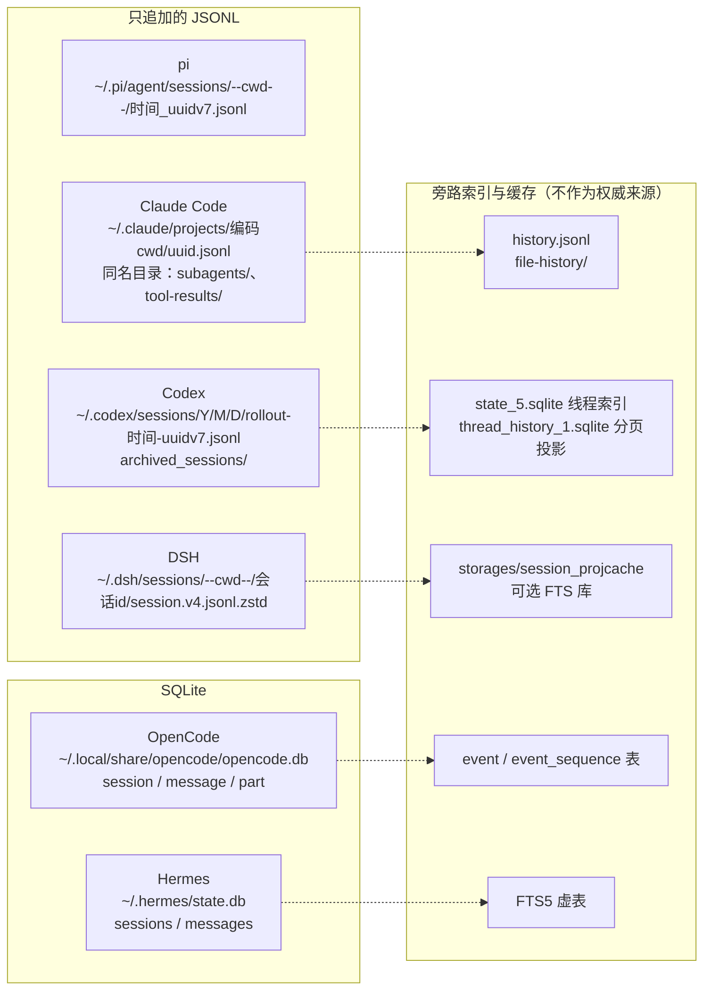
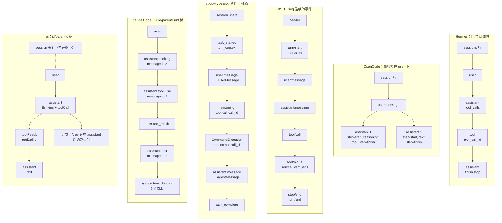

# Agent 会话与轨迹数据形态对比

补充阅读：TeamHub 的[十类 Agent 本地轨迹调研（2026-10-01）](https://github.com/Orbit-Labs-AI/team-hub/blob/main/%E9%A1%B9%E7%9B%AE/Orbit/03-%E7%A0%94%E7%A9%B6/%E4%B8%BB%E6%B5%81Agent%E6%9C%AC%E5%9C%B0%E8%BD%A8%E8%BF%B9%E6%95%B0%E6%8D%AE%E8%B0%83%E7%A0%94%E6%8A%A5%E5%91%8A.md)，资料调研的范围更广，但没有逐个安装实测，不与下文的源码／本机核验范围混用。

> 研究对象：pi、Hermes Agent、DeepSeek Harness（下称 DSH）、OpenCode、Codex、Claude Code。
>
> 回答三个问题：每个 agent 完成一次 chat 之后，落盘的 session 长什么样；它的内部结构怎样决定了这份 trajectory 的数据形态；六者有哪些异同。
>
> 本目录是 [数据获取与标准化方案](../../archive/plans/data-acquisition.md)（模块 1）的源码级依据。方案中的结论多来自本机实测，这里从源码出发逐条给出出处（GitHub permalink），并补上本机没有安装的 Hermes 与 OpenCode。

## 0. 结论先行

1. **两类介质，三种形态。** pi、Claude Code、Codex、DSH 写只追加的 JSONL；OpenCode、Hermes 写 SQLite。JSONL 里又分两派：pi 和 Claude Code 一行是一条消息（Claude Code 还会把一次模型响应按内容块拆成多行），Codex 和 DSH 一行是一个运行时事件，消息只是事件的一种。
2. **每家只有一个权威来源，旁边挂着可重建的索引。** Codex 的 `state_5.sqlite` 与 `thread_history_1.sqlite`、DSH 的投影缓存与可选 FTS、Hermes 的 FTS 虚表、OpenCode 的 `event` 表（迁移时被清空过）都不能当正文来源。
3. **消息方言决定能否原样回放。** Claude Code 存 Anthropic Messages 原生结构，Codex 存 OpenAI Responses 原生 item，Hermes 存 OpenAI Chat 形状加各家推理旁路列；pi、DSH、OpenCode 存自己的中立格式，换 provider 时由适配层转换。
4. **"一次模型调用"的边界六家各不相同。** pi、Hermes 是一行 assistant；OpenCode 是一条 assistant message；Claude Code 是同一 `message.id` 的多行；Codex 是一条 `token_usage_record` 及其前后的一组 item；DSH 是 step 内的一条 `assistant/message`。统计调用次数、token、耗时之前都要先按各家规则合并。
5. **链接模型有三种。** 树：pi（`id`/`parentId`）、Claude Code（`uuid`/`parentUuid`，并行工具会产生侧枝）；线性序号：Codex（`ordinal`）、DSH（`seq`）、Hermes（自增 `id`）；扇形：OpenCode 同一轮的每条 assistant 都直接挂在该轮 user 下。
6. **压缩都不真删原文，但标记方式不同。** pi、Codex、DSH、OpenCode 追加摘要类记录；Claude Code 开一个新根并用 `logicalParentUuid` 指回；Hermes 默认把旧行置为 `active=0, compacted=1`。
7. **计量口径差异大。** 都有逐次调用的 token，Hermes 例外，只有会话级与按模型的累计。美元成本：pi、OpenCode 逐次记录；Hermes 只写会话级与按模型的估算值，Claude Code 只有会话累计的 `cost-state`（含子代理）；Codex、DSH 不记。缓存是否计入输入、推理是否计入输出也各不相同：Claude Code、Hermes 的输入不含缓存，Codex 输入含缓存命中；OpenCode 输出不含推理，pi、Hermes、Claude Code 的推理计入输出。
8. **审批几乎不落盘。** 只有 DSH 完整记录 `approval/asked` 与 `approval/decided`；Claude Code 只记拒绝原因（`toolDenialKind`）与权限模式；Codex 只有命令的 `declined` 状态与 guardian 审查子线程；Hermes 只能从工具结果 JSON 推断；OpenCode 不落盘，pi 没有审批机制。
9. **训练格式只有 Hermes 提供。** Hermes 可以显式开启 ShareGPT 轨迹（`<think>`、`<tool_call>`、`<tool_response>`），还能把会话导出成 Claude Code JSONL 形状。Codex 和 Hermes 都能导入 Claude Code 会话（只保留文本），Claude Code 的 JSONL 已经事实上成了跨 agent 的交换格式。
10. **数据方案已吸收这批报告的修正**（对照 `45aba99`），Hermes 与 OpenCode 的事件映射由方案引用本文 §6.3。还剩三处要补：pi 的 `bashExecution` 角色与 `image` 内容块；Hermes 的 `role=user` 不等于真人输入，gateway 的 `/retry` 会物理删除行；Claude Code 2.1.287 的工具结果可能只是 `{detachedToolCall: true}` 占位。详见 §6.2、§6.3。

## 1. 范围、方法与版本

| Agent | 仓库与固定提交 | 语言 | 固定提交上的版本 | 本机版本与数据 | 依据 |
| --- | --- | --- | --- | --- | --- |
| pi | [`earendil-works/pi@7fbbd5f`](https://github.com/earendil-works/pi/tree/7fbbd5f4a1d982bb02d63472dde0774fa639f99b)（2026-10-01） | TypeScript | coding-agent 1.0.0 | 已装 0.99.1；`~/.pi/agent/sessions` 下 2 个会话 | 源码 + 本机 |
| Hermes Agent | [`NousResearch/hermes-agent@10c6188`](https://github.com/NousResearch/hermes-agent/tree/10c6188de188871f64a88dd95bc6b262adb0c307)（2026-10-02） | Python | 未标版本号；`state.db` schema v31 | 未安装 | 源码 |
| DSH | [`deepseek-ai/deepseek-harness@639ed01`](https://github.com/deepseek-ai/deepseek-harness/tree/639ed015397290b3745d163aafe02ffee4aa3f84)（2026-09-29） | TypeScript（cordis 插件） | 0.2.0-rc.2，会话格式 v4 | 已装 0.1.1-rc.2（写格式 v0）；`~/.dsh/sessions` 下 79 个会话 | 源码 + 本机 |
| OpenCode | [`anomalyco/opencode@1ddb087`](https://github.com/anomalyco/opencode/tree/1ddb0873aee50d209d1a8d7f91b89c5daf692d49)（2026-10-02） | TypeScript（Bun + Effect） | 1.18.34 | 未安装 | 源码 |
| Codex | [`openai/codex@4dd51f4`](https://github.com/openai/codex/tree/4dd51f4a5f2037f8aa322fe7807315e6530a4ec8)（2026-10-02） | Rust | Cargo workspace 为 `0.0.0`、npm 包为 `0.0.0-dev`，发版时注入 | Codex Desktop；`~/.codex` 下 906 个 rollout，其中记录的 `cli_version` 为 0.98–0.159 | 源码 + 本机 |
| Claude Code | CLI 闭源；参考 [`claude-agent-sdk-python@bfb895c`](https://github.com/anthropics/claude-agent-sdk-python/tree/bfb895c6ef46e095191938b4eda798a025957c09)（0.2.163，捆绑 CLI 2.1.287）、[`claude-agent-sdk-typescript@9d8cb9c`](https://github.com/anthropics/claude-agent-sdk-typescript/tree/9d8cb9c1ae68672c343d75723440b73afe5b993c)、[`claude-code@52c7644`](https://github.com/anthropics/claude-code/tree/52c76441cae91f6891e4712306bffb057ff6fec5)（CHANGELOG） | — | 2.1.287 | 已装 CLI 2.1.285（转录的 `version` 为 2.1.247–2.1.284）；只统计 `~/.claude`：126 个主会话、269 个子代理文件 | SDK 源码 + 类型定义 + CHANGELOG + 本机 |

方法：

- 源码一律只读。上表提交就是本仓库 [`third_party/`](../../../third_party/README.md) 子模块固定的提交，即 2026-10-02 各上游默认分支的最新提交；Claude 的 TS SDK 与 claude-code 两个仓库不收录为子模块，直接链接 GitHub。文中链接都固定到这些提交。
- 报告初稿按 2026-10-01 前后的提交分析，之后迁移到上表提交：permalink 按 `git diff` 重新定位行号，并逐条核对引用行内容。两次提交之间与会话有关的变化写在各报告 §0 的「迁移核对」一行。
- 本机数据只读，只统计结构（记录类型、字段集合、出现率、版本），不摘录任何对话正文。示例中的正文全部换成 `<user prompt>`、`<assistant text>`、`<tool output>` 等占位符，路径中的用户名写作 `~`，项目名写作 `<project>`。凭据文件（`~/.codex/auth.json`、`~/.dsh/.credentials.yaml`、`~/.pi/agent/auth.json` 等）没有打开。
- 所有 Mermaid 图都在 Mermaid 11 下做过解析与渲染检查；示例 JSON/JSONL 逐行可解析。

## 2. 六家的落盘形态总览



## 3. 结构图与 trajectory 数据形态的对照

每份报告的 §1 是结构图（组件、数据流，虚线标出写入持久化的边）与一次 chat 的时序图，§5 是 trajectory 数据形态图，§6 是"组件 → 记录"对照表。下表把六家的因果关系压缩成一行：

| Agent | 结构特点：谁写、何时写 | 由此得到的数据形态 | 详见 |
| --- | --- | --- | --- |
| pi | `AgentSession` 订阅 agent loop 的 `message_end`，每条消息完成后经 `SessionManager`（entry 的唯一追加者）追加一行；`/tree` 导航是一等功能 | 一会话一文件的 entry 树；消息完整，没有流式碎片；分支留在同一文件 | [pi.md](pi.md) §1.2、§1.3、§5.2、§6 |
| Hermes | 多个入口（CLI、TUI、gateway、ACP、cron）共用 `AIAgent` 与同一个 `state.db`，用租约协调；"先落库、再产生副作用" | 关系表中的 OpenAI Chat 消息行，带展示列与谱系列；压缩把旧行改为 `active=0, compacted=1`，另插入摘要与携带的尾部副本；撤销以软删除为主 | [hermes-agent.md](hermes-agent.md) §1.2、§1.3、§5.2、§6 |
| DSH | 一切都是 cordis 插件，所有插件经 `Session.append`（会话对象由 `ctx.sessions` 创建或获取）写同一条事件日志，持久化后端只是订阅者 | 事件溯源日志：turn/step 括号、插件自定义事件，统计与标题都由投影重算 | [dsh.md](dsh.md) §1.2、§1.3、§5、§6 |
| OpenCode | 客户端/服务端架构：服务端把每次更新发成 durable 事件，在同一事务里投影到表；客户端靠 SSE 拿增量 | 关系表中的 message 与 part；part 是状态机（工具从 pending 到 completed），行被反复覆盖 | [opencode.md](opencode.md) §1.2、§1.3、§5.2、§6 |
| Codex | 会话事件总线同时服务模型（Responses API 回放）与 UI（app-server 分页），RolloutRecorder 两份都存 | 同一信息两种表示（`response_item` 与 `item_completed`）；`ordinal` 支撑分页投影 | [codex.md](codex.md) §1.2、§1.3、§5.4、§6 |
| Claude Code | 流式循环每完成一个内容块就写一行；宿主（Desktop）把界面状态也写进同一文件 | 一次响应拆多行且 usage 重复；树形链接；元数据行反复重追加 | [claude-code.md](claude-code.md) §1.2、§1.3、§5.2、§5.3、§6 |

同一个"提问 → 调工具 → 回答"的会话，在六家的链接方式：



## 4. 同一次 chat 在六家的落盘对照

场景：新会话，用户提 1 个问题；模型第 1 次调用给出推理和 1 个工具调用；工具执行；模型第 2 次调用给出最终回答。各单元格按写入顺序列出产生的记录；完整示例见各报告 §7。

| 阶段 | pi | Hermes | DSH（HEAD v4） | OpenCode | Codex | Claude Code |
| --- | --- | --- | --- | --- | --- | --- |
| 会话创建 | 内存中备好 `session` 头行、`model_change`、`thinking_level_change`，等首条 user 消息时一起写出 | `sessions` 行 upsert，`system_prompts` 行 | 头行 `type:"session"`；全新会话在第一个回合前还有 `permission/preset`、`sandbox/mode`、`approval/policy`（base bundle 的权限预设插件写入） | `session` 行（`POST /session`） | 首个可落盘条目（通常是首回合的 `task_started`）触发物化，先写 `session_meta`（ordinal 0） | 没有头行；Desktop 先写 `queue-operation` |
| 用户输入 | `message(system)`（首轮的全量 prompt 分段与工具定义）、`message(user)` | `messages(role=user)`，在第一次调用模型之前写 | `agent/inbox/spliced` → `turn/start` → `agent/inbox/spliced`（认领）→ `step/start` → `system/message` → `user/message`（人类输入与注入的上下文）→ `request/header`、`request/context` → `session/title`（回退标题） | `message(user)` + text `part` | `task_started` → 注入上下文的 `response_item` 与 `world_state` → `turn_context` → `response_item(message user)` + `item_completed(UserMessage)` | `user`（`promptId`、`permissionMode`）、若干 `attachment`、`file-history-snapshot` |
| 第 1 次调用（推理 + 工具调用） | `message(assistant)`：`thinking`、`toolCall`、`usage`、`stopReason:"toolUse"` | `messages(role=assistant)`：`tool_calls`、`reasoning*`，在执行工具之前写 | `assistant/message`：`reasoning`、`tool-call`、嵌入的流、`usage` | `message(assistant 1, parentID=user)`，`step-start`、`reasoning`、`tool` part（pending→running） | `item_completed(Reasoning)`、`response_item(reasoning)`、`response_item(custom_tool_call)`、`token_usage_record` | 同一 `message.id` 拆两行：`assistant(thinking)`、`assistant(tool_use)`，两行 `usage` 相同 |
| 工具执行与结果 | `message(toolResult)`：`toolCallId`、`isError` | `messages(role=tool)`：`tool_call_id`，工具完成后立即写 | `tool/call` →（`approval/asked`、`approval/decided`）→ `tool/result`（`sourceEventSeqs` 指向 `tool/call`）→ `step/end` | `tool` part 覆盖为 `completed`（`output`、`time.start/end`）；`step-finish`（tokens、cost）；assistant 1 写 `finish:"tool-calls"` | `item_completed(CommandExecution)`、`response_item(custom_tool_call_output)`、`token_count` | `user(tool_result)` + `toolUseResult`；大输出写 `tool-results/`；编辑类写 `file-history-delta` |
| 第 2 次调用（最终回答） | `message(assistant)`：`text`、`stopReason:"stop"` | `messages(role=assistant)`：`finish_reason='stop'` | `step/start` → `assistant/message` → `step/end` | `message(assistant 2, parentID=user)`，`step-start`、`text`、`step-finish` part | `item_completed(AgentMessage)`、`response_item(message assistant, phase final_answer)`、`token_usage_record`、`token_count` | `assistant(text)`（新的 `message.id`） |
| 回合结束 | 没有专门记录 | 没有专门记录；会话结束时写 `ended_at`、`end_reason` | `turn/end{reason:completed}`；provider 标题异步写入，可能晚于 `turn/end` | assistant 写 `time.completed`，没有回合记录；后台写标题 | `task_complete`（`duration_ms`、`time_to_first_token_ms`） | CLI 写 `system/turn_duration`（Desktop 不写）；`last-prompt`、`ai-title` 等元数据反复重追加 |
| 用量落在哪里 | 每条 assistant 的 `usage`（含美元 cost） | `sessions` 汇总列与 `session_model_usage`，由后台线程增量写 | 每条 `assistant/message.usage`（无 cost） | `step-finish` part（含 cost）；assistant 上 `cost` 累加、`tokens` 只保留最后一步；`session` 行累加全部 step | `token_usage_record`（按 `response_id`）；`token_count` 是累计快照；无 cost | 每行 `message.usage`，需按 `message.id` 去重；`cost-state` 是会话累计（含子代理） |
| 本例记录数 | 8 行 | 1 行 sessions、1 行 system_prompts、4 行 messages，另有用量行 | 头行 + 20 个事件（另有 3 个权限预设事件） | 1 行 session、3 行 message、约 7–9 行 part，每次写入另追加 1 行 event | 20 行 | 10 行，另有元数据重追加行 |

## 5. 总对比表

### 5.1 存储与组织

| 维度 | pi | Hermes | DSH | OpenCode | Codex | Claude Code |
| --- | --- | --- | --- | --- | --- | --- |
| 权威存储 | JSONL 文件 | SQLite `state.db` | 多个 zstd 帧拼接的 JSONL 事件日志 | SQLite `opencode.db`（WAL） | JSONL rollout | JSONL transcript |
| 默认位置 | `~/.pi/agent/sessions/--<cwd>--/<时间>_<id>.jsonl` | `~/.hermes/state.db`，每个 profile 一个库 | `~/.dsh/sessions/--<cwd>--/<id>/session.v4.jsonl.zstd` | `~/.local/share/opencode/opencode.db`，macOS 也是这个路径 | `~/.codex/sessions/YYYY/MM/DD/rollout-<本地时间>-<id>.jsonl` 与 `archived_sessions/` | `~/.claude/projects/<编码 cwd>/<id>.jsonl` |
| 根目录覆盖 | `PI_CODING_AGENT_DIR`；会话目录另有 `PI_CODING_AGENT_SESSION_DIR`、`--session-dir`、`sessionDir` | `HERMES_HOME`、profile | `DSH_HOME`、profile patch | `XDG_DATA_HOME`、`OPENCODE_DB`；非正式渠道库名为 `opencode-<channel>.db` | `CODEX_HOME`、`CODEX_SQLITE_HOME` | `CLAUDE_CONFIG_DIR`、`CLAUDE_CODE_PROJECT_DIR_NAME` |
| 会话粒度 | 一个文件，含全部分支 | `sessions` 一行加 `messages` 多行 | 一个目录，取最高代日志文件 | `session` 一行加 `message`、`part` 多行 | 一个文件；revert 后是一条文件链 | 一个文件，加同名目录（子代理、大输出） |
| 会话 ID | 默认 UUIDv7；`--session-id` 可自定义；老文件可能是 v4 | `YYYYMMDD_HHMMSS_<hex>`（本地时间）；ACP 为 uuid4，cron 为 `cron_<任务 id>_<时间>`，托管群聊为 `room_<32 位 hex>` | 不透明字符串：Web、headless、fork 为 `session-<uuid4>`，SDK 为 `session-<32 位 hex>`，ACP 顶层与进程内子代理为裸 uuid4；类型看头行 | `ses_` + 26 字符，按时间降序 | UUIDv7 | UUIDv4 |
| 项目归属 | 头行 `cwd`（目录名有损） | `sessions.cwd`、`git_repo_root` | 头行 `cwd`（目录名有损） | `project_id`（git 远程或根 commit 的哈希）与 `directory` | `session_meta.cwd` 与 `git`；`turn_context.cwd` 可变 | 每行 `cwd`（会话内可变，目录名有损） |
| 写入方式 | 同步逐行追加 | 每次 flush 一个事务；有 CAS 改写与软删除 | 200 ms 一批，每批一个 zstd 帧并 fsync | 每次 upsert 覆盖行，同一事务追加 `event` | writer task 逐行追加并 flush | 逐行追加；元数据行反复重追加 |
| 并发控制 | 无 | 回合租约、压缩租约 | `session.lock`（HEAD） | SQLite WAL、IMMEDIATE 事务 | `thread-writer-locks/<id>.lock` | 无文件锁；靠运行中会话登记（`~/.claude/sessions/<pid>.json`）避免双写 |
| 版本与迁移 | 头行 `version`（3），打开旧文件时迁移并重写 | `schema_version`（31），列声明式补齐 | 格式代 v0–v4，升级时写新代文件、旧代保留 | 迁移表；旧 JSON 存储已不再读取 | `history_mode` 分 legacy 与 paginated，迁移会原地改写文件 | 没有 schema 版本，每行带 CLI `version` |
| 保留与清理 | 不自动清理；`/resume` 列表可删除会话文件 | `sessions.auto_prune` 默认删除结束且 90 天不活跃的会话 | 不删除 | 不自动删除会话；`tool-output/` 与快照保留 7 天 | 不自动删除，可归档；`thread/delete` 会删除 rollout 文件 | 默认清理 30 天未修改的会话；Desktop 会话另有豁免规则 |

### 5.2 消息与轨迹

| 维度 | pi | Hermes | DSH | OpenCode | Codex | Claude Code |
| --- | --- | --- | --- | --- | --- | --- |
| 记录单元 | 一行一个 entry，消息完成时写 | 一行一条消息 | 一行一个事件（v0 另有流式分片打包行） | 一行一条 message 或一个 part | 一行一个 item 或事件 | 一行一个 entry，assistant 按内容块拆行 |
| 消息方言 | 自定义 `AgentMessage`，`api` 字段记录实际 API | OpenAI Chat 形状，加推理旁路列 | 自定义中立格式（`ContentBlock`） | 自定义 part，经 AI SDK 转换 | OpenAI Responses 原生 item，另有 UI 层 `TurnItem` | Anthropic Messages 原生结构，外加信封字段 |
| 角色 | system、user、assistant、toolResult、bashExecution | user、assistant、tool（gateway 另有 `session_meta` 行）；system 不入表 | system、developer、user、assistant、tool（v4） | user、assistant | message 的 user、assistant、developer，加各类 item | `type` 为 user、assistant、system、attachment 等 |
| 链接模型 | `id`/`parentId` 树，当前位置是最后一行 | 自增 `id` 线性；会话之间用 `parent_session_id` | `seq` 线性；`sourceEventSeqs` 回指 | 本轮 assistant 的 `parentID` 都指向 user；子会话用 `parent_id` | `ordinal` 线性，加 `turn_id`、`call_id`、`response_id` 外键；文件之间用 `history_base`、`parent_thread_id` | `uuid`/`parentUuid` 树：并行工具侧枝、rewind 分支、压缩新根 |
| 一次模型调用 | 一条 assistant entry | 一行 assistant | step 内一条 `assistant/message` | 一条 assistant message（step-start 到 step-finish） | 一条 `token_usage_record` 及对应的一组 item | 同一 `message.id` 的若干行 |
| 工具调用关联 | `toolCall.id` = `toolResult.toolCallId` | `tool_calls[].id` = `tool_call_id`；id 重复时用 `tool_call_uid` | `tool-call.id` = `tool/call.callId` = `tool/result` 的 `toolCallId` | tool part 自带 `callID` 与状态 | `call_id`；Code Mode 嵌套工具只能靠 `turn_id` 和行序 | `tool_use.id` = `tool_result.tool_use_id`；`sourceToolAssistantUUID` |
| 工具成败 | `toolResult.isError` | 没有专门列，看结果 JSON；未执行的调用记 `effect_disposition='none'` | `tool/result` 的 `isError`、`error` | `state.status` 为 completed 或 error | `item_completed` 的 `status`、`exit_code`（`*_output` 里没有成败标志） | `is_error`、`toolDenialKind` |
| 大工具输出 | 截断后写入会话；bash 全文写到 `$TMPDIR`（临时） | 外置到 `cache/spillover/`，24 小时过期 | 截断后写入日志；全文写到 `$TMPDIR/dsh-spill-*`（临时） | 截断后入库；全文写到 `tool-output/`，7 天 | 完整输出写入 rollout，截断只作用于发给模型的历史；没有外置文件，图片以 base64 内联 | 超过阈值写到 `<id>/tool-results/`（通用 5 万字符，Bash 3 万、可调），`tool_result` 只留约 2KB 预览 |
| 推理内容 | `thinking` 文本加 `thinkingSignature`；OpenAI 模型只存推理摘要；脱敏块正文为占位 | `reasoning`、`reasoning_content`、`reasoning_details`、`codex_reasoning_items` 多列 | `reasoning` 明文；签名在 `replayState` | `reasoning` part；换模型后降级为普通文本 | `summary` 明文摘要（约 56% 非空）加加密的 `encrypted_content` | `thinking` 加 `signature`，约一半只有签名 |
| 流式增量 | 不落盘 | 不落盘；中断时保留已输出的部分 | v0 逐个增量落盘；v2 起压缩后嵌入消息 | 不落盘；part 先写空值、结束时写全文 | 不落盘 | 按内容块落盘，不含 token 级增量 |
| system prompt 与工具定义 | 首轮 `system` 消息存全量分段与 `toolsAdded`，之后只存变化 | `system_prompts` 表按哈希去重；`tool_names` 指向工具数组 | v0 在 `request/header`，v3 起为 `system/message`；工具 schema 在 `request/header` | 不落盘（V1） | `session_meta.base_instructions` 与注入的 developer 消息；工具定义不全量保存 | 不作为字段保存；新版本有 `prompt_snapshot`、`deferred_tools_record` 附件 |

### 5.3 计量

| 维度 | pi | Hermes | DSH | OpenCode | Codex | Claude Code |
| --- | --- | --- | --- | --- | --- | --- |
| token 粒度 | 每次调用一份 `usage` | 会话累计与按「模型 × provider × 任务」累计；消息行没有 token | 每个 step 一份 `usage` | 每个 step 一个 `step-finish`；assistant 取最后一步，session 累计 | 每次调用一条 `token_usage_record`，另有累计的 `token_count` | 每次调用一份 `usage`，拆行后重复 |
| 缓存与推理口径 | `input` 不含缓存，`cacheRead`、`cacheWrite` 单列；推理计入输出 | `input_tokens` 不含缓存读写；`reasoning_tokens` 是 `output_tokens` 的一部分 | 输入（不含缓存）、输出、缓存读、缓存写互不相交 | 输入不含缓存，输出不含推理 | 输入含缓存命中（`cached_input_tokens` 是其中一部分） | `input_tokens` 不含缓存；`output_tokens` 含思考（`output_tokens_details.thinking_tokens` 是其中一部分） |
| 美元成本 | 每次调用，按价目表计算 | 只写估算的 `estimated_cost_usd`（会话级与按模型）；`actual_cost_usd` 只有导入数据可能带值 | 无 | 每个 step 的 `cost`，按 models.dev 价目计算 | 无，只有 `rate_limits` 百分比 | 会话累计的 `cost-state.totalCostUSD`（resume 时恢复，含子代理） |
| 模型与 provider | assistant 的 `api`、`provider`、`model`；`model_change` | `sessions.model`、`billing_provider`；`session_model_usage` | `assistant/message.source` 的 `provider`、`model`；`request/header` | assistant 的 `providerID`、`modelID` | `turn_context.model`、`session_meta.model_provider` | `message.model`，没有 provider 字段 |
| 时间戳 | entry 为 ISO 字符串；消息为 epoch 毫秒 | epoch 秒（REAL） | epoch 毫秒 | epoch 毫秒 | 行 `timestamp` 为写入时刻的 UTC ISO（毫秒） | ISO UTC 毫秒，内容块完成时刻 |

### 5.4 控制流

| 维度 | pi | Hermes | DSH | OpenCode | Codex | Claude Code |
| --- | --- | --- | --- | --- | --- | --- |
| 压缩 | 追加 `compaction` entry（摘要、`firstKeptEntryId`、system 检查点），旧 entry 保留 | 默认就地：旧行 `active=0, compacted=1`，插入摘要行；遗留模式另开子会话 | `compaction/*` 事件，加 `surfaceOp: replace` | compaction user、`summary:true` 的 assistant、合成的 continue；prune（默认关闭）只给旧工具输出打标 | `compacted{replacement_history}`，加 `world_state`、`turn_context` | `system/compact_boundary` 开新根，`logicalParentUuid` 回指，加 `isCompactSummary` 行 |
| 分支、fork、rewind | 同文件分叉（`/tree`）；`/fork`、`/clone` 写新文件（`parentSession`） | rewind 以软删除（`active=0`）为主，gateway 普通 `/retry` 与 ACP 整体替换会物理删除；`/branch` 拷贝到子会话 | fork 开新会话，父会话前缀作为种子（`isSeeded`） | revert 提交时删除撤销点（含）之后的消息行；fork 拷贝到新会话，不设 `parent_id` | paginated 的 fork 与 revert 用 `history_base` 引用父文件前缀，子代理复制前缀；legacy 有回滚标记 | rewind 在同一文件分叉；fork 与后台续接把历史复制进新文件，`/clear` 开新会话 |
| 文件快照 | 无 | shadow git，默认关闭，与会话无外键 | 无持久快照 | 影子 git，part 里存 tree hash | 无 | `file-history-snapshot`/`delta`，备份在 `~/.claude/file-history/` |
| 子代理 | 无内置 | 子会话（`parent_session_id`、`_delegate_from`）；父会话 tool 行里有结果 JSON | 子会话目录（头行 `origin:"subagent"`、`parentSession`、`delegationDepth`） | 子会话（`parent_id`）；父 tool part 存子会话 id | 子 rollout，先复制父前缀（`subagent_history_start_ordinal`）；`thread_spawn_edges` | `<id>/subagents/agent-<id>.jsonl` 与 `.meta.json` |
| 审批与权限 | 无 | 不落事件；从工具结果 JSON 推断（`status:"blocked"` 加 `user_summary`、`pending_approval`） | `approval/asked`、`approval/decided` 等完整落盘 | 不落盘 | 不落盘；只有 `declined` 状态和 guardian 子线程 | 只记拒绝原因（`toolDenialKind`）与权限模式 |
| 错误与中断 | `stopReason` 为 error/aborted，加 `errorMessage`；重试用 `context_edit` 标记 | `failed_turn` 行、`interrupted` 元数据、`effect_disposition` | `turn/end` 原因、`assistant/attempt`、`llm/retry`；resume 时补写闭合事件 | message `error`、tool part `error` | `turn_aborted`、`task_complete.error` | `system/api_error`、`<synthetic>` 行、中断标记文本 |
| 标题 | `session_info`（只有手动命名） | `sessions.title` 与 `title_source` | `session/title` 事件 | `session.title` | `session_index.jsonl` 与 `threads.title` | `ai-title`、`custom-title` 元数据行 |

### 5.5 读取、导出与互通

| 维度 | pi | Hermes | DSH | OpenCode | Codex | Claude Code |
| --- | --- | --- | --- | --- | --- | --- |
| 搜索索引 | 无 | FTS5：词索引、trigram、CJK | 可选 FTS5，默认关闭 | 无全文索引，标题 `LIKE` | `state_5` 元数据索引，加文件内容匹配 | 无 |
| 导出与分享 | HTML、当前分支 JSONL、`/share` | `sessions export`：jsonl、md、qmd、html、trace | session-query 的 ZIP 导出 | `opencode export`/`import`，分享到 opncd.ai | `exec --json` 事件流，app-server 分页接口 | `/export` 纯文本，`stream-json` |
| 训练轨迹 | 无专门格式（evals 用原生 JSONL） | ShareGPT（`<think>`、`<tool_call>`、`<tool_response>`），需显式开启；还有 batch_runner、trajectory_compressor | 无 | 无 | 无专门格式；rollout 本身可回放到 Responses API | 无 |
| 跨 agent 导入 | 只导入 pi 格式的 JSONL | 导入 Claude Code、Codex 会话，只保留文本轮次 | 子代理可调用外部产品；兼容 Claude Code 与 Codex 的 hook 协议 | 无 | 导入 Claude Code、Cursor 会话，有损，只保留文本 | 无；它的 JSONL 被 Codex、Hermes 读取，Hermes 的 trace 导出也采用它的形状 |

## 6. 异同分析与对 Orbit 的启示

### 6.1 共同点与差异的来源

**共同点**

- 都在本地落盘。四家 JSONL 只追加；两家 SQLite 以插入为主，但会原地覆盖行（OpenCode 的 part）或打标志（Hermes 的 `active`、`compacted`）。
- 工具调用与结果都靠 call id 配对，call id 一般直接沿用 provider 下发的值；provider 没给时 Hermes 生成确定性的 `call_<hex>`，OpenCode 对用户直接执行的 shell 与子任务用 ULID；pi 的适配层会改写部分 provider 的 id（OpenAI Responses 存成 `<call_id>|<item_id>`，Google 缺失时合成）。call id 在 Hermes 里可能重复，所以 Hermes 另加了 `tool_call_uid`。
- 压缩都保留原文，只改变"模型下次能看到什么"。
- 多数是懒创建：没真正发出消息的会话不会留下数据。pi 在首条 user 或 assistant 消息时写出，Codex 在首回合 `task_started` 时物化；DSH 在首次追加时原子发布；Hermes 在首个回合开始时 upsert。OpenCode 例外，`POST /session` 时就建 `session` 行（内置 TUI 与 Web 在首次提交时才调用，API 调用方可能建出空会话）。
- cwd 编码成目录名的规则都是有损的（pi、DSH、Claude Code），项目归属必须读记录里的 `cwd`。

**差异的来源**：数据形态基本由"谁在什么时机写"决定（§3 表格）。

- 写入者订阅"消息完成"事件（pi），就得到干净的消息日志。
- 写入者紧跟流式循环、按内容块落盘（Claude Code），就得到拆行与重复 usage。
- 写入者是同时服务模型回放与 UI 分页的事件总线（Codex），同一信息就会存两份。
- 写入者是插件化的事件日志（DSH），就得到事件溯源和投影。
- 写入者是服务端事务加投影（OpenCode），就得到可覆盖的关系行。
- 多个宿主共用一个库（Hermes），就需要租约、软删除和大量展示列。

**对解析的直接影响**

| 问题 | 需要按 agent 区分的规则 |
| --- | --- |
| 哪些 user 记录是真人输入 | pi：`role=user`（扩展 `sendUserMessage()` 的消息也是 `role=user`，盘上无来源标记）；Claude Code：排除 `isMeta`、只含 `tool_result` 的行、压缩摘要、中断标记与本地命令包装行，再看 `origin.kind`（`task-notification` 不是真人）；Codex：`item_completed(UserMessage)` 条目（新版本对应的 user 消息另带 `metadata.user_input_order`），注入的上下文也是 `role=user`；DSH：只有顶层会话里 `source.kind:"user"` 的 `user/message`，子代理会话里同类消息是父模型的委派提示；OpenCode：排除 synthetic text 与 compaction part；Hermes：`role=user` 且 `display_kind` 为空或为 `steer`（回合中途的真人输入），排除注入类 `display_kind`、`observed=1` 的旁听行，以及只能按正文标记识别的合成提示 |
| 一次模型调用怎么合并 | 见 §5.2「一次模型调用」一行 |
| token 怎么去重 | Claude Code 按 `message.id` 取一次；Codex 用 `token_usage_record`，`token_count` 只取最后一条作快照；OpenCode 用 `step-finish`，不要再加 assistant 上的值，fork 会话要先去掉复制段；子代理的用量记在子会话里（OpenCode、Hermes、DSH、Codex），父会话的汇总不含它们，要按父子关系递归汇总；Claude Code 例外：子代理文件的行内 usage 多为占位值，以父会话的 Agent 结果用量或 `cost-state` 为准 |
| 回合边界 | 显式：Codex（`task_started`/`task_complete`）、DSH（`turn/start`/`turn/end`）、Claude Code（`promptId`；`system/turn_duration` 只有 CLI 会话写）；隐式：pi、Hermes、OpenCode 只能由真人 user 记录推出 |
| 重放与复制 | Claude Code 的 `--fork-session`、`/fork`、后台续接与 Desktop 分支会把历史复制进新文件（前台 `--resume` 不复制；本机 830 个 `uuid` 出现在 3 对文件里）；Codex 子代理先复制父前缀；DSH fork 带种子前缀；Hermes `/branch` 复制历史但保留 `message_uid`；pi `/fork` 复制 entry 并保留原 id；OpenCode fork 把前缀复制成新 ID 的 message/part，没有回链。统计时都要识别副本 |

### 6.2 对数据方案的补充与修正

[data-acquisition.md](../../archive/plans/data-acquisition.md) 当前版本（`45aba99`）已吸收这批报告此前提出的修正：pi 的落盘时机、条目类型与子代理；OpenCode 的 V2 表名、ID 回绕、revert 删行与 fork 用量；Claude Code 的 `--resume` 与历史副本、`turn_duration` 只见于 CLI、子代理的占位用量；Codex 的工具成败与 Code Mode 嵌套条目；Hermes 的两种日志模式与 90 天自动清理。方案 4.4 节也已引用下面 §6.3 的 Hermes、OpenCode 映射。逐条比对后还剩三处：

1. **pi**：方案的 `message.role` 只列了 `user / assistant / toolResult / system`，缺 `bashExecution`（用户 `!` 命令的执行结果）；内容块缺 `image`（[pi.md](pi.md) §3.4、§3.5）。
2. **Hermes**：方案写「rewind、编辑、重新生成把分歧后的行软删除」，但 gateway 对普通回合的 `/retry` 和 ACP 的整体替换会先 DELETE 活跃行再重插，增量同步要核对已镜像的行是否仍在；另外 `role=user` 不等于真人输入：`steer` 是回合中途的真人输入，续写提示、压缩交接等合成行没有 `display_kind`，只能按正文标记识别（[hermes-agent.md](hermes-agent.md) §4.7、§9.3）。
3. **Claude Code 2.1.287**：WebFetch、WebSearch 为优先级 `now` 的消息让路时，工具结果只是 `{detachedToolCall: true}` 占位，真实结果在之后的轮次送达，连接器不能把它当作最终的 `tool.result`；MCP 的 `structuredContent` 过大时不保存，改带 `structuredContentOmitted: true`（[claude-code.md](claude-code.md) §3.7）。

### 6.3 补充 Hermes 与 OpenCode 的标准事件映射

[方案](../../archive/plans/data-acquisition.md) 4.4 节的标准事件表目前有 Claude Code、Codex、DSH、pi 四列，下面补上另外两家：

| kind | Hermes | OpenCode |
| --- | --- | --- |
| `session.meta` | `sessions` 行（`source`、`cwd`、`model_config`、`profile_name`） | `session` 行（`directory`、`project_id`、`agent`、`model`、`version`） |
| `session.title` | `sessions.title` 与 `title_source` | `session.title` |
| `setting.change` | `display_kind='model_switch'` 的标记行；`model_config` 中的路由 | user message 的 `agent`、`model` 变化 |
| `turn.start` / `turn.end` | 由真人 user 行推出（一次 `run_conversation` 为一回合） | 由真人 user message 推出；结束看最后一条 assistant 的 `finish` |
| `message.user` | `role=user` 且 `display_kind` 为空或为 `steer`；排除注入类 `display_kind`、`observed=1` 的旁听行、`_compressed_summary=1` 的摘要行与按正文识别的合成提示 | user message 的 text part，排除 synthetic、compaction、subtask |
| `message.assistant` | assistant 行的 `content` | text part |
| `reasoning` | `reasoning`、`reasoning_content`、`reasoning_details`、`codex_reasoning_items` | reasoning part |
| `tool.call` / `tool.result` | assistant 行的 `tool_calls` / tool 行 | tool part（`callID`、`state`） |
| `model.usage` | `session_model_usage`（只有累计，没有逐次） | `step-finish` part |
| `context.inject` | `api_content` 与 `content` 的差异；`system_prompts` | user message 中 `synthetic: true` 的 text part（附件内联、MCP 资源、编辑器选区、压缩后的继续提示、后台子任务结果等）；system prompt 不落盘 |
| `context.compaction` | `_compressed_summary=1` 的行；`active`、`compacted` 标志 | compaction part 与 `summary:true` 的 assistant |
| `permission.request` / `permission.decision` | 不落事件；从工具结果 JSON 推断（见 §5.4） | 不落盘 |
| `branch` | `parent_session_id` 加 `_branched_from`、`_reset_from`；rewind 的 `active=0`；gateway `/retry` 删除后重插的行 | fork 出的新会话；`session.revert` |
| `subagent.spawn` / `subagent.result` | `_delegate_from` 子会话；父 tool 行的结果 JSON；`async_delegations` | 子会话 `parent_id`；父 tool part 的 `state.metadata.sessionId` |
| `plan.update` | 按工具名识别 | `todo` 表 |
| `file.change` | 工具参数 | `patch` part、快照 hash |
| `error` | `failed_turn` 行、`finish_reason`、`effect_disposition` | message `error`、tool part `error` |
| `ui.state` | `display_*` 列 | — |

## 7. 各 Agent 报告

| Agent | 报告 | 关键依据 |
| --- | --- | --- |
| pi | [pi.md](pi.md) | `packages/coding-agent/src/core/session-manager.ts`、`docs/session-format.md`；本机 2 个会话 |
| Hermes Agent | [hermes-agent.md](hermes-agent.md) | `hermes_state*.py`、`agent/session_persistence.py`、`agent/trajectory.py` |
| DeepSeek Harness | [dsh.md](dsh.md) | `packages/core/session`、`packages/session/session-persistence-jsonl`；本机 79 个会话 |
| OpenCode | [opencode.md](opencode.md) | `packages/core/src/database`、`packages/opencode/src/session` |
| Codex | [codex.md](codex.md) | `codex-rs/rollout`、`codex-rs/protocol`、`codex-rs/thread-store`；本机 906 个 rollout |
| Claude Code | [claude-code.md](claude-code.md) | Agent SDK 的会话读写实现、`sdk.d.ts`、CHANGELOG；本机 126 个主会话 |

每份报告结构相同：元信息 → 结构图与一次 chat 的时序图 → 存储布局 → 记录 schema → 写入语义 → trajectory 数据形态图 → 结构 ↔ 数据对照表 → 一次 chat 的完整落盘示例 → 本机核对 → 解析要点 → 可比较维度速查 → 源码索引。

## 8. 复现

参考源码以 git 子模块放在本仓库的 [`third_party/`](../../../third_party/README.md)，固定在上表提交。在仓库根目录运行：

```bash
git submodule update --init --depth 1
```

Claude 的 TS SDK 与 claude-code 仓库不是子模块，需要时单独浅克隆到指定 commit（其余仓库也可以这样取，替换 URL 与 commit 即可）：

```bash
git init claude-code && git -C claude-code remote add origin https://github.com/anthropics/claude-code.git && git -C claude-code fetch --depth 1 origin 52c76441cae91f6891e4712306bffb057ff6fec5 && git -C claude-code checkout FETCH_HEAD
```

| 仓库 | commit | 本仓库位置 |
| --- | --- | --- |
| `https://github.com/earendil-works/pi.git` | `7fbbd5f4a1d982bb02d63472dde0774fa639f99b` | `third_party/pi` |
| `https://github.com/NousResearch/hermes-agent.git` | `10c6188de188871f64a88dd95bc6b262adb0c307` | `third_party/hermes-agent` |
| `https://github.com/deepseek-ai/deepseek-harness.git` | `639ed015397290b3745d163aafe02ffee4aa3f84` | `third_party/deepseek-harness` |
| `https://github.com/anomalyco/opencode.git` | `1ddb0873aee50d209d1a8d7f91b89c5daf692d49` | `third_party/opencode` |
| `https://github.com/openai/codex.git` | `4dd51f4a5f2037f8aa322fe7807315e6530a4ec8` | `third_party/codex` |
| `https://github.com/anthropics/claude-agent-sdk-python.git` | `bfb895c6ef46e095191938b4eda798a025957c09` | `third_party/claude-agent-sdk-python` |
| `https://github.com/anthropics/claude-agent-sdk-typescript.git` | `9d8cb9c1ae68672c343d75723440b73afe5b993c` | 不收录 |
| `https://github.com/anthropics/claude-code.git` | `52c76441cae91f6891e4712306bffb057ff6fec5` | 不收录 |
