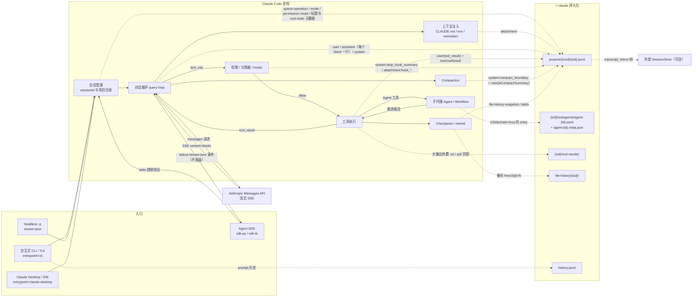
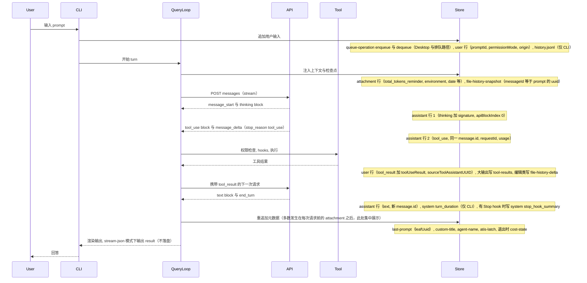
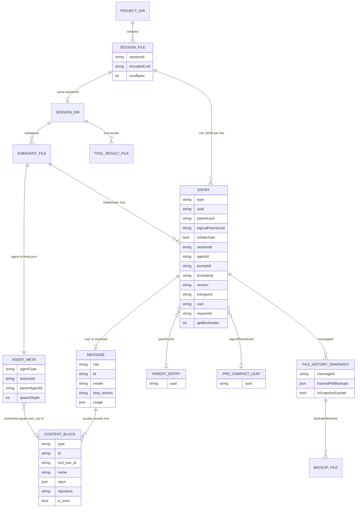
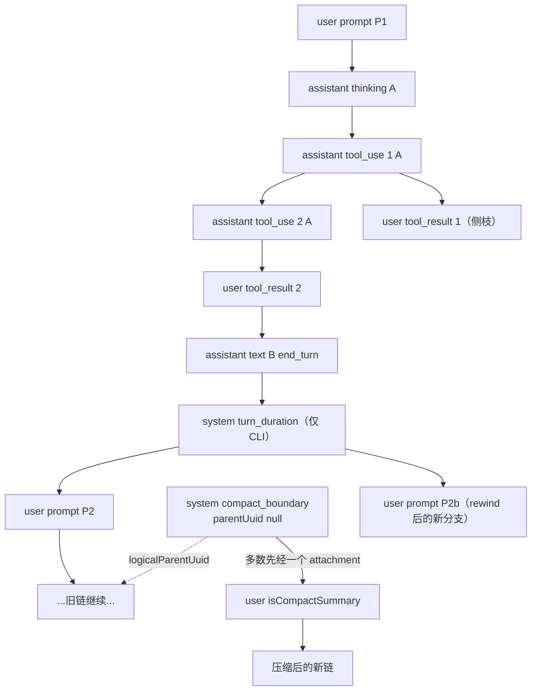

# Claude Code 会话与轨迹数据分析

> 文档状态：研究快照。正文保留原基线、日期与证据；其中的状态和数字不代表当前版本。现行入口见[文档导航](../../README.md)。


> 面向 Orbit（本地跨 Agent 会话分析 Mac App）的数据接入调研。本机数据已脱敏：用户名写作 `~`，项目名写作 `<project>`，报告中不含任何对话正文、提示词、命令或工具输出，只含字段名、类型、计数、版本号与工具名。

**一句话结论**：Claude Code 每个会话落盘为 `~/.claude/projects/<编码后的 cwd>/<sessionId>.jsonl`，追加写入，一行一个 entry。消息类 entry 的 `message` 字段原样保存 Anthropic Messages API 结构，但一次 API 响应会按 content block 拆成多行（同一 `message.id`，`usage` 重复）。entry 之间用 `uuid`/`parentUuid` 连成树：并行工具调用、rewind、compaction 都会产生分叉或新根。子代理写在 `<sessionId>/subagents/` 下的独立文件。大工具输出另存到 `<sessionId>/tool-results/`，文件快照存到 `~/.claude/file-history/`。另有十余种不进对话链的“元数据行”（标题、模式、成本快照、队列操作等），会被反复追加。

## 0. 元信息

| 项 | 值 |
| --- | --- |
| 分析对象 | Claude Code（闭源 CLI）。PATH 中的 `claude` 指向 `~/.local/share/claude/versions/2.1.285`；Claude Desktop 内嵌 2.1.281 / 2.1.284。本机 transcript 的 `version` 范围为 2.1.247–2.1.284（2.1.285 还没有落盘样本） |
| Python SDK | [`anthropics/claude-agent-sdk-python`](https://github.com/anthropics/claude-agent-sdk-python/tree/bfb895c6ef46e095191938b4eda798a025957c09) @ `bfb895c6ef46e095191938b4eda798a025957c09`（0.2.163，捆绑 CLI 2.1.287，[src/claude_agent_sdk/_cli_version.py:3](https://github.com/anthropics/claude-agent-sdk-python/blob/bfb895c6ef46e095191938b4eda798a025957c09/src/claude_agent_sdk/_cli_version.py#L3)；本仓库子模块 `third_party/claude-agent-sdk-python` 固定在这个提交），提供会话列举、读取、改写、fork、SessionStore 镜像与 resume 物化的完整实现 |
| TypeScript SDK 仓库 | [`anthropics/claude-agent-sdk-typescript`](https://github.com/anthropics/claude-agent-sdk-typescript/tree/9d8cb9c1ae68672c343d75723440b73afe5b993c) @ `9d8cb9c1ae68672c343d75723440b73afe5b993c`（CHANGELOG 顶部 0.3.287）。仓库只有 `examples/session-stores/` 与 CHANGELOG，SDK 本体不开源 |
| claude-code 仓库 | [`anthropics/claude-code`](https://github.com/anthropics/claude-code/tree/52c76441cae91f6891e4712306bffb057ff6fec5) @ `52c76441cae91f6891e4712306bffb057ff6fec5`。CHANGELOG 顶部为 2.1.287，另有插件、hooks 示例与 `mods/types/claude-code.d.ts`（由 2.1.277 生成） |
| 迁移核对 | 初稿基于 Python SDK `db750b2`、TS SDK 仓库 `0e21ebb`、claude-code 仓库 `6160717`（CHANGELOG 顶部 2.1.286）。2026-10-02 迁到上面三个提交：全部 permalink 按两次提交的 `git diff` 重新定位行号，并逐条核对引用行内容未变。Python SDK 只把捆绑的 CLI 从 2.1.286 升到 2.1.287，会话读写代码没有变化；两个 CHANGELOG 新增 2.1.287 / 0.3.287 条目，其中与 transcript 有关的两处变化见 §3.7 末尾 |
| 本机类型定义 | `~/Library/Application Support/Code/agent-host/sdk-cache/claude/0.3.220/darwin-arm64/node_modules/@anthropic-ai/claude-agent-sdk/`：`sdk.d.ts`、`sdk-tools.d.ts`。npm 包 0.3.220，`package.json` 中 `claudeCodeVersion` = 2.1.220。下文简写为 `sdk.d.ts:<行号>`、`sdk-tools.d.ts:<行号>` |
| 本机数据快照 | 2026-10-02，读取 `~/.claude`（只读）。当前会话文件与其他后台会话仍在写入，计数是快照值。本机另有 `~/.claude-account2/projects`（4 个主会话、48 个子代理文件，cli 2.1.284）、Desktop 的 `~/Library/Application Support/Claude/local-agent-mode-sessions/**/.claude/projects`（1 个文件）与索引 `claude-code-sessions/<id>/<id>/local_<id>.json`（119 个），本文统计不含 |
| 方法 | ① 读 SDK 源码，它是 CLI 磁盘格式的“官方读者”；② 公开类型定义（`sdk.d.ts`、`sdk-tools.d.ts`、hooks 类型）；③ CHANGELOG 中与 transcript/session/compact/rewind/fork/cleanup 相关的条目；④ 本机实证：Python 流式解析全部 JSONL，只输出 key 集合、类型分布、计数与比值。另外把 Python SDK 的链重建函数原样抽出（AST 提取，未安装依赖），在本机数据上执行 |

**局限（务必阅读）**

1. CLI 闭源，磁盘格式是“CLI 内部的判别联合”。SDK 类型明确说这个联合不属于 SDK API 表面（`sdk.d.ts:4876`）。本文字段表以本机实测为准，可能随版本增删。本机 30 天内就出现了 `apiBlockIndex`、`advisorModel`、`serverClassifier*` 等新字段，见 §8.4。
2. 本机只有 `entrypoint` = `cli` 与 `claude-desktop` 两种来源，没有 `sdk-py`/`sdk-ts`/IDE 来源的样本。没有 `summary`、`progress`、`tag`、`content-replacement` 类型的行，也没有 SDK `fork_session` 产生的 `forkedFrom`。凡涉及这些的结论，依据只有 SDK 源码或 CHANGELOG，已标注。
3. 没有反编译、也没有对 CLI 二进制做 strings 分析。内部写入机制（例如何时 flush）只按可观察行为描述，并标“推断”或“待确认”。
4. 本机 transcript 的 `userType` 只出现 `external`，其他取值待确认。

## 1. 结构图与一次 chat 的数据流

### 1.1 组件表

| 组件 | 职责（可观察行为） | 依据 | 写出的记录 |
| --- | --- | --- | --- |
| 交互式 CLI / TUI（`claude`） | 读取输入、斜杠命令、渲染；`entrypoint:"cli"` | 本机 15/126 个主会话为 `cli` | `user`（`promptSource:"typed"`）、`~/.claude/history.jsonl`（只有 CLI 写，见 §2.5）、`mode`/`permission-mode` |
| Headless `-p` / `--output-format stream-json` | 非交互运行，stdout 输出 NDJSON 形式的 `SDKMessage` 事件流 | SDK 启动命令固定为 `--output-format stream-json --verbose`：[src/claude_agent_sdk/_internal/transport/subprocess_cli.py:574](https://github.com/anthropics/claude-agent-sdk-python/blob/bfb895c6ef46e095191938b4eda798a025957c09/src/claude_agent_sdk/_internal/transport/subprocess_cli.py#L574) | transcript 与交互式相同；stdout 上的 `system/init`、`result` 等**不落盘** |
| Agent SDK（Python / TS） | 以子进程拉起 CLI，经 stdin/stdout 控制协议交互；`resume`/`fork`/`session_id` 映射为 CLI 参数 | `CLAUDE_CODE_ENTRYPOINT=sdk-py`：[src/claude_agent_sdk/_internal/transport/subprocess_cli.py:822](https://github.com/anthropics/claude-agent-sdk-python/blob/bfb895c6ef46e095191938b4eda798a025957c09/src/claude_agent_sdk/_internal/transport/subprocess_cli.py#L822)；TS 包 `sdk.mjs` 默认设为 `sdk-ts` | `entrypoint:"sdk-py"`/`"sdk-ts"`（本机无样本）；可选 SessionStore 镜像 |
| Claude Desktop（及 IDE 宿主） | 宿主内嵌 Claude Code，写入同一 `~/.claude/projects` 布局 | 本机 111/126 个主会话为 `claude-desktop`；IDE 的取值待确认 | 本机只见于 Desktop 的 `custom-title`、`pr-link`、`frame-link`、`artifact-*`、`relocated`、`<sessionId>.desktop-released.json`；每个 Desktop 会话都有 `queue-operation`（CLI 只在输入排队时有）；`bridge-session`（cli 9/15）、`atis-latch`（cli 12/15）两种入口都有 |
| 会话管理 / 持久化层 | 分配 sessionId（UUIDv4），把 cwd 编码为目录名；JSONL 追加；元数据重追加；30 天清理 | [src/claude_agent_sdk/_internal/sessions.py:104](https://github.com/anthropics/claude-agent-sdk-python/blob/bfb895c6ef46e095191938b4eda798a025957c09/src/claude_agent_sdk/_internal/sessions.py#L104)、[src/claude_agent_sdk/_internal/session_mutations.py:12](https://github.com/anthropics/claude-agent-sdk-python/blob/bfb895c6ef46e095191938b4eda798a025957c09/src/claude_agent_sdk/_internal/session_mutations.py#L12) | 全部 entry；`custom-title`/`ai-title`/`agent-name`/`last-prompt`/`cost-state` 等元数据行 |
| 对话循环（query loop） | 组装上下文，调用 API，执行工具，再调用 API，直到 `stop_reason:"end_turn"` | `ResultMessage.num_turns`：[src/claude_agent_sdk/types.py:1340](https://github.com/anthropics/claude-agent-sdk-python/blob/bfb895c6ef46e095191938b4eda798a025957c09/src/claude_agent_sdk/types.py#L1340)；本机序列（§5.1） | `attachment`（上下文注入）、`assistant`、`user(tool_result)`、`system/turn_duration`（仅 CLI）、`system/api_error` |
| Anthropic Messages API（流式 SSE） | `message_start → content_block_* → message_delta → message_stop`；响应 id 为 `msg_…`，请求 id 为 `req_…` | `sdk.d.ts:2884`（“One API assistant turn may produce several assistant messages sharing a message.id”）；`SDKPartialAssistantMessage`（`sdk.d.ts:4150`） | `assistant` 行，每个 content block 一行，`message` 为 BetaMessage 原样 |
| 工具执行与权限 | 依次经过权限模式（default/acceptEdits/plan/bypassPermissions/dontAsk/auto）、规则、auto 模式分类器、hooks、SDK `canUseTool`，然后执行 | [src/claude_agent_sdk/types.py:25](https://github.com/anthropics/claude-agent-sdk-python/blob/bfb895c6ef46e095191938b4eda798a025957c09/src/claude_agent_sdk/types.py#L25)；本机 `toolDenialKind` | `user(tool_result)` + `toolUseResult`；大输出写入 `tool-results/`；`permission-mode`；`serverClassifier*` 字段 |
| Hooks | 外部命令通过 stdin 收到 JSON（含 `session_id`、`transcript_path`、`cwd`） | [src/claude_agent_sdk/types.py:299](https://github.com/anthropics/claude-agent-sdk-python/blob/bfb895c6ef46e095191938b4eda798a025957c09/src/claude_agent_sdk/types.py#L299)、[mods/types/claude-code.d.ts:583](https://github.com/anthropics/claude-code/blob/52c76441cae91f6891e4712306bffb057ff6fec5/mods/types/claude-code.d.ts#L583) | `system/stop_hook_summary`、`attachment` 中的 `hook_success`/`hook_additional_context`/`hook_system_message` |
| 子代理（Agent/Task 工具、Workflow） | 独立上下文的子循环，可后台运行，可嵌套 | [src/claude_agent_sdk/_internal/sessions.py:1199](https://github.com/anthropics/claude-agent-sdk-python/blob/bfb895c6ef46e095191938b4eda798a025957c09/src/claude_agent_sdk/_internal/sessions.py#L1199)、`sdk-tools.d.ts:99`（AgentOutput） | `<sessionId>/subagents/agent-<agentId>.jsonl` + `.meta.json`；父会话 `toolUseResult.agentId`；`attachment:queued_command`（task-notification） |
| Compaction（自动 / `/compact`） | 把旧上下文摘要后开新链 | `SDKCompactBoundaryMessage`（`sdk.d.ts:2943`）；[src/claude_agent_sdk/_internal/sessions.py:938](https://github.com/anthropics/claude-agent-sdk-python/blob/bfb895c6ef46e095191938b4eda798a025957c09/src/claude_agent_sdk/_internal/sessions.py#L938) | `system/compact_boundary` + `user(isCompactSummary)` + `attachment:compact_file_reference` |
| Checkpoint / rewind | 编辑前备份文件；`/rewind`（Esc Esc）回退对话或文件 | [src/claude_agent_sdk/types.py:2395](https://github.com/anthropics/claude-agent-sdk-python/blob/bfb895c6ef46e095191938b4eda798a025957c09/src/claude_agent_sdk/types.py#L2395)、`sdk.d.ts:2479`（`rewindFiles`） | `file-history-snapshot`、`file-history-delta`；`~/.claude/file-history/<sessionId>/<hex16>@v<n>` |
| SessionStore 镜像（可选，SDK） | CLI 本地写成功后，经 stdout 发送 `transcript_mirror` 帧，由 SDK 转交外部存储 | [src/claude_agent_sdk/_internal/transcript_mirror_batcher.py:3](https://github.com/anthropics/claude-agent-sdk-python/blob/bfb895c6ef46e095191938b4eda798a025957c09/src/claude_agent_sdk/_internal/transcript_mirror_batcher.py#L3)、[src/claude_agent_sdk/types.py:1631](https://github.com/anthropics/claude-agent-sdk-python/blob/bfb895c6ef46e095191938b4eda798a025957c09/src/claude_agent_sdk/types.py#L1631) | 外部 store 中与磁盘同构的 entry，另加合成的 `agent_metadata` 条目 |

### 1.2 图 1：结构图

虚线 `-.->` 表示写入持久化，标签为写出的记录类型；实线为进程内或线上的数据流，不落盘。



### 1.3 图 2：一次 chat 的时序（1 次提问 + 1 次工具调用 + 最终回答）



## 2. 存储布局

### 2.1 目录树（本机实测，名称已泛化）

```text
$CLAUDE_CONFIG_DIR（默认 ~/.claude）
├── projects/                                   # 35 个项目目录
│   └── <encoded-cwd>/                          # cwd 编码（§2.2）
│       ├── <sessionId>.jsonl                   # 主 transcript（126 个）
│       ├── <sessionId>.desktop-released.json   # Desktop sidecar {v, releasedAt, reason}（3 个）
│       ├── <sessionId>/                        # 与会话同名的目录（69 个）
│       │   ├── custom-title.json               # {customTitle}（57 个）
│       │   ├── subagents/
│       │   │   ├── agent-<agentId>.jsonl       # 子代理 transcript
│       │   │   ├── agent-<agentId>.meta.json   # 子代理元数据 sidecar
│       │   │   └── workflows/<runId>/          # Workflow 产生的子代理
│       │   │       ├── agent-<agentId>.jsonl / .meta.json
│       │   │       └── journal.jsonl           # {type, key, agentId, label|phase|result}
│       │   ├── workflows/<runId>.json          # 运行汇总 {runId, status, agentCount, totalTokens, totalToolCalls, …}
│       │   ├── workflows/scripts/*.js
│       │   └── tool-results/                   # 外置的大工具输出
│       │       ├── <id>.txt / toolu_<id>.txt
│       │       ├── pdf-<uuid>/page-NN.jpg
│       │       ├── webfetch-<ms>-<rand>.pdf|.bin
│       │       └── mcp-<server>-<tool>-<ms>.txt
│       └── memory/MEMORY.md, *.md              # 自动记忆，不属于会话数据
├── history.jsonl                               # prompt 历史（仅 CLI）
├── file-history/<sessionId>/<hex16>@v<n>       # checkpoint 备份
├── plans/<slug>.md                             # plan 文件，名称等于 entry 中的 slug
├── sessions/<pid>.json (+ <pid>.<sha256>.key)  # 运行中进程注册表；.key 未读取
├── session-env/<sessionId>/                    # 每会话一个环境目录（本机 239 个，均为空）
├── shell-snapshots/snapshot-zsh-<ms>-<rand>.sh
├── usage-data/session-meta/<sessionId>.json, facets/<sessionId>.json, report*.html   # /insights 缓存
├── jobs/pins.json
├── backups/.claude.json.backup.<ms>            # 配置备份，未读取
└── .last-cleanup                               # 最近一次清理的 ISO 时间
```

`todos/` 与 `tasks/` 在本机不存在。CHANGELOG 2.1.117 提到 `~/.claude/tasks/` 在清理范围内，本机缺失的原因待确认。`debug/`、`telemetry/`、`paste-cache/`、`ide/`、`cache/` 不属于会话数据，未读取。

### 2.2 cwd → 目录名编码

- 规则：每个非 `[a-zA-Z0-9]` 字符替换为 `-`；结果长于 200 字符时，截断到 200 字符，再加 `-` 和原路径的 32 位哈希（base36）。依据：[src/claude_agent_sdk/_internal/sessions.py:61](https://github.com/anthropics/claude-agent-sdk-python/blob/bfb895c6ef46e095191938b4eda798a025957c09/src/claude_agent_sdk/_internal/sessions.py#L61)、[src/claude_agent_sdk/_internal/sessions.py:43](https://github.com/anthropics/claude-agent-sdk-python/blob/bfb895c6ef46e095191938b4eda798a025957c09/src/claude_agent_sdk/_internal/sessions.py#L43)、[src/claude_agent_sdk/_internal/sessions.py:104](https://github.com/anthropics/claude-agent-sdk-python/blob/bfb895c6ef46e095191938b4eda798a025957c09/src/claude_agent_sdk/_internal/sessions.py#L104)、[src/claude_agent_sdk/_internal/sessions.py:81](https://github.com/anthropics/claude-agent-sdk-python/blob/bfb895c6ef46e095191938b4eda798a025957c09/src/claude_agent_sdk/_internal/sessions.py#L81)。这个哈希不是教科书 djb2：`h = (h << 5) - h + c`（即 h×31+c，初值 0），每步截成有符号 32 位，最后取绝对值转 base36；只有注释称之为 djb2（[src/claude_agent_sdk/_internal/sessions.py:1517](https://github.com/anthropics/claude-agent-sdk-python/blob/bfb895c6ef46e095191938b4eda798a025957c09/src/claude_agent_sdk/_internal/sessions.py#L1517)；TS `SessionKey` 文档的“portable djb2 hash”，`sdk.d.ts:4713`）。SDK 注释说 CLI 用 `Bun.hash`，因此长路径可能不一致，需要按前缀回退匹配：[src/claude_agent_sdk/_internal/sessions.py:157](https://github.com/anthropics/claude-agent-sdk-python/blob/bfb895c6ef46e095191938b4eda798a025957c09/src/claude_agent_sdk/_internal/sessions.py#L157)。前缀回退会命中前 200 字符相同的另一个项目（[src/claude_agent_sdk/_internal/sessions.py:176](https://github.com/anthropics/claude-agent-sdk-python/blob/bfb895c6ef46e095191938b4eda798a025957c09/src/claude_agent_sdk/_internal/sessions.py#L176)；CLI 的同类问题见 [CHANGELOG 2.1.224](https://github.com/anthropics/claude-code/blob/52c76441cae91f6891e4712306bffb057ff6fec5/CHANGELOG.md#L2724)），需要再用 entry 的 `cwd` 核对。
- 编码前先做 `realpath` 与 NFC 规范化：[src/claude_agent_sdk/_internal/sessions.py:1513](https://github.com/anthropics/claude-agent-sdk-python/blob/bfb895c6ef46e095191938b4eda798a025957c09/src/claude_agent_sdk/_internal/sessions.py#L1513)。
- 本机实测：126 个主会话中，125 个满足 `sanitize(第一个 cwd) == 目录名`，剩下 1 个由会话中后来的 cwd 命中（重定位）。唯一一个超过 200 字符的样本（原始编码 264 字符，目录名 207 字符），其后缀与 SDK 哈希（h×31+c）的 base36 结果**一致**，与教科书 djb2（×33、初值 5381）不一致。例：`/private/tmp/…` 编码为 `-private-tmp-…`，`/a/-b` 中 `/-` 变成 `--`，空格变成 `-`。
- **编码有损**（`-`、`/`、`.`、空格都映射为 `-`），不能反解。cwd 应读 entry 内的 `cwd` 字段。注意 `cwd` 会在会话中变化：本机 43/126 个文件含多个不同 `cwd`。
- 覆盖：`CLAUDE_CODE_PROJECT_DIR_NAME` 可指定项目目录名（[CHANGELOG 2.1.234](https://github.com/anthropics/claude-code/blob/52c76441cae91f6891e4712306bffb057ff6fec5/CHANGELOG.md#L2499)）。

### 2.3 会话文件命名与 ID

- 主 transcript 为 `<sessionId>.jsonl`，`sessionId` 是 UUID。本机 126/126 为 v4。SDK 只接受 UUID 格式的文件名：[src/claude_agent_sdk/_internal/sessions.py:538](https://github.com/anthropics/claude-agent-sdk-python/blob/bfb895c6ef46e095191938b4eda798a025957c09/src/claude_agent_sdk/_internal/sessions.py#L538)（`_validate_uuid`）。
- 可以用 `--session-id <uuid>` 指定 ID（[src/claude_agent_sdk/types.py:2043](https://github.com/anthropics/claude-agent-sdk-python/blob/bfb895c6ef46e095191938b4eda798a025957c09/src/claude_agent_sdk/types.py#L2043)；与 `--resume --fork-session` 组合见 [CHANGELOG 2.0.73](https://github.com/anthropics/claude-code/blob/52c76441cae91f6891e4712306bffb057ff6fec5/CHANGELOG.md#L6928)）。
- 本机 126/126 个主文件内只有一个 `sessionId`，且等于文件名。
- 子代理：`<sessionId>/subagents/agent-<agentId>.jsonl`。本机 `agentId` 均为 17 位十六进制字符串，文件内每行 `agentId` 都等于文件名（100%）。子代理 entry 的 `sessionId` 是**父会话**的 ID（100%）。路径可以嵌套在 `subagents/workflows/<runId>/` 下：[src/claude_agent_sdk/_internal/sessions.py:1215](https://github.com/anthropics/claude-agent-sdk-python/blob/bfb895c6ef46e095191938b4eda798a025957c09/src/claude_agent_sdk/_internal/sessions.py#L1215)。
- 子代理 sidecar `agent-<agentId>.meta.json` 的 key（本机）：`agentType, description, toolUseId, parentAgentId?, spawnDepth, requestShape?, requestNonInteractive?, isFork?, model?`；Workflow 子代理是 `workflowPhase` 而不是 `toolUseId`。SDK 读取方式见 [src/claude_agent_sdk/_internal/sessions.py:1415](https://github.com/anthropics/claude-agent-sdk-python/blob/bfb895c6ef46e095191938b4eda798a025957c09/src/claude_agent_sdk/_internal/sessions.py#L1415)。sidecar 只存在于磁盘；SessionStore 中对应的是合成的 `{"type":"agent_metadata",…}` 条目：[src/claude_agent_sdk/_internal/session_import.py:107](https://github.com/anthropics/claude-agent-sdk-python/blob/bfb895c6ef46e095191938b4eda798a025957c09/src/claude_agent_sdk/_internal/session_import.py#L107)。

### 2.4 外置的大工具输出（tool-results）

- 超过阈值的工具输出写入 `<sessionId>/tool-results/`。transcript 中的 `tool_result.content` 只保留 `<persisted-output>` 包裹的预览（约 2KB）和完整文件路径。Bash 的 `toolUseResult` 另有 `persistedOutputPath` / `persistedOutputSize`（`sdk-tools.d.ts:2954`）。
- 本机 36 个会话目录有 `tool-results/`：268 个 `<id>.txt`、16 个 `toolu_<id>.txt`、747 张 `pdf-<uuid>/page-NN.jpg`、33 个 `webfetch-<ms>-<rand>.pdf`、4 个 `mcp-<server>-<tool>-<ms>.txt`，共约 215 MB。378 个 `tool_result` 文本引用了 `tool-results/` 路径，其中约 279 个带 `<persisted-output>` 标记。
- 演进：大输出改为落盘而非截断（[CHANGELOG 2.1.2](https://github.com/anthropics/claude-code/blob/52c76441cae91f6891e4712306bffb057ff6fec5/CHANGELOG.md#L6781)）；阈值 50K 字符（[2.1.51](https://github.com/anthropics/claude-code/blob/52c76441cae91f6891e4712306bffb057ff6fec5/CHANGELOG.md#L6214)）；单文件上限 1 GB（[2.1.265](https://github.com/anthropics/claude-code/blob/52c76441cae91f6891e4712306bffb057ff6fec5/CHANGELOG.md#L1674)）；`bashOutputMaxChars`/`taskOutputMaxChars` 可调（[2.1.261](https://github.com/anthropics/claude-code/blob/52c76441cae91f6891e4712306bffb057ff6fec5/CHANGELOG.md#L1730)）。

### 2.5 其他辅助文件

| 路径 | 本机形态（只列 key） | 与会话的关系 | 依据 |
| --- | --- | --- | --- |
| `history.jsonl` | 86 行，key 恒为 `display, pastedContents, timestamp, project, sessionId`；`timestamp` 是 13 位 epoch 毫秒，单调递增 | 只记录 CLI 输入：77 行对应 `entrypoint=cli` 的会话，9 行对应的 transcript 已不存在（已清理）；Desktop 输入不写入 | 本机；[CHANGELOG 2.1.89](https://github.com/anthropics/claude-code/blob/52c76441cae91f6891e4712306bffb057ff6fec5/CHANGELOG.md#L5415)、[2.1.243](https://github.com/anthropics/claude-code/blob/52c76441cae91f6891e4712306bffb057ff6fec5/CHANGELOG.md#L2292) |
| `file-history/<sessionId>/<hex16>@v<n>` | 29 个目录、269 个备份文件，目录名都对应现存会话 | 由 `file-history-snapshot`/`file-history-delta` 中的 `backupFileName` 引用 | 本机；[CHANGELOG 2.1.208](https://github.com/anthropics/claude-code/blob/52c76441cae91f6891e4712306bffb057ff6fec5/CHANGELOG.md#L3195) |
| `plans/<slug>.md` | 1 个 | 文件名等于 entry 的 `slug` 字段；slug 由 prompt 与随机词组成 | 本机；[CHANGELOG 2.1.111](https://github.com/anthropics/claude-code/blob/52c76441cae91f6891e4712306bffb057ff6fec5/CHANGELOG.md#L5012) |
| `sessions/<pid>.json` | `pid, sessionId, cwd, startedAt, procStart, version, peerProtocol, peerFeatures, kind, entrypoint, hostSessionId, pidDomain, messagingSocketPath, name, nameSource?, nameSince, updatedAt, status, statusUpdatedAt, bridgeSessionId?` | 运行中进程到会话的注册表，适合“活跃会话”检测 | 本机 |
| `session-env/<sessionId>/` | 239 个空目录，其中 57 个对应现存主会话 | 每会话的环境目录 | 本机 |
| `shell-snapshots/` | `snapshot-zsh-<ms>-<rand>.sh` | Bash 工具的 shell 快照 | [CHANGELOG 1.0.48](https://github.com/anthropics/claude-code/blob/52c76441cae91f6891e4712306bffb057ff6fec5/CHANGELOG.md#L7684) |
| `usage-data/session-meta/<sessionId>.json` | `session_id, project_path, start_time, duration_minutes, user_message_count, assistant_message_count, tool_counts{name:int}, input_tokens, output_tokens, tool_errors, lines_added, …, transcript_mtime` | `/insights` 的派生缓存，可作交叉校验 | [CHANGELOG 2.1.149](https://github.com/anthropics/claude-code/blob/52c76441cae91f6891e4712306bffb057ff6fec5/CHANGELOG.md#L4165) |
| `usage-data/facets/<sessionId>.json` | `underlying_goal, goal_categories, outcome, user_satisfaction_counts, claude_helpfulness, session_type, friction_counts, friction_detail, primary_success, brief_summary, session_id` | `/insights` 的 LLM 定性标注 | 本机 |

### 2.6 环境变量与开关

| 名称 | 作用 | 依据 |
| --- | --- | --- |
| `CLAUDE_CONFIG_DIR` | 整个根目录改为该路径（默认 `~/.claude`） | [src/claude_agent_sdk/_internal/sessions.py:122](https://github.com/anthropics/claude-agent-sdk-python/blob/bfb895c6ef46e095191938b4eda798a025957c09/src/claude_agent_sdk/_internal/sessions.py#L122)；[CHANGELOG 1.0.6](https://github.com/anthropics/claude-code/blob/52c76441cae91f6891e4712306bffb057ff6fec5/CHANGELOG.md#L7871) |
| `CLAUDE_CODE_PROJECT_DIR_NAME` | 自定义项目目录名 | [CHANGELOG 2.1.234](https://github.com/anthropics/claude-code/blob/52c76441cae91f6891e4712306bffb057ff6fec5/CHANGELOG.md#L2499) |
| `--no-session-persistence` / SDK `persistSession:false` | 不写 transcript，会话不可 resume | `sdk.d.ts:1580`、`sdk.d.ts:4994` |
| `CLAUDE_CODE_ENTRYPOINT` | 决定 entry 的 `entrypoint` 值；SDK 默认 `sdk-py`/`sdk-ts` | [src/claude_agent_sdk/_internal/transport/subprocess_cli.py:822](https://github.com/anthropics/claude-agent-sdk-python/blob/bfb895c6ef46e095191938b4eda798a025957c09/src/claude_agent_sdk/_internal/transport/subprocess_cli.py#L822) |
| `fileCheckpointingEnabled`（settings）/ SDK `enableFileCheckpointing` | 编辑前快照，供 `/rewind`、`rewindFiles` 使用；SDK 通过 `CLAUDE_CODE_ENABLE_SDK_FILE_CHECKPOINTING` 开启 | `sdk.d.ts:6561`；[src/claude_agent_sdk/_internal/transport/subprocess_cli.py:865](https://github.com/anthropics/claude-agent-sdk-python/blob/bfb895c6ef46e095191938b4eda798a025957c09/src/claude_agent_sdk/_internal/transport/subprocess_cli.py#L865) |
| `plansDirectory` | plan 文件目录 | [CHANGELOG 2.1.9](https://github.com/anthropics/claude-code/blob/52c76441cae91f6891e4712306bffb057ff6fec5/CHANGELOG.md#L6682) |

### 2.7 清理策略

- `cleanupPeriodDays`：默认 30 天，最小 1（`sdk.d.ts:4994`）；设为 0 会被拒绝（[CHANGELOG 2.1.89](https://github.com/anthropics/claude-code/blob/52c76441cae91f6891e4712306bffb057ff6fec5/CHANGELOG.md#L5444)）；最早在 [0.2.117](https://github.com/anthropics/claude-code/blob/52c76441cae91f6891e4712306bffb057ff6fec5/CHANGELOG.md#L7899) 引入。清理范围包括整个会话目录与子代理（[2.1.110](https://github.com/anthropics/claude-code/blob/52c76441cae91f6891e4712306bffb057ff6fec5/CHANGELOG.md#L5060)）、tool-results（[2.1.83](https://github.com/anthropics/claude-code/blob/52c76441cae91f6891e4712306bffb057ff6fec5/CHANGELOG.md#L5600)）、`tasks/`/`shell-snapshots/`/`backups/`（[2.1.117](https://github.com/anthropics/claude-code/blob/52c76441cae91f6891e4712306bffb057ff6fec5/CHANGELOG.md#L4902)）。Desktop 写入的会话在应用内仍可见时保留，上限由 `desktopSessionCleanupPeriodDays` 控制（[2.1.248](https://github.com/anthropics/claude-code/blob/52c76441cae91f6891e4712306bffb057ff6fec5/CHANGELOG.md#L2114)）。
- 本机 `settings.json` 未设置 `cleanupPeriodDays` / `desktopSessionCleanupPeriodDays`，按默认 30 天执行。`.last-cleanup` 记录最近一次清理时间。现存主会话的首条时间戳从 2026-09-01 到 2026-10-01，最旧文件的 mtime 为 2026-09-02，与 30 天窗口一致。
- 其他删除路径：`claude project purge`（[2.1.126](https://github.com/anthropics/claude-code/blob/52c76441cae91f6891e4712306bffb057ff6fec5/CHANGELOG.md#L4676)）；SDK `delete_session` 硬删 `.jsonl` 并递归删除同名目录：[src/claude_agent_sdk/_internal/session_mutations.py:182](https://github.com/anthropics/claude-agent-sdk-python/blob/bfb895c6ef46e095191938b4eda798a025957c09/src/claude_agent_sdk/_internal/session_mutations.py#L182)、[src/claude_agent_sdk/_internal/session_mutations.py:229](https://github.com/anthropics/claude-agent-sdk-python/blob/bfb895c6ef46e095191938b4eda798a025957c09/src/claude_agent_sdk/_internal/session_mutations.py#L229)。
- SessionStore 不受本地清理影响，保留期由适配器自行负责：[src/claude_agent_sdk/types.py:1609](https://github.com/anthropics/claude-agent-sdk-python/blob/bfb895c6ef46e095191938b4eda798a025957c09/src/claude_agent_sdk/types.py#L1609)。

## 3. 记录 schema

除特别说明外，出现率是“该字段在该 type 行中出现的比例”，统计对象是本机主会话（126 文件 / 49,190 行）。子代理统计含普通子代理 69 个文件与 Workflow 子代理 200 个文件。

### 3.1 entry 类型总览

| type | 主会话行数 | 占比 | 子代理行数 | 进入 parentUuid 链 | 说明 |
| --- | ---: | ---: | ---: | --- | --- |
| `assistant` | 13,799 | 28.1% | 58,094 | 是 | 每个 content block 一行（§4.2） |
| `attachment` | 10,094 | 20.5% | 33,052 | 是 | 上下文注入、提醒、hook 输出等，`attachment.type` 共 39 种 |
| `user` | 7,419 | 15.1% | 33,313 | 是 | prompt / tool_result / meta |
| `system` | 488 | 1.0% | 8 | 是 | 7 种 subtype（§3.5） |
| `last-prompt` | 3,041 | 6.2% | 0 | 否 | `leafUuid` 与最近 prompt |
| `atis-latch` | 2,994 | 6.1% | 0 | 否 | `{atis}`，语义待确认 |
| `bridge-session` | 2,870 | 5.8% | 0 | 否 | Remote Control / Desktop 桥接会话 |
| `custom-title` | 2,525 | 5.1% | 0 | 否 | `/rename` 或宿主设置的标题 |
| `agent-name` | 2,445 | 5.0% | 0 | 否 | 会话名 |
| `queue-operation` | 1,162 | 2.4% | 0 | 否 | 输入队列 enqueue/dequeue/remove |
| `mode` | 535 | 1.1% | 0 | 否 | 本机只有 `normal` |
| `ai-title` | 445 | 0.9% | 0 | 否 | 自动标题 |
| `file-history-delta` | 298 | 0.6% | 0 | 否 | 单个文件的增量备份 |
| `file-history-snapshot` | 281 | 0.6% | 0 | 否 | 每个 prompt 一次快照 |
| `permission-mode` | 232 | 0.5% | 0 | 否 | 本机取值：auto 206、plan 26 |
| `pr-link` | 195 | 0.4% | 0 | 否 | 关联的 PR |
| `cost-state` | 180 | 0.4% | 0 | 否 | 会话级累计成本快照 |
| `frame-link` / `artifact-comment-monitor` / `artifact-autoreact-ledger` | 131 / 25 / 17 | <0.3% | 0 | 否 | Desktop Artifact 相关 |
| `relocated` / `continued-in` | 13 / 1 | – | 0 | 否 | cwd 迁移 / 会话接续指针 |
| `fork-context-ref` | 0 | – | 3 | 否 | 子代理 fork 时指向父上下文的指针 |

SDK 只把 `user/assistant/progress/system/attachment` 且带 `uuid` 的行视为 transcript 消息，其余作为元数据：[src/claude_agent_sdk/_internal/sessions.py:826](https://github.com/anthropics/claude-agent-sdk-python/blob/bfb895c6ef46e095191938b4eda798a025957c09/src/claude_agent_sdk/_internal/sessions.py#L826)。

### 3.2 公共信封字段（消息类 entry：user / assistant / attachment / system）

| 字段 | 类型 | 含义 | 主会话 | 子代理 | 依据 |
| --- | --- | --- | --- | --- | --- |
| `parentUuid` | uuid \| null | 父 entry。`null` 表示根：会话首条、`compact_boundary`、子代理首条 | 100% | 100% | [src/claude_agent_sdk/_internal/sessions.py:931](https://github.com/anthropics/claude-agent-sdk-python/blob/bfb895c6ef46e095191938b4eda798a025957c09/src/claude_agent_sdk/_internal/sessions.py#L931) |
| `logicalParentUuid` | uuid | 只出现在 `compact_boundary`，指向压缩前的叶子 | system 的 1%（4 行） | 8 行 | [src/claude_agent_sdk/_internal/sessions.py:938](https://github.com/anthropics/claude-agent-sdk-python/blob/bfb895c6ef46e095191938b4eda798a025957c09/src/claude_agent_sdk/_internal/sessions.py#L938) |
| `isSidechain` | bool | 主会话全为 false，子代理文件全为 true | 100% | 100% | [src/claude_agent_sdk/_internal/sessions.py:438](https://github.com/anthropics/claude-agent-sdk-python/blob/bfb895c6ef46e095191938b4eda798a025957c09/src/claude_agent_sdk/_internal/sessions.py#L438) |
| `agentId` | string | 子代理 ID，等于文件名 | 0 | 100% | 本机 |
| `type` | enum | 见 §3.1 | 100% | 100% | – |
| `uuid` | uuid v4 | entry ID（本机 100% 为 v4） | 100% | 100% | 本机 |
| `timestamp` | ISO-8601 UTC 毫秒 `Z` | entry 生成时间（不等于写入顺序，§4.2） | 100% | 100% | 本机 100% 匹配 `YYYY-MM-DDTHH:MM:SS.mmmZ` |
| `userType` | string | 本机只有 `external` | 100% | 100% | 本机 |
| `entrypoint` | string | `cli` / `claude-desktop`（本机）；SDK 为 `sdk-py` / `sdk-ts` | 100% | 100% | 本机；[src/claude_agent_sdk/_internal/transport/subprocess_cli.py:822](https://github.com/anthropics/claude-agent-sdk-python/blob/bfb895c6ef46e095191938b4eda798a025957c09/src/claude_agent_sdk/_internal/transport/subprocess_cli.py#L822) |
| `cwd` | 绝对路径 | 写入时的工作目录，会话内可变 | 100% | 100% | 本机 |
| `sessionId` | uuid | 主会话等于文件名；子代理等于父会话 | 100% | 100% | 本机 |
| `version` | semver | 写入该行的 CLI 版本 | 100% | 100% | 本机 |
| `gitBranch` | string | 分支名；`HEAD` 占 24%（推断为非 git 目录或 detached） | 100% | 100% | [src/claude_agent_sdk/_internal/sessions.py:463](https://github.com/anthropics/claude-agent-sdk-python/blob/bfb895c6ef46e095191938b4eda798a025957c09/src/claude_agent_sdk/_internal/sessions.py#L463) 起 |
| `slug` | string | plan 模式会话的 slug，等于 `plans/<slug>.md` | 7–8% | 2–20% | 本机 |
| `sessionKind` | `"bg"` | 后台会话 | 2–3% | – | 本机 |
| `session_id` | uuid | 蛇形重复字段，本机只见于 cli 文件（2.1.258–2.1.260、2.1.284） | 13–17% | – | 本机（随入口而非版本出现） |

### 3.3 `user` entry

| 字段 | 类型 | 含义 | 主会话 | 子代理 |
| --- | --- | --- | --- | --- |
| `message` | `{role:"user", content}` | `content` 为字符串（prompt，6.5%）或 block 数组（tool_result/text/image） | 100% | 100% |
| `promptId` | uuid | turn ID：prompt 与本 turn 的 tool_result 行共享，不等于 prompt 的 `uuid` | 100% | 100% |
| `toolUseResult` | object \| string \| array | 工具的富结构输出（§3.7）。字符串基本表示错误：全部数据中字符串形态共 968 个，其中 943 个 `is_error:true`，另外 25 个未标 `is_error`；反过来，944 个 `is_error:true` 中有 943 个是字符串 | 93% | 2–6% |
| `sourceToolAssistantUUID` | uuid | 产生该 tool_use 的 assistant 行；本机 100% 等于 `parentUuid` | 93% | 97–99% |
| `permissionMode` | enum | prompt 行记录当时的权限模式（auto/default/plan/bypassPermissions） | 5% | – |
| `origin` | `{kind,…}` | 来源：human 229 / task-notification 73 / peer 26（子代理中为 coordinator） | 4% | <1% |
| `promptSource` / `turnOrigin` / `turnPosition` | enum / enum / `{promptIndex, turnIndex}` | 输入通道：sdk/system/typed/queued/suggestion_accepted；turn 来源 | ≤5% | – |
| `isMeta` | bool | 系统注入的 user 行，例如命令输出、技能正文 | 2% | <1% |
| `isCompactSummary` / `isVisibleInTranscriptOnly` | bool | 压缩摘要行 | 4 行 | 8 行 |
| `toolDenialKind` | enum | 被拒工具。全部数据：automode-blocked 9 / user-rejected 8 / permission-rule 5 / automode-unavailable 2 / interrupted 1 | 17 行 | 8 行 |
| `serverClassifierContext`、`classifierMetaLines` | object | auto 模式分类器上下文 | 41% / 1% | 57–88% |
| 其他低频 | – | `sourceToolUseID`、`imagePasteIds`、`queueSkipAttachments`、`turnCompanion`、`mcpMeta`、`interruptedMessageId`、`userFeedback`、`queueTranscriptOnly`、`toolEndsTurn` | <1% | <1% |

content block（主会话 user 行）：`tool_result` 6,892，`text` 57，`image` 5。`tool_result` 的 key 为 `tool_use_id, type, content, is_error`。`is_error` 在主会话显式出现 70%（全部数据 62%），缺省按 false 处理。内层 `content` 为字符串（6,119）或数组（773，内含 text / image / tool_reference / document）。99.8% 的 user 行只有 1 个 block，多 block 主要是 text+text、image+text 这类 prompt。

### 3.4 `assistant` entry

信封之外的字段：`requestId`（`req_…`，99.8%）、`apiBlockIndex`（该 block 在 API 响应中的序号，95%，2.1.255 起出现）、`effort`（99%，[CHANGELOG 2.1.212](https://github.com/anthropics/claude-code/blob/52c76441cae91f6891e4712306bffb057ff6fec5/CHANGELOG.md#L3072)）、`perTurnEffort`（80%）、`advisorModel`（79%）、`serverClassifierRequest`（54%）、`wireToolInputs`（39%）、`wireIngestContext`（6%）、`attributionSkill`/`attributionMcpServer`/`attributionMcpTool`（≤6%），子代理另有 `attributionAgent`（100%）。错误行有 `isApiErrorMessage`、`error`（rate_limit / server_error / authentication_failed / invalid_request）、`apiErrorStatus`（429 / 403）、`errorDetails`、`isAbortedMidStream`。

`message`（即 Anthropic `BetaMessage`）的 key 出现率：`model, id, type, role, content, stop_reason, stop_sequence, stop_details, usage, diagnostics` 100%；`context_management`、`container` 82%；`input_transformations` 80%（例如 `thinking_dropped`）。`message.id` 为 `msg_…`；本地合成的错误行 `model:"<synthetic>"` 使用 UUID 形 id，多数没有 `requestId`。

`usage` 的 key：`input_tokens, cache_creation_input_tokens, cache_read_input_tokens, output_tokens, service_tier, cache_creation{ephemeral_1h_input_tokens, ephemeral_5m_input_tokens}, inference_geo` 100%；`output_tokens_details{thinking_tokens}, server_tool_use{web_search_requests, web_fetch_requests}, iterations[], speed` 25%。

content block：

| block | key | 主会话 | 子代理 | 备注 |
| --- | --- | ---: | ---: | --- |
| `tool_use` | `type, id, name, input, caller` | 6,893 | 32,785 | `id` 前缀 100% 为 `toolu_`；`caller` 本机恒为 `{"type":"direct"}` |
| `thinking` | `type, thinking, signature` | 5,324 | 21,199 | `signature` 100% 非空；`thinking` 文本为空串的占 47.8%（主会话） |
| `text` | `type, text` | 1,584 | 4,112 | – |
| `redacted_thinking`、`server_tool_use`、`image` | – | 0 | 0 | SDK 类型支持 server tool 与 advisor 结果：[src/claude_agent_sdk/types.py:987](https://github.com/anthropics/claude-agent-sdk-python/blob/bfb895c6ef46e095191938b4eda798a025957c09/src/claude_agent_sdk/types.py#L987)；本机未见 |

`thinking` 为空但带签名，推断与 [CHANGELOG 2.1.89](https://github.com/anthropics/claude-code/blob/52c76441cae91f6891e4712306bffb057ff6fec5/CHANGELOG.md#L5445)“interactive 默认不再生成 thinking summary”有关，待确认。主会话 `stop_reason` 分布：`tool_use` 13,199、`end_turn` 557、`stop_sequence` 30、`null` 9、`refusal` 4。

### 3.5 `system` entry（按 subtype）

| subtype | 主会话行数 | 关键字段（不含信封） |
| --- | ---: | --- |
| `stop_hook_summary` | 216 | `hookCount, hookInfos, hookErrors, hookAdditionalContext, preventedContinuation, stopReason, hasOutput, level, toolUseID` |
| `api_error` | 155 | `level, error{…}, retryInMs, retryAttempt, maxRetries, source` |
| `turn_duration` | 60 | `durationMs, messageCount, isMeta`，偶有 `pendingBackgroundAgentCount` |
| `local_command` | 30 | `content`（命令与输出标签）、`level`、`isMeta`，偶有 `commandRun` |
| `away_summary` | 19 | `content, isMeta`（会话 recap，[CHANGELOG 2.1.108](https://github.com/anthropics/claude-code/blob/52c76441cae91f6891e4712306bffb057ff6fec5/CHANGELOG.md#L5080)） |
| `informational` | 4 | `content, isMeta, level` |
| `compact_boundary` | 4（子代理 8） | `logicalParentUuid, content, level, compactMetadata{trigger, preTokens, postTokens, cumulativeDroppedTokens, durationMs, preservedSegment{headUuid, anchorUuid, tailUuid}, preservedMessages{anchorUuid, uuids, allUuids}, preCompactDiscoveredTools?}`；12 个样本中 auto 9、manual 3 |

磁盘上 `compactMetadata` 用 camelCase，stream-json 上的 `compact_metadata` 用 snake_case（`sdk.d.ts:2943`）。`level` 取值：suggestion / error / info / warning / notice。

### 3.6 元数据行与非消息类型

这些行不带 `uuid`/`parentUuid`，或者不在链上。

| type | 字段（按落盘顺序） | 语义 / 依据 |
| --- | --- | --- |
| `queue-operation` | `type, operation, timestamp, sessionId, content?, reason?` | `enqueue` 585 / `dequeue` 340 / `remove` 237（`reason:"absorbed_mid_turn"`）。Desktop 会话中 96%（270/282）的 prompt 前有 dequeue；CLI 为 31%（26/85，即排队输入）。`content` 为排队的输入文本 |
| `last-prompt` | `type, lastPrompt?, leafUuid, sessionId` | `leafUuid` 是写入前最后一个带 uuid 的 entry（本机 99.2%），即当时的链头指针。SDK 用 `lastPrompt` 作为会话摘要：[src/claude_agent_sdk/_internal/sessions.py:454](https://github.com/anthropics/claude-agent-sdk-python/blob/bfb895c6ef46e095191938b4eda798a025957c09/src/claude_agent_sdk/_internal/sessions.py#L454) |
| `custom-title` / `ai-title` / `agent-name` | `type, customTitle`（或 `aiTitle` / `agentName`）`, sessionId` | 标题取值优先级：customTitle > aiTitle > lastPrompt > summary > 首个 prompt：[src/claude_agent_sdk/_internal/sessions.py:421](https://github.com/anthropics/claude-agent-sdk-python/blob/bfb895c6ef46e095191938b4eda798a025957c09/src/claude_agent_sdk/_internal/sessions.py#L421)；SDK `rename_session` 也追加 `custom-title`：[src/claude_agent_sdk/_internal/session_mutations.py:100](https://github.com/anthropics/claude-agent-sdk-python/blob/bfb895c6ef46e095191938b4eda798a025957c09/src/claude_agent_sdk/_internal/session_mutations.py#L100) |
| `mode` / `permission-mode` | `type, mode`（或 `permissionMode`）`, sessionId` | 会话模式与权限模式 |
| `cost-state` | `type, sessionId, totalCostUSD, totalAPIDuration, totalAPIDurationWithoutRetries, totalToolDuration, totalLinesAdded, totalLinesRemoved, totalDuration, startTime, modelUsage{<model>:{inputTokens, outputTokens, thinkingTokens, cacheReadInputTokens, cacheCreationInputTokens, webSearchRequests, costUSD}}, hasUnknownModelCost` | 会话级累计值（含子代理）：resume 时恢复累计值、headless 退出时保存（[CHANGELOG 2.1.277](https://github.com/anthropics/claude-code/blob/52c76441cae91f6891e4712306bffb057ff6fec5/CHANGELOG.md#L979)），`/clear` 后从零开始（[2.1.211](https://github.com/anthropics/claude-code/blob/52c76441cae91f6891e4712306bffb057ff6fec5/CHANGELOG.md#L3098)）。本机 115/115 个文件每个只有一个 `startTime`，值单调不减 |
| `file-history-snapshot` | `type, messageId, snapshot{messageId, trackedFileBackups{<path>:{backupFileName, version, backupTime, realParentDir}}, timestamp}, isSnapshotUpdate` | `messageId` 指向 user 行：258 个为 prompt，12 个为其他 user 行，11 个在文件中找不到。`backupFileName` 为 `<hex16>@v<n>` 或 null（尚无备份）；路径可以是相对或绝对路径 |
| `file-history-delta` | `type, messageId, snapshotMessageId, trackingPath, backup{backupFileName, version, backupTime, realParentDir}, timestamp` | `messageId` 指向发起编辑的 assistant 行，`snapshotMessageId` 指向 prompt。比旧版整份快照省空间（[CHANGELOG 2.1.208](https://github.com/anthropics/claude-code/blob/52c76441cae91f6891e4712306bffb057ff6fec5/CHANGELOG.md#L3195)） |
| `pr-link` | `type, sessionId, prNumber, prUrl, prRepository, timestamp` | 会话关联的 PR |
| `bridge-session` | `type, sessionId, bridgeSessionId, lastSequenceNum, ownerAccountUuid, ownerOrganizationUuid` | 含账号 / 组织 UUID，属隐私数据 |
| `atis-latch` | `type, atis, sessionId` | 语义待确认 |
| `frame-link`、`artifact-comment-monitor`、`artifact-autoreact-ledger` | `v, artifacts{…}, accountUuid?` 等 | Desktop Artifact 状态 |
| `relocated` | `type, sessionId, relocatedCwd` | 会话迁到新 cwd（参见 [CHANGELOG 2.1.251](https://github.com/anthropics/claude-code/blob/52c76441cae91f6891e4712306bffb057ff6fec5/CHANGELOG.md#L2051)） |
| `continued-in` | `type, timestamp, sessionId, continuedInSessionId` | 指向接续本会话的新会话（同目录），目标会话中没有反向引用。本机唯一样本来自一个以 `/compact` 结尾、没有 `/clear` 的 2.1.258 CLI 会话：目标是同目录的 `sessionKind:"bg"` 会话，首个消息类 entry 就是 `compact_boundary`，并有连续 22 个 entry 与源会话尾部的 `uuid`/`timestamp` 相同（`logicalParentUuid` 也对得上）。触发操作待确认（更像压缩后转入后台续接） |
| `fork-context-ref`（子代理文件首行） | `type, agentId, parentSessionId, parentLastUuid, contextLength` | fork 型子代理不复制父上下文，只记指针（[CHANGELOG 2.1.118](https://github.com/anthropics/claude-code/blob/52c76441cae91f6891e4712306bffb057ff6fec5/CHANGELOG.md#L4882)）。对应的 meta.json 有 `isFork:true` |
| 本机未见：`tag`、`summary`、`content-replacement`、`progress`，以及 `forkedFrom` 字段 | `tag{tag}`、`summary{summary}`、`content-replacement{replacements}` | SDK 写入或兼容的类型：[src/claude_agent_sdk/_internal/session_mutations.py:112](https://github.com/anthropics/claude-agent-sdk-python/blob/bfb895c6ef46e095191938b4eda798a025957c09/src/claude_agent_sdk/_internal/session_mutations.py#L112)、[src/claude_agent_sdk/_internal/session_mutations.py:454](https://github.com/anthropics/claude-agent-sdk-python/blob/bfb895c6ef46e095191938b4eda798a025957c09/src/claude_agent_sdk/_internal/session_mutations.py#L454)、[src/claude_agent_sdk/_internal/session_mutations.py:392](https://github.com/anthropics/claude-agent-sdk-python/blob/bfb895c6ef46e095191938b4eda798a025957c09/src/claude_agent_sdk/_internal/session_mutations.py#L392)。旧版 `summary` 行是否带 `leafUuid`，本机无样本，待确认 |

### 3.7 `toolUseResult` 按工具的形态（只列 key，主会话 + 子代理）

| 工具 | key 集合（主要形态） |
| --- | --- |
| Bash | `stdout, stderr, interrupted, isImage, noOutputExpected`；可选 `bashEditDiff`、`persistedOutputPath`、`persistedOutputSize`；完整类型见 `sdk-tools.d.ts:2898`（含 `backgroundTaskId`、`gitOperation` 等） |
| Read | `type, file`（文本时 `file{filePath, content, numLines, startLine, totalLines}`）；PDF 另有 `firstPage`（`sdk-tools.d.ts:201`） |
| Edit | `filePath, oldString, newString, originalFile, structuredPatch, userModified, replaceAll`；可选 `contentNotInModelContext`、`memdirStamped`、`staleRecovered`（`sdk-tools.d.ts:3025`） |
| Write | `type, filePath, content, structuredPatch, originalFile, userModified`；可选 `memdirStamped`（`sdk-tools.d.ts:3073`） |
| WebFetch | `bytes, code, codeText, durationMs, result, url` |
| WebSearch | `query, results, durationSeconds, searchCount` |
| Agent | `agentId, description, prompt, status, isAsync, outputFile, canReadOutputFile, resolvedModel`（本机全为 `async_launched`）；完成态另有 `content, usage, totalTokens, totalToolUseCount, totalDurationMs, toolStats, worktreePath?`（`sdk-tools.d.ts:99`） |
| ToolSearch / TaskOutput / TaskStop | `matches, query, total_deferred_tools` / `retrieval_status, task` / `command, message, task_id, task_type` |
| SendMessage / Skill / AskUserQuestion | `message, success, display?, msg_id?, …` / `commandName, success, allowedTools?` / `questions, answers, annotations?` |
| Workflow | `runId, scriptPath, status, summary, taskId, taskType, transcriptDir, workflowName` |
| `mcp__*` | 数组（369）或字符串（65） |
| 任意工具出错时 | 字符串（错误文本） |

`toolUseResult` 在 stream-json 上的名字是 `tool_use_result`，类型说明见 `sdk.d.ts:4589`：“Structured tool output — the tool's full Output object”。

2.1.287 起 `tool_use_result` 有两处形态变化（依据 TS SDK 0.3.287 的 CHANGELOG，本机还没有 2.1.287 的样本）：WebFetch、WebSearch 为优先级 `now` 的消息让路时，结果记为 `{detachedToolCall: true}`，真实结果在之后的轮次送达（[CHANGELOG.md:10](https://github.com/anthropics/claude-agent-sdk-typescript/blob/9d8cb9c1ae68672c343d75723440b73afe5b993c/CHANGELOG.md#L10)）；MCP 工具的 `structuredContent` 超过 1,048,576 个 JSON 字符时不再保存，改设 `structuredContentOmitted: true`，SDK 进程内 server 与 MCP Apps 的工具除外（[CHANGELOG.md:11](https://github.com/anthropics/claude-agent-sdk-typescript/blob/9d8cb9c1ae68672c343d75723440b73afe5b993c/CHANGELOG.md#L11)）。CLI 同版 CHANGELOG 说大 MCP 结果的新处理让会话文件变小（[CHANGELOG.md:80](https://github.com/anthropics/claude-code/blob/52c76441cae91f6891e4712306bffb057ff6fec5/CHANGELOG.md#L80)），transcript 的 `toolUseResult` 很可能同样变化，需用本机样本确认。解析时 `detachedToolCall` 只是占位，不能当作工具的最终结果。

### 3.8 关键 SDK 类型摘录（短引用）

- `SessionStoreEntry`：磁盘 entry 是“a large discriminated union over `type` … That union is CLI-internal”（`sdk.d.ts:4876`）。Python 版 `type: Required[str]; uuid; timestamp`，其余字段原样透传：[src/claude_agent_sdk/types.py:1537](https://github.com/anthropics/claude-agent-sdk-python/blob/bfb895c6ef46e095191938b4eda798a025957c09/src/claude_agent_sdk/types.py#L1537)。
- `SDKAssistantMessage.timestamp`：“One API assistant turn may produce several assistant messages sharing a message.id”（`sdk.d.ts:2884`）。
- `SDKCompactBoundaryMessage.compact_metadata.preserved_segment / preserved_messages`：用于把保留下来的消息段重新接到 anchor 上（`sdk.d.ts:2959`、`sdk.d.ts:2967`）。
- `SDKResultSuccess`：`duration_ms, duration_api_ms, num_turns, result, stop_reason, total_cost_usd, usage, modelUsage, permission_denials, terminal_reason?, uuid, session_id`（`sdk.d.ts:4292`）；Python 对应 [src/claude_agent_sdk/types.py:1340](https://github.com/anthropics/claude-agent-sdk-python/blob/bfb895c6ef46e095191938b4eda798a025957c09/src/claude_agent_sdk/types.py#L1340)。
- `SessionMessage`（SDK 读回的消息）：`type, uuid, session_id, message, parent_tool_use_id, parent_agent_id`（`sdk.d.ts:4727`；[src/claude_agent_sdk/types.py:1779](https://github.com/anthropics/claude-agent-sdk-python/blob/bfb895c6ef46e095191938b4eda798a025957c09/src/claude_agent_sdk/types.py#L1779)）。

## 4. 写入语义

### 4.1 追加写、元数据重追加

- 每行一个紧凑 JSON 对象，只追加。SDK 的改写辅助函数用 `O_WRONLY|O_APPEND` 追加，不改旧行：[src/claude_agent_sdk/_internal/session_mutations.py:678](https://github.com/anthropics/claude-agent-sdk-python/blob/bfb895c6ef46e095191938b4eda798a025957c09/src/claude_agent_sdk/_internal/session_mutations.py#L678)、[src/claude_agent_sdk/_internal/session_mutations.py:699](https://github.com/anthropics/claude-agent-sdk-python/blob/bfb895c6ef46e095191938b4eda798a025957c09/src/claude_agent_sdk/_internal/session_mutations.py#L699)。本机 173,660 行全部可解析，没有空行。
- **元数据会被反复重追加**。SDK 注释提到 CLI 的 `reAppendSessionMetadata()` 会先读文件尾再重写缓存的元数据：[src/claude_agent_sdk/_internal/session_mutations.py:12](https://github.com/anthropics/claude-agent-sdk-python/blob/bfb895c6ef46e095191938b4eda798a025957c09/src/claude_agent_sdk/_internal/session_mutations.py#L12)。本机实测每个文件平均有 `custom-title` 36.9 行、`agent-name` 41.8 行、`bridge-session` 37.0 行，但每文件只有约 1 个不同取值；最后一行落在文件尾 64KB 内的比例为 67/69 到 100%。目的是让只读首尾 64KB 的列举逻辑（[src/claude_agent_sdk/_internal/sessions.py:33](https://github.com/anthropics/claude-agent-sdk-python/blob/bfb895c6ef46e095191938b4eda798a025957c09/src/claude_agent_sdk/_internal/sessions.py#L33)）总能读到；参见 [CHANGELOG 2.1.239](https://github.com/anthropics/claude-code/blob/52c76441cae91f6891e4712306bffb057ff6fec5/CHANGELOG.md#L2347)。
- 例外：CLI 在流式错误后会原地截断文件而不是整体重写（[CHANGELOG 2.1.69](https://github.com/anthropics/claude-code/blob/52c76441cae91f6891e4712306bffb057ff6fec5/CHANGELOG.md#L6051)）。读取端要处理文件变小。曾出现过的损坏形态：坏行（[2.1.121](https://github.com/anthropics/claude-code/blob/52c76441cae91f6891e4712306bffb057ff6fec5/CHANGELOG.md#L4760)，resume 时跳过）、`parentUuid` 环（[2.1.30](https://github.com/anthropics/claude-code/blob/52c76441cae91f6891e4712306bffb057ff6fec5/CHANGELOG.md#L6507)）、异步写失败导致链断裂（[2.1.91](https://github.com/anthropics/claude-code/blob/52c76441cae91f6891e4712306bffb057ff6fec5/CHANGELOG.md#L5368)）、写失败告警（[2.1.217](https://github.com/anthropics/claude-code/blob/52c76441cae91f6891e4712306bffb057ff6fec5/CHANGELOG.md#L2910)）。

### 4.2 写入时机与“一次响应拆多行”（重点核实）

- **结论：一次 API 响应的每个 content block 各写一行 `assistant` entry。** 这些行共享 `message.id` 与 `requestId`，各有自己的 `uuid`、`timestamp`、`apiBlockIndex`（0..n-1），并沿 `parentUuid` 串成链。
  - 类型依据：`sdk.d.ts:2884`。
  - 本机：主会话 13,799 个 assistant 行中 13,798 行只含 1 个 block；5,666 个 `message.id` 平均 2.44 行，最多 16 行。行数分布：1 行 1,030、2 行 2,150、3 行 2,002、4 行 277、5 行及以上 207。同一 `message.id` 的 `requestId` 100% 相同；有 `apiBlockIndex` 的组 100% 是 0..n-1。
- **usage 重复**：主会话 4,636 个多行组中，组内每行 `usage` 与 `stop_reason` 完全相同（0 不一致），都是最终值（[CHANGELOG 2.1.97](https://github.com/anthropics/claude-code/blob/52c76441cae91f6891e4712306bffb057ff6fec5/CHANGELOG.md#L5302)、[2.1.98](https://github.com/anthropics/claude-code/blob/52c76441cae91f6891e4712306bffb057ff6fec5/CHANGELOG.md#L5251)）。所以 thinking 行上也写着 `stop_reason:"tool_use"`。直接对行求和会把 token 多算约 2.5–3.1 倍（按字段：cache_read 2.47、cache_creation 2.87、input 3.12、output 3.14）。
- **子代理例外**：子代理行常带流式占位 usage。约 88% 的响应（27,626 / 31,543 个 `message.id` 组；2.1.281 为 22,375 / 24,370）组内每一行都是 `stop_reason:null` 的占位值（`output_tokens` 中位数只有 8），组内没有最终值；组内 `usage` 不一致、最后一行最大的只是少数，所以“组内取最大”只能救回约 2k 个组。子代理 token 不能靠行内 usage，见 §9。
- **工具结果可以插在同一响应的两行之间**：主会话 451 组、子代理 602 组出现这种情况，中间夹的主要是 `user(tool_result)`。说明 tool_use block 一完成工具就开始执行，结果可能先于后续 block 落盘。推断：assistant 行按 block 完成顺序入写队列；最终 usage 如何回填，待确认。
- **文件顺序不等于时间戳顺序**：93/126 个主文件按行顺序看时间戳不单调。应以文件行序加 `parentUuid` 为准。`timestamp` 是“该 block 完成或该 entry 生成的时间”，SDK 说明它只用于展示，不要拿来排序（`sdk.d.ts:2884`）。
- 其他时机（本机序列归纳）：
  - prompt 提交时写 `user`（Desktop 与排队输入先写 `queue-operation`）；
  - 每次请求前写一组 `attachment`；元数据重追加（`last-prompt` 打头，随后 `custom-title`、`agent-name` 等）也多发生在这时，而不是回合结束：本机约 96% 的 `custom-title` 行紧跟 `last-prompt`，它们之前最近的消息类 entry 约 73% 是 attachment、21% 是 tool_use，是 `end_turn` 的不到 2%；
  - 每个 prompt 写一次 `file-history-snapshot`，每次编辑写一次 `file-history-delta`；
  - 回合结束写 `system/turn_duration`，但只见于 CLI 入口（本机 cli 15 个文件中 12 个有，Desktop 文件 0 行）；Desktop 会话的回合结束只能由 `end_turn` 与下一个真人 prompt 推断；
  - 进程退出或保存点写 `cost-state`（每文件 1.6 行）。
- SessionStore 镜像在本地写成功后才发出，约 100ms 一批，在 `result` 时或积压超过 500 条 / 1 MiB 时 flush：[src/claude_agent_sdk/types.py:1631](https://github.com/anthropics/claude-agent-sdk-python/blob/bfb895c6ef46e095191938b4eda798a025957c09/src/claude_agent_sdk/types.py#L1631)、[src/claude_agent_sdk/_internal/transcript_mirror_batcher.py:28](https://github.com/anthropics/claude-agent-sdk-python/blob/bfb895c6ef46e095191938b4eda798a025957c09/src/claude_agent_sdk/_internal/transcript_mirror_batcher.py#L28)。

### 4.3 中断 / 取消 / 错误

- 用户中断会写一条普通的 `user` 行（不是 isMeta），`content` 为 text block，文本以 `[Request interrupted by user]` 或 `[Request interrupted by user for tool use]` 开头。本机主会话 12 行、子代理 59 行；另有 20 个 `tool_result`（主会话 6、子代理 14）内含该类标记。SDK 取首个 prompt 时会跳过这类行：[src/claude_agent_sdk/_internal/sessions.py:52](https://github.com/anthropics/claude-agent-sdk-python/blob/bfb895c6ef46e095191938b4eda798a025957c09/src/claude_agent_sdk/_internal/sessions.py#L52)。参见 [CHANGELOG 2.1.218](https://github.com/anthropics/claude-code/blob/52c76441cae91f6891e4712306bffb057ff6fec5/CHANGELOG.md#L2881)。
- 流中途中止的 assistant 行带 `isAbortedMidStream:true`（本机 1 行）；工具因中断被拒时为 `toolDenialKind:"interrupted"`。stream-json 的 `result.terminal_reason` 会给出 `aborted_streaming` / `aborted_tools`，但不落盘：[src/claude_agent_sdk/types.py:1363](https://github.com/anthropics/claude-agent-sdk-python/blob/bfb895c6ef46e095191938b4eda798a025957c09/src/claude_agent_sdk/types.py#L1363)。
- API 错误：重试过程写 `system/api_error`（`retryAttempt/maxRetries/retryInMs`）；最终失败写合成的 assistant 行（`model:"<synthetic>"`、`isApiErrorMessage:true`、`error`、`apiErrorStatus`）。工具错误为 `tool_result.is_error:true`，此时 `toolUseResult` 通常是字符串。拒答时 `stop_reason:"refusal"` 并带 `stop_details`（TS [CHANGELOG 0.3.162](https://github.com/anthropics/claude-agent-sdk-typescript/blob/9d8cb9c1ae68672c343d75723440b73afe5b993c/CHANGELOG.md#L720)）。

### 4.4 resume / continue / fork / clear / rewind

| 操作 | 数据表现 | 依据 |
| --- | --- | --- |
| `--resume <id>` | 沿用原 `sessionId`，继续写 `<sessionId>.jsonl`。例外：`--resume <id> --bg` 在 2.1.257 前静默开副本，之后会话被占用时开副本并提示（[CHANGELOG 2.1.257](https://github.com/anthropics/claude-code/blob/52c76441cae91f6891e4712306bffb057ff6fec5/CHANGELOG.md#L1999)）；`-p --resume <file>` 遇到 transcript 中格式错误的 sessionId 时改用新 ID（[2.1.261](https://github.com/anthropics/claude-code/blob/52c76441cae91f6891e4712306bffb057ff6fec5/CHANGELOG.md#L1750)） | SDK `fork_session` 选项说明（[src/claude_agent_sdk/types.py:2249](https://github.com/anthropics/claude-agent-sdk-python/blob/bfb895c6ef46e095191938b4eda798a025957c09/src/claude_agent_sdk/types.py#L2249)–2251）；[CHANGELOG 2.1.199](https://github.com/anthropics/claude-code/blob/52c76441cae91f6891e4712306bffb057ff6fec5/CHANGELOG.md#L3397)；store 版 e2e 只断言 ID 不变（[e2e-tests/test_session_store_resume_settings.py:94](https://github.com/anthropics/claude-agent-sdk-python/blob/bfb895c6ef46e095191938b4eda798a025957c09/e2e-tests/test_session_store_resume_settings.py#L94)）；参数映射见 [src/claude_agent_sdk/_internal/transport/subprocess_cli.py:649](https://github.com/anthropics/claude-agent-sdk-python/blob/bfb895c6ef46e095191938b4eda798a025957c09/src/claude_agent_sdk/_internal/transport/subprocess_cli.py#L649) |
| `--continue` | 选当前目录最近修改的非 sidechain 会话，然后同上 | [src/claude_agent_sdk/_internal/transport/subprocess_cli.py:640](https://github.com/anthropics/claude-agent-sdk-python/blob/bfb895c6ef46e095191938b4eda798a025957c09/src/claude_agent_sdk/_internal/transport/subprocess_cli.py#L640)；SDK 镜像实现 [src/claude_agent_sdk/_internal/session_resume.py:268](https://github.com/anthropics/claude-agent-sdk-python/blob/bfb895c6ef46e095191938b4eda798a025957c09/src/claude_agent_sdk/_internal/session_resume.py#L268) |
| `--resume-session-at <uuid>`（+ `--resume-drops-turn`） | 截断式 resume：只加载到该 uuid 为止，通常配合 fork 使用 | [src/claude_agent_sdk/types.py:2253](https://github.com/anthropics/claude-agent-sdk-python/blob/bfb895c6ef46e095191938b4eda798a025957c09/src/claude_agent_sdk/types.py#L2253)、[src/claude_agent_sdk/types.py:2265](https://github.com/anthropics/claude-agent-sdk-python/blob/bfb895c6ef46e095191938b4eda798a025957c09/src/claude_agent_sdk/types.py#L2265)；TS [CHANGELOG 0.3.223](https://github.com/anthropics/claude-agent-sdk-typescript/blob/9d8cb9c1ae68672c343d75723440b73afe5b993c/CHANGELOG.md#L413) |
| `--fork-session` | 新 `sessionId`、新文件，源会话不变；新文件含截至 resume 点的历史副本：e2e 单独读新会话就能得到 TURN_1（:102），而 `get_session_messages` 只读单个 `<id>.jsonl` | [src/claude_agent_sdk/types.py:2249](https://github.com/anthropics/claude-agent-sdk-python/blob/bfb895c6ef46e095191938b4eda798a025957c09/src/claude_agent_sdk/types.py#L2249)；e2e：[e2e-tests/test_truncating_resume.py:100](https://github.com/anthropics/claude-agent-sdk-python/blob/bfb895c6ef46e095191938b4eda798a025957c09/e2e-tests/test_truncating_resume.py#L100)、[e2e-tests/test_truncating_resume.py:102](https://github.com/anthropics/claude-agent-sdk-python/blob/bfb895c6ef46e095191938b4eda798a025957c09/e2e-tests/test_truncating_resume.py#L102)、[e2e-tests/test_truncating_resume.py:104](https://github.com/anthropics/claude-agent-sdk-python/blob/bfb895c6ef46e095191938b4eda798a025957c09/e2e-tests/test_truncating_resume.py#L104)；[src/claude_agent_sdk/_internal/sessions.py:844](https://github.com/anthropics/claude-agent-sdk-python/blob/bfb895c6ef46e095191938b4eda798a025957c09/src/claude_agent_sdk/_internal/sessions.py#L844) |
| SDK `fork_session()`（离线） | 新文件：复制非 sidechain 的 transcript 行，重映射全部 `uuid`/`parentUuid`/`logicalParentUuid`，改写 `sessionId`；每行加 `forkedFrom{sessionId, messageUuid}`；去掉 `teamName/agentName/slug/sourceToolAssistantUUID`；丢弃 `progress`；只把最后一行时间戳改为当前时间；补 `content-replacement` 与 `custom-title "(fork)"`；不复制 file-history | [src/claude_agent_sdk/_internal/session_mutations.py:240](https://github.com/anthropics/claude-agent-sdk-python/blob/bfb895c6ef46e095191938b4eda798a025957c09/src/claude_agent_sdk/_internal/session_mutations.py#L240)、[src/claude_agent_sdk/_internal/session_mutations.py:348](https://github.com/anthropics/claude-agent-sdk-python/blob/bfb895c6ef46e095191938b4eda798a025957c09/src/claude_agent_sdk/_internal/session_mutations.py#L348)、[src/claude_agent_sdk/_internal/session_mutations.py:420](https://github.com/anthropics/claude-agent-sdk-python/blob/bfb895c6ef46e095191938b4eda798a025957c09/src/claude_agent_sdk/_internal/session_mutations.py#L420)、[src/claude_agent_sdk/_internal/session_mutations.py:438](https://github.com/anthropics/claude-agent-sdk-python/blob/bfb895c6ef46e095191938b4eda798a025957c09/src/claude_agent_sdk/_internal/session_mutations.py#L438) |
| `/branch`（原 `/fork`）、`/fork`、`/subtask` | `/fork` 改名为 `/branch`（[2.1.77](https://github.com/anthropics/claude-code/blob/52c76441cae91f6891e4712306bffb057ff6fec5/CHANGELOG.md#L5786)）；新的 `/fork` 把对话复制进一个新的后台会话文件（[2.1.212](https://github.com/anthropics/claude-code/blob/52c76441cae91f6891e4712306bffb057ff6fec5/CHANGELOG.md#L3029)）；2.1.118 起会话内 fork 子代理只写指针、读取时再展开（[2.1.118](https://github.com/anthropics/claude-code/blob/52c76441cae91f6891e4712306bffb057ff6fec5/CHANGELOG.md#L4882)；2.1.212 起由 `/subtask` 启动，`subagent_type:"fork"` 的子代理同理），本机对应子代理首行 `fork-context-ref` | CHANGELOG；本机 3 个样本（均为子代理文件，meta `isFork:true`） |
| `/clear` | 新 `sessionId`；旧会话在 stream-json 上发出 `conversation_reset` | [e2e-tests/test_conversation_reset.py:52](https://github.com/anthropics/claude-agent-sdk-python/blob/bfb895c6ef46e095191938b4eda798a025957c09/e2e-tests/test_conversation_reset.py#L52)、[src/claude_agent_sdk/types.py:1439](https://github.com/anthropics/claude-agent-sdk-python/blob/bfb895c6ef46e095191938b4eda798a025957c09/src/claude_agent_sdk/types.py#L1439) |
| 对话 rewind（Esc Esc、`/rewind`、SDK `rewind_conversation`） | 不删旧行；新输入的 `parentUuid` 指向回退点，在同一文件形成新分支；读取方按“最新分支”展示 | TS [CHANGELOG 0.3.283](https://github.com/anthropics/claude-agent-sdk-typescript/blob/9d8cb9c1ae68672c343d75723440b73afe5b993c/CHANGELOG.md#L51)（rewound-away branch）、[0.3.186](https://github.com/anthropics/claude-agent-sdk-typescript/blob/9d8cb9c1ae68672c343d75723440b73afe5b993c/CHANGELOG.md#L610)；本机这类分叉极少 |
| 文件 rewind（`/rewind`、`rewindFiles`） | 用 `file-history-snapshot.messageId`（prompt uuid）定位，从 `file-history/<sid>/<hex16>@v<n>` 恢复；transcript 本身不新增特殊行（待确认） | `sdk.d.ts:2479`；[src/claude_agent_sdk/_internal/query.py:814](https://github.com/anthropics/claude-agent-sdk-python/blob/bfb895c6ef46e095191938b4eda798a025957c09/src/claude_agent_sdk/_internal/query.py#L814) |

## 5. Trajectory 数据形态

### 5.1 抽象序列（主会话中的一个 turn）

```text
[queue-operation(enqueue), queue-operation(dequeue)]?          # Desktop / 排队输入
user(prompt: content=str, promptId=P, permissionMode, origin)
attachment(total_tokens_reminder | environment | date | …)*
file-history-snapshot(messageId = prompt.uuid)
assistant(thinking, message.id=A, apiBlockIndex=0)
assistant(text?,    message.id=A, apiBlockIndex=1)
assistant(tool_use, message.id=A, apiBlockIndex=k)             # 并行工具：A 下有多行 tool_use
  user(tool_result, promptId=P, sourceToolAssistantUUID=上一行) + toolUseResult
  [file-history-delta(messageId = 该 tool_use 行)]            # 编辑类工具
attachment(…)*
assistant(thinking, message.id=B) → assistant(text, message.id=B, stop_reason=end_turn)
[system(turn_duration)] [system(stop_hook_summary)]            # turn_duration 仅 CLI
last-prompt(leafUuid) / custom-title / agent-name / atis-latch / … (重追加)  [cost-state]   # 重追加多发生在请求前的 attachment 之后，不限回合末
```

### 5.2 图 3：数据形态（实体关系）



`PARENT_ENTRY` 与 `PRE_COMPACT_LEAF` 都是同一文件里的 `ENTRY`。图中单独画出，是为了避免 ER 图出现自环。`requestId`、`apiBlockIndex` 是 assistant entry 的顶层字段，不在 `message` 内。Workflow 子代理的 meta 没有 `toolUseId`，所以 `AGENT_META` 到 `CONTENT_BLOCK` 是零或一；嵌套子代理的 `toolUseId` 指向父子代理 transcript 里的 tool_use，而不是主会话。

### 5.3 图 4：parentUuid 树的典型形态（并行工具、压缩、rewind）



形态统计（本机）：

- **并行工具调用会让树分叉**。`tool_result` 的 `parentUuid` 恒等于发起它的 tool_use 行（`sourceToolAssistantUUID`，100%），而同一响应的下一个 tool_use 行也挂在这个 tool_use 行下。主会话共 757 个分叉点，其中 751 个是 `assistant(tool_use) → {assistant(tool_use), user(tool_result)}`，其余 6 个为 API 重试、本地命令和极少数 rewind。
- **单叶回溯会丢数据**（执行时为新快照，计数与 §8 略有出入）。按 SDK 算法（最新主叶沿 `parentUuid` 回到根：[src/claude_agent_sdk/_internal/sessions.py:931](https://github.com/anthropics/claude-agent-sdk-python/blob/bfb895c6ef46e095191938b4eda798a025957c09/src/claude_agent_sdk/_internal/sessions.py#L931)），主会话有 2,195 / 21,243 个 user/assistant entry（10.3%）不在链上。把 Python SDK 的函数原样抽出在本机执行，`get_session_messages` 只返回 5,929 / 7,149 个 `tool_result`（82.9%）。丢失的 1,220 个混合了两种原因：约 800 个是并行侧枝叶，404 个位于 `compact_boundary` 之前（SDK 有意不跟随 `logicalParentUuid`：[src/claude_agent_sdk/_internal/sessions.py:938](https://github.com/anthropics/claude-agent-sdk-python/blob/bfb895c6ef46e095191938b4eda798a025957c09/src/claude_agent_sdk/_internal/sessions.py#L938)），另有 16 个其他离链行。子代理的线性假设（[src/claude_agent_sdk/_internal/sessions.py:1260](https://github.com/anthropics/claude-agent-sdk-python/blob/bfb895c6ef46e095191938b4eda798a025957c09/src/claude_agent_sdk/_internal/sessions.py#L1260)）只返回 27,881 / 34,565 个 `tool_result`（80.7%）。TS SDK 已在 [0.2.80](https://github.com/anthropics/claude-agent-sdk-typescript/blob/9d8cb9c1ae68672c343d75723440b73afe5b993c/CHANGELOG.md#L1095) 修复并行工具结果丢失，压缩前的旧链不在修复范围内；Python SDK 在本 commit 仍是单链回溯。
- 离链子树分类（主会话 823 个）：646 个单个 tool_result 叶（并行侧枝）、88 个多 entry 分支（其中 73 个是“tool_result 先续链、后一个 tool_use 成侧枝”，其余为 API 重试和极少数 rewind）、89 个纯非消息叶（`stop_hook_summary`、`prompt_snapshot`、`turn_duration` 挂在 assistant text 下）。该分类只统计挂在当前根下的离链子树，不含压缩前旧根下的整段历史。
- 根：123 个主文件只有 1 个根，3 个有 2 个根。`parentUuid:null` 的行按类型：user 102、attachment 20（会话开头的 hook 输出）、system 7（含 4 个 `compact_boundary`）。没有悬空的父引用。

### 5.4 压缩

- `compact_boundary` 的 `parentUuid` 恒为 `null`（12/12），`logicalParentUuid` 指向压缩前最后一个 entry（12/12 可解析）。其后是 `isCompactSummary:true, isVisibleInTranscriptOnly:true` 的 user 行（内含摘要文本），以及 `attachment:instructions/session_context/date/compact_file_reference`。摘要行不一定是 boundary 的直接子节点：12 个样本中有 9 个先挂一个 attachment。
- 压缩前的行**仍在同一文件里**。SDK 读取时有意不跟随 `logicalParentUuid`，压缩后的视图从摘要开始：[src/claude_agent_sdk/_internal/sessions.py:938](https://github.com/anthropics/claude-agent-sdk-python/blob/bfb895c6ef46e095191938b4eda798a025957c09/src/claude_agent_sdk/_internal/sessions.py#L938)。`preservedSegment` / `preservedMessages` 描述被原样保留、需要重新接到 anchor 的消息段（`sdk.d.ts:2959`、`sdk.d.ts:2967`）。
- 相关 hooks：PreCompact（`trigger: manual|auto`，[src/claude_agent_sdk/types.py:387](https://github.com/anthropics/claude-agent-sdk-python/blob/bfb895c6ef46e095191938b4eda798a025957c09/src/claude_agent_sdk/types.py#L387)）、PostCompact（[CHANGELOG 2.1.76](https://github.com/anthropics/claude-code/blob/52c76441cae91f6891e4712306bffb057ff6fec5/CHANGELOG.md#L5796)）。另有“Summarize from here / up to here”的部分压缩（[2.1.32](https://github.com/anthropics/claude-code/blob/52c76441cae91f6891e4712306bffb057ff6fec5/CHANGELOG.md#L6472)、[2.1.141](https://github.com/anthropics/claude-code/blob/52c76441cae91f6891e4712306bffb057ff6fec5/CHANGELOG.md#L4358)）。

### 5.5 子代理与主会话的关联

1. 父会话 assistant 行中 `tool_use{name:"Agent"|"Task", id:T}`，对应子代理 `agent-<agentId>.meta.json` 的 `toolUseId == T`。SDK 用它恢复 `parent_tool_use_id`：[src/claude_agent_sdk/_internal/sessions.py:1328](https://github.com/anthropics/claude-agent-sdk-python/blob/bfb895c6ef46e095191938b4eda798a025957c09/src/claude_agent_sdk/_internal/sessions.py#L1328)；e2e 见 [e2e-tests/test_subagent_session_reads.py:75](https://github.com/anthropics/claude-agent-sdk-python/blob/bfb895c6ef46e095191938b4eda798a025957c09/e2e-tests/test_subagent_session_reads.py#L75)。
2. 父会话 `user(tool_result)` 的 `toolUseResult.agentId` 等于文件名中的 agentId（本机 61/61）。
3. 嵌套子代理：`meta.parentAgentId` 指向发起它的子代理（本机 8 个），据此可建深度 2 及以上的代理树（TS [CHANGELOG 0.3.202](https://github.com/anthropics/claude-agent-sdk-typescript/blob/9d8cb9c1ae68672c343d75723440b73afe5b993c/CHANGELOG.md#L534)）。
4. 后台代理（本机 61/61 为 `status:"async_launched"`）完成后，父会话出现 `attachment:queued_command`（`commandMode:"task-notification"`，带 `usage{totalTokens, toolUses, durationMs}`）或 `origin.kind:"task-notification"` 的 user 行。
5. Workflow：`subagents/workflows/<runId>/` 中每个代理的 meta 带 `workflowPhase`；`journal.jsonl` 与 `workflows/<runId>.json` 记录运行汇总（`totalTokens`、`totalToolCalls` 等）。
6. 子代理 entry：`isSidechain:true`、`agentId`、`sessionId=父会话`，首行是 `parentUuid:null` 的 user prompt；fork 型子代理首行是 `fork-context-ref`（父上下文以指针表示）。子代理文件内同样存在并行工具分叉。

### 5.6 stream-json / result（“导出 / 训练格式”的对应物）

- `claude -p --output-format stream-json --verbose` 每行输出一个 `SDKMessage`，联合类型共 39 种（`sdk.d.ts:4019`）：`system/init`（工具、模型、权限模式、`claude_code_version` 等，`sdk.d.ts:4412`）、`assistant`、`user`（工具结果，以及 `--replay-user-messages` 时的回显，见 [src/claude_agent_sdk/client.py:368](https://github.com/anthropics/claude-agent-sdk-python/blob/bfb895c6ef46e095191938b4eda798a025957c09/src/claude_agent_sdk/client.py#L368)）、`stream_event`（`--include-partial-messages`，原始 SSE 事件，`sdk.d.ts:4150`）、`system/compact_boundary`、`system/status`、`system/api_retry`、hook 与 task 事件、`rate_limit_event`、`conversation_reset`，最后是 `result`（`total_cost_usd, usage, modelUsage, num_turns, duration_ms, duration_api_ms, permission_denials, terminal_reason`）。
- 与磁盘的对应：

| 磁盘（transcript） | 线上（stream-json） |
| --- | --- |
| `type/uuid/message` | 同名 |
| `sessionId` | `session_id` |
| `toolUseResult` | `tool_use_result` |
| `requestId` | `request_id` |
| `compactMetadata`（camelCase） | `compact_metadata`（snake_case） |
| 子代理在独立文件（`isSidechain/agentId`） | 混在主流中，用 `parent_tool_use_id` 标记 |
| `cost-state` / `system/turn_duration` | `result.total_cost_usd/modelUsage/duration_ms`（近似对应） |
| 无 | 只在线上：`system/init`、`result`、`stream_event`、`rate_limit_event`、`status`、`transcript_mirror` 帧 |

- 同样存在拆行：stream-json 的 assistant 消息也是每个 block 一条（`sdk.d.ts:2884`）。
- `transcript_mirror` 帧（`{"type":"transcript_mirror","filePath":…,"entries":[…]}`）是磁盘行的原样副本，只在开启 `--session-mirror` 时出现：[src/claude_agent_sdk/_internal/transport/subprocess_cli.py:724](https://github.com/anthropics/claude-agent-sdk-python/blob/bfb895c6ef46e095191938b4eda798a025957c09/src/claude_agent_sdk/_internal/transport/subprocess_cli.py#L724)、[src/claude_agent_sdk/_internal/query.py:428](https://github.com/anthropics/claude-agent-sdk-python/blob/bfb895c6ef46e095191938b4eda798a025957c09/src/claude_agent_sdk/_internal/query.py#L428)。
- 官方提供的“导出”只有 `/export` 纯文本（[CHANGELOG 1.0.44](https://github.com/anthropics/claude-code/blob/52c76441cae91f6891e4712306bffb057ff6fec5/CHANGELOG.md#L7700)）与 SDK 读取 API（`getSessionMessages` 等）。专门的训练格式未找到依据，待确认。

## 6. 结构 ↔ 数据对照表

| 组件 / 阶段 | 产生的记录类型 | 关键字段 | 触发时机 |
| --- | --- | --- | --- |
| 进程启动 / 会话建立 | `mode`、`permission-mode`（仅 CLI）、`bridge-session`、`atis-latch`、`agent-name` | `sessionId`、`version`、`entrypoint` | 启动、首个 prompt、resume |
| 用户提交 | `queue-operation`、`user(prompt)`、`history.jsonl`（仅 CLI） | `promptId`、`permissionMode`、`origin`、`promptSource` | 回车提交、出队 |
| 上下文注入 | `attachment`（39 种） | `attachment.type` | 每次请求前，以及工具调用之间 |
| Checkpoint | `file-history-snapshot`；`file-history/<sid>/<hex16>@v<n>` | `messageId`、`trackedFileBackups` | 每个 prompt |
| API 流式响应 | `assistant`（每个 block 一行） | `message.id`、`requestId`、`apiBlockIndex`、`usage`、`stop_reason`、`model` | block 完成 |
| 权限 / 分类器 | user 行 `permissionMode`、`toolDenialKind`、`serverClassifier*` | `toolDenialKind` | 工具调用前 |
| 工具执行 | `user(tool_result)` + `toolUseResult`；`tool-results/*` | `tool_use_id`、`is_error`、`sourceToolAssistantUUID` | 工具完成（可能早于本响应结束） |
| 编辑类工具 | `file-history-delta` | `messageId`、`snapshotMessageId`、`trackingPath` | 每次编辑 |
| Hooks | `system/stop_hook_summary`、`attachment:hook_success/hook_additional_context/hook_system_message` | `hookInfos`、`toolUseID`、`exitCode` | hook 执行 |
| 子代理 | `subagents/agent-<id>.jsonl` + `.meta.json`；父会话 `toolUseResult.agentId`；`queued_command`（task-notification） | `agentId`、`toolUseId`、`parentAgentId` | 派生 / 完成 |
| Compaction | `system/compact_boundary`、`user(isCompactSummary)`、`attachment:compact_file_reference` | `compactMetadata`、`logicalParentUuid` | auto 或 manual |
| 回合结束 | `system/turn_duration`（仅 CLI） | `durationMs`、`messageCount` | `end_turn` |
| 元数据重追加 | `last-prompt`、`custom-title`、`agent-name`、`atis-latch` 等 | `leafUuid` | 多在每次请求前（attachment 之后），不限回合末 |
| 标题 | `ai-title`、`custom-title`（+ `custom-title.json`） | `aiTitle`、`customTitle` | 自动命名、`/rename` |
| 成本 | `cost-state` | `totalCostUSD`、`modelUsage` | 退出 / 保存点 |
| 错误 / 中断 | `system/api_error`、`assistant(<synthetic>)`、中断标记 user 行 | `retryAttempt`、`apiErrorStatus`、`isAbortedMidStream` | 失败、Esc、Ctrl+C |
| 会话迁移 / 接续 | `relocated`、`continued-in` | `relocatedCwd`、`continuedInSessionId` | cwd 迁移；`continued-in` 的触发操作待确认（更像压缩后转入后台续接） |
| SDK 镜像 | `transcript_mirror` 帧到外部 store | `filePath`、`entries` | 本地写成功后 |

## 7. 一次 chat 的完整落盘示例

> 本机数据脱敏。取自一个 `entrypoint:"cli"`、`version:"2.1.258"` 的真实 turn：1 次提问、1 次 Bash 调用、最终回答。字段顺序与落盘一致，每行一个紧凑 JSON。正文替换为占位符；UUID、`msg_`/`req_`/`toolu_` id、时间戳和 token 数为示意值；`cwd` 的真实值是绝对路径。
> - 第 4、5 行是**同一次 API 响应**的两个 block，它们的 `message.id`、`requestId`、`usage` 完全相同。
> - 第 4 行的 `thinking` 在原始数据中就是空串，只有 `signature`（见 §3.4）。
> - 2.1.258 的部分行带有蛇形 `session_id`。

```jsonl
{"parentUuid":"00000000-0000-4000-8000-000000000000","isSidechain":false,"promptId":"11111111-1111-4111-8111-111111111111","type":"user","message":{"role":"user","content":"<user prompt>"},"uuid":"00000000-0000-4000-8000-000000000001","timestamp":"2026-10-01T08:00:00.000Z","permissionMode":"auto","origin":{"kind":"human"},"promptSource":"typed","userType":"external","entrypoint":"cli","cwd":"~/<project>","sessionId":"aaaaaaaa-aaaa-4aaa-8aaa-aaaaaaaaaaaa","version":"2.1.258","gitBranch":"<branch>"}
{"parentUuid":"00000000-0000-4000-8000-000000000001","isSidechain":false,"attachment":{"type":"total_tokens_reminder","text":"<system reminder>"},"type":"attachment","uuid":"00000000-0000-4000-8000-000000000002","timestamp":"2026-10-01T08:00:00.010Z","userType":"external","entrypoint":"cli","cwd":"~/<project>","sessionId":"aaaaaaaa-aaaa-4aaa-8aaa-aaaaaaaaaaaa","version":"2.1.258","gitBranch":"<branch>"}
{"type":"file-history-snapshot","messageId":"00000000-0000-4000-8000-000000000001","snapshot":{"messageId":"00000000-0000-4000-8000-000000000001","trackedFileBackups":{"<tracked file path>":{"backupFileName":"0123456789abcdef@v2","version":2,"backupTime":"2026-10-01T07:50:00.000Z","realParentDir":"<abs dir>"}},"timestamp":"2026-10-01T08:00:00.020Z"},"isSnapshotUpdate":false}
{"parentUuid":"00000000-0000-4000-8000-000000000002","isSidechain":false,"message":{"model":"claude-fable-5-1","id":"msg_01EXAMPLEAAAAAAAAAAAAAAAA","type":"message","role":"assistant","content":[{"type":"thinking","thinking":"","signature":"<signature>"}],"stop_reason":"tool_use","stop_sequence":null,"stop_details":null,"usage":{"input_tokens":2,"cache_creation_input_tokens":90,"cache_read_input_tokens":50000,"output_tokens":120,"output_tokens_details":{"thinking_tokens":80},"server_tool_use":{"web_search_requests":0,"web_fetch_requests":0},"service_tier":"standard","cache_creation":{"ephemeral_1h_input_tokens":90,"ephemeral_5m_input_tokens":0},"inference_geo":"not_available","iterations":[{"input_tokens":2,"output_tokens":120,"cache_read_input_tokens":50000,"cache_creation_input_tokens":90,"cache_creation":{"ephemeral_5m_input_tokens":0,"ephemeral_1h_input_tokens":90},"type":"message"}],"speed":"standard"},"diagnostics":null},"apiBlockIndex":0,"requestId":"req_01EXAMPLEBBBBBBBBBBBBBBBB","type":"assistant","uuid":"00000000-0000-4000-8000-000000000004","timestamp":"2026-10-01T08:00:03.000Z","effort":"xhigh","session_id":"aaaaaaaa-aaaa-4aaa-8aaa-aaaaaaaaaaaa","userType":"external","entrypoint":"cli","cwd":"~/<project>","sessionId":"aaaaaaaa-aaaa-4aaa-8aaa-aaaaaaaaaaaa","version":"2.1.258","gitBranch":"<branch>"}
{"parentUuid":"00000000-0000-4000-8000-000000000004","isSidechain":false,"message":{"model":"claude-fable-5-1","id":"msg_01EXAMPLEAAAAAAAAAAAAAAAA","type":"message","role":"assistant","content":[{"type":"tool_use","id":"toolu_01EXAMPLECCCCCCCCCCCCCCCC","name":"Bash","input":{"command":"<command>","description":"<description>"},"caller":{"type":"direct"}}],"stop_reason":"tool_use","stop_sequence":null,"stop_details":null,"usage":{"input_tokens":2,"cache_creation_input_tokens":90,"cache_read_input_tokens":50000,"output_tokens":120,"output_tokens_details":{"thinking_tokens":80},"server_tool_use":{"web_search_requests":0,"web_fetch_requests":0},"service_tier":"standard","cache_creation":{"ephemeral_1h_input_tokens":90,"ephemeral_5m_input_tokens":0},"inference_geo":"not_available","iterations":[{"input_tokens":2,"output_tokens":120,"cache_read_input_tokens":50000,"cache_creation_input_tokens":90,"cache_creation":{"ephemeral_5m_input_tokens":0,"ephemeral_1h_input_tokens":90},"type":"message"}],"speed":"standard"},"diagnostics":null},"apiBlockIndex":1,"requestId":"req_01EXAMPLEBBBBBBBBBBBBBBBB","type":"assistant","uuid":"00000000-0000-4000-8000-000000000005","timestamp":"2026-10-01T08:00:04.000Z","effort":"xhigh","session_id":"aaaaaaaa-aaaa-4aaa-8aaa-aaaaaaaaaaaa","userType":"external","entrypoint":"cli","cwd":"~/<project>","sessionId":"aaaaaaaa-aaaa-4aaa-8aaa-aaaaaaaaaaaa","version":"2.1.258","gitBranch":"<branch>"}
{"parentUuid":"00000000-0000-4000-8000-000000000005","isSidechain":false,"promptId":"11111111-1111-4111-8111-111111111111","type":"user","message":{"role":"user","content":[{"tool_use_id":"toolu_01EXAMPLECCCCCCCCCCCCCCCC","type":"tool_result","content":"<tool output>","is_error":false}]},"uuid":"00000000-0000-4000-8000-000000000006","timestamp":"2026-10-01T08:00:05.000Z","toolUseResult":{"stdout":"<tool output>","stderr":"","interrupted":false,"isImage":false,"noOutputExpected":false},"sourceToolAssistantUUID":"00000000-0000-4000-8000-000000000005","session_id":"aaaaaaaa-aaaa-4aaa-8aaa-aaaaaaaaaaaa","userType":"external","entrypoint":"cli","cwd":"~/<project>","sessionId":"aaaaaaaa-aaaa-4aaa-8aaa-aaaaaaaaaaaa","version":"2.1.258","gitBranch":"<branch>"}
{"parentUuid":"00000000-0000-4000-8000-000000000006","isSidechain":false,"attachment":{"type":"total_tokens_reminder","text":"<system reminder>"},"type":"attachment","uuid":"00000000-0000-4000-8000-000000000007","timestamp":"2026-10-01T08:00:05.010Z","session_id":"aaaaaaaa-aaaa-4aaa-8aaa-aaaaaaaaaaaa","userType":"external","entrypoint":"cli","cwd":"~/<project>","sessionId":"aaaaaaaa-aaaa-4aaa-8aaa-aaaaaaaaaaaa","version":"2.1.258","gitBranch":"<branch>"}
{"parentUuid":"00000000-0000-4000-8000-000000000007","isSidechain":false,"attachment":{"type":"batching_reminder_sent","text":"<system reminder>","model":"claude-fable-5-1"},"type":"attachment","uuid":"00000000-0000-4000-8000-000000000008","timestamp":"2026-10-01T08:00:05.020Z","session_id":"aaaaaaaa-aaaa-4aaa-8aaa-aaaaaaaaaaaa","userType":"external","entrypoint":"cli","cwd":"~/<project>","sessionId":"aaaaaaaa-aaaa-4aaa-8aaa-aaaaaaaaaaaa","version":"2.1.258","gitBranch":"<branch>"}
{"parentUuid":"00000000-0000-4000-8000-000000000008","isSidechain":false,"message":{"model":"claude-fable-5-1","id":"msg_01EXAMPLEDDDDDDDDDDDDDDDD","type":"message","role":"assistant","content":[{"type":"text","text":"<assistant text>"}],"stop_reason":"end_turn","stop_sequence":null,"stop_details":null,"usage":{"input_tokens":56,"cache_creation_input_tokens":1110,"cache_read_input_tokens":50090,"output_tokens":447,"output_tokens_details":{"thinking_tokens":0},"server_tool_use":{"web_search_requests":0,"web_fetch_requests":0},"service_tier":"standard","cache_creation":{"ephemeral_1h_input_tokens":1110,"ephemeral_5m_input_tokens":0},"inference_geo":"not_available","iterations":[{"input_tokens":56,"output_tokens":447,"cache_read_input_tokens":50090,"cache_creation_input_tokens":1110,"cache_creation":{"ephemeral_5m_input_tokens":0,"ephemeral_1h_input_tokens":1110},"type":"message"}],"speed":"standard"},"diagnostics":null},"apiBlockIndex":0,"requestId":"req_01EXAMPLEEEEEEEEEEEEEEEEE","type":"assistant","uuid":"00000000-0000-4000-8000-000000000009","timestamp":"2026-10-01T08:00:12.000Z","effort":"xhigh","session_id":"aaaaaaaa-aaaa-4aaa-8aaa-aaaaaaaaaaaa","userType":"external","entrypoint":"cli","cwd":"~/<project>","sessionId":"aaaaaaaa-aaaa-4aaa-8aaa-aaaaaaaaaaaa","version":"2.1.258","gitBranch":"<branch>"}
{"parentUuid":"00000000-0000-4000-8000-000000000009","isSidechain":false,"type":"system","subtype":"turn_duration","durationMs":12000,"messageCount":9,"timestamp":"2026-10-01T08:00:12.050Z","uuid":"00000000-0000-4000-8000-000000000010","isMeta":false,"userType":"external","entrypoint":"cli","cwd":"~/<project>","sessionId":"aaaaaaaa-aaaa-4aaa-8aaa-aaaaaaaaaaaa","version":"2.1.258","gitBranch":"<branch>"}
```

同一文件中，这个 turn 前后还会出现下面这类重追加的元数据行，以及退出时的成本快照。它们在原始文件中位于不同位置，这里集中展示：

```jsonl
{"type":"last-prompt","lastPrompt":"<user prompt>","leafUuid":"00000000-0000-4000-8000-000000000010","sessionId":"aaaaaaaa-aaaa-4aaa-8aaa-aaaaaaaaaaaa"}
{"type":"ai-title","aiTitle":"<title>","sessionId":"aaaaaaaa-aaaa-4aaa-8aaa-aaaaaaaaaaaa"}
{"type":"agent-name","agentName":"<name>","sessionId":"aaaaaaaa-aaaa-4aaa-8aaa-aaaaaaaaaaaa"}
{"type":"mode","mode":"normal","sessionId":"aaaaaaaa-aaaa-4aaa-8aaa-aaaaaaaaaaaa"}
{"type":"permission-mode","permissionMode":"auto","sessionId":"aaaaaaaa-aaaa-4aaa-8aaa-aaaaaaaaaaaa"}
{"type":"cost-state","sessionId":"aaaaaaaa-aaaa-4aaa-8aaa-aaaaaaaaaaaa","totalCostUSD":0.42,"totalAPIDuration":12000,"totalAPIDurationWithoutRetries":12000,"totalToolDuration":1000,"totalLinesAdded":0,"totalLinesRemoved":0,"totalDuration":60000,"startTime":1790000000000,"modelUsage":{"claude-fable-5-1":{"inputTokens":58,"outputTokens":567,"thinkingTokens":80,"cacheReadInputTokens":100090,"cacheCreationInputTokens":1200,"webSearchRequests":0,"costUSD":0.42}},"hasUnknownModelCost":false}
```

链接关系（与原始数据一致）：

- 第 1 行的 `parentUuid` 指向上一 turn 的 `system/turn_duration`。
- 第 3 行 `messageId` 等于第 1 行 `uuid`。
- 第 6 行 `parentUuid` 与 `sourceToolAssistantUUID` 都指向第 5 行；`tool_use_id` 等于第 5 行 `tool_use.id`；`promptId` 等于第 1 行的 `promptId`。
- `last-prompt.leafUuid` 等于写入前最后一个带 uuid 的 entry。

## 8. 本机真实数据实证统计

### 8.1 规模

| 项 | 值 |
| --- | --- |
| 项目目录 | 35 个。主会话所在目录归类：普通项目目录 65、Desktop scratch-workspaces 15、`/private/tmp` 下临时目录 40、家目录 6 |
| 主会话文件 | 126 个，373 MB；中位 452 KB，P90 5.9 MB，最大 81 MB |
| 子代理文件 | 269 个，821 MB（普通 69 个，Workflow 200 个）；中位 2.1 MB，P90 5.0 MB，最大 125 MB。17 个会话有 subagents 目录，6 个有 workflows |
| 行数 | 主会话 49,190；子代理 15,809 + 108,661；全部可解析 |
| 来源 | 主会话 `entrypoint`：claude-desktop 111 个文件、cli 15 个；`userType` 全部为 `external` |
| 时间范围 | 首条时间戳 2026-09-01 至 2026-10-01（30 天保留窗口） |
| 其他 | `history.jsonl` 86 行；file-history 29 个目录 / 269 个备份 / 4.2 MB；tool-results 约 215 MB |

### 8.2 版本分布（每文件只有一个 `version`，126/126）

| version | 主会话行数 | 文件数（entrypoint） | 子代理行数 |
| --- | ---: | --- | ---: |
| 2.1.247 | 1,112 | 8（desktop） | – |
| 2.1.255 | 410 | 1（desktop） | – |
| 2.1.258 | 3,724 | 8（cli） | 241 |
| 2.1.259 | 498 | 1（cli） | 307 |
| 2.1.260 | 524 | 1（cli） | 5 |
| 2.1.266 | 555 | 3（desktop） | – |
| 2.1.280 | 7,121 | 12（11 desktop + 1 cli） | 4,010 |
| 2.1.281 | 11,932 | 62（61 desktop + 1 cli） | 7,040 + 107,584（Workflow） |
| 2.1.284 | 5,924 | 30（27 desktop + 3 cli） | 4,203 + 1,077（Workflow） |

本机没有一个文件跨版本，所以“resume 跨升级”的数据形态未观察到。

### 8.3 content block 与响应拆行

| 指标 | 主会话 | 普通子代理 | Workflow 子代理 |
| --- | --- | --- | --- |
| assistant 行数 / 单 block 行占比 | 13,799 / 99.99% | 7,009 / 100% | 51,085 / 99.996% |
| block 计数（tool_use / thinking / text） | 6,893 / 5,324 / 1,584 | 4,090 / 2,705 / 214 | 28,695 / 18,494 / 3,898 |
| user 侧（tool_result / text / image） | 6,892 / 57 / 5 | 4,088 / 12 / 0 | 28,689 / 18 / 0 |
| 每个 message.id 的行数（均值 / 最大） | 2.44 / 16 | 1.94 / 16 | 2.23 / 25 |
| 组内 usage 不一致的组数 | 0 | 1,496（两类子代理合计） | 同左 |
| tool_use ↔ tool_result 可配对 | 100% | 100% | 100% |
| tool_result `is_error=true` | 230（3.3%） | 103 | 606 |
| `thinking` 空文本占比 | 47.8% | 52.1% | 53.4% |
| 不在 SDK 单链上的 user/assistant 占比 | 10.3% | 两类子代理合计 10.2% | 同左 |

主会话工具调用 Top：Bash 4,778、Read 539、mcp__* 414、Edit 368、Write 297、WebFetch 88、Agent 76、ToolSearch 68、TaskOutput 49、WebSearch 46。

模型（主会话 assistant 行）：claude-opus-5-5 10,699、claude-fable-5-1 2,334、claude-fable-5 600、claude-sonnet-5 69、claude-haiku-4-5-20251001 66、`<synthetic>` 31。`usage.service_tier`：standard（另有 70 行为 null）。

`attachment.type` Top（主会话）：total_tokens_reminder 5,564、batching_reminder_sent 645、bash_output_audience_note 493、environment 473、silent_turn_reminder 455、deferred_tools_record 390、prompt_snapshot 211、remote_session_change 200、deferred_tools_delta 193、queued_command 185。

### 8.4 版本演进带来的字段变化（主会话，按 version 的出现率）

| 字段 | 本机首次出现 | 说明 |
| --- | --- | --- |
| `apiBlockIndex`（assistant） | 2.1.255 | 2.1.247 没有 |
| `effort`（assistant） | ≤2.1.247 | [CHANGELOG 2.1.212](https://github.com/anthropics/claude-code/blob/52c76441cae91f6891e4712306bffb057ff6fec5/CHANGELOG.md#L3072) |
| `session_id`（蛇形） | cli 的 2.1.258–2.1.260 与 2.1.284 | 随入口而非版本出现 |
| `sessionKind:"bg"` | 只在 2.1.258 | 后台会话 |
| `advisorModel`、`perTurnEffort`、`wireToolInputs`、`wireIngestContext`、`turnOrigin` | 2.1.280 | – |
| `serverClassifierRequest` / `serverClassifierContext` | 2.1.281 | auto 模式分类器 |
| `turnPosition` | 2.1.284 | – |
| 元数据类型 `cost-state`、`file-history-delta`、`agent-name`、`continued-in` | 2.1.258（cli） | Desktop 2.1.266 起有 `file-history-*`（3/3 个文件有快照），2.1.280 起有 `cost-state` |
| `pr-link`、`relocated` | 2.1.281 | – |
| `artifact-*`、`frame-link` | 2.1.247 与 2.1.281 及以后（只在 desktop） | – |

注意：本机版本与入口高度耦合（2.1.258–2.1.260 只有 cli，2.1.247/255/266 只有 desktop），上表的“首次出现”是“首个出现该字段的版本”，不能直接当作引入版本。

### 8.5 子代理与主会话的 key 差异

- 子代理多出：`agentId`（100%）、`attributionAgent`（assistant 100%）；`isSidechain` 全为 true。
- 子代理少了：除 `fork-context-ref`（3 行）外，没有任何元数据行；`toolUseResult` 只在 2–6% 的 user 行出现，主会话为 93%。
- 子代理 transcript 中 22,375 个响应（2.1.281）的最后一行 `stop_reason:null`，usage 为占位值。

### 8.6 其他校验

- 按 `message.id` 去重的 transcript `output_tokens` 与 `cost-state` 的 output tokens 之比（transcript / `cost-state`）：中位 1.0，P10 0.56（n=108）；反过来 `cost-state` / transcript 的 P10 为 1.00、P90 为 2.11。比值小于 1（transcript 少于 `cost-state`）时，差额推断来自不进 transcript 的调用（标题生成、子代理等）。
- `file-history-snapshot` 引用的备份 359/388 存在；`file-history-delta` 引用的备份 84/84 存在。

## 9. 对 Orbit 解析器的要点

**会话列表**

- 枚举所有候选根（`$CLAUDE_CONFIG_DIR`、同级 `~/.claude*`、Desktop local-agent-mode）下的 `projects/*/<uuid>.jsonl`，跳过 0 字节文件（SDK 也把它们视为不存在：[src/claude_agent_sdk/_internal/session_mutations.py:678](https://github.com/anthropics/claude-agent-sdk-python/blob/bfb895c6ef46e095191938b4eda798a025957c09/src/claude_agent_sdk/_internal/session_mutations.py#L678)）。
- 快速列表仿照 SDK，只读首尾 64KB：
  - 标题 = 尾部最后的 `customTitle` > `aiTitle` > `lastPrompt` > `summary` > 首个 prompt（跳过 meta、tool_result、`<command-name>`、中断标记等）；
  - `createdAt` = 首个 `timestamp`；`lastModified` = mtime；
  - `gitBranch` = 尾部最后值。
  - 依据：[src/claude_agent_sdk/_internal/sessions.py:421](https://github.com/anthropics/claude-agent-sdk-python/blob/bfb895c6ef46e095191938b4eda798a025957c09/src/claude_agent_sdk/_internal/sessions.py#L421)。
- 首行 `isSidechain:true` 的顶层文件当作子代理过滤（[src/claude_agent_sdk/_internal/sessions.py:438](https://github.com/anthropics/claude-agent-sdk-python/blob/bfb895c6ef46e095191938b4eda798a025957c09/src/claude_agent_sdk/_internal/sessions.py#L438)，历史格式兼容）。
- 活跃会话可用 `~/.claude/sessions/<pid>.json` 判断；不要读 `.key` 文件。

**cwd / 项目**

- 不要反解目录名，用首个带 `cwd` 的 entry。`cwd` 会变，可以记录 cwd 集合。
- 项目归属可再结合 `git worktree list` 合并：[src/claude_agent_sdk/_internal/sessions.py:579](https://github.com/anthropics/claude-agent-sdk-python/blob/bfb895c6ef46e095191938b4eda798a025957c09/src/claude_agent_sdk/_internal/sessions.py#L579) 起。
- `relocated` 表示会话迁移到新 cwd。

**起止时间、轮次、消息数**

- 起止：首末 `timestamp` 的最小值与最大值，不要用首行和末行，因为文件顺序不单调。
- 轮次：按 `promptId` 分组；`system/turn_duration`（仅 CLI）给出 `durationMs` 与 `messageCount`，Desktop 会话只能以同一 `promptId` 下最后一个 `end_turn` 计回合。`promptId` 的定义可参考 hooks 的 `prompt_id`：“correlating a user prompt with all subsequent events until the next prompt”（[mods/types/claude-code.d.ts:590](https://github.com/anthropics/claude-code/blob/52c76441cae91f6891e4712306bffb057ff6fec5/mods/types/claude-code.d.ts#L590)）。
- 消息数：assistant 先按 `message.id` 合并成“API 响应”，再计数；user 区分 prompt、tool_result、meta。

**工具调用**

- 用 `tool_use.id ↔ tool_result.tool_use_id` 配对（本机 100%）；名称取 `tool_use.name`，MCP 工具名为 `mcp__<server>__<tool>`；参数取 `input`。
- 成功或失败：`is_error`（缺省按 false 处理）。`toolUseResult` 为字符串时多为错误。被拒看 `toolDenialKind`。
- 耗时：`tool_result.timestamp − tool_use.timestamp`（近似，并行时会重叠）；部分工具自带 `durationMs`/`durationSeconds`。
- 大输出：识别 `<persisted-output>`，按需读取 `tool-results/` 中的文件。

**审批与权限**

- `permission-mode` 行与 prompt 行的 `permissionMode`、`toolDenialKind`、`serverClassifier*`（auto 模式）。
- 交互式“允许”本身没有独立记录（待确认）。stream-json 的 `permission_denials` 不落盘。

**token / cost（必须去重）**

- 以 `message.id` 为键跨文件去重（副本会把同一响应复制进多个文件；本机 175 个 `message.id` 出现在 ≥2 个主文件，约占 token 的 1.7%），组内取最后一行 usage。主会话组内各行相同；子代理约 88% 的组只有占位值，组内取最大也只能救回约 2k 个组，应改用父会话的 `queued_command.usage`、Agent `toolUseResult.usage/totalTokens`、Workflow 汇总 JSON 中的 `totalTokens`，或父会话 `cost-state.modelUsage`（已含子代理：有子代理的 17 个文件中 `cost-state`/transcript 的 output 比值中位 2.62，无子代理的为 1.00）。
- 输入总量 = `input_tokens + cache_creation_input_tokens + cache_read_input_tokens`（`cache_creation` 修复见 [CHANGELOG 2.1.152](https://github.com/anthropics/claude-code/blob/52c76441cae91f6891e4712306bffb057ff6fec5/CHANGELOG.md#L4135)）。
- 费用：transcript 没有逐条费用。可按模型价目计算，或取 `cost-state` 的最后一行（会话累计：resume 后接着累加，`/clear` 开新会话从零开始；包含子代理与不进 transcript 的调用）。

**模型**

- `message.model`，排除 `<synthetic>`；另有 `effort`、`advisorModel`、`usage.speed`/`service_tier`。

**错误**

- `system/api_error`、`isApiErrorMessage`、`stop_reason:"refusal"`、`tool_result.is_error`、中断标记行、`isAbortedMidStream`。

**压缩**

- `compact_boundary` 计数及 `trigger/preTokens/postTokens`。压缩前的行仍在文件中，统计时不要重复，也不要因为根断开就当成新会话。
- 展示时可以提供两种视图：完整视图（跟随 `logicalParentUuid`）与上下文视图（从 boundary 开始）。

**子代理**

- 用 `meta.toolUseId` 挂到父 tool_use，用 `toolUseResult.agentId` 交叉校验，用 `parentAgentId` 建树；Workflow 子代理按 runId 分组。

**分支**

- 不要用“最新叶单链回溯”作为唯一重建方式：实测会丢约 17% 的 tool_result，其中约 2/3 是并行侧枝，约 1/3 是压缩前的旧链（SDK 有意不跟随 `logicalParentUuid`）。
- 推荐方法：按文件顺序读取全部消息类 entry，按 `message.id` 合并，按 tool id 配对，用 `parentUuid` 图识别三类分叉：
  - 同一 `message.id` 的 tool_use 行下挂 tool_result，是**并行侧枝**，属于正常数据；
  - 发生在 prompt 层级的分叉，是 **rewind 或编辑重发**；
  - `api_error` 旁边的分叉是**重试**。

**跨文件副本**

- fork 类操作会把历史行复制进新文件（§4.4）。本机 3 对主文件共有 830 个重复 `uuid`：两对 Desktop 会话（652、156 个）与一对 CLI 后台续接（22 个）。副本文件先重追加元数据，再复制链上 entry；`uuid`、`timestamp` 不变，`parentUuid` 基本不变，只改写 `sessionId`；离链行（如 6 行 `api_error`）不复制；副本中 Agent 结果的 `toolUseResult.agentId` 仍指向源会话目录下的子代理文件。
- 跨文件按 `uuid` 去重（token 按上文以 `message.id` 去重）；SDK `fork_session` 会重映射 uuid，副本行改用 `forkedFrom.messageUuid` 回溯来源。

**增量读取**

- 记录字节偏移，只消费以 `\n` 结尾的完整行。文件变小（截断）、inode 变化或文件被删除（清理）时，整体重读。
- 元数据行会重复，同一字段取最后值。
- 同一个 `sessionId` 可能因 `relocated` 出现在另一个目录（参见 [CHANGELOG 2.1.251](https://github.com/anthropics/claude-code/blob/52c76441cae91f6891e4712306bffb057ff6fec5/CHANGELOG.md#L2051)）。

**大文件**

- 单文件可达 81 MB（主）/ 125 MB（子代理），必须流式解析。
- 大字段（`prompt_snapshot.systemPrompt`、`Edit.originalFile`、`Read.file.content`、`deferred_tools_record`）可以延迟解析或截断。

**格式演进**

- 字段白名单加原样保留未知字段；以 `version` 做特性开关；对 `type` 和 `attachment.type` 的未知值容错（SDK 也忽略未知类型：[src/claude_agent_sdk/_internal/message_parser.py:391](https://github.com/anthropics/claude-agent-sdk-python/blob/bfb895c6ef46e095191938b4eda798a025957c09/src/claude_agent_sdk/_internal/message_parser.py#L391) 起）。
- 30 天内就新增了多个字段（§8.4）。

**清理**

- 默认 30 天后删除。Orbit 若要长期分析，需要自行归档，只复制，不修改原文件。
- Desktop 会话有豁免规则；SDK SessionStore 中的数据不受本地清理影响。

**隐私**

- transcript 含完整提示词、文件原文（Read/Edit 的 `originalFile`）、命令输出、系统提示快照、账号与组织 UUID（`bridge-session`、`credential_org` 附件、`artifact-autoreact-ledger.accountUuid`）、PR 链接；`usage-data/session-meta` 的 `first_prompt`、`user_message_timestamps` 与 facets 的 `brief_summary`、`underlying_goal`、`friction_detail` 也是正文派生内容。
- 应当只在本地处理，默认不上传，展示前脱敏。
- 不要读取 `~/.claude.json`、`.credentials.json`、`sessions/*.key`、`backups/` 中的配置备份。

**来源区分**

- `entrypoint`（cli / claude-desktop / sdk-py / sdk-ts）、`sessionKind`、`origin.kind`、`promptSource`/`turnOrigin`、目录特征（Desktop scratch-workspaces、`/private/tmp`），以及 `<sessionId>.desktop-released.json`。

## 10. 可比较维度速查表

| 维度 | Claude Code 的取值 |
| --- | --- |
| 存储介质 | 本地文件系统，JSONL 文本，外加旁路目录与 JSON sidecar；无数据库；可选通过 SDK SessionStore 镜像到外部存储（S3/Redis/Postgres 参考实现：[examples/session-stores/README.md:128](https://github.com/anthropics/claude-agent-sdk-typescript/blob/9d8cb9c1ae68672c343d75723440b73afe5b993c/examples/session-stores/README.md#L128)） |
| 默认路径与覆盖方式 | `~/.claude/projects/<编码cwd>/<sessionId>.jsonl`；根目录用 `CLAUDE_CONFIG_DIR` 覆盖；目录名用 `CLAUDE_CODE_PROJECT_DIR_NAME`；`--no-session-persistence` / `persistSession:false` 关闭落盘；同机可能还有其他根（如 `~/.claude-account2`、Desktop local-agent-mode 下的 `.claude/projects`） |
| 会话粒度（一文件/一目录/一行） | 一会话一文件（主 transcript），另有同名目录（子代理、大输出、Workflow）；resume 沿用原 sessionId（`--bg` 副本例外）；`--fork-session`、`/branch`、新 `/fork`、后台续接、`/clear` 新建文件；CLI 副本保留原 `uuid`，SDK `fork_session` 重映射并加 `forkedFrom` |
| 项目/cwd 归属方式 | 目录名为 cwd 中非字母数字替换成 `-`（超过 200 字符截断并加 32 位哈希的 base36 后缀，算法为 h×31+c，注释称 djb2），有损；以 entry 的 `cwd` 为准（会话内可变） |
| 会话 ID 格式 | UUIDv4（本机 126/126），文件名即 sessionId；可用 `--session-id` 指定 |
| 记录 ID 与链接模型 | 每个 entry 有 `uuid`（v4）和 `parentUuid`，构成**树**：并行工具调用与 rewind 产生分叉，`compact_boundary` 以 `parentUuid:null` 开新根并用 `logicalParentUuid` 回指；子代理在独立文件，经 `toolUseId`/`agentId` 关联；元数据行无 uuid |
| 消息方言 | Anthropic Messages API 原生（`message` 为 BetaMessage / MessageParam），外包 Claude Code 自定义信封，另有自定义非消息类型 |
| 角色表示 | entry `type` 为 user/assistant，与 `message.role` 一致；工具结果是 role=user 的 `tool_result` block；system 与 attachment 是独立 `type`，不体现在 role 上 |
| 推理内容是否落盘（是否加密/签名） | 落盘：`thinking` block 带 `signature`（本机 100%）；约一半的 thinking 文本为空串，只有签名；`redacted_thinking` 本机未见 |
| 工具调用表示与 call id 关联 | assistant `tool_use{id:"toolu_…", name, input, caller}`，user `tool_result{tool_use_id, content, is_error}`；另有 `sourceToolAssistantUUID` 指回 tool_use 所在行；富结构在 `toolUseResult` |
| 大工具输出处理 | 超阈值写入 `<sid>/tool-results/`（txt、PDF 页图、webfetch 二进制），`tool_result` 中只留 `<persisted-output>` 预览和路径；阈值不止 50K 字符一种：Bash 内联上限 30K（[CHANGELOG 2.1.205](https://github.com/anthropics/claude-code/blob/52c76441cae91f6891e4712306bffb057ff6fec5/CHANGELOG.md#L3273)），`bashOutputMaxChars` 最高可调到 128K（[2.1.261](https://github.com/anthropics/claude-code/blob/52c76441cae91f6891e4712306bffb057ff6fec5/CHANGELOG.md#L1730)），本机约 72% 的外置 `.txt` 不足 50K 字符；Bash 记 `persistedOutputPath/Size`；单文件上限 1 GB |
| token 与 cost 记录粒度 | 每个 assistant 行带 API `usage`，同一 `message.id` 多行重复，需要去重；子代理行常为占位值；`cost-state` 记会话累计 USD 与按模型的用量（含子代理）；stream-json `result` 有 `total_cost_usd` 但不落盘 |
| 模型/provider 记录位置 | 每个 assistant 行的 `message.model`；`usage.service_tier/inference_geo/speed`；`cost-state.modelUsage` 以模型为键；provider 未在 transcript 中出现（stream-json 的 `ModelUsage.provider` 有，待确认） |
| 时间戳格式 | ISO-8601 UTC 毫秒加 `Z`（消息类 100%）；多数元数据行没有时间戳；`history.jsonl` 与 `cost-state.startTime` 用 epoch 毫秒整数 |
| 流式增量是否落盘 | token 级 delta 不落盘（只在 `--include-partial-messages` 的 stream-json 中）；按 content block 粒度落盘，每个 block 一行 |
| 写入方式（追加/覆盖/事务） | 追加（JSONL）；元数据反复重追加；偶有原地截断；无事务、无文件锁：CLI 借运行中会话注册表（`~/.claude/sessions/<pid>.json`）避免双写，resume 正在后台运行的会话以前会被拒绝（2.1.285 起改为接入该会话，[CHANGELOG 2.1.285](https://github.com/anthropics/claude-code/blob/52c76441cae91f6891e4712306bffb057ff6fec5/CHANGELOG.md#L284)），后台 resume 遇会话被占用时开副本（[2.1.257](https://github.com/anthropics/claude-code/blob/52c76441cae91f6891e4712306bffb057ff6fec5/CHANGELOG.md#L1999)） |
| 压缩表示 | `system/compact_boundary`（`parentUuid:null`、`logicalParentUuid`、`compactMetadata`），加 `user(isCompactSummary)`；旧行保留在同一文件 |
| 分支/fork/rewind 表示 | rewind 在同一文件形成 `parentUuid` 新分支；fork 为新文件、新 sessionId（SDK fork 带 `forkedFrom` 并重映射 UUID）；`/subtask`（原会话内 `/fork`）子代理用 `fork-context-ref` 指针；`/clear` 新建会话；`continued-in` 指向接续会话（触发操作待确认） |
| 文件快照/undo | 每个 prompt 一个 `file-history-snapshot`，每次编辑一个 `file-history-delta`；备份在 `~/.claude/file-history/<sid>/<hex16>@v<n>`；`/rewind` 与 SDK `rewindFiles` 使用 |
| 子代理表示 | `<sid>/subagents/agent-<agentId>.jsonl`（`isSidechain:true`，`sessionId` 为父会话）加 `.meta.json`（agentType、toolUseId、parentAgentId、spawnDepth 等）；Workflow 在 `subagents/workflows/<runId>/` |
| 标题/摘要 | `ai-title`（自动）、`custom-title`（`/rename`、SDK）、`agent-name`、`last-prompt`；`<sid>/custom-title.json`；`summary` 类型本机未见；`/insights` 的 facets |
| 搜索/索引 | 无持久索引；SDK 列举时读首尾 64KB；`history.jsonl` 是 prompt 历史（仅 CLI）；`usage-data/session-meta` 是 `/insights` 缓存 |
| 导出/分享/训练格式 | `/export` 纯文本；`-p --output-format stream-json`（SDKMessage NDJSON，以 `result` 结尾）；SDK `getSessionMessages`/`forkSession`/SessionStore；专门的训练格式未找到依据，待确认 |
| 审批/权限事件是否落盘 | 部分落盘：`permission-mode` 行与 prompt 行的 `permissionMode`；被拒工具的 `tool_result.is_error` 加 `toolDenialKind`；auto 模式分类器字段；“允许”本身无独立事件（待确认） |
| 错误/中断表示 | `system/api_error`（重试信息）；`<synthetic>` assistant 行（`isApiErrorMessage`/`error`/`apiErrorStatus`）；`tool_result.is_error`；`[Request interrupted by user…]` user 行；`isAbortedMidStream` |
| 版本字段与迁移 | 每个消息类 entry 有 `version`（CLI semver）；没有 schema 版本号或迁移机制；少数 sidecar 或元数据带 `v`；读取端必须容错 |
| 本机数据规模 | 126 个主会话（373 MB）、269 个子代理 transcript（821 MB）、共 173,660 行；35 个项目目录；2026-09-01 至 2026-10-01 |

## 11. 依据索引

| 主题 | 依据 |
| --- | --- |
| 目录编码、长路径哈希 | [src/claude_agent_sdk/_internal/sessions.py:61](https://github.com/anthropics/claude-agent-sdk-python/blob/bfb895c6ef46e095191938b4eda798a025957c09/src/claude_agent_sdk/_internal/sessions.py#L61)、[src/claude_agent_sdk/_internal/sessions.py:81](https://github.com/anthropics/claude-agent-sdk-python/blob/bfb895c6ef46e095191938b4eda798a025957c09/src/claude_agent_sdk/_internal/sessions.py#L81)、[src/claude_agent_sdk/_internal/sessions.py:104](https://github.com/anthropics/claude-agent-sdk-python/blob/bfb895c6ef46e095191938b4eda798a025957c09/src/claude_agent_sdk/_internal/sessions.py#L104)、[src/claude_agent_sdk/_internal/sessions.py:157](https://github.com/anthropics/claude-agent-sdk-python/blob/bfb895c6ef46e095191938b4eda798a025957c09/src/claude_agent_sdk/_internal/sessions.py#L157)、[src/claude_agent_sdk/_internal/sessions.py:1513](https://github.com/anthropics/claude-agent-sdk-python/blob/bfb895c6ef46e095191938b4eda798a025957c09/src/claude_agent_sdk/_internal/sessions.py#L1513)；`sdk.d.ts:4710`；本机 125/126 + 1 个长路径样本 |
| `CLAUDE_CONFIG_DIR` | [src/claude_agent_sdk/_internal/sessions.py:122](https://github.com/anthropics/claude-agent-sdk-python/blob/bfb895c6ef46e095191938b4eda798a025957c09/src/claude_agent_sdk/_internal/sessions.py#L122)；[CHANGELOG 1.0.6](https://github.com/anthropics/claude-code/blob/52c76441cae91f6891e4712306bffb057ff6fec5/CHANGELOG.md#L7871) |
| 会话列举 / 首尾 64KB / 标题优先级 | [src/claude_agent_sdk/_internal/sessions.py:33](https://github.com/anthropics/claude-agent-sdk-python/blob/bfb895c6ef46e095191938b4eda798a025957c09/src/claude_agent_sdk/_internal/sessions.py#L33)、[src/claude_agent_sdk/_internal/sessions.py:421](https://github.com/anthropics/claude-agent-sdk-python/blob/bfb895c6ef46e095191938b4eda798a025957c09/src/claude_agent_sdk/_internal/sessions.py#L421)、[src/claude_agent_sdk/_internal/sessions.py:472](https://github.com/anthropics/claude-agent-sdk-python/blob/bfb895c6ef46e095191938b4eda798a025957c09/src/claude_agent_sdk/_internal/sessions.py#L472)、[src/claude_agent_sdk/_internal/sessions.py:487](https://github.com/anthropics/claude-agent-sdk-python/blob/bfb895c6ef46e095191938b4eda798a025957c09/src/claude_agent_sdk/_internal/sessions.py#L487)；TS [CHANGELOG 0.2.53](https://github.com/anthropics/claude-agent-sdk-typescript/blob/9d8cb9c1ae68672c343d75723440b73afe5b993c/CHANGELOG.md#L1209) |
| 消息类 entry 集合、链重建、可见性 | [src/claude_agent_sdk/_internal/sessions.py:826](https://github.com/anthropics/claude-agent-sdk-python/blob/bfb895c6ef46e095191938b4eda798a025957c09/src/claude_agent_sdk/_internal/sessions.py#L826)、[src/claude_agent_sdk/_internal/sessions.py:931](https://github.com/anthropics/claude-agent-sdk-python/blob/bfb895c6ef46e095191938b4eda798a025957c09/src/claude_agent_sdk/_internal/sessions.py#L931)、[src/claude_agent_sdk/_internal/sessions.py:938](https://github.com/anthropics/claude-agent-sdk-python/blob/bfb895c6ef46e095191938b4eda798a025957c09/src/claude_agent_sdk/_internal/sessions.py#L938)、[src/claude_agent_sdk/_internal/sessions.py:1023](https://github.com/anthropics/claude-agent-sdk-python/blob/bfb895c6ef46e095191938b4eda798a025957c09/src/claude_agent_sdk/_internal/sessions.py#L1023)；TS [CHANGELOG 0.2.59](https://github.com/anthropics/claude-agent-sdk-typescript/blob/9d8cb9c1ae68672c343d75723440b73afe5b993c/CHANGELOG.md#L1189)、[0.2.80](https://github.com/anthropics/claude-agent-sdk-typescript/blob/9d8cb9c1ae68672c343d75723440b73afe5b993c/CHANGELOG.md#L1095)、[0.3.283](https://github.com/anthropics/claude-agent-sdk-typescript/blob/9d8cb9c1ae68672c343d75723440b73afe5b993c/CHANGELOG.md#L51)、[0.3.284](https://github.com/anthropics/claude-agent-sdk-typescript/blob/9d8cb9c1ae68672c343d75723440b73afe5b993c/CHANGELOG.md#L40)、[0.3.285](https://github.com/anthropics/claude-agent-sdk-typescript/blob/9d8cb9c1ae68672c343d75723440b73afe5b993c/CHANGELOG.md#L29)；本机执行 SDK 函数的结果（§5.3） |
| 每 block 一行、usage 重复 | `sdk.d.ts:2884`；[CHANGELOG 2.1.97](https://github.com/anthropics/claude-code/blob/52c76441cae91f6891e4712306bffb057ff6fec5/CHANGELOG.md#L5302)、[2.1.98](https://github.com/anthropics/claude-code/blob/52c76441cae91f6891e4712306bffb057ff6fec5/CHANGELOG.md#L5251)；本机 §4.2、§8.3 |
| 子代理文件、meta sidecar、嵌套 | [src/claude_agent_sdk/_internal/sessions.py:1199](https://github.com/anthropics/claude-agent-sdk-python/blob/bfb895c6ef46e095191938b4eda798a025957c09/src/claude_agent_sdk/_internal/sessions.py#L1199)、[src/claude_agent_sdk/_internal/sessions.py:1215](https://github.com/anthropics/claude-agent-sdk-python/blob/bfb895c6ef46e095191938b4eda798a025957c09/src/claude_agent_sdk/_internal/sessions.py#L1215)、[src/claude_agent_sdk/_internal/sessions.py:1246](https://github.com/anthropics/claude-agent-sdk-python/blob/bfb895c6ef46e095191938b4eda798a025957c09/src/claude_agent_sdk/_internal/sessions.py#L1246)、[src/claude_agent_sdk/_internal/sessions.py:1415](https://github.com/anthropics/claude-agent-sdk-python/blob/bfb895c6ef46e095191938b4eda798a025957c09/src/claude_agent_sdk/_internal/sessions.py#L1415)、[src/claude_agent_sdk/_internal/sessions.py:1444](https://github.com/anthropics/claude-agent-sdk-python/blob/bfb895c6ef46e095191938b4eda798a025957c09/src/claude_agent_sdk/_internal/sessions.py#L1444)；[e2e-tests/test_subagent_session_reads.py:75](https://github.com/anthropics/claude-agent-sdk-python/blob/bfb895c6ef46e095191938b4eda798a025957c09/e2e-tests/test_subagent_session_reads.py#L75)；`sdk-tools.d.ts:99`；TS [CHANGELOG 0.2.89](https://github.com/anthropics/claude-agent-sdk-typescript/blob/9d8cb9c1ae68672c343d75723440b73afe5b993c/CHANGELOG.md#L1044)、[0.3.202](https://github.com/anthropics/claude-agent-sdk-typescript/blob/9d8cb9c1ae68672c343d75723440b73afe5b993c/CHANGELOG.md#L534)；[CHANGELOG 2.0.42](https://github.com/anthropics/claude-code/blob/52c76441cae91f6891e4712306bffb057ff6fec5/CHANGELOG.md#L7145) |
| 改写：rename / tag / delete / fork | [src/claude_agent_sdk/_internal/session_mutations.py:12](https://github.com/anthropics/claude-agent-sdk-python/blob/bfb895c6ef46e095191938b4eda798a025957c09/src/claude_agent_sdk/_internal/session_mutations.py#L12)、[src/claude_agent_sdk/_internal/session_mutations.py:53](https://github.com/anthropics/claude-agent-sdk-python/blob/bfb895c6ef46e095191938b4eda798a025957c09/src/claude_agent_sdk/_internal/session_mutations.py#L53)、[src/claude_agent_sdk/_internal/session_mutations.py:112](https://github.com/anthropics/claude-agent-sdk-python/blob/bfb895c6ef46e095191938b4eda798a025957c09/src/claude_agent_sdk/_internal/session_mutations.py#L112)、[src/claude_agent_sdk/_internal/session_mutations.py:182](https://github.com/anthropics/claude-agent-sdk-python/blob/bfb895c6ef46e095191938b4eda798a025957c09/src/claude_agent_sdk/_internal/session_mutations.py#L182)、[src/claude_agent_sdk/_internal/session_mutations.py:240](https://github.com/anthropics/claude-agent-sdk-python/blob/bfb895c6ef46e095191938b4eda798a025957c09/src/claude_agent_sdk/_internal/session_mutations.py#L240)、[src/claude_agent_sdk/_internal/session_mutations.py:253](https://github.com/anthropics/claude-agent-sdk-python/blob/bfb895c6ef46e095191938b4eda798a025957c09/src/claude_agent_sdk/_internal/session_mutations.py#L253)、[src/claude_agent_sdk/_internal/session_mutations.py:348](https://github.com/anthropics/claude-agent-sdk-python/blob/bfb895c6ef46e095191938b4eda798a025957c09/src/claude_agent_sdk/_internal/session_mutations.py#L348)、[src/claude_agent_sdk/_internal/session_mutations.py:368](https://github.com/anthropics/claude-agent-sdk-python/blob/bfb895c6ef46e095191938b4eda798a025957c09/src/claude_agent_sdk/_internal/session_mutations.py#L368)、[src/claude_agent_sdk/_internal/session_mutations.py:423](https://github.com/anthropics/claude-agent-sdk-python/blob/bfb895c6ef46e095191938b4eda798a025957c09/src/claude_agent_sdk/_internal/session_mutations.py#L423)、[src/claude_agent_sdk/_internal/session_mutations.py:444](https://github.com/anthropics/claude-agent-sdk-python/blob/bfb895c6ef46e095191938b4eda798a025957c09/src/claude_agent_sdk/_internal/session_mutations.py#L444)、[src/claude_agent_sdk/_internal/session_mutations.py:474](https://github.com/anthropics/claude-agent-sdk-python/blob/bfb895c6ef46e095191938b4eda798a025957c09/src/claude_agent_sdk/_internal/session_mutations.py#L474)；TS [CHANGELOG 0.2.76](https://github.com/anthropics/claude-agent-sdk-typescript/blob/9d8cb9c1ae68672c343d75723440b73afe5b993c/CHANGELOG.md#L1114)、[0.2.113](https://github.com/anthropics/claude-agent-sdk-typescript/blob/9d8cb9c1ae68672c343d75723440b73afe5b993c/CHANGELOG.md#L934) |
| CLI 参数（resume / continue / fork / session-id / mirror / partial） | [src/claude_agent_sdk/_internal/transport/subprocess_cli.py:574](https://github.com/anthropics/claude-agent-sdk-python/blob/bfb895c6ef46e095191938b4eda798a025957c09/src/claude_agent_sdk/_internal/transport/subprocess_cli.py#L574)、[src/claude_agent_sdk/_internal/transport/subprocess_cli.py:640](https://github.com/anthropics/claude-agent-sdk-python/blob/bfb895c6ef46e095191938b4eda798a025957c09/src/claude_agent_sdk/_internal/transport/subprocess_cli.py#L640)、[src/claude_agent_sdk/_internal/transport/subprocess_cli.py:649](https://github.com/anthropics/claude-agent-sdk-python/blob/bfb895c6ef46e095191938b4eda798a025957c09/src/claude_agent_sdk/_internal/transport/subprocess_cli.py#L649)、[src/claude_agent_sdk/_internal/transport/subprocess_cli.py:655](https://github.com/anthropics/claude-agent-sdk-python/blob/bfb895c6ef46e095191938b4eda798a025957c09/src/claude_agent_sdk/_internal/transport/subprocess_cli.py#L655)、[src/claude_agent_sdk/_internal/transport/subprocess_cli.py:695](https://github.com/anthropics/claude-agent-sdk-python/blob/bfb895c6ef46e095191938b4eda798a025957c09/src/claude_agent_sdk/_internal/transport/subprocess_cli.py#L695)、[src/claude_agent_sdk/_internal/transport/subprocess_cli.py:704](https://github.com/anthropics/claude-agent-sdk-python/blob/bfb895c6ef46e095191938b4eda798a025957c09/src/claude_agent_sdk/_internal/transport/subprocess_cli.py#L704)、[src/claude_agent_sdk/_internal/transport/subprocess_cli.py:712](https://github.com/anthropics/claude-agent-sdk-python/blob/bfb895c6ef46e095191938b4eda798a025957c09/src/claude_agent_sdk/_internal/transport/subprocess_cli.py#L712)、[src/claude_agent_sdk/_internal/transport/subprocess_cli.py:721](https://github.com/anthropics/claude-agent-sdk-python/blob/bfb895c6ef46e095191938b4eda798a025957c09/src/claude_agent_sdk/_internal/transport/subprocess_cli.py#L721)、[src/claude_agent_sdk/_internal/transport/subprocess_cli.py:724](https://github.com/anthropics/claude-agent-sdk-python/blob/bfb895c6ef46e095191938b4eda798a025957c09/src/claude_agent_sdk/_internal/transport/subprocess_cli.py#L724)、[src/claude_agent_sdk/_internal/transport/subprocess_cli.py:822](https://github.com/anthropics/claude-agent-sdk-python/blob/bfb895c6ef46e095191938b4eda798a025957c09/src/claude_agent_sdk/_internal/transport/subprocess_cli.py#L822)、[src/claude_agent_sdk/_internal/transport/subprocess_cli.py:865](https://github.com/anthropics/claude-agent-sdk-python/blob/bfb895c6ef46e095191938b4eda798a025957c09/src/claude_agent_sdk/_internal/transport/subprocess_cli.py#L865) |
| resume / fork / clear 的会话 ID 行为（e2e） | [e2e-tests/test_session_store_resume_settings.py:94](https://github.com/anthropics/claude-agent-sdk-python/blob/bfb895c6ef46e095191938b4eda798a025957c09/e2e-tests/test_session_store_resume_settings.py#L94)、[e2e-tests/test_truncating_resume.py:100](https://github.com/anthropics/claude-agent-sdk-python/blob/bfb895c6ef46e095191938b4eda798a025957c09/e2e-tests/test_truncating_resume.py#L100)、[e2e-tests/test_conversation_reset.py:52](https://github.com/anthropics/claude-agent-sdk-python/blob/bfb895c6ef46e095191938b4eda798a025957c09/e2e-tests/test_conversation_reset.py#L52)；[src/claude_agent_sdk/types.py:2036](https://github.com/anthropics/claude-agent-sdk-python/blob/bfb895c6ef46e095191938b4eda798a025957c09/src/claude_agent_sdk/types.py#L2036)、[src/claude_agent_sdk/types.py:2249](https://github.com/anthropics/claude-agent-sdk-python/blob/bfb895c6ef46e095191938b4eda798a025957c09/src/claude_agent_sdk/types.py#L2249)、[src/claude_agent_sdk/types.py:2253](https://github.com/anthropics/claude-agent-sdk-python/blob/bfb895c6ef46e095191938b4eda798a025957c09/src/claude_agent_sdk/types.py#L2253)、[src/claude_agent_sdk/types.py:2265](https://github.com/anthropics/claude-agent-sdk-python/blob/bfb895c6ef46e095191938b4eda798a025957c09/src/claude_agent_sdk/types.py#L2265)；`sdk.d.ts:1500`、`sdk.d.ts:1815` |
| SessionStore 契约与镜像 | [src/claude_agent_sdk/types.py:1515](https://github.com/anthropics/claude-agent-sdk-python/blob/bfb895c6ef46e095191938b4eda798a025957c09/src/claude_agent_sdk/types.py#L1515)、[src/claude_agent_sdk/types.py:1537](https://github.com/anthropics/claude-agent-sdk-python/blob/bfb895c6ef46e095191938b4eda798a025957c09/src/claude_agent_sdk/types.py#L1537)、[src/claude_agent_sdk/types.py:1609](https://github.com/anthropics/claude-agent-sdk-python/blob/bfb895c6ef46e095191938b4eda798a025957c09/src/claude_agent_sdk/types.py#L1609)、[src/claude_agent_sdk/types.py:1631](https://github.com/anthropics/claude-agent-sdk-python/blob/bfb895c6ef46e095191938b4eda798a025957c09/src/claude_agent_sdk/types.py#L1631)、[src/claude_agent_sdk/_internal/session_store.py:149](https://github.com/anthropics/claude-agent-sdk-python/blob/bfb895c6ef46e095191938b4eda798a025957c09/src/claude_agent_sdk/_internal/session_store.py#L149)、[src/claude_agent_sdk/_internal/transcript_mirror_batcher.py:3](https://github.com/anthropics/claude-agent-sdk-python/blob/bfb895c6ef46e095191938b4eda798a025957c09/src/claude_agent_sdk/_internal/transcript_mirror_batcher.py#L3)、[src/claude_agent_sdk/_internal/session_import.py:107](https://github.com/anthropics/claude-agent-sdk-python/blob/bfb895c6ef46e095191938b4eda798a025957c09/src/claude_agent_sdk/_internal/session_import.py#L107)、[src/claude_agent_sdk/_internal/session_summary.py:30](https://github.com/anthropics/claude-agent-sdk-python/blob/bfb895c6ef46e095191938b4eda798a025957c09/src/claude_agent_sdk/_internal/session_summary.py#L30)、[src/claude_agent_sdk/_internal/session_resume.py:167](https://github.com/anthropics/claude-agent-sdk-python/blob/bfb895c6ef46e095191938b4eda798a025957c09/src/claude_agent_sdk/_internal/session_resume.py#L167)、[src/claude_agent_sdk/_internal/query.py:428](https://github.com/anthropics/claude-agent-sdk-python/blob/bfb895c6ef46e095191938b4eda798a025957c09/src/claude_agent_sdk/_internal/query.py#L428)；[examples/session-stores/shared/conformance.ts:24](https://github.com/anthropics/claude-agent-sdk-typescript/blob/9d8cb9c1ae68672c343d75723440b73afe5b993c/examples/session-stores/shared/conformance.ts#L24)、[examples/session-stores/README.md:200](https://github.com/anthropics/claude-agent-sdk-typescript/blob/9d8cb9c1ae68672c343d75723440b73afe5b993c/examples/session-stores/README.md#L200)、[examples/session-stores/README.md:249](https://github.com/anthropics/claude-agent-sdk-typescript/blob/9d8cb9c1ae68672c343d75723440b73afe5b993c/examples/session-stores/README.md#L249)、[examples/session-stores/README.md:266](https://github.com/anthropics/claude-agent-sdk-typescript/blob/9d8cb9c1ae68672c343d75723440b73afe5b993c/examples/session-stores/README.md#L266)；TS [CHANGELOG 0.2.119](https://github.com/anthropics/claude-agent-sdk-typescript/blob/9d8cb9c1ae68672c343d75723440b73afe5b993c/CHANGELOG.md#L909)；`sdk.d.ts:4793`、`sdk.d.ts:4886` |
| stream-json 消息类型 | [src/claude_agent_sdk/_internal/message_parser.py:151](https://github.com/anthropics/claude-agent-sdk-python/blob/bfb895c6ef46e095191938b4eda798a025957c09/src/claude_agent_sdk/_internal/message_parser.py#L151)、[src/claude_agent_sdk/_internal/message_parser.py:308](https://github.com/anthropics/claude-agent-sdk-python/blob/bfb895c6ef46e095191938b4eda798a025957c09/src/claude_agent_sdk/_internal/message_parser.py#L308)、[src/claude_agent_sdk/_internal/message_parser.py:343](https://github.com/anthropics/claude-agent-sdk-python/blob/bfb895c6ef46e095191938b4eda798a025957c09/src/claude_agent_sdk/_internal/message_parser.py#L343)、[src/claude_agent_sdk/_internal/message_parser.py:378](https://github.com/anthropics/claude-agent-sdk-python/blob/bfb895c6ef46e095191938b4eda798a025957c09/src/claude_agent_sdk/_internal/message_parser.py#L378)；[src/claude_agent_sdk/types.py:1139](https://github.com/anthropics/claude-agent-sdk-python/blob/bfb895c6ef46e095191938b4eda798a025957c09/src/claude_agent_sdk/types.py#L1139)、[src/claude_agent_sdk/types.py:1340](https://github.com/anthropics/claude-agent-sdk-python/blob/bfb895c6ef46e095191938b4eda798a025957c09/src/claude_agent_sdk/types.py#L1340)、[src/claude_agent_sdk/types.py:1381](https://github.com/anthropics/claude-agent-sdk-python/blob/bfb895c6ef46e095191938b4eda798a025957c09/src/claude_agent_sdk/types.py#L1381)；`sdk.d.ts:4019`、`sdk.d.ts:4150`、`sdk.d.ts:4292`、`sdk.d.ts:4412`、`sdk.d.ts:4583` |
| Compaction | `sdk.d.ts:2943`、`sdk.d.ts:2959`、`sdk.d.ts:2967`；[src/claude_agent_sdk/types.py:387](https://github.com/anthropics/claude-agent-sdk-python/blob/bfb895c6ef46e095191938b4eda798a025957c09/src/claude_agent_sdk/types.py#L387)；[CHANGELOG 1.0.48](https://github.com/anthropics/claude-code/blob/52c76441cae91f6891e4712306bffb057ff6fec5/CHANGELOG.md#L7686)、[2.1.32](https://github.com/anthropics/claude-code/blob/52c76441cae91f6891e4712306bffb057ff6fec5/CHANGELOG.md#L6472)、[2.1.76](https://github.com/anthropics/claude-code/blob/52c76441cae91f6891e4712306bffb057ff6fec5/CHANGELOG.md#L5796)、[2.1.141](https://github.com/anthropics/claude-code/blob/52c76441cae91f6891e4712306bffb057ff6fec5/CHANGELOG.md#L4358)；本机 12 个 boundary |
| Checkpoint / rewind | [src/claude_agent_sdk/types.py:2395](https://github.com/anthropics/claude-agent-sdk-python/blob/bfb895c6ef46e095191938b4eda798a025957c09/src/claude_agent_sdk/types.py#L2395)、[src/claude_agent_sdk/_internal/query.py:814](https://github.com/anthropics/claude-agent-sdk-python/blob/bfb895c6ef46e095191938b4eda798a025957c09/src/claude_agent_sdk/_internal/query.py#L814)；`sdk.d.ts:1484`、`sdk.d.ts:2479`、`sdk.d.ts:6561`；[CHANGELOG 2.0.0](https://github.com/anthropics/claude-code/blob/52c76441cae91f6891e4712306bffb057ff6fec5/CHANGELOG.md#L7370)、[2.1.191](https://github.com/anthropics/claude-code/blob/52c76441cae91f6891e4712306bffb057ff6fec5/CHANGELOG.md#L3511)、[2.1.208](https://github.com/anthropics/claude-code/blob/52c76441cae91f6891e4712306bffb057ff6fec5/CHANGELOG.md#L3195)；TS [CHANGELOG 0.3.186](https://github.com/anthropics/claude-agent-sdk-typescript/blob/9d8cb9c1ae68672c343d75723440b73afe5b993c/CHANGELOG.md#L610) |
| fork / branch 演进 | [CHANGELOG 2.0.73](https://github.com/anthropics/claude-code/blob/52c76441cae91f6891e4712306bffb057ff6fec5/CHANGELOG.md#L6928)、[2.1.77](https://github.com/anthropics/claude-code/blob/52c76441cae91f6891e4712306bffb057ff6fec5/CHANGELOG.md#L5786)、[2.1.118](https://github.com/anthropics/claude-code/blob/52c76441cae91f6891e4712306bffb057ff6fec5/CHANGELOG.md#L4882)、[2.1.212](https://github.com/anthropics/claude-code/blob/52c76441cae91f6891e4712306bffb057ff6fec5/CHANGELOG.md#L3029) |
| 大输出外置 | [CHANGELOG 2.1.2](https://github.com/anthropics/claude-code/blob/52c76441cae91f6891e4712306bffb057ff6fec5/CHANGELOG.md#L6781)、[2.1.51](https://github.com/anthropics/claude-code/blob/52c76441cae91f6891e4712306bffb057ff6fec5/CHANGELOG.md#L6214)、[2.1.261](https://github.com/anthropics/claude-code/blob/52c76441cae91f6891e4712306bffb057ff6fec5/CHANGELOG.md#L1730)、[2.1.265](https://github.com/anthropics/claude-code/blob/52c76441cae91f6891e4712306bffb057ff6fec5/CHANGELOG.md#L1674)；`sdk-tools.d.ts:2898`、`sdk-tools.d.ts:2954`；本机 §2.4 |
| 清理与保留 | `sdk.d.ts:4994`；[CHANGELOG 0.2.117](https://github.com/anthropics/claude-code/blob/52c76441cae91f6891e4712306bffb057ff6fec5/CHANGELOG.md#L7899)、[2.1.83](https://github.com/anthropics/claude-code/blob/52c76441cae91f6891e4712306bffb057ff6fec5/CHANGELOG.md#L5600)、[2.1.89](https://github.com/anthropics/claude-code/blob/52c76441cae91f6891e4712306bffb057ff6fec5/CHANGELOG.md#L5444)、[2.1.110](https://github.com/anthropics/claude-code/blob/52c76441cae91f6891e4712306bffb057ff6fec5/CHANGELOG.md#L5060)、[2.1.117](https://github.com/anthropics/claude-code/blob/52c76441cae91f6891e4712306bffb057ff6fec5/CHANGELOG.md#L4902)、[2.1.126](https://github.com/anthropics/claude-code/blob/52c76441cae91f6891e4712306bffb057ff6fec5/CHANGELOG.md#L4676)、[2.1.181](https://github.com/anthropics/claude-code/blob/52c76441cae91f6891e4712306bffb057ff6fec5/CHANGELOG.md#L3639)、[2.1.248](https://github.com/anthropics/claude-code/blob/52c76441cae91f6891e4712306bffb057ff6fec5/CHANGELOG.md#L2114)；本机 `.last-cleanup` 与时间范围 |
| 写入可靠性与损坏形态 | [CHANGELOG 2.1.30](https://github.com/anthropics/claude-code/blob/52c76441cae91f6891e4712306bffb057ff6fec5/CHANGELOG.md#L6507)、[2.1.69](https://github.com/anthropics/claude-code/blob/52c76441cae91f6891e4712306bffb057ff6fec5/CHANGELOG.md#L6051)、[2.1.91](https://github.com/anthropics/claude-code/blob/52c76441cae91f6891e4712306bffb057ff6fec5/CHANGELOG.md#L5368)、[2.1.97](https://github.com/anthropics/claude-code/blob/52c76441cae91f6891e4712306bffb057ff6fec5/CHANGELOG.md#L5277)、[2.1.121](https://github.com/anthropics/claude-code/blob/52c76441cae91f6891e4712306bffb057ff6fec5/CHANGELOG.md#L4760)、[2.1.170](https://github.com/anthropics/claude-code/blob/52c76441cae91f6891e4712306bffb057ff6fec5/CHANGELOG.md#L3787)、[2.1.217](https://github.com/anthropics/claude-code/blob/52c76441cae91f6891e4712306bffb057ff6fec5/CHANGELOG.md#L2910)、[2.1.251](https://github.com/anthropics/claude-code/blob/52c76441cae91f6891e4712306bffb057ff6fec5/CHANGELOG.md#L2051)、[2.1.267](https://github.com/anthropics/claude-code/blob/52c76441cae91f6891e4712306bffb057ff6fec5/CHANGELOG.md#L1622) |
| Hooks 输入（`transcript_path` 等） | [src/claude_agent_sdk/types.py:299](https://github.com/anthropics/claude-agent-sdk-python/blob/bfb895c6ef46e095191938b4eda798a025957c09/src/claude_agent_sdk/types.py#L299)、[src/claude_agent_sdk/types.py:303](https://github.com/anthropics/claude-agent-sdk-python/blob/bfb895c6ef46e095191938b4eda798a025957c09/src/claude_agent_sdk/types.py#L303)、[src/claude_agent_sdk/types.py:377](https://github.com/anthropics/claude-agent-sdk-python/blob/bfb895c6ef46e095191938b4eda798a025957c09/src/claude_agent_sdk/types.py#L377)；[mods/types/claude-code.d.ts:583](https://github.com/anthropics/claude-code/blob/52c76441cae91f6891e4712306bffb057ff6fec5/mods/types/claude-code.d.ts#L583)、[mods/types/claude-code.d.ts:9577](https://github.com/anthropics/claude-code/blob/52c76441cae91f6891e4712306bffb057ff6fec5/mods/types/claude-code.d.ts#L9577)；读 transcript 的示例 [plugins/ralph-wiggum/hooks/stop-hook.sh:58](https://github.com/anthropics/claude-code/blob/52c76441cae91f6891e4712306bffb057ff6fec5/plugins/ralph-wiggum/hooks/stop-hook.sh#L58)；[CHANGELOG 2.1.72](https://github.com/anthropics/claude-code/blob/52c76441cae91f6891e4712306bffb057ff6fec5/CHANGELOG.md#L5938) |
| 中断 / 错误 | [src/claude_agent_sdk/_internal/sessions.py:52](https://github.com/anthropics/claude-agent-sdk-python/blob/bfb895c6ef46e095191938b4eda798a025957c09/src/claude_agent_sdk/_internal/sessions.py#L52)、[src/claude_agent_sdk/types.py:1363](https://github.com/anthropics/claude-agent-sdk-python/blob/bfb895c6ef46e095191938b4eda798a025957c09/src/claude_agent_sdk/types.py#L1363)；[CHANGELOG 2.1.218](https://github.com/anthropics/claude-code/blob/52c76441cae91f6891e4712306bffb057ff6fec5/CHANGELOG.md#L2881)；TS [CHANGELOG 0.3.162](https://github.com/anthropics/claude-agent-sdk-typescript/blob/9d8cb9c1ae68672c343d75723440b73afe5b993c/CHANGELOG.md#L720) |
| 标题 / plan / history / insights | [src/claude_agent_sdk/_internal/session_mutations.py:100](https://github.com/anthropics/claude-agent-sdk-python/blob/bfb895c6ef46e095191938b4eda798a025957c09/src/claude_agent_sdk/_internal/session_mutations.py#L100)；[CHANGELOG 2.1.111](https://github.com/anthropics/claude-code/blob/52c76441cae91f6891e4712306bffb057ff6fec5/CHANGELOG.md#L5012)、[2.1.239](https://github.com/anthropics/claude-code/blob/52c76441cae91f6891e4712306bffb057ff6fec5/CHANGELOG.md#L2347)、[2.1.89](https://github.com/anthropics/claude-code/blob/52c76441cae91f6891e4712306bffb057ff6fec5/CHANGELOG.md#L5415)、[2.1.149](https://github.com/anthropics/claude-code/blob/52c76441cae91f6891e4712306bffb057ff6fec5/CHANGELOG.md#L4165) |
| 思考摘要 / effort / usage 修复 | [CHANGELOG 2.1.89](https://github.com/anthropics/claude-code/blob/52c76441cae91f6891e4712306bffb057ff6fec5/CHANGELOG.md#L5445)、[2.1.152](https://github.com/anthropics/claude-code/blob/52c76441cae91f6891e4712306bffb057ff6fec5/CHANGELOG.md#L4135)、[2.1.212](https://github.com/anthropics/claude-code/blob/52c76441cae91f6891e4712306bffb057ff6fec5/CHANGELOG.md#L3072) |
| 本机实证脚本 | 统计脚本只读 `~/.claude`，放在会话 scratchpad（未入库）；指标见 §8 |
