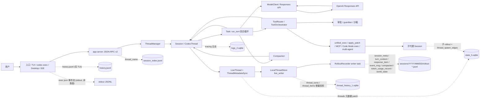
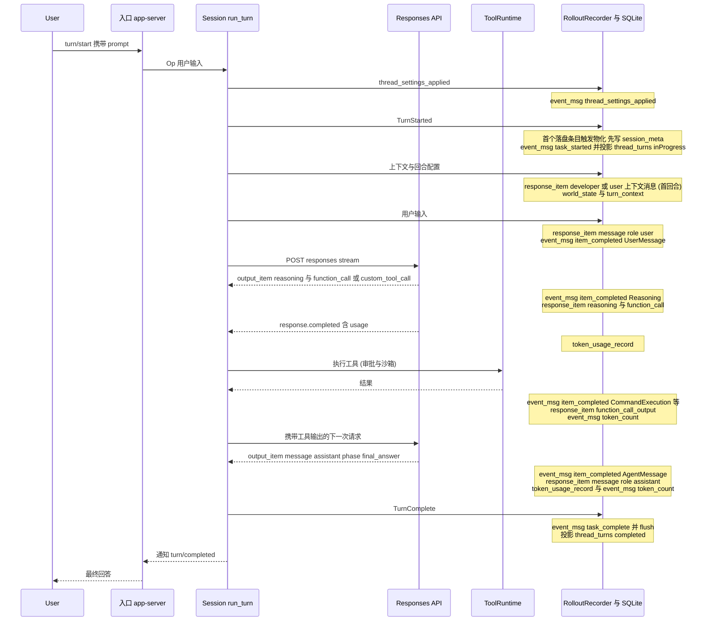
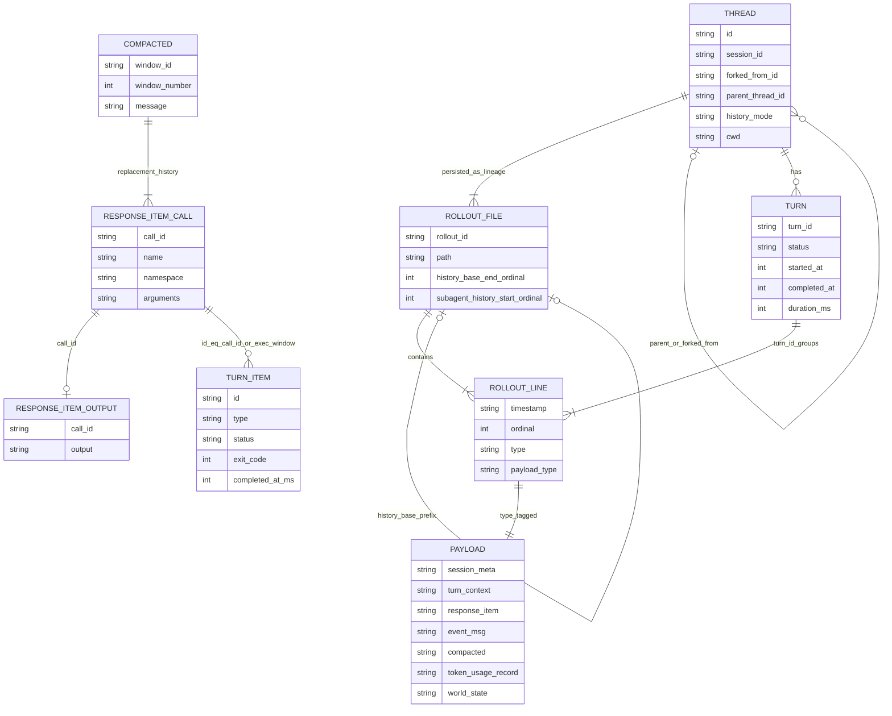

# Codex（openai/codex）会话与轨迹数据分析

> 状态：初稿已完成，2026-10-02。每个 permalink 的行号都已对照源码核实；无法确认的结论标为「待确认」。

## 0. 元信息

| 项 | 值 |
| --- | --- |
| 仓库 | [openai/codex](https://github.com/openai/codex) |
| 分析 commit | `9552906b2b8358121f71695e1e6602791cdcecc0`（2026-10-01） |
| 源码版本号 | workspace `version = "0.0.0"`，发布构建时注入；落盘的 `cli_version` 取 `CARGO_PKG_VERSION`（[codex-rs/rollout/src/recorder.rs:948](https://github.com/openai/codex/blob/9552906b2b8358121f71695e1e6602791cdcecc0/codex-rs/rollout/src/recorder.rs#L948)） |
| 语言 | Rust（`codex-rs/` workspace，edition 2024，toolchain 1.95.0） |
| 本机数据 | 由 Codex Desktop / CLI / exec 产生，`cli_version` 从 0.98.0 到 0.159.2（见 §8） |
| 分析方法 | ① 静态阅读 HEAD 源码；② 只读统计本机 `~/.codex`：用 Python 流式扫描全部 906 个 rollout JSONL（全量，未抽样），只统计 key 集合、类型、枚举值和计数；SQLite 以 `mode=ro` 打开（目录里没有 WAL 文件的库额外加 `immutable=1`），只查 schema 和聚合结果 |
| 约定 | 「源码 HEAD 行为」与「本机数据表现」分开写；无法确认的写「待确认」并说明原因 |

## 1. 结构图与一次 chat 的数据流

### 1.1 组件表

| 组件 | 职责 | 源码位置 | 写出的记录 |
| --- | --- | --- | --- |
| 入口：TUI `codex`、`codex exec`、Desktop/IDE（通过 app-server JSON-RPC） | 收集用户输入；`thread/start` 时选择 `history_mode`；在 `initialize` 中用 clientInfo.name 设置 originator | [tui/src/app_server_session.rs:2111](https://github.com/openai/codex/blob/9552906b2b8358121f71695e1e6602791cdcecc0/codex-rs/tui/src/app_server_session.rs#L2111)、[exec/src/lib.rs:263](https://github.com/openai/codex/blob/9552906b2b8358121f71695e1e6602791cdcecc0/codex-rs/exec/src/lib.rs#L263)、[app-server/…/initialize_processor.rs:168](https://github.com/openai/codex/blob/9552906b2b8358121f71695e1e6602791cdcecc0/codex-rs/app-server/src/request_processors/initialize_processor.rs#L168) | TUI 追加 `history.jsonl`；exec `--json` 只往 stdout 输出 JSONL（§5.6） |
| app-server | v2 方法 `thread/start`、`turn/start`、`thread/resume`、`thread/fork`、`thread/revert`、`thread/turns/list`、`thread/items/list` 等 | [thread_processor.rs:526](https://github.com/openai/codex/blob/9552906b2b8358121f71695e1e6602791cdcecc0/codex-rs/app-server/src/request_processors/thread_processor.rs#L526)、[turn_processor.rs:174](https://github.com/openai/codex/blob/9552906b2b8358121f71695e1e6602791cdcecc0/codex-rs/app-server/src/request_processors/turn_processor.rs#L174)、[common.rs:551](https://github.com/openai/codex/blob/9552906b2b8358121f71695e1e6602791cdcecc0/codex-rs/app-server-protocol/src/protocol/common.rs#L551) | 改名写 `session_index.jsonl` 和 state |
| ThreadManager | 创建/恢复/fork 线程，构建 ThreadStore，启动迁移和压缩 worker | [core/src/thread_manager.rs:243](https://github.com/openai/codex/blob/9552906b2b8358121f71695e1e6602791cdcecc0/codex-rs/core/src/thread_manager.rs#L243)、[:1044](https://github.com/openai/codex/blob/9552906b2b8358121f71695e1e6602791cdcecc0/codex-rs/core/src/thread_manager.rs#L1044)、[:1266](https://github.com/openai/codex/blob/9552906b2b8358121f71695e1e6602791cdcecc0/codex-rs/core/src/thread_manager.rs#L1266)、[:1476](https://github.com/openai/codex/blob/9552906b2b8358121f71695e1e6602791cdcecc0/codex-rs/core/src/thread_manager.rs#L1476) | —（通过 Session 间接写） |
| Session（一个线程一个） | 会话状态与事件总线；`send_event`、`record_conversation_items`、`persist_rollout_items` 是所有落盘的入口 | [core/src/session/mod.rs:2270](https://github.com/openai/codex/blob/9552906b2b8358121f71695e1e6602791cdcecc0/codex-rs/core/src/session/mod.rs#L2270)、[:3443](https://github.com/openai/codex/blob/9552906b2b8358121f71695e1e6602791cdcecc0/codex-rs/core/src/session/mod.rs#L3443)、[:4438](https://github.com/openai/codex/blob/9552906b2b8358121f71695e1e6602791cdcecc0/codex-rs/core/src/session/mod.rs#L4438) | 全部 RolloutItem |
| Task 层（RegularTask 等） | 回合生命周期 | [tasks/regular.rs:51](https://github.com/openai/codex/blob/9552906b2b8358121f71695e1e6602791cdcecc0/codex-rs/core/src/tasks/regular.rs#L51)、[tasks/mod.rs:812-847](https://github.com/openai/codex/blob/9552906b2b8358121f71695e1e6602791cdcecc0/codex-rs/core/src/tasks/mod.rs#L812) | `task_started` / `task_complete` / `turn_aborted` |
| 回合循环 `run_turn` | 预压缩、更新上下文、记录输入、采样循环、自动压缩 | [session/turn.rs:163](https://github.com/openai/codex/blob/9552906b2b8358121f71695e1e6602791cdcecc0/codex-rs/core/src/session/turn.rs#L163)、[:283](https://github.com/openai/codex/blob/9552906b2b8358121f71695e1e6602791cdcecc0/codex-rs/core/src/session/turn.rs#L283)、[:368](https://github.com/openai/codex/blob/9552906b2b8358121f71695e1e6602791cdcecc0/codex-rs/core/src/session/turn.rs#L368)、[:2530](https://github.com/openai/codex/blob/9552906b2b8358121f71695e1e6602791cdcecc0/codex-rs/core/src/session/turn.rs#L2530) | `turn_context`、`world_state`、`response_item`（developer/user）、`item_completed(UserMessage)` |
| 上下文与用户输入 | 首回合或配置变化时注入上下文消息；用户输入同时写成模型消息和 UI 条目 | [session/mod.rs:4576-4653](https://github.com/openai/codex/blob/9552906b2b8358121f71695e1e6602791cdcecc0/codex-rs/core/src/session/mod.rs#L4576)、[:4861-4921](https://github.com/openai/codex/blob/9552906b2b8358121f71695e1e6602791cdcecc0/codex-rs/core/src/session/mod.rs#L4861) | 同上 |
| ModelClient | 调用 Responses API 流式接口；HEAD 只支持 `responses` 这一种 wire API | [core/src/client.rs:265](https://github.com/openai/codex/blob/9552906b2b8358121f71695e1e6602791cdcecc0/codex-rs/core/src/client.rs#L265)、[:2226](https://github.com/openai/codex/blob/9552906b2b8358121f71695e1e6602791cdcecc0/codex-rs/core/src/client.rs#L2226)、[model-provider-info/src/lib.rs:104](https://github.com/openai/codex/blob/9552906b2b8358121f71695e1e6602791cdcecc0/codex-rs/model-provider-info/src/lib.rs#L104) | `token_usage_record`（[session/mod.rs:4667-4699](https://github.com/openai/codex/blob/9552906b2b8358121f71695e1e6602791cdcecc0/codex-rs/core/src/session/mod.rs#L4667)）、`token_count`（[:4823](https://github.com/openai/codex/blob/9552906b2b8358121f71695e1e6602791cdcecc0/codex-rs/core/src/session/mod.rs#L4823)） |
| 输出处理 `handle_output_item_done` | 把模型输出 item 落盘并派发工具 | [core/src/stream_events_utils.rs:315](https://github.com/openai/codex/blob/9552906b2b8358121f71695e1e6602791cdcecc0/codex-rs/core/src/stream_events_utils.rs#L315) | `response_item`（reasoning/message/function_call/custom_tool_call/…）、`item_completed(Reasoning/AgentMessage)` |
| ToolRouter、ToolOrchestrator 与 handlers | 解析工具调用；审批；沙箱；执行 unified_exec、apply_patch、MCP、multi-agent、view_image、tool_search 等；Code Mode `exec` 在 JS 运行时里嵌套调用其他工具 | [tools/router.rs:248](https://github.com/openai/codex/blob/9552906b2b8358121f71695e1e6602791cdcecc0/codex-rs/core/src/tools/router.rs#L248)、[tools/orchestrator.rs:43](https://github.com/openai/codex/blob/9552906b2b8358121f71695e1e6602791cdcecc0/codex-rs/core/src/tools/orchestrator.rs#L43)、[tools/events.rs:581-600](https://github.com/openai/codex/blob/9552906b2b8358121f71695e1e6602791cdcecc0/codex-rs/core/src/tools/events.rs#L581)、[code-mode-protocol/src/lib.rs:52](https://github.com/openai/codex/blob/9552906b2b8358121f71695e1e6602791cdcecc0/codex-rs/code-mode-protocol/src/lib.rs#L52) | `response_item:*_output`、`item_completed(CommandExecution/FileChange/McpToolCall/CollabAgentToolCall/…)` |
| 审批与 guardian | 审批请求和决定都是瞬态事件，不落盘；被拒绝的命令记为 `CommandExecution.status=declined`；guardian 自动审批跑在独立子线程中 | [policy.rs:176-180](https://github.com/openai/codex/blob/9552906b2b8358121f71695e1e6602791cdcecc0/codex-rs/rollout/src/policy.rs#L176)、[tools/events.rs:565-577](https://github.com/openai/codex/blob/9552906b2b8358121f71695e1e6602791cdcecc0/codex-rs/core/src/tools/events.rs#L565)、[state/src/extract.rs:20](https://github.com/openai/codex/blob/9552906b2b8358121f71695e1e6602791cdcecc0/codex-rs/state/src/extract.rs#L20) | guardian 线程自己的 rollout（`source={"subagent":{"other":"guardian"}}`） |
| 压缩 | 本地摘要压缩，或远程压缩（加密的 `compaction` item） | [compact.rs:385](https://github.com/openai/codex/blob/9552906b2b8358121f71695e1e6602791cdcecc0/codex-rs/core/src/compact.rs#L385)、[compact_remote_v2.rs:360](https://github.com/openai/codex/blob/9552906b2b8358121f71695e1e6602791cdcecc0/codex-rs/core/src/compact_remote_v2.rs#L360)、[session/mod.rs:3983-4109](https://github.com/openai/codex/blob/9552906b2b8358121f71695e1e6602791cdcecc0/codex-rs/core/src/session/mod.rs#L3983) | `compacted` + `world_state` + `turn_context` + `thread_settings_applied`；`item_completed(ContextCompaction)` |
| 子代理（AgentControl，multi-agent v2） | spawn/wait/send/close；子线程继承父上下文 | [agent/control/spawn.rs:115-126](https://github.com/openai/codex/blob/9552906b2b8358121f71695e1e6602791cdcecc0/codex-rs/core/src/agent/control/spawn.rs#L115)、[session/mod.rs:3853-3910](https://github.com/openai/codex/blob/9552906b2b8358121f71695e1e6602791cdcecc0/codex-rs/core/src/session/mod.rs#L3853)、[state/src/runtime/threads.rs:133](https://github.com/openai/codex/blob/9552906b2b8358121f71695e1e6602791cdcecc0/codex-rs/state/src/runtime/threads.rs#L133) | 子 rollout；`thread_spawn_edges`；父 rollout 中的 `inter_agent_communication_metadata` 和 `agent_message` |
| LiveThread 与 ThreadMetadataSync | 应用持久化策略，生成元数据 patch | [thread-store/src/live_thread.rs:220-272](https://github.com/openai/codex/blob/9552906b2b8358121f71695e1e6602791cdcecc0/codex-rs/thread-store/src/live_thread.rs#L220) | `state_5.threads` |
| LocalThreadStore live_writer | 写 JSONL 后投影 | [thread-store/src/local/live_writer.rs:327-370](https://github.com/openai/codex/blob/9552906b2b8358121f71695e1e6602791cdcecc0/codex-rs/thread-store/src/local/live_writer.rs#L327) | rollout JSONL、`thread_history_1` |
| RolloutRecorder | JSONL writer task | [rollout/src/recorder.rs:86](https://github.com/openai/codex/blob/9552906b2b8358121f71695e1e6602791cdcecc0/codex-rs/rollout/src/recorder.rs#L86) | `rollout-*.jsonl` |
| state runtime | 各 SQLite 库的连接、迁移与写入 | [state/src/sqlite.rs:66-142](https://github.com/openai/codex/blob/9552906b2b8358121f71695e1e6602791cdcecc0/codex-rs/state/src/sqlite.rs#L66) | `state_5` / `thread_history_1` / `logs_2` / … |

### 1.2 图 1：结构与数据流（虚线表示写入持久化）



### 1.3 图 2：一次 chat 的时序（paginated，含 1 次工具调用）



说明：

- 上图的顺序与本机记录的相邻关系一致：
  - `thread_settings_applied → task_started` 共 5910 次；
  - `task_started → turn_context` 共 5978 次；
  - `turn_context → message(user)` 共 6824 次；
  - `message(user) → item_completed(UserMessage)` 共 6562 次；
  - `item_completed(AgentMessage) → message(assistant)` 共 10846 次；
  - `token_count → task_complete` 共 6870 次。
- 非工具输出（消息、推理）的写入顺序是**先写 `item_completed`，再写 `response_item`**（[stream_events_utils.rs:375-394](https://github.com/openai/codex/blob/9552906b2b8358121f71695e1e6602791cdcecc0/codex-rs/core/src/stream_events_utils.rs#L375)）。工具调用则是先写 `response_item`，再执行工具（[:346](https://github.com/openai/codex/blob/9552906b2b8358121f71695e1e6602791cdcecc0/codex-rs/core/src/stream_events_utils.rs#L346)）。
- 工具在 in-flight future 中并发执行。`token_usage_record` 在 `response.completed` 到达时写入，因此可能夹在工具执行产生的 `item_completed` 之间。

## 2. 存储布局

### 2.1 目录树

```text
$CODEX_HOME（默认 ~/.codex）
├── sessions/YYYY/MM/DD/                        # 未归档线程的 rollout（canonical history）
│   ├── rollout-<本地时间 YYYY-MM-DDTHH-MM-SS>-<threadId>.jsonl
│   ├── rollout-<本地时间>-<threadId>_<rolloutId>.jsonl   # thread/revert 生成的新不可变 rollout
│   └── rollout-*.jsonl.zst                     # 冷文件 zstd 压缩（feature 默认关闭；本机 0 个）
├── archived_sessions/rollout-*.jsonl            # 归档：平铺，没有日期子目录（rename 移入）
├── session_index.jsonl                          # 线程改名的追加日志 {id, thread_name, updated_at}
├── history.jsonl                                # TUI 的 prompt 历史 {session_id, ts, text}
├── state_5.sqlite                               # 线程元数据索引（threads、thread_spawn_edges、projects…）
├── thread_history_1.sqlite                      # rollout 的分页投影（thread_turns / thread_items），可重建
├── logs_2.sqlite                                # tracing 日志（按 thread_id / process_uuid 关联）
├── goals_1.sqlite / queue_1.sqlite / memories_1.sqlite（/ memories_v2_1.sqlite）
├── rollout-migrations/<threadId>.pending        # legacy→paginated 迁移进行中的 journal
├── thread-writer-locks/<threadId>.lock          # 跨进程独占写锁（advisory lock）
├── .tmp/rollout-compression.lock                # 压缩 worker 的运行标记
├── external_agent_session_imports.json          # 外部 agent 会话导入台账
└── memories/（MEMORY.md、raw_memories.md、rollout_summaries/ …）
```

- `CODEX_HOME`：环境变量覆盖，值必须是已存在的目录（会被 canonicalize）；未设置时为 `~/.codex`（[codex-rs/utils/home-dir/src/lib.rs:13](https://github.com/openai/codex/blob/9552906b2b8358121f71695e1e6602791cdcecc0/codex-rs/utils/home-dir/src/lib.rs#L13)）。
- SQLite 目录：config 键 `sqlite_home`，默认取 `$CODEX_SQLITE_HOME`，否则用 `$CODEX_HOME`（[codex-rs/config/src/config_toml.rs:371](https://github.com/openai/codex/blob/9552906b2b8358121f71695e1e6602791cdcecc0/codex-rs/config/src/config_toml.rs#L371)、[codex-rs/state/src/lib.rs:128](https://github.com/openai/codex/blob/9552906b2b8358121f71695e1e6602791cdcecc0/codex-rs/state/src/lib.rs#L128)）。本机另有一个旧的 `~/.codex/sqlite/` 目录（state_5 只有 35 个 migration，最后修改于 2026-06），应是历史版本的 sqlite_home，当前未在使用（待确认）。
- 子目录名常量：`sessions` / `archived_sessions`（[codex-rs/rollout/src/lib.rs:86](https://github.com/openai/codex/blob/9552906b2b8358121f71695e1e6602791cdcecc0/codex-rs/rollout/src/lib.rs#L86)）。

### 2.2 rollout 文件命名与 ID

- 路径由 [precompute_new_rollout_path](https://github.com/openai/codex/blob/9552906b2b8358121f71695e1e6602791cdcecc0/codex-rs/rollout/src/recorder.rs#L1723) 生成：用 `OffsetDateTime::now_local()` 的**本地时间**组成 `sessions/YYYY/MM/DD/`，再加文件名。
- 文件名格式见 [RolloutFileName::render](https://github.com/openai/codex/blob/9552906b2b8358121f71695e1e6602791cdcecc0/codex-rs/rollout/src/rollout_file_name.rs#L62)：
  - 普通线程：`rollout-YYYY-MM-DDTHH-MM-SS-<threadId>.jsonl`（rollout id 等于 thread id）；
  - `thread/revert` 产生的文件：`rollout-…-<threadId>_<rolloutId>.jsonl`（thread id 保持不变，另起新的 rollout id）。
- 压缩文件在文件名后追加 `.zst`（[compression.rs:29](https://github.com/openai/codex/blob/9552906b2b8358121f71695e1e6602791cdcecc0/codex-rs/rollout/src/compression.rs#L29)）：
  - 只压缩 7 天以上的冷文件，zstd level 3（[compression.rs:362-363](https://github.com/openai/codex/blob/9552906b2b8358121f71695e1e6602791cdcecc0/codex-rs/rollout/src/compression.rs#L362)）；
  - 由 feature `local_thread_store_compression` 控制，HEAD 默认关闭（[features/src/lib.rs:1198](https://github.com/openai/codex/blob/9552906b2b8358121f71695e1e6602791cdcecc0/codex-rs/features/src/lib.rs#L1198)）；
  - 读取方必须同时支持 `.jsonl` 和 `.jsonl.zst`。
- **ID 都是 UUIDv7**：
  - `ThreadId::new()` 使用 `Uuid::now_v7()`，`RolloutId` 是 `ThreadId` 的类型别名（[codex-rs/protocol/src/thread_id.rs:16](https://github.com/openai/codex/blob/9552906b2b8358121f71695e1e6602791cdcecc0/codex-rs/protocol/src/thread_id.rs#L16)、[:25](https://github.com/openai/codex/blob/9552906b2b8358121f71695e1e6602791cdcecc0/codex-rs/protocol/src/thread_id.rs#L25)、[:30](https://github.com/openai/codex/blob/9552906b2b8358121f71695e1e6602791cdcecc0/codex-rs/protocol/src/thread_id.rs#L30)）；
  - `session_id` 等于根线程的 thread id，同一会话树内共享（[protocol.rs:3130](https://github.com/openai/codex/blob/9552906b2b8358121f71695e1e6602791cdcecc0/codex-rs/protocol/src/protocol.rs#L3130)）；
  - 新的 Responses item id 由客户端生成，格式为 `<prefix>_<uuidv7>`，prefix 如 `msg` / `rs` / `fc` / `ctc` / `amsg` / `cmp` 等（[response_item_id.rs:20](https://github.com/openai/codex/blob/9552906b2b8358121f71695e1e6602791cdcecc0/codex-rs/protocol/src/response_item_id.rs#L20)、[models.rs:1309](https://github.com/openai/codex/blob/9552906b2b8358121f71695e1e6602791cdcecc0/codex-rs/protocol/src/models.rs#L1309)）；
  - TurnItem id 同样是 UUIDv7（[items.rs:518](https://github.com/openai/codex/blob/9552906b2b8358121f71695e1e6602791cdcecc0/codex-rs/protocol/src/items.rs#L518)）。
- 三个时间戳的含义：
  - 文件名时间：本地时间，没有时区后缀；
  - `session_meta.payload.timestamp`：同一时刻的 UTC 值，精确到毫秒（[recorder.rs:927-933](https://github.com/openai/codex/blob/9552906b2b8358121f71695e1e6602791cdcecc0/codex-rs/rollout/src/recorder.rs#L927)）；
  - 每行的 `timestamp`：**写入时刻**的 UTC（[recorder.rs:2077-2082](https://github.com/openai/codex/blob/9552906b2b8358121f71695e1e6602791cdcecc0/codex-rs/rollout/src/recorder.rs#L2077)）。
  - 本机核对：906 个文件的「文件名时间 − payload.timestamp」全部等于 +8.0h（与本机时区一致）。

### 2.3 SQLite 库

所有库的文件名常量见 [codex-rs/state/src/sqlite.rs:34-39](https://github.com/openai/codex/blob/9552906b2b8358121f71695e1e6602791cdcecc0/codex-rs/state/src/sqlite.rs#L34)。均通过 sqlx migrator 建表，本机全部是 WAL 模式（文件头第 18/19 字节为 `02 02`）。

| 库 | 表 | 用途 | 本机规模 |
| --- | --- | --- | --- |
| `state_5.sqlite` | `threads`（id、rollout_path、created_at(_ms)、updated_at(_ms)、recency_at(_ms)、source、thread_source、originator、model_provider、model、reasoning_effort、cwd、title、name、preview、first_user_message、sandbox_policy、approval_mode、tokens_used、archived、archived_at、git_sha/branch/origin_url、cli_version、agent_nickname/role/path、memory_mode、history_mode、project_id、section…）；`thread_spawn_edges`(parent_thread_id, child_thread_id, status)；`thread_dynamic_tools`；`projects`/`project_roots`；`thread_sections`；`thread_attachments`；`rollout_migration_state`/`rollout_migration_skipped_rollouts`；`backfill_state`；`external_agent_config_imports`；`remote_control_enrollments` | 线程列表/搜索/归档的**元数据索引**，不存消息内容（`first_user_message`/`preview`/`title` 除外）。建表见 [0001_threads.sql](https://github.com/openai/codex/blob/9552906b2b8358121f71695e1e6602791cdcecc0/codex-rs/state/migrations/0001_threads.sql#L1)、[0021_thread_spawn_edges.sql](https://github.com/openai/codex/blob/9552906b2b8358121f71695e1e6602791cdcecc0/codex-rs/state/migrations/0021_thread_spawn_edges.sql#L1)、[0040_threads_history_mode.sql](https://github.com/openai/codex/blob/9552906b2b8358121f71695e1e6602791cdcecc0/codex-rs/state/migrations/0040_threads_history_mode.sql#L1)、[0047_rollout_migration_state.sql](https://github.com/openai/codex/blob/9552906b2b8358121f71695e1e6602791cdcecc0/codex-rs/state/migrations/0047_rollout_migration_state.sql#L1) | 约 50 MB；threads 890 行（archived 458）；spawn_edges 213（全部 open）；58 个 migration |
| `thread_history_1.sqlite` | `thread_turns`(thread_id, turn_id, rollout_ordinal, status, error_json, started_at, completed_at, duration_ms, first_user_item_id, final_agent_item_id, rollout_byte_offset, rollout_end_ordinal, rollout_end_byte_offset)；`thread_items`(thread_id, turn_id, item_id, rollout_ordinal, created_at_ms, item_json, item_type, updated_at_ordinal, started_at_ms, completed_at_ms)；`thread_realtime_items`；`thread_history_projection_state`(thread_id, next_rollout_byte_offset, next_rollout_ordinal) | paginated rollout 的**投影**，供 `thread/turns/list`、`thread/items/list` 分页读取。`item_json` 是 app-server v2 `ThreadItem`（camelCase）。建表见 [0001_thread_history.sql](https://github.com/openai/codex/blob/9552906b2b8358121f71695e1e6602791cdcecc0/codex-rs/state/thread_history_migrations/0001_thread_history.sql#L1)。该库的 recovery 策略是 `Unavailable`，与其他库的「备份后重建」不同（[sqlite.rs:124-132](https://github.com/openai/codex/blob/9552906b2b8358121f71695e1e6602791cdcecc0/codex-rs/state/src/sqlite.rs#L124)） | 约 894 MB；turns 1368 行（463 个线程），items 79925 行（458 个线程），projection_state 906 行 |
| `logs_2.sqlite` | `logs`(id, ts, ts_nanos, level, target, feedback_log_body, module_path, file, line, thread_id, process_uuid, estimated_bytes)（[logs_migrations/0001_logs.sql](https://github.com/openai/codex/blob/9552906b2b8358121f71695e1e6602791cdcecc0/codex-rs/state/logs_migrations/0001_logs.sql#L1)） | tracing 日志，可按 thread_id 关联，可能含敏感文本 | 约 346 MB；101216 行，972 个 thread_id |
| `goals_1.sqlite` | `thread_goals`、`thread_goal_continuation_deferrals`（[goals_migrations/0001_thread_goals.sql](https://github.com/openai/codex/blob/9552906b2b8358121f71695e1e6602791cdcecc0/codex-rs/state/goals_migrations/0001_thread_goals.sql#L1)） | 线程长期目标（goal）状态 | 1 行（paused） |
| `queue_1.sqlite` | `queued_items`、`queued_thread_revisions`（[queue_migrations/0001_queued_items.sql](https://github.com/openai/codex/blob/9552906b2b8358121f71695e1e6602791cdcecc0/codex-rs/state/queue_migrations/0001_queued_items.sql#L1)） | 持久化的待发送用户消息队列 | 0 / 10 行 |
| `memories_1.sqlite` | `stage1_outputs`、`jobs`、`consolidation_progress`（[memory_migrations/0001_memories.sql](https://github.com/openai/codex/blob/9552906b2b8358121f71695e1e6602791cdcecc0/codex-rs/state/memory_migrations/0001_memories.sql#L1)） | memories 管线：从 rollout 抽取记忆、全局合并 | 0 / 1 / 1 行 |

### 2.4 辅助文件

| 文件 | 格式 | 写入方 | 说明 |
| --- | --- | --- | --- |
| `session_index.jsonl` | 每行 `{id, thread_name, updated_at(RFC3339)}` | [append_thread_name](https://github.com/openai/codex/blob/9552906b2b8358121f71695e1e6602791cdcecc0/codex-rs/rollout/src/session_index.rs#L33) | 改名时追加，后写覆盖先写；删除线程时整文件重写（[session_index.rs:20-29](https://github.com/openai/codex/blob/9552906b2b8358121f71695e1e6602791cdcecc0/codex-rs/rollout/src/session_index.rs#L20)）。本机 274 行，261 个 id，均可在 `threads` 表中找到 |
| `history.jsonl` | 每行 `{session_id, ts(unix 秒), text}`（[message-history/src/lib.rs:8](https://github.com/openai/codex/blob/9552906b2b8358121f71695e1e6602791cdcecc0/codex-rs/message-history/src/lib.rs#L8)） | 只有 TUI 写入（[tui/src/app/thread_routing.rs:565](https://github.com/openai/codex/blob/9552906b2b8358121f71695e1e6602791cdcecc0/codex-rs/tui/src/app/thread_routing.rs#L565)） | 由 config `[history] persistence = save-all/none`、`max_bytes` 控制（[config/src/types.rs:202-219](https://github.com/openai/codex/blob/9552906b2b8358121f71695e1e6602791cdcecc0/codex-rs/config/src/types.rs#L202)）；文件权限 0600，写前取 advisory lock。本机 16 行，均为早期 TUI 使用，session_id 都已不在 `threads` 表中 |
| `external_agent_session_imports.json` | `{records:[{source_path, content_sha256, imported_thread_id, imported_at, source_modified_at, connector_names, title}], detected_connector_records:[…]}`（[ledger.rs:19-44](https://github.com/openai/codex/blob/9552906b2b8358121f71695e1e6602791cdcecc0/codex-rs/external-agent-migration/src/sessions/ledger.rs#L19)） | app-server 的导入流程 | 本机 50 条记录，来源均为 Claude Code 项目 JSONL；对应的导入线程已不在 `threads` 表或 rollout 目录中（可能已被删除，待确认） |
| `rollout-migrations/<threadId>.pending` | 迁移 journal（[publish.rs:35-41](https://github.com/openai/codex/blob/9552906b2b8358121f71695e1e6602791cdcecc0/codex-rs/thread-store/src/local/rollout_migration/publish.rs#L35)） | legacy→paginated 迁移 | 迁移完成后删除；本机为空目录 |
| `thread-writer-locks/<threadId>.lock` | 空文件 + advisory lock（[writer_lock.rs:17](https://github.com/openai/codex/blob/9552906b2b8358121f71695e1e6602791cdcecc0/codex-rs/rollout/src/writer_lock.rs#L17)、[:43-86](https://github.com/openai/codex/blob/9552906b2b8358121f71695e1e6602791cdcecc0/codex-rs/rollout/src/writer_lock.rs#L43)） | LocalThreadStore | 保证一个线程只有一个写入进程；Tandem **不应**去抢这把锁 |

### 2.5 环境变量与配置开关

| 名称 | 作用 | 依据 |
| --- | --- | --- |
| `CODEX_HOME` | 根目录 | [home-dir/src/lib.rs:14](https://github.com/openai/codex/blob/9552906b2b8358121f71695e1e6602791cdcecc0/codex-rs/utils/home-dir/src/lib.rs#L14) |
| `CODEX_SQLITE_HOME` / `sqlite_home` | SQLite 目录 | [state/src/lib.rs:128](https://github.com/openai/codex/blob/9552906b2b8358121f71695e1e6602791cdcecc0/codex-rs/state/src/lib.rs#L128) |
| `[history] persistence/max_bytes` | 控制 history.jsonl | [config/src/types.rs:202](https://github.com/openai/codex/blob/9552906b2b8358121f71695e1e6602791cdcecc0/codex-rs/config/src/types.rs#L202) |
| `CODEX_ROLLOUT_TRACE_ROOT` | 开启 rollout-trace 调试 bundle（默认关闭，见 §5.8） | [rollout-trace/src/thread.rs:44](https://github.com/openai/codex/blob/9552906b2b8358121f71695e1e6602791cdcecc0/codex-rs/rollout-trace/src/thread.rs#L44) |
| `CODEX_INTERNAL_ORIGINATOR_OVERRIDE` | 覆盖 originator（默认 `codex_cli_rs`） | [login/src/auth/default_client.rs:42-43](https://github.com/openai/codex/blob/9552906b2b8358121f71695e1e6602791cdcecc0/codex-rs/login/src/auth/default_client.rs#L42) |
| feature `background_paginated_rollout_migration` | 启动时后台把 legacy rollout 迁移为 paginated（默认关闭） | [features/src/lib.rs:1210](https://github.com/openai/codex/blob/9552906b2b8358121f71695e1e6602791cdcecc0/codex-rs/features/src/lib.rs#L1210)、[thread_manager.rs:461-504](https://github.com/openai/codex/blob/9552906b2b8358121f71695e1e6602791cdcecc0/codex-rs/core/src/thread_manager.rs#L461) |
| `codex migrate-rollouts [--apply]` | 手动迁移，不加 `--apply` 时只报告 | [cli/src/migrate_rollouts.rs:22-46](https://github.com/openai/codex/blob/9552906b2b8358121f71695e1e6602791cdcecc0/codex-rs/cli/src/migrate_rollouts.rs#L22) |

### 2.6 两种历史模式：legacy 与 paginated（最重要的版本分界）

- `SessionMeta.history_mode` 只有两个取值：`legacy`（缺省）和 `paginated`（[protocol.rs:778-782](https://github.com/openai/codex/blob/9552906b2b8358121f71695e1e6602791cdcecc0/codex-rs/protocol/src/protocol.rs#L778)）。
- **legacy**：
  - 行内没有 `ordinal`；
  - 持久化旧式事件 `user_message` / `agent_message` / `agent_reasoning` / `patch_apply_end` / `mcp_tool_call_end` / `web_search_end` 等。
- **paginated**：
  - 每行带单调递增的 `ordinal`；
  - 以 `event_msg:item_completed(TurnItem)` 代替上述旧事件（[policy.rs:94-140](https://github.com/openai/codex/blob/9552906b2b8358121f71695e1e6602791cdcecc0/codex-rs/rollout/src/policy.rs#L94)）；
  - 写入后增量投影到 `thread_history_1.sqlite`。
- 新线程使用哪种模式由客户端在 `thread/start` 时指定：
  - HEAD 的 TUI 和 `codex exec` 在非 ephemeral 时都请求 `paginated`（[tui/src/app_server_session.rs:2111](https://github.com/openai/codex/blob/9552906b2b8358121f71695e1e6602791cdcecc0/codex-rs/tui/src/app_server_session.rs#L2111)、[exec/src/lib.rs:1453](https://github.com/openai/codex/blob/9552906b2b8358121f71695e1e6602791cdcecc0/codex-rs/exec/src/lib.rs#L1453)）；
  - 服务端不支持时回退为 legacy；
  - 外部会话导入固定写 legacy（§5.9）。
- 已有的 legacy 文件可以被迁移器**原地改写**为 paginated（§4.6）。
- 本机现状：906 个文件全部是 paginated，`state_5.rollout_migration_state` 中有一条 `legacy_to_paginated_v1` 记录，说明迁移已执行过。

## 3. 记录 schema

### 3.1 外层 RolloutLine

```rust
// codex-rs/history/src/lib.rs:360-367
#[derive(Serialize, Clone, JsonSchema)]
pub struct RolloutLine {
    pub timestamp: String,
    #[serde(default, skip_serializing_if = "Option::is_none")]
    pub ordinal: Option<u64>,
    #[serde(flatten)]
    pub item: RolloutItem,
}
```

- 出处：[history/src/lib.rs:361](https://github.com/openai/codex/blob/9552906b2b8358121f71695e1e6602791cdcecc0/codex-rs/history/src/lib.rs#L361)。
- `RolloutItem` 用 wire 枚举序列化：`#[serde(tag = "type", rename_all = "snake_case")]`，内容放在 `payload` 字段（[rollout_payload.rs:31-72](https://github.com/openai/codex/blob/9552906b2b8358121f71695e1e6602791cdcecc0/codex-rs/history/src/rollout_payload.rs#L31)）。
- 因此一行 JSON 只有这几个 key：`timestamp`、`ordinal`（可选）、`type`、`payload`，以及 `response_item` 专用的 `metadata`。
- 官方解析器先把整行解成 `Value`，再手工取出 `timestamp`/`ordinal`（[rollout/src/lib.rs:52-79](https://github.com/openai/codex/blob/9552906b2b8358121f71695e1e6602791cdcecc0/codex-rs/rollout/src/lib.rs#L52)），目的是绕开 serde flatten 与 arbitrary_precision 的冲突。

| 字段 | 类型 | 说明 |
| --- | --- | --- |
| `timestamp` | string | 写入时刻 UTC，`YYYY-MM-DDTHH:MM:SS.mmmZ` |
| `ordinal` | u64，可选 | 仅 paginated 模式有。从 0 开始；带 `history_base` 的文件从 `history_base.end_ordinal_exclusive` 开始；每行 +1，跨 lineage 全局连续（[ordinal.rs:23-33](https://github.com/openai/codex/blob/9552906b2b8358121f71695e1e6602791cdcecc0/codex-rs/rollout/src/ordinal.rs#L23)） |
| `type` | string | 取值见 3.2 |
| `payload` | object | 变体内容 |
| `metadata` | object，可选 | 仅 `response_item`，即 `CodexHarnessMetadata`：`client_authored`、`fallback_token_limit_override`、`mcp_attribution`、`user_input_order`、`retained_source`、`guardian_*` 等，属于 harness 私有信息、模型不可见（[history/src/lib.rs:63-135](https://github.com/openai/codex/blob/9552906b2b8358121f71695e1e6602791cdcecc0/codex-rs/history/src/lib.rs#L63)） |

### 3.2 RolloutItem 变体

定义见 [history/src/lib.rs:211-227](https://github.com/openai/codex/blob/9552906b2b8358121f71695e1e6602791cdcecc0/codex-rs/history/src/lib.rs#L211)，是否落盘由 [is_persisted_rollout_item](https://github.com/openai/codex/blob/9552906b2b8358121f71695e1e6602791cdcecc0/codex-rs/rollout/src/policy.rs#L10) 决定。

| `type` | payload 类型 | 何时写 | 本机行数 |
| --- | --- | --- | --- |
| `session_meta` | `SessionMetaLine` | 文件第一行，在 rollout 首次物化时写入。子代理和 fork 文件的第 2 行（ordinal 1）可能是**父线程 meta 的副本** | 1054（906 个文件，148 个文件有 2 条） |
| `turn_context` | `TurnContextItem` | 每个真实用户回合写 1 次；mid-turn 压缩后再写 1 次 | 7315 |
| `response_item` | `ResponseItem`（+`metadata`） | 每个进入模型上下文的 item（输入、输出、工具调用和结果） | 121220 |
| `event_msg` | `EventMsg`（按模式过滤） | 生命周期事件和 `item_completed` | 151138 |
| `compacted` | `CompactedItem` | 上下文压缩 | 143 |
| `token_usage_record` | `TokenUsageRecord` | 每个 Responses API 响应完成时 | 21668 |
| `world_state` | `WorldStateItem{full, state}` | 环境/指令等「世界状态」的全量快照或补丁 | 1785 |
| `inter_agent_communication_metadata` | `{trigger_turn}` | 多 agent v2 消息投递，后面紧跟一条 `response_item:agent_message` | 1604 |
| `inter_agent_communication` | `InterAgentCommunication` | 旧版的跨 agent 消息记录，仅保留读取兼容 | 0 |
| `retained_context` / `security_risk_score` / `realtime_item` | — | guardian 保留上下文、安全评分、实时语音（`realtime_item` 只在 paginated 下写） | 0 |

### 3.3 SessionMeta（`type=session_meta`）

`SessionMetaLine = SessionMeta`（flatten）`+ git`（[protocol.rs:3123-3198](https://github.com/openai/codex/blob/9552906b2b8358121f71695e1e6602791cdcecc0/codex-rs/protocol/src/protocol.rs#L3123)、[:3236-3241](https://github.com/openai/codex/blob/9552906b2b8358121f71695e1e6602791cdcecc0/codex-rs/protocol/src/protocol.rs#L3236)）。写入逻辑在 [recorder.rs:935-968](https://github.com/openai/codex/blob/9552906b2b8358121f71695e1e6602791cdcecc0/codex-rs/rollout/src/recorder.rs#L935)，git 信息在物化时异步采集（[recorder.rs:1978-1990](https://github.com/openai/codex/blob/9552906b2b8358121f71695e1e6602791cdcecc0/codex-rs/rollout/src/recorder.rs#L1978)）。

| 字段 | 说明 | 本机出现情况（共 1054 条 session_meta，含 148 条父线程副本；百分比或条数） |
| --- | --- | --- |
| `id` | thread id（UUIDv7） | 100% |
| `session_id` | 根线程 id。旧文件缺失时由读取方用 `id` 回填（[protocol.rs:3259-3265](https://github.com/openai/codex/blob/9552906b2b8358121f71695e1e6602791cdcecc0/codex-rs/protocol/src/protocol.rs#L3259)） | 100% |
| `timestamp` | 创建时刻 UTC | 100% |
| `cwd` | 创建时的工作目录，是项目归属的主键 | 100% |
| `originator` | 客户端标识，如 `Codex Desktop`、`codex_exec`、`codex_vscode`、`codex_cli_rs`（默认） | 100% |
| `cli_version` | 写入时的 Codex 版本 | 100% |
| `source` | `SessionSource`：`"cli"`/`"vscode"`/`"exec"`/`"mcp"`/`{custom}`/`{internal}`/`{"subagent": …}`（[protocol.rs:2826-2837](https://github.com/openai/codex/blob/9552906b2b8358121f71695e1e6602791cdcecc0/codex-rs/protocol/src/protocol.rs#L2826)） | 100% |
| `thread_source` | `user`/`subagent`/`guardian_review`/`memory_consolidation`/任意 feature 字符串（本机有 `automation`、`realtime_voice`）（[protocol.rs:2843-2895](https://github.com/openai/codex/blob/9552906b2b8358121f71695e1e6602791cdcecc0/codex-rs/protocol/src/protocol.rs#L2843)） | 99.7% |
| `model_provider` | 如 `openai` | 100% |
| `base_instructions` | `{text, provenance?}`，即系统指令全文，**很大** | 100% |
| `history_mode` | `legacy`/`paginated` | 100% |
| `context_window` | `{window_id}`，初始上下文窗口的 UUIDv7 | 99.7% |
| `forked_from_id` / `forked_from_ordinal_exclusive` | fork 来源线程，以及继承的前缀边界 | 202 |
| `parent_thread_id` | 子代理的父线程 | 627 |
| `subagent_history_start_ordinal` | 子线程**自己的**记录从这个 ordinal 开始，之前的记录是继承来的上下文 | 612 |
| `history_base` | `{thread_id(=rollout id), end_ordinal_exclusive, end_byte_offset}`，指向前一个 rollout 的不可变前缀（revert/fork）（[protocol.rs:3103-3115](https://github.com/openai/codex/blob/9552906b2b8358121f71695e1e6602791cdcecc0/codex-rs/protocol/src/protocol.rs#L3103)） | 18 |
| `agent_nickname`/`agent_role`/`agent_path` | 子代理身份 | 214 |
| `multi_agent_version` | `disabled`/`v1`/`v2` | 636 |
| `runtime_workspace_roots`、`dynamic_tools`、`selected_capability_roots`、`memory_mode`、`creator_user_id`/`creator_account_id` | 辅助信息。`creator_*` 是 ChatGPT 账户标识，属于隐私字段 | — |
| `git` | `{commit_hash, branch, repository_url}`，cwd 是 git 仓库时才有 | 611 |

`SubAgentSource`（[protocol.rs:2908-2923](https://github.com/openai/codex/blob/9552906b2b8358121f71695e1e6602791cdcecc0/codex-rs/protocol/src/protocol.rs#L2908)）：

```rust
pub enum SubAgentSource {
    Review,
    Compact,
    ThreadSpawn { parent_thread_id: ThreadId, depth: i32, agent_path: Option<AgentPath>,
                  agent_nickname: Option<String>, agent_role: Option<String> },
    MemoryConsolidation,
    Other(String),            // 本机：{"subagent":{"other":"guardian"}} = 审批 guardian
}
```

### 3.4 TurnContextItem（`type=turn_context`）

定义见 [protocol.rs:3301-3358](https://github.com/openai/codex/blob/9552906b2b8358121f71695e1e6602791cdcecc0/codex-rs/protocol/src/protocol.rs#L3301)。源码注释：「Persist once per real user turn … and again after mid-turn compaction」。

| 字段 | 说明 |
| --- | --- |
| `turn_id` / `root_turn_id` | 回合 id；`root_turn_id` 只在子代理回合中出现，指向根线程的回合 |
| `cwd`、`workspace_roots`、`current_date`、`timezone` | 环境 |
| `approval_policy` | `AskForApproval`，本机取值 `never`/`on-request`（[protocol.rs:986](https://github.com/openai/codex/blob/9552906b2b8358121f71695e1e6602791cdcecc0/codex-rs/protocol/src/protocol.rs#L986)） |
| `approvals_reviewer` | 审批由谁执行：`user` 或 `auto_review`（guardian 自动审批；旧别名 `guardian_subagent`）（[config_types.rs:183-190](https://github.com/openai/codex/blob/9552906b2b8358121f71695e1e6602791cdcecc0/codex-rs/protocol/src/config_types.rs#L183)） |
| `sandbox_policy` | `{type: read-only / workspace-write / danger-full-access, …}`（[protocol.rs:1072](https://github.com/openai/codex/blob/9552906b2b8358121f71695e1e6602791cdcecc0/codex-rs/protocol/src/protocol.rs#L1072)） |
| `permission_profile`、`file_system_sandbox_policy`、`network`、`active_permission_profile` | 新式权限模型 |
| `model`、`effort`、`summary`、`personality`、`collaboration_mode`、`comp_hash` | 模型配置。`summary` 只为兼容旧版本而写入（注释说明已不再读取） |
| `multi_agent_version`、`realtime_active`、`disabled_plugin_ids`、`cyber_access_program` | 其他开关 |

### 3.5 ResponseItem（`type=response_item`，OpenAI Responses API 方言）

定义见 [models.rs:1010-1256](https://github.com/openai/codex/blob/9552906b2b8358121f71695e1e6602791cdcecc0/codex-rs/protocol/src/models.rs#L1010)。所有变体都可以带 `id` 和 `internal_chat_message_metadata_passthrough`，后者包含 `turn_id`、`create_time`（小数 unix 秒）、`content_item_kinds`（[models.rs:960-994](https://github.com/openai/codex/blob/9552906b2b8358121f71695e1e6602791cdcecc0/codex-rs/protocol/src/models.rs#L960)）。是否落盘见 [policy.rs:44-65](https://github.com/openai/codex/blob/9552906b2b8358121f71695e1e6602791cdcecc0/codex-rs/rollout/src/policy.rs#L44)。

| `payload.type` | 关键字段 | 落盘 | 本机行数 |
| --- | --- | --- | --- |
| `message` | `role`(user/assistant/developer)、`content[]`（`input_text`/`input_image{image_url 或 file_id, detail}`/`input_audio`/`output_text`）、`phase`(`commentary`/`final_answer`) | 是 | 21939 |
| `reasoning` | `summary[]{summary_text}`、`content[]`（`reasoning_text`/`text`，可选）、`encrypted_content` | 是 | 43358（100% 带 encrypted_content） |
| `function_call` | `name`、`namespace`（MCP/插件命名空间）、`arguments`（**JSON 字符串**）、`call_id`、`encrypted_function_args` | 是 | 3838 |
| `function_call_output` | `call_id`、`name`、`namespace`、`output`（string 或 content item 数组） | 是 | 3862 |
| `custom_tool_call` | `name`、`input`（自由文本）、`call_id`、`status` | 是 | 23249（`exec` 23211，`apply_patch` 38） |
| `custom_tool_call_output` | `call_id`、`name`、`output` | 是 | 23296 |
| `local_shell_call` | `call_id`、`status`、`action{type:exec, command[], timeout_ms, working_directory, env, user}` | 是 | 0 |
| `tool_search_call` / `tool_search_output` | `execution`、`arguments` / `tools[]` | 是 | 20 / 20 |
| `web_search_call` | `status`、`action{search/open_page/find_in_page}` | 是 | 0 |
| `image_generation_call` | `status`、`revised_prompt`、`result`（base64） | 是 | 0 |
| `agent_message` | `author`、`recipient`（agent path）、`content[]`（`input_text`/`encrypted_content`） | 是 | 1604 |
| `compaction`（别名 `compaction_summary`） | `encrypted_content`：远程压缩的不透明摘要 | 是 | 34 |
| `context_compaction`、`configuration_update` | — | 是 | 0 |
| `additional_tools`、`compaction_trigger`、`other` | 只用于请求控制 | **否** | — |

注意：`FunctionCallOutputPayload` 内部的 `success` 字段**不会被序列化**，`output` 只写 body（[models.rs:2253-2263](https://github.com/openai/codex/blob/9552906b2b8358121f71695e1e6602791cdcecc0/codex-rs/protocol/src/models.rs#L2253)）。因此从 response_item 本身看不出工具是否成功，要用 `item_completed` 里的 `status`/`exit_code` 判断。

### 3.6 EventMsg（`type=event_msg`）与持久化策略

`EventMsg` 用 `#[serde(tag = "type", rename_all = "snake_case")]` 序列化，共有 80 多个变体（[protocol.rs:1354-1575](https://github.com/openai/codex/blob/9552906b2b8358121f71695e1e6602791cdcecc0/codex-rs/protocol/src/protocol.rs#L1354)）。其中 `TurnStarted`/`TurnComplete` 在 wire 上仍叫 `task_started`/`task_complete`（[protocol.rs:1408](https://github.com/openai/codex/blob/9552906b2b8358121f71695e1e6602791cdcecc0/codex-rs/protocol/src/protocol.rs#L1408)、[:1417](https://github.com/openai/codex/blob/9552906b2b8358121f71695e1e6602791cdcecc0/codex-rs/protocol/src/protocol.rs#L1417)）。

持久化策略见 [should_persist_event_msg](https://github.com/openai/codex/blob/9552906b2b8358121f71695e1e6602791cdcecc0/codex-rs/rollout/src/policy.rs#L94)。HEAD 已经**没有** limited/extended 两档，改为按 `history_mode` 区分：

| 类别 | 事件 | legacy | paginated |
| --- | --- | --- | --- |
| 总是落盘 | `token_count`、`thread_goal_updated`、`thread_rolled_back`、`turn_aborted`、`task_started`、`task_complete`、`thread_settings_applied` | ✔ | ✔ |
| `item_completed` | `{thread_id, turn_id, item: TurnItem, started_at_ms?, completed_at_ms}` | 只保存 FunctionCallOutput / Plan / Sleep / SubAgentActivity(Completed) | ✔ 全部 |
| 只在 legacy 下落盘 | `user_message`、`agent_message`、`agent_reasoning`、`agent_reasoning_raw_content`、`entered_review_mode`、`exited_review_mode`、`patch_apply_end`、`context_compacted`、`mcp_tool_call_end`、`web_search_end`、`image_generation_end`、`sub_agent_activity`(非 Completed) | ✔ | ✘ |
| 从不落盘（瞬态） | `error`、`warning`、`exec_command_begin/end`、`exec_command_output_delta`、`exec_approval_request`、`apply_patch_approval_request`、`request_permissions`、`request_user_input`、`elicitation_request`、`guardian_assessment`、`stream_error`、各类 `*_delta`、`item_started`、`hook_*`、`turn_diff`、`plan_update`、`mcp_startup_*`、`session_configured`、`raw_response_*`、`collab_*_begin/end` 等 | ✘ | ✘ |

关键事件的字段：

| 事件 | 字段 | 依据 |
| --- | --- | --- |
| `task_started` | `turn_id`、`root_turn_id?`、`trace_id?`、`started_at`(unix 秒)、`model_context_window`、`collaboration_mode_kind` | [protocol.rs:2179-2197](https://github.com/openai/codex/blob/9552906b2b8358121f71695e1e6602791cdcecc0/codex-rs/protocol/src/protocol.rs#L2179) |
| `task_complete` | `turn_id`、`last_agent_message`、`error?{message, codex_error_info}`、`started_at`、`completed_at`(秒)、`duration_ms`、`time_to_first_token_ms` | [protocol.rs:2153-2176](https://github.com/openai/codex/blob/9552906b2b8358121f71695e1e6602791cdcecc0/codex-rs/protocol/src/protocol.rs#L2153) |
| `turn_aborted` | `turn_id?`、`reason`(`interrupted`/`replaced`/`review_ended`/`budget_limited`)、`error?`、`started_at`、`completed_at`、`duration_ms` | [protocol.rs:4257-4285](https://github.com/openai/codex/blob/9552906b2b8358121f71695e1e6602791cdcecc0/codex-rs/protocol/src/protocol.rs#L4257) |
| `token_count` | `info?{total_token_usage, last_token_usage, model_context_window}`、`rate_limits?{limit_id, limit_name, primary{used_percent, window_minutes, resets_at}, secondary, credits, individual_limit, spend_control_reached, plan_type, rate_limit_reached_type}`；`TokenUsage = {input_tokens, cached_input_tokens, cache_write_input_tokens, output_tokens, reasoning_output_tokens, total_tokens}` | [protocol.rs:2241-2260](https://github.com/openai/codex/blob/9552906b2b8358121f71695e1e6602791cdcecc0/codex-rs/protocol/src/protocol.rs#L2241)、[:2276-2282](https://github.com/openai/codex/blob/9552906b2b8358121f71695e1e6602791cdcecc0/codex-rs/protocol/src/protocol.rs#L2276)、[:2343-2363](https://github.com/openai/codex/blob/9552906b2b8358121f71695e1e6602791cdcecc0/codex-rs/protocol/src/protocol.rs#L2343) |
| `thread_settings_applied` | `thread_id?`、`thread_settings{model, model_provider_id, service_tier, approval_policy, approvals_reviewer, permission_profile, cwd, reasoning_effort, reasoning_summary, personality, collaboration_mode, disabled_plugin_ids, runtime_workspace_roots}` | [protocol.rs:2200-2238](https://github.com/openai/codex/blob/9552906b2b8358121f71695e1e6602791cdcecc0/codex-rs/protocol/src/protocol.rs#L2200) |
| `thread_rolled_back` | `num_turns`：legacy 回滚标记，回放时丢弃最后 N 个用户回合 | [protocol.rs:3699-3702](https://github.com/openai/codex/blob/9552906b2b8358121f71695e1e6602791cdcecc0/codex-rs/protocol/src/protocol.rs#L3699) |
| `item_completed` | `thread_id`、`turn_id`、`item`、`started_at_ms?`、`completed_at_ms`（旧文件缺失时默认为 0） | [protocol.rs:1948-1960](https://github.com/openai/codex/blob/9552906b2b8358121f71695e1e6602791cdcecc0/codex-rs/protocol/src/protocol.rs#L1948) |

### 3.7 TurnItem（`item_completed.item`，paginated 的 UI 语义层）

`TurnItem` 使用 `#[serde(tag = "type")]`，**变体名是 PascalCase**（[items.rs:42-78](https://github.com/openai/codex/blob/9552906b2b8358121f71695e1e6602791cdcecc0/codex-rs/protocol/src/items.rs#L42)）。字段命名多数是 snake_case，但 `McpToolCall` 和 extension 类条目用 camelCase。

| `item.type` | 关键字段 | 本机 |
| --- | --- | --- |
| `UserMessage` | `id`、`client_id?`、`content[]`（UserInput：`text{text, text_elements}`/`image{image_url}`/`local_image{path}`/`mention`/…） | 6584 |
| `AgentMessage` | `id`、`content[{type:Text, text}]`、`phase`、`memory_citation?`、`delivery?`、`questions?` | 11071 |
| `Reasoning` | `id`、`summary_text[]`、`raw_content[]` | 38649 |
| `CommandExecution` | `id`、`command[]`、`cwd`、`parsed_cmd[]`、`source`(agent/user_shell/unified_exec_startup/unified_exec_interaction)、`status`(in_progress/completed/failed/declined)、`stdout`、`stderr`、`aggregated_output`、`exit_code`、`duration{secs,nanos}`、`formatted_output`、`process_id`、`plugin_id?` | 24859 |
| `FileChange` | `id`、`changes{<path>: FileChange}`（**以路径为 key 的对象**）、`status`、`auto_approved?`、`stdout`、`stderr` | 3101 |
| `McpToolCall` | `id`、`server`、`tool`、`arguments`、`status`(inProgress/completed/failed)、`result?`、`error?`、`duration`、`connectorId`/`appName`/`readOnlyHint`… | 2999 |
| `CollabAgentToolCall` | `tool`(spawn_agent/send_input/wait/close_agent/…)、`sender_thread_id`、`receiver_thread_ids[]`、`receiver_agents`、`agents_states`、`prompt?`、`model?` | 205 |
| `SubAgentActivity` | `kind`(started/interacted/interrupted/completed)、`agent_thread_id`、`agent_path` | 1617 |
| `WebSearch` | `query`、`action`、`results?` | 176 |
| `ImageView` | `path` | 1403 |
| `Extension` | `kind`：本机见到 `web.search` / `clock.sleep` / `image_gen.generation`，载荷字段随 kind 变化 | 3897 |
| `ContextCompaction` | `id` | 136 |
| `FunctionCallOutput`、`Plan`、`HookPrompt`、`DynamicToolCall`、`ImageGeneration`、`EnteredReviewMode`/`ExitedReviewMode` | — | 22 / 0 / … |

### 3.8 CompactedItem（`type=compacted`）

内存结构见 [history/src/lib.rs:286-306](https://github.com/openai/codex/blob/9552906b2b8358121f71695e1e6602791cdcecc0/codex-rs/history/src/lib.rs#L286)，wire 结构见 [rollout_payload.rs:239-266](https://github.com/openai/codex/blob/9552906b2b8358121f71695e1e6602791cdcecc0/codex-rs/history/src/rollout_payload.rs#L239)。

| 字段 | 说明 |
| --- | --- |
| `message` | 本地压缩时为摘要文本（`SUMMARY_PREFIX` 加摘要）；远程压缩（Responses compaction）时为空字符串 |
| `replacement_history[]` | 压缩后**完整替换**的模型历史，元素是 ResponseItem（可能包含加密的 `compaction` item、用户消息、developer 消息、`agent_message`） |
| `replacement_history_metadata[]` | 与 `replacement_history` 等长的 harness metadata，按下标对齐 |
| `window_number`、`first_window_id`、`previous_window_id`、`window_id` | 上下文窗口链。旧文件把数字写在 `window_id` 里，读取时有兼容处理 |
| `compaction_response_id` | 压缩请求的 Responses id |
| `latest_token_usage_record` | 压缩时最近一条 `TokenUsageRecord` 的快照，resume 时用它恢复用量 |
| `guardian_history`、`retained_context`、`mcp_resource_origins`、`resume_metadata{multi_agent_version, last_started_turn_id, previous_turn_settings}` | 恢复状态用的检查点 |

本机 143 条 compacted 全部带 `replacement_history`（长度 3～51，中位数 11），`message` 全部为空，即都走远程压缩。

### 3.9 TokenUsageRecord（`type=token_usage_record`）

定义见 [protocol.rs:2262-2273](https://github.com/openai/codex/blob/9552906b2b8358121f71695e1e6602791cdcecc0/codex-rs/protocol/src/protocol.rs#L2262)，源码注释为「Best-effort Responses API usage observed for one completed response」。

字段：`thread_id`、`turn_id`、`session_id`、`root_turn_id`、`response_id`、`usage`（本次响应）、`turn_token_usage`（回合累计）、`thread_token_usage`（线程累计），三组都是 `TokenUsage`。这是**唯一按单次模型请求（response_id）粒度**记录 token 的地方。

## 4. 写入语义

### 4.1 写入链路

```text
core Session ──send_event()/record_conversation_items()/persist_rollout_items()──▶ LiveThread.append_items()
   └─▶ ThreadStore(Local).append_items() ──retain(is_persisted_rollout_item)──▶ RolloutRecorder (mpsc 256)
          └─▶ writer task：pending_items → JsonlWriter.write_line()（write_all + flush） ──▶ rollout-*.jsonl
   └─(paginated) materialize_to_sqlite()：从 next_rollout_byte_offset 增量读取 JSONL ──▶ thread_history_1.sqlite
   └─ ThreadMetadataSync → update/record_thread_metadata ──▶ state_5.sqlite threads
```

- **所有 EventMsg 都会先尝试落盘**：`send_event_raw_with_persistence` 无条件把事件包成 `RolloutItem::EventMsg` 交给 store，由 store 按策略过滤（[core/src/session/mod.rs:2512-2516](https://github.com/openai/codex/blob/9552906b2b8358121f71695e1e6602791cdcecc0/codex-rs/core/src/session/mod.rs#L2512)、[live_writer.rs:338-344](https://github.com/openai/codex/blob/9552906b2b8358121f71695e1e6602791cdcecc0/codex-rs/thread-store/src/local/live_writer.rs#L338)）。
- **按 item 立即追加，每批都有 flush 屏障**：
  - `durable_write` 先 `record_canonical_items`（入队），再 `recorder.flush()`（等待 writer 写完）（[live_writer.rs:372-384](https://github.com/openai/codex/blob/9552906b2b8358121f71695e1e6602791cdcecc0/codex-rs/thread-store/src/local/live_writer.rs#L372)）；
  - writer 收到 `AddItems` 后，只要文件已物化就立即写盘（[recorder.rs:1943-1946](https://github.com/openai/codex/blob/9552906b2b8358121f71695e1e6602791cdcecc0/codex-rs/rollout/src/recorder.rs#L1943)）；
  - 每行都是 `serde_json::to_string` 后加 `\n`，然后 `write_all` + `flush`（[recorder.rs:2091-2097](https://github.com/openai/codex/blob/9552906b2b8358121f71695e1e6602791cdcecc0/codex-rs/rollout/src/recorder.rs#L2091)）；
  - 没有显式 fsync。迁移发布时才会 `sync_parent_directory`。
- **writer 线程**：
  - 每个 rollout 对应一个 tokio task 和一个容量 256 的有界 mpsc 通道（[recorder.rs:998-1022](https://github.com/openai/codex/blob/9552906b2b8358121f71695e1e6602791cdcecc0/codex-rs/rollout/src/recorder.rs#L998)）；
  - 命令有 `AddItems`、`Persist`、`Flush`、`Shutdown`、`Discard` 五种（[recorder.rs:128-143](https://github.com/openai/codex/blob/9552906b2b8358121f71695e1e6602791cdcecc0/codex-rs/rollout/src/recorder.rs#L128)）。
- **延迟物化**：
  - 新线程只预先计算路径，文件和 `session_meta` 要等第一次真正写盘时才创建（[recorder.rs:870-874](https://github.com/openai/codex/blob/9552906b2b8358121f71695e1e6602791cdcecc0/codex-rs/rollout/src/recorder.rs#L870)、[:1877-1902](https://github.com/openai/codex/blob/9552906b2b8358121f71695e1e6602791cdcecc0/codex-rs/rollout/src/recorder.rs#L1877)）；
  - 两种情况会触发写盘：
    - live_writer 每次 `AddItems` 之后都会再发一个 `Flush`，而 `Flush` 在有待写条目时会打开文件，先写 `session_meta`，再写待写条目（[recorder.rs:1804-1809](https://github.com/openai/codex/blob/9552906b2b8358121f71695e1e6602791cdcecc0/codex-rs/rollout/src/recorder.rs#L1804)）；
    - 显式调用 `persist()`，例如记录用户输入后调用的 `ensure_rollout_materialized`（[core/src/session/mod.rs:4920](https://github.com/openai/codex/blob/9552906b2b8358121f71695e1e6602791cdcecc0/codex-rs/core/src/session/mod.rs#L4920)）；
  - 因此，第一个可落盘的条目（通常是回合开始时的 `task_started`）会让文件出现；从未开始过回合的线程不留下文件；
  - 文件物化之前发出的 `thread_settings_applied` 走 `send_event_raw_without_materializing_rollout`，会被直接丢弃而不是缓存（[thread_settings.rs:121-130](https://github.com/openai/codex/blob/9552906b2b8358121f71695e1e6602791cdcecc0/codex-rs/core/src/session/thread_settings.rs#L121)、[session/mod.rs:2470-2480](https://github.com/openai/codex/blob/9552906b2b8358121f71695e1e6602791cdcecc0/codex-rs/core/src/session/mod.rs#L2470)），所以首回合前通常没有这条记录；
  - 第一行的 `timestamp`（物化时刻）晚于 `payload.timestamp`（创建时刻）：本机 619 个文件相差不到 1 秒，145 个在 1～60 秒之间，142 个超过 60 秒。
- **只追加，不改写**：
  - live 路径只用 `append(true)` 打开文件；resume 时先确保文件以换行符结尾，再续写（[recorder.rs:2017-2056](https://github.com/openai/codex/blob/9552906b2b8358121f71695e1e6602791cdcecc0/codex-rs/rollout/src/recorder.rs#L2017)）；
  - 改写只发生在三种维护操作中：legacy→paginated 迁移（替换整个文件）、压缩为 `.zst`（替换为压缩文件）、`remove_thread_name_entries`（只重写 session_index）。

### 4.2 ordinal 与 resume

- 新文件的 `next` 从 0 开始，带 `history_base` 时从 `end_ordinal_exclusive` 开始。
- resume 时用 `ReverseJsonlScanner` 从文件尾部倒着找最后一条有效记录，取其 `ordinal + 1` 作为下一个值（[ordinal.rs:55-100](https://github.com/openai/codex/blob/9552906b2b8358121f71695e1e6602791cdcecc0/codex-rs/rollout/src/ordinal.rs#L55)）。
- 子线程如果在复制继承前缀的过程中崩溃（最后一个 ordinal 小于 `subagent_history_start_ordinal − 1`），会拒绝 resume。
- 本机核对：906 个文件全部带 ordinal，且全部连续；891 个从 0 开始，15 个从非 0 开始（都是带 history_base 的 revert 文件）。

### 4.3 中断、错误与崩溃

- **用户中断**（`interrupt_task` → `abort_all_tasks(Interrupted)`），按顺序发生：
  1. 取消 task，最多等待 100ms 让它优雅结束；
  2. 如果开启了 `agent_interrupt_message_enabled`，向模型历史写一条「turn aborted」标记消息：multi-agent v2 用 developer 角色，否则用 contextual user 角色（[tasks/mod.rs:78-118](https://github.com/openai/codex/blob/9552906b2b8358121f71695e1e6602791cdcecc0/codex-rs/core/src/tasks/mod.rs#L78)、[:958-976](https://github.com/openai/codex/blob/9552906b2b8358121f71695e1e6602791cdcecc0/codex-rs/core/src/tasks/mod.rs#L958)）；
  3. flush；
  4. 发出 `turn_aborted{reason:interrupted}`，然后再 flush（[tasks/mod.rs:1001-1014](https://github.com/openai/codex/blob/9552906b2b8358121f71695e1e6602791cdcecc0/codex-rs/core/src/tasks/mod.rs#L1001)）。
  - 已经完成的 item 都已逐条写盘；只有 `item_started` 而没有 `item_completed` 的条目不会出现在 rollout 中，因为 `item_started` 不落盘。
- **回合失败**：
  - 不单独写 `error` 事件，因为 `error` 不落盘；
  - 错误体现在 `task_complete.error{message, codex_error_info}` 中，投影后的状态为 `failed`（[tasks/mod.rs:826-843](https://github.com/openai/codex/blob/9552906b2b8358121f71695e1e6602791cdcecc0/codex-rs/core/src/tasks/mod.rs#L826)、[thread_history_projection.rs:35-55](https://github.com/openai/codex/blob/9552906b2b8358121f71695e1e6602791cdcecc0/codex-rs/app-server-protocol/src/protocol/thread_history_projection.rs#L35)）。
- **进程崩溃**：
  - 文件末尾可能留下半行。下次 resume 会先补一个换行符（[recorder.rs:2043-2056](https://github.com/openai/codex/blob/9552906b2b8358121f71695e1e6602791cdcecc0/codex-rs/rollout/src/recorder.rs#L2043)）；
  - 读取时，无法解析的行会被计数并跳过（[recorder.rs:1105-1131](https://github.com/openai/codex/blob/9552906b2b8358121f71695e1e6602791cdcecc0/codex-rs/rollout/src/recorder.rs#L1105)）；
  - 投影器只处理以换行结尾的完整前缀（[thread_history_materialization.rs:140-145](https://github.com/openai/codex/blob/9552906b2b8358121f71695e1e6602791cdcecc0/codex-rs/thread-store/src/local/thread_history_materialization.rs#L140)）；
  - 崩溃时正在进行的回合只有 `task_started` 而没有终止事件，投影中的状态停留在 `inProgress`。本机 thread_turns 中有 12 行处于该状态。
- **写失败**：
  - writer 丢弃文件句柄，保留未写出的条目，重开一次文件重试；仍然失败就把错误返回给调用方（[recorder.rs:1818-1862](https://github.com/openai/codex/blob/9552906b2b8358121f71695e1e6602791cdcecc0/codex-rs/rollout/src/recorder.rs#L1818)）；
  - core 只记 error 日志，不中断回合（[core/src/session/mod.rs:4438-4446](https://github.com/openai/codex/blob/9552906b2b8358121f71695e1e6602791cdcecc0/codex-rs/core/src/session/mod.rs#L4438)）。

### 4.4 resume / fork / revert 如何重建

- **resume（加载 rollout）**：
  - `load_rollout_items` 逐行解析，把**第一条** session_meta 作为线程身份（[recorder.rs:1091-1154](https://github.com/openai/codex/blob/9552906b2b8358121f71695e1e6602791cdcecc0/codex-rs/rollout/src/recorder.rs#L1091)）；
  - 读取时会过滤掉旧版的 `ghost_snapshot` 行（[recorder.rs:1239-1300](https://github.com/openai/codex/blob/9552906b2b8358121f71695e1e6602791cdcecc0/codex-rs/rollout/src/recorder.rs#L1239)）。
- **模型历史重建**：
  - 从后往前找到最新的、可作为边界的 `compacted`，以它的 `replacement_history` 为基底，再回放其后的 ResponseItem（[rollout_reconstruction.rs:57-88](https://github.com/openai/codex/blob/9552906b2b8358121f71695e1e6602791cdcecc0/codex-rs/core/src/session/rollout_reconstruction.rs#L57)）；
  - 遇到 legacy `thread_rolled_back{num_turns}` 时，跳过之后最新的 N 个真实用户回合段（[rollout_reconstruction.rs:116-124](https://github.com/openai/codex/blob/9552906b2b8358121f71695e1e6602791cdcecc0/codex-rs/core/src/session/rollout_reconstruction.rs#L116)）；
  - `turn_context`/`world_state` 用来恢复「参考上下文」基线，以便下一个回合只发送 diff。
- **paginated fork**：
  - 先把源线程 persist 并投影，再按边界计算 `history_base`：`Latest`/`ThroughTurn`/`BeforeTurn` 对应 `thread_turns.rollout_end_ordinal/end_byte_offset`（[paginated_fork.rs:15-85](https://github.com/openai/codex/blob/9552906b2b8358121f71695e1e6602791cdcecc0/codex-rs/thread-store/src/local/paginated_fork.rs#L15)、[:87](https://github.com/openai/codex/blob/9552906b2b8358121f71695e1e6602791cdcecc0/codex-rs/thread-store/src/local/paginated_fork.rs#L87)）；
  - 也就是说，新线程可以通过指针引用父 rollout 的前缀，而不是复制。
- **thread/revert**：
  - 作用于未加载的 paginated 线程。它新建一个 rollout id 和文件 `…_<rolloutId>.jsonl`，文件中的 `history_base` 指向旧文件中保留的前缀；
  - 旧文件保持不变，唯一的可变切换是 `threads.rollout_path` 的 CAS 更新（[revert_thread.rs:15-18](https://github.com/openai/codex/blob/9552906b2b8358121f71695e1e6602791cdcecc0/codex-rs/thread-store/src/local/revert_thread.rs#L15)、[:121-150](https://github.com/openai/codex/blob/9552906b2b8358121f71695e1e6602791cdcecc0/codex-rs/thread-store/src/local/revert_thread.rs#L121)）；
  - 读取方要沿 `history_base` 链拼接各个 segment（[rollout_lineage.rs:14-30](https://github.com/openai/codex/blob/9552906b2b8358121f71695e1e6602791cdcecc0/codex-rs/thread-store/src/local/rollout_lineage.rs#L14)）。
- **子代理**：
  - 新建时先写自己的 session_meta（其中 `subagent_history_start_ordinal` 等于继承条目数加 1）；
  - 再复制父线程的上下文条目，包括父线程的 session_meta、compacted、事件，以及 full fork 时的 turn_context/world_state，但不复制 token_usage_record（[live_thread.rs:155-178](https://github.com/openai/codex/blob/9552906b2b8358121f71695e1e6602791cdcecc0/codex-rs/thread-store/src/live_thread.rs#L155)、[agent/control/spawn.rs:115-126](https://github.com/openai/codex/blob/9552906b2b8358121f71695e1e6602791cdcecc0/codex-rs/core/src/agent/control/spawn.rs#L115)）；
  - 投影时会跳过 start ordinal 之前的继承记录（[thread_history_materialization.rs:238-244](https://github.com/openai/codex/blob/9552906b2b8358121f71695e1e6602791cdcecc0/codex-rs/thread-store/src/local/thread_history_materialization.rs#L238)）。

### 4.5 JSONL 与 thread_history SQLite 的关系

- **JSONL 是唯一权威来源，SQLite 只是可重建的视图**。源码注释原文：「SQLite is a rebuildable view. The flush barrier must win before projection starts so it can lag JSONL after failure, but can never get ahead of canonical history.」（[live_writer.rs:353-355](https://github.com/openai/codex/blob/9552906b2b8358121f71695e1e6602791cdcecc0/codex-rs/thread-store/src/local/live_writer.rs#L353)）。
- 不存在「双写」：每次 append/persist/flush 完成后，`materialize_to_sqlite` 从 `thread_history_projection_state.next_rollout_byte_offset` 开始读取 JSONL 的新增部分（[thread_history_materialization.rs:22-83](https://github.com/openai/codex/blob/9552906b2b8358121f71695e1e6602791cdcecc0/codex-rs/thread-store/src/local/thread_history_materialization.rs#L22)）。
- 每一行再交给无状态的 `project_rollout_line` 处理：只有 `task_started`/`task_complete`/`turn_aborted` 更新 `thread_turns`，只有 `item_completed` 更新 `thread_items`（[thread_history_projection.rs:21-100](https://github.com/openai/codex/blob/9552906b2b8358121f71695e1e6602791cdcecc0/codex-rs/app-server-protocol/src/protocol/thread_history_projection.rs#L21)）。
- 投影出错只记 warn，不影响 JSONL。遇到坏行、未知行、ordinal 重复/回退/缺口、时间戳非法时，记录 anomaly 后跳过（[thread_history_materialization.rs:329-350](https://github.com/openai/codex/blob/9552906b2b8358121f71695e1e6602791cdcecc0/codex-rs/thread-store/src/local/thread_history_materialization.rs#L329)）。
- legacy 线程不做投影。
- 本机核对：
  - projection_state 906 行，与 rollout 文件一一对应（其中 16 行的 key 是 revert 文件的 rollout id）；
  - 有文件对应的 890 行中，878 行的 `next_rollout_byte_offset` 等于文件大小，即已投影到文件末尾；6 行偏移小于文件大小（尚未追平），6 行偏移大于文件大小（原因待确认，推测文件曾被迁移或改写，导致投影状态过期）；
  - 有 turns 的 447 个线程中，437 个的 turn 数与 rollout 中（子代理起点之后）的 `task_started` 数一致；
  - 约 410 个 guardian 线程没有任何 turn（见 §8）。
- 结论：thread_history_1.sqlite 不是 rollout 的新权威存储。它是 app-server 分页 API 的缓存，大小约 894 MB，主要因为 `item_json` 冗余保存了完整的工具输出。

### 4.6 legacy→paginated 迁移（rollout-migrations / migrate-rollouts）

- 状态机说明见 [rollout_migration.rs:1-9](https://github.com/openai/codex/blob/9552906b2b8358121f71695e1e6602791cdcecc0/codex-rs/thread-store/src/local/rollout_migration.rs#L1)，流程如下：
  1. 取 maintenance 锁和 writer 锁；
  2. 把旧文件**规范化**写入同目录的临时文件 `.<name>.paginated.tmp`（[publish.rs:70-88](https://github.com/openai/codex/blob/9552906b2b8358121f71695e1e6602791cdcecc0/codex-rs/thread-store/src/local/rollout_migration/publish.rs#L70)）；
  3. 投影到 SQLite 并校验；
  4. 写 `.pending` journal；
  5. 用 `rename` **原地替换**原路径（[rollout_migration.rs:815](https://github.com/openai/codex/blob/9552906b2b8358121f71695e1e6602791cdcecc0/codex-rs/thread-store/src/local/rollout_migration.rs#L815)）。
- 规范化会把旧事件（`exec_command_end`、`patch_apply_end`、`mcp_tool_call_end`、`user_message`、`agent_message` 等）转换成 `item_completed(TurnItem)`，并生成稳定的 item id（[legacy_event.rs:1-9](https://github.com/openai/codex/blob/9552906b2b8358121f71695e1e6602791cdcecc0/codex-rs/thread-store/src/local/rollout_migration/legacy_event.rs#L1)）。
- 回滚（ThreadRolledBack）在转换前就已应用，被回滚的回合**不会**保留。迁移器自己声明：「The goal is to preserve the model-visible conversation, not to preserve every legacy record byte-for-byte」（[canonicalizer.rs:1-10](https://github.com/openai/codex/blob/9552906b2b8358121f71695e1e6602791cdcecc0/codex-rs/thread-store/src/local/rollout_migration/canonicalizer.rs#L1)）。
- 迁移 id 为 `legacy_to_paginated_v1`（[startup.rs:39](https://github.com/openai/codex/blob/9552906b2b8358121f71695e1e6602791cdcecc0/codex-rs/thread-store/src/local/rollout_migration/startup.rs#L39)）。
- 对 Tandem 的含义：
  - 同一个 thread id 的文件可能在某次 Codex 启动后被整体改写（内容和 mtime 都会变化）；
  - 基于「字节偏移」的增量游标必须能检测到这种改写，例如比较 inode、文件大小是否缩小、首行 ordinal 是否存在；
  - 迁移后旧事件的原始形态就丢失了。

### 4.7 state_5 元数据如何从 rollout 派生

- `ThreadMetadataSync` 在每次 append 之后观察已落盘的条目，用 `state::extract::apply_rollout_item` 生成 patch（[extract.rs:28-49](https://github.com/openai/codex/blob/9552906b2b8358121f71695e1e6602791cdcecc0/codex-rs/state/src/extract.rs#L28)）。各字段来源：
  - session_meta → id、source、originator、thread_source、agent_*、model_provider、cli_version、cwd、git；
  - turn_context → model、reasoning_effort、sandbox_policy、approval_mode；
  - `token_count.info.total_token_usage.total_tokens` → `tokens_used`；
  - 第一条 `user_message` 或 `item_completed(UserMessage)` → `first_user_message`/`preview`/`title`；
  - `thread_settings_applied` 覆盖 model/cwd/权限等字段（[extract.rs:130-165](https://github.com/openai/codex/blob/9552906b2b8358121f71695e1e6602791cdcecc0/codex-rs/state/src/extract.rs#L130)）。
- guardian 线程不从用户消息生成 title。
- 归档时把文件 rename 到 `archived_sessions/`，并设置 `archived=1`、`archived_at` 和新的 `rollout_path`（[archive_thread.rs:80-135](https://github.com/openai/codex/blob/9552906b2b8358121f71695e1e6602791cdcecc0/codex-rs/thread-store/src/local/archive_thread.rs#L80)）。

## 5. Trajectory 数据形态

### 5.1 抽象序列（paginated，HEAD；由源码推导，并用本机相邻关系核对）

```text
rollout := session_meta(ordinal=0)
           [session_meta(父线程副本, ordinal=1) 继承前缀…]        # 只有子代理/fork 才有，止于 subagent_history_start_ordinal
           turn*
           (compacted, world_state?, turn_context?, thread_settings_applied)*   # 压缩可能插在任意两个回合之间或回合内部

turn    := event_msg:thread_settings_applied?
           event_msg:task_started{turn_id}
           [response_item:message(developer|user 上下文片段)* , world_state]?   # 首回合或上下文变化时
           turn_context{turn_id, model, effort, cwd, approval_policy, sandbox_policy…}
           response_item:message(role=user) , event_msg:item_completed(UserMessage)
           step+
           ( event_msg:task_complete{turn_id, last_agent_message, duration_ms…}
           | event_msg:turn_aborted{reason} )

step    := ( event_msg:item_completed(Reasoning)? , response_item:reasoning{encrypted_content} )*
           ( event_msg:item_completed(AgentMessage{phase=commentary|final_answer}) , response_item:message(role=assistant) )*
           ( response_item:function_call{call_id} | custom_tool_call{call_id, name=exec|apply_patch} )*
           token_usage_record{response_id, usage, turn_token_usage, thread_token_usage}
           event_msg:item_completed(CommandExecution|FileChange|McpToolCall|CollabAgentToolCall|SubAgentActivity|WebSearch|ImageView|Extension)*
           response_item:function_call_output{call_id} | custom_tool_call_output{call_id}
           event_msg:token_count{info.total/last, rate_limits}
```

Legacy 模式（旧版本 Codex，或未迁移的文件）的序列只能**按源码推导**，本机已没有样本：

- 行内没有 `ordinal`；
- 用 `event_msg:user_message`、`agent_message`、`agent_reasoning`、`patch_apply_end`、`mcp_tool_call_end`、`web_search_end` 等代替 `item_completed`；
- `exec_command_end` 属于瞬态事件，legacy 下也不落盘，所以 legacy rollout 里看不到 shell 命令的退出码和输出摘要，只能从 `function_call_output.output` 文本中解析。

### 5.2 同一信息的两种表示

在 paginated 模式下，模型视角（Responses API 方言）和 UI 视角（TurnItem）**同时落盘**：

| 信息 | 模型视角 `response_item` | UI 视角 `event_msg:item_completed` | 关联方式 | 去重建议 |
| --- | --- | --- | --- | --- |
| 用户输入 | `message{role:user, content:[input_text, input_image(data URL)…]}`，可能夹带注入的上下文片段 | `UserMessage{id(UUIDv7), content:[UserInput{text, text_elements}…]}` | 相邻（ri 在前），同一个 `turn_id` | 展示和计数用 UserMessage；ri:user 中还有大量 harness 注入的 user/developer 消息（AGENTS.md、环境上下文等），**不能**都算作用户提问 |
| 助手回复 | `message{role:assistant, phase, id=msg_…}` | `AgentMessage{id=msg_…, content:[{type:Text,text}], phase}` | 新数据中 `item.id` 等于 `ri.id`（本机 5085 条） | 用 AgentMessage；`phase=final_answer` 是最终回答，`commentary` 是过程说明 |
| 推理 | `reasoning{summary[], encrypted_content}` | `Reasoning{id=rs_…, summary_text[], raw_content[]}` | `item.id` 等于 `ri.id`（本机 35522 条）；summary 为空时可能没有 TurnItem | 明文摘要取 TurnItem；加密内容无法解密 |
| 工具调用 | `function_call{name, namespace, arguments(JSON 字符串), call_id}` / `custom_tool_call{name, input, call_id}` | `CommandExecution` / `McpToolCall` / `FileChange` / `CollabAgentToolCall` / `SubAgentActivity` / `WebSearch`… | 直接工具：`item.id` 等于 `call_id`（MCP 710、collab 205、子代理 1314、apply_patch 38 条）。**Code Mode 嵌套工具**：`item.id = exec-<uuid>`，与外层 `exec` 的 call_id 无关，只能靠 `turn_id` 和行序归属（本机 89% 落在 exec 调用与其 output 之间，11% 在之后的 `wait` 窗口里） | 调用参数和结果状态以 TurnItem 为准（含 `status`、`exit_code`、`duration`）；`response_item` 用来还原模型实际看到的内容 |
| 工具输出 | `function_call_output` / `custom_tool_call_output{call_id, output}`，output 是字符串或 `[input_text\|input_image\|encrypted_content]` 数组 | TurnItem 中的 `aggregated_output`/`stdout`/`stderr`/`result` | 用 `call_id` 与调用配对（本机 23246/23249、3838/3838 能配上；3 个 exec 调用缺 output，推测因中断） | 文本两边都有，需要去重 |
| token | `token_usage_record`（每个响应一条，带 response_id） | `event_msg:token_count`（线程累计值 + last + 限额） | 按顺序对应 | 计费按 `token_usage_record.usage` 求和；`token_count` 只取最后一条作为快照 |

Legacy 模式下同样存在双重表示，只是 UI 侧换成 `event_msg:user_message`/`agent_message`/`agent_reasoning` 等旧事件。

### 5.3 链接模型

- **线性 + 外键**：
  - 每个文件内部按 `ordinal`（或行序）线性排列；
  - 没有 parentId 树；
  - 回合内的归属靠三种外键：`turn_id`（task_started/turn_context/item_completed，以及 response_item 的 `internal_chat_message_metadata_passthrough.turn_id`）、`call_id`（调用↔输出）、`response_id`（token_usage_record）。
- **跨文件链接（DAG）**：
  - `session_meta.forked_from_id`：fork 来源；
  - `session_meta.parent_thread_id` 和 `source.subagent.thread_spawn.parent_thread_id`：子代理的父线程；
  - `session_meta.history_base.thread_id`：前缀所在的 rollout id；
  - `session_id`：会话树的根；
  - `CollabAgentToolCall.receiver_thread_ids` 和 `SubAgentActivity.agent_thread_id`：父线程指向子线程；
  - state DB 的 `thread_spawn_edges`。
- **回合 id**：
  - 由 Codex 生成；
  - app-server 文档注释写作 UUIDv7（[v2/thread_data.rs:387](https://github.com/openai/codex/blob/9552906b2b8358121f71695e1e6602791cdcecc0/codex-rs/app-server-protocol/src/protocol/v2/thread_data.rs#L387)）；
  - 外部导入的回合 id 形如 `external-import-turn-<n>`；
  - Session 内部默认创建的回合上下文（不是由用户 submission 产生的），其 sub id 形如 `auto-compact-<n>`（[session/mod.rs:1465-1470](https://github.com/openai/codex/blob/9552906b2b8358121f71695e1e6602791cdcecc0/codex-rs/core/src/session/mod.rs#L1465)、[turn_context.rs:1510-1514](https://github.com/openai/codex/blob/9552906b2b8358121f71695e1e6602791cdcecc0/codex-rs/core/src/session/turn_context.rs#L1510)）。

### 5.4 图 3：数据形态



### 5.5 压缩、fork/rollback/revert、子代理

- **压缩**：
  - 写入一组记录：`compacted{replacement_history, window_*}`，后跟 `world_state(full)`、`turn_context`（mid-turn 时）、`thread_settings_applied`（[session/mod.rs:4086-4098](https://github.com/openai/codex/blob/9552906b2b8358121f71695e1e6602791cdcecc0/codex-rs/core/src/session/mod.rs#L4086)）；
  - UI 侧有 `item_completed(ContextCompaction)`；
  - 远程压缩还会在 replacement_history 里留下加密的 `compaction` item；
  - 手动/独立压缩作为单独 task 运行，会发出自己的 `task_started`（[compact_remote_v2.rs:107-115](https://github.com/openai/codex/blob/9552906b2b8358121f71695e1e6602791cdcecc0/codex-rs/core/src/compact_remote_v2.rs#L107)、[compact.rs:146-151](https://github.com/openai/codex/blob/9552906b2b8358121f71695e1e6602791cdcecc0/codex-rs/core/src/compact.rs#L146)）；回合内的自动压缩不另起回合，相关记录直接夹在当前回合中；
  - 压缩**不删除**之前的行，rollout 始终保留全量历史，`replacement_history` 只决定 resume 时模型能看到什么；
  - 本机 143 次压缩，replacement_history 共 1901 个条目。
- **fork**：
  - paginated fork 优先用 `history_base` 指针引用父 rollout 的前缀；
  - 子代理 fork 则把父线程的上下文复制进子文件（§4.4）；
  - 本机 201 个子代理文件带 `forked_from_id`。
- **rollback/undo**：
  - legacy 的 `thread_rolled_back{num_turns}` 只是追加的标记，原始行仍在文件中，回放时跳过；
  - HEAD 注释说 live rollback 已不再支持（[protocol.rs:1402-1404](https://github.com/openai/codex/blob/9552906b2b8358121f71695e1e6602791cdcecc0/codex-rs/protocol/src/protocol.rs#L1402)）；
  - paginated 的替代方案是 `thread/revert`：新建不可变文件，把 `history_base` 截到某个回合之前，旧文件保留；
  - Codex 不做文件快照，代码层面的 undo 不在 rollout 里（旧的 `ghost_snapshot` item 读取时会被丢弃，[recorder.rs:1298-1300](https://github.com/openai/codex/blob/9552906b2b8358121f71695e1e6602791cdcecc0/codex-rs/rollout/src/recorder.rs#L1298)）。
- **子代理**（multi-agent v2）：
  - 父 rollout 中有：`function_call{name=spawn_agent|wait_agent|send_message|list_agents|interrupt_agent…}`、`item_completed(CollabAgentToolCall{receiver_thread_ids})` / `SubAgentActivity{agent_thread_id, agent_path, kind}`，以及接收消息时的 `inter_agent_communication_metadata` + `response_item:agent_message{author, recipient, content[input_text, encrypted_content]}`；
  - 子 rollout：`source.subagent.thread_spawn{parent_thread_id, depth, agent_path, agent_nickname, agent_role}`，带 `subagent_history_start_ordinal`；
  - state 中有 `thread_spawn_edges(parent, child, open|closed)`（[agent-graph-store/src/types.rs:7-12](https://github.com/openai/codex/blob/9552906b2b8358121f71695e1e6602791cdcecc0/codex-rs/agent-graph-store/src/types.rs#L7)）。
- **guardian 审批子线程**：
  - `source.subagent.other="guardian"`，`thread_source=guardian_review`（本机另有 172 个此类线程的 thread_source 为 `subagent`），模型为 `codex-auto-review`；
  - 本机这类文件只含继承的前缀，详见 §8.4。

### 5.6 `codex exec --json` 事件流（stdout，不落盘）

`codex exec --json` 只是把 app-server 通知映射成精简事件流打印出来。它创建的线程照常写 rollout：`originator=codex_exec`、`source=exec`，非 ephemeral 时为 paginated（[exec/src/lib.rs:263](https://github.com/openai/codex/blob/9552906b2b8358121f71695e1e6602791cdcecc0/codex-rs/exec/src/lib.rs#L263)、[:1453](https://github.com/openai/codex/blob/9552906b2b8358121f71695e1e6602791cdcecc0/codex-rs/exec/src/lib.rs#L1453)）。

| 事件 `type` | 字段 | 依据 |
| --- | --- | --- |
| `thread.started` | `thread_id` | [exec_events.rs:11-43](https://github.com/openai/codex/blob/9552906b2b8358121f71695e1e6602791cdcecc0/codex-rs/exec/src/exec_events.rs#L11) |
| `turn.started` | `{}` | 同上 |
| `item.started` / `item.updated` / `item.completed` | `item{id:"item_<n>", type, …}`，type 取值 `agent_message{text}`、`reasoning{text}`、`command_execution{command, aggregated_output, exit_code, status}`、`file_change{changes[{path, kind}], status}`、`mcp_tool_call{server, tool, arguments, result, error, status}`、`collab_tool_call`、`web_search`、`todo_list{items[{text, completed}]}`、`error{message}` | [exec_events.rs:96-133](https://github.com/openai/codex/blob/9552906b2b8358121f71695e1e6602791cdcecc0/codex-rs/exec/src/exec_events.rs#L96) |
| `turn.completed` | `usage{input_tokens, cached_input_tokens, cache_write_input_tokens, output_tokens, reasoning_output_tokens}`，取线程累计值 | [exec_events.rs:49-73](https://github.com/openai/codex/blob/9552906b2b8358121f71695e1e6602791cdcecc0/codex-rs/exec/src/exec_events.rs#L49)、[event_processor_with_jsonl_output.rs:118-129](https://github.com/openai/codex/blob/9552906b2b8358121f71695e1e6602791cdcecc0/codex-rs/exec/src/event_processor_with_jsonl_output.rs#L118) |
| `turn.failed` / `error` | `error{message}` / `message` | [exec_events.rs:54-94](https://github.com/openai/codex/blob/9552906b2b8358121f71695e1e6602791cdcecc0/codex-rs/exec/src/exec_events.rs#L54) |

注意：

- exec 事件里的 item id 是进程内的流水号 `item_<n>`（[event_processor_with_jsonl_output.rs:100-102](https://github.com/openai/codex/blob/9552906b2b8358121f71695e1e6602791cdcecc0/codex-rs/exec/src/event_processor_with_jsonl_output.rs#L100)），**不能**与 rollout 中的 id 对齐。
- 这种流适合实时采集，不适合当作历史数据源。

### 5.7 app-server v2 投影（Thread / Turn / ThreadItem）

- **Thread**（[v2/thread_data.rs:204-294](https://github.com/openai/codex/blob/9552906b2b8358121f71695e1e6602791cdcecc0/codex-rs/app-server-protocol/src/protocol/v2/thread_data.rs#L204)）：
  - 字段有 `id`、`sessionId`、`forkedFromId`、`parentThreadId`、`preview`、`historyMode`、`modelProvider`、`model`、`reasoningEffort`、`createdAt`/`updatedAt`/`recencyAt`（秒）、`path`、`cwd`、`cliVersion`、`originator`、`source`、`threadSource`、`agentNickname`/`agentRole`、`gitInfo`、`name`、`turns[]`；
  - 主要来自 `state_5.threads`。
- **Turn**（[thread_data.rs:386-406](https://github.com/openai/codex/blob/9552906b2b8358121f71695e1e6602791cdcecc0/codex-rs/app-server-protocol/src/protocol/v2/thread_data.rs#L386)）：
  - 字段有 `id`、`items[]`、`itemsView`、`status`（`completed`/`interrupted`/`failed`/`inProgress`）、`error`、`startedAt`、`completedAt`、`durationMs`。
- **ThreadItem**（[v2/item.rs:232-429](https://github.com/openai/codex/blob/9552906b2b8358121f71695e1e6602791cdcecc0/codex-rs/app-server-protocol/src/protocol/v2/item.rs#L232)）：
  - 用 camelCase 的 `type`：`userMessage`、`agentMessage`、`reasoning{summary, content}`、`commandExecution{command(字符串), cwd, status, commandActions, aggregatedOutput, exitCode, durationMs}`、`fileChange{changes[], status}`、`mcpToolCall{…, durationMs}`、`collabAgentToolCall`、`subAgentActivity`、`webSearch`、`imageView`、`sleep`、`imageGeneration`、`contextCompaction`、`hookPrompt`、`plan`、`dynamicToolCall`、`enteredReviewMode`/`exitedReviewMode`；
  - 这就是 `thread_history_1.thread_items.item_json` 的格式。
- 投影入口：
  - paginated 用 `project_rollout_line`，逐行无状态处理；
  - legacy 和全量重建用 `ThreadHistoryBuilder` / `build_turns_from_rollout_items`，有状态，能处理 user_message、rollback 等旧事件（[thread_history.rs:87-93](https://github.com/openai/codex/blob/9552906b2b8358121f71695e1e6602791cdcecc0/codex-rs/app-server-protocol/src/protocol/thread_history.rs#L87)、[:360-439](https://github.com/openai/codex/blob/9552906b2b8358121f71695e1e6602791cdcecc0/codex-rs/app-server-protocol/src/protocol/thread_history.rs#L360)）。
- 分页 API：`thread/turns/list`、`thread/items/list`（[common.rs:857-868](https://github.com/openai/codex/blob/9552906b2b8358121f71695e1e6602791cdcecc0/codex-rs/app-server-protocol/src/protocol/common.rs#L857)）。
- 本机 `thread_items.item_type` 分布：reasoning 35793、commandExecution 24859、agentMessage 5357、webSearch 3584、fileChange 3042、mcpToolCall 2606、subAgentActivity 1536、imageView 1403、userMessage 1033、sleep 381、collabAgentToolCall 205、contextCompaction 89、functionCallOutput 22、imageGeneration 15。
- 注意 `ThreadItem::CommandExecution.duration_ms` 是毫秒整数，而 rollout 中 TurnItem 的 `duration` 是 `{secs, nanos}`。

### 5.8 rollout-trace（调试 bundle，默认关闭）

- 只有设置了 `CODEX_ROLLOUT_TRACE_ROOT` 才会写本地 bundle：`manifest.json`、`trace.jsonl`（原始事件序列）和 `payloads/*.json`。
- 离线 reducer 把 bundle 还原成 `state.json`，其中包含 threads/turns、conversation_items、inference_calls、tool_calls、code_cells、terminals、compactions、interaction_edges（[rollout-trace/README.md:3-7](https://github.com/openai/codex/blob/9552906b2b8358121f71695e1e6602791cdcecc0/codex-rs/rollout-trace/README.md#L3)、[:41-69](https://github.com/openai/codex/blob/9552906b2b8358121f71695e1e6602791cdcecc0/codex-rs/rollout-trace/README.md#L41)）。
- 这个 reducer 的语义图设计值得 Tandem 参考，例如 Code Mode cell 与嵌套工具的归属、跨线程的 spawn/task/result 边。
- 本机没有发现 trace bundle。

### 5.9 外部 agent 会话导入（external-agent-migration）：现成的跨 agent 映射范例

**职责划分**：

- `codex-external-agent-migration` crate 只负责**探测和解析**。服务层对 Sessions 类别的 import 是空操作（[service.rs:437](https://github.com/openai/codex/blob/9552906b2b8358121f71695e1e6602791cdcecc0/codex-rs/external-agent-migration/src/service.rs#L437)）。
- 真正建线程的是 app-server 的 `session_importer`。
- 相关 RPC：`externalAgentConfig/detect`、`externalAgentConfig/import`；进度通过 `externalAgentConfig/import/progress`、`…/completed` 通知。

**探测范围**：

- Claude Code：扫描 `~/.claude/projects/*/*.jsonl`，只看一层，不进入 `subagents/` 子目录（[detect/sessions/cla.rs:26-61](https://github.com/openai/codex/blob/9552906b2b8358121f71695e1e6602791cdcecc0/codex-rs/external-agent-migration/src/detect/sessions/cla.rs#L26)）。
- Cursor：扫描 `~/.cursor/projects/<encoded>/agent-transcripts/**/*.jsonl`，跳过 `subagents` 目录（[detect/sessions/cur.rs:60-80](https://github.com/openai/codex/blob/9552906b2b8358121f71695e1e6602791cdcecc0/codex-rs/external-agent-migration/src/detect/sessions/cur.rs#L60)）。
- 默认只取最近 30 天、最多 50 个会话（[model.rs:5-6](https://github.com/openai/codex/blob/9552906b2b8358121f71695e1e6602791cdcecc0/codex-rs/external-agent-migration/src/model.rs#L5)）。

**Claude Code 记录到 Codex 的映射**（[records_cla.rs:170-220](https://github.com/openai/codex/blob/9552906b2b8358121f71695e1e6602791cdcecc0/codex-rs/external-agent-migration/src/sessions/records_cla.rs#L170)、[records_common.rs:14-59](https://github.com/openai/codex/blob/9552906b2b8358121f71695e1e6602791cdcecc0/codex-rs/external-agent-migration/src/sessions/records_common.rs#L14)）：

| Claude Code 源 | Codex 结果 |
| --- | --- |
| `type ∈ {user, assistant}` 的记录 | 每条记录变成一条消息，按**文件行序**处理（不读 `uuid`/`parentUuid`，不按树遍历） |
| `isMeta:true` 或 `isSidechain:true` | 丢弃，因此子代理/sidechain 对话不导入 |
| `summary`/`system`/`file-history-snapshot` 等其他类型 | 忽略；`custom-title`/`ai-title` 用作标题候选 |
| `message.content` 中的 `text` 块 | 原文 |
| `tool_use` 块 | 文本注记 `[external_agent_tool_call: <name>]`，只保留 description/command/file 三个字段，否则保留截断到 2000 字符的 input（[records_common.rs:4-5](https://github.com/openai/codex/blob/9552906b2b8358121f71695e1e6602791cdcecc0/codex-rs/external-agent-migration/src/sessions/records_common.rs#L4)） |
| `tool_result` 块 | 文本注记 `[external_agent_tool_result(: error)]`，内容截断到 4000 字符；只含 tool_result 的 user 记录**改判为 assistant** |
| `thinking` 块 | 静默丢弃 |
| 其他块（image 等） | 占位文本 `[external unsupported block: <type>]` |
| `timestamp` | 转为 unix 秒，只保留在 `task_started.started_at` 和 `task_complete.completed_at` 中 |
| `cwd` | 取第一条有 cwd 的记录，作为新线程的 cwd |
| usage、model、`requestId`、`gitBranch`、`version` | 不读取 |

**生成的 RolloutItem**（[sessions/export.rs:85-217](https://github.com/openai/codex/blob/9552906b2b8358121f71695e1e6602791cdcecc0/codex-rs/external-agent-migration/src/sessions/export.rs#L85)）：

- 每条 user 消息，依次生成：
  1. 上一回合的 `task_complete`（如果有）；
  2. `task_started{turn_id:"external-import-turn-<n>"}`；
  3. `event_msg:user_message`；
  4. `response_item:message(user, input_text)`。
- 每条 assistant 消息，生成 `event_msg:agent_message` 和 `response_item:message(assistant, output_text)`。
- 最后一个回合结束时，依次生成：
  1. 标记 `agent_message "<EXTERNAL SESSION IMPORTED>"`（只给 UI 看，不进入模型上下文）；
  2. 估算的 `token_count`（字节数 / 4）；
  3. `task_complete`。
- **不会**生成 `turn_context`、`function_call`、`reasoning`、`item_completed`。

**线程元数据**（[app-server/…/session_importer.rs:448-500](https://github.com/openai/codex/blob/9552906b2b8358121f71695e1e6602791cdcecc0/codex-rs/app-server/src/external_agent_migration/session_importer.rs#L448)）：

- 新 `ThreadId::new()`；`source` 是 app-server 自己的 source，`thread_source=None`；
- `history_mode=Legacy`、`multi_agent_version=V1`；
- session_meta 的时间戳是**导入时刻**；
- 写入后更新 state：title 优先用 custom-title，其次 ai-title，最后取首条用户消息前 120 字符；`created_at`/`updated_at` 取源时间。

**去重与台账**：

- 台账记录 `source_path` 和整文件 sha256（[ledger.rs:32-44](https://github.com/openai/codex/blob/9552906b2b8358121f71695e1e6602791cdcecc0/codex-rs/external-agent-migration/src/sessions/ledger.rs#L32)）；
- 同一路径内容变化时会尝试**追加**新增部分；
- 如果用户已经在 Codex 中继续了这个会话，或线程已归档或正在加载，就不再同步。

**对 Tandem 的启示**：

- Codex 官方的跨 agent 映射是一种**有损、只保留文本**的映射：保留回合边界和时间戳，把工具调用压成可读注记，丢掉思维链、usage 和树结构。
- Tandem 的统一模型应在这个基础上**保留结构**：保留 call_id 配对、parentUuid 树、sidechain/子代理、usage，并以「回合、消息、工具调用」作为公共骨架。

### 5.10 memories（对 rollout 的二次消费）

- memories 管线只在根会话启动时、memories feature 开启且 state DB 可用时运行（[memories/README.md:29-36](https://github.com/openai/codex/blob/9552906b2b8358121f71695e1e6602791cdcecc0/codex-rs/memories/README.md#L29)）。
- 它按 [should_persist_response_item_for_memories](https://github.com/openai/codex/blob/9552906b2b8358121f71695e1e6602791cdcecc0/codex-rs/rollout/src/policy.rs#L69) 过滤 rollout：丢掉 developer 消息、reasoning、压缩条目；再把每个线程提炼成 `raw_memory`/`rollout_summary`，写入 `memories_1.sqlite.stage1_outputs` 和 `~/.codex/memories/`。
- `threads.memory_mode` 的取值：`enabled`、`disabled`、`polluted`（本机 250 个线程为 polluted，含义待确认）。

## 6. 结构 ↔ 数据对照表

| 组件/阶段 | 产生的记录类型 | 关键字段 | 触发时机 |
| --- | --- | --- | --- |
| 线程创建与物化（RolloutRecorder.persist） | `session_meta`（ordinal 0） | `id`、`session_id`、`timestamp`、`cwd`、`originator`、`cli_version`、`source`、`thread_source`、`model_provider`、`base_instructions`、`history_mode`、`git`、`forked_from_id`、`parent_thread_id`、`history_base`、`subagent_history_start_ordinal` | 第一次真正写盘时：第一个可落盘条目（通常是回合开始的 `task_started`）的 flush，或显式 persist |
| 线程设置（thread_settings） | `event_msg:thread_settings_applied` | `thread_settings{model, model_provider_id, reasoning_effort, cwd, approval_policy, permission_profile, collaboration_mode…}` | 回合前提交设置变更时；压缩检查点之后 |
| 回合开始（RegularTask） | `event_msg:task_started` | `turn_id`、`started_at`、`model_context_window`、`collaboration_mode_kind`、`root_turn_id` | 回合开始 |
| 上下文更新（record_context_updates…） | `response_item:message(developer/user 片段)`、`world_state`、`turn_context` | `turn_context{turn_id, model, effort, cwd, approval_policy, sandbox_policy, permission_profile}`；`world_state{full, state}` | 每个真实用户回合：首回合注入全量上下文，之后只注入差量 |
| 用户输入（record_user_prompt_and_emit_turn_item） | `response_item:message(user)` + `event_msg:item_completed(UserMessage)` | `content`、`text_elements`、`client_id`、`metadata.user_input_order` | 输入被接受时，包括回合中途追加的 steer 输入 |
| 模型输出（handle_output_item_done） | `item_completed(Reasoning/AgentMessage)` + `response_item:reasoning/message(assistant)` | `summary`、`encrypted_content`、`phase`、`id(rs_/msg_)` | SSE 的 output_item.done |
| 工具调用（ToolRouter） | `response_item:function_call/custom_tool_call/local_shell_call/tool_search_call` | `name`、`namespace`、`arguments`/`input`、`call_id` | output_item.done，在执行之前 |
| 工具执行（handlers / tools/events.rs） | `item_completed(CommandExecution/FileChange/McpToolCall/CollabAgentToolCall/SubAgentActivity/WebSearch/ImageView/Extension)` | `status`（completed/failed/declined）、`exit_code`、`duration`、`aggregated_output`、`result`/`error` | 工具结束；被拒绝时 status 为 declined |
| 工具结果回填 | `response_item:function_call_output/custom_tool_call_output` | `call_id`、`output`（字符串或数组） | 工具结束后、下一次采样前 |
| 响应完成（ModelClient） | `token_usage_record` + `event_msg:token_count` | `response_id`、`usage`、`turn_token_usage`、`thread_token_usage`；`info.total/last`、`rate_limits` | response.completed |
| 压缩（compact / compact_remote_v2） | `compacted` + `world_state` + `turn_context` + `thread_settings_applied`；`item_completed(ContextCompaction)`；`response_item:compaction` | `replacement_history`、`window_number/id`、`compaction_response_id` | 超过 token 阈值，或手动 `/compact`、`thread/compact/start` |
| 子代理（AgentControl） | 父线程：`function_call(spawn_agent/wait_agent…)`、`item_completed(CollabAgentToolCall/SubAgentActivity)`、`inter_agent_communication_metadata` + `response_item:agent_message`；子线程：新 rollout；state：`thread_spawn_edges` | `receiver_thread_ids`、`agent_thread_id`、`agent_path`、`trigger_turn` | spawn、消息投递、完成 |
| 回合结束 | `event_msg:task_complete` | `last_agent_message`、`duration_ms`、`time_to_first_token_ms`、`error` | 正常结束或失败 |
| 中断 | `response_item:message(中断标记)` + `event_msg:turn_aborted` | `reason`、`duration_ms` | 用户中断，或回合被替换 |
| 目标（goal） | `event_msg:thread_goal_updated` | `goal{objective, status, tokensUsed, timeUsedSeconds…}` | goal 变化 |
| thread_history 投影 | `thread_history_1`：`thread_turns`、`thread_items` | `status`、`item_json`、`rollout_ordinal`、`*_byte_offset` | paginated 模式下每次 append/flush 之后 |
| 元数据同步 | `state_5.threads` | `title`、`preview`、`first_user_message`、`tokens_used`、`model`、`reasoning_effort`、`updated_at` | append 之后（ThreadMetadataSync） |
| 改名 | `session_index.jsonl` | `thread_name` | `thread/name/set` |
| 归档 | 文件 rename 到 `archived_sessions/`；`threads.archived=1` | `archived_at`、`rollout_path` | `thread/archive` |
| revert | 新 rollout 文件（带 `history_base`）；`threads.rollout_path` 切换 | `history_base{thread_id, end_ordinal_exclusive, end_byte_offset}` | `thread/revert` |
| TUI 输入 | `history.jsonl` | `session_id`、`ts`、`text` | TUI 提交输入时 |

## 7. 一次 chat 的完整落盘示例

> 场景：1 次用户提问，1 次工具调用（Code Mode `exec`，内部执行一条 shell 命令），然后给出最终回答。
>
> 示例的来源：
> - **字段集合与顺序**：按本机最新版本 rollout（cli 0.15x，paginated）脱敏核对。
> - **取值**：全部换成占位符或虚构数字。
> - 为了可读性，省略了部分可选的嵌套字段，例如 `base_instructions.text` 正文、`permission_profile` 的完整 entries、`rate_limits.secondary`、首回合注入的其余上下文消息。
>
> 其他说明：
> - 文件名示例：`sessions/2026/10/01/rollout-2026-10-01T17-00-00-<thread-uuidv7>.jsonl`。文件名用本地时间（UTC+8），JSON 中一律是 UTC。
> - 首回合的上下文注入在真实文件中通常有 3～10 条 developer/user 消息，这里只保留 2 条。

```jsonl
{"timestamp":"2026-10-01T09:00:01.204Z","ordinal":0,"type":"session_meta","payload":{"session_id":"<thread-uuidv7>","id":"<thread-uuidv7>","timestamp":"2026-10-01T09:00:00.000Z","cwd":"~/<project>","originator":"Codex Desktop","cli_version":"0.159.2","source":"vscode","thread_source":"user","model_provider":"openai","base_instructions":{"text":"<base instructions>","provenance":{"type":"model","model":"<model>"}},"history_mode":"paginated","context_window":{"window_id":"<window-uuidv7>"},"git":{"commit_hash":"<sha>","branch":"<branch>","repository_url":"<repo url>"}}}
{"timestamp":"2026-10-01T09:00:01.204Z","ordinal":1,"type":"event_msg","payload":{"type":"task_started","turn_id":"<turn-uuidv7>","started_at":1790845201,"model_context_window":272000,"collaboration_mode_kind":"default"}}
{"timestamp":"2026-10-01T09:00:01.950Z","ordinal":2,"type":"response_item","payload":{"type":"message","id":"msg_<uuidv7>","role":"developer","content":[{"type":"input_text","text":"<injected developer context>"}],"internal_chat_message_metadata_passthrough":{"turn_id":"<turn-uuidv7>","create_time":1790845201.95}},"metadata":{"client_authored":false}}
{"timestamp":"2026-10-01T09:00:01.950Z","ordinal":3,"type":"response_item","payload":{"type":"message","id":"msg_<uuidv7>","role":"user","content":[{"type":"input_text","text":"<injected environment context>"}],"internal_chat_message_metadata_passthrough":{"turn_id":"<turn-uuidv7>","create_time":1790845201.95}}}
{"timestamp":"2026-10-01T09:00:01.951Z","ordinal":4,"type":"world_state","payload":{"full":true,"state":{"model":"<model>","apps_instructions":false,"realtime":{"active":false},"agents_md":{"directory":"~/<project>","text":"<AGENTS.md text>"}}}}
{"timestamp":"2026-10-01T09:00:01.952Z","ordinal":5,"type":"turn_context","payload":{"turn_id":"<turn-uuidv7>","cwd":"~/<project>","workspace_roots":["~/<project>"],"current_date":"2026-10-01","timezone":"<tz>","approval_policy":"on-request","approvals_reviewer":"auto_review","sandbox_policy":{"type":"workspace-write","network_access":false,"exclude_tmpdir_env_var":false,"exclude_slash_tmp":false},"permission_profile":{"type":"managed","file_system":{"type":"restricted","entries":[{"path":{"type":"special","value":{"kind":"root"}},"access":"read"}]},"network":"restricted"},"model":"<model>","personality":"friendly","collaboration_mode":{"mode":"default","settings":{"model":"<model>","reasoning_effort":"high","developer_instructions":null}},"multi_agent_version":"v2","realtime_active":false,"effort":"high","summary":"auto"}}
{"timestamp":"2026-10-01T09:00:01.960Z","ordinal":6,"type":"response_item","payload":{"type":"message","id":"msg_<uuidv7>","role":"user","content":[{"type":"input_text","text":"<user prompt>"}],"internal_chat_message_metadata_passthrough":{"turn_id":"<turn-uuidv7>","create_time":1790845201.96}},"metadata":{"client_authored":false,"user_input_order":1}}
{"timestamp":"2026-10-01T09:00:01.961Z","ordinal":7,"type":"event_msg","payload":{"type":"item_completed","thread_id":"<thread-uuidv7>","turn_id":"<turn-uuidv7>","item":{"type":"UserMessage","id":"<item-uuidv7>","content":[{"type":"text","text":"<user prompt>","text_elements":[]}]},"started_at_ms":1790845201961,"completed_at_ms":1790845201961}}
{"timestamp":"2026-10-01T09:00:04.310Z","ordinal":8,"type":"event_msg","payload":{"type":"item_completed","thread_id":"<thread-uuidv7>","turn_id":"<turn-uuidv7>","item":{"type":"Reasoning","id":"rs_<id>","summary_text":["<reasoning summary>"],"raw_content":[]},"started_at_ms":1790845203400,"completed_at_ms":1790845204310}}
{"timestamp":"2026-10-01T09:00:04.311Z","ordinal":9,"type":"response_item","payload":{"type":"reasoning","id":"rs_<id>","summary":[{"type":"summary_text","text":"<reasoning summary>"}],"encrypted_content":"<encrypted>","internal_chat_message_metadata_passthrough":{"turn_id":"<turn-uuidv7>"}}}
{"timestamp":"2026-10-01T09:00:04.900Z","ordinal":10,"type":"response_item","payload":{"type":"custom_tool_call","id":"ctc_<id>","status":"completed","call_id":"call_<id>","name":"exec","input":"<tool input: code-mode script>","internal_chat_message_metadata_passthrough":{"turn_id":"<turn-uuidv7>","create_time":1790845204.9}}}
{"timestamp":"2026-10-01T09:00:05.020Z","ordinal":11,"type":"token_usage_record","payload":{"thread_id":"<thread-uuidv7>","turn_id":"<turn-uuidv7>","session_id":"<thread-uuidv7>","root_turn_id":"<turn-uuidv7>","response_id":"resp_<id>","usage":{"input_tokens":21000,"cached_input_tokens":0,"cache_write_input_tokens":0,"output_tokens":420,"reasoning_output_tokens":180,"total_tokens":21420},"turn_token_usage":{"input_tokens":21000,"cached_input_tokens":0,"cache_write_input_tokens":0,"output_tokens":420,"reasoning_output_tokens":180,"total_tokens":21420},"thread_token_usage":{"input_tokens":21000,"cached_input_tokens":0,"cache_write_input_tokens":0,"output_tokens":420,"reasoning_output_tokens":180,"total_tokens":21420}}}
{"timestamp":"2026-10-01T09:00:05.700Z","ordinal":12,"type":"event_msg","payload":{"type":"item_completed","thread_id":"<thread-uuidv7>","turn_id":"<turn-uuidv7>","item":{"type":"CommandExecution","id":"exec-<uuid>","process_id":"<process id>","command":["<command>"],"cwd":"~/<project>","parsed_cmd":[{"type":"unknown","cmd":"<command>"}],"source":"unified_exec_startup","status":"completed","stdout":"<tool output>","stderr":"","aggregated_output":"<tool output>","exit_code":0,"duration":{"secs":0,"nanos":412000000},"formatted_output":"<tool output>"},"started_at_ms":1790845205288,"completed_at_ms":1790845205700}}
{"timestamp":"2026-10-01T09:00:05.760Z","ordinal":13,"type":"response_item","payload":{"type":"custom_tool_call_output","id":"ctco_<uuidv7>","call_id":"call_<id>","output":[{"type":"input_text","text":"<tool output>"}],"internal_chat_message_metadata_passthrough":{"turn_id":"<turn-uuidv7>","create_time":1790845205.76}},"metadata":{"client_authored":false,"fallback_token_limit_override":10000}}
{"timestamp":"2026-10-01T09:00:05.761Z","ordinal":14,"type":"event_msg","payload":{"type":"token_count","info":{"total_token_usage":{"input_tokens":21000,"cached_input_tokens":0,"cache_write_input_tokens":0,"output_tokens":420,"reasoning_output_tokens":180,"total_tokens":21420},"last_token_usage":{"input_tokens":21000,"cached_input_tokens":0,"cache_write_input_tokens":0,"output_tokens":420,"reasoning_output_tokens":180,"total_tokens":21420},"model_context_window":272000},"rate_limits":{"limit_id":"<limit id>","limit_name":null,"primary":{"used_percent":3.0,"window_minutes":300,"resets_at":1790860000},"secondary":null,"credits":null,"individual_limit":null,"spend_control_reached":null,"plan_type":"<plan type>","rate_limit_reached_type":null}}}
{"timestamp":"2026-10-01T09:00:15.180Z","ordinal":15,"type":"event_msg","payload":{"type":"item_completed","thread_id":"<thread-uuidv7>","turn_id":"<turn-uuidv7>","item":{"type":"AgentMessage","id":"msg_<id>","content":[{"type":"Text","text":"<assistant text>"}],"phase":"final_answer"},"started_at_ms":1790845209100,"completed_at_ms":1790845215180}}
{"timestamp":"2026-10-01T09:00:15.181Z","ordinal":16,"type":"response_item","payload":{"type":"message","id":"msg_<id>","role":"assistant","content":[{"type":"output_text","text":"<assistant text>"}],"phase":"final_answer","internal_chat_message_metadata_passthrough":{"turn_id":"<turn-uuidv7>"}}}
{"timestamp":"2026-10-01T09:00:15.300Z","ordinal":17,"type":"token_usage_record","payload":{"thread_id":"<thread-uuidv7>","turn_id":"<turn-uuidv7>","session_id":"<thread-uuidv7>","root_turn_id":"<turn-uuidv7>","response_id":"resp_<id>","usage":{"input_tokens":21700,"cached_input_tokens":20992,"cache_write_input_tokens":0,"output_tokens":350,"reasoning_output_tokens":90,"total_tokens":22050},"turn_token_usage":{"input_tokens":42700,"cached_input_tokens":20992,"cache_write_input_tokens":0,"output_tokens":770,"reasoning_output_tokens":270,"total_tokens":43470},"thread_token_usage":{"input_tokens":42700,"cached_input_tokens":20992,"cache_write_input_tokens":0,"output_tokens":770,"reasoning_output_tokens":270,"total_tokens":43470}}}
{"timestamp":"2026-10-01T09:00:15.301Z","ordinal":18,"type":"event_msg","payload":{"type":"token_count","info":{"total_token_usage":{"input_tokens":42700,"cached_input_tokens":20992,"cache_write_input_tokens":0,"output_tokens":770,"reasoning_output_tokens":270,"total_tokens":43470},"last_token_usage":{"input_tokens":21700,"cached_input_tokens":20992,"cache_write_input_tokens":0,"output_tokens":350,"reasoning_output_tokens":90,"total_tokens":22050},"model_context_window":272000},"rate_limits":{"limit_id":"<limit id>","limit_name":null,"primary":{"used_percent":3.0,"window_minutes":300,"resets_at":1790860000},"secondary":null,"credits":null,"individual_limit":null,"spend_control_reached":null,"plan_type":"<plan type>","rate_limit_reached_type":null}}}
{"timestamp":"2026-10-01T09:00:15.320Z","ordinal":19,"type":"event_msg","payload":{"type":"task_complete","turn_id":"<turn-uuidv7>","last_agent_message":"<assistant text>","started_at":1790845201,"completed_at":1790845215,"duration_ms":14116,"time_to_first_token_ms":2196}}
```

要点：

1. **会话起始**：
   - `session_meta` 与 `task_started` 的行时间戳相同。原因是延迟物化：`task_started` 是第一个可落盘条目，它的 flush 屏障打开文件，并先写出 session_meta（§4.1）。
   - `payload.timestamp` 是线程创建时间。
2. **找出真正的用户提问**：要区分两类 user 消息。
   - 用户提问是第 6 行 `response_item:message(user)`，带 `metadata.user_input_order`，并且紧跟第 7 行 `item_completed(UserMessage)`；
   - 第 3 行是 harness 注入的上下文，同样是 `role=user`。
3. **工具调用的两种形态**：
   - Code Mode：`custom_tool_call(exec)` 与 `custom_tool_call_output` 通过 `call_id` 配对；中间嵌套的 `CommandExecution` 的 id 是 `exec-<uuid>`。
   - 直接调用（如 `function_call{name:"exec_command", arguments:"{…}"}`）：`output` 一般是字符串；对应 TurnItem 的 `id` 等于 `call_id`。
   - 本机 legacy 迁移来的旧回合可能**完全没有** CommandExecution 条目，因为 legacy 下 `exec_command_end` 不落盘。
4. **token**：每个 `token_usage_record` 对应一次 Responses 调用；`token_count.info.total_token_usage` 是线程累计值。示例中第二次请求的 `total` 等于两次请求之和。
5. **中断时的结尾**：最后一行换成 `{"type":"turn_aborted","turn_id":…,"reason":"interrupted",…}`，前面通常有一条中断标记消息（developer 或 user 角色）。

## 8. 本机真实数据核对结果

> 数据来源：`~/.codex`，扫描时间 2026-10-02。只统计结构信息，不包含任何正文。

### 8.1 文件与行

| 指标 | 值 |
| --- | --- |
| rollout 文件 | sessions 432 个（约 255 MB）；archived_sessions 474 个（约 3.46 GB）；全部是 `.jsonl`，没有 `.zst` |
| 行数 | 305927 行（sessions 63136，archived 242791）；JSON 解析错误 0 |
| 单文件 | 大小 15.6 KB～174 MB（中位数 0.82 MB，p90 5.8 MB）；行数 2～9251（中位数 143） |
| 超长行 | 最长 16.4 MB；超过 1 MB 的行有 639 条，主要是内联 base64 图片：`input_image.image_url` 的 data URL 最大 5.85 MB，并且会在 compacted 和 item_completed 中重复出现 |
| 文件名 | 890 个是 `rollout-<ts>-<uuid>.jsonl`，16 个是 `…-<threadId>_<rolloutId>.jsonl`（revert）；UUID 版本全部为 v7；文件名中的 id 与首行 `session_meta.id` 一致 890/890 |
| 首行 | 906/906 是 `session_meta`；148 个文件有第 2 条 session_meta（ordinal 1，内容是父线程 meta，属于子代理继承） |
| 外层 key 集合 | `{ordinal,payload,timestamp,type}` 298738 行；`{metadata,ordinal,payload,timestamp,type}` 7189 行 |
| 时间戳 | 305927/305927 符合 `YYYY-MM-DDTHH:MM:SS.mmmZ`；每个文件内单调不减 |
| ordinal | 906/906 文件全部带 ordinal 且连续；891 个从 0 开始，15 个从非 0 开始（有 history_base） |
| history_mode | 1054 条 session_meta 全部为 `paginated`（state_5.threads 中 890/890 也是 paginated） |

### 8.2 行类型分布（type / payload.type）

| 类型 | 行数 |
| --- | --- |
| `event_msg/item_completed` | 94719 |
| `response_item/reasoning` | 43358 |
| `event_msg/token_count` | 35871 |
| `response_item/custom_tool_call_output` | 23296 |
| `response_item/custom_tool_call` | 23249 |
| `response_item/message` | 21939（assistant 10960 / user 8154 / developer 2825） |
| `token_usage_record` | 21668 |
| `turn_context` | 7315 |
| `event_msg/task_started` / `task_complete` / `turn_aborted` | 7244 / 7045 / 65（turn_aborted 的 reason 全部是 interrupted） |
| `event_msg/thread_settings_applied` | 6191 |
| `response_item/function_call` / `function_call_output` | 3838 / 3862 |
| `world_state` | 1785 |
| `inter_agent_communication_metadata` / `response_item/agent_message` | 1604 / 1604 |
| `session_meta` | 1054 |
| `compacted` / `response_item/compaction` | 143 / 34 |
| `response_item/tool_search_call` / `tool_search_output` | 20 / 20 |
| `event_msg/thread_goal_updated` | 3 |

本机**没有出现**的类型：任何 legacy 事件（`user_message`、`agent_message`、`agent_reasoning`、`exec_command_end`、`patch_apply_end`、`mcp_tool_call_end` 等）、`local_shell_call`、`web_search_call`、`inter_agent_communication`、`retained_context`、`security_risk_score`、`realtime_item`。

`item_completed.item.type` 分布：Reasoning 38649、CommandExecution 24859、AgentMessage 11071、UserMessage 6584、Extension 3897、FileChange 3101、McpToolCall 2999、SubAgentActivity 1617、ImageView 1403、CollabAgentToolCall 205、WebSearch 176、ContextCompaction 136、FunctionCallOutput 22。

### 8.3 关键字段的取值分布

| 字段 | 分布 |
| --- | --- |
| 自身 session_meta 的 `originator`（906 个文件） | `Codex Desktop` 875、`codex_work_desktop` 26、`codex_exec` 3、`codex_vscode` 2 |
| `source` × `thread_source` | `vscode`×`user` 254；`subagent.other(guardian)`×`guardian_review` 241；`subagent.thread_spawn`×`subagent` 213；`subagent.other(guardian)`×`subagent` 172；`vscode`×`automation` 19；`exec`×`user` 3；其他 4 |
| `cli_version`（按 minor 计） | 0.153 最多（255），其后依次为 0.155、0.151、0.154、0.146…；最旧 0.98.0，最新 0.159.2 |
| `model`（turn_context） | `codex-auto-review` 5569（guardian）、`gpt-6-astra` 997、`gpt-5.6-sol` 702 等 |
| `effort` | low 5572、ultra 744、max 574、high 224、medium 142、xhigh 56 |
| `approval_policy` / `sandbox_policy.type` | never 5572 / on-request 1743；read-only 5572 / workspace-write 1728 / danger-full-access 15 |
| `phase`（assistant message） | final_answer 6975、commentary 3985；user/developer 消息没有 phase |
| reasoning | 100% 带 `encrypted_content`；55.7% 有非空 summary；`content`（明文 CoT）字段在 7836 条中出现，但不含任何元素（content item 计数为 0） |
| function_call `name` | MCP/命名空间工具 2484；`wait` 319、`wait_agent` 265、`spawn_agent` 226、`exec_command` 175、`list_agents` 151、`view_image` 28 … |
| custom_tool_call `name` | `exec` 23211（Code Mode，见 §5.3），`apply_patch` 38 |
| tool output 形态 | function_call_output：字符串 2556、数组 1306；custom_tool_call_output：数组 23015、字符串 281 |
| CommandExecution | `source` 全部是 `unified_exec_startup`；status completed 23070 / failed 1789 |
| McpToolCall / FileChange | completed 2827 / failed 172；completed 3096 / failed 5 |
| token_count | `info.total_token_usage` 与 `last_token_usage` 的 key 都是 6 项（含 `cache_write_input_tokens`）；info 为 null 的有 8 条 |
| compacted | message 全部为空；replacement_history 中的条目：user message 1423、developer 295、compaction 135、agent_message 48 |

### 8.4 SQLite 与 rollout 的对应

| 核对项 | 结果 |
| --- | --- |
| `threads` 与磁盘文件 | threads 890 行，对应 890 个 thread id，与文件一一对应；`rollout_path` 全部存在（sessions 432 + archived 458）；有 12 行指向 `_rolloutId` revert 文件 |
| archived | 458 个线程已归档，archived_sessions 中有 474 个文件，多出的 16 个是被 revert 替换的旧文件或新文件 |
| `history_mode` | 890/890 为 paginated |
| `memory_mode` | enabled 640 / polluted 250 |
| `thread_spawn_edges` | 213 条，全部 `open`，与 `subagent.thread_spawn` 文件数（213）一致 |
| `thread_history_1` 覆盖 | 有 turns 的线程：user 238、spawn 子代理约 183、automation 19、exec 3；guardian 线程约 410 个没有 turns |
| guardian rollout | 410 个文件的所有记录都在 `subagent_history_start_ordinal` 之前（最大 ordinal + 1 等于 start），即文件里只有继承来的前缀，guardian 自己的审查回合没有出现在 rollout 中。原因待确认：可能是 private guardian reviewer 的回合不落盘（参见 `is_private_guardian_reviewer` 相关逻辑） |
| `logs_2` | 101216 行，DEBUG 48%、INFO 29%、TRACE 22%；972 个不同 thread_id，40 个 process_uuid |
| `session_index.jsonl` | 274 行，对应 261 个 thread id，均存在于 threads 表 |

### 8.5 与源码的差异和注意点

1. 源码默认关闭后台迁移（feature 是 UnderDevelopment、默认 false），但本机所有 rollout 已是 paginated，且有 `legacy_to_paginated_v1` 记录。推测 Desktop 宿主开启了该 feature 或执行过迁移（待确认，config.toml 中没有显式配置）。因此**本机数据无法体现 legacy 格式**。legacy 的字段只能依据源码 policy、迁移器和 `ThreadHistoryBuilder` 来推断。
2. 源码保留了 `inter_agent_communication` 变体，但本机实际使用的是「metadata + agent_message ResponseItem」组合（[core/src/session/mod.rs:3901-3907](https://github.com/openai/codex/blob/9552906b2b8358121f71695e1e6602791cdcecc0/codex-rs/core/src/session/mod.rs#L3901)）。
3. 文档和旧资料中的 limited/extended 持久化档位，在 HEAD 中已被 history_mode 取代。

## 9. 对 Tandem 解析器的要点

### 9.1 各指标怎么取

| 指标 | 首选来源 | 回退来源与注意事项 |
| --- | --- | --- |
| 会话列表 | `state_5.threads`（只读）：`id`、`rollout_path`、`title`/`name`、`preview`、`created_at_ms`、`updated_at_ms`、`archived`、`source`、`thread_source`、`model`、`tokens_used`、`cwd` | 扫描 `sessions/**/rollout-*.jsonl(.zst)` 与 `archived_sessions/*`，读首行 session_meta。**同一 thread id 可能对应多个文件**（revert），当前文件以 `threads.rollout_path` 为准，否则按 `history_base` 链与文件时间判断 |
| cwd / 项目 | `session_meta.cwd`、`git{repository_url, branch, commit_hash}` | 回合内以 `turn_context.cwd` 和 `thread_settings_applied.thread_settings.cwd` 为准（cwd 可能中途变化）；Desktop 的 `projects`/`project_roots` 表可以把 `project_id` 映射到根目录 |
| 起止时间 | `session_meta.payload.timestamp`（创建）、最后一行的 `timestamp` | `task_started.started_at`/`task_complete.completed_at` 是秒；`item_completed.*_ms` 是毫秒；state 中的 `created_at_ms`/`updated_at_ms`/`recency_at_ms` |
| 轮次 | 计数 `event_msg:task_started`，并以 `task_complete`/`turn_aborted` 闭合 | 必须**跳过**子代理文件中 `ordinal < subagent_history_start_ordinal` 的继承前缀；手动压缩也会产生回合；只有开始没有结束的回合视为未完成或崩溃；外部导入的回合 id 前缀为 `external-import-turn-` |
| 消息数 | 用户消息数 = `item_completed(UserMessage)`；助手消息数 = `item_completed(AgentMessage)`（按 `phase` 区分 commentary 和 final_answer） | legacy 用 `event_msg:user_message`/`agent_message`；**不要**直接数 `response_item:message`，其中混有 harness 注入的 user/developer 消息 |
| 工具调用名与参数 | `response_item:function_call{name, namespace, arguments}`（arguments 是 JSON 字符串，需要二次解析）；`custom_tool_call{name, input}` | Code Mode 下真实动作在嵌套的 TurnItem 里（`CommandExecution.command`、`McpToolCall.server/tool/arguments`、`FileChange.changes`） |
| 成功/失败 | TurnItem 的 `status`（completed/failed/declined）、`exit_code`、`McpToolCall.error`、`result.isError` | `function_call_output` 不带 success 字段；legacy 只能解析输出文本，或参考 `patch_apply_end`/`mcp_tool_call_end` |
| 耗时 | TurnItem 的 `duration{secs, nanos}`，或 `completed_at_ms − started_at_ms` | 回合耗时用 `task_complete.duration_ms`；首 token 时间用 `time_to_first_token_ms` |
| 审批 | 不直接落盘。可从 `turn_context.approval_policy/approvals_reviewer/sandbox_policy` 得到策略；被拒绝的命令记为 `status=declined`（exit_code −1） | guardian 自动审批是独立的子线程：`source.subagent.other=guardian`，`thread_source=guardian_review` |
| token | 把 `token_usage_record.usage` 按 `response_id` 去重后求和（也可直接用 `thread_token_usage` 的最后值） | legacy 或旧版本没有 token_usage_record，取最后一条 `token_count.info.total_token_usage`；导入会话的 token_count 只是 bytes/4 的估算值 |
| cost | 不落盘 | 用模型价目 × (`input − cached`、`cached`、`cache_write`、`output`) 自行计算；`rate_limits` 只能用作额度参考 |
| 模型 | `turn_context.model`/`effort`（按回合） | `thread_settings_applied.thread_settings.model`；provider 取 `session_meta.model_provider` |
| 错误 | `task_complete.error{message, codex_error_info}`、`turn_aborted{reason, error}` | `error` 和 `stream_error` 事件不落盘 |
| 压缩 | `compacted`（次数、`window_number`）、`item_completed(ContextCompaction)` | 统计消息时要忽略 `replacement_history` 中的副本 |
| 子代理 | 子线程的 `session_meta.source.subagent.thread_spawn{parent_thread_id, depth, agent_path, agent_nickname, agent_role}`；`state_5.thread_spawn_edges` | 父线程侧有 `CollabAgentToolCall.receiver_thread_ids`、`SubAgentActivity.agent_thread_id` |
| 分支 | `forked_from_id`、`forked_from_ordinal_exclusive`、`history_base`、文件名中的 `_rolloutId` | legacy 有 `thread_rolled_back.num_turns` |
| 标题 | `threads.name`（用户改名）优先，其次 `session_index.jsonl` 中最后一条，再次 `threads.title`/`preview`（首条用户消息） | 没有模型生成的摘要；memories 的 `rollout_summary` 是另一条管线 |

### 9.2 陷阱

1. **同一信息的双重表示**：
   - `response_item` 与 `item_completed` 之间（见 §5.2）；
   - `token_usage_record` 与 `token_count` 之间；
   - `compacted.replacement_history` 与原始行之间；
   - 子代理继承前缀与父 rollout 之间；
   - fork、revert 的前缀与源文件之间；
   - `thread_history_1.item_json` 与 rollout 之间。
   去重时要以「线程自身 ordinal 区间 + 一种视角」为准。
2. **两种格式并存，且文件会被改写**：
   - 解析器必须同时支持 legacy（无 ordinal、旧事件）和 paginated；
   - 迁移器会原地改写文件，压缩会把文件换成 `.jsonl.zst`，归档会把文件移到 `archived_sessions/`；
   - 增量游标要记录 `(path, inode, size, mtime, last_ordinal, byte_offset)`；发现文件变小、inode 变化或路径消失时，整文件重扫。
3. **兼容别名与旧字段**：
   - `compaction_summary` 等同于 `compaction`；`turn_started`/`turn_complete` 等同于 `task_started`/`task_complete`；`agent_type` 等同于 `agent_role`；
   - `window_id` 可能是旧的数字形式；旧 session_meta 可能缺 `session_id`；`completed_at_ms` 可能缺失（默认 0）；
   - 旧文件可能含 `ghost_snapshot` 行，应丢弃；`multi_agent_mode` 是旧字段；
   - 遇到未知 `type` 或 `payload.type` 一律跳过，不要报错（官方解析器在 ResponseItem 上用 `#[serde(other)] Other`）。
4. **大文件与大行**：
   - 单个文件最大 174 MB，单行最大 16 MB；
   - base64 图片以 data URL 内联在 `input_image.image_url` 中，并在 compacted 和 item_completed 里重复出现；
   - `base_instructions` 动辄几十 KB；
   - 要用流式逐行读取并设单行上限，读列表时只读首行和尾部。官方的 `ReverseJsonlScanner` 可作参考：它从文件尾部反向读取最后一条有效记录。
5. **SQLite WAL**：
   - 只能以 `mode=ro` 打开。若库目录不可写，或没有 `-shm` 文件，需要加 `immutable=1`，但这时读不到 WAL 中未 checkpoint 的数据，且并发写入下可能读到不一致的页；
   - 更稳妥的做法是在 Codex 空闲时把 `.sqlite`、`-wal`、`-shm` 一起复制到临时目录再读；
   - 不要对 `thread-writer-locks/*.lock` 加锁；
   - `thread_history_1.sqlite`（约 894 MB）不是必需的，可以不读。
6. **增量读取**：
   - 文件是 append-only，每行 `flush` 但不 fsync；
   - 文件末尾可能有未写完的半行，以 `\n` 结尾为准，只处理完整前缀；
   - 新线程在第一个回合开始（第一个可落盘条目）之前**没有文件**；
   - 活跃线程可以用 `thread-writer-locks/<id>.lock` 是否被锁住、`threads.updated_at_ms` 来判断（只观察，不加锁）。
7. **时间与 ID**：
   - 文件名是本地时间，JSON 中是 UTC；
   - `started_at`/`completed_at` 是秒，`*_ms` 是毫秒，`create_time` 是浮点秒，`duration` 是 `{secs, nanos}`；
   - TurnItem 的 id 规则不统一：UUIDv7、`msg_`/`rs_` 前缀、`call_…`、`exec-<uuid>`，迁移过来的数据还有 `item-<n>` 形式的合成 id。
8. **隐私**：rollout 中可能含有：
   - 完整系统指令；
   - `world_state.agents_md.text`（AGENTS.md 全文）；
   - 绝对路径；
   - git remote URL；
   - `creator_user_id`/`creator_account_id`；
   - 用户 prompt、工具输出（可能含密钥）、截图 base64；
   - `logs_2.sqlite` 中的日志正文。
   `encrypted_content` 是不可解密的不透明数据。Tandem 应默认只抽取元数据与统计，正文按需加载，并支持脱敏。

## 10. 可比较维度速查表

| 维度 | Codex 的取值 |
| --- | --- |
| 存储介质 | JSONL 文件（canonical）加 SQLite（`state_5` 元数据索引、`thread_history_1` 可重建投影、`logs_2` 日志等）；冷文件可选 zstd 压缩 |
| 默认路径与覆盖方式 | `~/.codex/sessions/YYYY/MM/DD/`、`~/.codex/archived_sessions/`；用环境变量 `CODEX_HOME` 覆盖根目录；SQLite 目录用 `sqlite_home` 或 `CODEX_SQLITE_HOME` 覆盖 |
| 会话粒度（一文件/一目录/一行） | 一个线程对应一个文件（revert、fork 会形成多段 lineage 文件）；会话树（root + 子代理）共享 `session_id`，但各自独立成文件 |
| 项目/cwd 归属方式 | `session_meta.cwd`（创建时）+ `turn_context.cwd`（每回合）+ `git` 信息；目录结构按日期组织，而非按项目；Desktop 另有 `projects` 表 |
| 会话 ID 格式 | UUIDv7（`ThreadId`），同时出现在文件名中；revert 文件形如 `<threadId>_<rolloutId>` |
| 记录 ID 与链接模型（线性/parentId 树/DAG） | 文件内线性，靠 `ordinal`（paginated）或行序（legacy）排序；回合内用 `turn_id`、`call_id`、`response_id` 关联；跨文件形成 DAG：`forked_from_id`、`parent_thread_id`、`history_base`、`thread_spawn_edges`；没有 parentId 树 |
| 消息方言（OpenAI Chat / Anthropic Messages / OpenAI Responses / 自定义） | **OpenAI Responses API** 的 item（`response_item`），再加 Codex 自定义的事件层（`event_msg`、`item_completed`、TurnItem） |
| 角色表示 | `message.role` 取 `user`/`assistant`/`developer`（没有 system，系统指令在 `session_meta.base_instructions` 中）；`agent_message` 用 `author`/`recipient` 表示 agent path；TurnItem 用类型区分 `UserMessage`/`AgentMessage` |
| 推理内容是否落盘（是否加密/签名） | 落盘。`reasoning.encrypted_content` 是不透明的加密数据（100% 存在）；`summary` 是明文摘要（约 56% 非空）；原始 CoT `content` 在本机为空；UI 侧的 `Reasoning.summary_text` 是明文 |
| 工具调用表示与 call id 关联 | `function_call`/`custom_tool_call`/`local_shell_call`/`tool_search_call` 与对应的 `*_output` 通过 `call_id` 配对；执行细节在 `item_completed` 的 TurnItem 中（直接调用时 `id = call_id`；Code Mode 嵌套调用的 id 为 `exec-<uuid>`，只能按行序归属） |
| 大工具输出处理（截断/外置） | rollout 保存工具产生的完整输出：截断只作用于发给模型的 live history，截断预算记录在 `metadata.fallback_token_limit_override` 中（[context_manager/history.rs:512-513](https://github.com/openai/codex/blob/9552906b2b8358121f71695e1e6602791cdcecc0/codex-rs/core/src/context_manager/history.rs#L512)）；运行时缓冲上限约 1 MiB（head/tail，[unified_exec/mod.rs:80](https://github.com/openai/codex/blob/9552906b2b8358121f71695e1e6602791cdcecc0/codex-rs/core/src/unified_exec/mod.rs#L80)）；**没有外置文件**，图片也以 base64 内联 |
| token 与 cost 记录粒度 | token：每次 Responses 调用一条 `token_usage_record`（含 response/turn/thread 三级）；`token_count` 是线程累计值和最近一次的值，外加 rate limits；state 中 `tokens_used` 是线程总量；**cost 不记录** |
| 模型/provider 记录位置 | `session_meta.model_provider`；`turn_context.model`/`effort`（每回合）；`thread_settings_applied.thread_settings.model`；state 中的 `threads.model`/`reasoning_effort` |
| 时间戳格式 | 行级：UTC ISO8601，毫秒精度，以 `Z` 结尾；事件内：unix 秒（`started_at`/`completed_at`）、毫秒（`*_ms`）、浮点秒（`create_time`）；文件名：本地时间 `YYYY-MM-DDTHH-MM-SS` |
| 流式增量是否落盘 | 不落盘。`*_delta`、`item_started`、`exec_command_output_delta` 都是瞬态事件，只保存完成态（`item_completed`、`response_item`） |
| 写入方式（追加/覆盖/事务） | 只追加。每个 rollout 一个 writer task，逐行 `write_all + flush`，不 fsync；SQLite 投影在追加之后增量提交；维护操作（迁移、压缩、归档）通过临时文件加 rename 来替换或移动 |
| 压缩表示 | `compacted{message, replacement_history[], window_*}` 后跟 `world_state`/`turn_context`/`thread_settings_applied`；远程压缩时 `replacement_history` 中含加密的 `compaction` item；UI 侧为 `item_completed(ContextCompaction)`；原始行保留 |
| 分支/fork/rewind 表示 | fork 用 `forked_from_id` + `forked_from_ordinal_exclusive`，可能有 `history_base` 指针；rewind 用 `thread/revert` 生成新的不可变 rollout 文件（文件名带 `_rolloutId`，带 `history_base`），再切换 `threads.rollout_path`；legacy 用 `thread_rolled_back{num_turns}` 标记 |
| 文件快照/undo | 不做文件快照；旧的 `ghost_snapshot` item 读取时丢弃；文件改动只记录在 `FileChange.changes`（add 带 content，update 带 unified_diff） |
| 子代理表示 | 独立的 rollout，`source.subagent.thread_spawn{parent_thread_id, depth, agent_path, agent_nickname, agent_role}`，复制父上下文前缀（以 `subagent_history_start_ordinal` 为界）；父线程侧有 `CollabAgentToolCall`、`SubAgentActivity`、`agent_message`；state 中有 `thread_spawn_edges`；guardian 审批也是一种子线程 |
| 标题/摘要 | `threads.title`（首条用户消息）和 `name`（用户改名，同时追加到 `session_index.jsonl`）；`preview`；没有模型生成的标题；memories 管线会另外生成 `rollout_summary` |
| 搜索/索引 | `state_5.threads` 上有多种排序和过滤索引；`thread/search` 直接在 rollout 文件内容上做匹配（[search_threads.rs:36](https://github.com/openai/codex/blob/9552906b2b8358121f71695e1e6602791cdcecc0/codex-rs/thread-store/src/local/search_threads.rs#L36)、[rollout/src/search.rs](https://github.com/openai/codex/blob/9552906b2b8358121f71695e1e6602791cdcecc0/codex-rs/rollout/src/search.rs#L1)）；`thread/searchOccurrences` 在 `thread_history_1` 投影上检索（[thread_history/search.rs](https://github.com/openai/codex/blob/9552906b2b8358121f71695e1e6602791cdcecc0/codex-rs/thread-store/src/local/thread_history/search.rs#L1)）；没有独立的全文索引 |
| 导出/分享/训练格式 | 没有专门的导出格式；rollout JSONL 本身就是可回放的格式；`codex exec --json` 输出精简事件流；rollout-trace bundle 用于调试（需要 `CODEX_ROLLOUT_TRACE_ROOT`）；app-server v2 的 `Thread`/`Turn`/`ThreadItem` 是对外 API 形态 |
| 审批/权限事件是否落盘 | 请求和决定都不落盘（`exec_approval_request`、`apply_patch_approval_request`、`request_permissions`、`guardian_assessment` 均为瞬态）；只留下策略快照（`turn_context`）、`declined` 状态和 guardian 子线程 |
| 错误/中断表示 | `task_complete.error`（失败）、`turn_aborted{reason: interrupted / replaced / review_ended / budget_limited}`，以及一条中断标记消息；`error`/`stream_error` 事件不落盘；崩溃表现为回合只有开始没有结束，文件尾可能有半行 |
| 版本字段与迁移 | `session_meta.cli_version`、`history_mode`（legacy/paginated）、`multi_agent_version`；SQLite 用 `_sqlx_migrations`；rollout 迁移由 `legacy_to_paginated_v1`（`codex migrate-rollouts` 或 feature 开关）完成，原地改写 |
| 本机数据规模 | 906 个 rollout（432 未归档，474 归档），共约 3.7 GB、30.6 万行；890 个线程（vscode 261 个、exec 3 个，含 automation 19 个；guardian 413 个；spawn 子代理 213 个）；`state_5` 约 50 MB，`thread_history_1` 约 894 MB，`logs_2` 约 346 MB；时间跨度 2026-02 至 2026-10 |

## 11. 关键源码索引

| 主题 | permalink |
| --- | --- |
| RolloutItem 枚举 | [codex-rs/history/src/lib.rs:211](https://github.com/openai/codex/blob/9552906b2b8358121f71695e1e6602791cdcecc0/codex-rs/history/src/lib.rs#L211) |
| RolloutLine / CompactedItem / InitialHistory | [history/src/lib.rs:361](https://github.com/openai/codex/blob/9552906b2b8358121f71695e1e6602791cdcecc0/codex-rs/history/src/lib.rs#L361)、[:286](https://github.com/openai/codex/blob/9552906b2b8358121f71695e1e6602791cdcecc0/codex-rs/history/src/lib.rs#L286)、[:380](https://github.com/openai/codex/blob/9552906b2b8358121f71695e1e6602791cdcecc0/codex-rs/history/src/lib.rs#L380) |
| wire 格式（type/payload/metadata） | [codex-rs/history/src/rollout_payload.rs:31](https://github.com/openai/codex/blob/9552906b2b8358121f71695e1e6602791cdcecc0/codex-rs/history/src/rollout_payload.rs#L31) |
| 规范解析器 decode_rollout_line | [codex-rs/rollout/src/lib.rs:52](https://github.com/openai/codex/blob/9552906b2b8358121f71695e1e6602791cdcecc0/codex-rs/rollout/src/lib.rs#L52) |
| 持久化策略 | [codex-rs/rollout/src/policy.rs:10](https://github.com/openai/codex/blob/9552906b2b8358121f71695e1e6602791cdcecc0/codex-rs/rollout/src/policy.rs#L10)、[:94](https://github.com/openai/codex/blob/9552906b2b8358121f71695e1e6602791cdcecc0/codex-rs/rollout/src/policy.rs#L94) |
| RolloutRecorder / writer / 时间格式 | [codex-rs/rollout/src/recorder.rs:86](https://github.com/openai/codex/blob/9552906b2b8358121f71695e1e6602791cdcecc0/codex-rs/rollout/src/recorder.rs#L86)、[:1936](https://github.com/openai/codex/blob/9552906b2b8358121f71695e1e6602791cdcecc0/codex-rs/rollout/src/recorder.rs#L1936)、[:2072](https://github.com/openai/codex/blob/9552906b2b8358121f71695e1e6602791cdcecc0/codex-rs/rollout/src/recorder.rs#L2072) |
| 路径与文件名 | [recorder.rs:1723](https://github.com/openai/codex/blob/9552906b2b8358121f71695e1e6602791cdcecc0/codex-rs/rollout/src/recorder.rs#L1723)、[rollout_file_name.rs:39](https://github.com/openai/codex/blob/9552906b2b8358121f71695e1e6602791cdcecc0/codex-rs/rollout/src/rollout_file_name.rs#L39) |
| ordinal | [codex-rs/rollout/src/ordinal.rs:17](https://github.com/openai/codex/blob/9552906b2b8358121f71695e1e6602791cdcecc0/codex-rs/rollout/src/ordinal.rs#L17) |
| 压缩 `.zst` | [codex-rs/rollout/src/compression.rs:29](https://github.com/openai/codex/blob/9552906b2b8358121f71695e1e6602791cdcecc0/codex-rs/rollout/src/compression.rs#L29) |
| session_index.jsonl | [codex-rs/rollout/src/session_index.rs:25](https://github.com/openai/codex/blob/9552906b2b8358121f71695e1e6602791cdcecc0/codex-rs/rollout/src/session_index.rs#L25) |
| SessionMeta / SessionMetaLine / SessionSource / SubAgentSource | [protocol.rs:3123](https://github.com/openai/codex/blob/9552906b2b8358121f71695e1e6602791cdcecc0/codex-rs/protocol/src/protocol.rs#L3123)、[:3236](https://github.com/openai/codex/blob/9552906b2b8358121f71695e1e6602791cdcecc0/codex-rs/protocol/src/protocol.rs#L3236)、[:2826](https://github.com/openai/codex/blob/9552906b2b8358121f71695e1e6602791cdcecc0/codex-rs/protocol/src/protocol.rs#L2826)、[:2908](https://github.com/openai/codex/blob/9552906b2b8358121f71695e1e6602791cdcecc0/codex-rs/protocol/src/protocol.rs#L2908) |
| TurnContextItem / HistoryPosition / ThreadHistoryMode | [protocol.rs:3301](https://github.com/openai/codex/blob/9552906b2b8358121f71695e1e6602791cdcecc0/codex-rs/protocol/src/protocol.rs#L3301)、[:3103](https://github.com/openai/codex/blob/9552906b2b8358121f71695e1e6602791cdcecc0/codex-rs/protocol/src/protocol.rs#L3103)、[:778](https://github.com/openai/codex/blob/9552906b2b8358121f71695e1e6602791cdcecc0/codex-rs/protocol/src/protocol.rs#L778) |
| EventMsg 与回合事件 | [protocol.rs:1358](https://github.com/openai/codex/blob/9552906b2b8358121f71695e1e6602791cdcecc0/codex-rs/protocol/src/protocol.rs#L1358)、[:2153](https://github.com/openai/codex/blob/9552906b2b8358121f71695e1e6602791cdcecc0/codex-rs/protocol/src/protocol.rs#L2153)、[:2179](https://github.com/openai/codex/blob/9552906b2b8358121f71695e1e6602791cdcecc0/codex-rs/protocol/src/protocol.rs#L2179)、[:4257](https://github.com/openai/codex/blob/9552906b2b8358121f71695e1e6602791cdcecc0/codex-rs/protocol/src/protocol.rs#L4257) |
| Token 结构 | [protocol.rs:2241](https://github.com/openai/codex/blob/9552906b2b8358121f71695e1e6602791cdcecc0/codex-rs/protocol/src/protocol.rs#L2241)、[:2264](https://github.com/openai/codex/blob/9552906b2b8358121f71695e1e6602791cdcecc0/codex-rs/protocol/src/protocol.rs#L2264)、[:2343](https://github.com/openai/codex/blob/9552906b2b8358121f71695e1e6602791cdcecc0/codex-rs/protocol/src/protocol.rs#L2343) |
| ResponseItem / ContentItem | [codex-rs/protocol/src/models.rs:1012](https://github.com/openai/codex/blob/9552906b2b8358121f71695e1e6602791cdcecc0/codex-rs/protocol/src/models.rs#L1012)、[:878](https://github.com/openai/codex/blob/9552906b2b8358121f71695e1e6602791cdcecc0/codex-rs/protocol/src/models.rs#L878) |
| TurnItem | [codex-rs/protocol/src/items.rs:46](https://github.com/openai/codex/blob/9552906b2b8358121f71695e1e6602791cdcecc0/codex-rs/protocol/src/items.rs#L46) |
| ThreadId（UUIDv7） | [codex-rs/protocol/src/thread_id.rs:16](https://github.com/openai/codex/blob/9552906b2b8358121f71695e1e6602791cdcecc0/codex-rs/protocol/src/thread_id.rs#L16) |
| Session 落盘入口 | [core/src/session/mod.rs:2482](https://github.com/openai/codex/blob/9552906b2b8358121f71695e1e6602791cdcecc0/codex-rs/core/src/session/mod.rs#L2482)、[:4438](https://github.com/openai/codex/blob/9552906b2b8358121f71695e1e6602791cdcecc0/codex-rs/core/src/session/mod.rs#L4438) |
| 回合循环 | [core/src/session/turn.rs:163](https://github.com/openai/codex/blob/9552906b2b8358121f71695e1e6602791cdcecc0/codex-rs/core/src/session/turn.rs#L163) |
| 上下文与 TurnContext 落盘 | [core/src/session/mod.rs:4576](https://github.com/openai/codex/blob/9552906b2b8358121f71695e1e6602791cdcecc0/codex-rs/core/src/session/mod.rs#L4576) |
| 输出 item 处理 | [core/src/stream_events_utils.rs:315](https://github.com/openai/codex/blob/9552906b2b8358121f71695e1e6602791cdcecc0/codex-rs/core/src/stream_events_utils.rs#L315) |
| 回合终止事件与中断 | [core/src/tasks/mod.rs:812](https://github.com/openai/codex/blob/9552906b2b8358121f71695e1e6602791cdcecc0/codex-rs/core/src/tasks/mod.rs#L812)、[:1001](https://github.com/openai/codex/blob/9552906b2b8358121f71695e1e6602791cdcecc0/codex-rs/core/src/tasks/mod.rs#L1001) |
| 压缩落盘 | [core/src/session/mod.rs:3983](https://github.com/openai/codex/blob/9552906b2b8358121f71695e1e6602791cdcecc0/codex-rs/core/src/session/mod.rs#L3983) |
| resume 重建 | [core/src/session/rollout_reconstruction.rs:61](https://github.com/openai/codex/blob/9552906b2b8358121f71695e1e6602791cdcecc0/codex-rs/core/src/session/rollout_reconstruction.rs#L61) |
| LiveThread | [codex-rs/thread-store/src/live_thread.rs:38](https://github.com/openai/codex/blob/9552906b2b8358121f71695e1e6602791cdcecc0/codex-rs/thread-store/src/live_thread.rs#L38) |
| 写入与投影 | [thread-store/src/local/live_writer.rs:327](https://github.com/openai/codex/blob/9552906b2b8358121f71695e1e6602791cdcecc0/codex-rs/thread-store/src/local/live_writer.rs#L327)、[thread_history_materialization.rs:22](https://github.com/openai/codex/blob/9552906b2b8358121f71695e1e6602791cdcecc0/codex-rs/thread-store/src/local/thread_history_materialization.rs#L22) |
| 逐行投影 | [app-server-protocol/src/protocol/thread_history_projection.rs:21](https://github.com/openai/codex/blob/9552906b2b8358121f71695e1e6602791cdcecc0/codex-rs/app-server-protocol/src/protocol/thread_history_projection.rs#L21) |
| 全量投影（兼容 legacy） | [app-server-protocol/src/protocol/thread_history.rs:87](https://github.com/openai/codex/blob/9552906b2b8358121f71695e1e6602791cdcecc0/codex-rs/app-server-protocol/src/protocol/thread_history.rs#L87) |
| v2 Thread / Turn / ThreadItem | [v2/thread_data.rs:204](https://github.com/openai/codex/blob/9552906b2b8358121f71695e1e6602791cdcecc0/codex-rs/app-server-protocol/src/protocol/v2/thread_data.rs#L204)、[:386](https://github.com/openai/codex/blob/9552906b2b8358121f71695e1e6602791cdcecc0/codex-rs/app-server-protocol/src/protocol/v2/thread_data.rs#L386)、[v2/item.rs:236](https://github.com/openai/codex/blob/9552906b2b8358121f71695e1e6602791cdcecc0/codex-rs/app-server-protocol/src/protocol/v2/item.rs#L236) |
| fork / revert / lineage | [paginated_fork.rs:15](https://github.com/openai/codex/blob/9552906b2b8358121f71695e1e6602791cdcecc0/codex-rs/thread-store/src/local/paginated_fork.rs#L15)、[revert_thread.rs:19](https://github.com/openai/codex/blob/9552906b2b8358121f71695e1e6602791cdcecc0/codex-rs/thread-store/src/local/revert_thread.rs#L19)、[rollout_lineage.rs:28](https://github.com/openai/codex/blob/9552906b2b8358121f71695e1e6602791cdcecc0/codex-rs/thread-store/src/local/rollout_lineage.rs#L28) |
| 归档 | [thread-store/src/local/archive_thread.rs:67](https://github.com/openai/codex/blob/9552906b2b8358121f71695e1e6602791cdcecc0/codex-rs/thread-store/src/local/archive_thread.rs#L67) |
| legacy→paginated 迁移 | [rollout_migration.rs:1](https://github.com/openai/codex/blob/9552906b2b8358121f71695e1e6602791cdcecc0/codex-rs/thread-store/src/local/rollout_migration.rs#L1)、[canonicalizer.rs:1](https://github.com/openai/codex/blob/9552906b2b8358121f71695e1e6602791cdcecc0/codex-rs/thread-store/src/local/rollout_migration/canonicalizer.rs#L1)、[cli/src/migrate_rollouts.rs:22](https://github.com/openai/codex/blob/9552906b2b8358121f71695e1e6602791cdcecc0/codex-rs/cli/src/migrate_rollouts.rs#L22) |
| state 元数据派生 | [codex-rs/state/src/extract.rs:28](https://github.com/openai/codex/blob/9552906b2b8358121f71695e1e6602791cdcecc0/codex-rs/state/src/extract.rs#L28) |
| SQLite 库与文件名 | [codex-rs/state/src/sqlite.rs:34](https://github.com/openai/codex/blob/9552906b2b8358121f71695e1e6602791cdcecc0/codex-rs/state/src/sqlite.rs#L34) |
| thread_history 表 | [state/thread_history_migrations/0001_thread_history.sql:1](https://github.com/openai/codex/blob/9552906b2b8358121f71695e1e6602791cdcecc0/codex-rs/state/thread_history_migrations/0001_thread_history.sql#L1) |
| 子代理 spawn 与 spawn edges | [core/src/agent/control/spawn.rs:115](https://github.com/openai/codex/blob/9552906b2b8358121f71695e1e6602791cdcecc0/codex-rs/core/src/agent/control/spawn.rs#L115)、[state/src/runtime/threads.rs:133](https://github.com/openai/codex/blob/9552906b2b8358121f71695e1e6602791cdcecc0/codex-rs/state/src/runtime/threads.rs#L133) |
| exec --json 事件 | [codex-rs/exec/src/exec_events.rs:11](https://github.com/openai/codex/blob/9552906b2b8358121f71695e1e6602791cdcecc0/codex-rs/exec/src/exec_events.rs#L11) |
| history.jsonl | [codex-rs/message-history/src/lib.rs:104](https://github.com/openai/codex/blob/9552906b2b8358121f71695e1e6602791cdcecc0/codex-rs/message-history/src/lib.rs#L104) |
| CODEX_HOME | [codex-rs/utils/home-dir/src/lib.rs:13](https://github.com/openai/codex/blob/9552906b2b8358121f71695e1e6602791cdcecc0/codex-rs/utils/home-dir/src/lib.rs#L13) |
| 外部会话导入 | [external-agent-migration/src/sessions/export.rs:85](https://github.com/openai/codex/blob/9552906b2b8358121f71695e1e6602791cdcecc0/codex-rs/external-agent-migration/src/sessions/export.rs#L85)、[records_cla.rs:170](https://github.com/openai/codex/blob/9552906b2b8358121f71695e1e6602791cdcecc0/codex-rs/external-agent-migration/src/sessions/records_cla.rs#L170)、[app-server/src/external_agent_migration/session_importer.rs:448](https://github.com/openai/codex/blob/9552906b2b8358121f71695e1e6602791cdcecc0/codex-rs/app-server/src/external_agent_migration/session_importer.rs#L448) |
| rollout-trace | [codex-rs/rollout-trace/README.md:1](https://github.com/openai/codex/blob/9552906b2b8358121f71695e1e6602791cdcecc0/codex-rs/rollout-trace/README.md#L1) |
