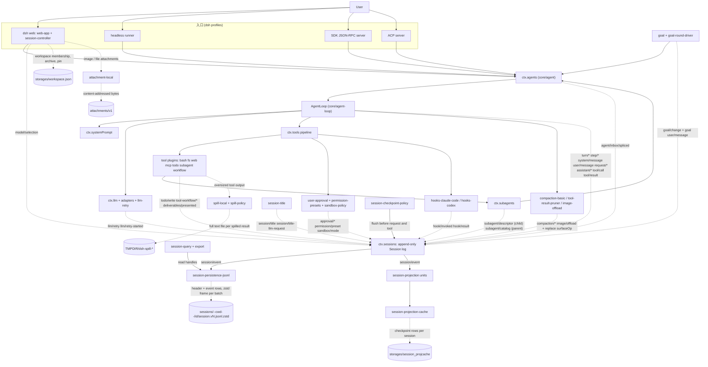
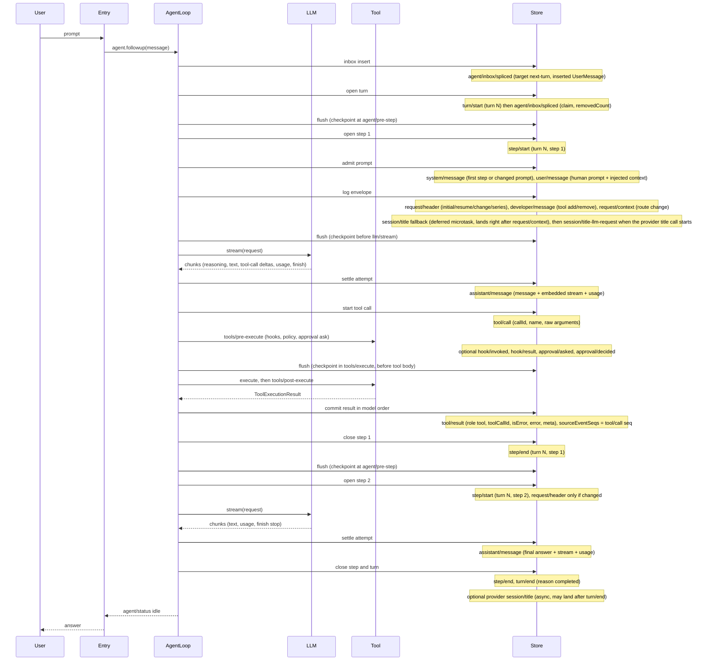
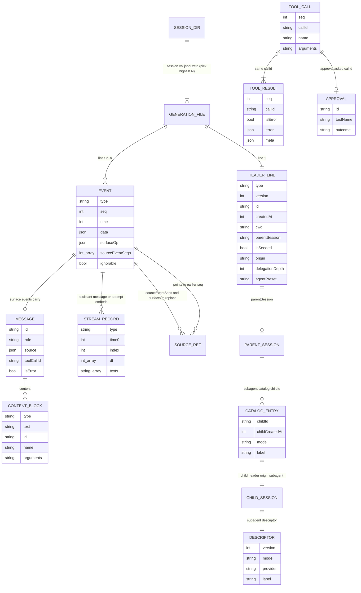

# DeepSeek Harness（deepseek-ai/deepseek-harness）会话与轨迹数据分析

## 0. 元信息

| 项 | 值 |
| --- | --- |
| 仓库 | GitHub `deepseek-ai/deepseek-harness`，默认分支 `master` |
| 分析 commit | `639ed015397290b3745d163aafe02ffee4aa3f84`（2026-09-29，`release-dsh-0.2.0-rc.2` 合并） |
| HEAD 产品版本 | `@deepseek-ai/dsh` `0.2.0-rc.2`（[apps/cli/package.json:4](https://github.com/deepseek-ai/deepseek-harness/blob/639ed015397290b3745d163aafe02ffee4aa3f84/apps/cli/package.json#L4)） |
| HEAD 会话格式（writer） | `SESSION_FORMAT_VERSION = 4`（[packages/core/session/src/types.ts:89](https://github.com/deepseek-ai/deepseek-harness/blob/639ed015397290b3745d163aafe02ffee4aa3f84/packages/core/session/src/types.ts#L89)） |
| 本机安装版本 | `@deepseek-ai/dsh` `0.1.1-rc.2`（`~/.local/lib/node_modules/@deepseek-ai/dsh/package.json`），写出会话格式 **v0** |
| 语言 / 框架 | TypeScript（ESM），vendored Cordis 插件框架（一切皆插件：loop、LLM、工具、会话日志、持久化都可替换）；另有 Python SDK（`python/`，通过 `dsh --profile sdk` 子进程工作） |
| 分析方法 | ① 读 HEAD 源码与 `docs/`、`.agents/notes/`、生成的 [persistence-catalog.md](https://github.com/deepseek-ai/deepseek-harness/blob/639ed015397290b3745d163aafe02ffee4aa3f84/docs/persistence-catalog.md)；② 读本机 0.1.1-rc.2 的编译产物与 README；③ 用 `zstdcat` 流式解压本机 `~/.dsh/sessions/**/session.jsonl.zstd`，Python 只统计 key 集合 / 类型分布 / 计数，不输出正文；④ 不运行 dsh、不联网、不改任何文件 |
| 隐私处理 | 报告不含任何对话正文、工具输出、文件内容；用户名写作 `~`（会话目录名中写作 `<user>`，因为 `~` 在 projectKey 里是转义前缀），项目名写作 `<project>`；未打开 `~/.dsh/.credentials.yaml`，`settings.yaml` 只看了键名 |

会话格式与产品版本的对应关系（来自仓库内的发布档案 [manifest.json](https://github.com/deepseek-ai/deepseek-harness/blob/639ed015397290b3745d163aafe02ffee4aa3f84/docs/persistence-changes/releases/manifest.json) 与 [historical-formats/README.md](https://github.com/deepseek-ai/deepseek-harness/blob/639ed015397290b3745d163aafe02ffee4aa3f84/docs/persistence-changes/historical-formats/README.md)）：

| 产品 tag | 会话格式 | 物理文件名 | 关键形态 |
| --- | --- | --- | --- |
| `dsh-v0.0.1-rc.1` … `dsh-v0.1.2-rc.1`（含本机 `0.1.1-rc.2`） | v0 | `session.jsonl[.zstd]` | 流式增量是独立事件 `assistant/chunk`，物理上可打包成 `text-chunks`/`reasoning-chunks`/`tool-call-chunks` 行；system prompt 在 `request/header.header.system`；tool 结果是 `role:'user'` + `tool-result` 块 |
| （采集的 alpha/RC 发布档案中没有写 v1 的 tag；格式快照取自 PR #3349 相关中间源码树，代码仍按已发布格式兼容） | v1 | `session.v1.jsonl[.zstd]` | 与 v0 同布局，仅版本号不同 |
| `dsh-v0.1.3-alpha.1` / `alpha.2` | v2 | `session.v2.jsonl[.zstd]` | 增量流改为嵌入 `assistant/message.data.stream`；新增 `assistant/attempt`；header 改 `isSeeded` |
| `dsh-v0.1.5-alpha.1` … `dsh-v0.1.5-rc.2` | v3 | `session.v3.jsonl[.zstd]` | system prompt 变成 `system/message` 事件；`surfaceOp.replace` 端点改名 `startSeq/endSeq`；PTC 事件改名；新增 `subagent/catalog`、`image/offload`、`deliverables/presented` |
| HEAD（0.2.0-rc.2） | v4 | `session.v4.jsonl[.zstd]` | tool 结果改为 `role:'tool'` 扁平消息；message source 的 `plugin` 包装改为直接 `kind`；新增 `developer/message`、`workspace/changes`；迁移为缺目录项的子代理在父会话尾部补写 `subagent/catalog`（该事件 v3 已有） |

注意：仓库的发布记录仍写着 `latestReleasedVersion: 3`（[docs/session-format-status.md](https://github.com/deepseek-ai/deepseek-harness/blob/639ed015397290b3745d163aafe02ffee4aa3f84/docs/session-format-status.md)），而 v4 只是「finalized」。0.1.6～0.2.0-rc.2 之间哪个发布版首次写出 v4，仓库内没有可核对记录（见文末「附：待确认事项」）。

## 1. 结构图与一次 chat 的数据流

### 1.1 组件表

DSH 的产品形态都是 `dsh --profile <name>` 启动的一棵 Cordis 插件树：`web`、`headless`、`sdk`、`sdk-minimal`、`acp` 五个 profile 共享 `dsh-base` bundle（除 `sdk-minimal`），持久化、LLM、工具、审批全部来自 base（[docs/architecture.md](https://github.com/deepseek-ai/deepseek-harness/blob/639ed015397290b3745d163aafe02ffee4aa3f84/docs/architecture.md)）。

| 组件 / 插件 | 职责 | 源码位置 | 写出的记录（持久化事件类型） |
| --- | --- | --- | --- |
| `dsh` 启动器 | 选择 profile、叠加 patch 层、启动插件树 | `apps/cli` | 无（不直接写会话） |
| Web 入口（`dsh web`） | 浏览器 UI + RPC；`session.create` 生成 `session-<uuid>`、按 workspace 路径定 cwd；fork | `packages/bundle/web-app`、`packages/api/session-controller`（[commands.ts:109](https://github.com/deepseek-ai/deepseek-harness/blob/639ed015397290b3745d163aafe02ffee4aa3f84/packages/api/session-controller/src/commands.ts#L109)） | `model/selection`；fork 时写子会话种子；`storages/workspace.json` |
| Headless 入口 | 一次性任务，`--json` 输出 NDJSON 事件流，`--session-id` 续聊 | `packages/bundle/headless`（[index.ts:342](https://github.com/deepseek-ai/deepseek-harness/blob/639ed015397290b3745d163aafe02ffee4aa3f84/packages/bundle/headless/src/index.ts#L342)） | 通过 agent loop 写普通事件 |
| SDK 入口 | JSON-RPC over stdio；`session.event` 通知原样转发 `SessionEvent` | `packages/sdk/{protocol,server,client}`、`python/` | 同上 |
| ACP 入口 | 自动化客户端（Agent Client Protocol） | `packages/acp/acp` | 同上 |
| Agent 注册表 `ctx.agents` | 创建 / resume / fork Agent；inbox | `packages/core/agent` | `agent/inbox/spliced` |
| Agent loop `ctx.agentLoop` | turn/step 驱动、请求组装、流式、工具调度、失败收尾 | `packages/core/agent-loop`（[agent.ts](https://github.com/deepseek-ai/deepseek-harness/blob/639ed015397290b3745d163aafe02ffee4aa3f84/packages/core/agent-loop/src/agent.ts)、[tool-calls.ts](https://github.com/deepseek-ai/deepseek-harness/blob/639ed015397290b3745d163aafe02ffee4aa3f84/packages/core/agent-loop/src/tool-calls.ts)） | `turn/*`、`step/*`、`system/message`、`user/message`、`request/header`、`request/context`、`developer/message`、`assistant/message`、`assistant/attempt`、`tool/call`、`tool/result` |
| 会话日志 `ctx.sessions` | 内存中的 append-only `SessionEvent` 日志，分配 `seq`/`time`，`session/event` 广播 | `packages/core/session`（[index.ts:722](https://github.com/deepseek-ai/deepseek-harness/blob/639ed015397290b3745d163aafe02ffee4aa3f84/packages/core/session/src/index.ts#L722)） | 所有事件的唯一入口；`session/end-seed` |
| 持久化后端 | 把 `session/event` 批量追加到 `session.vN.jsonl.zstd` | `packages/session/session-persistence`（抽象）+ `session-persistence-jsonl`（实现） | 物理文件 |
| Checkpoint 策略 | 模型请求前、顶层工具执行前、下一 step 前强制 flush | `packages/session/session-checkpoint-policy` | 无新事件（只触发 flush） |
| LLM 运行时与适配器 | provider 路由、流式 chunk、usage、replayState | `packages/llm/llm`、`llm-deepseek(-api-key/-account)`、`llm-pi-ai` | 由 loop 写入 `assistant/*` |
| LLM 重试 | 失败后按策略重试 | `packages/llm/llm-retry` | `llm/retry`、`llm/retry-started` |
| 系统提示组装 | prompt section + tool schema 组装 | `packages/core/system-prompt` | 由 loop 写 `system/message` / `request/header` |
| 工具管线 `ctx.tools` | pre/execute/post 三段 waterfall，PTC（`run_code`） | `packages/core/tools` | `tool/ptc-dispatch-start`、`tool/ptc-dispatch` |
| 具体工具 | bash/pwsh、fs（read/edit/write/grep/glob）、web、mcp、todo、goal、subagent、workflow、jobs… | `packages/shell`、`fs`、`web`、`mcp`、`todo`、`goal`、`subagent`、`workflow`、`jobs` | `tool/result.meta`、`todo/write`、`goal/change`、`tool-workflow/*`、`deliverables/presented` 等 |
| 审批 / 权限 / 沙箱 | 询问用户、权限预设、沙箱模式 | `packages/interaction/user-approval`、`permission-presets`、`packages/sandbox/sandbox-policy` | `approval/asked`、`approval/decided`、`approval/policy`、`permission/preset`、`sandbox/mode` |
| Hooks 桥 | 兼容 Claude Code / Codex hook 协议 | `packages/hooks/hooks-claude-code`、`hooks-codex` | `hook/invoked`、`hook/result` |
| 压缩 | 摘要压缩、工具结果裁剪、图片下放 | `packages/compaction/compaction-basic`、`compaction-tool-result-pruner`、`compaction-image-offload` | `compaction/start\|summary\|end\|prune`、`image/offload`、替换型 `user/message` / `tool/result` |
| Goal | 同会话目标与自动续轮 | `packages/goal/goal`、`goal-round-driver` | `goal/change`；续轮 `user/message`（`source.kind:'goal'`） |
| 子代理 | spawn / fork / 外部产品子代理；父子目录 | `packages/subagent/*` | 子会话 header + `subagent/descriptor`；父会话 `subagent/catalog`、`subagent-settled` 通知 |
| 标题 | 回退标题 + LLM 标题 | `packages/session/session-title(-first-prompt-llm)` | `session/title`、`session/title-llm-request` |
| 投影 / 缓存 | 从日志折叠出统计、token、标题等；落盘为缓存 | `packages/session/session-projection`、`session-projection-cache`、`session-stats`、`packages/llm/token-meter` | `storages/session_projcache/...`（非日志） |
| 查询 / 导出 | 精确读、FTS 搜索（默认关闭）、ZIP 导出 | `packages/session-query/*` | SQLite（默认 `:memory:` 且不打开） |
| Spill / 附件 | 超大工具输出落临时文件；图片与文件附件内容寻址存储 | `packages/spill/*`、`packages/attachment/*` | `$TMPDIR/dsh-spill-*`、`$DSH_HOME/attachments/v1` |
| 上报 | 会话日志随官方 DeepSeek 请求增量上传；OTel 仅反馈触发 | `packages/session/session-log-deepseek`、`session-telemetry-otel` | `session-log-deepseek/delivery-accepted`、`feedback/*` |

### 1.2 图 1：结构图



### 1.3 图 2：一次 chat 的时序（HEAD，v4）

下图对应「用户提问 → 模型调用一次工具 → 模型给出最终回答」。顺序依据 [agent.ts](https://github.com/deepseek-ai/deepseek-harness/blob/639ed015397290b3745d163aafe02ffee4aa3f84/packages/core/agent-loop/src/agent.ts) 中 `turn()`（L296）、`step()`（L398）、`buildRequest()`（L599）与 [tool-calls.ts](https://github.com/deepseek-ai/deepseek-harness/blob/639ed015397290b3745d163aafe02ffee4aa3f84/packages/core/agent-loop/src/tool-calls.ts) 的 append 调用；「写入 Store」指追加到内存日志并由持久化后端在 ≤200 ms 批处理窗口或显式 flush 时落盘。



## 2. 存储布局

### 2.1 根目录与覆盖方式

| 层 | 规则 | 依据 |
| --- | --- | --- |
| Harness home | 显式配置 > `$DSH_HOME`（空白视为未设置）> `~/.dsh` | [home-paths/src/index.ts:87](https://github.com/deepseek-ai/deepseek-harness/blob/639ed015397290b3745d163aafe02ffee4aa3f84/packages/util/home-paths/src/index.ts#L87)、[L98](https://github.com/deepseek-ai/deepseek-harness/blob/639ed015397290b3745d163aafe02ffee4aa3f84/packages/util/home-paths/src/index.ts#L98) |
| 会话根 | base bundle 行 `session-persistence-jsonl.config.root = dshHomePath('sessions')`，`compression` 默认 `'zstd'` | [cordis.patch.yml:130-133](https://github.com/deepseek-ai/deepseek-harness/blob/639ed015397290b3745d163aafe02ffee4aa3f84/packages/bundle/base/cordis.patch.yml#L130)、[session-persistence-jsonl/src/index.ts:68](https://github.com/deepseek-ai/deepseek-harness/blob/639ed015397290b3745d163aafe02ffee4aa3f84/packages/session/session-persistence-jsonl/src/index.ts#L68)、[L87](https://github.com/deepseek-ai/deepseek-harness/blob/639ed015397290b3745d163aafe02ffee4aa3f84/packages/session/session-persistence-jsonl/src/index.ts#L87) |
| 非会话 KV | `storage-json.config.root = dshHomePath('storages')` | [cordis.patch.yml:168-171](https://github.com/deepseek-ai/deepseek-harness/blob/639ed015397290b3745d163aafe02ffee4aa3f84/packages/bundle/base/cordis.patch.yml#L168) |
| Profile 覆盖 | 层叠顺序：bundle patch → `$DSH_HOME/profiles/<name>/cordis.patch.yml` → `$DSH_HOME/cordis.patch.yml` → `--patch`；任一层可按 row id 整体替换 `session-persistence-jsonl` 的 `config`（换 root 或 `compression: 'none'`） | [docs/architecture.md](https://github.com/deepseek-ai/deepseek-harness/blob/639ed015397290b3745d163aafe02ffee4aa3f84/docs/architecture.md)、`apps/cli/README.md` |
| 本机实际 | `~/.dsh/profiles/web/cordis.patch.yml` 与 `cordis.yml` 均为空列表 `[]`，无 `~/.dsh/cordis.patch.yml`；`settings.yaml` 无会话 / 存储相关键 → 全部用默认值 | 本机核对 |

`compression: 'none'` 时文件为纯 JSONL（后缀 `.jsonl`），一个 root 只允许一种编码，不做混合或转换（[session-persistence-jsonl/README.md](https://github.com/deepseek-ai/deepseek-harness/blob/639ed015397290b3745d163aafe02ffee4aa3f84/packages/session/session-persistence-jsonl/README.md)）。

### 2.2 目录树

```text
$DSH_HOME/                                    # 默认 ~/.dsh
├── sessions/                                 # JSONL 会话根
│   ├── --<projectKey(cwd)>--/                # 例：--Users-<user>-Projects-<project>--
│   │   └── <encodeSegment(sessionId)>/       # 一个会话一个目录
│   │       ├── session.jsonl.zstd            # v0 代（本机 0.1.1-rc.2 写出）
│   │       ├── session.v4.jsonl.zstd         # v4 代（HEAD 写出；v1..v3 同理 session.vN.jsonl.zstd）
│   │       └── session.lock                  # HEAD：跨进程写租约（flock），0.1.1-rc.2 没有
│   └── _no-cwd/                              # 没有 cwd 的会话
├── storages/                                 # storage-json root
│   ├── workspace.json                        # workspace 单元（single 布局）
│   ├── session_projcache.json                # 0.1.1-rc.2：投影缓存单文件（unit v3）
│   ├── session_projcache/sessions/<id>.json  # HEAD：投影缓存 per-record（v7）
│   └── schedule.json                         # 仅在安装可选 Schedule bundle 时（默认组合不含）
├── attachments/v1/…                          # 图片 / 文件附件，内容寻址，永不自动删除
├── cache/attachments/…                       # 附件派生缓存
├── profiles/<name>/{package.json,cordis.patch.yml,node_modules,…}
├── cordis.patch.yml                          # home 级 patch（可选）
├── settings.yaml / .credentials.yaml         # 设置 / 凭据（与会话无关，勿读凭据）
└── .anonymous-user-id                        # OTel 匿名 id（HEAD，可能不存在）

$TMPDIR/dsh-spill-XXXXXX/session-<sha256(sessionId)[0:12]>/<12hex>-<name>   # 超大工具输出（进程私有临时根）
```

- **cwd 编码**（`projectKey`，[format.ts:225-245](https://github.com/deepseek-ai/deepseek-harness/blob/639ed015397290b3745d163aafe02ffee4aa3f84/packages/session/session-persistence-jsonl/src/format.ts#L225)）：`/`、`\`、`:` 连续出现时折叠为一个 `-`；`[A-Za-z0-9._-]` 原样保留（`~` 除外）；其余 UTF-16 code unit 写成 `~XXXX`（4 位大写十六进制）；去掉开头的 `-`，空则为 `root`；截断到 251 字符后包成 `--<slug>--`。**有损**：不同 cwd 可能映射到同一目录，因此 cwd 必须从 header 的 `cwd` 字段读，不要从目录名反解。没有 cwd 时用 `_no-cwd`（[L254-257](https://github.com/deepseek-ai/deepseek-harness/blob/639ed015397290b3745d163aafe02ffee4aa3f84/packages/session/session-persistence-jsonl/src/format.ts#L254)）。
- **会话目录名**（`encodeSegment`，[format.ts:199-214](https://github.com/deepseek-ai/deepseek-harness/blob/639ed015397290b3745d163aafe02ffee4aa3f84/packages/session/session-persistence-jsonl/src/format.ts#L199)）：单射转义，`[A-Za-z0-9._-]` 保留，其余（含 `~`）写成 `~XXXX`，`.`/`..` 特判。常见 id（`session-<uuid>`、`<uuid>`）转义后与原文相同。
- **代（generation）文件名**：v0 为 `session.jsonl`，vN（N≥1）为 `session.vN.jsonl`，再加压缩后缀 `.zstd`（[session-format/src/filename.ts:14-17](https://github.com/deepseek-ai/deepseek-harness/blob/639ed015397290b3745d163aafe02ffee4aa3f84/packages/session/session-format/src/filename.ts#L14)、[format.ts:58](https://github.com/deepseek-ai/deepseek-harness/blob/639ed015397290b3745d163aafe02ffee4aa3f84/packages/session/session-persistence-jsonl/src/format.ts#L58)）。运行时只认**数字最大的规范代**；HEAD 以写模式打开旧代会话时，会在同目录生成 `session.v4.jsonl.zstd`，旧代文件字节不变、永不删除（[docs/architecture.md「Session log」](https://github.com/deepseek-ai/deepseek-harness/blob/639ed015397290b3745d163aafe02ffee4aa3f84/docs/architecture.md)）。只读打开不会产生新代。
- **锁文件**：HEAD 在会话目录放 `session.lock`（POSIX `flock`，Windows 用命名信号量无文件），释放时不删除（[lease.ts:40](https://github.com/deepseek-ai/deepseek-harness/blob/639ed015397290b3745d163aafe02ffee4aa3f84/packages/session/session-persistence-jsonl/src/lease.ts#L40)）。0.1.1-rc.2 的 README 没有锁文件，本机目录中也只有 `session.jsonl.zstd`。

### 2.3 会话 ID 规则

| 来源 | 格式 | 依据 |
| --- | --- | --- |
| Web `session.create`（无指定 id） | `session-<uuid v4>` | [commands.ts:109](https://github.com/deepseek-ai/deepseek-harness/blob/639ed015397290b3745d163aafe02ffee4aa3f84/packages/api/session-controller/src/commands.ts#L109) |
| Web fork 子会话 | `session-<uuid v4>` | [commands.ts:266](https://github.com/deepseek-ai/deepseek-harness/blob/639ed015397290b3745d163aafe02ffee4aa3f84/packages/api/session-controller/src/commands.ts#L266) |
| Headless（无 `--session-id`） | `session-<uuid v4>` | [headless/src/index.ts:342](https://github.com/deepseek-ai/deepseek-harness/blob/639ed015397290b3745d163aafe02ffee4aa3f84/packages/bundle/headless/src/index.ts#L342) |
| TypeScript / Python SDK 客户端 | `session-<32 位 hex>`（uuid 去掉连字符） | [sdk/client/src/api.ts:104](https://github.com/deepseek-ai/deepseek-harness/blob/639ed015397290b3745d163aafe02ffee4aa3f84/packages/sdk/client/src/api.ts#L104)、[python/sdk/src/deepseek_harness/api.py:122](https://github.com/deepseek-ai/deepseek-harness/blob/639ed015397290b3745d163aafe02ffee4aa3f84/python/sdk/src/deepseek_harness/api.py#L122) |
| ACP `session/new` | 裸 `<uuid v4>`（顶层会话，header 无 `origin`） | [acp/src/index.ts:199](https://github.com/deepseek-ai/deepseek-harness/blob/639ed015397290b3745d163aafe02ffee4aa3f84/packages/acp/acp/src/index.ts#L199) |
| 进程内子代理（spawn / fork / continuable） | 裸 `<uuid v4>` | [subagent-in-process-driver/src/index.ts:113](https://github.com/deepseek-ai/deepseek-harness/blob/639ed015397290b3745d163aafe02ffee4aa3f84/packages/subagent/subagent-in-process-driver/src/index.ts#L113)、[subagent/src/continuation.ts:110](https://github.com/deepseek-ai/deepseek-harness/blob/639ed015397290b3745d163aafe02ffee4aa3f84/packages/subagent/subagent/src/continuation.ts#L110) |
| Webhook 触发的会话 | `webhook-<uuid v4>` | [webhook/src/session.ts:133](https://github.com/deepseek-ai/deepseek-harness/blob/639ed015397290b3745d163aafe02ffee4aa3f84/packages/webhook/webhook/src/session.ts#L133) |
| Agent loop 配置的 agent 未给 id | `<agentId>-session-<uuid v4>` | [agent-loop/src/index.ts:377](https://github.com/deepseek-ai/deepseek-harness/blob/639ed015397290b3745d163aafe02ffee4aa3f84/packages/core/agent-loop/src/index.ts#L377) |

所以本机同一项目下「`session-<uuid>` vs `<uuid>`」的区别是：前者是 Web 创建的顶层会话，后者是进程内子代理的子会话（header 带 `origin:'subagent'`、`parentSession`、`delegationDepth≥1`）；本机 25 个 `session-*` 全是顶层、54 个裸 uuid 全是子会话（§8），但这只是本机分布：ACP 创建的顶层会话也是裸 uuid。**ID 只是不透明字符串**，解析器应以 header 字段判断类型，不要依赖前缀。

### 2.4 `storages/*.json`

| 文件 | 内容 | 依据 |
| --- | --- | --- |
| `workspace.json` | `{unit:{name:'workspace',version:2}, global:{initialized, workspaceIds[], archivedSessionIds[], pinnedSessionIds[], defaultWorkspaceId?, pendingMutation?}, tables:{workspaces:{<workspaceId>:{path,title,sessionIds[],createdAt,updatedAt}}}}`；时间是 ISO-8601 字符串；`sessionIds` 顺序就是 UI 顺序；归档 / 置顶是全局集合，不在会话日志里 | [workspace/src/spec.ts:24-84](https://github.com/deepseek-ai/deepseek-harness/blob/639ed015397290b3745d163aafe02ffee4aa3f84/packages/workspace/workspace/src/spec.ts#L24) |
| `session_projcache.json`（本机 v3 单文件）/ `session_projcache/sessions/<id>.json`（HEAD per-record，`{version:7, record:{identity:{formatVersion,createdAt,cwd,isSeeded,inheritedEventCount}, rows:{<unit>:{ver,seq,val}}}}`） | 投影检查点缓存：`sessionStats`、`tokenUsage`、`title`、`contextPressure`、`subagent`、`permissions`、`todos`、`plan`、`goal`… 每行带折叠到的 `seq` 水位；**可能过期或缺失，只能当提示** | [session-projection-cache/src/spec.ts:29-108](https://github.com/deepseek-ai/deepseek-harness/blob/639ed015397290b3745d163aafe02ffee4aa3f84/packages/session/session-projection-cache/src/spec.ts#L29) |
| `schedule.json` | 定时任务；只有安装可选 Schedule bundle 时才有（shipped 组合不含该插件） | [schedule/src/storage.ts:57](https://github.com/deepseek-ai/deepseek-harness/blob/639ed015397290b3745d163aafe02ffee4aa3f84/packages/schedule/schedule/src/storage.ts#L57) |

storage-json 的 `single` 布局是一个 `<unit>.json`（原子替换写），`per-record` 布局是 `<unit>/<table>/<key>.json`，每文件 `{version, record}`（[storage-json/README.md](https://github.com/deepseek-ai/deepseek-harness/blob/639ed015397290b3745d163aafe02ffee4aa3f84/packages/storage/storage-json/README.md)）。HEAD 首次打开空的 per-record 树时会从旧 `session_projcache.json`（版本 3–6 兼容）初始化，旧文件不改。

### 2.5 SQLite 与其他辅助存储

- **SQLite（session-query-sqlite）**：base 默认 `path: ':memory:'`、`openAt: never`，即**默认不建任何磁盘数据库**，搜索调用直接失败（[cordis.patch.yml:149-153](https://github.com/deepseek-ai/deepseek-harness/blob/639ed015397290b3745d163aafe02ffee4aa3f84/packages/bundle/base/cordis.patch.yml#L149)）。用户在 patch 中打开时才有派生库：`persisted_sessions`（id、version、created_at、cwd、parent_session、seed_length、delegation_depth、agent_preset、revision…）+ FTS5 表 `persisted_docs(text, session_id, seq, type, time, surface, codepoint_length)`，`SCHEMA_VERSION = 8`（[schema.ts:8](https://github.com/deepseek-ai/deepseek-harness/blob/639ed015397290b3745d163aafe02ffee4aa3f84/packages/session-query/session-query-sqlite/src/schema.ts#L8)、[L113-137](https://github.com/deepseek-ai/deepseek-harness/blob/639ed015397290b3745d163aafe02ffee4aa3f84/packages/session-query/session-query-sqlite/src/schema.ts#L113)）。它只是索引，权威数据仍是 JSONL。
- **Spill（超大工具输出外置）**：`spill-policy` 的 `maxInlineTokens: 12500`（HEAD，[cordis.patch.yml:407-410](https://github.com/deepseek-ai/deepseek-harness/blob/639ed015397290b3745d163aafe02ffee4aa3f84/packages/bundle/base/cordis.patch.yml#L407)；0.1.1-rc.2 为 `maxInlineBytes: 50000`）。超限结果在日志里只保留头尾预览 + 一行 `(Omitted N bytes. Full formatted result stored at: <path> …)`；全文写到进程私有临时根 `$TMPDIR/dsh-spill-*/session-<sha256(id) 前 12 位>/<随机 12 hex>-<名字>`（[spill-local/src/store.ts:36-81](https://github.com/deepseek-ai/deepseek-harness/blob/639ed015397290b3745d163aafe02ffee4aa3f84/packages/spill/spill-local/src/store.ts#L36)），启动时按 `cleanupPeriodDays` 清理。**不在 `~/.dsh` 下，不保证长期存在。**
- **附件**：图片 / 文件以内容寻址存到 `$DSH_HOME/attachments/v1`，日志里只存 `ImageAttachmentRef` / `FileAttachmentRef`（[attachment-local/src/index.ts:176](https://github.com/deepseek-ai/deepseek-harness/blob/639ed015397290b3745d163aafe02ffee4aa3f84/packages/attachment/attachment-local/src/index.ts#L176)）。本机没有 `attachments/` 目录。

### 2.6 HEAD 与本机版本差异（存储层）

| 方面 | 0.1.1-rc.2（本机） | HEAD 0.2.0-rc.2 |
| --- | --- | --- |
| 日志文件 | `session.jsonl.zstd`（v0） | `session.v4.jsonl.zstd`；旧代保留 |
| header | `seedLength?`（无 `isSeeded`） | `isSeeded`（必填）；继承切点由最后一个 `session/end-seed{inherited:true}` 推出 |
| 流式增量 | 独立 `assistant/chunk` 事件 + 打包行 | 嵌入 `assistant/message.stream` / `assistant/attempt.stream` |
| 批处理窗口 | `writeBatchMaxDelayMs` 可配，默认 200 | 内部常量 200 ms，不可配 |
| 写锁 | 进程内 claim | 进程内 claim + `session.lock`（flock） |
| 投影缓存 | `storages/session_projcache.json`（单文件 v3） | `storages/session_projcache/sessions/<id>.json`（per-record v7） |
| workspace.json | v2，`archivedSessionIds` | v2，另有 `pinnedSessionIds`、`defaultWorkspaceId` |

## 3. 记录 schema

### 3.1 物理行：header + 事件行

每个代文件是 JSONL：**第 1 行是 header，其后每行一条记录**。zstd 模式下文件是若干独立 zstd 帧的拼接：第一帧只含 header 行，之后每个持久化批次一帧，每帧都带 checksum；例外是从旧代迁移发布的新代，它由 header 帧 + 一个包含全部迁移事件的大帧组成，之后追加的批次才一批一帧（[generation.ts:746-765](https://github.com/deepseek-ai/deepseek-harness/blob/639ed015397290b3745d163aafe02ffee4aa3f84/packages/session/session-persistence-jsonl/src/generation.ts#L746)）（[session-persistence-jsonl/README.md「Physical encoding」](https://github.com/deepseek-ai/deepseek-harness/blob/639ed015397290b3745d163aafe02ffee4aa3f84/packages/session/session-persistence-jsonl/README.md)）。`zstd -dc` 可直接流式解出完整 JSONL。

**HEAD v4 header 行**（[format.ts:83-96](https://github.com/deepseek-ai/deepseek-harness/blob/639ed015397290b3745d163aafe02ffee4aa3f84/packages/session/session-persistence-jsonl/src/format.ts#L83)；编码器 [session-format-v1-to-v2/src/codec.ts:155-176](https://github.com/deepseek-ai/deepseek-harness/blob/639ed015397290b3745d163aafe02ffee4aa3f84/packages/session/session-format-v1-to-v2/src/codec.ts#L155)）：

```ts
interface HeaderLine {
  type: 'session'
  version: number            // 4
  id: SessionId
  createdAt: number          // epoch ms
  cwd?: string               // 绝对路径
  parentSession?: SessionId  // fork 来源或子代理父会话
  isSeeded: boolean          // 是否含 fork 继承前缀
  origin?: 'subagent'
  delegationDepth: number    // 顶层 0，子代理 = 父 + 1
  agentPreset?: string
}
```

**v0 header 行**（本机）：必填 `type, version(0), id, createdAt, delegationDepth`，可选 `cwd, parentSession, seedLength, origin, agentPreset`（[session-format-v0-to-v1/src/codec.ts:21-22](https://github.com/deepseek-ai/deepseek-harness/blob/639ed015397290b3745d163aafe02ffee4aa3f84/packages/session/session-format-v0-to-v1/src/codec.ts#L21)）。

**事件信封**（逻辑与物理相同，[types.ts:493-516](https://github.com/deepseek-ai/deepseek-harness/blob/639ed015397290b3745d163aafe02ffee4aa3f84/packages/core/session/src/types.ts#L493)）：

| 字段 | 类型 | 说明 |
| --- | --- | --- |
| `type` | string | 事件类型（`SessionEventMap` 的 key，可由插件合并扩展） |
| `seq` | int ≥ 0 | 会话内从 0 起**连续**的序号；`seq = log.length`（[index.ts:746](https://github.com/deepseek-ai/deepseek-harness/blob/639ed015397290b3745d163aafe02ffee4aa3f84/packages/core/session/src/index.ts#L746)） |
| `time` | int | `Date.now()` epoch 毫秒（[index.ts:747](https://github.com/deepseek-ai/deepseek-harness/blob/639ed015397290b3745d163aafe02ffee4aa3f84/packages/core/session/src/index.ts#L747)） |
| `data` | JSON | 事件载荷（append 时校验必须是无损 JSON） |
| `ignorable?` | `true` | 读者不认识该类型时可跳过；缺省 = 必需，未知必需事件必须拒读 |
| `surfaceOp?` | `'append'` 或 `{op:'replace', startSeq, endSeq}` | 5 种 surface 事件上必填、其他事件禁止（v3+ 格式强制；v0–v2 在 surface 事件上也可缺省）（[types.ts:439-464](https://github.com/deepseek-ai/deepseek-harness/blob/639ed015397290b3745d163aafe02ffee4aa3f84/packages/core/session/src/types.ts#L439)、[L467-471](https://github.com/deepseek-ai/deepseek-harness/blob/639ed015397290b3745d163aafe02ffee4aa3f84/packages/core/session/src/types.ts#L467)）；v0–v2 的 replace 端点名为 `start/end` |
| `sourceEventSeqs?` | int[] | 该 surface 事件引用的更早事件（工具结果 → 其 `tool/call`；压缩检查点 → 被替换区间）；v2+ 物理上把连续 ≥3 个序号压成 `[start,end]` 对，v0/v1 也接受 range 对（本机未出现）（[codec.ts:217-232](https://github.com/deepseek-ai/deepseek-harness/blob/639ed015397290b3745d163aafe02ffee4aa3f84/packages/session/session-format-v1-to-v2/src/codec.ts#L217)）；`assistant/message` 自 v2 起不再引用 chunk，v3+ 格式上禁止携带 |

**v0 打包行**（只在 v0/v1 存在，[session-format-v0-to-v1/src/codec.ts:203-295](https://github.com/deepseek-ai/deepseek-harness/blob/639ed015397290b3745d163aafe02ffee4aa3f84/packages/session/session-format-v0-to-v1/src/codec.ts#L203)）：`{type:'text-chunks'|'reasoning-chunks', seq0, time0, data:{turn, step, index, dt[], texts[]}}` 或 `{type:'tool-call-chunks', seq0, time0, data:{turn, step, index, id, name?, dt[], args[]}}`。一行代表 `texts.length`（或 `args.length`）个连续的 `assistant/chunk` 事件：第 i 个的 `seq = seq0 + i`，`time = time0 + dt[0] + … + dt[i-1]`，`dt.length = n - 1`；分别还原为 `text-delta` / `reasoning-delta` / `tool-call-delta` chunk。0.1.1-rc.2 README 说明只有 ≥3 个同块连续增量才打包（`packChunks` 默认开）。

### 3.2 核心事件（HEAD v4，`SessionEventMap`，[types.ts:281-428](https://github.com/deepseek-ai/deepseek-harness/blob/639ed015397290b3745d163aafe02ffee4aa3f84/packages/core/session/src/types.ts#L281)）

| 类型 | surface? | `data` 字段 | 行号 |
| --- | --- | --- | --- |
| `turn/start` | 否 | `{turn}` | [L288](https://github.com/deepseek-ai/deepseek-harness/blob/639ed015397290b3745d163aafe02ffee4aa3f84/packages/core/session/src/types.ts#L288) |
| `turn/end` | 否 | `{turn, reason: TurnEndReason}` | [L297](https://github.com/deepseek-ai/deepseek-harness/blob/639ed015397290b3745d163aafe02ffee4aa3f84/packages/core/session/src/types.ts#L297) |
| `step/start` / `step/end` | 否 | `{turn, step}` | [L299](https://github.com/deepseek-ai/deepseek-harness/blob/639ed015397290b3745d163aafe02ffee4aa3f84/packages/core/session/src/types.ts#L299)、[L301](https://github.com/deepseek-ai/deepseek-harness/blob/639ed015397290b3745d163aafe02ffee4aa3f84/packages/core/session/src/types.ts#L301) |
| `user/message` | 是 | `UserMessage`（data 本身就是消息） | [L309](https://github.com/deepseek-ai/deepseek-harness/blob/639ed015397290b3745d163aafe02ffee4aa3f84/packages/core/session/src/types.ts#L309) |
| `developer/message` | 是 | `{turn, step, message: DeveloperMessage, headerSeq?}`（工具增删） | [L311](https://github.com/deepseek-ai/deepseek-harness/blob/639ed015397290b3745d163aafe02ffee4aa3f84/packages/core/session/src/types.ts#L311) |
| `system/message` | 是 | `{turn, step, message: SystemMessage}` | [L330](https://github.com/deepseek-ai/deepseek-harness/blob/639ed015397290b3745d163aafe02ffee4aa3f84/packages/core/session/src/types.ts#L330) |
| `assistant/message` | 是 | `{turn, step, message: AssistantMessage, stream: AssistantStreamRecord[], usage?: TokenUsage, interrupted?: true}` | [L341-349](https://github.com/deepseek-ai/deepseek-harness/blob/639ed015397290b3745d163aafe02ffee4aa3f84/packages/core/session/src/types.ts#L341) |
| `assistant/attempt` | 否 | `{turn, step, stream}`（失败 / 重试 / 取消的尝试，不进模型历史） | [L355](https://github.com/deepseek-ai/deepseek-harness/blob/639ed015397290b3745d163aafe02ffee4aa3f84/packages/core/session/src/types.ts#L355) |
| `tool/call` | 否 | `{turn, step, callId, name, arguments}`（`arguments` 为模型原样 JSON 字符串） | [L361](https://github.com/deepseek-ai/deepseek-harness/blob/639ed015397290b3745d163aafe02ffee4aa3f84/packages/core/session/src/types.ts#L361) |
| `tool/result` | 是 | `{turn, step, message: ToolResultMessage, error?: {name, code, reason?}, meta?: JsonValue}` | [L375-385](https://github.com/deepseek-ai/deepseek-harness/blob/639ed015397290b3745d163aafe02ffee4aa3f84/packages/core/session/src/types.ts#L375) |
| `request/header` | 否 | `{header: EpochHeader, reason: 'initial'\|'resume'\|'change'\|'series', startsSeries?: true}` | [L390-395](https://github.com/deepseek-ai/deepseek-harness/blob/639ed015397290b3745d163aafe02ffee4aa3f84/packages/core/session/src/types.ts#L390) |
| `request/context` | 否 | `{provider, model, contextWindow?, systemPromptUpdate?}` | [L402](https://github.com/deepseek-ai/deepseek-harness/blob/639ed015397290b3745d163aafe02ffee4aa3f84/packages/core/session/src/types.ts#L402) |
| `session/end-seed` | 否 | `{inherited?: true}` | [L427](https://github.com/deepseek-ai/deepseek-harness/blob/639ed015397290b3745d163aafe02ffee4aa3f84/packages/core/session/src/types.ts#L427) |

`EpochHeader = {config: LlmCallConfig, adapterDefaults?, tools?: ToolSchema[], system?: never}`（[types.ts:240-251](https://github.com/deepseek-ai/deepseek-harness/blob/639ed015397290b3745d163aafe02ffee4aa3f84/packages/core/session/src/types.ts#L240)）；`LlmCallConfig` 含 `provider, model, reasoningEffort?` 与采样标量（[llm/src/call-config.ts:23](https://github.com/deepseek-ai/deepseek-harness/blob/639ed015397290b3745d163aafe02ffee4aa3f84/packages/llm/llm/src/call-config.ts#L23)）。

`TurnEndReason`（[types.ts:201-229](https://github.com/deepseek-ai/deepseek-harness/blob/639ed015397290b3745d163aafe02ffee4aa3f84/packages/core/session/src/types.ts#L201)）：`completed`、`aborted{reason:{kind:'user'|'parent'|'hook'(reason)|'disposed'|'legacy'}}`、`blocked`、`error{error: LlmFailure}`、`max-tokens`、`interrupted`（崩溃后补写，loop 从不实时写）、`forked`（只在 fork 种子里）。

### 3.3 插件事件（HEAD v4 全集，来源见 [persistence-catalog.md](https://github.com/deepseek-ai/deepseek-harness/blob/639ed015397290b3745d163aafe02ffee4aa3f84/docs/persistence-catalog.md)）

除 `image/offload`（消息投影：改写后续请求中被选中的图片块，不新增消息，[projection.ts:18-25](https://github.com/deepseek-ai/deepseek-harness/blob/639ed015397290b3745d163aafe02ffee4aa3f84/packages/compaction/compaction-image-offload/src/projection.ts#L18)）外，全部是 log-only（不进模型历史）：

| 类型 | `data` 要点 | 定义 |
| --- | --- | --- |
| `agent/inbox/spliced` | `{target:'next-turn'\|'next-step', start, removedCount?, inserted: UserMessage[], outcome?:'canceled'}` | [core/agent/src/types.ts:96](https://github.com/deepseek-ai/deepseek-harness/blob/639ed015397290b3745d163aafe02ffee4aa3f84/packages/core/agent/src/types.ts#L96) |
| `agent-preset/selected` | `{agentPreset}` | [agent-preset-registry/src/session.ts:28](https://github.com/deepseek-ai/deepseek-harness/blob/639ed015397290b3745d163aafe02ffee4aa3f84/packages/preset/agent-preset-registry/src/session.ts#L28) |
| `approval/asked` / `approval/decided` | `{id, toolName, callId?, reason?}` / `{id, outcome:'allowed-once'\|'rejected'\|'cancelled'\|'unavailable'}` | [user-approval/src/types.ts:32-55](https://github.com/deepseek-ai/deepseek-harness/blob/639ed015397290b3745d163aafe02ffee4aa3f84/packages/interaction/user-approval/src/types.ts#L32) |
| `approval/policy` | `{policy:'ask'\|'never', source?:'delegation'}` | [user-approval/src/index.ts:40](https://github.com/deepseek-ai/deepseek-harness/blob/639ed015397290b3745d163aafe02ffee4aa3f84/packages/interaction/user-approval/src/index.ts#L40) |
| `sandbox/mode` | `{mode:'read-only'\|'workspace-write'\|'danger-full-access', source?}` | [sandbox-policy/src/session-mode.ts:33](https://github.com/deepseek-ai/deepseek-harness/blob/639ed015397290b3745d163aafe02ffee4aa3f84/packages/sandbox/sandbox-policy/src/session-mode.ts#L33) |
| `permission/preset` | `{preset}` | [permission-presets/src/index.ts:59](https://github.com/deepseek-ai/deepseek-harness/blob/639ed015397290b3745d163aafe02ffee4aa3f84/packages/interaction/permission-presets/src/index.ts#L59) |
| `command/run` / `command/done` | `{commandId, name, args?, source}` / `{commandId, kind:'success'\|'error', text?, sourceEventSeq?}` | [commands/src/types.ts:105-112](https://github.com/deepseek-ai/deepseek-harness/blob/639ed015397290b3745d163aafe02ffee4aa3f84/packages/interaction/commands/src/types.ts#L105) |
| `compaction/start\|end` | `{compactionId, sourceCommandId?, turn:number\|null, error?}` | [compaction/src/types.ts:24](https://github.com/deepseek-ai/deepseek-harness/blob/639ed015397290b3745d163aafe02ffee4aa3f84/packages/compaction/compaction/src/types.ts#L24)、[L72](https://github.com/deepseek-ai/deepseek-harness/blob/639ed015397290b3745d163aafe02ffee4aa3f84/packages/compaction/compaction/src/types.ts#L72) |
| `compaction/summary` | `{compactionId, summary: ContentBlock[], shadowedRange, shadowedSeqs, shadowedTokenCount, provider, model, maxTokens?, usage?, rawOutput?, llmStreamCall?}` | [compaction/src/types.ts:34](https://github.com/deepseek-ai/deepseek-harness/blob/639ed015397290b3745d163aafe02ffee4aa3f84/packages/compaction/compaction/src/types.ts#L34) |
| `compaction/prune` | `{shadowedRange, shadowedSeqs, shadowedTokenCount}` | [compaction/src/types.ts:82](https://github.com/deepseek-ai/deepseek-harness/blob/639ed015397290b3745d163aafe02ffee4aa3f84/packages/compaction/compaction/src/types.ts#L82) |
| `image/offload` | `{targets: ImageOffloadTarget[]}` | [compaction-image-offload/src/projection.ts:25](https://github.com/deepseek-ai/deepseek-harness/blob/639ed015397290b3745d163aafe02ffee4aa3f84/packages/compaction/compaction-image-offload/src/projection.ts#L25) |
| `goal/change` | `{kind:'goal/change', version:1, operation, goal, roundsStarted, createdAt, updatedAt}`；清除时为 `{kind, version:1, operation:'clear', cleared, clearedAt}` | [goal/src/domain.ts:24-66](https://github.com/deepseek-ai/deepseek-harness/blob/639ed015397290b3745d163aafe02ffee4aa3f84/packages/goal/goal/src/domain.ts#L24) |
| `hook/invoked` / `hook/result` | `{turn, point, dialect, matcher?, handlerId}` / `{turn, point, handlerId, decision, exitCode?, stderrSummary?, durationMs}` | [hook-protocol/src/types.ts:19-31](https://github.com/deepseek-ai/deepseek-harness/blob/639ed015397290b3745d163aafe02ffee4aa3f84/packages/hooks/hook-protocol/src/types.ts#L19) |
| `llm/retry` / `llm/retry-started` | `{retryId, turn, step, provider, mode, policyKey, retry, maxRetries?, delayMs, failure}` / `{retryId, turn, step, retry}` | [llm-retry/src/types.ts:9-38](https://github.com/deepseek-ai/deepseek-harness/blob/639ed015397290b3745d163aafe02ffee4aa3f84/packages/llm/llm-retry/src/types.ts#L9) |
| `model/selection` | `{provider, model, reasoningEffort?}` | [session-controller/src/types.ts:40](https://github.com/deepseek-ai/deepseek-harness/blob/639ed015397290b3745d163aafe02ffee4aa3f84/packages/api/session-controller/src/types.ts#L40) |
| `plan/mode` | `{active}` | [plan-mode/src/index.ts:53](https://github.com/deepseek-ai/deepseek-harness/blob/639ed015397290b3745d163aafe02ffee4aa3f84/packages/plan/plan-mode/src/index.ts#L53) |
| `schedule/change` | 版本化的 schedule 变更 | [schedule/src/types.ts:358](https://github.com/deepseek-ai/deepseek-harness/blob/639ed015397290b3745d163aafe02ffee4aa3f84/packages/schedule/schedule/src/types.ts#L358) |
| `session/title` | `{title, messageSeqs[], source:{kind:'fallback'}\|{kind:'provider', provider, model?}\|{kind:'user'}}` | [session-title/src/types.ts:28-48](https://github.com/deepseek-ai/deepseek-harness/blob/639ed015397290b3745d163aafe02ffee4aa3f84/packages/session/session-title/src/types.ts#L28) |
| `session/title-llm-request` | 标题请求的 route、system、messages、maxTokens（发送前记录） | [session-title-llm/src/index.ts:52](https://github.com/deepseek-ai/deepseek-harness/blob/639ed015397290b3745d163aafe02ffee4aa3f84/packages/session/session-title-llm/src/index.ts#L52) |
| `session-log-deepseek/delivery-accepted` | `{sessionId, sessionFormatVersion?, throughSeq}` | [session-log-deepseek/src/types.ts:81](https://github.com/deepseek-ai/deepseek-harness/blob/639ed015397290b3745d163aafe02ffee4aa3f84/packages/session/session-log-deepseek/src/types.ts#L81) |
| `subagent/descriptor` | `{version:3, mode:'one-shot'\|'continuable', provider, label?, agentProvider?, agentModel?, agentReasoningEffort?, persona?, toolFilter?}`（子会话里） | [subagent/src/descriptor.ts:38-91](https://github.com/deepseek-ai/deepseek-harness/blob/639ed015397290b3745d163aafe02ffee4aa3f84/packages/subagent/subagent/src/descriptor.ts#L38) |
| `subagent/catalog` | `{version:0\|1, childId, childCreatedAt, mode, label?}`（父会话里） | [subagent/src/catalog.ts:28-43](https://github.com/deepseek-ai/deepseek-harness/blob/639ed015397290b3745d163aafe02ffee4aa3f84/packages/subagent/subagent/src/catalog.ts#L28) |
| `subagent/model-selection-policy` | `{allowedModels[]}` | [tool-subagent/src/model-selection-state.ts:17](https://github.com/deepseek-ai/deepseek-harness/blob/639ed015397290b3745d163aafe02ffee4aa3f84/packages/subagent/tool-subagent/src/model-selection-state.ts#L17) |
| `team/member\|task\|message/queued\|message/delivered` | 实验性 Agent Teams（roster / task 只存在 Team Lead 会话） | [agent-team/src/types.ts:232-238](https://github.com/deepseek-ai/deepseek-harness/blob/639ed015397290b3745d163aafe02ffee4aa3f84/packages/experimental/agent-team/src/types.ts#L232) |
| `todo/write` | `{todos:[{content, status}]}`（整表快照，最后一次为准） | [tool-todo/src/types.ts:31](https://github.com/deepseek-ai/deepseek-harness/blob/639ed015397290b3745d163aafe02ffee4aa3f84/packages/todo/tool-todo/src/types.ts#L31) |
| `tool/ptc-dispatch-start` / `tool/ptc-dispatch` | `run_code` 程序内的子调用开始 / 结束（子调用 id `<parent>:ptc:<n>`） | [core/tools/src/types.ts:42-58](https://github.com/deepseek-ai/deepseek-harness/blob/639ed015397290b3745d163aafe02ffee4aa3f84/packages/core/tools/src/types.ts#L42) |
| `tool-workflow/run-start\|run-end\|agent-start\|agent-end` | workflow 运行及其成员子会话 | [tool-workflow/src/types.ts:47-62](https://github.com/deepseek-ai/deepseek-harness/blob/639ed015397290b3745d163aafe02ffee4aa3f84/packages/workflow/tool-workflow/src/types.ts#L47) |
| `deliverables/presented` | `{turn, callId, files[]}` | [tool-present/src/types.ts:15](https://github.com/deepseek-ai/deepseek-harness/blob/639ed015397290b3745d163aafe02ffee4aa3f84/packages/deliverables/tool-present/src/types.ts#L15) |
| `workspace/changes` | `{turn}`（摘要本体在 Host 内存） | [workspace-changes/src/types.ts:106](https://github.com/deepseek-ai/deepseek-harness/blob/639ed015397290b3745d163aafe02ffee4aa3f84/packages/deliverables/workspace-changes/src/types.ts#L106) |
| `feedback/record\|message-put\|message-delete` | 人工反馈（不进模型） | [command-feedback/src/types.ts:40](https://github.com/deepseek-ai/deepseek-harness/blob/639ed015397290b3745d163aafe02ffee4aa3f84/packages/feedback/command-feedback/src/types.ts#L40)、[message-feedback/src/types.ts:56-58](https://github.com/deepseek-ai/deepseek-harness/blob/639ed015397290b3745d163aafe02ffee4aa3f84/packages/feedback/message-feedback/src/types.ts#L56) |
| `web/deepseek-search-llm-request` | 辅助搜索请求（无密钥） | [web-search-deepseek/src/provider.ts:82](https://github.com/deepseek-ai/deepseek-harness/blob/639ed015397290b3745d163aafe02ffee4aa3f84/packages/web/web-search-deepseek/src/provider.ts#L82) |

### 3.4 消息方言：自定义的 provider 中立格式

DSH 主对话不落盘 provider 原生 wire 格式（例外：辅助事件 `web/deepseek-search-llm-request` 的 `body` 是发往 DeepSeek Messages 端点的原样请求 JSON，[web-search-deepseek/src/provider.ts:55-77](https://github.com/deepseek-ai/deepseek-harness/blob/639ed015397290b3745d163aafe02ffee4aa3f84/packages/web/web-search-deepseek/src/provider.ts#L55)），而是自己的中立消息模型（[llm/src/message.ts:139-196](https://github.com/deepseek-ai/deepseek-harness/blob/639ed015397290b3745d163aafe02ffee4aa3f84/packages/llm/llm/src/message.ts#L139)、[llm/src/types.ts:61-189](https://github.com/deepseek-ai/deepseek-harness/blob/639ed015397290b3745d163aafe02ffee4aa3f84/packages/llm/llm/src/types.ts#L61)）：

```ts
interface MessageBase { readonly id: MessageId; readonly content: readonly ContentBlock[]; readonly source: MessageSource }
interface SystemMessage    extends MessageBase { role: 'system'; source: { kind: 'system-prompt' } }
interface DeveloperMessage extends MessageBase { role: 'developer' }
interface UserMessage      extends MessageBase { role: 'user' }
interface AssistantMessage extends MessageBase { role: 'assistant'; source: { kind: 'model'; provider; model; replayState? } }
interface ToolResultMessage extends MessageBase { role: 'tool'; source: { kind: 'tool'; callId }; toolCallId; isError? }
```

- **内容块**（`ContentBlockMap`，[types.ts:137-145](https://github.com/deepseek-ai/deepseek-harness/blob/639ed015397290b3745d163aafe02ffee4aa3f84/packages/llm/llm/src/types.ts#L137)）：`text{text}`、`reasoning{text}`、`image{attachment, offloaded?}`、`file{attachment}`、`tool-call{id, name, arguments}`、`tool-addition{toolName}`、`tool-removal{toolName}`。v0–v3 另有 `tool-result{toolCallId, content, isError}` 包装块，v4 起废弃。
- **角色**：`system`（v3+）、`developer`（v4）、`user`、`assistant`、`tool`（v4；v0–v3 工具结果是 `role:'user'` + 单个 `tool-result` 块）。
- **来源 `source.kind`**：`user`（人类；Web 加 `rpcId`、`clientTimeZone`）、`model`、`tool`、`system-prompt`，以及插件合并的 `runtime-context`、`agent-instructions`、`skill-catalog`、`skill-invocation`、`goal`、`compact-checkpoint`、`subagent-settled`、`subagent-report`（旧日志）、`agent-message`、`session-reference`、`time-context`、`tmux-context`、`plan-mode`、`hooks-*`、`schedule`、`webhook`、`tool-registry`… 可选 `form`（`instructions|catalog|snapshot|notice|relay|recall`）说明注入内容的语义（[message.ts:55-115](https://github.com/deepseek-ai/deepseek-harness/blob/639ed015397290b3745d163aafe02ffee4aa3f84/packages/llm/llm/src/message.ts#L55)）。v0–v3 部分插件来源包装为 `{kind:'plugin', plugin:'<名字>'}`，其余已是直接 kind（本机 v0：包装 87 条，直接 kind 如 `skill-catalog` 76、`subagent-settled` 53、`agent-instructions` 40、`subagent-report` 38、`coordinator` 7）；v4 迁移把包装来源改为直接 kind：`@deepseek-ai/dsh-system-prompt` 在 system 消息上为 `system-prompt`、在其他角色上为 `runtime-context`，少数名字改名（如 `compact` → `compact-checkpoint`），白名单内的名字保留原名，其余为 `plugin:<原名>`（[session-format-v3-to-v4/src/sources.ts:44](https://github.com/deepseek-ai/deepseek-harness/blob/639ed015397290b3745d163aafe02ffee4aa3f84/packages/session/session-format-v3-to-v4/src/sources.ts#L44)、[L60](https://github.com/deepseek-ai/deepseek-harness/blob/639ed015397290b3745d163aafe02ffee4aa3f84/packages/session/session-format-v3-to-v4/src/sources.ts#L60)、[L64](https://github.com/deepseek-ai/deepseek-harness/blob/639ed015397290b3745d163aafe02ffee4aa3f84/packages/session/session-format-v3-to-v4/src/sources.ts#L64)；完整规则见 [v3-to-v4 README](https://github.com/deepseek-ai/deepseek-harness/blob/639ed015397290b3745d163aafe02ffee4aa3f84/packages/session/session-format-v3-to-v4/README.md)）。
- **推理内容**：`reasoning` 块明文落盘（DeepSeek 的 `reasoning_content` / Anthropic thinking 都折成它）；provider 签名 / 加密推理放在 `AssistantMessage.source.replayState`：DeepSeek 适配器为 `{response:{kind:'deepseek-messages', version:1, model}, blocks:[{type, signature?}]}`（[llm-deepseek/src/replay.ts:7-31](https://github.com/deepseek-ai/deepseek-harness/blob/639ed015397290b3745d163aafe02ffee4aa3f84/packages/llm/llm-deepseek/src/replay.ts#L7)，HEAD 走 `https://api.deepseek.com/anthropic` 的 Messages 接口）；pi-ai 适配器为 `{response:{kind:'pi-ai', version:2, api, provider, model, responseModel?, responseId?, providerThinkingLevel?, stopReason}, blocks:[{type, textSignature?|thinkingSignature?|thoughtSignature?, redacted?}]}`（[llm-pi-ai/src/replay.ts:16-35](https://github.com/deepseek-ai/deepseek-harness/blob/639ed015397290b3745d163aafe02ffee4aa3f84/packages/llm/llm-pi-ai/src/replay.ts#L16)；`responseModel` 是 provider 报告的实际模型，0.1.1-rc.2 已支持，`providerThinkingLevel` 为 HEAD 新增，两者在本机 2,145 条 replayState 中都未出现）。
- **嵌入流 `AssistantStreamRecord`**（v2+，[assistant-stream.ts:20-44](https://github.com/deepseek-ai/deepseek-harness/blob/639ed015397290b3745d163aafe02ffee4aa3f84/packages/llm/llm/src/assistant-stream.ts#L20)）：`text-chunks{time0, index, dt[], texts[]}`、`reasoning-chunks{…}`、`tool-call-chunks{time0, index, dt[], id, name?, args[]}`、`chunk{time, chunk: StreamChunk}`；`StreamChunk` 为 `block-start | text-delta | reasoning-delta | tool-call-delta | block-end | usage | finish{reason, replayState?}`（[types.ts:452-464](https://github.com/deepseek-ai/deepseek-harness/blob/639ed015397290b3745d163aafe02ffee4aa3f84/packages/llm/llm/src/types.ts#L452)）。这与 v0 的打包行同构，只是从顶层行搬进了消息事件。
- **token 与 model**：`TokenUsage{inputTokens(未缓存), outputTokens, totalTokens?, cacheReadTokens?, cacheWriteTokens?, reasoningTokens?}`，四个计数**互不相交**（[types.ts:175-189](https://github.com/deepseek-ai/deepseek-harness/blob/639ed015397290b3745d163aafe02ffee4aa3f84/packages/llm/llm/src/types.ts#L175)）；每个 step 一份，挂在 `assistant/message.data.usage`，也在嵌入流的 `usage` chunk 里。provider/model 在 `assistant/message.data.message.source.{provider,model}`，请求侧在 `request/header.header.config` 与 `request/context`。**没有 cost 字段**（日志不记录金额）。
- **工具调用关联**：`assistant/message` 的 `tool-call.id` = `tool/call.data.callId` = `tool/result.data.message.toolCallId` = `source.callId`；`tool/result.sourceEventSeqs = [tool/call 的 seq]`（[tool-calls.ts:263-289](https://github.com/deepseek-ai/deepseek-harness/blob/639ed015397290b3745d163aafe02ffee4aa3f84/packages/core/agent-loop/src/tool-calls.ts#L263)）。callId 由 provider 签发，格式不统一。

## 4. 写入语义

### 4.1 谁在何时追加

- 唯一写入口是 `Session.append(type, data, surfaceIntent?)`：快照并校验 data 为无损 JSON、分配 `seq = log.length` 与 `time = Date.now()`、校验 surface 规则、推入内存日志，再同步发出 `session/event`（[index.ts:722-773](https://github.com/deepseek-ai/deepseek-harness/blob/639ed015397290b3745d163aafe02ffee4aa3f84/packages/core/session/src/index.ts#L722)）。事件**一旦追加不可修改**；"修改"一律用新的 surface 事件 + `surfaceOp: replace` 表示。
- Agent loop 的追加点：`turn/start`（[agent.ts:305](https://github.com/deepseek-ai/deepseek-harness/blob/639ed015397290b3745d163aafe02ffee4aa3f84/packages/core/agent-loop/src/agent.ts#L305)）、`step/start`（[L329](https://github.com/deepseek-ai/deepseek-harness/blob/639ed015397290b3745d163aafe02ffee4aa3f84/packages/core/agent-loop/src/agent.ts#L329)）、`system/message`（[L417](https://github.com/deepseek-ai/deepseek-harness/blob/639ed015397290b3745d163aafe02ffee4aa3f84/packages/core/agent-loop/src/agent.ts#L417)）、`user/message`（[L421](https://github.com/deepseek-ai/deepseek-harness/blob/639ed015397290b3745d163aafe02ffee4aa3f84/packages/core/agent-loop/src/agent.ts#L421)，只在首次尝试）、`request/header`（[L620-633](https://github.com/deepseek-ai/deepseek-harness/blob/639ed015397290b3745d163aafe02ffee4aa3f84/packages/core/agent-loop/src/agent.ts#L620)）、`developer/message`（[L643](https://github.com/deepseek-ai/deepseek-harness/blob/639ed015397290b3745d163aafe02ffee4aa3f84/packages/core/agent-loop/src/agent.ts#L643)）、`request/context`（[L665](https://github.com/deepseek-ai/deepseek-harness/blob/639ed015397290b3745d163aafe02ffee4aa3f84/packages/core/agent-loop/src/agent.ts#L665)）、`assistant/message`（[L520-529](https://github.com/deepseek-ai/deepseek-harness/blob/639ed015397290b3745d163aafe02ffee4aa3f84/packages/core/agent-loop/src/agent.ts#L520)；取消时带 `interrupted:true` 的前缀 [L451-465](https://github.com/deepseek-ai/deepseek-harness/blob/639ed015397290b3745d163aafe02ffee4aa3f84/packages/core/agent-loop/src/agent.ts#L451)）、`assistant/attempt`（[L469/L475/L492](https://github.com/deepseek-ai/deepseek-harness/blob/639ed015397290b3745d163aafe02ffee4aa3f84/packages/core/agent-loop/src/agent.ts#L469)）、`step/end`（[L356](https://github.com/deepseek-ai/deepseek-harness/blob/639ed015397290b3745d163aafe02ffee4aa3f84/packages/core/agent-loop/src/agent.ts#L356)，`finally` 中必写）、`turn/end`（[L385](https://github.com/deepseek-ai/deepseek-harness/blob/639ed015397290b3745d163aafe02ffee4aa3f84/packages/core/agent-loop/src/agent.ts#L385)，`finally` 中必写）、`tool/call` / `tool/result`（[tool-calls.ts:264](https://github.com/deepseek-ai/deepseek-harness/blob/639ed015397290b3745d163aafe02ffee4aa3f84/packages/core/agent-loop/src/tool-calls.ts#L264)、[L282](https://github.com/deepseek-ai/deepseek-harness/blob/639ed015397290b3745d163aafe02ffee4aa3f84/packages/core/agent-loop/src/tool-calls.ts#L282)）。
- `request/header` 不是每步都写：每个 loop 实例首次请求写 `initial`（日志里还没有 header）或 `resume`；之后只有 header（config / tools）变化时写 `change`，或 header 未变但开始新消息系列（包括压缩等 surface 替换之后）时写 `series`（[agent.ts:618-634](https://github.com/deepseek-ai/deepseek-harness/blob/639ed015397290b3745d163aafe02ffee4aa3f84/packages/core/agent-loop/src/agent.ts#L618)、[types.ts:265-272](https://github.com/deepseek-ai/deepseek-harness/blob/639ed015397290b3745d163aafe02ffee4aa3f84/packages/core/session/src/types.ts#L265)）。`request/context` 在 provider/model/contextWindow/systemPromptUpdate 任一变化时写（[L660-666](https://github.com/deepseek-ai/deepseek-harness/blob/639ed015397290b3745d163aafe02ffee4aa3f84/packages/core/agent-loop/src/agent.ts#L660)）。
- 工具调用在有界并发池里执行；`tool/call` 在调用**开始**时写，`tool/result` 按**模型给出的顺序**提交（[docs/agent-lifecycle.md](https://github.com/deepseek-ai/deepseek-harness/blob/639ed015397290b3745d163aafe02ffee4aa3f84/docs/agent-lifecycle.md)）。所以 `tool/result.time` 可能晚于真实完成时间。单个调用内部的顺序是：`tools/pre-execute`（hook、策略，必要时 `approval/asked` → `approval/decided`）→ `tools/execute`（先 checkpoint flush，再执行工具体）→ `tools/post-execute`（[core/tools/src/index.ts:1505-1511](https://github.com/deepseek-ai/deepseek-harness/blob/639ed015397290b3745d163aafe02ffee4aa3f84/packages/core/tools/src/index.ts#L1505)、[checkpoint-policy/src/index.ts:70-75](https://github.com/deepseek-ai/deepseek-harness/blob/639ed015397290b3745d163aafe02ffee4aa3f84/packages/session/session-checkpoint-policy/src/index.ts#L70)）；本机 17 次审批都位于 `tool/call` 与 `tool/result` 之间。

### 4.2 批处理、追加与原子性

| 机制 | 行为 | 依据 |
| --- | --- | --- |
| 写后批处理 | 持久化后端监听 `session/event`，按会话缓冲；第一条待写事件启动一个固定 **200 ms** 窗口（后续事件不重置），到期执行一次 durable `append`；写入期间到达的事件进入下一批 | [storage.ts:36](https://github.com/deepseek-ai/deepseek-harness/blob/639ed015397290b3745d163aafe02ffee4aa3f84/packages/session/session-persistence-jsonl/src/storage.ts#L36)、[L274-281](https://github.com/deepseek-ai/deepseek-harness/blob/639ed015397290b3745d163aafe02ffee4aa3f84/packages/session/session-persistence-jsonl/src/storage.ts#L274) |
| 一批 = 一帧 | zstd 模式每批追加一个独立帧；raw 模式追加若干行；随后 `fsync`；写或 sync 失败时截回原长度 | [index.ts:1324-1362](https://github.com/deepseek-ai/deepseek-harness/blob/639ed015397290b3745d163aafe02ffee4aa3f84/packages/session/session-persistence-jsonl/src/index.ts#L1324) |
| 懒创建 + 原子发布 | `create` 不写盘；首次 append 把 header + 第一批写入临时文件并 fsync，POSIX 用 `link()` 不覆盖发布并 fsync 目录（同 id 竞争会 EEXIST 失败） | [index.ts:1176-1235](https://github.com/deepseek-ai/deepseek-harness/blob/639ed015397290b3745d163aafe02ffee4aa3f84/packages/session/session-persistence-jsonl/src/index.ts#L1176) |
| 显式 checkpoint | `session-checkpoint-policy`：每次 `llm/stream` 前、每个顶层 `tools/execute` 前、每次 `agent/pre-step` 前都 `flush`；flush 失败则不调模型 / 不执行工具（fail-closed） | [checkpoint-policy/src/index.ts:63-82](https://github.com/deepseek-ai/deepseek-harness/blob/639ed015397290b3745d163aafe02ffee4aa3f84/packages/session/session-checkpoint-policy/src/index.ts#L63) |
| turn 边界 | loop 在 turn 结束时**不**等待 flush；`turn/end` 可能在 200 ms 窗口后才落盘 | [types.ts:290-297](https://github.com/deepseek-ai/deepseek-harness/blob/639ed015397290b3745d163aafe02ffee4aa3f84/packages/core/session/src/types.ts#L290) |
| 单写者 | 进程内同一会话只允许一个 write handle；HEAD 另以 `session.lock` 排斥其他进程 | [lease.ts:1-40](https://github.com/deepseek-ai/deepseek-harness/blob/639ed015397290b3745d163aafe02ffee4aa3f84/packages/session/session-persistence-jsonl/src/lease.ts#L1) |
| 永不重写 / 不删除 | 已提交事件不改写；没有删除 API，日志一直累积 | [docs/subsystems/persistence.md](https://github.com/deepseek-ai/deepseek-harness/blob/639ed015397290b3745d163aafe02ffee4aa3f84/docs/subsystems/persistence.md) |

结论：落盘粒度是「事件」而不是「turn」；外部读取者看到的文件是**某个已 fsync 批次边界上的前缀**，最多落后约 200 ms 加写入耗时。流式 token 在 v2+ 不会逐个落盘：一个 attempt 结束（成功、失败或取消）时，整条压缩流随 `assistant/message` 或 `assistant/attempt` 一次写入；进程在 settle 前被硬杀，则该 attempt 的流不落盘（[docs/architecture.md「Session log」](https://github.com/deepseek-ai/deepseek-harness/blob/639ed015397290b3745d163aafe02ffee4aa3f84/docs/architecture.md)）。v0 则把每个增量都作为事件写下（本机约 98% 的逻辑事件是 `assistant/chunk`，见 §8）。

### 4.3 崩溃、中断与错误的表现

- **撕裂尾部**：读取时只返回物理上完整的连续前缀；raw 模式丢弃最后一个不完整行；zstd 模式取最后一个不完整帧中已完整的 JSONL 记录，写 handle 在下一次追加前把撕裂字节截掉（[index.ts:1365-1374](https://github.com/deepseek-ai/deepseek-harness/blob/639ed015397290b3745d163aafe02ffee4aa3f84/packages/session/session-persistence-jsonl/src/index.ts#L1365)）并重写恢复的记录。完整帧 checksum 错误 = 损坏，拒读。
- **未闭合的 turn**：持久化**不修补**；日志以 `turn/start` 而无 `turn/end` 结尾。resume（`ctx.agents.resume`）以写模式打开、读全量、计算 `interruptedTurnClosers` 并作为普通批次追加：缺失结果的工具 → 合成 `tool/result`（已记录 `tool/call` 的为 `TOOL_OUTCOME_UNKNOWN`，未记录开始的为 `TOOL_NOT_STARTED`，`isError:true`），再补 `step/end` 与 `turn/end{reason:{kind:'interrupted'}}`（[agent-loop/src/index.ts:848-856](https://github.com/deepseek-ai/deepseek-harness/blob/639ed015397290b3745d163aafe02ffee4aa3f84/packages/core/agent-loop/src/index.ts#L848)、[repair.ts:15-96](https://github.com/deepseek-ai/deepseek-harness/blob/639ed015397290b3745d163aafe02ffee4aa3f84/packages/core/session/src/repair.ts#L15)）。只读的 session-query 在内存里做同样补齐，不写回。
- **用户取消**：流式中途取消时，已流出的文本 / 推理前缀以 `assistant/message{interrupted:true}` 落盘，其中未派发的工具调用不出现；工具阶段取消时，已开始的调用先结算（中止结果是 `isError` 结果），剩余尚未开始的调用各补一对合成的 `tool/call` + `tool/result`（错误码 `TOOL_ABORTED_BEFORE_DISPATCH`）；`turn/end{reason:{kind:'aborted', reason:{kind:'user'|'parent'|…}}}`（[agent.ts:366-372](https://github.com/deepseek-ai/deepseek-harness/blob/639ed015397290b3745d163aafe02ffee4aa3f84/packages/core/agent-loop/src/agent.ts#L366)、[tool-calls.ts:250-260](https://github.com/deepseek-ai/deepseek-harness/blob/639ed015397290b3745d163aafe02ffee4aa3f84/packages/core/agent-loop/src/tool-calls.ts#L250)）。
- **模型错误**：失败尝试记为 `assistant/attempt`（v2+；v0 只有 `finish{kind:'error'}` chunk）；重试插件写 `llm/retry`（计划重试，含 `failure{code,message,…}`、`delayMs`）与 `llm/retry-started`；最终放弃则 `turn/end{reason:{kind:'error', error: LlmFailure}}`（[agent.ts:373-381](https://github.com/deepseek-ai/deepseek-harness/blob/639ed015397290b3745d163aafe02ffee4aa3f84/packages/core/agent-loop/src/agent.ts#L373)）。
- **工具错误**：`tool/result.message.isError = true`，可选 `data.error{name, code, reason?}`（只在 isError 时允许）；`isError` 表示工具层失败，不等于命令退出码非零（本机 1213 次 `bash` 结果 `isError` 全为 false）。
- **step 失败**：已记录但未出结果的工具调用由 `ToolCallRecovery` 补写结果，再写 `step/end`（[agent.ts:342-357](https://github.com/deepseek-ai/deepseek-harness/blob/639ed015397290b3745d163aafe02ffee4aa3f84/packages/core/agent-loop/src/agent.ts#L342)）。

### 4.4 resume 与投影重建

- resume 流程：`open(id,'write')` → `read(0)` → 追加 closers → `SessionStore.prepare(seed)`；构造函数在种子后追加一个**无标记的** `session/end-seed {}` 作为「历史 / 新工作」分界（若日志已以 `session/end-seed` 结尾则不重复追加）（[core/session/src/index.ts:615-622](https://github.com/deepseek-ai/deepseek-harness/blob/639ed015397290b3745d163aafe02ffee4aa3f84/packages/core/session/src/index.ts#L615)）→ 首个请求写 `request/header{reason:'resume'}`。HEAD 打开旧代日志时会先迁移并发布 `session.v4.jsonl.zstd` 再返回写 handle。
- 投影（projection）是对事件日志的纯折叠；`session-projection-cache` 把每个单元的状态与折叠到的 `seq` 写进 `storages`，下次只需重放尾部；行 `ver` 不匹配或身份（createdAt/cwd/formatVersion）不匹配即丢弃重建（[spec.ts:29-58](https://github.com/deepseek-ai/deepseek-harness/blob/639ed015397290b3745d163aafe02ffee4aa3f84/packages/session/session-projection-cache/src/spec.ts#L29)）。会话列表只读 header + 缓存提示，不扫描日志正文。
- 大会话：historical 代迁移分块流式进行（约 1 MiB 主线程切片），验证在 Worker Thread 中进行（[session-persistence-jsonl/README.md](https://github.com/deepseek-ai/deepseek-harness/blob/639ed015397290b3745d163aafe02ffee4aa3f84/packages/session/session-persistence-jsonl/README.md)）。

## 5. Trajectory 数据形态

### 5.1 抽象序列

术语（[docs/architecture.md「Turn flow」](https://github.com/deepseek-ai/deepseek-harness/blob/639ed015397290b3745d163aafe02ffee4aa3f84/docs/architecture.md)）：**step** = 一次模型请求 + 它所请求的工具执行；**turn** = 零个或多个 step，在认领第一条输入前打开、在不再欠任何工作时关闭。`turn` 从 1 起、会话内单调递增；`step` 在每个 turn 内从 1 起（[agent.ts:303](https://github.com/deepseek-ai/deepseek-harness/blob/639ed015397290b3745d163aafe02ffee4aa3f84/packages/core/agent-loop/src/agent.ts#L303)、[L315](https://github.com/deepseek-ai/deepseek-harness/blob/639ed015397290b3745d163aafe02ffee4aa3f84/packages/core/agent-loop/src/agent.ts#L315)；本机 79 个日志全部满足）。

```text
Session  := HeaderLine, Event[seq = 0 .. n-1]           # seq 连续；time 单调不减（本机核对）
Preamble := agent/inbox/spliced | permission/preset | sandbox/mode | approval/policy
          | model/selection | agent-preset/selected | subagent/descriptor | session/end-seed | …
Turn     := turn/start(k)  agent/inbox/spliced(认领)  Step*  turn/end(k, reason)
Step     := step/start(k, s)
            [system/message]                 # v3+：第一个 step 写 surface 节点 0；之后仅在 prompt 变化时
            user/message*                    # 第一步：人类提示 + 注入上下文；后续步：steer / inject 进来的 next-step 输入
            [request/header] [developer/message] [request/context]
            ( assistant/attempt [llm/retry llm/retry-started]
              [system/message] [request/header] [developer/message] [request/context] )*   # 失败 / 重试的尝试（v2+）；重试会重写有变化的 system 与请求信封事件
            [assistant/message]              # 至多一个成功结算（取消时可带 interrupted:true）；最终失败的 step 没有
            ( tool/call [approval/asked approval/decided] [hook/invoked hook/result]
              [tool/ptc-dispatch-start tool/ptc-dispatch]* tool/result )*
            step/end(k, s)
GoalRound := 一个 turn，其进入的 user/message.source = {kind:'goal', goalId, revision, round>0}
v0 差异   := assistant/message 之前有逐增量 assistant/chunk（或打包行）；没有 system/message；system prompt 在 request/header.header.system
```

插件事件（`todo/write`、`session/title`、`goal/change`、`compaction/*`、`subagent/catalog`…）可以出现在 turn 内或 turn 之间（例如标题 provider 异步完成后写 `session/title`，不开 turn）。

### 5.2 链接模型

- **会话内是线性日志**：没有 parentId 树，身份就是 `seq`。所有「指向」都是对更早 `seq` 的引用：`sourceEventSeqs`（工具结果 → `tool/call`；压缩检查点 → `compaction/start`、`compaction/summary` 与被替换节点；v0 的 `assistant/message` → 它的 `assistant/chunk`）、`surfaceOp.replace{startSeq,endSeq}`、`developer/message.headerSeq`、`session/title.messageSeqs`、`compaction/*.shadowedSeqs|shadowedRange`、`command/done.sourceEventSeq`、`image/offload.targets[].seq`。因此引用关系是一个**只指向过去的 DAG**，叠加在线性序列上。
- **按 id 配对**：工具 `callId`（`tool-call` 块 ↔ `tool/call` ↔ `tool/result`）、审批 `id`、hook `handlerId`、`compactionId`、`commandId`、`retryId`、PTC `subCallId`、消息 `id`（inbox 插入的消息 id = 后续 `user/message.id`，本机 97/97 个人类消息核对一致）。
- **surface（模型可见历史）**：带 `surfaceOp` 的 5 种事件按顺序组成 surface；`replace` 用一个新节点遮蔽一段连续节点（不删除原事件）。`Session.deriveMessages()` 只投影当前 surface（[index.ts:860-881](https://github.com/deepseek-ai/deepseek-harness/blob/639ed015397290b3745d163aafe02ffee4aa3f84/packages/core/session/src/index.ts#L860)）。分析「完整轨迹」读全日志；还原「模型当时看到的上下文」要按顺序应用 surfaceOp。
- **跨会话**：header `parentSession`（fork 来源或子代理父会话）；父会话 `subagent/catalog.childId`（v3+）；父会话里的通知 `user/message.source.senderSessionId`（`subagent-settled`、`subagent-report`（旧日志）、`agent-message`）；`tool-workflow/agent-start` 记录 workflow 成员的子会话。

### 5.3 图 3：数据形态



### 5.4 压缩（compaction）的表示

- **摘要压缩**（`compaction-basic`，[region.ts:210-245](https://github.com/deepseek-ai/deepseek-harness/blob/639ed015397290b3745d163aafe02ffee4aa3f84/packages/compaction/compaction-basic/src/region.ts#L210)、[L491-509](https://github.com/deepseek-ai/deepseek-harness/blob/639ed015397290b3745d163aafe02ffee4aa3f84/packages/compaction/compaction-basic/src/region.ts#L491)）：`compaction/start{compactionId, turn|null}` → `compaction/summary{summary, shadowedRange, shadowedSeqs, shadowedTokenCount, provider, model, usage?, rawOutput?}` → 紧接一个 `user/message`，`source = {kind:'compact-checkpoint', compactionId}`（[checkpoint.ts:19-25](https://github.com/deepseek-ai/deepseek-harness/blob/639ed015397290b3745d163aafe02ffee4aa3f84/packages/compaction/compaction/src/checkpoint.ts#L19)），`surfaceOp = {op:'replace', startSeq, endSeq}`，`sourceEventSeqs = [start, summary, …shadowed]` → `compaction/end{error?}`。原始事件不删除，只是被 surface 遮蔽；手动 `/compact` 的 `turn` 为 `null`，并带 `sourceCommandId`。
- **工具结果裁剪**（`tool-result-pruner`，[index.ts:160-171](https://github.com/deepseek-ai/deepseek-harness/blob/639ed015397290b3745d163aafe02ffee4aa3f84/packages/compaction/compaction-tool-result-pruner/src/index.ts#L160)）：`compaction/prune{…}` 后紧跟一个**新的 `tool/result`**（同一 callId，内容被截短），`surfaceOp: replace` 指向原结果。**同一个 callId 会有两条 `tool/result`**，统计工具调用时只算 `surfaceOp === 'append'` 的那条。
- **图片下放**：`image/offload{targets}` 是消息投影，不产生新消息；被下放的图片块在请求里变成占位文本。
- 压缩不改变 `seq` 连续性，也不改写旧事件；`contextPressure` 投影用 `shadowedTokenCount` 估算替换后的上下文规模。

### 5.5 fork / checkpoint / rewind

- **fork 是新会话**，不是同文件分支：Web fork 生成 `session-<uuid>`，header `parentSession = 源会话`、`isSeeded = true`（v0 为 `seedLength = n`），没有 `origin`（[commands.ts:255-284](https://github.com/deepseek-ai/deepseek-harness/blob/639ed015397290b3745d163aafe02ffee4aa3f84/packages/api/session-controller/src/commands.ts#L255)）。子日志 = 源日志 `[0..boundary]` 的**原样拷贝**（seq、time 不变）+ `session/end-seed{inherited:true}` + 为未完成的 tail 合成的收尾（`TOOL_NOT_STARTED` / `TOOL_OUTCOME_UNKNOWN` 工具结果、`step/end`、`turn/end{kind:'forked'}`）（[fork.ts:21-30](https://github.com/deepseek-ai/deepseek-harness/blob/639ed015397290b3745d163aafe02ffee4aa3f84/packages/core/session/src/fork.ts#L21)）。继承切点 = 最后一个 `session/end-seed{inherited:true}` 的 seq。**统计时必须跳过继承前缀，否则会重复计算父会话内容。**
- **rewind**：没有原地回退；「从某处重来」通过任意 seq 处 fork 实现（[2026-08-18-arbitrary-seq-session-fork 笔记](https://github.com/deepseek-ai/deepseek-harness/blob/639ed015397290b3745d163aafe02ffee4aa3f84/.agents/notes/implemented/feature/2026-08-18-arbitrary-seq-session-fork.md)）。
- **checkpoint 一词的两种含义**：持久化 checkpoint（flush 屏障，见 §4.2），以及压缩 checkpoint（`compact-checkpoint` 替换消息）。都不是文件快照。
- **文件快照 / undo**：会话日志不保存文件快照。`workspace-changes` 在 turn 开始 / 结束时用临时 git 对象目录与文件副本计算本 turn 改动，但这些数据**只在 Host 内存 / 会话临时目录中，会话释放即删除**；日志里只有 `workspace/changes{turn}`（[workspace-changes/README.md](https://github.com/deepseek-ai/deepseek-harness/blob/639ed015397290b3745d163aafe02ffee4aa3f84/packages/deliverables/workspace-changes/README.md)）。可持久利用的是 `edit`/`write` 工具在 `tool/result.meta` 中写的 `{diffs:[{path, oldText|null, newText}], operation?}`（[tool-fs/src/diff.ts:22](https://github.com/deepseek-ai/deepseek-harness/blob/639ed015397290b3745d163aafe02ffee4aa3f84/packages/fs/tool-fs/src/diff.ts#L22)）。
- **resume 边界**：无标记的 `session/end-seed {}` 表示「此前为恢复 / 种子历史，此后为本次进程的新工作」。

### 5.6 子代理

- 进程内子代理（`subagent-spawn-in-process`、`subagent-fork-in-process`、continuable）各自是**独立会话目录**，与父会话同在 `--<cwd>--` 下；id 为裸 uuid；header `origin:'subagent'`、`parentSession`、`delegationDepth = 父 + 1`；fork 型子代理另带继承前缀。
- continuable 子代理在创建时（任何 turn 之前）写 `subagent/descriptor{version, mode:'one-shot'|'continuable', provider, label, agentProvider?, agentModel?, …}`（[continuation-activation.ts:623-628](https://github.com/deepseek-ai/deepseek-harness/blob/639ed015397290b3745d163aafe02ffee4aa3f84/packages/subagent/subagent/src/continuation-activation.ts#L623)；本机 50/54 位于 seq 0），one-shot 子代理在初始 turn 内、首个请求前写（[subagent-in-process-driver/src/index.ts:81-90](https://github.com/deepseek-ai/deepseek-harness/blob/639ed015397290b3745d163aafe02ffee4aa3f84/packages/subagent/subagent-in-process-driver/src/index.ts#L81)；本机 4/54）；子会话的第一条 `user/message{source.kind:'user'}` 是**父模型写的委派提示**，不是人类输入。
- 父会话：`tool/call{name:'subagent', …}`（工具名随配置，本机为 `subagent`）+ 对应 `tool/result`；v3+ 另写 `subagent/catalog{childId, childCreatedAt, mode, label}`（[catalog.ts:143-165](https://github.com/deepseek-ai/deepseek-harness/blob/639ed015397290b3745d163aafe02ffee4aa3f84/packages/subagent/subagent/src/catalog.ts#L143)）；子代理结束时父会话收到 `user/message{source:{kind:'subagent-settled', form:'notice', senderSessionId, summary}}`；子代理（或相邻 Agent）主动发来的消息在 HEAD 为 `agent-message`（`form:'relay'`、`senderSessionId`，[continuation-messages.ts:42-43](https://github.com/deepseek-ai/deepseek-harness/blob/639ed015397290b3745d163aafe02ffee4aa3f84/packages/subagent/subagent/src/continuation-messages.ts#L42)），`subagent-report` / `coordinator`（relay）只见于 v0–v3 旧日志，v4 迁移保留原名。
- 外部产品子代理（Claude Code、Codex、ACP、dsh-sdk）也会分配 `<uuid>` 形式的会话 id，但不在父会话目录写子日志，父日志里只有委派的 `tool/call` / `tool/result`。Claude Code（`persistSession:false`，[subagent-claude-code/src/run.ts:330](https://github.com/deepseek-ai/deepseek-harness/blob/639ed015397290b3745d163aafe02ffee4aa3f84/packages/subagent/subagent-claude-code/src/run.ts#L330)）与 Codex（ephemeral thread）的完整轨迹不落任何存储；ACP 与 dsh-sdk 子代理的轨迹留在子进程自己的会话日志 / 会话根下（各 provider README、[docs/subsystems/subagent.md](https://github.com/deepseek-ai/deepseek-harness/blob/639ed015397290b3745d163aafe02ffee4aa3f84/docs/subsystems/subagent.md)）；本报告未展开。

### 5.7 导出与外发格式

| 形式 | 内容 | 依据 |
| --- | --- | --- |
| Web 导出 ZIP | `dsh-session-<id>.zip`：根 `session[.vN].jsonl`（JSONL 明文、ZIP 内 DEFLATE，文件名用导出时 writer 的当前代）、`subagents/<id>/session[.vN].jsonl`（递归后代）、`media/<attachmentId>.<ext>`、`files/<前2位>/<digest>/<name>`；导出前 flush 活跃会话 | [session-log-export/src/archive.ts:7-11](https://github.com/deepseek-ai/deepseek-harness/blob/639ed015397290b3745d163aafe02ffee4aa3f84/packages/session-query/session-log-export/src/archive.ts#L7)、[L328](https://github.com/deepseek-ai/deepseek-harness/blob/639ed015397290b3745d163aafe02ffee4aa3f84/packages/session-query/session-log-export/src/archive.ts#L328) |
| Headless `--json` | NDJSON：`session`（开头，含 id）、`status`、`text`、`thinking`、`tool_call`、`tool_result`、…、`final`（或 `error`）；字符串截到 8 KiB、单行 ≤32 KiB；text/thinking 在 step 提交时才出 | [headless/README.md](https://github.com/deepseek-ai/deepseek-harness/blob/639ed015397290b3745d163aafe02ffee4aa3f84/packages/bundle/headless/README.md) |
| SDK JSON-RPC | 通知 `session.event`（原样 `SessionEvent`，全部会话不过滤）、`session.status`、`subagent.started`、`subagent.finished` | [sdk/protocol/README.md](https://github.com/deepseek-ai/deepseek-harness/blob/639ed015397290b3745d163aafe02ffee4aa3f84/packages/sdk/protocol/README.md) |
| 官方 DeepSeek 请求附带日志 | `session-log-deepseek` 在调用官方 DeepSeek API 时把规范日志的增量放进 `dsh_session_log` 请求字段，并写 `session-log-deepseek/delivery-accepted{throughSeq}` 水位（base 默认挂载） | [session-log-deepseek/README.md](https://github.com/deepseek-ai/deepseek-harness/blob/639ed015397290b3745d163aafe02ffee4aa3f84/packages/session/session-log-deepseek/README.md)、[cordis.patch.yml:43](https://github.com/deepseek-ai/deepseek-harness/blob/639ed015397290b3745d163aafe02ffee4aa3f84/packages/bundle/base/cordis.patch.yml#L43) |
| OTel | `FEEDBACK_ONLY`（默认）：只有用户提交反馈时才上报日志前缀 | [cordis.patch.yml:204](https://github.com/deepseek-ai/deepseek-harness/blob/639ed015397290b3745d163aafe02ffee4aa3f84/packages/bundle/base/cordis.patch.yml#L204) |
| 训练格式 | 仓库内未见专门的训练数据导出格式 | 源码检索未发现（待确认） |

## 6. 结构 ↔ 数据对照表

| 组件 / 阶段 | 产生的记录类型 | 关键字段 | 触发时机 |
| --- | --- | --- | --- |
| 会话创建（Web / headless / SDK） | header 行；`permission/preset`、`sandbox/mode`、`approval/policy`（预设）；`model/selection` | header `id/createdAt/cwd/agentPreset`；`preset/mode/policy` | 首次 append 时才物化文件 |
| 用户发送 | `agent/inbox/spliced` | `target`, `inserted[].id/content/source` | 消息进入 inbox（可能被取消：`outcome:'canceled'`） |
| turn 开始 | `turn/start`、`agent/inbox/spliced`（认领） | `turn`、`removedCount` | driver 被唤醒 |
| step 开始 | `step/start` | `turn, step` | pre-step 通过后 |
| prompt 准入 | `system/message`、`user/message` | message `id/role/content/source`、`surfaceOp` | 首次尝试；system 仅首步或变化 |
| 请求信封 | `request/header`、`developer/message`、`request/context` | `config.provider/model/reasoningEffort`、`tools`、`reason`；`contextWindow` | 首次 / 变化 / 新系列 / 路由变化 |
| 模型流 | v2+：嵌入 `stream`；v0：`assistant/chunk` / 打包行 | `time0, dt[], texts[]`；`usage`；`finish.reason` | 流式进行中（v0 逐批落盘；v2+ 结算时一次写） |
| 尝试结算 | `assistant/message` 或 `assistant/attempt` | `message.content`、`source.provider/model/replayState`、`usage`、`interrupted` | 成功 / 失败 / 取消 |
| 重试 | `llm/retry`、`llm/retry-started` | `retryId, retry, delayMs, failure.code` | 请求失败且策略允许 |
| 工具开始 | `tool/call` | `callId, name, arguments` | 调度池开始执行该调用 |
| 审批 | `approval/asked`、`approval/decided` | `id, toolName, callId, reason`；`outcome` | 需要询问时（在 call 与 result 之间） |
| Hook | `hook/invoked`、`hook/result` | `point, dialect, handlerId, decision, exitCode, durationMs` | 配置了 Claude Code / Codex hook |
| 工具结束 | `tool/result` | `message.toolCallId, isError, content`、`error.code`、`meta`、`sourceEventSeqs` | 按模型顺序提交 |
| PTC 子调用 | `tool/ptc-dispatch-start`、`tool/ptc-dispatch` | `subCallId, name, arguments, content, isError` | `run_code` 程序内 |
| step / turn 结束 | `step/end`、`turn/end` | `reason.kind`（completed / aborted / error / max-tokens / blocked / interrupted / forked） | `finally` 中必写 |
| 待办 | `todo/write` | `todos[{content,status}]` | 模型调用 `todo_write` |
| 标题 | `session/title`、`session/title-llm-request` | `title, messageSeqs, source.kind` | 首条人类消息后（回退）与 provider 异步完成后 |
| 压缩 | `compaction/*`、替换型 `user/message` / `tool/result`、`image/offload` | `compactionId, shadowedSeqs, shadowedTokenCount, usage` | 上下文压力 / 溢出 / 手动 `/compact` |
| Goal | `goal/change`；续轮 `user/message{kind:'goal'}` | `operation, goal, roundsStarted`；`goalId, round` | 目标变更；空闲且目标活跃时 |
| 子代理 | 子：header + `subagent/descriptor`；父：`subagent/catalog`、`subagent-settled` 通知 | `childId, mode, label`；`senderSessionId` | 委派开始 / 结束 |
| 命令 | `command/run`、`command/done` | `commandId, name, args, kind` | 斜杠命令 |
| 交付 / 改动 | `deliverables/presented`、`workspace/changes` | `files[]`；`turn` | present 工具成功；顶层 turn 结束 |
| 恢复 / fork | `session/end-seed`、合成收尾事件 | `inherited` | resume / fork 构造 |
| 上报 | `session-log-deepseek/delivery-accepted`、`feedback/*` | `throughSeq`；反馈内容 | 官方 API 接受上传；用户反馈 |
| 投影缓存（非日志） | `storages/session_projcache…` | 各单元 `{ver, seq, val}` | 每 200 事件或 5 s 节流写（[cordis.patch.yml:182-186](https://github.com/deepseek-ai/deepseek-harness/blob/639ed015397290b3745d163aafe02ffee4aa3f84/packages/bundle/base/cordis.patch.yml#L182)） |

## 7. 一次 chat 的完整落盘示例

场景：1 次用户提问 → 模型调用 1 次 `bash` → 模型给出最终回答。正文全部用占位符；数字（时间、token）为示意值。JSON 键顺序不保证与真实文件一致，但字段名、嵌套与取值类型严格按格式。

### 7.1 HEAD v4（源码推导）

文件：`~/.dsh/sessions/--Users-<user>-Projects-<project>--/session-<uuid>/session.v4.jsonl.zstd`（`zstd -dc` 后内容如下；header 单独一帧，其余行按 200 ms 批次分帧）。回退 `session/title` 由首条人类消息在微任务中触发追加，而 `user/message` → `request/header` → `request/context` 在同一段同步代码里写入，所以它紧跟第一个 step 的 `request/context`（[session-title/src/index.ts:499-522](https://github.com/deepseek-ai/deepseek-harness/blob/639ed015397290b3745d163aafe02ffee4aa3f84/packages/session/session-title/src/index.ts#L499)、[agent.ts:419-425](https://github.com/deepseek-ai/deepseek-harness/blob/639ed015397290b3745d163aafe02ffee4aa3f84/packages/core/agent-loop/src/agent.ts#L419)）；provider 标题的 `session/title-llm-request` 与结果异步写入（结果可能晚于 `turn/end`），本例省略。审批事件只在策略为 `ask` 且需要询问时出现。

```jsonl
{"type":"session","version":4,"id":"session-<uuid>","createdAt":1790000000000,"cwd":"/Users/~/Projects/<project>","isSeeded":false,"delegationDepth":0,"agentPreset":"<preset-id>"}
{"type":"agent/inbox/spliced","seq":0,"time":1790000001000,"data":{"target":"next-turn","start":0,"inserted":[{"role":"user","content":[{"type":"text","text":"<user prompt>"}],"source":{"kind":"user","rpcId":"<rpc-uuid>","clientTimeZone":"<time-zone>"},"id":"<msg-uuid-1>"}]}}
{"type":"turn/start","seq":1,"time":1790000001005,"data":{"turn":1}}
{"type":"agent/inbox/spliced","seq":2,"time":1790000001006,"data":{"target":"next-turn","start":0,"removedCount":1,"inserted":[]}}
{"type":"step/start","seq":3,"time":1790000001010,"data":{"turn":1,"step":1}}
{"type":"system/message","seq":4,"time":1790000001020,"data":{"turn":1,"step":1,"message":{"role":"system","content":[{"type":"text","text":"<system prompt>"}],"source":{"kind":"system-prompt"},"id":"<msg-uuid-2>"}},"surfaceOp":"append"}
{"type":"user/message","seq":5,"time":1790000001021,"data":{"role":"user","content":[{"type":"text","text":"<user prompt>"}],"source":{"kind":"user","rpcId":"<rpc-uuid>","clientTimeZone":"<time-zone>"},"id":"<msg-uuid-1>"},"surfaceOp":"append"}
{"type":"user/message","seq":6,"time":1790000001022,"data":{"role":"user","content":[{"type":"text","text":"<runtime context>"}],"source":{"kind":"runtime-context","form":"snapshot","sections":[{"name":"<section name>","text":"<runtime context>"}]},"id":"<msg-uuid-3>"},"surfaceOp":"append"}
{"type":"request/header","seq":7,"time":1790000001023,"data":{"header":{"config":{"provider":"deepseek-official","model":"deepseek-flash","reasoningEffort":"<effort>","maxTokens":256000},"adapterDefaults":{"maxTokens":true},"tools":[{"name":"bash","description":"<tool description>","parameters":{"type":"object","properties":{"command":{"type":"string"}},"required":["command"]}}]},"reason":"initial"}}
{"type":"request/context","seq":8,"time":1790000001024,"data":{"provider":"deepseek-official","model":"deepseek-flash","contextWindow":1000000,"systemPromptUpdate":"in-history"}}
{"type":"session/title","seq":9,"time":1790000001030,"data":{"title":"<fallback title>","messageSeqs":[5],"source":{"kind":"fallback"}}}
{"type":"assistant/message","seq":10,"time":1790000004000,"data":{"turn":1,"step":1,"message":{"role":"assistant","content":[{"type":"reasoning","text":"<reasoning>"},{"type":"tool-call","id":"<call-id>","name":"bash","arguments":"{\"command\":\"<command>\"}"}],"source":{"kind":"model","provider":"deepseek-official","model":"deepseek-flash","replayState":{"response":{"kind":"deepseek-messages","version":1,"model":"deepseek-flash"},"blocks":[{"type":"reasoning","signature":"<signature>"},{"type":"tool-call"}]}},"id":"<msg-uuid-4>"},"usage":{"inputTokens":1200,"outputTokens":80,"cacheReadTokens":3000,"totalTokens":4280},"stream":[{"type":"chunk","time":1790000002000,"chunk":{"type":"block-start","index":0,"blockType":"reasoning"}},{"type":"reasoning-chunks","time0":1790000002010,"index":0,"dt":[15,12],"texts":["<reasoning delta>","<reasoning delta>","<reasoning delta>"]},{"type":"chunk","time":1790000003000,"chunk":{"type":"block-end","index":0,"block":{"type":"reasoning","text":"<reasoning>"}}},{"type":"chunk","time":1790000003010,"chunk":{"type":"block-start","index":1,"blockType":"tool-call"}},{"type":"tool-call-chunks","time0":1790000003020,"index":1,"dt":[],"id":"<call-id>","name":"bash","args":["<arguments delta>"]},{"type":"tool-call-chunks","time0":1790000003030,"index":1,"dt":[9],"id":"<call-id>","args":["<arguments delta>","<arguments delta>"]},{"type":"chunk","time":1790000003900,"chunk":{"type":"block-end","index":1,"block":{"type":"tool-call","id":"<call-id>","name":"bash","arguments":"{\"command\":\"<command>\"}"}}},{"type":"chunk","time":1790000003950,"chunk":{"type":"usage","usage":{"inputTokens":1200,"outputTokens":80,"cacheReadTokens":3000,"totalTokens":4280}}},{"type":"chunk","time":1790000003960,"chunk":{"type":"finish","reason":{"kind":"tool-calls"},"replayState":{"response":{"kind":"deepseek-messages","version":1,"model":"deepseek-flash"},"blocks":[{"type":"reasoning","signature":"<signature>"},{"type":"tool-call"}]}}}]},"surfaceOp":"append"}
{"type":"tool/call","seq":11,"time":1790000004010,"data":{"turn":1,"step":1,"callId":"<call-id>","name":"bash","arguments":"{\"command\":\"<command>\"}"}}
{"type":"approval/asked","seq":12,"time":1790000004020,"data":{"id":"<approval-id>","toolName":"bash","callId":"<call-id>","reason":"<reason>"}}
{"type":"approval/decided","seq":13,"time":1790000006000,"data":{"id":"<approval-id>","outcome":"allowed-once"}}
{"type":"tool/result","seq":14,"time":1790000007000,"data":{"turn":1,"step":1,"message":{"role":"tool","source":{"kind":"tool","callId":"<call-id>"},"toolCallId":"<call-id>","content":[{"type":"text","text":"<tool output>"}],"isError":false,"id":"<msg-uuid-5>"}},"sourceEventSeqs":[11],"surfaceOp":"append"}
{"type":"step/end","seq":15,"time":1790000007010,"data":{"turn":1,"step":1}}
{"type":"step/start","seq":16,"time":1790000007020,"data":{"turn":1,"step":2}}
{"type":"assistant/message","seq":17,"time":1790000009000,"data":{"turn":1,"step":2,"message":{"role":"assistant","content":[{"type":"text","text":"<assistant text>"}],"source":{"kind":"model","provider":"deepseek-official","model":"deepseek-flash","replayState":{"response":{"kind":"deepseek-messages","version":1,"model":"deepseek-flash"},"blocks":[{"type":"text"}]}},"id":"<msg-uuid-6>"},"usage":{"inputTokens":150,"outputTokens":60,"cacheReadTokens":4300,"totalTokens":4510},"stream":[{"type":"chunk","time":1790000008000,"chunk":{"type":"block-start","index":0,"blockType":"text"}},{"type":"text-chunks","time0":1790000008010,"index":0,"dt":[20],"texts":["<assistant text delta>","<assistant text delta>"]},{"type":"chunk","time":1790000008900,"chunk":{"type":"block-end","index":0,"block":{"type":"text","text":"<assistant text>"}}},{"type":"chunk","time":1790000008950,"chunk":{"type":"usage","usage":{"inputTokens":150,"outputTokens":60,"cacheReadTokens":4300,"totalTokens":4510}}},{"type":"chunk","time":1790000008960,"chunk":{"type":"finish","reason":{"kind":"stop"},"replayState":{"response":{"kind":"deepseek-messages","version":1,"model":"deepseek-flash"},"blocks":[{"type":"text"}]}}}]},"surfaceOp":"append"}
{"type":"step/end","seq":18,"time":1790000009010,"data":{"turn":1,"step":2}}
{"type":"turn/end","seq":19,"time":1790000009020,"data":{"turn":1,"reason":{"kind":"completed"}}}
```

说明：全新会话在第一个 turn 之前还有 `permission/preset`、`sandbox/mode`、`approval/policy` 三个预设事件：base bundle 中的 permission-presets 插件在 `session/created` 时为全新会话写入它们（[permission-presets/src/index.ts:245-250](https://github.com/deepseek-ai/deepseek-harness/blob/639ed015397290b3745d163aafe02ffee4aa3f84/packages/interaction/permission-presets/src/index.ts#L245)、[L428-445](https://github.com/deepseek-ai/deepseek-harness/blob/639ed015397290b3745d163aafe02ffee4aa3f84/packages/interaction/permission-presets/src/index.ts#L428)、[cordis.patch.yml:229-251](https://github.com/deepseek-ai/deepseek-harness/blob/639ed015397290b3745d163aafe02ffee4aa3f84/packages/bundle/base/cordis.patch.yml#L229)；本机 23 个有 turn 的顶层会话都以这三个事件开头，见 §7.2），本例省略；官方路由把适配器默认输出上限物化进 `config.maxTokens`，并以 `adapterDefaults` 标记（[llm/src/index.ts:896-898](https://github.com/deepseek-ai/deepseek-harness/blob/639ed015397290b3745d163aafe02ffee4aa3f84/packages/llm/llm/src/index.ts#L896)、[L945-952](https://github.com/deepseek-ai/deepseek-harness/blob/639ed015397290b3745d163aafe02ffee4aa3f84/packages/llm/llm/src/index.ts#L945)、[llm-deepseek/src/model-info.ts:77](https://github.com/deepseek-ai/deepseek-harness/blob/639ed015397290b3745d163aafe02ffee4aa3f84/packages/llm/llm-deepseek/src/model-info.ts#L77)、[defaults.ts:8](https://github.com/deepseek-ai/deepseek-harness/blob/639ed015397290b3745d163aafe02ffee4aa3f84/packages/llm/llm-deepseek/src/defaults.ts#L8)）；第二个 step 的工具集合未变，所以没有新的 `request/header`；`provider:"deepseek-official"` 来自 [llm-deepseek-api-key/src/index.ts:15](https://github.com/deepseek-ai/deepseek-harness/blob/639ed015397290b3745d163aafe02ffee4aa3f84/packages/llm/llm-deepseek-api-key/src/index.ts#L15)，`deepseek-flash` 与 `contextWindow` 来自 [llm-deepseek/src/models.ts:8](https://github.com/deepseek-ai/deepseek-harness/blob/639ed015397290b3745d163aafe02ffee4aa3f84/packages/llm/llm-deepseek/src/models.ts#L8)、[defaults.ts:6](https://github.com/deepseek-ai/deepseek-harness/blob/639ed015397290b3745d163aafe02ffee4aa3f84/packages/llm/llm-deepseek/src/defaults.ts#L6)，usage 的 `totalTokens` 由 DeepSeek 适配器按四项求和（[translate.ts:159](https://github.com/deepseek-ai/deepseek-harness/blob/639ed015397290b3745d163aafe02ffee4aa3f84/packages/llm/llm-deepseek/src/translate.ts#L159)）。v3 与 v4 的区别只在 `tool/result.message`（v3：`role:"user"` + `content:[{"type":"tool-result","toolCallId","content","isError"}]`）与插件 source 写法。

### 7.2 本机 0.1.1-rc.2 / v0（本机数据脱敏）

结构取自本机样本的真实键集合（§8），所有字符串值与时间已替换。v0 的特点：prompt 前有权限预设事件；人类消息之后跟着 system-prompt 插件注入的快照与 skill 目录；system prompt 在 `request/header.header.system`；增量流是顶层行；工具结果是 `role:"user"` 包装块。

```jsonl
{"type":"session","version":0,"id":"session-<uuid>","createdAt":1790000000000,"cwd":"/Users/~/Projects/<project>","delegationDepth":0,"agentPreset":"<preset-id>"}
{"type":"permission/preset","seq":0,"time":1790000000100,"data":{"preset":"workspace-write"}}
{"type":"sandbox/mode","seq":1,"time":1790000000100,"data":{"mode":"workspace-write"}}
{"type":"approval/policy","seq":2,"time":1790000000100,"data":{"policy":"ask"}}
{"type":"agent/inbox/spliced","seq":3,"time":1790000001000,"data":{"target":"next-turn","start":0,"inserted":[{"id":"<msg-uuid-1>","role":"user","content":[{"type":"text","text":"<user prompt>"}],"source":{"kind":"user","rpcId":"<rpc-uuid>","clientTimeZone":"<time-zone>"}}]}}
{"type":"turn/start","seq":4,"time":1790000001005,"data":{"turn":1}}
{"type":"agent/inbox/spliced","seq":5,"time":1790000001006,"data":{"target":"next-turn","start":0,"removedCount":1,"inserted":[]}}
{"type":"step/start","seq":6,"time":1790000001010,"data":{"turn":1,"step":1}}
{"type":"user/message","seq":7,"time":1790000001020,"data":{"id":"<msg-uuid-1>","role":"user","content":[{"type":"text","text":"<user prompt>"}],"source":{"kind":"user","rpcId":"<rpc-uuid>","clientTimeZone":"<time-zone>"}},"surfaceOp":"append"}
{"type":"user/message","seq":8,"time":1790000001021,"data":{"id":"<msg-uuid-2>","role":"user","content":[{"type":"text","text":"<runtime context>"}],"source":{"kind":"plugin","plugin":"@deepseek-ai/dsh-system-prompt","form":"snapshot","sections":[{"name":"<section name>","text":"<runtime context>"}]}},"surfaceOp":"append"}
{"type":"user/message","seq":9,"time":1790000001022,"data":{"id":"<msg-uuid-3>","role":"user","content":[{"type":"text","text":"<skill catalog>"}],"source":{"kind":"skill-catalog","form":"catalog","entries":[{"name":"<skill name>","description":"<skill description>"}]}},"surfaceOp":"append"}
{"type":"session/title","seq":10,"time":1790000001030,"data":{"title":"<fallback title>","messageSeqs":[7],"source":{"kind":"fallback"}}}
{"type":"request/header","seq":11,"time":1790000001031,"data":{"header":{"config":{"provider":"<provider>","model":"<model>"},"system":"<system prompt>","tools":[{"name":"bash","description":"<tool description>","parameters":{"type":"object"}}]},"reason":"initial"}}
{"type":"request/context","seq":12,"time":1790000001032,"data":{"provider":"<provider>","model":"<model>","contextWindow":200000}}
{"type":"session/title-llm-request","seq":13,"time":1790000001033,"data":{"titleProvider":"session-title-first-prompt-llm","messageSeqs":[7],"route":{"provider":"<provider>","model":"<model>"},"system":"<title system prompt>","messages":[{"id":"<msg-uuid-7>","role":"user","content":[{"type":"text","text":"<framed first prompt>"}],"source":{"kind":"plugin","plugin":"dsh-session-title-llm"}}],"maxTokens":64}}
{"type":"assistant/chunk","seq":14,"time":1790000002000,"data":{"turn":1,"step":1,"chunk":{"type":"block-start","index":0,"blockType":"reasoning"}}}
{"type":"reasoning-chunks","seq0":15,"time0":1790000002010,"data":{"turn":1,"step":1,"index":0,"dt":[15,12],"texts":["<reasoning delta>","<reasoning delta>","<reasoning delta>"]}}
{"type":"assistant/chunk","seq":18,"time":1790000003000,"data":{"turn":1,"step":1,"chunk":{"type":"block-start","index":1,"blockType":"tool-call"}}}
{"type":"tool-call-chunks","seq0":19,"time0":1790000003010,"data":{"turn":1,"step":1,"index":1,"id":"<call-id>","name":"bash","dt":[10,9,8],"args":["<arguments delta>","<arguments delta>","<arguments delta>","<arguments delta>"]}}
{"type":"assistant/chunk","seq":23,"time":1790000003900,"data":{"turn":1,"step":1,"chunk":{"type":"block-end","index":0,"block":{"type":"reasoning","text":"<reasoning>"}}}}
{"type":"assistant/chunk","seq":24,"time":1790000003901,"data":{"turn":1,"step":1,"chunk":{"type":"block-end","index":1,"block":{"type":"tool-call","id":"<call-id>","name":"bash","arguments":"{\"command\":\"<command>\"}"}}}}
{"type":"assistant/chunk","seq":25,"time":1790000003950,"data":{"turn":1,"step":1,"chunk":{"type":"usage","usage":{"inputTokens":1200,"outputTokens":80,"cacheReadTokens":3000}}}}
{"type":"assistant/chunk","seq":26,"time":1790000003960,"data":{"turn":1,"step":1,"chunk":{"type":"finish","reason":{"kind":"tool-calls"},"replayState":{"response":{"kind":"pi-ai","version":2,"api":"<api>","provider":"<provider>","model":"<model>","responseId":"<response-id>","stopReason":"<stop-reason>"},"blocks":[{"type":"reasoning","thinkingSignature":"<signature>"},{"type":"tool-call"}]}}}}
{"type":"assistant/message","seq":27,"time":1790000003970,"data":{"turn":1,"step":1,"message":{"id":"<msg-uuid-4>","role":"assistant","content":[{"type":"reasoning","text":"<reasoning>"},{"type":"tool-call","id":"<call-id>","name":"bash","arguments":"{\"command\":\"<command>\"}"}],"source":{"kind":"model","provider":"<provider>","model":"<model>","replayState":{"response":{"kind":"pi-ai","version":2,"api":"<api>","provider":"<provider>","model":"<model>","responseId":"<response-id>","stopReason":"<stop-reason>"},"blocks":[{"type":"reasoning","thinkingSignature":"<signature>"},{"type":"tool-call"}]}}},"usage":{"inputTokens":1200,"outputTokens":80,"cacheReadTokens":3000}},"sourceEventSeqs":[14,15,16,17,18,19,20,21,22,23,24,25,26],"surfaceOp":"append"}
{"type":"tool/call","seq":28,"time":1790000004000,"data":{"turn":1,"step":1,"callId":"<call-id>","name":"bash","arguments":"{\"command\":\"<command>\"}"}}
{"type":"tool/result","seq":29,"time":1790000007000,"data":{"turn":1,"step":1,"message":{"id":"<msg-uuid-5>","role":"user","content":[{"type":"tool-result","toolCallId":"<call-id>","isError":false,"content":[{"type":"text","text":"<tool output>"}]}],"source":{"kind":"tool","callId":"<call-id>"}}},"sourceEventSeqs":[28],"surfaceOp":"append"}
{"type":"step/end","seq":30,"time":1790000007010,"data":{"turn":1,"step":1}}
{"type":"step/start","seq":31,"time":1790000007020,"data":{"turn":1,"step":2}}
{"type":"assistant/chunk","seq":32,"time":1790000008000,"data":{"turn":1,"step":2,"chunk":{"type":"block-start","index":0,"blockType":"text"}}}
{"type":"text-chunks","seq0":33,"time0":1790000008010,"data":{"turn":1,"step":2,"index":0,"dt":[20,18],"texts":["<assistant text delta>","<assistant text delta>","<assistant text delta>"]}}
{"type":"assistant/chunk","seq":36,"time":1790000008900,"data":{"turn":1,"step":2,"chunk":{"type":"block-end","index":0,"block":{"type":"text","text":"<assistant text>"}}}}
{"type":"assistant/chunk","seq":37,"time":1790000008950,"data":{"turn":1,"step":2,"chunk":{"type":"usage","usage":{"inputTokens":150,"outputTokens":60,"cacheReadTokens":4300}}}}
{"type":"assistant/chunk","seq":38,"time":1790000008960,"data":{"turn":1,"step":2,"chunk":{"type":"finish","reason":{"kind":"stop"},"replayState":{"response":{"kind":"pi-ai","version":2,"api":"<api>","provider":"<provider>","model":"<model>","responseId":"<response-id>","stopReason":"<stop-reason>"},"blocks":[{"type":"text"}]}}}}
{"type":"assistant/message","seq":39,"time":1790000008970,"data":{"turn":1,"step":2,"message":{"id":"<msg-uuid-6>","role":"assistant","content":[{"type":"text","text":"<assistant text>"}],"source":{"kind":"model","provider":"<provider>","model":"<model>","replayState":{"response":{"kind":"pi-ai","version":2,"api":"<api>","provider":"<provider>","model":"<model>","responseId":"<response-id>","stopReason":"<stop-reason>"},"blocks":[{"type":"text"}]}}},"usage":{"inputTokens":150,"outputTokens":60,"cacheReadTokens":4300}},"sourceEventSeqs":[32,33,34,35,36,37,38],"surfaceOp":"append"}
{"type":"step/end","seq":40,"time":1790000009000,"data":{"turn":1,"step":2}}
{"type":"turn/end","seq":41,"time":1790000009010,"data":{"turn":1,"reason":{"kind":"completed"}}}
```

注意打包行占用多个 seq（例如 `seq0:15` 的 3 个成员占 15–17，下一行从 18 开始）。0.1.1-rc.2 的打包器要求同一行内 tool-call 增量的 `id` 相同、`name` 的有无与取值一致（本机 `dsh-session/lib/index.js` 的 `continues()`）；pi-ai 适配器在每个增量上都带 `name`（本机 22,585/22,585 个 `tool-call-chunks` 行、5,911/5,911 个未打包的 `tool-call-delta` 都带），所以首个增量与后续增量打进同一行（本例 `seq0:19` 占 19–22）。§7.1 的 HEAD 示例拆成两行，是因为 DeepSeek 适配器只在第一个增量上带 `name`。`session/title-llm-request`（seq 13）在本机 23/25 个顶层会话中紧跟第一个 step 的 `request/context`（另 2 个顶层会话没有 turn）。本机样本中的 `assistant/message.sourceEventSeqs` 全部指向 `assistant/chunk`，`tool/result.sourceEventSeqs` 全部指向 `tool/call`（§8）。

## 8. 本机真实数据核对结果

数据：`~/.dsh`（0.1.1-rc.2 写出，创建时间 UTC 2026-08-22 至 2026-08-30，即北京时间 08-22 至 08-31）。方法：`zstdcat` 流式解压 + Python 只统计键名、类型、计数；zstd 帧数用纯 Python 解析帧头得到（不解压）。

### 8.1 目录与文件

| 项 | 统计 |
| --- | --- |
| 项目目录 | 2 个：`--Users-<user>-…-<project-A>--`（76 个会话）、`--Users-<user>-…-<project-B>--`（3 个会话） |
| 会话目录 | 79 个：25 个 `session-<uuid>`（全部 `delegationDepth:0`、无 `origin`/`parentSession`），54 个 `<uuid>`（全部 `origin:'subagent'`、有 `parentSession`；depth 1/2/3 = 46/3/5） |
| 目录内容 | 每个目录恰好 1 个 `session.jsonl.zstd`；无 `session.lock`、无其他代、无附件 / spill 文件 |
| 父子关系 | 54 个子会话引用 11 个不同父会话，父会话全部在本机 |
| header | 79/79 `version: 0`；键集合 `{type, version, id, createdAt, cwd, delegationDepth, agentPreset}`（顶层）或再加 `{origin, parentSession}`（子会话）；无 `seedLength`（即没有 fork 会话）；`agentPreset` 2 种取值 |
| 压缩体积 | 合计 41.0 MB；单文件中位 386 KB，最大 3.13 MB（顶层合计 16.7 MB，子会话合计 24.3 MB） |
| 解压体积 | 合计 92.6 MB；单文件最大 5.96 MB；压缩比约 2.26 |
| zstd 帧 | 合计 125,036 帧，全部带 content checksum；每文件 2–12,297 帧（中位 587），即「1 个 header 帧 + 每批 1 帧」；79/79 文件的第 1 帧解压后恰好只有 header 一行，抽查第 2 帧全部以换行结尾（帧内都是完整行） |
| 物理行 | 159,023 行 = 79 header + 52,092 普通事件行 + 106,852 打包行 |
| 逻辑事件 | 632,449 个（打包行展开后）；其中 `assistant/chunk` 618,373 个，占 97.8% |
| 单行最大 | 164 KB（一条 `assistant/message`；超过 100 KB 的 48 行中 42 行是 `tool/result`）；`request/header` 每条约 33–53 KB（v0 内含完整 system prompt + 工具 schema） |
| seq / time | 79/79 文件 seq 从 0 连续（含打包行展开）；`time` 单调不减；打包行 `dt.length = n-1` 全部成立 |
| turn / step 编号 | turn 从 1 起连续（2 个会话无 turn）；step 在 turn 内从 1 起连续；79/79 文件没有未闭合的 turn（最后一条事件：`turn/end` 65、`session/end-seed` 10、`agent/inbox/spliced` 2、`session/title` 1、`approval/policy` 1） |

### 8.2 记录类型分布（物理行计数）

| 类型 | 行数 | 类型 | 行数 |
| --- | --- | --- | --- |
| `reasoning-chunks`（打包行） | 77,092 | `request/header` | 90 |
| `assistant/chunk` | 38,016 | `todo/write` | 86 |
| `tool-call-chunks`（打包行） | 22,585 | `session/title` | 83 |
| `text-chunks`（打包行） | 7,175 | `sandbox/mode` / `approval/policy` | 80 / 80 |
| `tool/call` / `tool/result` | 2,832 / 2,832 | `session`（header） | 79 |
| `step/start` / `step/end` | 2,164 / 2,164 | `request/context` | 78 |
| `assistant/message` | 2,147 | `session/end-seed` | 66 |
| `agent/inbox/spliced` | 483 | `subagent/descriptor` | 54 |
| `user/message` | 398 | `llm/retry` / `llm/retry-started` | 46 / 46 |
| `turn/start` / `turn/end` | 119 / 119 | `permission/preset` | 26 |
| `web/deepseek-search-llm-request` | 24 | `session/title-llm-request` | 23 |
| `approval/asked` / `approval/decided` | 17 / 17 | `command/run` / `command/done` | 1 / 1 |

本机没有出现：`compaction/*`、`system/message`、`developer/message`、`assistant/attempt`、`goal/change`、`hook/*`、`subagent/catalog`、`plan/mode`、`model/selection`、`tool/*-dispatch*`、`workspace/changes` 等。

### 8.3 关键字段取值分布

| 维度 | 统计 |
| --- | --- |
| `user/message.source.kind` | `user` 97（顶层人类 43，均带 `rpcId`+`clientTimeZone`；子会话委派提示 54，只有 `kind`）、`plugin` 87（其中 78 为 `@deepseek-ai/dsh-system-prompt` 快照）、`skill-catalog` 76、`subagent-settled` 53、`agent-instructions` 40、`subagent-report` 38、`coordinator` 7 |
| 人类消息与 inbox | 97/97 个 `kind:'user'` 消息的 id 先出现在 `agent/inbox/spliced.inserted` |
| `tool/result.message` | 2,832/2,832 为 `role:'user'` + 单个 `tool-result` 块 `{toolCallId, isError, content:[text]}`；`isError:true` 44；带 `data.error` 18（`FS_STALE_VERSION` 6、`FS_NOT_FOUND` 3…）；带 `meta` 1,285 |
| 工具名（top 8） | `bash` 1,213、`read` 871、`grep` 247、`todo_write` 86、`edit` 75、`glob` 60、`subagent` 54、`report`/`list_agents` 各 38；`bash` 的 `isError` 全为 false |
| `surfaceOp` | 全部 `'append'`（无 replace）；`sourceEventSeqs` 只出现在 `assistant/message`（→ chunk）与 `tool/result`（→ `tool/call`），全为整数（无 range 对） |
| `assistant/message.sourceEventSeqs` 覆盖范围 | 2,113 条恰好引用本次结算前的全部 chunk；34 条只引用最后一次尝试（之前的失败尝试 chunk 不被任何消息引用，v1→v2 迁移会把它们变成 `assistant/attempt`） |
| finish reason（chunk） | `tool-calls` 2,040、`stop` 103、`error` 58、`max-tokens` 2 |
| `turn/end.reason` | `completed` 98、`error` 12（`NO_ADAPTER` 9、`PI_AI_ERROR` 3）、`aborted{parent}` 7、`max-tokens` 2 |
| `assistant/message` | 2,147；带 `usage` 2,145（含 `cacheReadTokens` 2,092）；`interrupted:true` 2 |
| provider（assistant 消息来源） | `openrouter` 1,167、`kimi-coding` 687、`openai-codex` 288、`xai` 5；均经 pi-ai 适配器：2,145 条带 `replayState`（`response.kind:'pi-ai', version:2`），另 2 条 `interrupted:true` 的没有 |
| 推理签名 | `replayState.blocks[]` 中 `thinkingSignature` 1,562 个、`textSignature` 24 个（字符串，未解析） |
| `request/header.reason` | `initial` 77、`change` 10、`resume` 3 |
| `agent/inbox/spliced` | `next-turn` 226（取消 7）、`next-step` 257（取消 44） |
| 审批 | 17 次，全部 `allowed-once`；顺序均为 `tool/call → approval/asked → approval/decided → tool/result` |
| 标题 | `session/title` 83（`fallback` 77、`provider` 6） |
| `subagent/descriptor` | 54 个，`version: 2`；`continuable` 50、`one-shot` 4，provider 均为 `spawn` |
| `session/end-seed`（均无 `inherited`） | 子会话 descriptor 之后 50、子会话 turn 之后 3、顶层 turn 之后 9（resume 边界）、顶层权限事件之后 4 |
| `storages/workspace.json` | unit `workspace` v2；1 个 workspace（3 个会话）；`archivedSessionIds` 21 个 |
| `storages/session_projcache.json` | unit `session_projcache` v3；79 个会话记录，每个 13 行：`sessionStats`、`tokenUsage`、`title`、`contextPressure`、`contextBreakdown`、`subagent`、`subagentTiming`、`permissions`、`sessionListMetadata`、`todos`、`plan`、`goal`、`imageLimits` |
| SQLite / 附件 / spill | 本机无 SQLite 文件、无 `attachments/`；`settings.yaml` 与 profile patch 无会话相关覆盖 |

### 8.4 与 HEAD 源码的差异

| 方面 | 本机（v0，0.1.1-rc.2） | HEAD（v4） | 解析器影响 |
| --- | --- | --- | --- |
| 文件名 | `session.jsonl.zstd` | `session.v4.jsonl.zstd`（旧代保留） | 选最高代 |
| header | `seedLength?`，无 `isSeeded` | `isSeeded` 必填 | fork 判断两套规则 |
| 增量流 | 顶层 `assistant/chunk` + 打包行（`seq0/time0`） | 嵌入 `assistant/message.stream` | v0 需展开打包行才能对齐 seq |
| `assistant/message` | 带 `sourceEventSeqs` 指向 chunk | 禁止 `sourceEventSeqs`，带 `stream` | — |
| 失败尝试 | 只有 `finish{kind:'error'}` chunk | `assistant/attempt` | 错误统计口径不同 |
| system prompt | `request/header.header.system` | `system/message` 事件 | 提取 prompt 位置不同 |
| 工具结果 | `role:'user'` + `tool-result` 包装块 | `role:'tool'`，`toolCallId`/`isError` 在消息上 | 两套取值路径 |
| 插件 source | 部分为 `{kind:'plugin', plugin:'…'}`（本机 87 条），其余已是直接 kind | 直接 `{kind:'<producer>'}` | 归类时做映射（规则见 §3.4） |
| `surfaceOp.replace` | `{op, start, end}` | `{op, startSeq, endSeq}` | 两套键名 |
| PTC 事件 | `tool/code-dispatch*` | `tool/ptc-dispatch*` | 重命名 |
| 新增事件 | — | `system/message`、`developer/message`、`assistant/attempt`、`subagent/catalog`、`image/offload`、`deliverables/presented`、`workspace/changes`、`feedback/message-*` | 未知类型应容忍 |
| `subagent/descriptor.version` | 2 | 3 | — |
| 投影缓存 | 单文件 v3 | per-record v7 | 只当提示 |
| 写锁 | 无 | `session.lock` | 列目录时忽略 |

各版本事件清单的差异由仓库内的 schema 快照直接比对得出：v0→v2 删除 `assistant/chunk`、新增 `assistant/attempt`、`feedback/message-*`；v2→v3 新增 `system/message`、`subagent/catalog`、`image/offload`、`deliverables/presented`，`tool/code-dispatch*` 改名为 `tool/ptc-dispatch*`；v3→v4 新增 `developer/message`、`workspace/changes`（[historical-formats/*.schema.json](https://github.com/deepseek-ai/deepseek-harness/blob/639ed015397290b3745d163aafe02ffee4aa3f84/docs/persistence-changes/historical-formats/README.md) 与 [persistence-schema.json](https://github.com/deepseek-ai/deepseek-harness/blob/639ed015397290b3745d163aafe02ffee4aa3f84/docs/persistence-schema.json)）。

## 9. 对 Tandem 解析器的要点

### 9.1 发现与会话列表

1. 根目录：`$DSH_HOME/sessions`（默认 `~/.dsh/sessions`）。若用户在 `$DSH_HOME/profiles/*/cordis.patch.yml`、`$DSH_HOME/cordis.patch.yml` 中替换了 `session-persistence-jsonl` 行，则以其 `root` / `compression` 为准（本机未覆盖）。
2. 遍历 `sessions/<projectDir>/<sessionDir>/`，用正则 `^session(?:\.v([1-9][0-9]*))?\.jsonl(\.zstd)?$` 选**版本号最大**的文件；忽略 `session.lock`、临时文件、其他后缀。`_no-cwd` 也是合法项目目录。
3. 列表只需读 header：zstd 文件的**第一个帧只含 header 行**，解第一帧即可；raw 文件读第一行。header 给出 `id`、`createdAt`、`cwd`、`parentSession`、`origin`、`delegationDepth`、`isSeeded`（v0 为 `seedLength`）、`agentPreset`、`version`。
4. 分类：`origin === 'subagent'` → 子代理会话（挂到 `parentSession` 下）；有 `parentSession` 且 `isSeeded`/`seedLength` 而无 `origin` → fork 会话；其余 → 顶层会话。不要依赖 id 前缀。
5. 项目归属用 header `cwd`（目录名编码有损）；Web 会话还可用 `storages/workspace.json` 的 `workspaces[*].path / sessionIds` 得到 workspace 与显示顺序，`archivedSessionIds` / `pinnedSessionIds` 得到归档 / 置顶。
6. 标题：最后一个 `session/title.data.title`（`source.kind`：fallback / provider / user）；廉价路径是投影缓存的 `title` 行（可能过期）。

### 9.2 版本分派（同一字段在不同代的位置）

| 信息 | v0 / v1 | v2 | v3 | v4 |
| --- | --- | --- | --- | --- |
| fork 切点 | header `seedLength` | 最后一个 `session/end-seed{inherited:true}` 的 seq | 同 v2 | 同 v2 |
| 流式增量 | 顶层 `assistant/chunk` + 打包行（展开规则见 §3.1） | `assistant/message.data.stream` / `assistant/attempt.data.stream` | 同 v2 | 同 v2 |
| system prompt | `request/header.data.header.system` | 同 v0 | `system/message` | 同 v3 |
| 工具结果 | `data.message.content[0]`（`type:'tool-result'`）的 `toolCallId/isError/content` | 同 v0 | 同 v0 | `data.message.toolCallId/isError/content` |
| 注入上下文来源 | `source:{kind:'plugin', plugin}` 或直接 kind | 同 v0 | 同 v0 | 直接 `source.kind`（`@deepseek-ai/dsh-system-prompt` 在 system 消息上为 `system-prompt`、其他角色上为 `runtime-context`；白名单名字保留原名，其余为 `plugin:<原名>`；映射表见 v3-to-v4 README） |
| 替换端点 | `surfaceOp:{op:'replace', start, end}` | 同 v0 | `{op:'replace', startSeq, endSeq}` | 同 v3 |
| PTC 子调用 | `tool/code-dispatch*` | 同 v0 | `tool/ptc-dispatch*` | 同 v3 |
| 失败尝试 | 仅 `finish{kind:'error'}` chunk | `assistant/attempt` | 同 v2 | 同 v2 |
| `sourceEventSeqs` 物理编码 | 整数或 `[start,end]` 对 | 连续 ≥3 个压成 `[start,end]` | 同 v2 | 同 v2 |

不识别的 header `version`：DSH 自己会拒读（未来格式）；Tandem 作为只读分析器可以尽力解析，但要标注「未知版本」。不识别的事件类型：带 `ignorable:true` 可安全跳过；不带的事件 DSH 会拒绝重建，Tandem 应计数并告警而不是崩溃。

### 9.3 各指标的提取口径

| 指标 | 建议口径 |
| --- | --- |
| 起止时间 | 起：header `createdAt`；止：最后一条事件的 `time`（需读到文件尾；列表阶段可用文件 mtime 或缓存 `sessionListMetadata.lastPromptAt` 近似） |
| 轮次 | 与 DSH 自身一致：turns = 至少有一个 `step/end` 的不同 turn 数，steps = `step/end` 数（[session-stats/src/projection.ts:113-212](https://github.com/deepseek-ai/deepseek-harness/blob/639ed015397290b3745d163aafe02ffee4aa3f84/packages/session/session-stats/src/projection.ts#L113)）；goal 续轮看进入该 turn 的 `user/message.source.kind === 'goal'` |
| 消息数 | 只数 `surfaceOp === 'append'` 的 surface 事件，按 `message.role`（`user/message` 的 data 本身就是消息）；`replace` 事件是压缩 / 裁剪的替身，不计入 |
| 人类提问 | 顶层会话里 `user/message` 且 `source.kind === 'user'`；子会话里同样的消息是父模型的委派提示；其他 kind 都是注入上下文 |
| 工具调用 | 以 `tool/call` 为准：`name`、`arguments`（原始 JSON 字符串，可能非法）；按 `callId` 找 `surfaceOp === 'append'` 的 `tool/result`；成功 = `!isError`（v4 在 message 上，v0–v3 在 tool-result 块上）；错误码 = `data.error.code`；耗时 = `result.time − call.time`（结果按模型顺序提交，是上界）；也可用 DSH 的 `toolMs` 口径 |
| 审批 | `approval/asked` 与 `approval/decided` 按同一 `id` 配对取 `outcome`；`asked.callId` 关联 `tool/call.callId`；策略变更看最后一个 `approval/policy` / `sandbox/mode` / `permission/preset`（`source:'delegation'` 表示从父会话继承） |
| token | 对每个 step 取 `assistant/message.data.usage`；失败重试的尝试按 token-meter 口径计入（[usage-projection.ts:117-150](https://github.com/deepseek-ai/deepseek-harness/blob/639ed015397290b3745d163aafe02ffee4aa3f84/packages/llm/token-meter/src/usage-projection.ts#L117)：`llm/retry-started` 后的新尝试累加，同一 step 的重复样本替换）；总输入 = `inputTokens + cacheReadTokens + cacheWriteTokens`；压缩摘要另看 `compaction/summary.usage`；标题、搜索等辅助调用不记录 usage |
| cost | 日志无金额字段，需按 `provider/model` 与价格表自算 |
| 模型 | 每个 step 的 `assistant/message.data.message.source.provider/model`；请求意图在 `request/header.header.config`（含 `reasoningEffort`）；Web 用户选择在 `model/selection`；pi-ai 路由下 provider 报告的实际模型可能另记在 `source.replayState.response.responseModel`（可选，本机未出现） |
| 首 token / 解码时间 | v2+ 从嵌入流的第一个非空增量时间计算（`time0`、`time0 + Σdt`）；v0 用 `assistant/chunk` 的 `time` |
| 错误 | `turn/end.reason.kind` ∈ `error`（`error.code/message`）/ `aborted`（`reason.kind`：user / parent / hook / disposed）/ `interrupted` / `max-tokens` / `blocked`；`llm/retry.failure`；`assistant/attempt`（v2+）；工具错误见上 |
| 压缩 | `compaction/summary` 次数、`shadowedTokenCount`、`usage`；`compaction/prune` 次数；`turn === null` 表示手动 |
| 子代理 | 子会话 header 的 `parentSession`、`delegationDepth`；子会话 `subagent/descriptor.mode/label/provider`；父会话 `subagent/catalog`（v3+）与 `subagent-settled` 通知；父会话里调用子代理的 `tool/call`（本机工具名 `subagent`） |
| 分支 | fork 会话：跳过继承前缀（v0：前 `seedLength` 个事件；v2+：最后一个 `session/end-seed{inherited:true}` 及之前），之后的 `tool/result` 若 `error.code` 为 `TOOL_NOT_STARTED`/`TOOL_OUTCOME_UNKNOWN`、`turn/end` 为 `forked` 是合成收尾 |

### 9.4 陷阱

- **多代文件**：HEAD 以写模式恢复一个旧会话后，目录里会同时有 `session.jsonl.zstd` 和 `session.v4.jsonl.zstd`；只读最高代，否则重复计数。迁移会**重新编号 seq**（v1→v2 删除 chunk 事件，并可能补遗留重启的 interrupted `turn/end`、拆出 `goal/change`；v2→v3 插入 system 消息；v3→v4 可能插入 interrupted 收尾，补写的 catalog 只追加在尾部），所以不能跨代复用 seq 或字节偏移。
- **大文件**：单会话可达数 MB 压缩 / 数十 MB 解压；单行可达 160 KB 以上（本机最大两行都是 `assistant/message`，`tool/result` 最大约 140 KB）；v0 的逻辑事件约 98% 是流式 chunk。用流式解码 + 逐行 JSON 解析；不需要逐 token 时可只读打包行的 `seq0` 与长度来推进 seq。
- **增量读取**：文件只会在尾部追加完整的 zstd 帧（每批一帧），帧之间相互独立。可记录「最后一个完整帧的结束偏移 + 已读 seq + inode/size/mtime」，变化后从偏移继续解码新帧；最后一个帧可能正在写入（不完整），应等待而不是报错；raw 模式忽略没有换行结尾的最后一行。会话活跃时文件最多落后约 200 ms + I/O。
- **崩溃 tail**：日志可能以未闭合的 `turn/start` 结束（崩溃后尚未 resume）；DSH 的只读路径会在内存补 `interrupted` 收尾，Tandem 也应把它显示为「中断」，不要写回。
- **可选字段**：`usage`、`replayState`、`cwd`、`parentSession`、`meta`、`error`、`interrupted`、`startsSeries`、`adapterDefaults`、`tools` 都可能缺失；`isError` 在 v0 块上恒有，在 v4 消息上也由构造器写入。
- **重复与替身**：`tool/result` 被裁剪时会有第二条同 callId 的替换事件；压缩检查点是 `user/message`，不是用户输入；`agent/inbox/spliced` 里的消息可能被取消（`outcome:'canceled'`），只有进入 `user/message` 的才算被模型接收。
- **时间**：事件 `time` 是写入日志的时刻，不是工具真实完成时刻；同毫秒内可有多条事件；workspace.json 的时间是 ISO 字符串。
- **隐私**：日志包含完整提示、system prompt、工具 schema、命令与输出、读到的文件内容、推理明文与 provider 签名、`cwd` 绝对路径、`rpcId`/`clientTimeZone`。Tandem 应只在本机处理，展示前脱敏，不上传原文。另外 DSH 在使用官方 DeepSeek provider 时会通过 `session-log-deepseek` 把日志增量随请求发送给 DeepSeek（base 默认挂载），这是 DSH 自身行为，Tandem 可在隐私面板提示。
- **不要写**：不要创建或删除 `session.lock`，不要以任何方式修改日志；DSH 用 `flock` 排他写，读不受影响。

### 9.5 最小解析流程（伪代码）

```text
for dir in glob($DSH_HOME/sessions/*/*/):
    f = max(canonical generation files in dir, key=version)
    header = json(first line of decompress(first zstd frame of f))
    events = []
    for row in jsonl(stream_decompress(f))[1:]:
        if row.type in {text-chunks, reasoning-chunks, tool-call-chunks} and 'seq0' in row:   # v0/v1 packed row
            expand to n assistant/chunk events: seq = seq0 + i, time = time0 + sum(dt[:i])
        else:
            if row.sourceEventSeqs: expand [start,end] pairs
            events.append(row)
    cut = header.seedLength (v0/v1) or index of last session/end-seed{inherited:true} (v2+) or 0
    own = events[cut:]                      # 跳过 fork 继承前缀
    fold own events: turns/steps, messages(by surfaceOp append), tool pairs(by callId),
                     usage(per step), errors(turn/end, llm/retry, attempts), titles, compaction, subagent links
```

## 10. 可比较维度速查表

| 维度 | DSH 的取值 |
| --- | --- |
| 存储介质 | 本地文件：每会话一个 append-only JSONL 日志（默认为 zstd 帧拼接）；辅助 JSON（`storages/`）；可选 SQLite FTS5 派生索引（默认 `:memory:` 且不打开） |
| 默认路径与覆盖方式 | `~/.dsh/sessions/--<cwd 编码>--/<id>/session[.vN].jsonl.zstd`；`$DSH_HOME` 覆盖 home；profile / home `cordis.patch.yml` 或 `--patch` 可改 `session-persistence-jsonl` 的 `root` 与 `compression` |
| 会话粒度（一文件/一目录/一行） | 一会话一目录；目录内每个格式代一个文件（读最高代）；文件内一行一事件（v0/v1 的打包行一行代表多个 chunk 事件） |
| 项目/cwd 归属方式 | header `cwd`（绝对路径，权威）；上层目录名是 cwd 的有损可读编码；Web 另有 `workspace.json` 的 workspace → sessionIds |
| 会话 ID 格式 | 不透明字符串：`session-<uuid>`（Web / headless / fork）、`session-<32hex>`（TS / Python SDK）、`<uuid>`（进程内子代理、ACP 顶层会话）、`webhook-<uuid>`、`<agentId>-session-<uuid>` |
| 记录 ID 与链接模型（线性/parentId 树/DAG） | 线性：`seq` 从 0 连续；在其上叠加只指向过去的引用 DAG（`sourceEventSeqs`、`surfaceOp.replace`、`headerSeq`、`messageSeqs`、`shadowedSeqs`）；消息另有 uuid `id`；无 parentId 树；跨会话靠 `parentSession` / `subagent/catalog` |
| 消息方言（OpenAI Chat / Anthropic Messages / OpenAI Responses / 自定义） | 自定义 provider 中立格式（`role` + `content` 块 + `source`）；provider 原生响应元数据只放在 `replayState`（DeepSeek 适配器走 Anthropic Messages 兼容接口，pi-ai 适配器覆盖 OpenAI Completions / Responses / Anthropic 等） |
| 角色表示 | `message.role` ∈ `system` / `developer` / `user` / `assistant` / `tool`（v4；v0–v3 工具结果为 `user` + `tool-result` 块，v0–v2 无 `system` 消息）；`source.kind` 区分人类、模型、工具、各类注入上下文 |
| 推理内容是否落盘（是否加密/签名） | 是：`reasoning` 块明文落盘；provider 签名（`signature` / `thinkingSignature` / `textSignature` / `thoughtSignature`，可能是加密推理）存在 `source.replayState.blocks[]` 和 finish chunk 中 |
| 工具调用表示与 call id 关联 | assistant `tool-call` 块 `{id, name, arguments}` + `tool/call` 事件 + `tool/result`（`toolCallId` / `source.callId`，`sourceEventSeqs` 指回 `tool/call`）；callId 由 provider 签发；参数是模型原样 JSON 字符串 |
| 大工具输出处理（截断/外置） | 外置 + 截断：超过预算（HEAD 12,500 估算 token；0.1.1-rc.2 为 50,000 字节）时日志只留头尾预览与文件路径，全文在 `$TMPDIR/dsh-spill-*`（进程启动时一次性清理修改时间超过 `cleanupPeriodDays`（默认 30 天）的文件）；压缩阶段 tool-result-pruner 再裁剪（替换事件）；图片 / 文件进内容寻址附件库 |
| token 与 cost 记录粒度 | token：每个 step 一份 `TokenUsage`（未缓存输入、输出、缓存读、缓存写、可选 total / reasoning），失败尝试的 usage 在嵌入流里；压缩摘要另有 usage；无 cost 字段 |
| 模型/provider 记录位置 | `assistant/message.data.message.source.{provider, model}`；`request/header.header.config`（含 `reasoningEffort`）；`request/context`；`model/selection`；`compaction/summary.{provider, model}` |
| 时间戳格式 | epoch 毫秒整数（事件 `time`、header `createdAt`、流 `time0` + `dt[]` 增量）；`workspace.json` 为 ISO-8601 字符串 |
| 流式增量是否落盘 | 是。v0：每个增量一个 `assistant/chunk` 事件（≥3 个连续同块增量打包为一行）；v2+：尝试结算时把完整压缩流嵌入 `assistant/message` / `assistant/attempt`，保留每个增量的边界与时间；进程在结算前崩溃则该尝试的流丢失 |
| 写入方式（追加/覆盖/事务） | 只追加：≤200 ms 批次，每批一个 zstd 帧 + fsync；首个批次经临时文件 + `link()` 原子发布；失败截回原长度；已提交事件从不改写；格式迁移发布新代文件、旧代不动；无多事件事务 |
| 压缩表示 | `compaction/start` → `compaction/summary` → `user/message`（`source.kind:'compact-checkpoint'`，`surfaceOp: replace` 遮蔽区间）→ `compaction/end`；裁剪 = `compaction/prune` + 替换型 `tool/result`；`image/offload`；原事件保留 |
| 分支/fork/rewind 表示 | fork = 新会话（`parentSession` + `isSeeded`；v0 `seedLength`），复制源前缀 + `session/end-seed{inherited:true}` + 合成收尾（`turn/end{kind:'forked'}`）；rewind 通过任意 seq 处 fork 实现；无同文件分支树 |
| 文件快照/undo | 无持久文件快照或 undo；turn 级改动快照只在 Host 临时目录、会话结束即删，日志只有 `workspace/changes{turn}`；`edit`/`write` 的 diff 在 `tool/result.meta.diffs` |
| 子代理表示 | 独立会话目录（`origin:'subagent'`、`parentSession`、`delegationDepth`）+ 子侧 `subagent/descriptor`；父侧 `subagent/catalog`（v3+）、委派工具调用与 `subagent-settled` / `agent-message` / `subagent-report`（旧日志）通知消息 |
| 标题/摘要 | `session/title` 事件（fallback / provider / user，最新为准）+ `session/title-llm-request`；投影缓存 `title` 行；无独立会话摘要（压缩摘要除外） |
| 搜索/索引 | 可选 SQLite FTS5（`persisted_sessions` + `persisted_docs`），默认关闭；列表靠 header + 投影缓存 |
| 导出/分享/训练格式 | Web 导出 ZIP（明文 JSONL `session[.vN].jsonl` + `subagents/` + 附件，ZIP 条目用 DEFLATE 压缩，默认 level 6）；headless `--json` NDJSON；SDK `session.event` 通知；官方 DeepSeek 请求附带日志增量（`dsh_session_log`）；未见训练专用格式 |
| 审批/权限事件是否落盘 | 是：`approval/asked`、`approval/decided`（含 `callId`、`outcome`）、`approval/policy`、`sandbox/mode`、`permission/preset`；hook 决策在 `hook/result` |
| 错误/中断表示 | `turn/end.reason`（`error{LlmFailure}`、`aborted{cause}`、`interrupted`、`max-tokens`、`blocked`、`forked`）；`assistant/attempt`；`llm/retry{failure}`；`assistant/message{interrupted:true}`；工具 `isError` + `error{name, code}`；合成 `TOOL_NOT_STARTED` / `TOOL_OUTCOME_UNKNOWN` 结果 |
| 版本字段与迁移 | header `version`（单调整数，当前 4）+ 文件名代号 `vN`；相邻迁移链 v0→v1→v2→v3→v4：读时在内存迁移，写时发布新代；未知必需事件拒读，`ignorable` 事件可跳过；`storages` 各 unit 有独立版本（workspace 2、projcache 7） |
| 本机数据规模 | 79 个会话（25 顶层 + 54 子代理，2 个项目）；41.0 MB 压缩 / 92.6 MB 解压；159,023 物理行 / 632,449 逻辑事件；119 turn、2,164 step、2,147 条 assistant 消息、2,832 次工具调用；格式全为 v0 |

## 11. 关键源码索引

| 主题 | permalink |
| --- | --- |
| 格式版本常量 | [packages/core/session/src/types.ts:89](https://github.com/deepseek-ai/deepseek-harness/blob/639ed015397290b3745d163aafe02ffee4aa3f84/packages/core/session/src/types.ts#L89) |
| SessionHeader | [packages/core/session/src/types.ts:94](https://github.com/deepseek-ai/deepseek-harness/blob/639ed015397290b3745d163aafe02ffee4aa3f84/packages/core/session/src/types.ts#L94) |
| TurnEndReason | [packages/core/session/src/types.ts:201](https://github.com/deepseek-ai/deepseek-harness/blob/639ed015397290b3745d163aafe02ffee4aa3f84/packages/core/session/src/types.ts#L201) |
| 核心事件表 SessionEventMap | [packages/core/session/src/types.ts:281](https://github.com/deepseek-ai/deepseek-harness/blob/639ed015397290b3745d163aafe02ffee4aa3f84/packages/core/session/src/types.ts#L281) |
| SurfaceOp / 事件信封 | [packages/core/session/src/types.ts:462](https://github.com/deepseek-ai/deepseek-harness/blob/639ed015397290b3745d163aafe02ffee4aa3f84/packages/core/session/src/types.ts#L462)、[L493](https://github.com/deepseek-ai/deepseek-harness/blob/639ed015397290b3745d163aafe02ffee4aa3f84/packages/core/session/src/types.ts#L493) |
| Session.append（seq/time 分配） | [packages/core/session/src/index.ts:722](https://github.com/deepseek-ai/deepseek-harness/blob/639ed015397290b3745d163aafe02ffee4aa3f84/packages/core/session/src/index.ts#L722) |
| deriveMessages（surface 投影） | [packages/core/session/src/index.ts:860](https://github.com/deepseek-ai/deepseek-harness/blob/639ed015397290b3745d163aafe02ffee4aa3f84/packages/core/session/src/index.ts#L860) |
| fork 种子 | [packages/core/session/src/fork.ts:21](https://github.com/deepseek-ai/deepseek-harness/blob/639ed015397290b3745d163aafe02ffee4aa3f84/packages/core/session/src/fork.ts#L21) |
| 崩溃收尾 | [packages/core/session/src/repair.ts:53](https://github.com/deepseek-ai/deepseek-harness/blob/639ed015397290b3745d163aafe02ffee4aa3f84/packages/core/session/src/repair.ts#L53) |
| Turn / step 驱动 | [packages/core/agent-loop/src/agent.ts:296](https://github.com/deepseek-ai/deepseek-harness/blob/639ed015397290b3745d163aafe02ffee4aa3f84/packages/core/agent-loop/src/agent.ts#L296)、[L398](https://github.com/deepseek-ai/deepseek-harness/blob/639ed015397290b3745d163aafe02ffee4aa3f84/packages/core/agent-loop/src/agent.ts#L398) |
| 请求信封日志 | [packages/core/agent-loop/src/agent.ts:599](https://github.com/deepseek-ai/deepseek-harness/blob/639ed015397290b3745d163aafe02ffee4aa3f84/packages/core/agent-loop/src/agent.ts#L599) |
| 工具调用 / 结果 | [packages/core/agent-loop/src/tool-calls.ts:263](https://github.com/deepseek-ai/deepseek-harness/blob/639ed015397290b3745d163aafe02ffee4aa3f84/packages/core/agent-loop/src/tool-calls.ts#L263) |
| resume | [packages/core/agent-loop/src/index.ts:816](https://github.com/deepseek-ai/deepseek-harness/blob/639ed015397290b3745d163aafe02ffee4aa3f84/packages/core/agent-loop/src/index.ts#L816) |
| 消息类型 | [packages/llm/llm/src/message.ts:139](https://github.com/deepseek-ai/deepseek-harness/blob/639ed015397290b3745d163aafe02ffee4aa3f84/packages/llm/llm/src/message.ts#L139) |
| 内容块 / TokenUsage / StreamChunk | [packages/llm/llm/src/types.ts:137](https://github.com/deepseek-ai/deepseek-harness/blob/639ed015397290b3745d163aafe02ffee4aa3f84/packages/llm/llm/src/types.ts#L137)、[L175](https://github.com/deepseek-ai/deepseek-harness/blob/639ed015397290b3745d163aafe02ffee4aa3f84/packages/llm/llm/src/types.ts#L175)、[L452](https://github.com/deepseek-ai/deepseek-harness/blob/639ed015397290b3745d163aafe02ffee4aa3f84/packages/llm/llm/src/types.ts#L452) |
| 嵌入流 AssistantStreamRecord | [packages/llm/llm/src/assistant-stream.ts:20](https://github.com/deepseek-ai/deepseek-harness/blob/639ed015397290b3745d163aafe02ffee4aa3f84/packages/llm/llm/src/assistant-stream.ts#L20) |
| DeepSeek replayState | [packages/llm/llm-deepseek/src/replay.ts:29](https://github.com/deepseek-ai/deepseek-harness/blob/639ed015397290b3745d163aafe02ffee4aa3f84/packages/llm/llm-deepseek/src/replay.ts#L29) |
| pi-ai replayState | [packages/llm/llm-pi-ai/src/replay.ts:16](https://github.com/deepseek-ai/deepseek-harness/blob/639ed015397290b3745d163aafe02ffee4aa3f84/packages/llm/llm-pi-ai/src/replay.ts#L16) |
| JSONL 路径 / header / 扫描 | [packages/session/session-persistence-jsonl/src/format.ts:83](https://github.com/deepseek-ai/deepseek-harness/blob/639ed015397290b3745d163aafe02ffee4aa3f84/packages/session/session-persistence-jsonl/src/format.ts#L83)、[L225](https://github.com/deepseek-ai/deepseek-harness/blob/639ed015397290b3745d163aafe02ffee4aa3f84/packages/session/session-persistence-jsonl/src/format.ts#L225)、[L386](https://github.com/deepseek-ai/deepseek-harness/blob/639ed015397290b3745d163aafe02ffee4aa3f84/packages/session/session-persistence-jsonl/src/format.ts#L386) |
| 代文件名 | [packages/session/session-format/src/filename.ts:14](https://github.com/deepseek-ai/deepseek-harness/blob/639ed015397290b3745d163aafe02ffee4aa3f84/packages/session/session-format/src/filename.ts#L14) |
| 批处理窗口 | [packages/session/session-persistence-jsonl/src/storage.ts:36](https://github.com/deepseek-ai/deepseek-harness/blob/639ed015397290b3745d163aafe02ffee4aa3f84/packages/session/session-persistence-jsonl/src/storage.ts#L36) |
| 物化 / 追加 / 截断 | [packages/session/session-persistence-jsonl/src/index.ts:1176](https://github.com/deepseek-ai/deepseek-harness/blob/639ed015397290b3745d163aafe02ffee4aa3f84/packages/session/session-persistence-jsonl/src/index.ts#L1176)、[L1324](https://github.com/deepseek-ai/deepseek-harness/blob/639ed015397290b3745d163aafe02ffee4aa3f84/packages/session/session-persistence-jsonl/src/index.ts#L1324) |
| 写锁 | [packages/session/session-persistence-jsonl/src/lease.ts:40](https://github.com/deepseek-ai/deepseek-harness/blob/639ed015397290b3745d163aafe02ffee4aa3f84/packages/session/session-persistence-jsonl/src/lease.ts#L40) |
| Checkpoint 策略 | [packages/session/session-checkpoint-policy/src/index.ts:63](https://github.com/deepseek-ai/deepseek-harness/blob/639ed015397290b3745d163aafe02ffee4aa3f84/packages/session/session-checkpoint-policy/src/index.ts#L63) |
| v0 打包行与 range 解码 | [packages/session/session-format-v0-to-v1/src/codec.ts:203](https://github.com/deepseek-ai/deepseek-harness/blob/639ed015397290b3745d163aafe02ffee4aa3f84/packages/session/session-format-v0-to-v1/src/codec.ts#L203) |
| v2+ header 编码 / range 编码 | [packages/session/session-format-v1-to-v2/src/codec.ts:155](https://github.com/deepseek-ai/deepseek-harness/blob/639ed015397290b3745d163aafe02ffee4aa3f84/packages/session/session-format-v1-to-v2/src/codec.ts#L155)、[L217](https://github.com/deepseek-ai/deepseek-harness/blob/639ed015397290b3745d163aafe02ffee4aa3f84/packages/session/session-format-v1-to-v2/src/codec.ts#L217) |
| v3→v4 迁移规格 | [packages/session/session-format-v3-to-v4/README.md](https://github.com/deepseek-ai/deepseek-harness/blob/639ed015397290b3745d163aafe02ffee4aa3f84/packages/session/session-format-v3-to-v4/README.md) |
| v2→v3 迁移规格 | [packages/session/session-format-v2-to-v3/README.md](https://github.com/deepseek-ai/deepseek-harness/blob/639ed015397290b3745d163aafe02ffee4aa3f84/packages/session/session-format-v2-to-v3/README.md) |
| 持久化事件目录（生成） | [docs/persistence-catalog.md](https://github.com/deepseek-ai/deepseek-harness/blob/639ed015397290b3745d163aafe02ffee4aa3f84/docs/persistence-catalog.md) |
| 会话统计口径 | [packages/session/session-stats/src/projection.ts:113](https://github.com/deepseek-ai/deepseek-harness/blob/639ed015397290b3745d163aafe02ffee4aa3f84/packages/session/session-stats/src/projection.ts#L113) |
| token 统计口径 | [packages/llm/token-meter/src/usage-projection.ts:117](https://github.com/deepseek-ai/deepseek-harness/blob/639ed015397290b3745d163aafe02ffee4aa3f84/packages/llm/token-meter/src/usage-projection.ts#L117) |
| 投影缓存 schema | [packages/session/session-projection-cache/src/spec.ts:101](https://github.com/deepseek-ai/deepseek-harness/blob/639ed015397290b3745d163aafe02ffee4aa3f84/packages/session/session-projection-cache/src/spec.ts#L101) |
| workspace.json schema | [packages/workspace/workspace/src/spec.ts:57](https://github.com/deepseek-ai/deepseek-harness/blob/639ed015397290b3745d163aafe02ffee4aa3f84/packages/workspace/workspace/src/spec.ts#L57) |
| 压缩事件 | [packages/compaction/compaction/src/types.ts:24](https://github.com/deepseek-ai/deepseek-harness/blob/639ed015397290b3745d163aafe02ffee4aa3f84/packages/compaction/compaction/src/types.ts#L24)、[compaction-basic/src/region.ts:491](https://github.com/deepseek-ai/deepseek-harness/blob/639ed015397290b3745d163aafe02ffee4aa3f84/packages/compaction/compaction-basic/src/region.ts#L491) |
| 子代理 descriptor / catalog | [packages/subagent/subagent/src/descriptor.ts:38](https://github.com/deepseek-ai/deepseek-harness/blob/639ed015397290b3745d163aafe02ffee4aa3f84/packages/subagent/subagent/src/descriptor.ts#L38)、[catalog.ts:143](https://github.com/deepseek-ai/deepseek-harness/blob/639ed015397290b3745d163aafe02ffee4aa3f84/packages/subagent/subagent/src/catalog.ts#L143) |
| Goal 事件 | [packages/goal/goal/src/domain.ts:24](https://github.com/deepseek-ai/deepseek-harness/blob/639ed015397290b3745d163aafe02ffee4aa3f84/packages/goal/goal/src/domain.ts#L24) |
| 标题事件 | [packages/session/session-title/src/types.ts:28](https://github.com/deepseek-ai/deepseek-harness/blob/639ed015397290b3745d163aafe02ffee4aa3f84/packages/session/session-title/src/types.ts#L28) |
| 审批事件 | [packages/interaction/user-approval/src/types.ts:32](https://github.com/deepseek-ai/deepseek-harness/blob/639ed015397290b3745d163aafe02ffee4aa3f84/packages/interaction/user-approval/src/types.ts#L32) |
| 会话 ID 生成（Web） | [packages/api/session-controller/src/commands.ts:109](https://github.com/deepseek-ai/deepseek-harness/blob/639ed015397290b3745d163aafe02ffee4aa3f84/packages/api/session-controller/src/commands.ts#L109) |
| base bundle 存储配置 | [packages/bundle/base/cordis.patch.yml:130](https://github.com/deepseek-ai/deepseek-harness/blob/639ed015397290b3745d163aafe02ffee4aa3f84/packages/bundle/base/cordis.patch.yml#L130) |
| DSH_HOME 解析 | [packages/util/home-paths/src/index.ts:87](https://github.com/deepseek-ai/deepseek-harness/blob/639ed015397290b3745d163aafe02ffee4aa3f84/packages/util/home-paths/src/index.ts#L87) |
| Spill 路径 | [packages/spill/spill-local/src/store.ts:78](https://github.com/deepseek-ai/deepseek-harness/blob/639ed015397290b3745d163aafe02ffee4aa3f84/packages/spill/spill-local/src/store.ts#L78) |
| 导出 ZIP 布局 | [packages/session-query/session-log-export/src/archive.ts:7](https://github.com/deepseek-ai/deepseek-harness/blob/639ed015397290b3745d163aafe02ffee4aa3f84/packages/session-query/session-log-export/src/archive.ts#L7) |
| SQLite FTS schema | [packages/session-query/session-query-sqlite/src/schema.ts:103](https://github.com/deepseek-ai/deepseek-harness/blob/639ed015397290b3745d163aafe02ffee4aa3f84/packages/session-query/session-query-sqlite/src/schema.ts#L103) |
| 架构与 turn 流程 | [docs/architecture.md](https://github.com/deepseek-ai/deepseek-harness/blob/639ed015397290b3745d163aafe02ffee4aa3f84/docs/architecture.md)、[docs/agent-lifecycle.md](https://github.com/deepseek-ai/deepseek-harness/blob/639ed015397290b3745d163aafe02ffee4aa3f84/docs/agent-lifecycle.md) |
| 持久化子系统 | [docs/subsystems/persistence.md](https://github.com/deepseek-ai/deepseek-harness/blob/639ed015397290b3745d163aafe02ffee4aa3f84/docs/subsystems/persistence.md) |
| 格式版本状态 | [docs/session-format-status.md](https://github.com/deepseek-ai/deepseek-harness/blob/639ed015397290b3745d163aafe02ffee4aa3f84/docs/session-format-status.md) |

## 附：待确认事项

1. **v4 首次发布的产品版本**：仓库发布记录仍为 `latestReleasedVersion: 3`（证据 tag `dsh-v0.1.5-alpha.1`），归档 manifest 采集于 2026-09-12，最后一条是 2026-09-10 发布的 `dsh-v0.1.5-rc.2`；0.1.6 / 0.1.7 / 0.2.0-rc.x 是否已写出 v4 无法在离线仓库中核对。
2. **工具 `tool/result.time` 与真实完成时间的偏差**：源码表明结果按模型顺序提交，偏差大小取决于并发工具，未做量化。
3. **外部产品子代理（Claude Code / Codex / ACP / dsh-sdk）子进程侧的日志形态**：已确认它们都不在父会话目录写子日志、Claude Code 与 Codex 不落轨迹（§5.6）；ACP 与 dsh-sdk 子进程自己的日志内容未展开。
4. **训练 / 分享专用导出格式**：源码中未发现，但未穷尽 `experimental/` 下的全部包。

