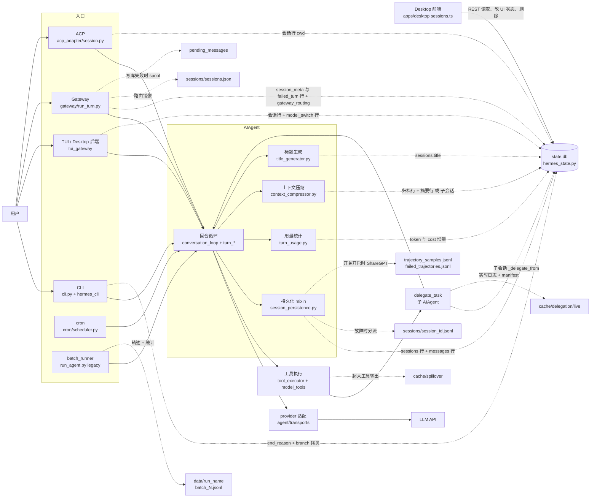
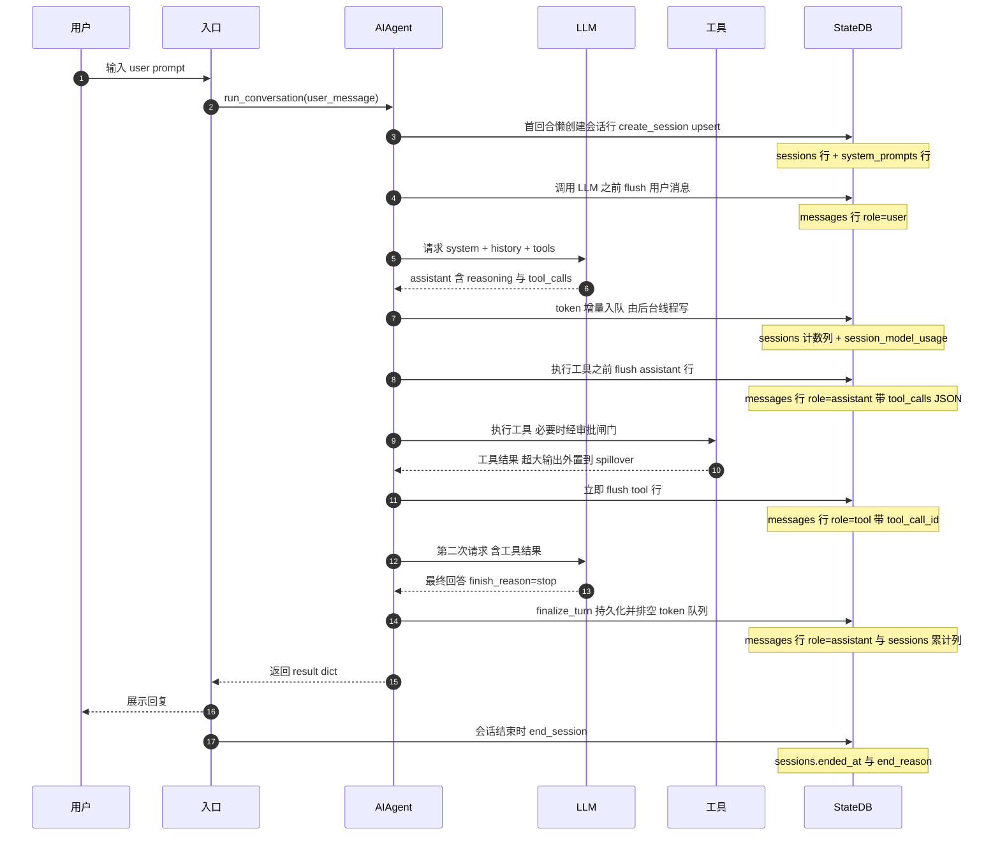
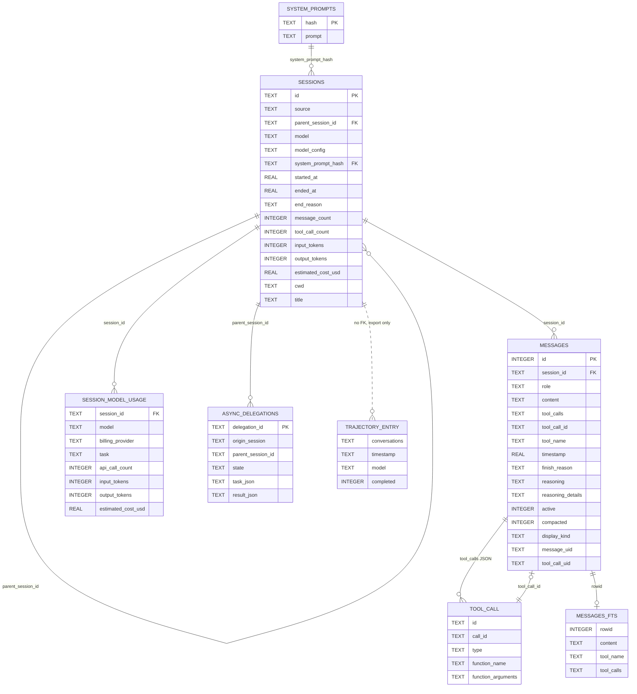

# Hermes Agent（NousResearch/hermes-agent）会话与轨迹数据分析

> 约定：源码链接都是指向 commit `10c6188de188871f64a88dd95bc6b262adb0c307` 的完整 GitHub permalink，行号已按该 commit 逐条核对（初稿基于 `44a1ce9`，迁移说明见 §0）。“源码推导”表示结论来自读代码、没有运行验证；“待确认”表示证据不足，原因写在同一处。

## 0. 元信息

| 项 | 值 |
| --- | --- |
| 仓库 | [NousResearch/hermes-agent](https://github.com/NousResearch/hermes-agent) |
| Commit | `10c6188de188871f64a88dd95bc6b262adb0c307`（2026-10-02，浅克隆，无 tag）；本仓库子模块 `third_party/hermes-agent` 固定在这个提交 |
| 迁移核对 | 初稿基于 `44a1ce9`（2026-10-01）。2026-10-02 迁到上面的提交：全部 permalink 按两次提交的 `git diff` 重新定位行号，并逐条核对引用行内容未变。其间 schema 版本仍为 31、FTS 布局版本仍为 3；与会话有关的变化只有一个新的延后部分索引 `idx_messages_session_uid`（§3.3），表结构不变 |
| 版本 | `pyproject.toml` 中 `version = "0.0.0"`（发版时注入，仓库内无版本号）；**state.db schema 版本 31**（[hermes_state_common.py:282](https://github.com/NousResearch/hermes-agent/blob/10c6188de188871f64a88dd95bc6b262adb0c307/hermes_state_common.py#L282)），FTS 存储布局版本 3（[hermes_state_common.py:305](https://github.com/NousResearch/hermes-agent/blob/10c6188de188871f64a88dd95bc6b262adb0c307/hermes_state_common.py#L305)） |
| 语言 | Python（核心、gateway、TUI/桌面后端），TypeScript（Ink TUI、Electron 桌面端） |
| 分析方法 | **仅源码静态阅读**（本机未安装 Hermes，无 `~/.hermes`，未运行任何代码）；结合仓库内开发文档 `website/docs/developer-guide/session-storage.md`、`trajectory-format.md`、`context-compression-and-caching.md` 交叉核对，文档与源码冲突时以源码为准 |

## 1. 结构图与一次 chat 的数据流

### 1.1 组件表

| 组件 | 职责 | 源码位置 | 写出的记录 |
| --- | --- | --- | --- |
| CLI 入口（`hermes`） | 交互 REPL、slash 命令、`/new` `/branch` `/undo` `/resume` `/save`；构造 AIAgent 时传入 `session_db` | [cli.py](https://github.com/NousResearch/hermes-agent/blob/10c6188de188871f64a88dd95bc6b262adb0c307/cli.py#L1)、[hermes_cli/cli_agent_setup_mixin.py:686](https://github.com/NousResearch/hermes-agent/blob/10c6188de188871f64a88dd95bc6b262adb0c307/hermes_cli/cli_agent_setup_mixin.py#L686)、[hermes_cli/cli_commands_mixin.py:1379](https://github.com/NousResearch/hermes-agent/blob/10c6188de188871f64a88dd95bc6b262adb0c307/hermes_cli/cli_commands_mixin.py#L1379) | `sessions.end_reason`（`new_session`/`branched`/`cli_close`）、`/branch` 拷贝的消息、`sessions/saved/*.json` |
| TUI / Desktop 后端（`tui_gateway`） | JSON-RPC 服务（`hermes --tui`、Electron 都连它）；source 为 `tui`/`desktop`；建会话行、写模型切换标记、会话收尾 | [tui_gateway/server.py:1536](https://github.com/NousResearch/hermes-agent/blob/10c6188de188871f64a88dd95bc6b262adb0c307/tui_gateway/server.py#L1536)、[tui_gateway/server.py:1795](https://github.com/NousResearch/hermes-agent/blob/10c6188de188871f64a88dd95bc6b262adb0c307/tui_gateway/server.py#L1795)、[tui_gateway/session_workdir.py:438](https://github.com/NousResearch/hermes-agent/blob/10c6188de188871f64a88dd95bc6b262adb0c307/tui_gateway/session_workdir.py#L438) | `sessions` 行（cwd、user_id、profile_name）、`model_switch` 行、`end_reason`（`tui_close` 等） |
| Desktop 前端 | 通过 REST `/api/sessions`、`/api/sessions/{id}/messages?include_compacted=` 读取会话；也经 REST 修改会话：PATCH 归档 / 置顶 / 未读、重命名，DELETE 删除 | [apps/desktop/src/api/sessions.ts:102](https://github.com/NousResearch/hermes-agent/blob/10c6188de188871f64a88dd95bc6b262adb0c307/apps/desktop/src/api/sessions.ts#L102)、[apps/desktop/src/api/sessions.ts:455](https://github.com/NousResearch/hermes-agent/blob/10c6188de188871f64a88dd95bc6b262adb0c307/apps/desktop/src/api/sessions.ts#L455)、[apps/desktop/src/api/sessions.ts:374-423](https://github.com/NousResearch/hermes-agent/blob/10c6188de188871f64a88dd95bc6b262adb0c307/apps/desktop/src/api/sessions.ts#L374)、[apps/desktop/src/api/sessions.ts:700-732](https://github.com/NousResearch/hermes-agent/blob/10c6188de188871f64a88dd95bc6b262adb0c307/apps/desktop/src/api/sessions.ts#L700) | 不直接写库；经后端修改 `sessions` 的 UI 状态与标题，或删除会话 |
| Gateway | 约 20 个消息平台的适配器；路由键 → 会话；gateway 侧转录、重试队列、spool | [gateway/run_turn.py:1826](https://github.com/NousResearch/hermes-agent/blob/10c6188de188871f64a88dd95bc6b262adb0c307/gateway/run_turn.py#L1826)、[gateway/session_transcript.py:223](https://github.com/NousResearch/hermes-agent/blob/10c6188de188871f64a88dd95bc6b262adb0c307/gateway/session_transcript.py#L223)、[gateway/session_persistence.py:442](https://github.com/NousResearch/hermes-agent/blob/10c6188de188871f64a88dd95bc6b262adb0c307/gateway/session_persistence.py#L442) | `session_meta` 行、`failed_turn` 行、`observed` 行、`gateway_routing`、`sessions.json`、`pending_messages/` |
| ACP 适配器 | 编辑器会话（Zed、VS Code、JetBrains），id 为 uuid4，source 为 `acp` | [acp_adapter/session.py:176](https://github.com/NousResearch/hermes-agent/blob/10c6188de188871f64a88dd95bc6b262adb0c307/acp_adapter/session.py#L176)、[acp_adapter/session.py:342](https://github.com/NousResearch/hermes-agent/blob/10c6188de188871f64a88dd95bc6b262adb0c307/acp_adapter/session.py#L342) | `sessions` 行（cwd，`model_config.cwd`） |
| cron | 定时任务，每次运行一个会话 | [cron/scheduler.py:2194](https://github.com/NousResearch/hermes-agent/blob/10c6188de188871f64a88dd95bc6b262adb0c307/cron/scheduler.py#L2194) | `source='cron'`，`end_reason` 为 `cron_complete` 或 `cron_incomplete_no_output` |
| batch_runner / `run_agent.py` | 离线批量或单 query；**不传 session_db** | [batch_runner.py:248](https://github.com/NousResearch/hermes-agent/blob/10c6188de188871f64a88dd95bc6b262adb0c307/batch_runner.py#L248)、[run_agent.py:1558](https://github.com/NousResearch/hermes-agent/blob/10c6188de188871f64a88dd95bc6b262adb0c307/run_agent.py#L1558) | ShareGPT 轨迹文件（见第 5 节） |
| AIAgent（门面与初始化） | 生成 session_id，懒创建会话行，记录 profile、cwd、来源 | [run_agent.py:241](https://github.com/NousResearch/hermes-agent/blob/10c6188de188871f64a88dd95bc6b262adb0c307/run_agent.py#L241)、[run_agent.py:349](https://github.com/NousResearch/hermes-agent/blob/10c6188de188871f64a88dd95bc6b262adb0c307/run_agent.py#L349)、[agent/agent_init.py:1199](https://github.com/NousResearch/hermes-agent/blob/10c6188de188871f64a88dd95bc6b262adb0c307/agent/agent_init.py#L1199) | `sessions` 行 |
| 回合循环 | `run_conversation` 及 `agent/turn_*.py` 各阶段：预检、构造请求、API 调用、响应接收、工具轮、最终回答、收尾 | [agent/conversation_loop.py:1695](https://github.com/NousResearch/hermes-agent/blob/10c6188de188871f64a88dd95bc6b262adb0c307/agent/conversation_loop.py#L1695)、[agent/turn_finalizer.py:509](https://github.com/NousResearch/hermes-agent/blob/10c6188de188871f64a88dd95bc6b262adb0c307/agent/turn_finalizer.py#L509) | 通过 persistence mixin 写 `messages` |
| 持久化 mixin | 把消息 flush 到 SQLite（基于标记去重、跳过脚手架、失败时分流 JSONL）；保存 trajectory | [agent/session_persistence.py:413](https://github.com/NousResearch/hermes-agent/blob/10c6188de188871f64a88dd95bc6b262adb0c307/agent/session_persistence.py#L413) | `messages` 行、`sessions/<id>.jsonl`、trajectory 文件 |
| provider / transport 适配 | 把 Chat Completions、Anthropic Messages、Responses（Codex）、Bedrock 等响应统一成 OpenAI 形状的 assistant dict | [agent/chat_completion_helpers.py:1666](https://github.com/NousResearch/hermes-agent/blob/10c6188de188871f64a88dd95bc6b262adb0c307/agent/chat_completion_helpers.py#L1666)、[agent/transports/anthropic.py:65](https://github.com/NousResearch/hermes-agent/blob/10c6188de188871f64a88dd95bc6b262adb0c307/agent/transports/anthropic.py#L65) | assistant 行的 content、reasoning*、tool_calls、codex_* |
| 工具注册与执行 | 工具注册表、`handle_function_call`、并发或串行执行、大输出外置、审批闸门 | [model_tools.py:876](https://github.com/NousResearch/hermes-agent/blob/10c6188de188871f64a88dd95bc6b262adb0c307/model_tools.py#L876)、[agent/tool_executor.py:1054](https://github.com/NousResearch/hermes-agent/blob/10c6188de188871f64a88dd95bc6b262adb0c307/agent/tool_executor.py#L1054)、[tools/tool_result_storage.py:293](https://github.com/NousResearch/hermes-agent/blob/10c6188de188871f64a88dd95bc6b262adb0c307/tools/tool_result_storage.py#L293) | tool 行、`cache/spillover/*.txt` |
| 用量与成本 | 每次 API 调用累计 token 与 cost | [agent/turn_usage.py:247](https://github.com/NousResearch/hermes-agent/blob/10c6188de188871f64a88dd95bc6b262adb0c307/agent/turn_usage.py#L247) | `sessions` 计数列、`session_model_usage` |
| 上下文压缩 | 预检、回合中、手动 `/compress`；默认就地压缩，可选轮转 | [agent/conversation_compression.py:3776](https://github.com/NousResearch/hermes-agent/blob/10c6188de188871f64a88dd95bc6b262adb0c307/agent/conversation_compression.py#L3776)、[agent/conversation_compression.py:3379](https://github.com/NousResearch/hermes-agent/blob/10c6188de188871f64a88dd95bc6b262adb0c307/agent/conversation_compression.py#L3379) | 旧行归档、摘要行、或新子会话 |
| 子代理 `delegate_task` | 构建并运行子 AIAgent | [tools/delegate_tool.py:156](https://github.com/NousResearch/hermes-agent/blob/10c6188de188871f64a88dd95bc6b262adb0c307/tools/delegate_tool.py#L156) | 子会话（`_delegate_from`）、`cache/delegation/live/*.log`、`async_delegations` |
| 记忆与技能 | `MEMORY.md`/`USER.md`、技能文件；后台 review 用 fork 出的 agent 且 `_persist_disabled`，不写用户会话 | [tools/memory_tool.py:40](https://github.com/NousResearch/hermes-agent/blob/10c6188de188871f64a88dd95bc6b262adb0c307/tools/memory_tool.py#L40)、[agent/background_review.py:1022](https://github.com/NousResearch/hermes-agent/blob/10c6188de188871f64a88dd95bc6b262adb0c307/agent/background_review.py#L1022) | `$HERMES_HOME/memories/*.md`（不在 state.db）；`session_model_usage(task='background_review')` |
| 标题生成 | 先写确定性标题，再用 LLM 升级 | [agent/title_generator.py:1](https://github.com/NousResearch/hermes-agent/blob/10c6188de188871f64a88dd95bc6b262adb0c307/agent/title_generator.py#L1) | `sessions.title/title_source` |
| SessionDB | 存储门面加约 20 个 sibling mixin | [hermes_state.py:451](https://github.com/NousResearch/hermes-agent/blob/10c6188de188871f64a88dd95bc6b262adb0c307/hermes_state.py#L451) | 第 3 节中的所有表 |
| 文件快照（默认关） | 修改文件前做 shadow git 快照 | [tools/checkpoint_manager.py:1](https://github.com/NousResearch/hermes-agent/blob/10c6188de188871f64a88dd95bc6b262adb0c307/tools/checkpoint_manager.py#L1) | `checkpoints/store/` |

### 1.2 图 1：结构与数据流（虚线 = 写入持久化）



### 1.3 图 2：一次 chat 的时序（1 次用户提问 + 1 次工具调用 + 最终回答）



## 2. 存储布局

### 2.1 HERMES_HOME 与 profile

- **解析顺序**：上下文局部 override → 环境变量 `HERMES_HOME` → 平台默认（[hermes_constants.py:111](https://github.com/NousResearch/hermes-agent/blob/10c6188de188871f64a88dd95bc6b262adb0c307/hermes_constants.py#L111)）。平台默认：macOS/Linux 为 `~/.hermes`，Windows 为 `%LOCALAPPDATA%\hermes`；二者都会拼上环境变量 `HERMES_DATA_DIR_SUFFIX`（[hermes_constants.py:51](https://github.com/NousResearch/hermes-agent/blob/10c6188de188871f64a88dd95bc6b262adb0c307/hermes_constants.py#L51)）。
- **命名 profile**：位于 `<默认根>/profiles/<name>/`，结构与默认根相同，**每个 profile 一个独立的 `state.db`**；默认根下的 `active_profile` 文件记录“粘性”激活的 profile（[hermes_constants.py:91](https://github.com/NousResearch/hermes-agent/blob/10c6188de188871f64a88dd95bc6b262adb0c307/hermes_constants.py#L91)）。profile 名需匹配 `[a-z0-9][a-z0-9_-]{0,63}`；SessionDB 从 db 文件路径反推所属 profile，用来给 `sessions.profile_name` 打标（[hermes_state_sessions.py:293](https://github.com/NousResearch/hermes-agent/blob/10c6188de188871f64a88dd95bc6b262adb0c307/hermes_state_sessions.py#L293)）。
- **state.db 路径** = `get_hermes_home() / "state.db"`，在调用时解析（[hermes_state.py:168](https://github.com/NousResearch/hermes-agent/blob/10c6188de188871f64a88dd95bc6b262adb0c307/hermes_state.py#L168)、[hermes_state.py:188](https://github.com/NousResearch/hermes-agent/blob/10c6188de188871f64a88dd95bc6b262adb0c307/hermes_state.py#L188)）。单个 `hermes serve` 进程可以同时服务多个 profile，但各 profile 仍写各自的 state.db（`website/docs/developer-guide/session-storage.md` “Desktop profile isolation”一节）。

### 2.2 目录树（只列与会话相关的部分）

```text
$HERMES_HOME/                          # 默认 ~/.hermes；命名 profile 为 ~/.hermes/profiles/<name>/
├── state.db                           # ★ 会话权威来源（SQLite），默认开启
├── state.db-wal, state.db-shm         # 仅 WAL 模式下存在（见 4.2）
├── config.yaml, .env                  # 配置（.env 只放密钥）
├── sessions/
│   ├── sessions.json                  # gateway 路由索引的“遗留镜像”，不是会话列表（可配置关闭）
│   ├── request_dump_<sid>_<YYYYMMDD_HHMMSS_ffffff>.json   # API 出错时的请求转储（已脱敏）
│   ├── <session_id>.jsonl             # 仅在 state.db 被替换/隔离时的转录“分流”文件（故障路径）
│   ├── saved/hermes_conversation_<YYYYMMDD_HHMMSS>.{json,md,html}   # 用户手动 /save 的导出（TUI/Desktop 只写 json）
│   └── session_<id>.json, <id>.json   # 旧版本遗留的逐会话快照（现行代码只删除、不写入）
├── pending_messages/pending-<hex>.json  # gateway 写库失败或关停时的待回放消息（故障路径）
├── cache/spillover/<tool_call_id>.txt   # 超大工具输出外置文件，24h 过期
├── checkpoints/store/…                  # 文件快照（shadow git），默认关闭
├── logs/agent.log, errors.log, gateway.log
├── active_profile
└── profiles/<name>/…                    # 同上
<进程 CWD>/trajectory_samples.jsonl、failed_trajectories.jsonl   # 训练轨迹，需显式开启
data/<run_name>/batch_<N>.jsonl、trajectories.jsonl、checkpoint.json、statistics.json   # batch_runner
```

逐项依据：
- `sessions/` 目录：在 agent 初始化时无条件创建，用来放 request_dump（[agent/agent_init.py:1205](https://github.com/NousResearch/hermes-agent/blob/10c6188de188871f64a88dd95bc6b262adb0c307/agent/agent_init.py#L1205)）；dump 文件名见 [agent/agent_runtime_helpers.py:1529](https://github.com/NousResearch/hermes-agent/blob/10c6188de188871f64a88dd95bc6b262adb0c307/agent/agent_runtime_helpers.py#L1529)，只在 API 出错或预检时写（[agent/turn_recovery.py:1012](https://github.com/NousResearch/hermes-agent/blob/10c6188de188871f64a88dd95bc6b262adb0c307/agent/turn_recovery.py#L1012)、[agent/turn_recovery.py:1210](https://github.com/NousResearch/hermes-agent/blob/10c6188de188871f64a88dd95bc6b262adb0c307/agent/turn_recovery.py#L1210)）。
- `sessions.json` 是遗留镜像，主副本在 `gateway_routing` 表，文件里第一个键 `_README` 自述这一点（[gateway/session_persistence.py:26](https://github.com/NousResearch/hermes-agent/blob/10c6188de188871f64a88dd95bc6b262adb0c307/gateway/session_persistence.py#L26)、[gateway/session_persistence.py:480](https://github.com/NousResearch/hermes-agent/blob/10c6188de188871f64a88dd95bc6b262adb0c307/gateway/session_persistence.py#L480)）。
- `<session_id>.jsonl` 分流文件：`divert_session_transcript_jsonl`，逐行写 flush 行的 dict（[hermes_state.py:421](https://github.com/NousResearch/hermes-agent/blob/10c6188de188871f64a88dd95bc6b262adb0c307/hermes_state.py#L421)）；只在 `StateDbReplacedError/StateDbCorruptError` 时调用（[agent/session_persistence.py:392](https://github.com/NousResearch/hermes-agent/blob/10c6188de188871f64a88dd95bc6b262adb0c307/agent/session_persistence.py#L392)、[gateway/session_transcript.py:152](https://github.com/NousResearch/hermes-agent/blob/10c6188de188871f64a88dd95bc6b262adb0c307/gateway/session_transcript.py#L152)）。
- 遗留快照：删除会话时会顺带清理 `<id>.json/.jsonl`、`session_<id>.json`、`request_dump_<id>_*.json`（[hermes_state_sessions.py:1563](https://github.com/NousResearch/hermes-agent/blob/10c6188de188871f64a88dd95bc6b262adb0c307/hermes_state_sessions.py#L1563)）；开发文档也说 state.db “replaces the earlier per-session JSONL file approach”。
- `/save`：TUI/Desktop 写 `sessions/saved/hermes_conversation_<ts>.json`，内容为 `{model, session_id, session_start, system_prompt, messages}`（[tui_gateway/methods_session.py:2174](https://github.com/NousResearch/hermes-agent/blob/10c6188de188871f64a88dd95bc6b262adb0c307/tui_gateway/methods_session.py#L2174)）；CLI 的 `/save <json|md|html> [filename] [redact]` 写 `sessions/saved/hermes_conversation_<ts>.<fmt>`（或用户给的路径），其中 JSON 是 `export_session` 的形状（`sessions` 各列 + `messages` + `timings`）（[hermes_cli/cli_session_mixin.py:673](https://github.com/NousResearch/hermes-agent/blob/10c6188de188871f64a88dd95bc6b262adb0c307/hermes_cli/cli_session_mixin.py#L673)、[hermes_cli/session_export.py:209](https://github.com/NousResearch/hermes-agent/blob/10c6188de188871f64a88dd95bc6b262adb0c307/hermes_cli/session_export.py#L209)）。
- `pending_messages/`：[gateway/shutdown_flush.py:34](https://github.com/NousResearch/hermes-agent/blob/10c6188de188871f64a88dd95bc6b262adb0c307/gateway/shutdown_flush.py#L34)、[gateway/shutdown_flush.py:49](https://github.com/NousResearch/hermes-agent/blob/10c6188de188871f64a88dd95bc6b262adb0c307/gateway/shutdown_flush.py#L49)。
- `cache/spillover/`：[tools/tool_result_storage.py:24](https://github.com/NousResearch/hermes-agent/blob/10c6188de188871f64a88dd95bc6b262adb0c307/tools/tool_result_storage.py#L24)；`SPILLOVER_MAX_AGE_HOURS = 24` 在 [tools/tool_result_storage.py:25](https://github.com/NousResearch/hermes-agent/blob/10c6188de188871f64a88dd95bc6b262adb0c307/tools/tool_result_storage.py#L25)。
- `checkpoints/`：目录结构写在模块 docstring 中（[tools/checkpoint_manager.py:13](https://github.com/NousResearch/hermes-agent/blob/10c6188de188871f64a88dd95bc6b262adb0c307/tools/checkpoint_manager.py#L13)），默认 `enabled: False`（[hermes_cli/config_defaults.py:501](https://github.com/NousResearch/hermes-agent/blob/10c6188de188871f64a88dd95bc6b262adb0c307/hermes_cli/config_defaults.py#L501)）。
- 训练轨迹与 batch 输出：见第 5 节。

### 2.3 各存储层定位：默认还是开关、是否权威

| 存储层 | 默认开启？ | 内容 | 是否会话权威 |
| --- | --- | --- | --- |
| `state.db`（`sessions`/`messages` 等表） | **是**（CLI、TUI、Desktop、gateway、ACP、cron、subagent 都会把 `session_db` 传给 AIAgent） | 会话元数据、完整消息、token/cost、谱系 | **是，唯一权威来源** |
| `state.db` 的 FTS 虚表 | 是（FTS5 可用时） | 由触发器维护的派生索引 | 否（派生数据） |
| `sessions/sessions.json` | 是（`gateway.write_sessions_json` 可关） | gateway 路由键 → session_id | 否（`gateway_routing` 表的镜像） |
| `sessions/<id>.jsonl` 分流文件 | 否（仅在 state.db 被替换/损坏时出现） | 未能入库的 flush 行 | 故障补充 |
| `pending_messages/*.json` | 否（仅故障或关停时） | 待回放的消息 | 故障补充（启动后回放并删除） |
| `cache/spillover/*.txt` | 是（工具输出超过阈值时） | 超大工具输出原文 | 否（库内只存预览加路径，24h 过期） |
| `trajectory_samples.jsonl` / `failed_trajectories.jsonl` | **否**（需 `run_agent.py --save_trajectories` 或 `AIAgent(save_trajectories=True)`；`hermes` CLI 不暴露） | ShareGPT 训练格式 | 否（导出物） |
| batch_runner 的 `data/<run>/` | 只在运行 batch_runner 时 | ShareGPT 加统计 | 否（不写 state.db，见 5.6） |
| `checkpoints/` | 否（`checkpoints.enabled: false`） | 文件系统快照 | 否 |
| `logs/*.log` | 是 | 文本日志（含每次 API 调用的耗时与 token、工具耗时） | 否（非结构化，但有补充价值） |

各 entry 传入 `session_db` 的依据：CLI [hermes_cli/cli_agent_setup_mixin.py:686](https://github.com/NousResearch/hermes-agent/blob/10c6188de188871f64a88dd95bc6b262adb0c307/hermes_cli/cli_agent_setup_mixin.py#L686)；gateway [gateway/run_turn_runner.py:1130](https://github.com/NousResearch/hermes-agent/blob/10c6188de188871f64a88dd95bc6b262adb0c307/gateway/run_turn_runner.py#L1130)；TUI/Desktop [tui_gateway/server.py:2665](https://github.com/NousResearch/hermes-agent/blob/10c6188de188871f64a88dd95bc6b262adb0c307/tui_gateway/server.py#L2665)；ACP [acp_adapter/session.py:525](https://github.com/NousResearch/hermes-agent/blob/10c6188de188871f64a88dd95bc6b262adb0c307/acp_adapter/session.py#L525)；subagent [tools/delegate_tool.py:246](https://github.com/NousResearch/hermes-agent/blob/10c6188de188871f64a88dd95bc6b262adb0c307/tools/delegate_tool.py#L246)。

### 2.4 ID 体系

| ID | 格式 | 依据 |
| --- | --- | --- |
| `sessions.id`（CLI/TUI/Desktop/agent 自生成） | `YYYYMMDD_HHMMSS_<6 位 hex>`，时间取**本地时区** `datetime.now()` | [hermes_state_ids.py:16](https://github.com/NousResearch/hermes-agent/blob/10c6188de188871f64a88dd95bc6b262adb0c307/hermes_state_ids.py#L16)、[hermes_state_ids.py:24](https://github.com/NousResearch/hermes-agent/blob/10c6188de188871f64a88dd95bc6b262adb0c307/hermes_state_ids.py#L24)、[agent/agent_init.py:1202](https://github.com/NousResearch/hermes-agent/blob/10c6188de188871f64a88dd95bc6b262adb0c307/agent/agent_init.py#L1202) |
| gateway 会话 | 同格式，8 位 hex | [gateway/session_lifecycle.py:26](https://github.com/NousResearch/hermes-agent/blob/10c6188de188871f64a88dd95bc6b262adb0c307/gateway/session_lifecycle.py#L26) |
| 外部会话导入 | CLI `hermes sessions import --from` 用默认 6 位；Desktop/Web 外部会话浏览器（`import_foreign_history`）用 12 位；Hermes 自身导出再导入（`import_sessions`）保留原 id，已存在则跳过（`source` 缺省为 `import`） | [hermes_state_portability.py:155](https://github.com/NousResearch/hermes-agent/blob/10c6188de188871f64a88dd95bc6b262adb0c307/hermes_state_portability.py#L155)、[hermes_cli/foreign_sessions.py:254](https://github.com/NousResearch/hermes-agent/blob/10c6188de188871f64a88dd95bc6b262adb0c307/hermes_cli/foreign_sessions.py#L254)、[hermes_cli/foreign_sessions_browser.py:94](https://github.com/NousResearch/hermes-agent/blob/10c6188de188871f64a88dd95bc6b262adb0c307/hermes_cli/foreign_sessions_browser.py#L94)、[hermes_state_portability.py:610-645](https://github.com/NousResearch/hermes-agent/blob/10c6188de188871f64a88dd95bc6b262adb0c307/hermes_state_portability.py#L610) |
| cron 会话 | `cron_<12 位 hex 任务 id>_<YYYYMMDD_HHMMSS>` | [cron/scheduler.py:2573](https://github.com/NousResearch/hermes-agent/blob/10c6188de188871f64a88dd95bc6b262adb0c307/cron/scheduler.py#L2573)、[cron/jobs.py:1864](https://github.com/NousResearch/hermes-agent/blob/10c6188de188871f64a88dd95bc6b262adb0c307/cron/jobs.py#L1864) |
| 托管群聊 room 会话（`source='bot_room'`） | `room_<32 位 hex>` | [gateway/platforms/api_server_room_dispatch.py:28-33](https://github.com/NousResearch/hermes-agent/blob/10c6188de188871f64a88dd95bc6b262adb0c307/gateway/platforms/api_server_room_dispatch.py#L28) |
| ACP 会话 | `uuid4()` 字符串（**不是**时间戳格式） | [acp_adapter/session.py:179](https://github.com/NousResearch/hermes-agent/blob/10c6188de188871f64a88dd95bc6b262adb0c307/acp_adapter/session.py#L179) |
| API server | 客户端可通过头 `X-Hermes-Session-Id` 续接已有会话（不可信的任意字符串，写文件名前会做净化） | [gateway/platforms/api_server_openai_routes.py:686](https://github.com/NousResearch/hermes-agent/blob/10c6188de188871f64a88dd95bc6b262adb0c307/gateway/platforms/api_server_openai_routes.py#L686)、[agent/session_persistence.py:63](https://github.com/NousResearch/hermes-agent/blob/10c6188de188871f64a88dd95bc6b262adb0c307/agent/session_persistence.py#L63) |
| `messages.id` | INTEGER AUTOINCREMENT，物理行号；**读取时一律 `ORDER BY id`**（时间戳可能回退） | [hermes_state_messages.py:1483](https://github.com/NousResearch/hermes-agent/blob/10c6188de188871f64a88dd95bc6b262adb0c307/hermes_state_messages.py#L1483) |
| `messages.message_uid` | 32 位 hex（`uuid4().hex`），表示“逻辑消息”的持久 id；压缩代际、分支拷贝、replace 时都会**复制同一个 uid** | [agent/message_metadata.py:56](https://github.com/NousResearch/hermes-agent/blob/10c6188de188871f64a88dd95bc6b262adb0c307/agent/message_metadata.py#L56)、[agent/message_metadata.py:73](https://github.com/NousResearch/hermes-agent/blob/10c6188de188871f64a88dd95bc6b262adb0c307/agent/message_metadata.py#L73) |
| tool call id | 由 provider 给出（如 `call_…`、`toolu_…`），缺失时 Hermes 生成确定性的 `call_<12hex>`；**可能重复**，所以另有 `tool_call_uids`/`tool_call_uid` 区分每一次出现 | [agent/chat_completion_helpers.py:1622](https://github.com/NousResearch/hermes-agent/blob/10c6188de188871f64a88dd95bc6b262adb0c307/agent/chat_completion_helpers.py#L1622)、[agent/message_metadata.py:34](https://github.com/NousResearch/hermes-agent/blob/10c6188de188871f64a88dd95bc6b262adb0c307/agent/message_metadata.py#L34) |
| subagent 进度 id | `sa-<task_index>-<8hex>`，只在运行期使用，不入库 | [tools/delegate_tool.py:195](https://github.com/NousResearch/hermes-agent/blob/10c6188de188871f64a88dd95bc6b262adb0c307/tools/delegate_tool.py#L195) |

## 3. 记录 schema

> 权威 DDL：`SCHEMA_SQL`（[hermes_state_common.py:371](https://github.com/NousResearch/hermes-agent/blob/10c6188de188871f64a88dd95bc6b262adb0c307/hermes_state_common.py#L371)）+ `DEFERRED_INDEX_SQL`（[hermes_state_common.py:634](https://github.com/NousResearch/hermes-agent/blob/10c6188de188871f64a88dd95bc6b262adb0c307/hermes_state_common.py#L634)）+ `FTS_SQL`/`FTS_TRIGRAM_SQL`（[hermes_state_common.py:772](https://github.com/NousResearch/hermes-agent/blob/10c6188de188871f64a88dd95bc6b262adb0c307/hermes_state_common.py#L772)、[hermes_state_common.py:897](https://github.com/NousResearch/hermes-agent/blob/10c6188de188871f64a88dd95bc6b262adb0c307/hermes_state_common.py#L897)）+ CJK 索引（[hermes_state_fts.py:40](https://github.com/NousResearch/hermes-agent/blob/10c6188de188871f64a88dd95bc6b262adb0c307/hermes_state_fts.py#L40)）。开发文档 `session-storage.md` 中的表结构是删节版，以源码为准。

### 3.1 全部表一览

| 表 / 对象 | 用途 | 定义位置 |
| --- | --- | --- |
| `schema_version(version)` | 单行，schema 版本（当前 31） | [hermes_state_common.py:372](https://github.com/NousResearch/hermes-agent/blob/10c6188de188871f64a88dd95bc6b262adb0c307/hermes_state_common.py#L372) |
| `system_prompts(hash PK, prompt)` | 按内容寻址的系统提示词去重存储；`sessions.tool_names` 也借它存工具定义 JSON（`{"version","tools"}` 对象） | [hermes_state_common.py:376](https://github.com/NousResearch/hermes-agent/blob/10c6188de188871f64a88dd95bc6b262adb0c307/hermes_state_common.py#L376) |
| `sessions` | 每会话一行（见 3.2） | [hermes_state_common.py:381](https://github.com/NousResearch/hermes-agent/blob/10c6188de188871f64a88dd95bc6b262adb0c307/hermes_state_common.py#L381) |
| `messages` | 每条消息一行（见 3.3） | [hermes_state_common.py:448](https://github.com/NousResearch/hermes-agent/blob/10c6188de188871f64a88dd95bc6b262adb0c307/hermes_state_common.py#L448) |
| `session_model_usage` | 按 (会话, 模型, provider, base_url, billing_mode, task) 累计的 token/cost；`task=''` 是主循环，其余是辅助调用（compression、title_generation、vision、background_review…） | [hermes_state_common.py:481](https://github.com/NousResearch/hermes-agent/blob/10c6188de188871f64a88dd95bc6b262adb0c307/hermes_state_common.py#L481) |
| `state_meta(key, value)` | KV 元数据：FTS 重建游标、`store_instance_id`、`store_created_at_utc`、`fts_storage_version` 等 | [hermes_state_common.py:503](https://github.com/NousResearch/hermes-agent/blob/10c6188de188871f64a88dd95bc6b262adb0c307/hermes_state_common.py#L503)、[hermes_state_schema.py:993](https://github.com/NousResearch/hermes-agent/blob/10c6188de188871f64a88dd95bc6b262adb0c307/hermes_state_schema.py#L993) |
| `gateway_routing(scope, session_key, entry_json, updated_at)` | gateway 路由索引的主副本 | [hermes_state_common.py:508](https://github.com/NousResearch/hermes-agent/blob/10c6188de188871f64a88dd95bc6b262adb0c307/hermes_state_common.py#L508) |
| `gateway_hygiene_state` | gateway 卫生压缩的失败计数 | [hermes_state_common.py:516](https://github.com/NousResearch/hermes-agent/blob/10c6188de188871f64a88dd95bc6b262adb0c307/hermes_state_common.py#L516) |
| `conversation_generations(source, session_key, generation)` | 每个路由对端的“对话代数”，只增不减，永不清理 | [hermes_state_common.py:543](https://github.com/NousResearch/hermes-agent/blob/10c6188de188871f64a88dd95bc6b262adb0c307/hermes_state_common.py#L543) |
| `gateway_heartbeats` | 后端进程心跳，用于孤儿会话清理 | [hermes_state_common.py:558](https://github.com/NousResearch/hermes-agent/blob/10c6188de188871f64a88dd95bc6b262adb0c307/hermes_state_common.py#L558) |
| `compression_locks` | 跨进程压缩租约 | [hermes_state_common.py:567](https://github.com/NousResearch/hermes-agent/blob/10c6188de188871f64a88dd95bc6b262adb0c307/hermes_state_common.py#L567) |
| `session_turn_leases` | 跨进程“回合租约”（同一会话同时只能有一个回合在写） | [hermes_state_common.py:574](https://github.com/NousResearch/hermes-agent/blob/10c6188de188871f64a88dd95bc6b262adb0c307/hermes_state_common.py#L574) |
| `async_delegations` | 后台（异步）委派任务的派发与投递簿记：`origin_session`、`parent_session_id`、`state`、`task_json`、`result_json` 等 | [hermes_state_common.py:581](https://github.com/NousResearch/hermes-agent/blob/10c6188de188871f64a88dd95bc6b262adb0c307/hermes_state_common.py#L581) |
| `delivery_obligations` | gateway 外发 outbox，**惰性创建** | [gateway/delivery_ledger.py:190](https://github.com/NousResearch/hermes-agent/blob/10c6188de188871f64a88dd95bc6b262adb0c307/gateway/delivery_ledger.py#L190) |
| `telegram_dm_topic_mode`、`telegram_dm_topic_bindings` | Telegram 私聊话题模式，用户执行 `/topic` 后才创建 | [hermes_state_telegram.py:28](https://github.com/NousResearch/hermes-agent/blob/10c6188de188871f64a88dd95bc6b262adb0c307/hermes_state_telegram.py#L28) |
| `messages_fts`（视图 `messages_fts_src`） | FTS5 词索引，external-content；tool 行只索引前 8192 字符 | [hermes_state_common.py:776](https://github.com/NousResearch/hermes-agent/blob/10c6188de188871f64a88dd95bc6b262adb0c307/hermes_state_common.py#L776)、[hermes_state_common.py:315](https://github.com/NousResearch/hermes-agent/blob/10c6188de188871f64a88dd95bc6b262adb0c307/hermes_state_common.py#L315) |
| `messages_fts_trigram`（视图 `messages_fts_trigram_src`） | trigram 子串索引；排除 tool 行，以及 `source IN ('cron','subagent')` 或带 `_delegate_from` 标记的会话 | [hermes_state_common.py:879](https://github.com/NousResearch/hermes-agent/blob/10c6188de188871f64a88dd95bc6b262adb0c307/hermes_state_common.py#L879)、[hermes_state_common.py:898](https://github.com/NousResearch/hermes-agent/blob/10c6188de188871f64a88dd95bc6b262adb0c307/hermes_state_common.py#L898) |
| `messages_fts_cjk`（视图 `messages_fts_cjk_src`） | CJK bigram 索引，依赖可加载扩展 `cjk_unicode61`，**仅在扩展能加载时存在** | [hermes_state_fts.py:40](https://github.com/NousResearch/hermes-agent/blob/10c6188de188871f64a88dd95bc6b262adb0c307/hermes_state_fts.py#L40) |

旧库（v23 之前、且未执行 `hermes sessions optimize-storage`）保留 inline 形态的旧 FTS 表（`LEGACY_FTS_SQL`，[hermes_state_common.py:986](https://github.com/NousResearch/hermes-agent/blob/10c6188de188871f64a88dd95bc6b262adb0c307/hermes_state_common.py#L986)）。同一 schema_version 下 FTS 布局可能不同，由 `state_meta.fts_storage_version` 单独标记。

### 3.2 `sessions` 表

DDL 摘录（[hermes_state_common.py:381](https://github.com/NousResearch/hermes-agent/blob/10c6188de188871f64a88dd95bc6b262adb0c307/hermes_state_common.py#L381)，节选）：

```sql
CREATE TABLE IF NOT EXISTS sessions (
    id TEXT PRIMARY KEY, source TEXT NOT NULL, created_source TEXT, user_id TEXT,
    session_key TEXT, chat_id TEXT, chat_type TEXT, thread_id TEXT, display_name TEXT, origin_json TEXT,
    model TEXT, model_config TEXT, system_prompt TEXT, system_prompt_hash TEXT, parent_session_id TEXT,
    started_at REAL NOT NULL, ended_at REAL, end_reason TEXT,
    message_count INTEGER DEFAULT 0, tool_call_count INTEGER DEFAULT 0,
    input_tokens INTEGER DEFAULT 0, output_tokens INTEGER DEFAULT 0, cache_read_tokens INTEGER DEFAULT 0,
    cache_write_tokens INTEGER DEFAULT 0, reasoning_tokens INTEGER DEFAULT 0,
    cwd TEXT, git_branch TEXT, git_repo_root TEXT, ...
    FOREIGN KEY (parent_session_id) REFERENCES sessions(id),
    FOREIGN KEY (system_prompt_hash) REFERENCES system_prompts(hash)
);
```

| 列 | 类型 | 含义 / 取值 | 写入者与时机 |
| --- | --- | --- | --- |
| `id` | TEXT PK | 会话 id（格式见 2.4） | 首次落库时 upsert（[hermes_state_sessions.py:322](https://github.com/NousResearch/hermes-agent/blob/10c6188de188871f64a88dd95bc6b262adb0c307/hermes_state_sessions.py#L322)） |
| `source` | TEXT NOT NULL | 平台来源，是“活的”路由状态：`cli`、`oneshot`（`-q`/`-z` 一次性）、`tui`、`desktop`、`acp`、`api_server`、`telegram`/`discord`/`slack`/…（gateway 平台名）、`subagent`、`cron`、`kanban`、`tool`、`recovered`、`claude-code`/`codex-cli`（外部导入）、`import`（自身导出再导入的缺省值）、`bot_room`（托管群聊 room）、`unknown`（占位，后续写入者会修正）；`batch` 仅在 5.6 所述的边缘情况下才可能出现；列表不完整，需容忍未知值 | `_session_source_for_agent`（[run_agent.py:69](https://github.com/NousResearch/hermes-agent/blob/10c6188de188871f64a88dd95bc6b262adb0c307/run_agent.py#L69)）；`unknown` 的修正逻辑在 [hermes_state_sessions.py:372](https://github.com/NousResearch/hermes-agent/blob/10c6188de188871f64a88dd95bc6b262adb0c307/hermes_state_sessions.py#L372) |
| `created_source` | TEXT | 首次创建时的来源，之后不再改 | [hermes_state_sessions.py:240](https://github.com/NousResearch/hermes-agent/blob/10c6188de188871f64a88dd95bc6b262adb0c307/hermes_state_sessions.py#L240) |
| `user_id` | TEXT | 对端主体：消息平台填发送者 id；经认证的 `hermes serve` 填 `<provider>:<user id>`；subagent/cron/kanban 为空 | 建行时一次性写入（session-storage.md “user_id is the principal…”一段） |
| `session_key`、`chat_id`、`chat_type`、`thread_id`、`display_name`、`origin_json` | TEXT | gateway 路由元数据；`origin_json` 与 `SessionSource.to_dict()` 同形：`{platform, chat_id, chat_name, chat_type, user_id, user_name, thread_id, [user_id_alt], [profile]}`；外部导入时为 `{"imported_from": {tool, path, foreign_session_id}}` | [run_agent.py:84](https://github.com/NousResearch/hermes-agent/blob/10c6188de188871f64a88dd95bc6b262adb0c307/run_agent.py#L84)、[hermes_cli/foreign_sessions.py:255](https://github.com/NousResearch/hermes-agent/blob/10c6188de188871f64a88dd95bc6b262adb0c307/hermes_cli/foreign_sessions.py#L255) |
| `expiry_finalized` | INTEGER | gateway 过期是否已收尾（`SessionEntry` 的镜像） | [hermes_state_sessions.py:432](https://github.com/NousResearch/hermes-agent/blob/10c6188de188871f64a88dd95bc6b262adb0c307/hermes_state_sessions.py#L432) |
| `model` | TEXT | 建行时的模型；首个计费调用可以改写（first accounted route）；`/model` 切换时无条件改写 | [hermes_state_usage.py:322](https://github.com/NousResearch/hermes-agent/blob/10c6188de188871f64a88dd95bc6b262adb0c307/hermes_state_usage.py#L322)、[hermes_state_sessions.py:708](https://github.com/NousResearch/hermes-agent/blob/10c6188de188871f64a88dd95bc6b262adb0c307/hermes_state_sessions.py#L708) |
| `model_config` | TEXT(JSON) | 初始化配置 `{max_iterations, reasoning_config, max_tokens}`（[agent/agent_init.py:1220](https://github.com/NousResearch/hermes-agent/blob/10c6188de188871f64a88dd95bc6b262adb0c307/agent/agent_init.py#L1220)），以及：`yolo_mode`；**谱系标记** `_delegate_from`/`_branched_from`/`_reset_from`（值为父会话 id）；`/model` 切换后的 `provider/base_url/api_mode/gateway_runtime`；`browser_model_lock`；ACP 会话的 `cwd/provider/base_url/api_mode` | [tools/delegate_tool.py:277](https://github.com/NousResearch/hermes-agent/blob/10c6188de188871f64a88dd95bc6b262adb0c307/tools/delegate_tool.py#L277)、[hermes_cli/cli_commands_mixin.py:1416](https://github.com/NousResearch/hermes-agent/blob/10c6188de188871f64a88dd95bc6b262adb0c307/hermes_cli/cli_commands_mixin.py#L1416)、[gateway/session_recovery.py:437](https://github.com/NousResearch/hermes-agent/blob/10c6188de188871f64a88dd95bc6b262adb0c307/gateway/session_recovery.py#L437)、[hermes_state_sessions.py:727](https://github.com/NousResearch/hermes-agent/blob/10c6188de188871f64a88dd95bc6b262adb0c307/hermes_state_sessions.py#L727)、[acp_adapter/session.py:350](https://github.com/NousResearch/hermes-agent/blob/10c6188de188871f64a88dd95bc6b262adb0c307/acp_adapter/session.py#L350) |
| `system_prompt` | TEXT | **遗留**内联副本；新行写 NULL | [hermes_state_sessions.py:370](https://github.com/NousResearch/hermes-agent/blob/10c6188de188871f64a88dd95bc6b262adb0c307/hermes_state_sessions.py#L370) |
| `system_prompt_hash` | TEXT FK | 完整系统提示词的 sha256，正文在 `system_prompts.prompt` | [hermes_state.py:502](https://github.com/NousResearch/hermes-agent/blob/10c6188de188871f64a88dd95bc6b262adb0c307/hermes_state.py#L502)；读取时 `COALESCE(sp.prompt, s.system_prompt)`（[hermes_state_sessions.py:814](https://github.com/NousResearch/hermes-agent/blob/10c6188de188871f64a88dd95bc6b262adb0c307/hermes_state_sessions.py#L814)） |
| `parent_session_id` | TEXT FK | 谱系父会话：压缩轮转（遗留模式）、subagent、`/branch`、reset、轮转后的 handoff | 建行时；子行会从父行回填 cwd/git/profile（[hermes_state_sessions.py:311](https://github.com/NousResearch/hermes-agent/blob/10c6188de188871f64a88dd95bc6b262adb0c307/hermes_state_sessions.py#L311)） |
| `started_at` / `ended_at` | REAL | Unix epoch 秒（`time.time()`） | 建行 / `end_session`（`end_session` 内**先写的 end_reason 生效**，[hermes_state_sessions.py:483](https://github.com/NousResearch/hermes-agent/blob/10c6188de188871f64a88dd95bc6b262adb0c307/hermes_state_sessions.py#L483)；重置与轮转发布可覆盖，见 4.1 第 10 行） |
| `end_reason` | TEXT | `compression`、`agent_close`、`cli_close`、`new_session`、`branched`、`session_reset`、`session_switch`、`idle`、`daily`、`suspended`、`resume_pending_expired`、`ws_orphan_reap`、`startup_orphan_reap`、`superseded_by_resume`、`tui_shutdown`、`tui_close`、`ws_disconnect`、`idle_timeout`、`lru_evict`、`webhook_complete`、`cron_complete`、`cron_incomplete_no_output` 等 | 分类常量见 [hermes_state_common.py:177](https://github.com/NousResearch/hermes-agent/blob/10c6188de188871f64a88dd95bc6b262adb0c307/hermes_state_common.py#L177)、[hermes_state_common.py:188](https://github.com/NousResearch/hermes-agent/blob/10c6188de188871f64a88dd95bc6b262adb0c307/hermes_state_common.py#L188)、[hermes_state_common.py:199](https://github.com/NousResearch/hermes-agent/blob/10c6188de188871f64a88dd95bc6b262adb0c307/hermes_state_common.py#L199)；调用点如 [run_agent.py:1048](https://github.com/NousResearch/hermes-agent/blob/10c6188de188871f64a88dd95bc6b262adb0c307/run_agent.py#L1048)、[cron/scheduler.py:2194](https://github.com/NousResearch/hermes-agent/blob/10c6188de188871f64a88dd95bc6b262adb0c307/cron/scheduler.py#L2194) |
| `message_count` / `tool_call_count` | INTEGER | 插入的**行数**（所有 role）/ assistant 行上 `tool_calls` 条目数；rewind/压缩后按活跃行重算 | [hermes_state_messages.py:368](https://github.com/NousResearch/hermes-agent/blob/10c6188de188871f64a88dd95bc6b262adb0c307/hermes_state_messages.py#L368)、[hermes_state_messages.py:1958](https://github.com/NousResearch/hermes-agent/blob/10c6188de188871f64a88dd95bc6b262adb0c307/hermes_state_messages.py#L1958) |
| `input_tokens`、`output_tokens`、`cache_read_tokens`、`cache_write_tokens`、`reasoning_tokens`、`api_call_count` | INTEGER | 会话累计（只计主循环）。口径：`input_tokens` 不含缓存读写（Chat/Responses 从 prompt 总数中减去缓存，[agent/usage_pricing.py:625-631](https://github.com/NousResearch/hermes-agent/blob/10c6188de188871f64a88dd95bc6b262adb0c307/agent/usage_pricing.py#L625)），`reasoning_tokens` 是 `output_tokens` 的一部分（[L633-638](https://github.com/NousResearch/hermes-agent/blob/10c6188de188871f64a88dd95bc6b262adb0c307/agent/usage_pricing.py#L633)）。`update_token_counts` 支持“增量”和“绝对值”两种模式，但现行生产代码只走增量（每次 API 调用一笔，`absolute=True` 只在测试里用到） | [hermes_state_usage.py:20](https://github.com/NousResearch/hermes-agent/blob/10c6188de188871f64a88dd95bc6b262adb0c307/hermes_state_usage.py#L20)、[hermes_state_usage.py:273](https://github.com/NousResearch/hermes-agent/blob/10c6188de188871f64a88dd95bc6b262adb0c307/hermes_state_usage.py#L273) |
| `billing_provider`、`billing_base_url`、`billing_mode` | TEXT | 计费路由（provider 名，如 openrouter/anthropic/nous；`billing_mode` 例如 `subscription_included`） | [agent/turn_usage.py:268](https://github.com/NousResearch/hermes-agent/blob/10c6188de188871f64a88dd95bc6b262adb0c307/agent/turn_usage.py#L268) |
| `estimated_cost_usd`、`actual_cost_usd`、`cost_status`、`cost_source`、`pricing_version` | REAL/TEXT | 成本：现行代码只写估算增量（`estimated_cost_usd`）；`actual_cost_usd` 没有原生写入者，只有导入的数据可能带值 | [agent/turn_usage.py:255-274](https://github.com/NousResearch/hermes-agent/blob/10c6188de188871f64a88dd95bc6b262adb0c307/agent/turn_usage.py#L255)、[hermes_state_portability.py:44-66](https://github.com/NousResearch/hermes-agent/blob/10c6188de188871f64a88dd95bc6b262adb0c307/hermes_state_portability.py#L44) |
| `cwd`、`git_branch`、`git_repo_root`、`git_metadata_generation` | TEXT/INT | 工作目录与 git 信息（只有本地 CLI 家族会在建行时写 cwd；TUI/Desktop/ACP 另有写入路径；TUI/Desktop 刷新项目树时，`backfill_repo_roots` 会按 cwd 把空的 `git_repo_root` 原地回填，CLI 会话也包括在内，[tui_gateway/methods_projects.py:291-296](https://github.com/NousResearch/hermes-agent/blob/10c6188de188871f64a88dd95bc6b262adb0c307/tui_gateway/methods_projects.py#L291)、[hermes_state_sessions.py:612-631](https://github.com/NousResearch/hermes-agent/blob/10c6188de188871f64a88dd95bc6b262adb0c307/hermes_state_sessions.py#L612)）；分组键是“git_repo_root，否则 cwd” | [run_agent.py:42](https://github.com/NousResearch/hermes-agent/blob/10c6188de188871f64a88dd95bc6b262adb0c307/run_agent.py#L42)、[hermes_state_sessions.py:558](https://github.com/NousResearch/hermes-agent/blob/10c6188de188871f64a88dd95bc6b262adb0c307/hermes_state_sessions.py#L558)、[hermes_state_sessions.py:31](https://github.com/NousResearch/hermes-agent/blob/10c6188de188871f64a88dd95bc6b262adb0c307/hermes_state_sessions.py#L31) |
| `title`、`title_source` | TEXT | 标题（≤100 字符，非 NULL 时全库唯一）；来源 `derived` < `llm` < `user` | [hermes_state_common.py:20](https://github.com/NousResearch/hermes-agent/blob/10c6188de188871f64a88dd95bc6b262adb0c307/hermes_state_common.py#L20)、[hermes_state_schema.py:133](https://github.com/NousResearch/hermes-agent/blob/10c6188de188871f64a88dd95bc6b262adb0c307/hermes_state_schema.py#L133)、[hermes_state.py:1586](https://github.com/NousResearch/hermes-agent/blob/10c6188de188871f64a88dd95bc6b262adb0c307/hermes_state.py#L1586) |
| `last_activity_at`、`last_activity_description`、`last_activity_provenance` | REAL/TEXT | 回合进行中的活动心跳（API 调用、工具、压缩），限流写入，只增不减 | [hermes_state_sessions.py:621](https://github.com/NousResearch/hermes-agent/blob/10c6188de188871f64a88dd95bc6b262adb0c307/hermes_state_sessions.py#L621) |
| `handoff_state`、`handoff_platform`、`handoff_error` | TEXT | `/handoff` 把会话移交到消息平台：`pending→running→completed/failed` | [hermes_state_gateway.py:875](https://github.com/NousResearch/hermes-agent/blob/10c6188de188871f64a88dd95bc6b262adb0c307/hermes_state_gateway.py#L875) |
| `compression_failure_cooldown_until`、`compression_failure_error`、`compression_fallback_streak`、`compression_ineffective_count`、`compression_recovery_deadline`、`compression_overload_streak` | 混合 | 压缩健康状态与退避 | [hermes_state_compression.py:343](https://github.com/NousResearch/hermes-agent/blob/10c6188de188871f64a88dd95bc6b262adb0c307/hermes_state_compression.py#L343) 起 |
| `profile_name`、`transport_profile` | TEXT | 所属 profile；多路复用时接收该会话的 bot profile | [hermes_state_sessions.py:359](https://github.com/NousResearch/hermes-agent/blob/10c6188de188871f64a88dd95bc6b262adb0c307/hermes_state_sessions.py#L359) |
| `rewind_count` | INTEGER | 每执行一次 rewind（/undo、/retry）加 1 | [hermes_state_messages.py:1956](https://github.com/NousResearch/hermes-agent/blob/10c6188de188871f64a88dd95bc6b262adb0c307/hermes_state_messages.py#L1956) |
| `archived`、`auto_archived`、`pinned`、`hidden`、`last_read_at` | INT/REAL | UI 状态 | [hermes_state_sessions.py:911](https://github.com/NousResearch/hermes-agent/blob/10c6188de188871f64a88dd95bc6b262adb0c307/hermes_state_sessions.py#L911) 起 |
| `tool_names` | TEXT | 本会话工具定义（`{"version","tools"}` 对象的 JSON，`version` 标识生成它的代码版本）在 `system_prompts` 中的 hash；遗留行是内联的 JSON 工具名列表 | [hermes_state_sessions.py:696](https://github.com/NousResearch/hermes-agent/blob/10c6188de188871f64a88dd95bc6b262adb0c307/hermes_state_sessions.py#L696)、[tools/mcp_tool_agent.py:160-168](https://github.com/NousResearch/hermes-agent/blob/10c6188de188871f64a88dd95bc6b262adb0c307/tools/mcp_tool_agent.py#L160) |

索引：`idx_sessions_source`、`idx_sessions_source_id`、`idx_sessions_parent`、`idx_sessions_started`（[hermes_state_common.py:611](https://github.com/NousResearch/hermes-agent/blob/10c6188de188871f64a88dd95bc6b262adb0c307/hermes_state_common.py#L611)）；`idx_sessions_session_key`、`idx_sessions_gateway_peer`、`idx_sessions_handoff_state`、`idx_sessions_system_prompt_hash`、`idx_sessions_tool_names`、`idx_sessions_effective_activity`（[hermes_state_common.py:726](https://github.com/NousResearch/hermes-agent/blob/10c6188de188871f64a88dd95bc6b262adb0c307/hermes_state_common.py#L726)）；唯一索引 `idx_sessions_title_unique ON sessions(title) WHERE title IS NOT NULL`（[hermes_state_schema.py:133](https://github.com/NousResearch/hermes-agent/blob/10c6188de188871f64a88dd95bc6b262adb0c307/hermes_state_schema.py#L133)）。

### 3.3 `messages` 表

DDL 摘录（[hermes_state_common.py:448](https://github.com/NousResearch/hermes-agent/blob/10c6188de188871f64a88dd95bc6b262adb0c307/hermes_state_common.py#L448)，节选）：

```sql
CREATE TABLE IF NOT EXISTS messages (
    id INTEGER PRIMARY KEY AUTOINCREMENT, session_id TEXT NOT NULL REFERENCES sessions(id),
    role TEXT NOT NULL, content TEXT, tool_call_id TEXT, tool_calls TEXT, tool_name TEXT,
    effect_disposition TEXT, timestamp REAL NOT NULL, token_count INTEGER, finish_reason TEXT,
    reasoning TEXT, reasoning_content TEXT, reasoning_details TEXT,
    codex_reasoning_items TEXT, codex_message_items TEXT, platform_message_id TEXT,
    observed INTEGER DEFAULT 0, _compressed_summary INTEGER NOT NULL DEFAULT 0,
    active INTEGER NOT NULL DEFAULT 1, compacted INTEGER NOT NULL DEFAULT 0, api_content TEXT,
    display_kind TEXT, display_metadata TEXT, display_identity BLOB, display_order INTEGER,
    message_uid TEXT, absorbed_message_uids TEXT, tool_call_uids TEXT, tool_call_uid TEXT
);
```

| 列 | 含义 | 依据 |
| --- | --- | --- |
| `id` | 物理行号，表示插入顺序；读取一律 `ORDER BY id` | [hermes_state_messages.py:1600](https://github.com/NousResearch/hermes-agent/blob/10c6188de188871f64a88dd95bc6b262adb0c307/hermes_state_messages.py#L1600) |
| `role` | `user` / `assistant` / `tool`；gateway 新会话另有一行 `session_meta`（content 为 NULL），由 gateway 在第一回合结束后追加——agent 已在回合内自行落库，按 `id` 排序它位于第一回合各行之后，不是首行（源码推导）。**system 提示词不入此表**（只在发送 API 请求时拼到最前） | [gateway/run_turn.py:1852](https://github.com/NousResearch/hermes-agent/blob/10c6188de188871f64a88dd95bc6b262adb0c307/gateway/run_turn.py#L1852)、[gateway/run_turn.py:2254](https://github.com/NousResearch/hermes-agent/blob/10c6188de188871f64a88dd95bc6b262adb0c307/gateway/run_turn.py#L2254)、[agent/turn_context.py:1326](https://github.com/NousResearch/hermes-agent/blob/10c6188de188871f64a88dd95bc6b262adb0c307/agent/turn_context.py#L1326) |
| `content` | 文本。若原值是 list/dict（多模态 part），常规 flush 路径落库前投影：文本 part 保留，图片 part 变成 `[screenshot]`（[agent/session_persistence.py:122](https://github.com/NousResearch/hermes-agent/blob/10c6188de188871f64a88dd95bc6b262adb0c307/agent/session_persistence.py#L122)）；其他写入路径（就地压缩、`replace_messages`、gateway `append_message`、导入等）以及其他非字符串结构直接以 **`"\x00json:" + JSON`** 前缀编码，可能带原始 base64 图片（压缩会保留最新的图片，[agent/context_compressor.py:1565-1580](https://github.com/NousResearch/hermes-agent/blob/10c6188de188871f64a88dd95bc6b262adb0c307/agent/context_compressor.py#L1565)、[agent/conversation_compression.py:3776-3778](https://github.com/NousResearch/hermes-agent/blob/10c6188de188871f64a88dd95bc6b262adb0c307/agent/conversation_compression.py#L3776)、[agent/turn_context.py:989-966](https://github.com/NousResearch/hermes-agent/blob/10c6188de188871f64a88dd95bc6b262adb0c307/agent/turn_context.py#L989)）（[hermes_state.py:1604](https://github.com/NousResearch/hermes-agent/blob/10c6188de188871f64a88dd95bc6b262adb0c307/hermes_state.py#L1604)、[hermes_state_messages.py:137](https://github.com/NousResearch/hermes-agent/blob/10c6188de188871f64a88dd95bc6b262adb0c307/hermes_state_messages.py#L137)）。assistant 正文在入历史前去掉 `<think>` 块并做密钥脱敏（[agent/chat_completion_helpers.py:1608](https://github.com/NousResearch/hermes-agent/blob/10c6188de188871f64a88dd95bc6b262adb0c307/agent/chat_completion_helpers.py#L1608)） | 同左 |
| `tool_calls` | assistant 行：JSON 数组，OpenAI Chat 形状加 Hermes 扩展字段：`[{"id","call_id","response_item_id","type":"function","function":{"name","arguments":"<JSON 字符串>"},["extra_content"]}]`；参数**不脱敏** | [agent/chat_completion_helpers.py:1643](https://github.com/NousResearch/hermes-agent/blob/10c6188de188871f64a88dd95bc6b262adb0c307/agent/chat_completion_helpers.py#L1643) |
| `tool_call_id` | tool 行：所回应的调用 id | [agent/tool_dispatch_helpers.py:434](https://github.com/NousResearch/hermes-agent/blob/10c6188de188871f64a88dd95bc6b262adb0c307/agent/tool_dispatch_helpers.py#L434) |
| `tool_name` | tool 行：工具名（内存中另有 OpenAI 的 `name` 字段，落库用 `tool_name`） | [agent/session_persistence.py:227](https://github.com/NousResearch/hermes-agent/blob/10c6188de188871f64a88dd95bc6b262adb0c307/agent/session_persistence.py#L227) |
| `effect_disposition` | tool 行副作用判定：`none` 表示未执行（被插件 / 作用域策略、参数裁剪检查或 guardrail 拦截，或中断跳过；不是审批信号，用户在审批中拒绝的命令为 NULL，见 9.4）；`unknown` 表示执行超时、副作用未知；NULL 表示正常执行 | [agent/tool_executor.py:340](https://github.com/NousResearch/hermes-agent/blob/10c6188de188871f64a88dd95bc6b262adb0c307/agent/tool_executor.py#L340)、[agent/tool_executor.py:1806](https://github.com/NousResearch/hermes-agent/blob/10c6188de188871f64a88dd95bc6b262adb0c307/agent/tool_executor.py#L1806) |
| `timestamp` | REAL epoch 秒，是**消息 dict 创建时**打的戳（gateway 适配器可以填平台事件时间）；写入前用 `coerce_epoch` 校验，非法值改为写入时刻 | [agent/message_metadata.py:240](https://github.com/NousResearch/hermes-agent/blob/10c6188de188871f64a88dd95bc6b262adb0c307/agent/message_metadata.py#L240)、[hermes_state_messages.py:77](https://github.com/NousResearch/hermes-agent/blob/10c6188de188871f64a88dd95bc6b262adb0c307/hermes_state_messages.py#L77) |
| `token_count` | 现行代码不写（恒为 NULL；只有导入数据可能带值） | 全仓 grep 无写入者；flush 只做透传 [agent/session_persistence.py:230](https://github.com/NousResearch/hermes-agent/blob/10c6188de188871f64a88dd95bc6b262adb0c307/agent/session_persistence.py#L230) |
| `finish_reason` | assistant 行：统一成 OpenAI 小写词表（`stop`/`tool_calls`/`length`/`content_filter`…）；`error`/`agent_error`/`content_filter` 会被列表归为 error 状态 | [agent/message_sanitization.py:308](https://github.com/NousResearch/hermes-agent/blob/10c6188de188871f64a88dd95bc6b262adb0c307/agent/message_sanitization.py#L308)、[hermes_state_sessions.py:207](https://github.com/NousResearch/hermes-agent/blob/10c6188de188871f64a88dd95bc6b262adb0c307/hermes_state_sessions.py#L207) |
| `reasoning` | assistant 行：推理纯文本（结构化推理，或从 `<think>` 抽出的文本） | [agent/chat_completion_helpers.py:1588](https://github.com/NousResearch/hermes-agent/blob/10c6188de188871f64a88dd95bc6b262adb0c307/agent/chat_completion_helpers.py#L1588) |
| `reasoning_content` | assistant 行：SDK 的 `reasoning_content`；DeepSeek/Kimi 等需要回放时可能是单个空格占位，或由流式推理文本提升而来 | [agent/chat_completion_helpers.py:1678](https://github.com/NousResearch/hermes-agent/blob/10c6188de188871f64a88dd95bc6b262adb0c307/agent/chat_completion_helpers.py#L1678) |
| `reasoning_details` | assistant 行 JSON：OpenRouter 的 reasoning_details，或 Anthropic thinking/redacted_thinking 块（**含 `signature`/加密 `data`**），原样保留 | [agent/chat_completion_helpers.py:1712](https://github.com/NousResearch/hermes-agent/blob/10c6188de188871f64a88dd95bc6b262adb0c307/agent/chat_completion_helpers.py#L1712)、[agent/transports/anthropic.py:82](https://github.com/NousResearch/hermes-agent/blob/10c6188de188871f64a88dd95bc6b262adb0c307/agent/transports/anthropic.py#L82) |
| `codex_reasoning_items` / `codex_message_items` | assistant 行 JSON：OpenAI Responses API 的 reasoning item（含 `encrypted_content`，也承载原生压缩 checkpoint）和 message item（含 id/phase） | [agent/chat_completion_helpers.py:1731](https://github.com/NousResearch/hermes-agent/blob/10c6188de188871f64a88dd95bc6b262adb0c307/agent/chat_completion_helpers.py#L1731) |
| `platform_message_id` | 消息平台自己的消息 id，用于去重（读出时也映射为 `message_id`） | [hermes_state_messages.py:1698](https://github.com/NousResearch/hermes-agent/blob/10c6188de188871f64a88dd95bc6b262adb0c307/hermes_state_messages.py#L1698) |
| `observed` | 群聊中被“旁听”、未 @ 机器人的消息（不进可回放历史，只作上下文） | [gateway/run_turn_runner.py:1562](https://github.com/NousResearch/hermes-agent/blob/10c6188de188871f64a88dd95bc6b262adb0c307/gateway/run_turn_runner.py#L1562) |
| `_compressed_summary` | 该行是压缩摘要载体 | [agent/context_compressor.py:303](https://github.com/NousResearch/hermes-agent/blob/10c6188de188871f64a88dd95bc6b262adb0c307/agent/context_compressor.py#L303) |
| `active` / `compacted` | `1/0`：活跃；`0/1`：被就地压缩归档（显示历史仍可见）；`0/0`：被 rewind/undo/edit 撤回、被取代的重复副本、被新标记取代的 `model_switch` 行，或 reopen 时退役的未执行排队提示（[tui_gateway/server.py:1831](https://github.com/NousResearch/hermes-agent/blob/10c6188de188871f64a88dd95bc6b262adb0c307/tui_gateway/server.py#L1831)、[hermes_state_sessions.py:505-528](https://github.com/NousResearch/hermes-agent/blob/10c6188de188871f64a88dd95bc6b262adb0c307/hermes_state_sessions.py#L505)） | [hermes_state_messages.py:1074](https://github.com/NousResearch/hermes-agent/blob/10c6188de188871f64a88dd95bc6b262adb0c307/hermes_state_messages.py#L1074)、[hermes_state_messages.py:1922](https://github.com/NousResearch/hermes-agent/blob/10c6188de188871f64a88dd95bc6b262adb0c307/hermes_state_messages.py#L1922) |
| `api_content` | 字节保真旁路：与 `content` 不同时，记录真正发给 API 的字符串（例如注入了记忆或插件上下文的 user 消息）；NULL 表示原样发送。模型只返回推理（`finish_reason='stop'` 且没有正文）时，assistant 行的 `content` 为空串，用户看到的回答（由推理提升而来）只在 `api_content` 里（[agent/turn_final_response.py:91-115](https://github.com/NousResearch/hermes-agent/blob/10c6188de188871f64a88dd95bc6b262adb0c307/agent/turn_final_response.py#L91)、[L273-277](https://github.com/NousResearch/hermes-agent/blob/10c6188de188871f64a88dd95bc6b262adb0c307/agent/turn_final_response.py#L273)） | [agent/session_persistence.py:208](https://github.com/NousResearch/hermes-agent/blob/10c6188de188871f64a88dd95bc6b262adb0c307/agent/session_persistence.py#L208) |
| `display_kind` | 展示类型：`hidden`、`failed_turn`、`model_switch`、`personality_switch`、`async_delegation_complete`、`process_complete`、`auto_continue`、`steer`、`internal_notification` 等 | [apps/desktop/src/types/hermes.ts:702](https://github.com/NousResearch/hermes-agent/blob/10c6188de188871f64a88dd95bc6b262adb0c307/apps/desktop/src/types/hermes.ts#L702)、[agent/turn_failure_copy.py:48](https://github.com/NousResearch/hermes-agent/blob/10c6188de188871f64a88dd95bc6b262adb0c307/agent/turn_failure_copy.py#L48) |
| `display_metadata` | JSON 对象：tool 行的展示元数据（由宿主回调生成）、reactions、`{"interrupted": true}`、失败回合的 `{"error", "error_surface"}`、`gateway_input_owner`、`_queued_prompt`、`model_only` 等 | [agent/tool_executor.py:1143](https://github.com/NousResearch/hermes-agent/blob/10c6188de188871f64a88dd95bc6b262adb0c307/agent/tool_executor.py#L1143)、[agent/turn_api_call.py:208](https://github.com/NousResearch/hermes-agent/blob/10c6188de188871f64a88dd95bc6b262adb0c307/agent/turn_api_call.py#L208)、[agent/conversation_loop.py:1748](https://github.com/NousResearch/hermes-agent/blob/10c6188de188871f64a88dd95bc6b262adb0c307/agent/conversation_loop.py#L1748) |
| `display_identity` / `display_order` | 显示去重用的指纹与分组序号：`display_identity` 由写入方在 INSERT 时计算（内容键的 sha256，32 字节 BLOB），`display_order` 由触发器维护；改写内容类列的 UPDATE 会把两者置 NULL，之后由读路径回填 | [hermes_state_messages.py:283-284](https://github.com/NousResearch/hermes-agent/blob/10c6188de188871f64a88dd95bc6b262adb0c307/hermes_state_messages.py#L283)、[hermes_state_messages.py:1290-1292](https://github.com/NousResearch/hermes-agent/blob/10c6188de188871f64a88dd95bc6b262adb0c307/hermes_state_messages.py#L1290)、[hermes_state_common.py:656](https://github.com/NousResearch/hermes-agent/blob/10c6188de188871f64a88dd95bc6b262adb0c307/hermes_state_common.py#L656) |
| `message_uid` | 逻辑消息的持久 id（见 2.4），**可能为 NULL**：触发器只给新 INSERT 补 uid；升级前的旧行分块回填，每次以写模式打开库只推进约 1 秒，回填完成前旧行没有 uid；`tool_call_uids` 不回填（[hermes_state_schema.py:1061](https://github.com/NousResearch/hermes-agent/blob/10c6188de188871f64a88dd95bc6b262adb0c307/hermes_state_schema.py#L1061)、[L1112-1136](https://github.com/NousResearch/hermes-agent/blob/10c6188de188871f64a88dd95bc6b262adb0c307/hermes_state_schema.py#L1112)）。按 uid `GROUP BY` 会把 NULL 归成一组，需单独处理 | [hermes_state_common.py:647](https://github.com/NousResearch/hermes-agent/blob/10c6188de188871f64a88dd95bc6b262adb0c307/hermes_state_common.py#L647) |
| `absorbed_message_uids` | 合并见证：被并入本行的其他消息的 uid 列表（JSON） | session-storage.md “absorbed_message_uids”一段 |
| `tool_call_uids` / `tool_call_uid` | assistant 行：`{tool_call_id: uid 或 [uids]}`；tool 行：对应的 uid，用来精确配对“同一次出现”的调用 | [hermes_state_messages.py:289](https://github.com/NousResearch/hermes-agent/blob/10c6188de188871f64a88dd95bc6b262adb0c307/hermes_state_messages.py#L289) |

**推理字段只在 assistant 行落盘**：`keep_reasoning=role == "assistant"`（[hermes_state_messages.py:765](https://github.com/NousResearch/hermes-agent/blob/10c6188de188871f64a88dd95bc6b262adb0c307/hermes_state_messages.py#L765)）。`anthropic_content_blocks`/`bedrock_content_blocks`（交错的已签名 thinking 与 tool_use 的有序块）**不落库**，只留在内存里（落库字段集合 `_ROW_REASONING_KEYS` 中没有它们，[agent/session_persistence.py:48](https://github.com/NousResearch/hermes-agent/blob/10c6188de188871f64a88dd95bc6b262adb0c307/agent/session_persistence.py#L48)）。

索引与触发器：`idx_messages_session(session_id, timestamp)`、`idx_messages_session_id(session_id, id)`、部分索引 `idx_messages_assistant_calls_by_session`（[hermes_state_common.py:615](https://github.com/NousResearch/hermes-agent/blob/10c6188de188871f64a88dd95bc6b262adb0c307/hermes_state_common.py#L615)）；`idx_messages_platform_msg_id`（[hermes_state_schema.py:958](https://github.com/NousResearch/hermes-agent/blob/10c6188de188871f64a88dd95bc6b262adb0c307/hermes_state_schema.py#L958)）；`idx_messages_session_active`、`idx_messages_display_*`，以及 `messages_message_uid_insert`、`messages_display_*` 触发器（[hermes_state_common.py:634](https://github.com/NousResearch/hermes-agent/blob/10c6188de188871f64a88dd95bc6b262adb0c307/hermes_state_common.py#L634)）；部分索引 `idx_messages_session_uid(session_id, message_uid) WHERE active = 1`，供转写修复在写锁内按逻辑身份查找活动行（[hermes_state_common.py:724](https://github.com/NousResearch/hermes-agent/blob/10c6188de188871f64a88dd95bc6b262adb0c307/hermes_state_common.py#L724)）；FTS 同步触发器 `messages_fts_*`、`messages_fts_trigram_*`、`messages_fts_cjk_*`。

### 3.4 `session_model_usage` 表（逐模型/逐任务用量）

主键 `(session_id, model, billing_provider, billing_base_url, billing_mode, task)`。主循环每次 API 调用一条增量（`task=''`），通过 UPSERT 累加，`first_seen/last_seen` 为 epoch（[hermes_state_usage.py:52](https://github.com/NousResearch/hermes-agent/blob/10c6188de188871f64a88dd95bc6b262adb0c307/hermes_state_usage.py#L52)、[hermes_state_usage.py:337](https://github.com/NousResearch/hermes-agent/blob/10c6188de188871f64a88dd95bc6b262adb0c307/hermes_state_usage.py#L337)）。辅助调用（压缩、标题、视觉、后台记忆/技能 review 等）通过 `record_auxiliary_usage` 记到 `task=<名称>`，**不计入** `sessions` 汇总列（[hermes_state_usage.py:367](https://github.com/NousResearch/hermes-agent/blob/10c6188de188871f64a88dd95bc6b262adb0c307/hermes_state_usage.py#L367)）。会话中途切换模型时，逐模型拆分只能从这张表拿到。

### 3.5 版本与迁移

- `SCHEMA_VERSION = 31`。列的新增是**声明式**的：`_reconcile_columns()` 对比 `SCHEMA_SQL` 与实际列，缺的用 `ALTER TABLE ADD COLUMN` 补；版本号只用来门控数据迁移（[hermes_state_schema.py:755](https://github.com/NousResearch/hermes-agent/blob/10c6188de188871f64a88dd95bc6b262adb0c307/hermes_state_schema.py#L755)、[hermes_state_schema.py:921](https://github.com/NousResearch/hermes-agent/blob/10c6188de188871f64a88dd95bc6b262adb0c307/hermes_state_schema.py#L921)）。
- 数据迁移链（[hermes_state_schema.py:1006](https://github.com/NousResearch/hermes-agent/blob/10c6188de188871f64a88dd95bc6b262adb0c307/hermes_state_schema.py#L1006)）：v16 给 subagent 行补 `_delegate_from`；v18 从 sessions.json 回填 gateway 元数据；v20/v22 建立并重建 `session_model_usage`；v23 FTS 存储重构（**需手动** `hermes sessions optimize-storage`，自动迁移只设一个标志）；v25 系统提示词去重；v29/v30 把 cron 与 subagent 移出 trigram 索引；v31 `message_uid` 分块回填（每次以写模式打开推进约 1 秒，见 3.3）。
- 新库会在 `state_meta` 写入 `store_instance_id` 和 `store_created_at_utc`（[hermes_state_schema.py:993](https://github.com/NousResearch/hermes-agent/blob/10c6188de188871f64a88dd95bc6b262adb0c307/hermes_state_schema.py#L993)），只在新建库时写（[L987-997](https://github.com/NousResearch/hermes-agent/blob/10c6188de188871f64a88dd95bc6b262adb0c307/hermes_state_schema.py#L987)）。旧库升级后没有该键，复制或还原的库会共用同一值，需退回用库文件路径等作库标识。

## 4. 写入语义

### 4.1 一个回合内的落盘时机（不是逐 token、也不是只在回合末）

| # | 时机 | 写什么 | 依据 |
| --- | --- | --- | --- |
| 0 | 第一回合开始：先构建系统提示词，再懒创建会话行 | `sessions` 行 upsert：source、model、model_config、system_prompt_hash、gateway 路由列、cwd、profile_name、parent_session_id；`system_prompts` 行在同一事务内写入 | [agent/turn_context.py:1121](https://github.com/NousResearch/hermes-agent/blob/10c6188de188871f64a88dd95bc6b262adb0c307/agent/turn_context.py#L1121)、[agent/turn_context.py:1133](https://github.com/NousResearch/hermes-agent/blob/10c6188de188871f64a88dd95bc6b262adb0c307/agent/turn_context.py#L1133)、[run_agent.py:349](https://github.com/NousResearch/hermes-agent/blob/10c6188de188871f64a88dd95bc6b262adb0c307/run_agent.py#L349)、[run_agent.py:369](https://github.com/NousResearch/hermes-agent/blob/10c6188de188871f64a88dd95bc6b262adb0c307/run_agent.py#L369)、[hermes_state_sessions.py:362](https://github.com/NousResearch/hermes-agent/blob/10c6188de188871f64a88dd95bc6b262adb0c307/hermes_state_sessions.py#L362) |
| 1 | 系统提示词重建后，或 TUI 预先建好会话行时（[tui_gateway/session_workdir.py:438-441](https://github.com/NousResearch/hermes-agent/blob/10c6188de188871f64a88dd95bc6b262adb0c307/tui_gateway/session_workdir.py#L438)） | `update_system_prompt` 回填 `system_prompts` 行与 `sessions.system_prompt_hash`（可选再写 `tool_names`） | [agent/conversation_loop.py:685](https://github.com/NousResearch/hermes-agent/blob/10c6188de188871f64a88dd95bc6b262adb0c307/agent/conversation_loop.py#L685)、[hermes_state_sessions.py:686](https://github.com/NousResearch/hermes-agent/blob/10c6188de188871f64a88dd95bc6b262adb0c307/hermes_state_sessions.py#L686) |
| 2 | **第一次调用 LLM 之前** | 本回合的 `user` 行（`content` 是干净文本，`api_content` 是实际发送的字节） | [agent/turn_context.py:997](https://github.com/NousResearch/hermes-agent/blob/10c6188de188871f64a88dd95bc6b262adb0c307/agent/turn_context.py#L997) |
| 3 | 每次 API 响应之后 | token/cost 增量**入队**，由后台线程合并后写入 `sessions` 与 `session_model_usage`（回合结束时 `flush_token_counts` 排空队列） | [agent/turn_usage.py:247](https://github.com/NousResearch/hermes-agent/blob/10c6188de188871f64a88dd95bc6b262adb0c307/agent/turn_usage.py#L247)、[hermes_state_usage.py:106](https://github.com/NousResearch/hermes-agent/blob/10c6188de188871f64a88dd95bc6b262adb0c307/hermes_state_usage.py#L106) |
| 4 | assistant 返回 tool_calls 后、**执行任何工具之前** | 带 `tool_calls` 的 `assistant` 行（“先落库、后产生副作用”） | [agent/turn_tool_round.py:124](https://github.com/NousResearch/hermes-agent/blob/10c6188de188871f64a88dd95bc6b262adb0c307/agent/turn_tool_round.py#L124) |
| 5 | **每个工具完成后**，在通知 UI 之前（并发批次例外：整批完成后按调用顺序逐个提交，[agent/tool_executor.py:1515-1517](https://github.com/NousResearch/hermes-agent/blob/10c6188de188871f64a88dd95bc6b262adb0c307/agent/tool_executor.py#L1515)、[L1553](https://github.com/NousResearch/hermes-agent/blob/10c6188de188871f64a88dd95bc6b262adb0c307/agent/tool_executor.py#L1553)） | 对应的 `tool` 行（大输出先外置到 spillover），立即 flush；写库失败则停止整批工具 | [agent/tool_executor.py:1146](https://github.com/NousResearch/hermes-agent/blob/10c6188de188871f64a88dd95bc6b262adb0c307/agent/tool_executor.py#L1146)、[agent/tool_executor.py:195](https://github.com/NousResearch/hermes-agent/blob/10c6188de188871f64a88dd95bc6b262adb0c307/agent/tool_executor.py#L195) |
| 6 | 回合进行中，限流 | `sessions.last_activity_*` 心跳（写入预算只有 0.5s，可跳过） | [hermes_state_sessions.py:621](https://github.com/NousResearch/hermes-agent/blob/10c6188de188871f64a88dd95bc6b262adb0c307/hermes_state_sessions.py#L621) |
| 7 | 回合结束（`finalize_turn`） | 清掉恢复用的脚手架消息，整理尾部（必要时补 assistant 行），可选 micro-compaction，然后 `_persist_session`：flush 剩余行并排空 token 队列；如开启则先保存 trajectory | [agent/turn_finalizer.py:590](https://github.com/NousResearch/hermes-agent/blob/10c6188de188871f64a88dd95bc6b262adb0c307/agent/turn_finalizer.py#L590)、[agent/turn_finalizer.py:604](https://github.com/NousResearch/hermes-agent/blob/10c6188de188871f64a88dd95bc6b262adb0c307/agent/turn_finalizer.py#L604)、[agent/session_persistence.py:435](https://github.com/NousResearch/hermes-agent/blob/10c6188de188871f64a88dd95bc6b262adb0c307/agent/session_persistence.py#L435) |
| 8 | 回合失败、且持久化尾部仍是 `user` | 追加一行 assistant 边界：`display_kind='failed_turn'`，`display_metadata={error, error_surface}`（强制脱敏） | [agent/conversation_loop.py:1789](https://github.com/NousResearch/hermes-agent/blob/10c6188de188871f64a88dd95bc6b262adb0c307/agent/conversation_loop.py#L1789) |
| 9 | 标题 | 调用模型前写确定性标题（`derived`），之后异步用小模型升级为 `llm`（辅助调用计入 `session_model_usage`） | [agent/title_generator.py:1](https://github.com/NousResearch/hermes-agent/blob/10c6188de188871f64a88dd95bc6b262adb0c307/agent/title_generator.py#L1) |
| 10 | 会话结束（由宿主决定） | `ended_at`、`end_reason`（`end_session` 先写者生效；重置会覆盖 `agent_close` 等可恢复原因，轮转发布会清掉自动收尾原因后写 `compression`，[hermes_state_sessions.py:535-566](https://github.com/NousResearch/hermes-agent/blob/10c6188de188871f64a88dd95bc6b262adb0c307/hermes_state_sessions.py#L535)、[hermes_state_compression.py:286-297](https://github.com/NousResearch/hermes-agent/blob/10c6188de188871f64a88dd95bc6b262adb0c307/hermes_state_compression.py#L286)）；`reopen_session` 会清空这两个字段 | [hermes_state_sessions.py:483](https://github.com/NousResearch/hermes-agent/blob/10c6188de188871f64a88dd95bc6b262adb0c307/hermes_state_sessions.py#L483)、[hermes_state_sessions.py:499](https://github.com/NousResearch/hermes-agent/blob/10c6188de188871f64a88dd95bc6b262adb0c307/hermes_state_sessions.py#L499) |

**流式增量不落盘**：正常情况下 assistant 行只在完整响应组装好（`build_assistant_message`）后写入。只有当用户在 API 调用期间中断时，已经流出的部分文本才会作为一行 assistant 落盘，并带 `display_metadata={"interrupted": true}`；若部分文本判定为失控重复，则改写为 `display_kind='hidden'` 的占位行（[agent/turn_api_call.py:194](https://github.com/NousResearch/hermes-agent/blob/10c6188de188871f64a88dd95bc6b262adb0c307/agent/turn_api_call.py#L194)）。

### 4.2 事务、锁与日志模式

- **每次 flush 是一个事务**：`append_messages_batch` 在一个 `BEGIN IMMEDIATE` 事务里完成准入检查、插入或改写行、更新计数器，要么全部成功，要么全部不落（[hermes_state_messages.py:449](https://github.com/NousResearch/hermes-agent/blob/10c6188de188871f64a88dd95bc6b262adb0c307/hermes_state_messages.py#L449)、[hermes_state.py:985](https://github.com/NousResearch/hermes-agent/blob/10c6188de188871f64a88dd95bc6b262adb0c307/hermes_state.py#L985)、[hermes_state.py:1022](https://github.com/NousResearch/hermes-agent/blob/10c6188de188871f64a88dd95bc6b262adb0c307/hermes_state.py#L1022)）。
- **写连接**：`timeout=1.0`，`isolation_level=None`（事务由代码显式控制），`PRAGMA foreign_keys=ON`（[hermes_state.py:778](https://github.com/NousResearch/hermes-agent/blob/10c6188de188871f64a88dd95bc6b262adb0c307/hermes_state.py#L778)）。遇到锁时按时间预算做带抖动的重试：常规写 20s，转录写 60s，活动心跳 0.5s；转录写超时会让本回合以 `session_persistence_failed:<cause>` 结束（[hermes_state.py:474](https://github.com/NousResearch/hermes-agent/blob/10c6188de188871f64a88dd95bc6b262adb0c307/hermes_state.py#L474)、[agent/turn_finalizer.py:708](https://github.com/NousResearch/hermes-agent/blob/10c6188de188871f64a88dd95bc6b262adb0c307/agent/turn_finalizer.py#L708)）。
- **WAL checkpoint**：每成功写 50 次做一次 PASSIVE checkpoint，每 1000 次做一次 FTS merge（[hermes_state.py:491](https://github.com/NousResearch/hermes-agent/blob/10c6188de188871f64a88dd95bc6b262adb0c307/hermes_state.py#L491)、[hermes_state.py:1035](https://github.com/NousResearch/hermes-agent/blob/10c6188de188871f64a88dd95bc6b262adb0c307/hermes_state.py#L1035)）。
- **日志模式不一定是 WAL**：配置项 `database.journal_mode` 默认 `wal`（[hermes_state_wal.py:157](https://github.com/NousResearch/hermes-agent/blob/10c6188de188871f64a88dd95bc6b262adb0c307/hermes_state_wal.py#L157)）。但如果链接的 SQLite 有 WAL-reset 缺陷（3.7.0–3.51.2，3.50.7 与 3.44.6 有修复回补），**新库保持 DELETE（回滚日志）模式**，已经是 WAL 的库则保持 WAL（[hermes_state_wal.py:131](https://github.com/NousResearch/hermes-agent/blob/10c6188de188871f64a88dd95bc6b262adb0c307/hermes_state_wal.py#L131)、[hermes_state_wal.py:281](https://github.com/NousResearch/hermes-agent/blob/10c6188de188871f64a88dd95bc6b262adb0c307/hermes_state_wal.py#L281)、[hermes_state_wal.py:428](https://github.com/NousResearch/hermes-agent/blob/10c6188de188871f64a88dd95bc6b262adb0c307/hermes_state_wal.py#L428)）。跨虚拟机文件系统（virtiofs/9p）会拒绝启用 WAL（[hermes_state_wal.py:309](https://github.com/NousResearch/hermes-agent/blob/10c6188de188871f64a88dd95bc6b262adb0c307/hermes_state_wal.py#L309)）；macOS NFS、SMB 等会静默拒绝 WAL，结果仍是 DELETE（[hermes_state_wal.py:260](https://github.com/NousResearch/hermes-agent/blob/10c6188de188871f64a88dd95bc6b262adb0c307/hermes_state_wal.py#L260)、[hermes_state_wal.py:334](https://github.com/NousResearch/hermes-agent/blob/10c6188de188871f64a88dd95bc6b262adb0c307/hermes_state_wal.py#L334)）。源码注释称在“bundled 3.50.4”上复测，并写明修复版运行时交付前让新库不用 WAL（[hermes_state_wal.py:272](https://github.com/NousResearch/hermes-agent/blob/10c6188de188871f64a88dd95bc6b262adb0c307/hermes_state_wal.py#L272)）；测试注释说明该 3.50.4 是 CI 用的 uv CPython 3.11.14 自带版本（[tests/e2e/core/sqlite/_helpers.py:47](https://github.com/NousResearch/hermes-agent/blob/10c6188de188871f64a88dd95bc6b262adb0c307/tests/e2e/core/sqlite/_helpers.py#L47)），并提到 Hermes 托管运行时可能已是已修复的 3.53.1（[tests/conftest.py:933](https://github.com/NousResearch/hermes-agent/blob/10c6188de188871f64a88dd95bc6b262adb0c307/tests/conftest.py#L933)）。实际是 WAL 还是 DELETE 取决于运行 Hermes 的 Python 链接的 SQLite（待确认），两种都要支持。
- **读路径**：仅在 WAL 模式下使用有上限的 `mode=ro` 只读连接池，读 busy 超时 5s（[hermes_state.py:185](https://github.com/NousResearch/hermes-agent/blob/10c6188de188871f64a88dd95bc6b262adb0c307/hermes_state.py#L185)、[hermes_state.py:746](https://github.com/NousResearch/hermes-agent/blob/10c6188de188871f64a88dd95bc6b262adb0c307/hermes_state.py#L746)）。
- **去重机制**：已写入的消息 dict 打上内部标记 `_db_persisted`；从库里读回的消息天生带这个标记，所以多个退出路径重复调用 flush 只会写真正新增的行（[agent/session_persistence.py:57](https://github.com/NousResearch/hermes-agent/blob/10c6188de188871f64a88dd95bc6b262adb0c307/agent/session_persistence.py#L57)、[hermes_state_messages.py:1675](https://github.com/NousResearch/hermes-agent/blob/10c6188de188871f64a88dd95bc6b262adb0c307/hermes_state_messages.py#L1675)）。
- **不是严格追加写**：带 `_row_id` 和行摘要的 dict 再次 flush 时，会以 CAS 方式 **UPDATE 原行**。典型场景：净化器修复了损坏的工具参数、补填中断留下的空 assistant 行、或把最终文本补进已落库的空行（[agent/transcript_repair.py:110](https://github.com/NousResearch/hermes-agent/blob/10c6188de188871f64a88dd95bc6b262adb0c307/agent/transcript_repair.py#L110)、[agent/turn_finalizer.py:264](https://github.com/NousResearch/hermes-agent/blob/10c6188de188871f64a88dd95bc6b262adb0c307/agent/turn_finalizer.py#L264)）。

### 4.3 并发（多进程、多宿主）

- gateway、Desktop 的 `hermes serve`、交互式 CLI、TUI、cron、worktree agent **共享同一个 state.db**（session-storage.md “Write Contention Handling”）。同一进程内的长生命周期调用方通过 `hermes_state_registry.acquire()` 共享一条写连接（[hermes_state.py:445](https://github.com/NousResearch/hermes-agent/blob/10c6188de188871f64a88dd95bc6b262adb0c307/hermes_state.py#L445)）。
- **回合租约**：`session_turn_leases` 保证同一会话同一时刻只有一个回合在写；flush 时带上 `turn_lease_holder`，租约丢失则拒绝写入（[agent/session_persistence.py:294](https://github.com/NousResearch/hermes-agent/blob/10c6188de188871f64a88dd95bc6b262adb0c307/agent/session_persistence.py#L294)、[hermes_state_messages.py:234](https://github.com/NousResearch/hermes-agent/blob/10c6188de188871f64a88dd95bc6b262adb0c307/hermes_state_messages.py#L234)）。
- **压缩租约**：`compression_locks` 只用来防止两个压缩同时进行，普通追加不受阻塞；压缩期间新到的行由 watermark 机制克隆到压缩结果之后（[hermes_state_messages.py:218](https://github.com/NousResearch/hermes-agent/blob/10c6188de188871f64a88dd95bc6b262adb0c307/hermes_state_messages.py#L218)）。
- **gateway 与 agent 的分工**：转录由 agent 自己落库，gateway 看到 `agent_persisted` 就跳过写库（[gateway/run_turn.py:1843](https://github.com/NousResearch/hermes-agent/blob/10c6188de188871f64a88dd95bc6b262adb0c307/gateway/run_turn.py#L1843)）。gateway 只自己写几类行：新会话的 `session_meta` 行、失败回合的边界行、群聊旁听行，并为每个会话维护重试队列和磁盘 spool（[gateway/session_transcript.py:223](https://github.com/NousResearch/hermes-agent/blob/10c6188de188871f64a88dd95bc6b262adb0c307/gateway/session_transcript.py#L223)、[gateway/session_transcript.py:365](https://github.com/NousResearch/hermes-agent/blob/10c6188de188871f64a88dd95bc6b262adb0c307/gateway/session_transcript.py#L365)）。

### 4.4 中断与错误回合

| 情形 | 落盘结果 | 依据 |
| --- | --- | --- |
| API 调用中途被中断 | 已流出的部分文本作为 assistant 行，带 `display_metadata.interrupted=true`；没有任何文本时不写 assistant 行 | [agent/turn_api_call.py:194](https://github.com/NousResearch/hermes-agent/blob/10c6188de188871f64a88dd95bc6b262adb0c307/agent/turn_api_call.py#L194) |
| 中断时尾部是 tool 行 | 补一行 assistant（内容为最终文本或 `"Operation interrupted."`），保持角色交替 | [agent/message_sanitization.py:287](https://github.com/NousResearch/hermes-agent/blob/10c6188de188871f64a88dd95bc6b262adb0c307/agent/message_sanitization.py#L287) |
| 已发出调用但工具还没启动就被中断 | 每个未执行的调用补一行 tool，`effect_disposition='none'` | [agent/tool_executor.py:332](https://github.com/NousResearch/hermes-agent/blob/10c6188de188871f64a88dd95bc6b262adb0c307/agent/tool_executor.py#L332) |
| 工具超时 | tool 行 `effect_disposition='unknown'` | [agent/tool_executor.py:1806](https://github.com/NousResearch/hermes-agent/blob/10c6188de188871f64a88dd95bc6b262adb0c307/agent/tool_executor.py#L1806) |
| provider 错误、重试耗尽、内容策略拒答等 | 尾部是 user 时补 `failed_turn` 行，`display_metadata.error_surface={layer, code, retryable, provider, model, …}`；上下文溢出类失败不补（避免会话越写越大） | [agent/conversation_loop.py:1800](https://github.com/NousResearch/hermes-agent/blob/10c6188de188871f64a88dd95bc6b262adb0c307/agent/conversation_loop.py#L1800)、[agent/error_surface.py:88](https://github.com/NousResearch/hermes-agent/blob/10c6188de188871f64a88dd95bc6b262adb0c307/agent/error_surface.py#L88) |
| state.db 被替换或损坏 | 本批行改写到 `sessions/<id>.jsonl` | [agent/session_persistence.py:392](https://github.com/NousResearch/hermes-agent/blob/10c6188de188871f64a88dd95bc6b262adb0c307/agent/session_persistence.py#L392) |
| 会话行在 agent 运行中被删除 | 重建会话行，并把内存中的完整转录重放写回 | [agent/session_persistence.py:354](https://github.com/NousResearch/hermes-agent/blob/10c6188de188871f64a88dd95bc6b262adb0c307/agent/session_persistence.py#L354) |

`turn_exit_reason`、`failure_reason`、`guardrail`、`completed`、`interrupted` 只存在于 `run_conversation` 返回的 dict 里，**不作为独立列落库**（[agent/turn_finalizer.py:671](https://github.com/NousResearch/hermes-agent/blob/10c6188de188871f64a88dd95bc6b262adb0c307/agent/turn_finalizer.py#L671)）。失败时的部分信息会经由 `failed_turn` 行的 `error_surface.code` 间接留存。

### 4.5 resume 如何重建上下文

- 入口：`resolve_resume_session_id` 先沿压缩链找到“tip”（最新的活跃延续会话），再往下找最深的有消息节点（[hermes_state_messages.py:1559](https://github.com/NousResearch/hermes-agent/blob/10c6188de188871f64a88dd95bc6b262adb0c307/hermes_state_messages.py#L1559)）。
- `get_resume_conversations` 一次 SELECT 得到两份历史（[hermes_state_messages.py:1743](https://github.com/NousResearch/hermes-agent/blob/10c6188de188871f64a88dd95bc6b262adb0c307/hermes_state_messages.py#L1743)）：
  - **model 历史**：只取 tip 会话中 `active=1` 的行，做角色交替修复，用于继续调用 LLM；
  - **display 历史**：取整个压缩谱系里 `active=1 OR compacted=1` 的行，按 `display_identity` 去重，用于界面展示。
- 行转 dict（`_rows_to_conversation`）：按 `id` 顺序生成 OpenAI 消息；`api_content` 原样保留（保证 prompt cache 字节一致）；推理字段只恢复到 assistant 行；`platform_message_id` 映射为 `message_id`；没有 uid 的 tool 行按前面的 assistant 行配对（[hermes_state_messages.py:1648](https://github.com/NousResearch/hermes-agent/blob/10c6188de188871f64a88dd95bc6b262adb0c307/hermes_state_messages.py#L1648)）。
- 系统提示词从 `sessions.system_prompt_hash` 恢复并逐字节复用，只有运行时不匹配时才重建（[agent/conversation_loop.py:745](https://github.com/NousResearch/hermes-agent/blob/10c6188de188871f64a88dd95bc6b262adb0c307/agent/conversation_loop.py#L745)）。
- 安全上限：resume 默认最多 20,000 条（`sessions.max_resume_messages`，[hermes_state.py:86](https://github.com/NousResearch/hermes-agent/blob/10c6188de188871f64a88dd95bc6b262adb0c307/hermes_state.py#L86)）。

### 4.6 上下文压缩如何体现在存储里

1. **就地压缩（默认）**：`compression.in_place` 默认 `true`（[agent/agent_init.py:1590](https://github.com/NousResearch/hermes-agent/blob/10c6188de188871f64a88dd95bc6b262adb0c307/agent/agent_init.py#L1590)）。走 `archive_and_compact`，**会话 id 不变**：原来 `active=1` 的行改为 `active=0, compacted=1`；压缩结果（摘要行加原样携带的尾部）作为新的 `active=1` 行插入；被携带的原行标记为 `active=0, compacted=0`；压缩期间到达的新行（id 大于 watermark）克隆到新集合之后；计数器重算（[hermes_state_messages.py:1074](https://github.com/NousResearch/hermes-agent/blob/10c6188de188871f64a88dd95bc6b262adb0c307/hermes_state_messages.py#L1074)；开发文档 context-compression-and-caching.md “In-place compaction”一节）。
2. **摘要行的形态**：role 为 `user` 或 `assistant`（按角色交替规则选择，必要时并入尾部第一行），`_compressed_summary=1`；内容为 `SUMMARY_PREFIX + "\n" + 脱敏后的摘要正文 + "\n\n" + _SUMMARY_END_MARKER`。前缀以 `[CONTEXT COMPACTION — REFERENCE ONLY]` 开头，旧版前缀是 `[CONTEXT SUMMARY]:`（[agent/context_compressor.py:5375](https://github.com/NousResearch/hermes-agent/blob/10c6188de188871f64a88dd95bc6b262adb0c307/agent/context_compressor.py#L5375)、[agent/context_compressor.py:5585](https://github.com/NousResearch/hermes-agent/blob/10c6188de188871f64a88dd95bc6b262adb0c307/agent/context_compressor.py#L5585)、[agent/context_compressor.py:4260](https://github.com/NousResearch/hermes-agent/blob/10c6188de188871f64a88dd95bc6b262adb0c307/agent/context_compressor.py#L4260)、[agent/context_compressor.py:258](https://github.com/NousResearch/hermes-agent/blob/10c6188de188871f64a88dd95bc6b262adb0c307/agent/context_compressor.py#L258)）。
3. **轮转压缩（遗留模式，`in_place: false`）**：`publish_compression_child` 在一个事务里完成：写子会话行（`parent_session_id` 指向父会话，复制路由、cwd、profile 等列）、插入交接消息、克隆并发到达的尾部、把父会话标记为 `end_reason='compression'`（[hermes_state_compression.py:244](https://github.com/NousResearch/hermes-agent/blob/10c6188de188871f64a88dd95bc6b262adb0c307/hermes_state_compression.py#L244)、[hermes_state_compression.py:326](https://github.com/NousResearch/hermes-agent/blob/10c6188de188871f64a88dd95bc6b262adb0c307/hermes_state_compression.py#L326)）。谱系查询：[hermes_state_sessions.py:47](https://github.com/NousResearch/hermes-agent/blob/10c6188de188871f64a88dd95bc6b262adb0c307/hermes_state_sessions.py#L47)。
4. **provider 原生压缩**（Codex app-server、Responses 原生压缩）：压缩发生在 provider 侧，checkpoint 存在 `codex_reasoning_items` 中，只保留最新的一份（[agent/codex_runtime.py:246](https://github.com/NousResearch/hermes-agent/blob/10c6188de188871f64a88dd95bc6b262adb0c307/agent/codex_runtime.py#L246)、[hermes_state_messages.py:791](https://github.com/NousResearch/hermes-agent/blob/10c6188de188871f64a88dd95bc6b262adb0c307/hermes_state_messages.py#L791)）。
5. **micro-compaction**（需显式开启）同样走 `archive_and_compact`（[agent/micro_compaction.py:429](https://github.com/NousResearch/hermes-agent/blob/10c6188de188871f64a88dd95bc6b262adb0c307/agent/micro_compaction.py#L429)）。

### 4.7 rewind、undo、edit

- `rewind_to_message`：把目标 user 行及之后所有活跃行**软删除**（`active=0`，`compacted` 保持 0），`rewind_count += 1`，计数器按活跃行重算；在同一事务内检查回合租约和压缩锁（[hermes_state_messages.py:1922](https://github.com/NousResearch/hermes-agent/blob/10c6188de188871f64a88dd95bc6b262adb0c307/hermes_state_messages.py#L1922)）；目标若是压缩交接载体，还会插入一行隐藏的交接脚手架作为新的头部（[hermes_state_messages.py:1951-1944](https://github.com/NousResearch/hermes-agent/blob/10c6188de188871f64a88dd95bc6b262adb0c307/hermes_state_messages.py#L1951)）。`/undo`、`/retry` 一般通过 `rewind_user_turn`（[hermes_state_rewind.py:45](https://github.com/NousResearch/hermes-agent/blob/10c6188de188871f64a88dd95bc6b262adb0c307/hermes_state_rewind.py#L45)）。**但不是所有回退都是软删除**：gateway 对普通回合的 `/retry` 调用 `rewrite_transcript(active_only=True)`，先 DELETE 全部 `active=1` 行，再重新插入前缀（新 `id`，原有 uid 保留），不加 `rewind_count`（[gateway/slash_commands_session.py:422-424](https://github.com/NousResearch/hermes-agent/blob/10c6188de188871f64a88dd95bc6b262adb0c307/gateway/slash_commands_session.py#L422)、[gateway/session_transcript.py:482-509](https://github.com/NousResearch/hermes-agent/blob/10c6188de188871f64a88dd95bc6b262adb0c307/gateway/session_transcript.py#L482)、[hermes_state_messages.py:845-847](https://github.com/NousResearch/hermes-agent/blob/10c6188de188871f64a88dd95bc6b262adb0c307/hermes_state_messages.py#L845)）；ACP 在非持有者 agent 落库时同样整体替换活跃行（[acp_adapter/session.py:389-398](https://github.com/NousResearch/hermes-agent/blob/10c6188de188871f64a88dd95bc6b262adb0c307/acp_adapter/session.py#L389)）。
- edit 与 regenerate 使用 `replace_messages(archive_dropped=True)`：只把发生分歧的后缀改为 `active=0`，保留不变的前缀（[hermes_state_messages.py:807](https://github.com/NousResearch/hermes-agent/blob/10c6188de188871f64a88dd95bc6b262adb0c307/hermes_state_messages.py#L807)）。不带该参数的 `replace_messages` 是**破坏性**的（直接 DELETE）。
- 被撤回（软删除）的行仍留在库里，可用 `include_inactive` 读取，但不会出现在 model 历史和 display 历史中；上述 DELETE 路径删掉的行则不复存在。删除会话会级联删除其委派子会话，其他子会话的 `parent_session_id` 被置 NULL（[hermes_state_sessions.py:188-202](https://github.com/NousResearch/hermes-agent/blob/10c6188de188871f64a88dd95bc6b262adb0c307/hermes_state_sessions.py#L188)）。

### 4.8 分支（`/branch`）

新建子会话：`parent_session_id` 指向原会话，`model_config._branched_from` 也记原会话 id；原会话以 `end_reason='branched'` 结束；原会话内存中的模型侧历史（压缩过则是摘要 + 尾部）被**拷贝**到子会话，新行有新的 `id`，但 `message_uid` 相同；只拷贝有限字段（role、content、tool_calls、tool_call_id、tool_name、reasoning、reasoning_details、codex_*、timestamp、api_content 与 uid），`display_kind`、`display_metadata`、`_compressed_summary`、`finish_reason`、`effect_disposition` 等不拷贝（[hermes_cli/cli_commands_mixin.py:1379](https://github.com/NousResearch/hermes-agent/blob/10c6188de188871f64a88dd95bc6b262adb0c307/hermes_cli/cli_commands_mixin.py#L1379)、[hermes_cli/cli_commands_mixin.py:1419](https://github.com/NousResearch/hermes-agent/blob/10c6188de188871f64a88dd95bc6b262adb0c307/hermes_cli/cli_commands_mixin.py#L1419)、[hermes_cli/cli_commands_mixin.py:221-222](https://github.com/NousResearch/hermes-agent/blob/10c6188de188871f64a88dd95bc6b262adb0c307/hermes_cli/cli_commands_mixin.py#L221)、[L1423-1426](https://github.com/NousResearch/hermes-agent/blob/10c6188de188871f64a88dd95bc6b262adb0c307/hermes_cli/cli_commands_mixin.py#L1423)）。TUI、gateway、API server 的分支用同一个标记（[tui_gateway/methods_session.py:257](https://github.com/NousResearch/hermes-agent/blob/10c6188de188871f64a88dd95bc6b262adb0c307/tui_gateway/methods_session.py#L257)、[gateway/platforms/api_server.py:3355](https://github.com/NousResearch/hermes-agent/blob/10c6188de188871f64a88dd95bc6b262adb0c307/gateway/platforms/api_server.py#L3355)）。gateway 的重置（含消息平台 `/new`、idle/daily 等）新建的子会话带 `parent_session_id` 与 `_reset_from`（[gateway/session_recovery.py:437](https://github.com/NousResearch/hermes-agent/blob/10c6188de188871f64a88dd95bc6b262adb0c307/gateway/session_recovery.py#L437)）；CLI 的 `/new` 只以 `end_reason='new_session'` 结束原会话，再新建无 `parent_session_id`、无标记的会话（[hermes_cli/cli_session_mixin.py:525](https://github.com/NousResearch/hermes-agent/blob/10c6188de188871f64a88dd95bc6b262adb0c307/hermes_cli/cli_session_mixin.py#L525)、[L565-571](https://github.com/NousResearch/hermes-agent/blob/10c6188de188871f64a88dd95bc6b262adb0c307/hermes_cli/cli_session_mixin.py#L565)）。

## 5. Trajectory 数据形态

### 5.1 抽象序列（state.db 中一个会话，按 `messages.id` 升序，只取 `active=1`）

```text
session := sessions 行（system 提示词经 system_prompt_hash 指向 system_prompts，不占 messages 行）
messages :=
  turn₁
  [session_meta]?                               # 仅 gateway 新会话：第一回合结束后追加（content 为 NULL）
  turn*
turn :=
  user                                          # 人类发起的 user 行：content 是用户输入，api_content 是实际发出的字节（若不同）；合成 user 行见下文
  ( assistant{content?, reasoning*, tool_calls[k]}   # 一次 LLM 响应 = 一行 assistant
    tool{tool_call_id, tool_name, content} × k       # 每个调用一行，按调用顺序
    [user(display_kind='steer')]?                    # 回合中途 /steer 插入的用户消息（只能出现在 tool 行之后）
  )*
  assistant{content, finish_reason='stop'}      # 最终回答
  | assistant{display_kind='failed_turn'}       # 失败回合的收尾行
```

穿插出现的特殊行：压缩摘要载体（`_compressed_summary=1`，user 或 assistant）；`model_switch` 标记（user 行，只保留最新一条为 active）；`async_delegation_complete` 投递行（user 行，见 5.4）；中断留下的部分 assistant 行；群聊旁听行（`observed=1`）。

**回合的定义**：一次 `run_conversation(user_message)` 就是一个回合，从一个“用户发起”的行开始，到下一个用户发起行之前结束（[agent/conversation_loop.py:1695](https://github.com/NousResearch/hermes-agent/blob/10c6188de188871f64a88dd95bc6b262adb0c307/agent/conversation_loop.py#L1695)）。**`role='user'` 不等于人类输入**：steer 是回合中途的人类输入（[hermes_state_search.py:781-788](https://github.com/NousResearch/hermes-agent/blob/10c6188de188871f64a88dd95bc6b262adb0c307/hermes_state_search.py#L781)，正文包在 OUT-OF-BAND 标记里，[agent/prompt_builder.py:571-575](https://github.com/NousResearch/hermes-agent/blob/10c6188de188871f64a88dd95bc6b262adb0c307/agent/prompt_builder.py#L571)），并入当前回合；另有几类合成 user 行没有 `display_kind`，只能靠正文识别：`[System: …]` 续写 / 截断提示（与 `finish_reason='incomplete'` 的 assistant 行成对出现，[agent/turn_final_response.py:221-233](https://github.com/NousResearch/hermes-agent/blob/10c6188de188871f64a88dd95bc6b262adb0c307/agent/turn_final_response.py#L221)）、`[CONTEXT COMPACTION…]` / `[CONTEXT SUMMARY]:` 压缩交接、`[IMPORTANT: Background process…]` 后台进程通知、todo 注入等（[agent/context_compressor.py:4300-4317](https://github.com/NousResearch/hermes-agent/blob/10c6188de188871f64a88dd95bc6b262adb0c307/agent/context_compressor.py#L4300)、[agent/conversation_compression.py:2243-2279](https://github.com/NousResearch/hermes-agent/blob/10c6188de188871f64a88dd95bc6b262adb0c307/agent/conversation_compression.py#L2243)）；旧库的 `failed_turn` 收尾行也可能没有 `display_kind`（[agent/turn_failure_copy.py:50-58](https://github.com/NousResearch/hermes-agent/blob/10c6188de188871f64a88dd95bc6b262adb0c307/agent/turn_failure_copy.py#L50)）。回合边界只用人类发起的 user 行。回合内每次 LLM 调用产生一行 assistant；API 调用次数（`api_call_count`）只存在会话累计值里，没有逐回合的落库字段。

### 5.2 图 3：数据形态（Mermaid erDiagram）



说明：`TOOL_CALL` 不是一张表，而是 `messages.tool_calls` 中 JSON 数组的元素；tool 行通过 `tool_call_id` 与它关联（provider id 可能重复，精确配对要用 `tool_call_uids`/`tool_call_uid`）。`MESSAGES_FTS` 代表三张 FTS 虚表（词索引、trigram、CJK）。

### 5.3 压缩、分支/rewind 的形态小结

| 操作 | 会话 id | 旧行 | 新行 | 谱系 |
| --- | --- | --- | --- | --- |
| 就地压缩（默认） | 不变 | `active=0, compacted=1`（显示历史仍可见）；被携带的原行 `active=0, compacted=0` | 摘要行（`_compressed_summary=1`）+ 携带的尾部，`active=1`，`message_uid` 沿用 | 无新会话 |
| 轮转压缩（`in_place:false`） | 新子会话 | 父会话行不动，父会话 `end_reason='compression'` | 子会话插入交接消息 | 子 `parent_session_id` = 父；`model_config` 取自 agent 初始配置并原样继承，所以子代理的延续仍带指向最初父会话的 `_delegate_from`（标记值不等于这个父 id，[agent/conversation_compression.py:3382](https://github.com/NousResearch/hermes-agent/blob/10c6188de188871f64a88dd95bc6b262adb0c307/agent/conversation_compression.py#L3382)） |
| rewind / undo / retry | 不变 | 目标 user 行及之后：`active=0, compacted=0`；`rewind_count+1`（gateway 普通回合 `/retry` 例外：DELETE 活跃行后重插前缀，新 `id`，`rewind_count` 不变） | 重新执行的回合按正常流程追加 | 无 |
| edit / regenerate | 不变 | 发生分歧的后缀改为 `active=0` | 新后缀 | 无 |
| `/branch` | 新会话 | 原会话 `end_reason='branched'` | 模型侧历史拷贝（压缩过则为摘要 + 尾部；新 `id`，同 `message_uid`，部分列不拷贝） | `parent_session_id` + `_branched_from` |
| `/new`、gateway 重置 | 新会话 | 原会话 `end_reason` 为 `new_session`/`session_reset`/`idle`/`daily`… | 空 | 可能带 `parent_session_id` + `_reset_from` |

依据见 4.6–4.8。区分“压缩延续”与“分叉子会话”的权威写法见 [hermes_state_common.py:221](https://github.com/NousResearch/hermes-agent/blob/10c6188de188871f64a88dd95bc6b262adb0c307/hermes_state_common.py#L221)（`_non_continuation_child_sql`），以及 [hermes_state_messages.py:1996](https://github.com/NousResearch/hermes-agent/blob/10c6188de188871f64a88dd95bc6b262adb0c307/hermes_state_messages.py#L1996)。

### 5.4 子代理（`delegate_task`）

- 每个子任务构建一个**新的 AIAgent**：`platform="subagent"`，`session_db` 用独立句柄，`parent_session_id` = 父会话 id；`ephemeral_system_prompt` 放子任务的目标提示（只在调用 API 时拼接，**不落库**）；同时设 `skip_memory`、`skip_context_files`（[tools/delegate_tool.py:236](https://github.com/NousResearch/hermes-agent/blob/10c6188de188871f64a88dd95bc6b262adb0c307/tools/delegate_tool.py#L236)、[agent/turn_context.py:1323](https://github.com/NousResearch/hermes-agent/blob/10c6188de188871f64a88dd95bc6b262adb0c307/agent/turn_context.py#L1323)）。
- 子会话行：新 id；`model_config._delegate_from = 父会话 id`（[tools/delegate_tool.py:277](https://github.com/NousResearch/hermes-agent/blob/10c6188de188871f64a88dd95bc6b262adb0c307/tools/delegate_tool.py#L277)）；`source` 取会话上下文的 `HERMES_SESSION_SOURCE`，取不到才是 `subagent`（[run_agent.py:74-81](https://github.com/NousResearch/hermes-agent/blob/10c6188de188871f64a88dd95bc6b262adb0c307/run_agent.py#L74)）：消息平台 gateway 只绑定 platform，其子代理为 `subagent`；TUI/Desktop 回合绑定 `tui`/`desktop`（[tui_gateway/server.py:1346](https://github.com/NousResearch/hermes-agent/blob/10c6188de188871f64a88dd95bc6b262adb0c307/tui_gateway/server.py#L1346)），上下文会复制进子代理线程（[tools/delegate_tool_dispatch.py:151](https://github.com/NousResearch/hermes-agent/blob/10c6188de188871f64a88dd95bc6b262adb0c307/tools/delegate_tool_dispatch.py#L151)），kanban、`--source tool` 进程用环境变量设 source（[hermes_cli/main.py:1863](https://github.com/NousResearch/hermes-agent/blob/10c6188de188871f64a88dd95bc6b262adb0c307/hermes_cli/main.py#L1863)），这些场景派生的子代理会继承该值（源码推导；[hermes_state_common.py:876](https://github.com/NousResearch/hermes-agent/blob/10c6188de188871f64a88dd95bc6b262adb0c307/hermes_state_common.py#L876) 的注释笼统称“gateway's source”）。**判定子代理应以 `_delegate_from` 为准**。子会话的第一条 user 行就是 goal（[tools/delegate_tool_child_run.py:851](https://github.com/NousResearch/hermes-agent/blob/10c6188de188871f64a88dd95bc6b262adb0c307/tools/delegate_tool_child_run.py#L851)）。
- 父会话一侧：assistant 行里有一个 `delegate_task` 调用，对应 tool 行的内容是 JSON `{"results":[{task_index, status, summary, api_calls, duration_seconds, model, exit_reason, truncated, tokens:{input,output}, tool_trace:[{tool, args_bytes, input_summary, result_bytes, status}], cost_usd, cost_status, [error], [failure_reason], [live_transcript]}], "total_duration_seconds", [live_transcripts]}`（[tools/delegate_tool_child_run.py:591](https://github.com/NousResearch/hermes-agent/blob/10c6188de188871f64a88dd95bc6b262adb0c307/tools/delegate_tool_child_run.py#L591)、[tools/delegate_tool_dispatch.py:208](https://github.com/NousResearch/hermes-agent/blob/10c6188de188871f64a88dd95bc6b262adb0c307/tools/delegate_tool_dispatch.py#L208)）。**结果里没有子会话 id**；要把父调用和子会话关联起来，只能用 `parent_session_id` 加时间窗加 goal 文本匹配（源码推导）。
- 旁路文件：`$HERMES_HOME/cache/delegation/live/<deleg_id>/task-<n>.log`（逐行、已脱敏、截断）加 `manifest.json`，保留 7 天（[tools/delegation_live_log.py:1](https://github.com/NousResearch/hermes-agent/blob/10c6188de188871f64a88dd95bc6b262adb0c307/tools/delegation_live_log.py#L1)）；超长 summary 外置为 `cache/delegation/subagent-summary-<n>-<ts>.txt`（[tools/delegate_tool_results.py:168](https://github.com/NousResearch/hermes-agent/blob/10c6188de188871f64a88dd95bc6b262adb0c307/tools/delegate_tool_results.py#L168)）。
- 后台（异步）委派：`async_delegations` 表记录派发与投递；完成时把结果作为一行 `user` 消息写回发起会话，`display_kind='async_delegation_complete'`，按 `delegation_id` 幂等（[hermes_state_messages.py:414](https://github.com/NousResearch/hermes-agent/blob/10c6188de188871f64a88dd95bc6b262adb0c307/hermes_state_messages.py#L414)）。
- 子代理的 token 与成本记在子会话自己的 `sessions` 行和 `session_model_usage` 上（子代理每次 API 调用写自己的增量）。`_rollup_children_cost` 只把子代理成本加进父 agent 的**内存**计数（[tools/delegate_tool_results.py:377](https://github.com/NousResearch/hermes-agent/blob/10c6188de188871f64a88dd95bc6b262adb0c307/tools/delegate_tool_results.py#L377)）；现行写库路径按每次调用写增量，因此按源码推导，父会话行的 `estimated_cost_usd` **不含**子代理成本（待确认）。统计会话树总成本时，应按 `_delegate_from` 把子会话加总。

### 5.5 训练用 trajectory 导出（ShareGPT）——精确结构

**开启方式**：只有 `run_agent.py --save_trajectories`（旧版单 query 运行器）或库调用 `AIAgent(save_trajectories=True)` 会写（[agent/legacy_cli.py:50](https://github.com/NousResearch/hermes-agent/blob/10c6188de188871f64a88dd95bc6b262adb0c307/agent/legacy_cli.py#L50)、[agent/session_persistence.py:525](https://github.com/NousResearch/hermes-agent/blob/10c6188de188871f64a88dd95bc6b262adb0c307/agent/session_persistence.py#L525)）。`hermes` CLI、gateway、TUI 都不暴露这个开关（trajectory-format.md “Controlling Trajectory Saving”；全仓 grep `save_trajectories` 在这些入口里没有出现）。写入发生在每回合 `finalize_turn` 时（[agent/turn_finalizer.py:590](https://github.com/NousResearch/hermes-agent/blob/10c6188de188871f64a88dd95bc6b262adb0c307/agent/turn_finalizer.py#L590)）；提前返回的失败回合（内容策略拒答、重试耗尽、出字前被中断等）不经过 `finalize_turn`，因此不写 trajectory（[agent/conversation_loop.py:1793-1797](https://github.com/NousResearch/hermes-agent/blob/10c6188de188871f64a88dd95bc6b262adb0c307/agent/conversation_loop.py#L1793)）。

**文件**：写在进程 CWD；`completed=True` 进 `trajectory_samples.jsonl`，否则进 `failed_trajectories.jsonl`；JSONL 追加写，写入前对整个文件加排它锁（POSIX 用 `flock`）（[agent/trajectory.py:37](https://github.com/NousResearch/hermes-agent/blob/10c6188de188871f64a88dd95bc6b262adb0c307/agent/trajectory.py#L37)）。`--save_sample` 另写一个 `sample_<8位>.json`（带缩进的单个 JSON，多一个 `query` 字段）（[run_agent.py:1491](https://github.com/NousResearch/hermes-agent/blob/10c6188de188871f64a88dd95bc6b262adb0c307/run_agent.py#L1491)）。

**每行结构**（[agent/trajectory.py:41](https://github.com/NousResearch/hermes-agent/blob/10c6188de188871f64a88dd95bc6b262adb0c307/agent/trajectory.py#L41)）：`{"conversations": [...], "timestamp": "<本地时间 ISO8601>", "model": "<agent.model>", "completed": true|false}`。

**`conversations` 的转换规则**（[agent/agent_runtime_helpers.py:168](https://github.com/NousResearch/hermes-agent/blob/10c6188de188871f64a88dd95bc6b262adb0c307/agent/agent_runtime_helpers.py#L168)）：

| 源 | ShareGPT 元素 | 细节 |
| --- | --- | --- |
| （保存时生成） | `{"from":"system","value":…}` | **不是**真实的 Hermes 系统提示词，而是固定的函数调用模板 `_TRAJECTORY_SYSTEM_PROMPT`，其中 `<tools>` 内是 `[{"name","description","parameters","required":null}]`（[agent/agent_runtime_helpers.py:94](https://github.com/NousResearch/hermes-agent/blob/10c6188de188871f64a88dd95bc6b262adb0c307/agent/agent_runtime_helpers.py#L94)、[agent/system_prompt.py:862](https://github.com/NousResearch/hermes-agent/blob/10c6188de188871f64a88dd95bc6b262adb0c307/agent/system_prompt.py#L862)） |
| 本回合的 user_query | `{"from":"human","value":…}` | 多模态内容被压平为文本，图片记为 `[N image(s)]`；随后**跳过 `messages[0]`** |
| assistant 且有 tool_calls | `{"from":"gpt","value":…}` | `<think>\n{reasoning}\n</think>\n` + 正文（`<REASONING_SCRATCHPAD>` 改写为 `<think>`）+ 每个调用一段 `<tool_call>\n{"name":…,"arguments":{…}}\n</tool_call>`（arguments 从 JSON 字符串解析成对象，解析失败则为 `{}`）；没有推理时补空的 `<think>\n</think>\n`（[agent/agent_runtime_helpers.py:121](https://github.com/NousResearch/hermes-agent/blob/10c6188de188871f64a88dd95bc6b262adb0c307/agent/agent_runtime_helpers.py#L121)） |
| 紧随其后的连续 tool 行 | **合并成一个** `{"from":"tool","value":…}` | 每条 `<tool_response>\n{"tool_call_id","name","content"}\n</tool_response>`，用 `\n` 连接；`name` **按位置**从父 assistant 的 tool_calls 取；content 以 `{` 或 `[` 开头时解析为 JSON（[agent/agent_runtime_helpers.py:141](https://github.com/NousResearch/hermes-agent/blob/10c6188de188871f64a88dd95bc6b262adb0c307/agent/agent_runtime_helpers.py#L141)） |
| assistant 无 tool_calls | `{"from":"gpt","value":…}` | `<think>…</think>\n` + 正文 |
| 其他 user 行 | `{"from":"human","value":…}` | 原样；多模态内容时 `value` 仍可能是 part 列表（图片 part 换成 `[screenshot]` 文本 part，[agent/tool_dispatch_helpers.py:411-424](https://github.com/NousResearch/hermes-agent/blob/10c6188de188871f64a88dd95bc6b262adb0c307/agent/tool_dispatch_helpers.py#L411)） |
| session_meta 等其他 role | 丢弃 | — |

多模态 tool 结果只保留文本摘要，图片变成 `[screenshot]`（[agent/tool_dispatch_helpers.py:411](https://github.com/NousResearch/hermes-agent/blob/10c6188de188871f64a88dd95bc6b262adb0c307/agent/tool_dispatch_helpers.py#L411)）。ephemeral 系统提示“not saved to trajectories”（[agent/agent_init.py:1169](https://github.com/NousResearch/hermes-agent/blob/10c6188de188871f64a88dd95bc6b262adb0c307/agent/agent_init.py#L1169)）。

> 注意（源码推导，待确认）：转换器总是跳过 `messages[0]`，并把 `user_query` 放在第一条 human。单 query 运行时 `messages[0]` 恰好就是本回合 user，所以没有问题；但如果对带历史的多轮会话开启该功能，第一条历史消息会被丢掉、本回合 query 会出现两次。

### 5.6 batch_runner、trajectory_compressor、mini_swe_runner

- **batch_runner**（[batch_runner.py](https://github.com/NousResearch/hermes-agent/blob/10c6188de188871f64a88dd95bc6b262adb0c307/batch_runner.py#L1)）：每个 prompt 新建一个 AIAgent，`platform="batch"`、`save_trajectories=False`，**不传 `session_db`**，所以默认不写 state.db（[batch_runner.py:248](https://github.com/NousResearch/hermes-agent/blob/10c6188de188871f64a88dd95bc6b262adb0c307/batch_runner.py#L248)；开发文档也写明 “Batch runner and RL trajectories are NOT stored here”）。边缘情况（待确认）：如果某个 prompt 调用了 `session_search` 工具，AIAgent 会惰性打开默认 state.db 并把它赋给 `_session_db`（[run_agent.py:314](https://github.com/NousResearch/hermes-agent/blob/10c6188de188871f64a88dd95bc6b262adb0c307/run_agent.py#L314)），之后的 flush 可能把该 batch 会话（`source='batch'`）写进库。`run_agent.py` 单 query 运行器同理。输出目录 `data/<run_name>/`（[batch_runner.py:465](https://github.com/NousResearch/hermes-agent/blob/10c6188de188871f64a88dd95bc6b262adb0c307/batch_runner.py#L465)）：
  - `batch_<N>.jsonl`，每行 `{"prompt_index", "conversations", "metadata": {"batch_num","timestamp","model"}, "completed", "partial", "api_calls", "toolsets_used", "tool_stats": {<所有工具>: {"count","success","failure"}}, "tool_error_counts": {<工具>: n}}`，追加后 fsync（[batch_runner.py:356](https://github.com/NousResearch/hermes-agent/blob/10c6188de188871f64a88dd95bc6b262adb0c307/batch_runner.py#L356)）。所有轮次都没有推理的样本会被丢弃，只留墓碑行 `{"prompt_index","discarded":"no_reasoning","prompt"}`（[batch_runner.py:343](https://github.com/NousResearch/hermes-agent/blob/10c6188de188871f64a88dd95bc6b262adb0c307/batch_runner.py#L343)）。开发文档示例中的 `metadata.prompt_source/difficulty` 与源码不一致，以源码为准。
  - `trajectories.jsonl`：合并所有 batch 文件，剔除墓碑行、含不存在工具名的条目和坏 JSON（[batch_runner.py:707](https://github.com/NousResearch/hermes-agent/blob/10c6188de188871f64a88dd95bc6b262adb0c307/batch_runner.py#L707)）；另有 `checkpoint.json` 与 `statistics.json`（[batch_runner.py:835](https://github.com/NousResearch/hermes-agent/blob/10c6188de188871f64a88dd95bc6b262adb0c307/batch_runner.py#L835)）。
  - 工具成败的判定：JSON 中 `error` 非空或 `success:false` 记为失败；**非零 exit code 不算失败**（[batch_runner.py:104](https://github.com/NousResearch/hermes-agent/blob/10c6188de188871f64a88dd95bc6b262adb0c307/batch_runner.py#L104)）。
- **trajectory_compressor**（[trajectory_compressor.py:1](https://github.com/NousResearch/hermes-agent/blob/10c6188de188871f64a88dd95bc6b262adb0c307/trajectory_compressor.py#L1)）：离线后处理。用 tokenizer（默认 `moonshotai/Kimi-K2-Thinking`）计数，目标 15,250 token；保护第一条 system、human、gpt、tool 和最后 4 轮；从中段累积到足够节省的区间（不会把 `<tool_call>` 和 `<tool_response>` 拆开），用摘要模型（默认 `google/gemini-3-flash-preview`，经 OpenRouter）生成以 `[CONTEXT SUMMARY]:` 开头的摘要，替换成**一条** `{"from":"human","value":<summary>}`；system 的 value 末尾追加提示语；被压缩的条目加 `compression_metrics` 字段，输出为 `<input>_compressed.jsonl` 或 `<dir>_compressed/`，另写汇总文件 `compression_metrics.json`（[trajectory_compressor.py:110](https://github.com/NousResearch/hermes-agent/blob/10c6188de188871f64a88dd95bc6b262adb0c307/trajectory_compressor.py#L110)、[trajectory_compressor.py:495](https://github.com/NousResearch/hermes-agent/blob/10c6188de188871f64a88dd95bc6b262adb0c307/trajectory_compressor.py#L495)、[trajectory_compressor.py:536](https://github.com/NousResearch/hermes-agent/blob/10c6188de188871f64a88dd95bc6b262adb0c307/trajectory_compressor.py#L536)、[trajectory_compressor.py:574](https://github.com/NousResearch/hermes-agent/blob/10c6188de188871f64a88dd95bc6b262adb0c307/trajectory_compressor.py#L574)）。
- **mini_swe_runner**：只带一个 terminal 工具的独立运行器，输出同样的 from/value 格式，每行 `{"conversations","completed","api_calls","metadata":{"model","env_type","timestamp"}}`，默认文件名 `swe-runner-test1.jsonl`（[mini_swe_runner.py:275](https://github.com/NousResearch/hermes-agent/blob/10c6188de188871f64a88dd95bc6b262adb0c307/mini_swe_runner.py#L275)、[mini_swe_runner.py:351](https://github.com/NousResearch/hermes-agent/blob/10c6188de188871f64a88dd95bc6b262adb0c307/mini_swe_runner.py#L351)）。
- **RL / Atropos 环境**：在本 commit 中**不在仓库内**（仓库没有 `environments/` 目录，文档指向外部的 NousResearch/atropos）；`tools/environments/` 是终端后端，不是 RL 环境。

### 5.7 其他导出形态（用户手动触发）

`hermes sessions export --format jsonl|md|qmd|html|trace`，默认 `jsonl`（[hermes_cli/subcommands/sessions.py:76](https://github.com/NousResearch/hermes-agent/blob/10c6188de188871f64a88dd95bc6b262adb0c307/hermes_cli/subcommands/sessions.py#L76)）：

- `jsonl`：每行一个会话对象，即 `sessions` 行的全部列，加 `messages`（`get_messages` 的行 dict），再加 `timings`。`timings` 只根据消息时间戳计算间隔；源码明说 **“Hermes persists no model/tool stopwatch samples”**（[hermes_state_portability.py:87](https://github.com/NousResearch/hermes-agent/blob/10c6188de188871f64a88dd95bc6b262adb0c307/hermes_state_portability.py#L87)、[hermes_state_portability.py:288](https://github.com/NousResearch/hermes-agent/blob/10c6188de188871f64a88dd95bc6b262adb0c307/hermes_state_portability.py#L288)）。
- `trace`：重新编码成 **Claude Code JSONL** 形状（`parentUuid` 链、`sessionId`、`type`、`message`），供 Hugging Face Agent Trace Viewer 使用；`timestamp` 统一取导出时刻，默认脱敏（[agent/trace_upload.py:145](https://github.com/NousResearch/hermes-agent/blob/10c6188de188871f64a88dd95bc6b262adb0c307/agent/trace_upload.py#L145)）。
- `md`/`qmd`/`html`：面向人阅读的渲染（[hermes_cli/sessions_cmd.py:322](https://github.com/NousResearch/hermes-agent/blob/10c6188de188871f64a88dd95bc6b262adb0c307/hermes_cli/sessions_cmd.py#L322)）。
- 反方向导入：`hermes sessions import --from claude|codex` 把 Claude Code（`~/.claude/projects/*/*.jsonl`，`CLAUDE_CONFIG_DIR` 可改根）或 Codex CLI（`~/.codex/sessions/` 下递归匹配 `rollout-*.jsonl`，含 `YYYY/MM/DD/` 子目录，`CODEX_HOME` 可改根）的会话**导入** state.db，`source` 为 `claude-code`/`codex-cli`，`origin_json.imported_from` 记录来源，只保留 user/assistant 文本：工具调用压成 `[ran tool: <name>]`、图片记 `[image]`、同角色相邻轮次合并、包装消息与 sidechain/meta 行丢弃（[hermes_cli/foreign_sessions.py:176](https://github.com/NousResearch/hermes-agent/blob/10c6188de188871f64a88dd95bc6b262adb0c307/hermes_cli/foreign_sessions.py#L176)、[hermes_cli/foreign_sessions.py:231](https://github.com/NousResearch/hermes-agent/blob/10c6188de188871f64a88dd95bc6b262adb0c307/hermes_cli/foreign_sessions.py#L231)、[L76](https://github.com/NousResearch/hermes-agent/blob/10c6188de188871f64a88dd95bc6b262adb0c307/hermes_cli/foreign_sessions.py#L76)、[L169](https://github.com/NousResearch/hermes-agent/blob/10c6188de188871f64a88dd95bc6b262adb0c307/hermes_cli/foreign_sessions.py#L169)）。CLI 导入不查重；Desktop 浏览器导入按来源幂等（[hermes_cli/foreign_sessions.py:254](https://github.com/NousResearch/hermes-agent/blob/10c6188de188871f64a88dd95bc6b262adb0c307/hermes_cli/foreign_sessions.py#L254)、[hermes_state_portability.py:163](https://github.com/NousResearch/hermes-agent/blob/10c6188de188871f64a88dd95bc6b262adb0c307/hermes_state_portability.py#L163)）。

## 6. 结构 ↔ 数据对照表

| 组件 / 阶段 | 产生的记录 | 关键字段 | 触发时机 |
| --- | --- | --- | --- |
| 会话创建（`_ensure_db_session`，或宿主的 `create_session`） | `sessions` 行（upsert，已有值不被覆盖） | `id`、`source`、`created_source`、`model`、`model_config`、`parent_session_id`、`cwd`、`profile_name`、`user_id`/`session_key`/`chat_id`/`origin_json`、`started_at` | 首回合开始时懒创建；TUI/ACP 建会话时可能更早 |
| 系统提示词构建 | `system_prompts` 行；`sessions.system_prompt_hash`、`tool_names` | `hash`、`prompt` | 首次构建，或能力刷新后 |
| 用户输入 | `messages(role=user)` | `content`、`api_content`、`timestamp`、`platform_message_id`、`display_kind`、`message_uid` | 第一次调用 LLM 之前 |
| LLM 响应（带工具调用） | `messages(role=assistant)` | `content`、`reasoning`、`reasoning_content`、`reasoning_details`、`codex_*`、`tool_calls`、`tool_call_uids`、`finish_reason='tool_calls'` | 执行工具之前 |
| 工具执行 | `messages(role=tool)`；可能附带 `cache/spillover/*.txt` | `tool_call_id`、`tool_name`、`content`、`effect_disposition`、`display_metadata`、`tool_call_uid`、`timestamp` | 每个工具完成后立即写（并发批次在整批完成后按调用顺序写） |
| 最终回答 | `messages(role=assistant)` | `content`、`reasoning*`、`finish_reason='stop'` | `finalize_turn` |
| 用量统计 | `sessions` 汇总列 + `session_model_usage` | `input/output/cache_read/cache_write/reasoning_tokens`、`api_call_count`、`estimated_cost_usd`、`cost_status/source`、`billing_*`、`task` | 每次 API 调用（异步合并写），回合末排空 |
| 活动心跳 | `sessions.last_activity_*` | `last_activity_at/description/provenance` | 回合中限流写入 |
| 标题 | `sessions.title/title_source` | `derived`→`llm`→`user` | 首回合开始（derived）、异步（llm）、用户命令 |
| 中断 | assistant 行（`display_metadata.interrupted`）；tool 行（`effect_disposition='none'`）；或补一行 `"Operation interrupted."` | 见 4.4 | 用户中断 |
| 失败回合 | assistant 行（`display_kind='failed_turn'`） | `display_metadata.error`、`error_surface.{layer,code,retryable,provider,model}` | 回合失败且持久化尾部是 user |
| 就地压缩 | 旧行 `active=0, compacted=1`；摘要行 `_compressed_summary=1` | `active`、`compacted`、`message_uid` | 超过阈值，或手动 `/compress` |
| 轮转压缩（遗留模式） | 子会话 `sessions` 行；父会话 `end_reason='compression'` | `parent_session_id` | 同上，且 `in_place:false` |
| rewind / undo / retry | 行改为 `active=0`；`sessions.rewind_count+1`（gateway 普通回合 `/retry` 为 DELETE 活跃行后重插） | `active`、`rewind_count` | 用户命令 |
| `/branch` | 新会话行加模型侧历史拷贝（部分列）；父会话 `end_reason='branched'` | `model_config._branched_from` | 用户命令 |
| 子代理 | 子会话行与子消息；父会话 tool 行中的 results JSON；`cache/delegation/live/*.log` | `_delegate_from`、`parent_session_id` | 每次调用 `delegate_task` |
| 异步委派投递 | `async_delegations` 行；`user` 行（`display_kind='async_delegation_complete'`） | `delegation_id` | 子任务完成后 |
| 模型切换 | `sessions.model` 和 `model_config` 中的路由；TUI/Desktop 另写一行 `display_kind='model_switch'` 的 user 标记；`session_model_usage` 出现新的 (model, provider) 行 | `model`、`billing_provider` | `/model` |
| 会话结束 | `sessions.ended_at/end_reason` | 见 3.2 | 宿主关闭、重置、超时、压缩 |
| gateway | `session_meta` 行；`gateway_routing`；`sessions.json` | `session_key`、`entry_json` | gateway 新会话、路由变化 |
| trajectory（需开关） | `trajectory_samples.jsonl` / `failed_trajectories.jsonl` | `conversations`、`timestamp`、`model`、`completed` | `finalize_turn` |
| batch_runner | `data/<run>/batch_N.jsonl` 等 | `prompt_index`、`conversations`、`tool_stats`… | 每个 prompt 完成后 |

## 7. 一次 chat 的完整落盘示例

> **源码推导**，不是真实数据（本机没有 Hermes）。场景：本地 CLI，1 次用户提问 → 模型调用 1 次 `terminal` 工具 → 最终回答。正文一律用占位符；id、时间戳、token 数为示意值。共 2 次 API 调用，provider 为 OpenRouter。

### 7.1 (a) state.db 中的行（以“回合结束后的最终行内容”写成等价的 INSERT）

实际写入顺序是：构建系统提示词 → 建会话行（upsert，同一事务写入 `system_prompts` 行与 `system_prompt_hash`）→ user 行 → assistant(tool_calls) 行 → tool 行 → 最终 assistant 行；token 计数列由后台线程逐次 UPDATE。

```sql
-- 系统提示词按内容寻址去重存放
INSERT INTO system_prompts (hash, prompt)
VALUES ('<sha256 of system prompt>', '<assembled system prompt>');

-- 会话行（会话仍在进行，尚未 end_session）
INSERT INTO sessions (
  id, source, created_source, user_id, model, model_config, system_prompt, system_prompt_hash,
  parent_session_id, started_at, ended_at, end_reason, message_count, tool_call_count,
  input_tokens, output_tokens, cache_read_tokens, cache_write_tokens, reasoning_tokens,
  cwd, git_branch, git_repo_root, billing_provider, billing_base_url, billing_mode,
  estimated_cost_usd, actual_cost_usd, cost_status, cost_source, pricing_version,
  title, title_source, last_activity_at, last_activity_description, last_activity_provenance,
  api_call_count, profile_name, rewind_count, archived, pinned, hidden
) VALUES (
  '20261002_101500_a1b2c3', 'cli', 'cli', NULL, '<model>',
  '{"max_iterations": 500, "reasoning_config": null, "max_tokens": null}',
  NULL, '<sha256 of system prompt>',
  NULL, 1790907300.05, NULL, NULL, 4, 1,
  8200, 350, 3900, 0, 120,
  '/Users/<user>/<project>', NULL, NULL, 'openrouter', 'https://openrouter.ai/api/v1', NULL,
  0.0181, NULL, 'estimated', 'provider_models_api', NULL,
  '<derived or llm title>', 'llm', 1790907312.40, '', 'unknown',
  2, 'default', 0, 0, 0, 0
);

-- 消息行，按 id 升序就是对话顺序
INSERT INTO messages (id, session_id, role, content, tool_call_id, tool_calls, tool_name,
  effect_disposition, timestamp, token_count, finish_reason, reasoning, reasoning_content,
  reasoning_details, codex_reasoning_items, codex_message_items, platform_message_id, observed,
  _compressed_summary, active, compacted, api_content, display_kind, display_metadata,
  message_uid, absorbed_message_uids, tool_call_uids, tool_call_uid)
VALUES
  (101, '20261002_101500_a1b2c3', 'user', '<user prompt>', NULL, NULL, NULL,
   NULL, 1790907300.10, NULL, NULL, NULL, NULL,
   NULL, NULL, NULL, NULL, 0,
   0, 1, 0, NULL, NULL, NULL,
   '9f0c3d2a1b4e4f5a8c7d6e5f4a3b2c1d', NULL, NULL, NULL),
  (102, '20261002_101500_a1b2c3', 'assistant', '', NULL,
   '[{"id": "call_abc123", "call_id": "call_abc123", "response_item_id": "fc_abc123", "type": "function", "function": {"name": "terminal", "arguments": "{\"command\": \"<command>\"}"}}]',
   NULL, NULL, 1790907304.80, NULL, 'tool_calls', '<reasoning text>', '<reasoning text>',
   NULL, NULL, NULL, NULL, 0,
   0, 1, 0, NULL, NULL, NULL,
   '1a2b3c4d5e6f47a8b9c0d1e2f3a4b5c6', NULL, '{"call_abc123": "7e6d5c4b3a2f41e0d9c8b7a6f5e4d3c2"}', NULL),
  (103, '20261002_101500_a1b2c3', 'tool', '{"output": "<tool output>", "exit_code": 0, "error": null}',
   'call_abc123', NULL, 'terminal',
   NULL, 1790907306.20, NULL, NULL, NULL, NULL,
   NULL, NULL, NULL, NULL, 0,
   0, 1, 0, NULL, NULL, NULL,
   '2b3c4d5e6f7a48b9c0d1e2f3a4b5c6d7', NULL, NULL, '7e6d5c4b3a2f41e0d9c8b7a6f5e4d3c2'),
  (104, '20261002_101500_a1b2c3', 'assistant', '<assistant text>', NULL, NULL, NULL,
   NULL, 1790907312.30, NULL, 'stop', NULL, NULL,
   NULL, NULL, NULL, NULL, 0,
   0, 1, 0, NULL, NULL, NULL,
   '3c4d5e6f7a8b49c0d1e2f3a4b5c6d7e8', NULL, NULL, NULL);

-- 逐模型用量：主循环 task=''，两次调用合并成一行
INSERT INTO session_model_usage (session_id, model, billing_provider, billing_base_url, billing_mode, task,
  api_call_count, input_tokens, output_tokens, cache_read_tokens, cache_write_tokens, reasoning_tokens,
  estimated_cost_usd, actual_cost_usd, cost_status, cost_source, first_seen, last_seen)
VALUES ('20261002_101500_a1b2c3', '<model>', 'openrouter', 'https://openrouter.ai/api/v1', '', '',
  2, 8200, 350, 3900, 0, 120, 0.0181, 0, 'estimated', 'provider_models_api', 1790907304.70, 1790907312.20);
```

各值的来源：
- `model_config.max_iterations`：未配置 `agent.max_turns` 时 CLI/TUI 默认 500（[hermes_cli/cli_config_load.py:201](https://github.com/NousResearch/hermes-agent/blob/10c6188de188871f64a88dd95bc6b262adb0c307/hermes_cli/cli_config_load.py#L201)、[tui_gateway/server.py:2646](https://github.com/NousResearch/hermes-agent/blob/10c6188de188871f64a88dd95bc6b262adb0c307/tui_gateway/server.py#L2646)）；配置为 unlimited 时才是 9223372036854775807。
- 上面的 INSERT 省略了 `display_identity`（写入方在 INSERT 时计算的 32 字节 sha256 BLOB）与 `display_order`（触发器填写，新行没有同指纹的旧行时等于自身 `id`）。
- assistant(tool_calls) 行没有正文时 `content` 是空串，而不是 NULL（`flatten_message_text(None)` 返回 `""`）。
- `reasoning_content` 在“流式推理且 SDK 没给该字段”时由 reasoning 文本提升而来（[agent/chat_completion_helpers.py:1694](https://github.com/NousResearch/hermes-agent/blob/10c6188de188871f64a88dd95bc6b262adb0c307/agent/chat_completion_helpers.py#L1694)）；`response_item_id` 由 `call_` 前缀换成 `fc_` 得到（[agent/codex_responses_adapter.py:327](https://github.com/NousResearch/hermes-agent/blob/10c6188de188871f64a88dd95bc6b262adb0c307/agent/codex_responses_adapter.py#L327)）。
- tool 行内容是 terminal 工具的 JSON 包络 `{"output","exit_code","error",…}`（[tools/terminal_tool_result.py:258](https://github.com/NousResearch/hermes-agent/blob/10c6188de188871f64a88dd95bc6b262adb0c307/tools/terminal_tool_result.py#L258)）。
- `tool_call_uids` 是 `json.dumps(..., sort_keys=True)` 的结果（[hermes_state_identity.py:49](https://github.com/NousResearch/hermes-agent/blob/10c6188de188871f64a88dd95bc6b262adb0c307/hermes_state_identity.py#L49)）。
- tool 行的 `display_metadata` 只有当宿主注册了 `tool_result_metadata_callback` 时才有值。全仓只有 TUI/Desktop 后端注册了它（[tui_gateway/agent_callbacks.py:152](https://github.com/NousResearch/hermes-agent/blob/10c6188de188871f64a88dd95bc6b262adb0c307/tui_gateway/agent_callbacks.py#L152)），CLI、gateway、ACP 都没有，所以本例 CLI 场景写 NULL。
- `git_*` 在 CLI 路径建行时不写（只有 TUI、ACP 有 git 探测写入，[tui_gateway/session_workdir.py:762](https://github.com/NousResearch/hermes-agent/blob/10c6188de188871f64a88dd95bc6b262adb0c307/tui_gateway/session_workdir.py#L762)）；但 TUI/Desktop 刷新项目树时可能按相同 cwd 回填 `git_repo_root`（[hermes_state_sessions.py:612-631](https://github.com/NousResearch/hermes-agent/blob/10c6188de188871f64a88dd95bc6b262adb0c307/hermes_state_sessions.py#L612)）。
- `last_activity_description=''` 和 `last_activity_provenance='unknown'` 是回合结束清理后的值（[hermes_state_sessions.py:649](https://github.com/NousResearch/hermes-agent/blob/10c6188de188871f64a88dd95bc6b262adb0c307/hermes_state_sessions.py#L649)）。
- `cost_source` 取值随定价来源变化，例如 `official_docs_snapshot`、`provider_models_api`、`none`（[agent/usage_pricing.py:152](https://github.com/NousResearch/hermes-agent/blob/10c6188de188871f64a88dd95bc6b262adb0c307/agent/usage_pricing.py#L152)、[agent/usage_pricing.py:717](https://github.com/NousResearch/hermes-agent/blob/10c6188de188871f64a88dd95bc6b262adb0c307/agent/usage_pricing.py#L717)）。

### 7.2 (b) JSON 会话日志

**Hermes 默认不写逐会话的 JSON/JSONL 日志**：state.db 是唯一的常规落盘，`sessions/<id>.jsonl` 只在故障分流时出现。最接近“会话日志”的是用户手动执行 `hermes sessions export --format jsonl` 的输出：每个会话占一行，下面为了可读性做了换行和缩进；`sessions` 的其余列略去。按 jsonl 导出时只包含 `active=1` 的行（[hermes_cli/sessions_cmd.py:347](https://github.com/NousResearch/hermes-agent/blob/10c6188de188871f64a88dd95bc6b262adb0c307/hermes_cli/sessions_cmd.py#L347)、[hermes_state_portability.py:283](https://github.com/NousResearch/hermes-agent/blob/10c6188de188871f64a88dd95bc6b262adb0c307/hermes_state_portability.py#L283)）。

```json
{
  "id": "20261002_101500_a1b2c3",
  "source": "cli",
  "model": "<model>",
  "system_prompt": "<assembled system prompt>",
  "started_at": 1790907300.05,
  "ended_at": 1790907400.0,
  "end_reason": "cli_close",
  "message_count": 4,
  "tool_call_count": 1,
  "input_tokens": 8200,
  "output_tokens": 350,
  "estimated_cost_usd": 0.0181,
  "cwd": "/Users/<user>/<project>",
  "title": "<title>",
  "messages": [
    {"id": 101, "session_id": "20261002_101500_a1b2c3", "role": "user", "content": "<user prompt>",
     "tool_call_id": null, "tool_calls": null, "tool_name": null, "effect_disposition": null,
     "timestamp": 1790907300.10, "token_count": null, "finish_reason": null, "reasoning": null,
     "reasoning_content": null, "reasoning_details": null, "codex_reasoning_items": null,
     "codex_message_items": null, "platform_message_id": null, "observed": 0, "active": 1, "compacted": 0,
     "api_content": null, "display_kind": null, "display_metadata": null,
     "message_uid": "9f0c3d2a1b4e4f5a8c7d6e5f4a3b2c1d", "absorbed_message_uids": null,
     "tool_call_uids": null, "tool_call_uid": null},
    {"id": 102, "session_id": "20261002_101500_a1b2c3", "role": "assistant", "content": "",
     "tool_call_id": null,
     "tool_calls": [{"id": "call_abc123", "call_id": "call_abc123", "response_item_id": "fc_abc123",
                     "type": "function",
                     "function": {"name": "terminal", "arguments": "{\"command\": \"<command>\"}"}}],
     "tool_name": null, "effect_disposition": null, "timestamp": 1790907304.80, "token_count": null,
     "finish_reason": "tool_calls", "reasoning": "<reasoning text>", "reasoning_content": "<reasoning text>",
     "reasoning_details": null, "codex_reasoning_items": null, "codex_message_items": null,
     "platform_message_id": null, "observed": 0, "active": 1, "compacted": 0, "api_content": null,
     "display_kind": null, "display_metadata": null, "message_uid": "1a2b3c4d5e6f47a8b9c0d1e2f3a4b5c6",
     "absorbed_message_uids": null,
     "tool_call_uids": "{\"call_abc123\": \"7e6d5c4b3a2f41e0d9c8b7a6f5e4d3c2\"}", "tool_call_uid": null},
    {"id": 103, "session_id": "20261002_101500_a1b2c3", "role": "tool",
     "content": "{\"output\": \"<tool output>\", \"exit_code\": 0, \"error\": null}",
     "tool_call_id": "call_abc123", "tool_calls": null, "tool_name": "terminal", "effect_disposition": null,
     "timestamp": 1790907306.20, "token_count": null, "finish_reason": null, "reasoning": null,
     "reasoning_content": null, "reasoning_details": null, "codex_reasoning_items": null,
     "codex_message_items": null, "platform_message_id": null, "observed": 0, "active": 1, "compacted": 0,
     "api_content": null, "display_kind": null, "display_metadata": null,
     "message_uid": "2b3c4d5e6f7a48b9c0d1e2f3a4b5c6d7", "absorbed_message_uids": null,
     "tool_call_uids": null, "tool_call_uid": "7e6d5c4b3a2f41e0d9c8b7a6f5e4d3c2"},
    {"id": 104, "session_id": "20261002_101500_a1b2c3", "role": "assistant", "content": "<assistant text>",
     "tool_call_id": null, "tool_calls": null, "tool_name": null, "effect_disposition": null,
     "timestamp": 1790907312.30, "token_count": null, "finish_reason": "stop", "reasoning": null,
     "reasoning_content": null, "reasoning_details": null, "codex_reasoning_items": null,
     "codex_message_items": null, "platform_message_id": null, "observed": 0, "active": 1, "compacted": 0,
     "api_content": null, "display_kind": null, "display_metadata": null,
     "message_uid": "3c4d5e6f7a8b49c0d1e2f3a4b5c6d7e8", "absorbed_message_uids": null,
     "tool_call_uids": null, "tool_call_uid": null}
  ],
  "timings": {
    "source": "message_timestamps", "available": true, "complete": false, "unavailable_reason": null,
    "message_timestamps": {"available": 4, "missing": 0},
    "first_message_at": "2026-10-02T02:15:00.100000+00:00", "last_message_at": "2026-10-02T02:15:12.300000+00:00",
    "wall_clock_ms": 12200, "largest_gap_ms": 6100,
    "role_counts": {"user": 1, "assistant": 2, "tool": 1}, "tool_result_count": 1, "tool_calls_emitted": 1,
    "intervals": [
      {"from_message_id": 101, "to_message_id": 102, "from_role": "user", "to_role": "assistant", "gap_ms": 4700},
      {"from_message_id": 102, "to_message_id": 103, "from_role": "assistant", "to_role": "tool", "gap_ms": 1400},
      {"from_message_id": 103, "to_message_id": 104, "from_role": "tool", "to_role": "assistant", "gap_ms": 6100}
    ]
  }
}
```

导出的消息里，`tool_calls` 和 `display_metadata` 已解码成 JSON 值，`reasoning_details`、`codex_*`、`tool_call_uids` 仍是 JSON 字符串（[hermes_state_messages.py:1407](https://github.com/NousResearch/hermes-agent/blob/10c6188de188871f64a88dd95bc6b262adb0c307/hermes_state_messages.py#L1407)）。故障分流文件 `sessions/<id>.jsonl` 的每一行则是 flush 行 dict，键顺序见 [agent/session_persistence.py:224](https://github.com/NousResearch/hermes-agent/blob/10c6188de188871f64a88dd95bc6b262adb0c307/agent/session_persistence.py#L224)。

### 7.3 (c) 训练 trajectory（ShareGPT）

条件：以 `python run_agent.py --save_trajectories --query='<user prompt>'` 方式运行，这一路径不写 state.db。追加到 `./trajectory_samples.jsonl` 的一行如下（为了可读性做了换行；system 的 value 中模板正文用 `…` 省略）：

```json
{
  "conversations": [
    {"from": "system", "value": "You are a function calling AI model. … Here are the available tools:\n<tools>\n[{\"name\": \"terminal\", \"description\": \"<tool description>\", \"parameters\": {\"type\": \"object\", \"properties\": {\"command\": {\"type\": \"string\"}}, \"required\": [\"command\"]}, \"required\": null}]\n</tools>\n… Each function call should be enclosed within <tool_call> </tool_call> XML tags.\nExample:\n<tool_call>\n{'name': <function-name>,'arguments': <args-dict>}\n</tool_call>"},
    {"from": "human", "value": "<user prompt>"},
    {"from": "gpt", "value": "<think>\n<reasoning text>\n</think>\n<tool_call>\n{\"name\": \"terminal\", \"arguments\": {\"command\": \"<command>\"}}\n</tool_call>"},
    {"from": "tool", "value": "<tool_response>\n{\"tool_call_id\": \"call_abc123\", \"name\": \"terminal\", \"content\": {\"output\": \"<tool output>\", \"exit_code\": 0, \"error\": null}}\n</tool_response>"},
    {"from": "gpt", "value": "<think>\n</think>\n<assistant text>"}
  ],
  "timestamp": "2026-10-02T10:15:12.412345",
  "model": "<model>",
  "completed": true
}
```

要点：
- tool 的 content 以 `{` 开头，所以被解析成**对象**嵌入，不再是字符串。
- 最终 gpt 没有推理，因此补了空的 `<think>\n</think>\n`。
- 外层 `timestamp` 是本地时间、无时区的 ISO 字符串。
- 外层 `parameters.required` 是工具 schema 自带的字段；最外层另有 `"required": null`，由 `format_tools_for_system_message` 固定写入（[agent/system_prompt.py:866](https://github.com/NousResearch/hermes-agent/blob/10c6188de188871f64a88dd95bc6b262adb0c307/agent/system_prompt.py#L866)）。

如果走 batch_runner，同样的 `conversations` 会写进 `data/<run>/batch_<N>.jsonl` 的一行，并额外带 `prompt_index`、`metadata`、`partial`、`api_calls`、`toolsets_used`、`tool_stats`、`tool_error_counts`（见 5.6）。

## 8. 本机数据核对

- **本机数据：无**。`~/.hermes` 不存在，Hermes 未安装，也没有设置 `HERMES_HOME` 指向别处，所以没有 `state.db`、日志或轨迹文件可以核对。本报告结论全部来自源码与仓库内文档。
- 仓库里可以佐证数据形态的 fixture 与测试（只读，未运行）：
  - [tests/fixtures/spark_failing_turn_shape.json](https://github.com/NousResearch/hermes-agent/blob/10c6188de188871f64a88dd95bc6b262adb0c307/tests/fixtures/spark_failing_turn_shape.json#L1)：内存中的 OpenAI 形状消息列表，含 user、assistant（`codex_reasoning_items` 带 `encrypted_content`，`tool_calls` 带 `id`/`call_id`/`type`/`function`）和 tool，与 3.3 描述的落库字段一致。
  - [tests/agent/test_trajectory_file_locking.py:16](https://github.com/NousResearch/hermes-agent/blob/10c6188de188871f64a88dd95bc6b262adb0c307/tests/agent/test_trajectory_file_locking.py#L16)：确认文件名 `trajectory_samples.jsonl`/`failed_trajectories.jsonl`、每行的 `conversations[].from/value` 形状，以及多进程追加时整行不交错。
  - [tests/hermes_state/test_reasoning_roundtrip.py:3](https://github.com/NousResearch/hermes-agent/blob/10c6188de188871f64a88dd95bc6b262adb0c307/tests/hermes_state/test_reasoning_roundtrip.py#L3)：确认 `get_messages()` 返回的 `reasoning_details`/`codex_*` 是原始 TEXT（即 7.2 中的 JSON 字符串）。
  - [tests/hermes_state/test_message_uid.py:1](https://github.com/NousResearch/hermes-agent/blob/10c6188de188871f64a88dd95bc6b262adb0c307/tests/hermes_state/test_message_uid.py#L1)：确认 `message_uid` 在各种拷贝路径下保持不变。
  - [tests/hermes_state/test_session_export_timings.py:6](https://github.com/NousResearch/hermes-agent/blob/10c6188de188871f64a88dd95bc6b262adb0c307/tests/hermes_state/test_session_export_timings.py#L6)：确认导出中的 `timings` 证据。
  - [tests/hermes_state/test_fts_trigram_subagent_exclusion.py:1](https://github.com/NousResearch/hermes-agent/blob/10c6188de188871f64a88dd95bc6b262adb0c307/tests/hermes_state/test_fts_trigram_subagent_exclusion.py#L1)、[tests/hermes_state/test_sqlite_wal_reset_gate.py:1](https://github.com/NousResearch/hermes-agent/blob/10c6188de188871f64a88dd95bc6b262adb0c307/tests/hermes_state/test_sqlite_wal_reset_gate.py#L1)：分别对应 FTS 排除子代理，以及 WAL-reset 版本闸门（已有 WAL 库不降级）。
  - [tests/fixtures/session-resume-active-turn.json](https://github.com/NousResearch/hermes-agent/blob/10c6188de188871f64a88dd95bc6b262adb0c307/tests/fixtures/session-resume-active-turn.json#L1)：TUI resume 的 RPC 载荷，**不是**落库格式，仅作参考。
- 结论：要用真实数据验证（第 10 节“本机数据规模”一行也一样），需要在一台装有 Hermes 的机器上，以只读方式打开 `state.db` 跑第 9 节的查询。

## 9. 对 Tandem 解析器的要点

### 9.1 发现与打开

1. **找库**：先看 `HERMES_HOME`；没有则用平台默认目录（macOS 为 `~/.hermes`，可能带 `HERMES_DATA_DIR_SUFFIX` 后缀），读取 `<root>/state.db`，再枚举 `<root>/profiles/*/state.db`，**每个 profile 是一个独立的库**。各库的 `state_meta.store_instance_id` 可作为库的稳定 id，用来给消息 id 加命名空间（[hermes_state_schema.py:993](https://github.com/NousResearch/hermes-agent/blob/10c6188de188871f64a88dd95bc6b262adb0c307/hermes_state_schema.py#L993)）；旧库升级后没有该键，复制或还原的库会共用同一值，需退回用库文件路径等作库标识。
2. **只读打开**：用 `file:<path>?mode=ro` 打开，设置 busy_timeout ≥ 5s（Hermes 自己的读连接也是 5s，[hermes_state.py:185](https://github.com/NousResearch/hermes-agent/blob/10c6188de188871f64a88dd95bc6b262adb0c307/hermes_state.py#L185)），遇到 `SQLITE_BUSY` 和瞬时 `disk I/O error` 时短暂重试（Hermes 读连接靠 5s busy_timeout 等锁，锁冲突不再重试；只有只读打开遇到瞬时 `disk I/O error` 时重试 3 次、每次 50ms，[hermes_state.py:180](https://github.com/NousResearch/hermes-agent/blob/10c6188de188871f64a88dd95bc6b262adb0c307/hermes_state.py#L180)、[hermes_state.py:739](https://github.com/NousResearch/hermes-agent/blob/10c6188de188871f64a88dd95bc6b262adb0c307/hermes_state.py#L739)）。**不要**用 `immutable=1`（会读不到 WAL 中尚未 checkpoint 的提交），**不要**做 checkpoint、VACUUM 或任何写操作。分析量大时，可先用 SQLite backup API 拷到临时库再分析。
3. **日志模式不固定**：可能是 WAL，也可能是 DELETE（见 4.2）。WAL 模式下只拷 `state.db` 而不带 `-wal` 会丢掉最近的提交；在 App Sandbox 中，需要授权整个目录，以便访问 `-wal`/`-shm` 这两个兄弟文件。
4. **不要碰 `messages_fts_cjk`**：它依赖自定义 tokenizer `cjk_unicode61`，标准 SQLite 一触及就会报 `no such tokenizer`（[hermes_state_fts.py:46](https://github.com/NousResearch/hermes-agent/blob/10c6188de188871f64a88dd95bc6b262adb0c307/hermes_state_fts.py#L46)）。基础表读取不受影响。全文检索建议由 Tandem 自建索引。
5. **按版本做防御**：读取 `schema_version.version`（本 commit 为 31），再用 `PRAGMA table_info(messages)` 判断列是否存在。旧库可能缺列（Hermes 下次以写模式打开时才会补齐），也可能还是旧 FTS 布局；未知列和未知的 `display_kind` 一律容忍。

### 9.2 会话列表、项目归属、起止时间

在 SQL 中取 `model_config` 的键时，必须先用 `json_valid` 保护，否则遇到坏 JSON 会直接报错（Hermes 自己也这样写，[hermes_state_common.py:82](https://github.com/NousResearch/hermes-agent/blob/10c6188de188871f64a88dd95bc6b262adb0c307/hermes_state_common.py#L82)）。下面的查询列出“用户可见的根会话”，排除子代理、压缩延续，以及 `tool`/`kanban`/`oneshot` 来源和 `hidden=1` 的会话（与 Hermes 自己的会话选择器一致，[hermes_state_sessions.py:199](https://github.com/NousResearch/hermes-agent/blob/10c6188de188871f64a88dd95bc6b262adb0c307/hermes_state_sessions.py#L199)）；判断压缩延续时，谱系标记要与父 id 比较，因为延续会原样继承 `model_config`（见 9.6）：

```sql
SELECT s.id, s.source, s.model, s.title, s.cwd, s.git_repo_root, s.started_at, s.ended_at, s.end_reason,
       s.parent_session_id, s.message_count, s.api_call_count, s.input_tokens, s.output_tokens,
       s.cache_read_tokens, s.cache_write_tokens, s.reasoning_tokens, s.estimated_cost_usd, s.profile_name,
       COALESCE(sp.prompt, s.system_prompt) AS system_prompt_text
FROM sessions AS s
LEFT JOIN system_prompts AS sp ON sp.hash = s.system_prompt_hash
WHERE json_extract(CASE WHEN json_valid(s.model_config) THEN s.model_config ELSE '{}' END, '$._delegate_from') IS NULL
  AND COALESCE(s.source, '') NOT IN ('subagent', 'tool', 'kanban', 'oneshot')
  AND COALESCE(s.hidden, 0) = 0
  AND NOT EXISTS (
      SELECT 1 FROM sessions AS p
      WHERE p.id = s.parent_session_id AND p.end_reason = 'compression'
        AND COALESCE(json_extract(CASE WHEN json_valid(s.model_config) THEN s.model_config ELSE '{}' END, '$._branched_from'), '') != p.id
        AND COALESCE(json_extract(CASE WHEN json_valid(s.model_config) THEN s.model_config ELSE '{}' END, '$._reset_from'), '') != p.id)
ORDER BY s.started_at DESC;
```

- Hermes 自己的“可列出”规则是：根会话，加上 branch 与 reset 子会话（[hermes_state_common.py:238](https://github.com/NousResearch/hermes-agent/blob/10c6188de188871f64a88dd95bc6b262adb0c307/hermes_state_common.py#L238)）。
- `source IN ('claude-code','codex-cli')` 是**从其他 agent 导入的副本**。用 `origin_json.imported_from.foreign_session_id`/`path` 和 Tandem 自己的 Claude Code、Codex 读取器去重，避免重复计数。
- **项目/cwd**：分组键是 `COALESCE(NULLIF(git_repo_root,''), NULLIF(cwd,''))`（[hermes_state_sessions.py:31](https://github.com/NousResearch/hermes-agent/blob/10c6188de188871f64a88dd95bc6b262adb0c307/hermes_state_sessions.py#L31)）。CLI 建行时只写 `cwd`，`git_repo_root` 起初为空；用过 TUI/Desktop 的话，`backfill_repo_roots` 可能已按相同 cwd 原地回填（[hermes_state_sessions.py:612-631](https://github.com/NousResearch/hermes-agent/blob/10c6188de188871f64a88dd95bc6b262adb0c307/hermes_state_sessions.py#L612)），否则需要 Tandem 自己从 cwd 推 repo root。gateway（消息平台）会话没有 cwd。ACP 的旧行可能只把 cwd 放在 `model_config.cwd` 里。子会话会继承父会话的 cwd。
- **时间**：`started_at`/`ended_at` 是 epoch 秒。`ended_at IS NULL` 可能表示仍在进行，也可能是进程崩溃留下的孤儿（Hermes 会在后续启动时用 `startup_orphan_reap` 等原因补写）。“最近活跃”时间取 `last_activity_at` 与 `MAX(messages.timestamp)` 中较新的那个（[hermes_state_common.py:256](https://github.com/NousResearch/hermes-agent/blob/10c6188de188871f64a88dd95bc6b262adb0c307/hermes_state_common.py#L256)）。会话 id 里的时间是本地时区，**不要拿来解析时间**。
- **标题**：`title` 可能为 NULL。这时可退回到第一条“合格”的 user 消息作预览：排除压缩摘要和 `hidden` 行（[hermes_state_common.py:129](https://github.com/NousResearch/hermes-agent/blob/10c6188de188871f64a88dd95bc6b262adb0c307/hermes_state_common.py#L129)）。

### 9.3 消息、轮次与完整转录

- **排序一律按 `id`**，不要按 timestamp（时钟可能回退，平台事件时间也可能早于写入时间）。
- **三种视图**：
  - 模型上下文：`active=1`；
  - 用户看到的完整历史：`active=1 OR compacted=1`，再去重；
  - 审计视图：全部行。其中 `active=0 AND compacted=0` 是被撤回或被取代的行。
- 完整历史的去重方式与 Hermes 的 `_display_rows_from_conn` 相同：按 `display_order` 分组，每组取 active 优先、id 最大的一行（[hermes_state_messages.py:1432](https://github.com/NousResearch/hermes-agent/blob/10c6188de188871f64a88dd95bc6b262adb0c307/hermes_state_messages.py#L1432)；Hermes 另用 `DISPLAY_VISIBLE_SQL` 排除 `model_only=1` 的仅模型可见行，如 micro-compaction 的合并行，[hermes_state_messages.py:55-58](https://github.com/NousResearch/hermes-agent/blob/10c6188de188871f64a88dd95bc6b262adb0c307/hermes_state_messages.py#L55)、[agent/micro_compaction.py:505](https://github.com/NousResearch/hermes-agent/blob/10c6188de188871f64a88dd95bc6b262adb0c307/agent/micro_compaction.py#L505)）。如果旧库的 `display_order` 为 NULL（只读打开时 Hermes 无法回填），Hermes 的只读回退按内容键 `(role, content, timestamp, tool_call_id, tool_calls, tool_name)` 去重，而不是 `message_uid`，同样跳过 `model_only` 行（[hermes_state_messages.py:1272-1283](https://github.com/NousResearch/hermes-agent/blob/10c6188de188871f64a88dd95bc6b262adb0c307/hermes_state_messages.py#L1272)、[L1365-1390](https://github.com/NousResearch/hermes-agent/blob/10c6188de188871f64a88dd95bc6b262adb0c307/hermes_state_messages.py#L1365)）。按 `display_order` 去重的查询：

```sql
SELECT chosen.*
FROM (SELECT DISTINCT display_order FROM messages
      WHERE session_id = :sid AND (active = 1 OR compacted = 1) AND display_order IS NOT NULL
        AND COALESCE(json_extract(CASE WHEN json_valid(display_metadata) THEN display_metadata ELSE '{}' END, '$.model_only'), 0) = 0) AS page
JOIN messages AS chosen ON chosen.id = (
    SELECT c.id FROM messages AS c
    WHERE c.session_id = :sid AND c.display_order = page.display_order AND (c.active = 1 OR c.compacted = 1)
      AND COALESCE(json_extract(CASE WHEN json_valid(c.display_metadata) THEN c.display_metadata ELSE '{}' END, '$.model_only'), 0) = 0
    ORDER BY c.active DESC, c.id DESC LIMIT 1)
ORDER BY page.display_order;
```

- **需要跳过或特殊对待的行**：
  - `role='session_meta'`；
  - `display_kind` 为 `hidden`、`model_switch`、`personality_switch` 的行：模型可见，但界面上不当作用户消息显示；`hidden` 完全不显示，`model_switch` 之类在 CLI 的 resume 回顾里显示为事件行（[hermes_cli/cli_agent_setup_mixin.py:141](https://github.com/NousResearch/hermes-agent/blob/10c6188de188871f64a88dd95bc6b262adb0c307/hermes_cli/cli_agent_setup_mixin.py#L141)）；
  - `observed=1` 的群聊旁听行；
  - `_compressed_summary=1` 的摘要行：建议当作“压缩事件”展示，而不是普通消息。
- **轮次统计**：以“用户发起”的 user 行为边界。中途插入的 `steer` user 行并入当前回合；`async_delegation_complete`/`process_complete`/`auto_continue` 等宿主注入的 user 行单独标注。还要排除没有 `display_kind`、只能按正文标记识别的合成 user 行（`[System: …]` 续写提示、压缩交接、后台进程通知、todo 注入，见 5.1）、`_compressed_summary=1` 的行（可能是 user 角色）和 `observed=1` 的旁听行；旧库的 `failed_turn` 行可能没有 `display_kind`，需按通知正文识别。`sessions.message_count` 统计的是所有行（含 tool、session_meta），**不等于**对话条数，建议用活跃行重新计算。
- **内容解码**：以 `"\x00json:"` 开头的 content 是 JSON（多模态 part）。常规 flush 落库时图片已替换成 `[screenshot]`，但就地压缩、`replace_messages`、gateway `append_message`、导入等路径直接写 JSON，可能带原始 base64 图片（见 3.3）。展示时用 `content`（例外：模型只返回推理时 assistant 行 `content` 为空串，用户看到的回答在 `api_content`，见 3.3）；`api_content` 包含实际注入给模型的上下文（例如记忆），隐私更敏感。
- **增量同步**：库并非严格只追加。原行可能被 UPDATE（内容修复、空 assistant 行补填、`active`/`compacted` 翻转、`display_metadata` 中的 reactions）；压缩、轮转、分支会用新 id 插入同一 `message_uid` 的副本。库里也有物理删除：整体替换活跃行（gateway `/retry`、ACP，见 4.7）、删除会话、`auto_prune`。建议：用 `id` 高水位增量拉取新行，同时对最近 N 行以及 `sessions.message_count`/`rewind_count` 发生变化的会话做重扫，并核对已镜像的行是否仍然存在；跨代际与重新插入的副本按非 NULL 的 `message_uid` 合并（`message_uid` 可能为 NULL，见 3.3）。

### 9.4 工具调用：名称、参数、成败、耗时、审批

- **展开调用**：用 `json_each` 展开 assistant 行的 `tool_calls`；再在**同一回合内**用 `tool_call_uid`（优先）或 `tool_call_id` 与 tool 行配对。provider 的调用 id 会跨回合重复，Hermes 自己也是遇到 user 行就重置配对索引（[hermes_state_messages.py:1711](https://github.com/NousResearch/hermes-agent/blob/10c6188de188871f64a88dd95bc6b262adb0c307/hermes_state_messages.py#L1711)）：

```sql
SELECT m.id AS assistant_row_id, m.timestamp AS called_at,
       json_extract(tc.value, '$.id') AS tool_call_id,
       json_extract(tc.value, '$.function.name') AS tool_name,
       json_extract(tc.value, '$.function.arguments') AS arguments_json
FROM messages AS m,
     json_each(CASE WHEN json_valid(m.tool_calls) THEN m.tool_calls ELSE '[]' END) AS tc
WHERE m.session_id = :sid AND m.role = 'assistant' AND m.active = 1
ORDER BY m.id, tc.key;
```

- **参数**：`function.arguments` 是 JSON **字符串**。损坏的参数会被修复成 `"{}"`，对应结果前会带上损坏标记（[agent/agent_runtime_helpers.py:232](https://github.com/NousResearch/hermes-agent/blob/10c6188de188871f64a88dd95bc6b262adb0c307/agent/agent_runtime_helpers.py#L232)）。参数**不脱敏**，可能含密钥（[agent/chat_completion_helpers.py:1641](https://github.com/NousResearch/hermes-agent/blob/10c6188de188871f64a88dd95bc6b262adb0c307/agent/chat_completion_helpers.py#L1641)）。
- **成败**：没有专门的列，只能启发式判断。可参照 Hermes 的 UI 逻辑 `_detect_tool_failure`（[agent/display.py:999-1035](https://github.com/NousResearch/hermes-agent/blob/10c6188de188871f64a88dd95bc6b262adb0c307/agent/display.py#L999)）：先排除已落地的文件改动和 guardrail 拒绝；带 `user_summary`（审批被拒或超时）的结果一律算失败；此后 terminal 只看 `exit_code≠0`；其他工具看 `success:false` 或非空的 `error`/`message`，字符串结果再看前 500 字符是否含 `"error"`/`"failed"` 或以 `Error` 开头。注意 batch_runner 的判定规则不同，**不把非零 exit code 算作失败**（[batch_runner.py:104](https://github.com/NousResearch/hermes-agent/blob/10c6188de188871f64a88dd95bc6b262adb0c307/batch_runner.py#L104)）。另外，`effect_disposition='none'` 表示未执行（被插件 / 作用域策略、参数裁剪检查或 guardrail 拦截，或中断跳过），`'unknown'` 表示超时；`none` 不是审批信号（见下面的审批）。
- **耗时：不落库**。源码注释原话是 “Hermes persists no model/tool stopwatch samples”（[hermes_state_portability.py:92](https://github.com/NousResearch/hermes-agent/blob/10c6188de188871f64a88dd95bc6b262adb0c307/hermes_state_portability.py#L92)）。近似算法：tool 行 timestamp（结果提交时刻）减去对应 assistant 行 timestamp（响应组装时刻）。并发调用的结果在整批完成后才按调用顺序提交，timestamp 在提交时打（[agent/tool_executor.py:1134](https://github.com/NousResearch/hermes-agent/blob/10c6188de188871f64a88dd95bc6b262adb0c307/agent/tool_executor.py#L1134)、[L1515-1517](https://github.com/NousResearch/hermes-agent/blob/10c6188de188871f64a88dd95bc6b262adb0c307/agent/tool_executor.py#L1515)），所以只能得到批级上界。精确耗时只出现在 `logs/agent.log` 的 `tool X completed (N.NNs, …)` 行（[agent/tool_executor.py:1090](https://github.com/NousResearch/hermes-agent/blob/10c6188de188871f64a88dd95bc6b262adb0c307/agent/tool_executor.py#L1090)），以及 API 调用的 `latency=` 行（[agent/turn_usage.py:205](https://github.com/NousResearch/hermes-agent/blob/10c6188de188871f64a88dd95bc6b262adb0c307/agent/turn_usage.py#L205)），日志需要另行解析。
- **大输出**：content 中出现 `<persisted-output>` 块，块内 `Full output saved to: <path>` 指向 spillover 文件。该文件 24h 后过期，可能已不存在（[tools/tool_result_storage.py:264](https://github.com/NousResearch/hermes-agent/blob/10c6188de188871f64a88dd95bc6b262adb0c307/tools/tool_result_storage.py#L264)）。`web_*`、`browser_*`、`mcp_*` 类工具的结果会被包在不可信数据定界符里（[agent/tool_dispatch_helpers.py:469](https://github.com/NousResearch/hermes-agent/blob/10c6188de188871f64a88dd95bc6b262adb0c307/agent/tool_dispatch_helpers.py#L469)）。
- **审批：没有独立的事件记录**，只能从工具结果 JSON 推断：
  - 批准后执行：`"approval": "Command required approval (…) and was approved by the user."`（[tools/terminal_tool.py:1044](https://github.com/NousResearch/hermes-agent/blob/10c6188de188871f64a88dd95bc6b262adb0c307/tools/terminal_tool.py#L1044)）；
  - 被拒：`"status": "blocked"` 加 `user_summary`（[tools/terminal_tool.py:1039](https://github.com/NousResearch/hermes-agent/blob/10c6188de188871f64a88dd95bc6b262adb0c307/tools/terminal_tool.py#L1039)）。这是一条普通 tool 结果，`effect_disposition` 为 NULL（[tools/terminal_tool.py:1015-1044](https://github.com/NousResearch/hermes-agent/blob/10c6188de188871f64a88dd95bc6b262adb0c307/tools/terminal_tool.py#L1015)）；`effect_disposition='none'` 只表示调用被插件 / 作用域策略、参数裁剪检查或 guardrail 拦截，或因中断跳过（[agent/tool_executor.py:715-741](https://github.com/NousResearch/hermes-agent/blob/10c6188de188871f64a88dd95bc6b262adb0c307/agent/tool_executor.py#L715)、[L1529](https://github.com/NousResearch/hermes-agent/blob/10c6188de188871f64a88dd95bc6b262adb0c307/agent/tool_executor.py#L1529)、[L340](https://github.com/NousResearch/hermes-agent/blob/10c6188de188871f64a88dd95bc6b262adb0c307/agent/tool_executor.py#L340)），不能当作审批信号；
  - gateway 等待审批：`"status": "pending_approval"`（[tools/terminal_tool.py:1024](https://github.com/NousResearch/hermes-agent/blob/10c6188de188871f64a88dd95bc6b262adb0c307/tools/terminal_tool.py#L1024)）。
  - 会话级 YOLO 状态在 `model_config.yolo_mode`；永久白名单在 `config.yaml` 的 `command_allowlist`，不在库里。

### 9.5 token、成本、模型

- 会话总量看 `sessions` 汇总列（只含主循环）。逐模型与辅助调用的明细看 `session_model_usage`（`task=''` 是主循环，其他 task 是压缩、标题等辅助调用）。消息级 token **没有**（`token_count` 为 NULL）。成本是估算值，`cost_status` 可能为 `estimated`、`included`（订阅内，金额为 0）或 `unknown`。
- **模型切换**：`session_model_usage` 会出现多行 (model, provider)，带 `first_seen`/`last_seen`。`sessions.model` 只是一个值（建行时的模型、首个计费路由，或 `/model` 切换后无条件改写的值）。TUI/Desktop 会另写一行 `model_switch` 标记。
- **子代理**的用量在子会话里。按 `_delegate_from` 汇总整棵会话树；父会话行很可能不含子代理成本（待确认，见 5.4）。

### 9.6 错误、压缩、子代理、分支

- **错误与中断**：看 `display_kind='failed_turn'`（错误详情在 `display_metadata.error` 和 `error_surface.code/layer/retryable`）、`finish_reason IN ('error','agent_error','content_filter')`、`display_metadata.interrupted=true`、内容为 `"Operation interrupted."` 的 assistant 行。会话整体状态可参照 Hermes 的 `classify_session_status`：看最后一行，尾部是 user/tool、或是带未完成 tool_calls 的 assistant，即判为 interrupted（[hermes_state_sessions.py:210](https://github.com/NousResearch/hermes-agent/blob/10c6188de188871f64a88dd95bc6b262adb0c307/hermes_state_sessions.py#L210)）。
- **压缩**：
  - 就地压缩：`compacted=1` 的行加 `_compressed_summary=1` 的摘要行；压缩次数可以近似为摘要行的“代数”。
  - 轮转压缩（遗留）：沿 `parent_session_id` 走，父会话 `end_reason='compression'`，且子会话的 `_branched_from`/`_delegate_from`/`_reset_from` 均不等于该父 id、`source≠tool`，就把整条链合并成一个逻辑会话（延续会原样继承 `model_config`，所以标记要与父 id 比较，[hermes_state_common.py:221](https://github.com/NousResearch/hermes-agent/blob/10c6188de188871f64a88dd95bc6b262adb0c307/hermes_state_common.py#L221)；与 `_resume_lineage_ids` 相同，[hermes_state_messages.py:1765](https://github.com/NousResearch/hermes-agent/blob/10c6188de188871f64a88dd95bc6b262adb0c307/hermes_state_messages.py#L1765)）。
- **子代理**：`json_extract(model_config,'$._delegate_from') = 父 id`。v16 迁移会把一些旧行标成 `'__orphaned__'`：这些行没有 `parent_session_id`，但按启发式规则被判定为孤儿子代理（[hermes_state_schema.py:1029](https://github.com/NousResearch/hermes-agent/blob/10c6188de188871f64a88dd95bc6b262adb0c307/hermes_state_schema.py#L1029)）。与父会话中具体调用的关联方式见 5.4。即使子会话已被清理，父会话 tool 行里的 `results[]` 仍保留每个子任务的 summary、tokens、耗时、成本和 tool_trace，可作为降级数据源。
- **分支**：`_branched_from` 子会话里有一份父会话模型侧历史的**拷贝**（压缩过则只有摘要 + 尾部；`message_uid` 相同，见 4.8）。统计消息、轮次时，只计入分叉点之后、`message_uid` 不在父会话中的行，避免重复计数。`_reset_from` 子会话是全新的对话。

### 9.7 陷阱清单

| 陷阱 | 说明与对策 |
| --- | --- |
| 多个存储层的取舍 | 以 `state.db` 为准。`sessions.json` 是路由镜像，可忽略。`pending_messages/` 与 `sessions/<id>.jsonl` **都可能包含库里没有的行**（写库失败或库被替换时 spool / 分流出来的，同一批消息可能两处都有），存在时应作为补充来源合并并去重（[gateway/session_transcript.py:129-172](https://github.com/NousResearch/hermes-agent/blob/10c6188de188871f64a88dd95bc6b262adb0c307/gateway/session_transcript.py#L129)）。trajectory 与 batch 文件是导出物，batch 运行本来就不在库里。 |
| WAL 与 DELETE 两种模式 | 只读连接加 busy 重试；不要单独拷贝主库文件；不要触发 checkpoint。 |
| 并发写与原地改写 | 见 9.3 的增量同步策略；`active`/`compacted` 会翻转；轮转或压缩后同一逻辑消息会出现新 id。 |
| 版本迁移 | 31 个 schema 版本，演进很快（列通过声明式方式补加）；FTS 布局还有独立版本；遇到新的 `display_kind` 和新列时保持兼容。 |
| 自动清理 | `sessions.auto_prune` 默认开启，已结束且 90 天不活跃的会话会被删除（[hermes_cli/config_defaults.py:2265](https://github.com/NousResearch/hermes-agent/blob/10c6188de188871f64a88dd95bc6b262adb0c307/hermes_cli/config_defaults.py#L2265)）。Tandem 需要自己留存快照。 |
| 多 profile | 每个 profile 一个库，消息 id 只在库内唯一；会话 id 理论上可能跨库重名，用 (store_instance_id, session_id) 作键；旧库升级后没有 `store_instance_id`，复制或还原的库会共用同一值，需退回用库文件路径等作库标识。 |
| ID 格式不统一 | 时间戳格式（6/8/12 位 hex）、cron 的 `cron_<任务 id>_<时间>`、托管 room 的 `room_<32 位 hex>`、ACP 的 uuid4、API server 由客户端提供的任意字符串；自身导出再导入的会话保留原 id。 |
| 隐私 | 库里有完整的工具输出（文件内容、命令输出）、未脱敏的工具参数，`api_content` 与系统提示词中可能含记忆（`MEMORY.md`/`USER.md`）。`security.redact_secrets` 默认开启（[agent/redact.py:90-97](https://github.com/NousResearch/hermes-agent/blob/10c6188de188871f64a88dd95bc6b262adb0c307/agent/redact.py#L90)、[hermes_cli/config_defaults.py:1767](https://github.com/NousResearch/hermes-agent/blob/10c6188de188871f64a88dd95bc6b262adb0c307/hermes_cli/config_defaults.py#L1767)），会脱敏 assistant 正文（[agent/chat_completion_helpers.py:1608](https://github.com/NousResearch/hermes-agent/blob/10c6188de188871f64a88dd95bc6b262adb0c307/agent/chat_completion_helpers.py#L1608)）、terminal 输出与 read_file 内容中的密钥，但工具参数刻意不脱敏（[agent/chat_completion_helpers.py:1641-1655](https://github.com/NousResearch/hermes-agent/blob/10c6188de188871f64a88dd95bc6b262adb0c307/agent/chat_completion_helpers.py#L1641)）。`reasoning_details`/`codex_reasoning_items` 含加密块。Tandem 应只在本地处理，默认不外传。 |

## 10. 可比较维度速查表

| 维度 | Hermes 的取值 |
| --- | --- |
| 存储介质 | SQLite 单文件 `state.db`（WAL 模式下另有 `-wal`/`-shm`）。另有故障路径 JSONL/JSON，以及需要手动或开关触发的导出文件 |
| 默认路径与覆盖方式 | `~/.hermes/state.db`（macOS/Linux），`%LOCALAPPDATA%\hermes\state.db`（Windows）；命名 profile 为 `~/.hermes/profiles/<name>/state.db`。可用 `HERMES_HOME` 覆盖，`HERMES_DATA_DIR_SUFFIX` 加后缀，`-p/--profile` 选择 profile，`active_profile` 文件记粘性激活（[hermes_constants.py:51](https://github.com/NousResearch/hermes-agent/blob/10c6188de188871f64a88dd95bc6b262adb0c307/hermes_constants.py#L51)、[hermes_constants.py:111](https://github.com/NousResearch/hermes-agent/blob/10c6188de188871f64a88dd95bc6b262adb0c307/hermes_constants.py#L111)） |
| 会话粒度（一文件/一目录/一行） | **一行**：`sessions` 一行加 `messages` 若干行；全部会话共用一个库，每个 profile 一个库 |
| 项目/cwd 归属方式 | `sessions.cwd`（本地 CLI、TUI/Desktop、ACP 会写，gateway 没有）加 `git_repo_root`/`git_branch`（只有 TUI/ACP 会探测；TUI/Desktop 还会按 cwd 回填其他会话的空 `git_repo_root`）；分组键是 git_repo_root，没有则用 cwd；子会话继承父会话 |
| 会话 ID 格式 | `YYYYMMDD_HHMMSS_<hex>`（本地时间；交互端与 CLI 导入 6 位 hex，gateway 8 位，Desktop 外部导入 12 位，cron 与 room 另有格式）；ACP 用 uuid4；API server 可由客户端头 `X-Hermes-Session-Id` 指定 |
| 记录 ID 与链接模型（线性/parentId 树/DAG） | 会话内**线性**：`messages.id` 自增顺序，tool 行经 `tool_call_id`/`tool_call_uid` 指回 assistant 的调用；跨代际用 `message_uid` 作逻辑 id。会话之间是 **`parent_session_id` 树**（压缩轮转、分支、重置、子代理，用 `model_config` 中的标记区分）。不是 DAG |
| 消息方言 | **OpenAI Chat Completions** 形状（`role`/`content`/`tool_calls`/`tool_call_id`），加 Hermes 扩展列：`reasoning*`、`codex_reasoning_items`/`codex_message_items` 承载 Anthropic 与 Responses 的原生数据；provider 差异在 transport 层统一 |
| 角色表示 | `role` 列取 `user`/`assistant`/`tool`（gateway 另有 `session_meta`）；system 提示词不入 messages，放在 `system_prompts`，经 hash 关联；`display_kind` 表示展示语义（steer、model_switch、failed_turn…） |
| 推理内容是否落盘（是否加密/签名） | **落盘**，且只在 assistant 行：`reasoning`（纯文本）、`reasoning_content`、`reasoning_details`（原样保留 Anthropic thinking 的 `signature`、redacted_thinking 的加密 `data`，以及 OpenRouter 结构）、`codex_reasoning_items`（Responses 的 `encrypted_content`）。交错的有序块 `anthropic_content_blocks` **不落库** |
| 工具调用表示与 call id 关联 | assistant 行 `tool_calls` JSON 数组，元素为 `{id, call_id, response_item_id, type:"function", function:{name, arguments:"<JSON 字符串>"}, [extra_content]}`；结果是独立的 tool 行（`tool_call_id`、`tool_name`）；`tool_call_uids`/`tool_call_uid` 精确配对每一次出现 |
| 大工具输出处理（截断/外置） | **外置**：超过阈值（默认 100,000 字符，MCP 工具 50,000，随上下文窗口缩放；单回合总量 200,000）写入 `cache/spillover/<id>.txt`，库里只留 `<persisted-output>` 预览（1,500 字符）和文件路径；外置失败则内联截断；外置文件 24h 过期（[tools/budget_config.py:13](https://github.com/NousResearch/hermes-agent/blob/10c6188de188871f64a88dd95bc6b262adb0c307/tools/budget_config.py#L13)） |
| token 与 cost 记录粒度 | 按每次 API 调用的增量，累计到会话级 `sessions` 和“会话 × 模型 × provider × task”级的 `session_model_usage`；辅助调用只进后者；**没有逐消息 token** |
| 模型/provider 记录位置 | `sessions.model`、`sessions.billing_provider/base_url/mode`、`model_config`（`/model` 之后写入的路由）、`session_model_usage.model/billing_provider`；消息行不记录模型（TUI 的 `model_switch` 标记行除外） |
| 时间戳格式 | Unix epoch 秒（REAL，`time.time()`），用于 `started_at`/`ended_at`/`messages.timestamp`；trajectory 用本地无时区 ISO8601；导出 `timings` 用 UTC ISO |
| 流式增量是否落盘 | **否**。只在 API 调用期间被中断时，把已流出的部分文本落成一行（`display_metadata.interrupted`） |
| 写入方式（追加/覆盖/事务） | SQLite 事务（`BEGIN IMMEDIATE`），每次 flush 一个事务；以追加为主，但有原地 UPDATE（修复、补填、标志翻转）、软删除，以及整体替换活跃行等物理 DELETE；trajectory 与 batch 文件是 JSONL 追加（分别用 flock 与 fsync 保护） |
| 压缩表示 | 默认**就地**：同一会话 id，旧行 `active=0, compacted=1`，新增摘要行 `_compressed_summary=1`；遗留模式**轮转**：新子会话，父会话 `end_reason='compression'`；provider 原生压缩的 checkpoint 存在 `codex_reasoning_items` |
| 分支/fork/rewind 表示 | rewind/undo/retry/edit：软删除（`active=0, compacted=0`）并递增 `rewind_count`（gateway 普通回合 `/retry` 例外：DELETE 活跃行后重插）；`/branch`：新会话，带 `_branched_from`，拷贝历史（`message_uid` 相同）；`/new` 和重置：新会话，可能带 `_reset_from` |
| 文件快照/undo | 可选的 `checkpoints`（默认关闭）：shadow git 仓库 `~/.hermes/checkpoints/store/`，按工作目录分 ref；**与会话没有外键关联**，源码注释自承“not an exact per-session ledger”（[tools/checkpoint_manager.py:1097](https://github.com/NousResearch/hermes-agent/blob/10c6188de188871f64a88dd95bc6b262adb0c307/tools/checkpoint_manager.py#L1097)） |
| 子代理表示 | 独立子会话：`parent_session_id` + `model_config._delegate_from`（source 可能是 `subagent`，也可能继承 `tui`/`desktop`/`kanban` 等）；父会话的 `delegate_task` tool 结果中有汇总 JSON（不含子会话 id）；`cache/delegation/live/*.log` 实时日志；后台委派另有 `async_delegations` 表和投递行 |
| 标题/摘要 | `sessions.title`（≤100 字符、全库唯一）加 `title_source`：先写确定性标题，再由 LLM 升级，用户命名优先级最高；没有会话级摘要列，压缩摘要是消息行 |
| 搜索/索引 | FTS5 三个索引：`messages_fts`（词索引，tool 行只取前 8,192 字符）、`messages_fts_trigram`（子串，排除 tool 行及 cron/subagent 会话）、`messages_fts_cjk`（自定义 tokenizer，可选）；供 `session_search` 工具和 `hermes sessions` 使用 |
| 导出/分享/训练格式 | `hermes sessions export --format jsonl\|md\|qmd\|html\|trace`（trace 是 Claude Code JSONL 形状，可上传 Hugging Face）；`/save` 写 JSON（CLI 另可写 md/html）；训练用 ShareGPT JSONL（`trajectory_samples.jsonl`/`failed_trajectories.jsonl`、batch 的 `batch_N.jsonl`/`trajectories.jsonl`、压缩后的 `_compressed`）；支持从 Claude Code、Codex CLI 导入 |
| 审批/权限事件是否落盘 | **否**，没有事件表；只能从工具结果 JSON 推断（`approval` 说明、`status:"blocked"` 加 `user_summary`、`pending_approval`）；会话 YOLO 在 `model_config.yolo_mode`，永久白名单在 config.yaml |
| 错误/中断表示 | `failed_turn` assistant 行（`display_metadata.error/error_surface`）、error 类 `finish_reason`、`display_metadata.interrupted`、`"Operation interrupted."` 合成行、tool 行的 `effect_disposition`（none/unknown）、会话 `end_reason`；`turn_exit_reason`/`failure_reason` **不落库** |
| 版本字段与迁移 | `schema_version.version`=31；声明式补列加按版本门控的数据迁移；FTS 布局单独记在 `state_meta.fts_storage_version`=3；行上没有版本字段；trajectory 文件没有格式版本号 |
| 本机数据规模 | **无**（未安装）。参考：源码注释提到，在 v23 之前的 inline FTS 布局下，重度安装的 state.db 可达 25 GB，其中 FTS 索引约占 18.9 GB（[hermes_state_schema.py:1076](https://github.com/NousResearch/hermes-agent/blob/10c6188de188871f64a88dd95bc6b262adb0c307/hermes_state_schema.py#L1076)）；不开自动清理时，“几周内就有 multi-GB 安装”（[hermes_cli/config_defaults.py:2272](https://github.com/NousResearch/hermes-agent/blob/10c6188de188871f64a88dd95bc6b262adb0c307/hermes_cli/config_defaults.py#L2272)） |

## 11. 关键源码索引

| 主题 | permalink |
| --- | --- |
| 开发文档：会话存储 | [website/docs/developer-guide/session-storage.md](https://github.com/NousResearch/hermes-agent/blob/10c6188de188871f64a88dd95bc6b262adb0c307/website/docs/developer-guide/session-storage.md#L1) |
| 开发文档：trajectory 格式 | [website/docs/developer-guide/trajectory-format.md](https://github.com/NousResearch/hermes-agent/blob/10c6188de188871f64a88dd95bc6b262adb0c307/website/docs/developer-guide/trajectory-format.md#L1) |
| 开发文档：就地压缩 | [website/docs/developer-guide/context-compression-and-caching.md:282](https://github.com/NousResearch/hermes-agent/blob/10c6188de188871f64a88dd95bc6b262adb0c307/website/docs/developer-guide/context-compression-and-caching.md#L282) |
| HERMES_HOME 解析 | [hermes_constants.py:111](https://github.com/NousResearch/hermes-agent/blob/10c6188de188871f64a88dd95bc6b262adb0c307/hermes_constants.py#L111) |
| state.db 默认路径 | [hermes_state.py:168](https://github.com/NousResearch/hermes-agent/blob/10c6188de188871f64a88dd95bc6b262adb0c307/hermes_state.py#L168) |
| SessionDB 类 | [hermes_state.py:451](https://github.com/NousResearch/hermes-agent/blob/10c6188de188871f64a88dd95bc6b262adb0c307/hermes_state.py#L451) |
| 写事务与重试 | [hermes_state.py:985](https://github.com/NousResearch/hermes-agent/blob/10c6188de188871f64a88dd95bc6b262adb0c307/hermes_state.py#L985) |
| 故障分流 JSONL | [hermes_state.py:421](https://github.com/NousResearch/hermes-agent/blob/10c6188de188871f64a88dd95bc6b262adb0c307/hermes_state.py#L421) |
| 日志模式（WAL/DELETE） | [hermes_state_wal.py:254](https://github.com/NousResearch/hermes-agent/blob/10c6188de188871f64a88dd95bc6b262adb0c307/hermes_state_wal.py#L254) |
| 完整 DDL：SCHEMA_SQL | [hermes_state_common.py:371](https://github.com/NousResearch/hermes-agent/blob/10c6188de188871f64a88dd95bc6b262adb0c307/hermes_state_common.py#L371) |
| 延后创建的索引与触发器 | [hermes_state_common.py:634](https://github.com/NousResearch/hermes-agent/blob/10c6188de188871f64a88dd95bc6b262adb0c307/hermes_state_common.py#L634) |
| FTS（词索引、trigram） | [hermes_state_common.py:772](https://github.com/NousResearch/hermes-agent/blob/10c6188de188871f64a88dd95bc6b262adb0c307/hermes_state_common.py#L772)、[hermes_state_common.py:897](https://github.com/NousResearch/hermes-agent/blob/10c6188de188871f64a88dd95bc6b262adb0c307/hermes_state_common.py#L897) |
| FTS（CJK） | [hermes_state_fts.py:40](https://github.com/NousResearch/hermes-agent/blob/10c6188de188871f64a88dd95bc6b262adb0c307/hermes_state_fts.py#L40) |
| 结束原因分类 | [hermes_state_common.py:177](https://github.com/NousResearch/hermes-agent/blob/10c6188de188871f64a88dd95bc6b262adb0c307/hermes_state_common.py#L177) |
| schema 初始化与迁移 | [hermes_state_schema.py:921](https://github.com/NousResearch/hermes-agent/blob/10c6188de188871f64a88dd95bc6b262adb0c307/hermes_state_schema.py#L921)、[hermes_state_schema.py:1006](https://github.com/NousResearch/hermes-agent/blob/10c6188de188871f64a88dd95bc6b262adb0c307/hermes_state_schema.py#L1006) |
| 会话 upsert 与父行继承 | [hermes_state_sessions.py:322](https://github.com/NousResearch/hermes-agent/blob/10c6188de188871f64a88dd95bc6b262adb0c307/hermes_state_sessions.py#L322) |
| end / reopen | [hermes_state_sessions.py:483](https://github.com/NousResearch/hermes-agent/blob/10c6188de188871f64a88dd95bc6b262adb0c307/hermes_state_sessions.py#L483) |
| get_session（还原系统提示词） | [hermes_state_sessions.py:814](https://github.com/NousResearch/hermes-agent/blob/10c6188de188871f64a88dd95bc6b262adb0c307/hermes_state_sessions.py#L814) |
| 消息 INSERT 结构 | [hermes_state_messages.py:31](https://github.com/NousResearch/hermes-agent/blob/10c6188de188871f64a88dd95bc6b262adb0c307/hermes_state_messages.py#L31) |
| 消息列绑定（推理字段只在 assistant 行） | [hermes_state_messages.py:258](https://github.com/NousResearch/hermes-agent/blob/10c6188de188871f64a88dd95bc6b262adb0c307/hermes_state_messages.py#L258) |
| 批量追加（单事务） | [hermes_state_messages.py:449](https://github.com/NousResearch/hermes-agent/blob/10c6188de188871f64a88dd95bc6b262adb0c307/hermes_state_messages.py#L449) |
| 就地压缩 archive_and_compact | [hermes_state_messages.py:1074](https://github.com/NousResearch/hermes-agent/blob/10c6188de188871f64a88dd95bc6b262adb0c307/hermes_state_messages.py#L1074) |
| get_messages / 显示去重 | [hermes_state_messages.py:1480](https://github.com/NousResearch/hermes-agent/blob/10c6188de188871f64a88dd95bc6b262adb0c307/hermes_state_messages.py#L1480)、[hermes_state_messages.py:1432](https://github.com/NousResearch/hermes-agent/blob/10c6188de188871f64a88dd95bc6b262adb0c307/hermes_state_messages.py#L1432) |
| 行转 OpenAI 消息 | [hermes_state_messages.py:1648](https://github.com/NousResearch/hermes-agent/blob/10c6188de188871f64a88dd95bc6b262adb0c307/hermes_state_messages.py#L1648) |
| resume（model 与 display 两份历史） | [hermes_state_messages.py:1743](https://github.com/NousResearch/hermes-agent/blob/10c6188de188871f64a88dd95bc6b262adb0c307/hermes_state_messages.py#L1743) |
| rewind | [hermes_state_messages.py:1922](https://github.com/NousResearch/hermes-agent/blob/10c6188de188871f64a88dd95bc6b262adb0c307/hermes_state_messages.py#L1922)、[hermes_state_rewind.py:45](https://github.com/NousResearch/hermes-agent/blob/10c6188de188871f64a88dd95bc6b262adb0c307/hermes_state_rewind.py#L45) |
| 轮转压缩：发布子会话 | [hermes_state_compression.py:244](https://github.com/NousResearch/hermes-agent/blob/10c6188de188871f64a88dd95bc6b262adb0c307/hermes_state_compression.py#L244) |
| token 与 cost 写入 | [hermes_state_usage.py:273](https://github.com/NousResearch/hermes-agent/blob/10c6188de188871f64a88dd95bc6b262adb0c307/hermes_state_usage.py#L273) |
| 会话 id 生成 | [hermes_state_ids.py:24](https://github.com/NousResearch/hermes-agent/blob/10c6188de188871f64a88dd95bc6b262adb0c307/hermes_state_ids.py#L24) |
| 导出与 timings | [hermes_state_portability.py:87](https://github.com/NousResearch/hermes-agent/blob/10c6188de188871f64a88dd95bc6b262adb0c307/hermes_state_portability.py#L87) |
| AIAgent 懒创建会话行 | [run_agent.py:349](https://github.com/NousResearch/hermes-agent/blob/10c6188de188871f64a88dd95bc6b262adb0c307/run_agent.py#L349) |
| source 判定 | [run_agent.py:69](https://github.com/NousResearch/hermes-agent/blob/10c6188de188871f64a88dd95bc6b262adb0c307/run_agent.py#L69) |
| 会话状态初始化 | [agent/agent_init.py:1199](https://github.com/NousResearch/hermes-agent/blob/10c6188de188871f64a88dd95bc6b262adb0c307/agent/agent_init.py#L1199) |
| 回合主循环 | [agent/conversation_loop.py:1695](https://github.com/NousResearch/hermes-agent/blob/10c6188de188871f64a88dd95bc6b262adb0c307/agent/conversation_loop.py#L1695) |
| 失败回合收尾行 | [agent/conversation_loop.py:1789](https://github.com/NousResearch/hermes-agent/blob/10c6188de188871f64a88dd95bc6b262adb0c307/agent/conversation_loop.py#L1789) |
| 回合开始持久化 | [agent/turn_context.py:997](https://github.com/NousResearch/hermes-agent/blob/10c6188de188871f64a88dd95bc6b262adb0c307/agent/turn_context.py#L997) |
| system 提示词只在 API 请求时拼接 | [agent/turn_context.py:1319](https://github.com/NousResearch/hermes-agent/blob/10c6188de188871f64a88dd95bc6b262adb0c307/agent/turn_context.py#L1319) |
| 执行工具前持久化 | [agent/turn_tool_round.py:124](https://github.com/NousResearch/hermes-agent/blob/10c6188de188871f64a88dd95bc6b262adb0c307/agent/turn_tool_round.py#L124) |
| 工具结果落库与外置 | [agent/tool_executor.py:1054](https://github.com/NousResearch/hermes-agent/blob/10c6188de188871f64a88dd95bc6b262adb0c307/agent/tool_executor.py#L1054) |
| 回合收尾（trajectory 与持久化） | [agent/turn_finalizer.py:509](https://github.com/NousResearch/hermes-agent/blob/10c6188de188871f64a88dd95bc6b262adb0c307/agent/turn_finalizer.py#L509) |
| flush 实现 | [agent/session_persistence.py:469](https://github.com/NousResearch/hermes-agent/blob/10c6188de188871f64a88dd95bc6b262adb0c307/agent/session_persistence.py#L469) |
| 落库行结构 | [agent/session_persistence.py:204](https://github.com/NousResearch/hermes-agent/blob/10c6188de188871f64a88dd95bc6b262adb0c307/agent/session_persistence.py#L204) |
| 原地改写 / CAS | [agent/transcript_repair.py:110](https://github.com/NousResearch/hermes-agent/blob/10c6188de188871f64a88dd95bc6b262adb0c307/agent/transcript_repair.py#L110) |
| assistant 消息构建 | [agent/chat_completion_helpers.py:1666](https://github.com/NousResearch/hermes-agent/blob/10c6188de188871f64a88dd95bc6b262adb0c307/agent/chat_completion_helpers.py#L1666) |
| tool 结果消息构建 | [agent/tool_dispatch_helpers.py:434](https://github.com/NousResearch/hermes-agent/blob/10c6188de188871f64a88dd95bc6b262adb0c307/agent/tool_dispatch_helpers.py#L434) |
| 每次 API 调用的用量 | [agent/turn_usage.py:247](https://github.com/NousResearch/hermes-agent/blob/10c6188de188871f64a88dd95bc6b262adb0c307/agent/turn_usage.py#L247) |
| 压缩摘要行的构造 | [agent/context_compressor.py:5572](https://github.com/NousResearch/hermes-agent/blob/10c6188de188871f64a88dd95bc6b262adb0c307/agent/context_compressor.py#L5572) |
| 就地压缩与轮转的提交点 | [agent/conversation_compression.py:3776](https://github.com/NousResearch/hermes-agent/blob/10c6188de188871f64a88dd95bc6b262adb0c307/agent/conversation_compression.py#L3776)、[agent/conversation_compression.py:3379](https://github.com/NousResearch/hermes-agent/blob/10c6188de188871f64a88dd95bc6b262adb0c307/agent/conversation_compression.py#L3379) |
| trajectory 文件写入 | [agent/trajectory.py:37](https://github.com/NousResearch/hermes-agent/blob/10c6188de188871f64a88dd95bc6b262adb0c307/agent/trajectory.py#L37) |
| ShareGPT 转换 | [agent/agent_runtime_helpers.py:168](https://github.com/NousResearch/hermes-agent/blob/10c6188de188871f64a88dd95bc6b262adb0c307/agent/agent_runtime_helpers.py#L168) |
| batch_runner 输出 | [batch_runner.py:310](https://github.com/NousResearch/hermes-agent/blob/10c6188de188871f64a88dd95bc6b262adb0c307/batch_runner.py#L310) |
| trajectory 压缩器 | [trajectory_compressor.py:495](https://github.com/NousResearch/hermes-agent/blob/10c6188de188871f64a88dd95bc6b262adb0c307/trajectory_compressor.py#L495) |
| mini_swe_runner | [mini_swe_runner.py:275](https://github.com/NousResearch/hermes-agent/blob/10c6188de188871f64a88dd95bc6b262adb0c307/mini_swe_runner.py#L275) |
| 子代理构建 | [tools/delegate_tool.py:156](https://github.com/NousResearch/hermes-agent/blob/10c6188de188871f64a88dd95bc6b262adb0c307/tools/delegate_tool.py#L156) |
| 子代理结果条目 | [tools/delegate_tool_child_run.py:591](https://github.com/NousResearch/hermes-agent/blob/10c6188de188871f64a88dd95bc6b262adb0c307/tools/delegate_tool_child_run.py#L591) |
| 子代理实时日志 | [tools/delegation_live_log.py:1](https://github.com/NousResearch/hermes-agent/blob/10c6188de188871f64a88dd95bc6b262adb0c307/tools/delegation_live_log.py#L1) |
| 大输出外置 | [tools/tool_result_storage.py:293](https://github.com/NousResearch/hermes-agent/blob/10c6188de188871f64a88dd95bc6b262adb0c307/tools/tool_result_storage.py#L293) |
| 审批结果形态 | [tools/approval.py:520](https://github.com/NousResearch/hermes-agent/blob/10c6188de188871f64a88dd95bc6b262adb0c307/tools/approval.py#L520)、[tools/terminal_tool.py:1023](https://github.com/NousResearch/hermes-agent/blob/10c6188de188871f64a88dd95bc6b262adb0c307/tools/terminal_tool.py#L1023) |
| gateway 写转录 | [gateway/run_turn.py:1826](https://github.com/NousResearch/hermes-agent/blob/10c6188de188871f64a88dd95bc6b262adb0c307/gateway/run_turn.py#L1826)、[gateway/session_transcript.py:365](https://github.com/NousResearch/hermes-agent/blob/10c6188de188871f64a88dd95bc6b262adb0c307/gateway/session_transcript.py#L365) |
| gateway 路由索引 | [gateway/session_persistence.py:442](https://github.com/NousResearch/hermes-agent/blob/10c6188de188871f64a88dd95bc6b262adb0c307/gateway/session_persistence.py#L442) |
| ACP 会话 | [acp_adapter/session.py:342](https://github.com/NousResearch/hermes-agent/blob/10c6188de188871f64a88dd95bc6b262adb0c307/acp_adapter/session.py#L342) |
| TUI 模型切换标记 | [tui_gateway/server.py:1795](https://github.com/NousResearch/hermes-agent/blob/10c6188de188871f64a88dd95bc6b262adb0c307/tui_gateway/server.py#L1795) |
| CLI `/branch` | [hermes_cli/cli_commands_mixin.py:1379](https://github.com/NousResearch/hermes-agent/blob/10c6188de188871f64a88dd95bc6b262adb0c307/hermes_cli/cli_commands_mixin.py#L1379) |
| 会话导出命令 | [hermes_cli/sessions_cmd.py:322](https://github.com/NousResearch/hermes-agent/blob/10c6188de188871f64a88dd95bc6b262adb0c307/hermes_cli/sessions_cmd.py#L322) |
| trace 导出（Claude Code 形状） | [agent/trace_upload.py:145](https://github.com/NousResearch/hermes-agent/blob/10c6188de188871f64a88dd95bc6b262adb0c307/agent/trace_upload.py#L145) |
| 导入 Claude Code / Codex 会话 | [hermes_cli/foreign_sessions.py:231](https://github.com/NousResearch/hermes-agent/blob/10c6188de188871f64a88dd95bc6b262adb0c307/hermes_cli/foreign_sessions.py#L231) |
| Desktop 读取会话 | [apps/desktop/src/api/sessions.ts:455](https://github.com/NousResearch/hermes-agent/blob/10c6188de188871f64a88dd95bc6b262adb0c307/apps/desktop/src/api/sessions.ts#L455) |
| 会话自动清理默认值 | [hermes_cli/config_defaults.py:2260](https://github.com/NousResearch/hermes-agent/blob/10c6188de188871f64a88dd95bc6b262adb0c307/hermes_cli/config_defaults.py#L2260) |
