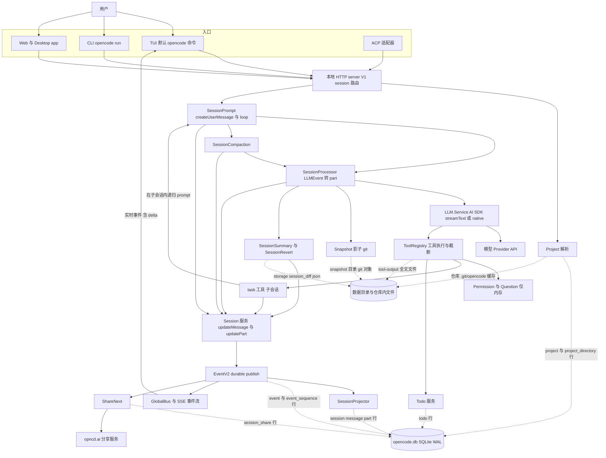
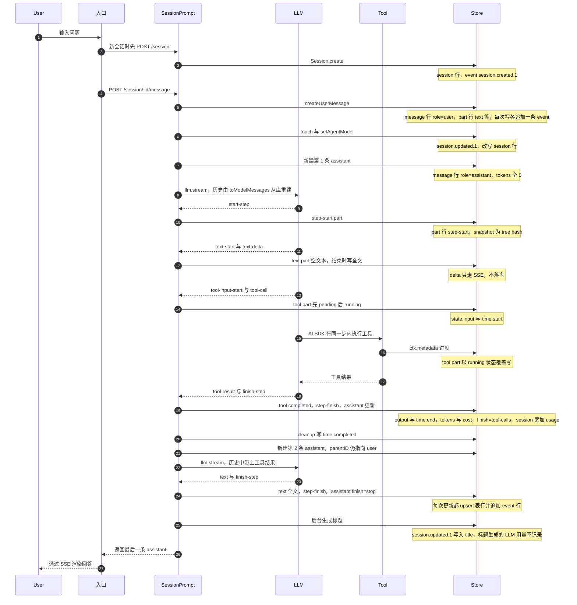
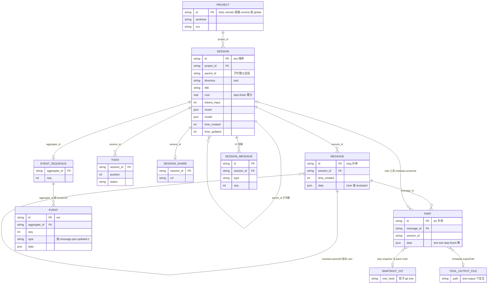

# OpenCode（anomalyco/opencode）会话与轨迹数据分析

> 面向 Tandem（本地跨 Agent 会话分析 Mac App）的数据接入设计。全部结论来自 HEAD 源码阅读；每条 schema / 写入行为论断都附 GitHub permalink（commit `63cf236`）。标注「源码推导」的内容未经运行验证；标注「待确认」的内容给出了原因。

## 0. 元信息

| 项 | 值 |
| --- | --- |
| 仓库 | `anomalyco/opencode`（原 `sst/opencode`），默认分支 `dev` |
| 分析 commit | `63cf236140b11c15cd645e90a7ded77bdc2193b4`（2026-10-01） |
| 版本 | `opencode` 与 `@opencode-ai/core` 包版本均为 `1.18.34`（[packages/opencode/package.json:3](https://github.com/anomalyco/opencode/blob/63cf236140b11c15cd645e90a7ded77bdc2193b4/packages/opencode/package.json#L3)） |
| 语言 / 运行时 | TypeScript；Bun（亦有 Node 入口）；Effect；Drizzle ORM + SQLite；LLM 默认经 Vercel AI SDK `streamText` |
| 分析方法 | 仅读源码、仓库内 spec 与测试；未运行 OpenCode、未安装依赖、未联网；本机没有 OpenCode 数据目录。源码是浅克隆（仅 1 个 commit），无法用 git 历史核对「何时改动」，时间线只能由迁移文件名里的时间戳与代码注释推断 |
| 一句话结论 | 当前后端是单个 SQLite 库 `~/.local/share/opencode/opencode.db`（WAL）。默认运行时（V1）把会话写进 `session` / `message` / `part` 三张表（`data` 列存 JSON），每一次写入还会在 `event` 表追加一条 durable 事件（事件溯源日志）。旧的按文件 JSON 存储已不再读写会话，只剩 `storage/session_diff/*.json`。同库中还有 V2（OpenCode 2.0 preview）的 `session_message` / `session_input` / `session_context_epoch` 表，默认 TUI/CLI 不写它们 |

## 1. 结构图与一次 chat 的数据流

### 1.1 组件表

| 组件 | 职责 | 源码位置 | 写出的记录 |
| --- | --- | --- | --- |
| 入口：TUI | 默认 `opencode` 命令；提交时调用 SDK `session.prompt`（V1 路由） | [packages/tui/src/component/prompt/index.tsx:1093-1111](https://github.com/anomalyco/opencode/blob/63cf236140b11c15cd645e90a7ded77bdc2193b4/packages/tui/src/component/prompt/index.tsx#L1093-L1111) | 无（经本地 server） |
| 入口：`opencode run` | 非交互 CLI；`--format json` 输出 NDJSON | [packages/opencode/src/cli/cmd/run.ts:678-691](https://github.com/anomalyco/opencode/blob/63cf236140b11c15cd645e90a7ded77bdc2193b4/packages/opencode/src/cli/cmd/run.ts#L678-L691)，[packages/opencode/src/cli/cmd/run.ts:864-870](https://github.com/anomalyco/opencode/blob/63cf236140b11c15cd645e90a7ded77bdc2193b4/packages/opencode/src/cli/cmd/run.ts#L864-L870) | 无（stdout） |
| 入口：Web/Desktop app、ACP | `promptAsync` / `session.prompt` | [packages/app/src/utils/server-compat.ts:200-201](https://github.com/anomalyco/opencode/blob/63cf236140b11c15cd645e90a7ded77bdc2193b4/packages/app/src/utils/server-compat.ts#L200-L201)，[packages/opencode/src/acp/service.ts:525](https://github.com/anomalyco/opencode/blob/63cf236140b11c15cd645e90a7ded77bdc2193b4/packages/opencode/src/acp/service.ts#L525) | 无 |
| 本地 HTTP server（V1） | `/session/...` 路由；`/event` SSE | [packages/opencode/src/server/routes/instance/httpapi/groups/session.ts:78-105](https://github.com/anomalyco/opencode/blob/63cf236140b11c15cd645e90a7ded77bdc2193b4/packages/opencode/src/server/routes/instance/httpapi/groups/session.ts#L78-L105) | 无（转调服务） |
| Project | 解析项目 ID、记录目录 | [packages/core/src/project.ts:110-126](https://github.com/anomalyco/opencode/blob/63cf236140b11c15cd645e90a7ded77bdc2193b4/packages/core/src/project.ts#L110-L126)，[packages/opencode/src/project/project.ts:213-310](https://github.com/anomalyco/opencode/blob/63cf236140b11c15cd645e90a7ded77bdc2193b4/packages/opencode/src/project/project.ts#L213-L310) | `project`、`project_directory`；`.git/opencode` |
| Session 服务 | 会话 CRUD；所有写入都转为 durable 事件 | [packages/opencode/src/session/session.ts:499-885](https://github.com/anomalyco/opencode/blob/63cf236140b11c15cd645e90a7ded77bdc2193b4/packages/opencode/src/session/session.ts#L499-L885) | `session.*` / `message.*` / `message.part.*` 事件 → 三表 |
| SessionPrompt | 生成 user message；主循环每轮新建 assistant；处理子任务、shell、命令、标题 | [packages/opencode/src/session/prompt.ts:635-1050](https://github.com/anomalyco/opencode/blob/63cf236140b11c15cd645e90a7ded77bdc2193b4/packages/opencode/src/session/prompt.ts#L635-L1050)，[packages/opencode/src/session/prompt.ts:1081-1341](https://github.com/anomalyco/opencode/blob/63cf236140b11c15cd645e90a7ded77bdc2193b4/packages/opencode/src/session/prompt.ts#L1081-L1341) | `message`、`part`、`session` |
| SessionProcessor | 把 `LLMEvent` 流转为 part 并维护 assistant | [packages/opencode/src/session/processor.ts:98-707](https://github.com/anomalyco/opencode/blob/63cf236140b11c15cd645e90a7ded77bdc2193b4/packages/opencode/src/session/processor.ts#L98-L707) | step-start/reasoning/text/tool/step-finish/patch part；assistant 更新 |
| LLM 层 | AI SDK `streamText`（默认）或原生运行时（实验） | [packages/opencode/src/session/llm.ts:224-353](https://github.com/anomalyco/opencode/blob/63cf236140b11c15cd645e90a7ded77bdc2193b4/packages/opencode/src/session/llm.ts#L224-L353)，[packages/opencode/src/session/llm/ai-sdk.ts:78-291](https://github.com/anomalyco/opencode/blob/63cf236140b11c15cd645e90a7ded77bdc2193b4/packages/opencode/src/session/llm/ai-sdk.ts#L78-L291) | 不直接写库 |
| 工具层 | 注册工具、执行、截断输出 | [packages/opencode/src/session/tools.ts:41-130](https://github.com/anomalyco/opencode/blob/63cf236140b11c15cd645e90a7ded77bdc2193b4/packages/opencode/src/session/tools.ts#L41-L130)，[packages/opencode/src/tool/tool.ts:99-149](https://github.com/anomalyco/opencode/blob/63cf236140b11c15cd645e90a7ded77bdc2193b4/packages/opencode/src/tool/tool.ts#L99-L149) | tool part 更新；`tool-output/` 文件 |
| Permission / Question | 询问与回复只在内存中排队 | [packages/opencode/src/permission/index.ts:67-167](https://github.com/anomalyco/opencode/blob/63cf236140b11c15cd645e90a7ded77bdc2193b4/packages/opencode/src/permission/index.ts#L67-L167) | **不落盘**（只发 live 事件） |
| task 工具（子代理） | 新建子会话并在其中递归 prompt | [packages/opencode/src/tool/task.ts:92-340](https://github.com/anomalyco/opencode/blob/63cf236140b11c15cd645e90a7ded77bdc2193b4/packages/opencode/src/tool/task.ts#L92-L340) | 子 `session` 行（`parent_id`）及其消息 |
| SessionCompaction | 自动/手动压缩、prune | [packages/opencode/src/session/compaction.ts:273-582](https://github.com/anomalyco/opencode/blob/63cf236140b11c15cd645e90a7ded77bdc2193b4/packages/opencode/src/session/compaction.ts#L273-L582) | compaction user + summary assistant + synthetic continue；`time.compacted` |
| Snapshot | 影子 git，`write-tree` / diff / restore | [packages/opencode/src/snapshot/index.ts:66-380](https://github.com/anomalyco/opencode/blob/63cf236140b11c15cd645e90a7ded77bdc2193b4/packages/opencode/src/snapshot/index.ts#L66-L380) | `snapshot/` 目录；part 中的 hash |
| SessionSummary / Revert | 按步计算 diff；撤销与提交 | [packages/opencode/src/session/summary.ts:82-127](https://github.com/anomalyco/opencode/blob/63cf236140b11c15cd645e90a7ded77bdc2193b4/packages/opencode/src/session/summary.ts#L82-L127)，[packages/opencode/src/session/revert.ts:38-124](https://github.com/anomalyco/opencode/blob/63cf236140b11c15cd645e90a7ded77bdc2193b4/packages/opencode/src/session/revert.ts#L38-L124) | `session.summary_*`/`revert`；user `summary.diffs`；`storage/session_diff` |
| Todo | todowrite 工具的存储 | [packages/opencode/src/session/todo.ts:29-66](https://github.com/anomalyco/opencode/blob/63cf236140b11c15cd645e90a7ded77bdc2193b4/packages/opencode/src/session/todo.ts#L29-L66) | `todo` 表 |
| EventV2 | durable 事件：同一事务内执行 projector 并写日志 | [packages/core/src/event.ts:205-439](https://github.com/anomalyco/opencode/blob/63cf236140b11c15cd645e90a7ded77bdc2193b4/packages/core/src/event.ts#L205-L439) | `event`、`event_sequence` |
| SessionProjector | 事件 → V1 三表 / V2 投影表 | [packages/core/src/session/projector.ts:210-453](https://github.com/anomalyco/opencode/blob/63cf236140b11c15cd645e90a7ded77bdc2193b4/packages/core/src/session/projector.ts#L210-L453) | `session`/`message`/`part`（V2：`session_message`/`session_input`） |
| EventV2Bridge / GlobalBus | 给事件附上 location，转发到 SSE | [packages/opencode/src/event-v2-bridge.ts:19-62](https://github.com/anomalyco/opencode/blob/63cf236140b11c15cd645e90a7ded77bdc2193b4/packages/opencode/src/event-v2-bridge.ts#L19-L62) | 无 |
| ShareNext | 分享与增量同步 | [packages/opencode/src/share/share-next.ts:112-336](https://github.com/anomalyco/opencode/blob/63cf236140b11c15cd645e90a7ded77bdc2193b4/packages/opencode/src/share/share-next.ts#L112-L336) | `session_share`；远端 opncd.ai |
| Database | 打开 SQLite、PRAGMA、迁移 | [packages/core/src/database/database.ts:22-55](https://github.com/anomalyco/opencode/blob/63cf236140b11c15cd645e90a7ded77bdc2193b4/packages/core/src/database/database.ts#L22-L55) | `opencode.db` |

### 1.2 图 1：结构与数据流（虚线 = 写入持久化）



### 1.3 图 2：一次 chat 的时序（1 次提问 + 1 次工具调用 + 最终回答）



要点：

- 所有写入都通过 `Session.updateMessage` / `updatePart` → `EventV2.publish` → 同一个 IMMEDIATE 事务里「projector upsert 表行 + 追加 event 行」（§4.1）。
- 工具执行发生在 AI SDK 的单步内部（`tools[x].execute`），由 `processor` 根据流里的 `tool-call` / `tool-result` 更新 tool part（[packages/opencode/src/session/tools.ts:92-133](https://github.com/anomalyco/opencode/blob/63cf236140b11c15cd645e90a7ded77bdc2193b4/packages/opencode/src/session/tools.ts#L92-L133)）。
- 第二次 LLM 调用是**新的一条 assistant message**，`parentID` 仍指向同一条 user message（§5.1）。

## 2. 存储布局

### 2.1 当前后端：SQLite（Drizzle），V1 表为主，事件日志为辅

- 打开数据库时设置 `journal_mode=WAL`、`synchronous=NORMAL`、`busy_timeout=5000`、`foreign_keys=ON`，然后执行迁移（[packages/core/src/database/database.ts:22-37](https://github.com/anomalyco/opencode/blob/63cf236140b11c15cd645e90a7ded77bdc2193b4/packages/core/src/database/database.ts#L22-L37)）。
- 表定义归 `packages/core`（`*.sql.ts` / `sql.ts`，见 [packages/core/drizzle.config.ts:5](https://github.com/anomalyco/opencode/blob/63cf236140b11c15cd645e90a7ded77bdc2193b4/packages/core/drizzle.config.ts#L5)）；`packages/opencode` 只是重新导出（[packages/opencode/src/storage/schema.ts:1-5](https://github.com/anomalyco/opencode/blob/63cf236140b11c15cd645e90a7ded77bdc2193b4/packages/opencode/src/storage/schema.ts#L1-L5)）。
- **默认运行时 = V1**：TUI 提交 prompt 调的是 SDK `session.prompt`，即 V1 路由 `POST /session/:sessionID/message`（[packages/tui/src/component/prompt/index.tsx:1093-1111](https://github.com/anomalyco/opencode/blob/63cf236140b11c15cd645e90a7ded77bdc2193b4/packages/tui/src/component/prompt/index.tsx#L1093-L1111)，[packages/opencode/src/server/routes/instance/httpapi/groups/session.ts:78-104](https://github.com/anomalyco/opencode/blob/63cf236140b11c15cd645e90a7ded77bdc2193b4/packages/opencode/src/server/routes/instance/httpapi/groups/session.ts#L78-L104)）。`opencode run` 同样走 `client.session.prompt`（[packages/opencode/src/cli/cmd/run.ts:864-870](https://github.com/anomalyco/opencode/blob/63cf236140b11c15cd645e90a7ded77bdc2193b4/packages/opencode/src/cli/cmd/run.ts#L864-L870)），Web/Desktop app 走 `legacy().session.promptAsync`（[packages/app/src/utils/server-compat.ts:200-201](https://github.com/anomalyco/opencode/blob/63cf236140b11c15cd645e90a7ded77bdc2193b4/packages/app/src/utils/server-compat.ts#L200-L201)）。spec 也写明 V2 runner 尚未取代 V1（[specs/v2/session.md:123-125](https://github.com/anomalyco/opencode/blob/63cf236140b11c15cd645e90a7ded77bdc2193b4/specs/v2/session.md#L123-L125)），`session.next.*` 事件「experimental and unshipped」（[specs/v2/session.md:173](https://github.com/anomalyco/opencode/blob/63cf236140b11c15cd645e90a7ded77bdc2193b4/specs/v2/session.md#L173)）。
- **V2 表**只有在调用 V2 `/api/session/*`（`@opencode-ai/server` + `@opencode-ai/protocol`，例如「OpenCode 2.0 preview」CLI，[packages/cli/src/commands/commands.ts:7](https://github.com/anomalyco/opencode/blob/63cf236140b11c15cd645e90a7ded77bdc2193b4/packages/cli/src/commands/commands.ts#L7)）时才会写入；该 CLI 的「Migrate v1 data to v2」目前只打印 `No migrations to run.`（[packages/cli/src/commands/handlers/migrate.ts:5](https://github.com/anomalyco/opencode/blob/63cf236140b11c15cd645e90a7ded77bdc2193b4/packages/cli/src/commands/handlers/migrate.ts#L5)）。
- **旧 JSON 文件存储**：`Storage` 服务仍在（`<data>/storage/<key...>.json`，[packages/opencode/src/storage/storage.ts:63-65](https://github.com/anomalyco/opencode/blob/63cf236140b11c15cd645e90a7ded77bdc2193b4/packages/opencode/src/storage/storage.ts#L63-L65)、[packages/opencode/src/storage/storage.ts:224](https://github.com/anomalyco/opencode/blob/63cf236140b11c15cd645e90a7ded77bdc2193b4/packages/opencode/src/storage/storage.ts#L224)），但 HEAD 里唯一的调用方是 revert 写 `session_diff/<sessionID>.json`（[packages/opencode/src/session/revert.ts:77](https://github.com/anomalyco/opencode/blob/63cf236140b11c15cd645e90a7ded77bdc2193b4/packages/opencode/src/session/revert.ts#L77)）。JSON→SQLite 的启动迁移已被删除（[specs/storage/remove-opencode-db.md:61](https://github.com/anomalyco/opencode/blob/63cf236140b11c15cd645e90a7ded77bdc2193b4/specs/storage/remove-opencode-db.md#L61)）；全仓 grep 不到任何读取旧 `storage/session|message|part` 会话文件的代码，只剩 `Storage` 自带的两个「旧目录 → 新目录」JSON 搬迁步骤（[packages/opencode/src/storage/storage.ts:81-211](https://github.com/anomalyco/opencode/blob/63cf236140b11c15cd645e90a7ded77bdc2193b4/packages/opencode/src/storage/storage.ts#L81-L211)）。

### 2.2 数据根目录与覆盖方式

| 项 | 规则 | 依据 |
| --- | --- | --- |
| 数据根 `Global.Path.data` | `path.join(xdgData, "opencode")`；`xdgData` 来自 `xdg-basedir@5.1.0`，即 `$XDG_DATA_HOME`，未设置时为 `~/.local/share`。**macOS 也是 `~/.local/share/opencode`，不是 `~/Library/...`**；Windows 为 `%USERPROFILE%\.local\share\opencode` | [packages/core/src/global.ts:10-29](https://github.com/anomalyco/opencode/blob/63cf236140b11c15cd645e90a7ded77bdc2193b4/packages/core/src/global.ts#L10-L29)，[packages/core/package.json:127](https://github.com/anomalyco/opencode/blob/63cf236140b11c15cd645e90a7ded77bdc2193b4/packages/core/package.json#L127)，[packages/web/src/content/docs/troubleshooting.mdx:25-28](https://github.com/anomalyco/opencode/blob/63cf236140b11c15cd645e90a7ded77bdc2193b4/packages/web/src/content/docs/troubleshooting.mdx#L25-L28) |
| 库文件名 | `OPENCODE_DB` 设置时：`:memory:` 或绝对路径原样使用，相对路径拼到数据根；否则渠道为 `latest`/`beta`/`prod` 或 `OPENCODE_DISABLE_CHANNEL_DB=1/true` 时为 `opencode.db`；其他渠道为 `opencode-<channel>.db`（源码直接运行时渠道默认 `local` → `opencode-local.db`） | [packages/core/src/database/database.ts:43-55](https://github.com/anomalyco/opencode/blob/63cf236140b11c15cd645e90a7ded77bdc2193b4/packages/core/src/database/database.ts#L43-L55)，[packages/core/src/installation/version.ts:6-8](https://github.com/anomalyco/opencode/blob/63cf236140b11c15cd645e90a7ded77bdc2193b4/packages/core/src/installation/version.ts#L6-L8)，[packages/core/src/flag/flag.ts:47](https://github.com/anomalyco/opencode/blob/63cf236140b11c15cd645e90a7ded77bdc2193b4/packages/core/src/flag/flag.ts#L47) |
| 自查命令 | `opencode db path` 打印库路径；`opencode db "<SQL>" --format json` 直接查询 | [packages/opencode/src/cli/cmd/db.ts:8-52](https://github.com/anomalyco/opencode/blob/63cf236140b11c15cd645e90a7ded77bdc2193b4/packages/opencode/src/cli/cmd/db.ts#L8-L52) |
| 文档滞后 | 官方 troubleshooting 仍写「`project/<slug>/storage/`」，那是更早的 JSON 布局，已不符合 HEAD | [packages/web/src/content/docs/troubleshooting.mdx:30-36](https://github.com/anomalyco/opencode/blob/63cf236140b11c15cd645e90a7ded77bdc2193b4/packages/web/src/content/docs/troubleshooting.mdx#L30-L36) |

### 2.3 目录结构（HEAD）

```text
$XDG_DATA_HOME/opencode/        默认 ~/.local/share/opencode/
├── opencode.db                 主库（另有 -wal / -shm）；非 latest/beta/prod 渠道为 opencode-<channel>.db
├── snapshot/<projectID>/<sha1(worktree)>/
│                               影子 git 目录（--git-dir），只存对象与 index，用于 step 快照与 revert
├── tool-output/tool_<id>       工具大输出的全文；保留 7 天后清理
├── storage/                    旧 JSON storage 根
│   ├── migration               旧 JSON 搬迁计数
│   ├── session_diff/<sessionID>.json   revert 时写入（HEAD 仍会写）
│   └── session/ message/ part/ project/   更早版本残留，HEAD 不再读取
├── plans/<time>-<slug>.md      非 git 项目的 plan 文件（git 项目在 <worktree>/.opencode/plans/）
├── worktree/<projectID>/       实验性 worktree
├── log/  repos/                日志、仓库缓存
└── auth.json  mcp-auth.json    凭据（Tandem 不应读取）
<repo>/.git/opencode            项目 ID 缓存文件（写在 git common dir）
```

依据：快照目录 [packages/opencode/src/snapshot/index.ts:71](https://github.com/anomalyco/opencode/blob/63cf236140b11c15cd645e90a7ded77bdc2193b4/packages/opencode/src/snapshot/index.ts#L71)；`tool-output` [packages/opencode/src/tool/truncation-dir.ts:4](https://github.com/anomalyco/opencode/blob/63cf236140b11c15cd645e90a7ded77bdc2193b4/packages/opencode/src/tool/truncation-dir.ts#L4) 与保留期 [packages/opencode/src/tool/truncate.ts:12-15](https://github.com/anomalyco/opencode/blob/63cf236140b11c15cd645e90a7ded77bdc2193b4/packages/opencode/src/tool/truncate.ts#L12-L15)；plan 路径 [packages/opencode/src/session/session.ts:331-336](https://github.com/anomalyco/opencode/blob/63cf236140b11c15cd645e90a7ded77bdc2193b4/packages/opencode/src/session/session.ts#L331-L336)；worktree [packages/opencode/src/worktree/index.ts:208](https://github.com/anomalyco/opencode/blob/63cf236140b11c15cd645e90a7ded77bdc2193b4/packages/opencode/src/worktree/index.ts#L208)；`auth.json` [packages/opencode/src/auth/index.ts:10](https://github.com/anomalyco/opencode/blob/63cf236140b11c15cd645e90a7ded77bdc2193b4/packages/opencode/src/auth/index.ts#L10)；`mcp-auth.json` [packages/opencode/src/mcp/auth.ts:37](https://github.com/anomalyco/opencode/blob/63cf236140b11c15cd645e90a7ded77bdc2193b4/packages/opencode/src/mcp/auth.ts#L37)；`log`/`repos` [packages/core/src/global.ts:17-29](https://github.com/anomalyco/opencode/blob/63cf236140b11c15cd645e90a7ded77bdc2193b4/packages/core/src/global.ts#L17-L29)；`.git/opencode` [packages/core/src/project.ts:65-71](https://github.com/anomalyco/opencode/blob/63cf236140b11c15cd645e90a7ded77bdc2193b4/packages/core/src/project.ts#L65-L71)、[packages/core/src/project.ts:124-126](https://github.com/anomalyco/opencode/blob/63cf236140b11c15cd645e90a7ded77bdc2193b4/packages/core/src/project.ts#L124-L126)。

### 2.4 SQLite 表清单

新库直接执行生成的完整 DDL，并把所有迁移 ID 记为已完成；已有库按 `migration` 表逐个补跑（[packages/core/src/database/migration.ts:18-41](https://github.com/anomalyco/opencode/blob/63cf236140b11c15cd645e90a7ded77bdc2193b4/packages/core/src/database/migration.ts#L18-L41)、[packages/core/src/database/migration.ts:96-106](https://github.com/anomalyco/opencode/blob/63cf236140b11c15cd645e90a7ded77bdc2193b4/packages/core/src/database/migration.ts#L96-L106)）。完整 DDL 见 [packages/core/src/database/schema.gen.ts:7-271](https://github.com/anomalyco/opencode/blob/63cf236140b11c15cd645e90a7ded77bdc2193b4/packages/core/src/database/schema.gen.ts#L7-L271)。

| 表 | 内容 | 默认 V1 运行时是否写 | 对 Tandem |
| --- | --- | --- | --- |
| `session` | 会话元数据 + 累计 cost/tokens | 是 | 核心 |
| `message` | 消息，`data` 为 JSON（User/Assistant） | 是 | 核心 |
| `part` | 消息片段，`data` 为 JSON（text/tool/step-finish…） | 是 | 核心 |
| `event` / `event_sequence` | durable 事件日志（每会话一个 aggregate，`seq` 递增）/ 每会话最新序号 | 是 | 增量同步、历史版本 |
| `todo` | 当前 todo 列表（每次整体替换） | 是 | 可选 |
| `project` / `project_directory` | 项目（worktree、vcs）/ 项目打开过的目录 | 是 | 项目归属 |
| `session_share` | 分享 id、**secret**、url | 分享时 | 只取 url |
| `workspace` | 实验性 workspace | 实验功能 | 可忽略 |
| `permission` | V2 已保存的「always」授权（project/action/resource） | 否（V2） | 可忽略 |
| `session_message` / `session_input` / `session_context_epoch` | V2 投影消息 / prompt 收件箱 / system context 基线 | 否（V2 preview） | 需兼容 |
| `account` / `account_state` / `control_account` / `credential` | 账号、OAuth token、凭据值 | — | **禁止读取** |
| `migration` / `data_migration`（及旧库残留 `__drizzle_migrations`） | 迁移记录 | — | 版本探测 |

### 2.5 ID 规则

| 对象 | 格式 | 方向 | 依据 |
| --- | --- | --- | --- |
| 会话 | `ses_` + 26 字符 | **降序**（新会话字典序更小） | [packages/schema/src/session-id.ts:5-14](https://github.com/anomalyco/opencode/blob/63cf236140b11c15cd645e90a7ded77bdc2193b4/packages/schema/src/session-id.ts#L5-L14) |
| 消息 / part | `msg_` / `prt_` + 26 字符 | 升序 | [packages/schema/src/v1/session.ts:17-27](https://github.com/anomalyco/opencode/blob/63cf236140b11c15cd645e90a7ded77bdc2193b4/packages/schema/src/v1/session.ts#L17-L27) |
| 事件 | `evt_` + 26 字符 | 升序 | [packages/schema/src/event.ts:9-12](https://github.com/anomalyco/opencode/blob/63cf236140b11c15cd645e90a7ded77bdc2193b4/packages/schema/src/event.ts#L9-L12) |
| 其他前缀 | `per`（权限请求）、`que`（问题）、`tool`（`tool-output` 文件名）、`wrk`、`pty`、`job` | — | [packages/opencode/src/id/id.ts:3-14](https://github.com/anomalyco/opencode/blob/63cf236140b11c15cd645e90a7ded77bdc2193b4/packages/opencode/src/id/id.ts#L3-L14) |
| 工具调用 `callID` | 模型 provider 给的 tool call id（如 Anthropic/OpenAI 的原生 id）；用户 `!shell` 与 subtask/命令触发的 task 用 `ulid()` | — | [packages/opencode/src/session/prompt.ts:288](https://github.com/anomalyco/opencode/blob/63cf236140b11c15cd645e90a7ded77bdc2193b4/packages/opencode/src/session/prompt.ts#L288)、[packages/opencode/src/session/prompt.ts:511](https://github.com/anomalyco/opencode/blob/63cf236140b11c15cd645e90a7ded77bdc2193b4/packages/opencode/src/session/prompt.ts#L511) |
| 项目 ID | ① 有 `origin` remote：`sha1("git-remote:" + 小写host/路径去.git)`；② 否则读 `<git common dir>/opencode` 缓存；③ 否则最小的根 commit SHA（`git rev-list --max-parents=0 HEAD` 排序取首个）；④ 非 git 目录为 `"global"`（worktree 记为 `/`） | — | [packages/core/src/project.ts:65-122](https://github.com/anomalyco/opencode/blob/63cf236140b11c15cd645e90a7ded77bdc2193b4/packages/core/src/project.ts#L65-L122)，[packages/core/src/git.ts:205-219](https://github.com/anomalyco/opencode/blob/63cf236140b11c15cd645e90a7ded77bdc2193b4/packages/core/src/git.ts#L205-L219)，[packages/opencode/src/project/project.ts:213-218](https://github.com/anomalyco/opencode/blob/63cf236140b11c15cd645e90a7ded77bdc2193b4/packages/opencode/src/project/project.ts#L213-L218) |

ID 生成算法（[packages/schema/src/identifier.ts:14-30](https://github.com/anomalyco/opencode/blob/63cf236140b11c15cd645e90a7ded77bdc2193b4/packages/schema/src/identifier.ts#L14-L30)）：`value = timestamp_ms * 0x1000 + counter`（counter 在同一毫秒、同一进程内自增），降序时取按位非；然后**只取 `value` 的低 48 位**编码为 12 位 hex，再接 14 位 base62 随机字符。

- **陷阱（源码推导）**：低 48 位 ÷ 4096 = 2^36 ms ≈ 795.4 天，所以 hex 前缀每约 2.18 年回绕一次。按 `k × 2^36 ms` 计算，最近一次回绕在 **2026-08-14 11:19:55 UTC**，下一次在 2028-10-17。回绕点前后生成的 ID 字典序与时间序相反。OpenCode 自己排序消息用 `(time_created, id)`（[packages/opencode/src/session/message-v2.ts:443](https://github.com/anomalyco/opencode/blob/63cf236140b11c15cd645e90a7ded77bdc2193b4/packages/opencode/src/session/message-v2.ts#L443)），注释也说明 ID 只是确定性的 tie-breaker（[packages/opencode/src/session/message-v2.ts:582-585](https://github.com/anomalyco/opencode/blob/63cf236140b11c15cd645e90a7ded77bdc2193b4/packages/opencode/src/session/message-v2.ts#L582-L585)）。`Identifier.timestamp()` 从 ID 解出的时间同样会回绕（[packages/opencode/src/id/id.ts:72-78](https://github.com/anomalyco/opencode/blob/63cf236140b11c15cd645e90a7ded77bdc2193b4/packages/opencode/src/id/id.ts#L72-L78)）。**Tandem 不要用 ID 推时间，也不要只按 ID 排序。**
- part 在消息内按 `id` 升序排列（[packages/opencode/src/session/message-v2.ts:103-108](https://github.com/anomalyco/opencode/blob/63cf236140b11c15cd645e90a7ded77bdc2193b4/packages/opencode/src/session/message-v2.ts#L103-L108)、[packages/opencode/src/session/message-v2.ts:496-507](https://github.com/anomalyco/opencode/blob/63cf236140b11c15cd645e90a7ded77bdc2193b4/packages/opencode/src/session/message-v2.ts#L496-L507)）。只有恰好跨越回绕瞬间的消息才会乱序，可忽略。
- 项目 ID 可能变化：若同一仓库先用「根 commit」后来加了 `origin`，`migrateProjectId` 会在一个 IMMEDIATE 事务里把旧 ID 下的 session/workspace 改挂到新 ID 并删除旧 project 行（[packages/opencode/src/project/project.ts:146-193](https://github.com/anomalyco/opencode/blob/63cf236140b11c15cd645e90a7ded77bdc2193b4/packages/opencode/src/project/project.ts#L146-L193)）；非 git 目录先挂在 `global` 下，变成 git 仓库后会按 `directory` 迁到新项目（[packages/opencode/src/project/project.ts:291-298](https://github.com/anomalyco/opencode/blob/63cf236140b11c15cd645e90a7ded77bdc2193b4/packages/opencode/src/project/project.ts#L291-L298)）。

### 2.6 旧格式与迁移时间线

| 阶段 | 形态 | 依据 / 推断 |
| --- | --- | --- |
| A. 最早 JSON | `<data>/project/<projectDir>/storage/session/{info,message,part}/…json`（按项目目录） | `Storage` 迁移 1 把它搬到 B（[packages/opencode/src/storage/storage.ts:82-181](https://github.com/anomalyco/opencode/blob/63cf236140b11c15cd645e90a7ded77bdc2193b4/packages/opencode/src/storage/storage.ts#L82-L181)）；官方文档仍描述此布局 |
| B. 扁平 JSON | `storage/project/<projectID>.json`、`storage/session/<projectID>/<sessionID>.json`、`storage/message/<sessionID>/<messageID>.json`、`storage/part/<messageID>/<partID>.json`、`storage/session_diff/<sessionID>.json` | 迁移 1、2 的目标路径（[packages/opencode/src/storage/storage.ts:121-208](https://github.com/anomalyco/opencode/blob/63cf236140b11c15cd645e90a7ded77bdc2193b4/packages/opencode/src/storage/storage.ts#L121-L208)）；文件内容与今天 `message.data` / `part.data` 同源（同一 Message/Part schema，只多了 id 字段）——源码推导 |
| C. SQLite 引入 | 首个迁移 `20260127222353_familiar_lady_ursula` 建 `project/message/part/permission/session/todo/session_share` | [packages/core/src/database/migration/20260127222353_familiar_lady_ursula.ts:5-104](https://github.com/anomalyco/opencode/blob/63cf236140b11c15cd645e90a7ded77bdc2193b4/packages/core/src/database/migration/20260127222353_familiar_lady_ursula.ts#L5-L104)。由时间戳推断 SQLite 后端约在 2026 年 1–2 月上线；对应 OpenCode 版本号**待确认**（浅克隆无历史） |
| C'. JSON→SQLite 导入 | 曾在启动时执行，HEAD 已删除 | [specs/storage/remove-opencode-db.md:61](https://github.com/anomalyco/opencode/blob/63cf236140b11c15cd645e90a7ded77bdc2193b4/specs/storage/remove-opencode-db.md#L61)。删除时间**待确认**。直接从 B 阶段升级到 HEAD 的用户，旧会话不会出现在库里 |
| D. 迁移表切换 | 旧库用 Drizzle 的 `__drizzle_migrations`，首次运行时导入到自有 `migration` 表 | [packages/core/src/database/migration.ts:51-94](https://github.com/anomalyco/opencode/blob/63cf236140b11c15cd645e90a7ded77bdc2193b4/packages/core/src/database/migration.ts#L51-L94) |
| E. 列演进 | `session.workspace_id`（2026-02-27）、`session.path`（04-28）、`session.agent/model`（05-01）、`session.cost/tokens_*` 并按 assistant 消息回填（05-10）、`session.metadata`（05-11） | [packages/core/src/database/migration.gen.ts:3-44](https://github.com/anomalyco/opencode/blob/63cf236140b11c15cd645e90a7ded77bdc2193b4/packages/core/src/database/migration.gen.ts#L3-L44)，回填 SQL [packages/core/src/database/migration/20260510033149_session_usage.ts:7-53](https://github.com/anomalyco/opencode/blob/63cf236140b11c15cd645e90a7ded77bdc2193b4/packages/core/src/database/migration/20260510033149_session_usage.ts#L7-L53) |
| F. 事件溯源 | `event` / `event_sequence`（2026-03-23），`owner_id`（05-04） | [packages/core/src/database/migration/20260323234822_events.ts:8-24](https://github.com/anomalyco/opencode/blob/63cf236140b11c15cd645e90a7ded77bdc2193b4/packages/core/src/database/migration/20260323234822_events.ts#L8-L24) |
| G. V2 表与清空 | `session_entry`（04-13）→ `session_message`（04-27）；`session_input`（06-03）；`session_context_epoch`（06-05）。06-03、06-04、06-22 的迁移多次 `DELETE FROM` V2 表以及 **`event` / `event_sequence`**，但保留 V1 的 session/message/part | [packages/core/src/database/migration/20260604172448_event_sourced_session_input.ts:8-12](https://github.com/anomalyco/opencode/blob/63cf236140b11c15cd645e90a7ded77bdc2193b4/packages/core/src/database/migration/20260604172448_event_sourced_session_input.ts#L8-L12)，[packages/core/src/database/migration/20260622202450_simplify_session_input.ts:8-14](https://github.com/anomalyco/opencode/blob/63cf236140b11c15cd645e90a7ded77bdc2193b4/packages/core/src/database/migration/20260622202450_simplify_session_input.ts#L8-L14)；测试断言「preserves canonical V1 state and restarts its event stream」（[packages/core/test/database-migration.test.ts:298-383](https://github.com/anomalyco/opencode/blob/63cf236140b11c15cd645e90a7ded77bdc2193b4/packages/core/test/database-migration.test.ts#L298-L383)） |
| H. 权限表重建 | 旧 `permission`（project_id 主键 + data JSON）被删除，重建为 V2 saved 授权表 | [packages/core/src/database/migration/20260601202201_amazing_prowler.ts:8](https://github.com/anomalyco/opencode/blob/63cf236140b11c15cd645e90a7ded77bdc2193b4/packages/core/src/database/migration/20260601202201_amazing_prowler.ts#L8)，[packages/core/src/database/migration/20260602002951_lowly_union_jack.ts:8-21](https://github.com/anomalyco/opencode/blob/63cf236140b11c15cd645e90a7ded77bdc2193b4/packages/core/src/database/migration/20260602002951_lowly_union_jack.ts#L8-L21) |

推论：**`event` 表不是完整历史**。2026-06-22 之前产生的事件已被清空，`import` 命令直接写表、不发事件（见 §5.7），会话删除时还会删掉该会话的事件。会话内容的权威来源始终是 `message` / `part`。

### 2.7 快照（snapshot）

- 仅当项目 `vcs == "git"` 且配置 `snapshot !== false` 时启用（[packages/opencode/src/snapshot/index.ts:167-170](https://github.com/anomalyco/opencode/blob/63cf236140b11c15cd645e90a7ded77bdc2193b4/packages/opencode/src/snapshot/index.ts#L167-L170)）。
- 影子仓库：`--git-dir <data>/snapshot/<projectID>/<sha1(worktree)>`、`--work-tree <worktree>`；`track()` 执行 `add` + `write-tree`，返回的是 **tree hash**（不是 commit）（[packages/opencode/src/snapshot/index.ts:318-347](https://github.com/anomalyco/opencode/blob/63cf236140b11c15cd645e90a7ded77bdc2193b4/packages/opencode/src/snapshot/index.ts#L318-L347)）；`patch(hash)` 用 `git diff --cached --name-only` 得到变更文件绝对路径（[packages/opencode/src/snapshot/index.ts:349-380](https://github.com/anomalyco/opencode/blob/63cf236140b11c15cd645e90a7ded77bdc2193b4/packages/opencode/src/snapshot/index.ts#L349-L380)）。`sha1` 见 [packages/core/src/util/hash.ts:4-6](https://github.com/anomalyco/opencode/blob/63cf236140b11c15cd645e90a7ded77bdc2193b4/packages/core/src/util/hash.ts#L4-L6)。
- 定期 `git gc --prune=7.days`（[packages/opencode/src/snapshot/index.ts:23](https://github.com/anomalyco/opencode/blob/63cf236140b11c15cd645e90a7ded77bdc2193b4/packages/opencode/src/snapshot/index.ts#L23)、[packages/opencode/src/snapshot/index.ts:305](https://github.com/anomalyco/opencode/blob/63cf236140b11c15cd645e90a7ded77bdc2193b4/packages/opencode/src/snapshot/index.ts#L305)）。因此旧 part 里记录的 tree hash 可能已不可解析。

### 2.8 相关环境变量与配置

| 变量 / 配置 | 作用 | 依据 |
| --- | --- | --- |
| `XDG_DATA_HOME` | 改数据根 | [packages/core/src/global.ts:10-11](https://github.com/anomalyco/opencode/blob/63cf236140b11c15cd645e90a7ded77bdc2193b4/packages/core/src/global.ts#L10-L11) |
| `OPENCODE_DB` | 指定库文件（绝对 / 相对数据根 / `:memory:`） | [packages/core/src/database/database.ts:44-46](https://github.com/anomalyco/opencode/blob/63cf236140b11c15cd645e90a7ded77bdc2193b4/packages/core/src/database/database.ts#L44-L46) |
| `OPENCODE_DISABLE_CHANNEL_DB` | 非正式渠道也用 `opencode.db` | [packages/core/src/database/database.ts:48-53](https://github.com/anomalyco/opencode/blob/63cf236140b11c15cd645e90a7ded77bdc2193b4/packages/core/src/database/database.ts#L48-L53) |
| `OPENCODE_EXPERIMENTAL_NATIVE_LLM` / `OPENCODE_EXPERIMENTAL` | 改走原生 LLM 运行时（落盘形态相同） | [packages/opencode/src/session/llm/AGENTS.md:85-88](https://github.com/anomalyco/opencode/blob/63cf236140b11c15cd645e90a7ded77bdc2193b4/packages/opencode/src/session/llm/AGENTS.md#L85-L88) |
| `OPENCODE_EXPERIMENTAL_BACKGROUND_SUBAGENTS` | 允许后台子代理 | [packages/opencode/src/tool/task.ts:97-102](https://github.com/anomalyco/opencode/blob/63cf236140b11c15cd645e90a7ded77bdc2193b4/packages/opencode/src/tool/task.ts#L97-L102) |
| 配置 `snapshot: false` | 不建快照，step 上无 snapshot、无 patch part | [packages/opencode/src/snapshot/index.ts:167-170](https://github.com/anomalyco/opencode/blob/63cf236140b11c15cd645e90a7ded77bdc2193b4/packages/opencode/src/snapshot/index.ts#L167-L170) |
| 配置 `tool_output.max_lines/max_bytes` | 工具输出截断阈值（默认 2000 行 / 50 KB） | [packages/opencode/src/tool/truncate.ts:75-83](https://github.com/anomalyco/opencode/blob/63cf236140b11c15cd645e90a7ded77bdc2193b4/packages/opencode/src/tool/truncate.ts#L75-L83) |
| 配置 `compaction.auto` / `compaction.prune`、`OPENCODE_DISABLE_AUTOCOMPACT` | 自动压缩与旧工具输出修剪 | [packages/opencode/src/session/compaction.ts:273-276](https://github.com/anomalyco/opencode/blob/63cf236140b11c15cd645e90a7ded77bdc2193b4/packages/opencode/src/session/compaction.ts#L273-L276)，[packages/core/src/flag/flag.ts:28](https://github.com/anomalyco/opencode/blob/63cf236140b11c15cd645e90a7ded77bdc2193b4/packages/core/src/flag/flag.ts#L28) |

## 3. 记录 schema

所有时间戳都是 **Unix 毫秒整数**（`Date.now()`）。`message.data` / `part.data` 是去掉了外键字段的 JSON：`message.data` 不含 `id`、`sessionID`；`part.data` 不含 `id`、`sessionID`、`messageID`（这些在列里）（[packages/core/src/session/projector.ts:77-87](https://github.com/anomalyco/opencode/blob/63cf236140b11c15cd645e90a7ded77bdc2193b4/packages/core/src/session/projector.ts#L77-L87)）。读取时 OpenCode 把列合并回对象（[packages/opencode/src/session/message-v2.ts:80-93](https://github.com/anomalyco/opencode/blob/63cf236140b11c15cd645e90a7ded77bdc2193b4/packages/opencode/src/session/message-v2.ts#L80-L93)）。`time_created` / `time_updated` 两列由 Drizzle 维护：插入时默认 `Date.now()`，更新时由 `$onUpdate` 刷新（[packages/core/src/database/schema.sql.ts:3-10](https://github.com/anomalyco/opencode/blob/63cf236140b11c15cd645e90a7ded77bdc2193b4/packages/core/src/database/schema.sql.ts#L3-L10)）。

### 3.1 DDL 摘录（新库建表语句，原文节选）

```sql
CREATE TABLE `session` (
  `id` text PRIMARY KEY, `project_id` text NOT NULL, `workspace_id` text, `parent_id` text,
  `slug` text NOT NULL, `directory` text NOT NULL, `path` text, `title` text NOT NULL, `version` text NOT NULL,
  `share_url` text, `summary_additions` integer, `summary_deletions` integer, `summary_files` integer,
  `summary_diffs` text, `metadata` text, `cost` real DEFAULT 0 NOT NULL,
  `tokens_input` integer DEFAULT 0 NOT NULL, `tokens_output` integer DEFAULT 0 NOT NULL,
  `tokens_reasoning` integer DEFAULT 0 NOT NULL, `tokens_cache_read` integer DEFAULT 0 NOT NULL,
  `tokens_cache_write` integer DEFAULT 0 NOT NULL, `revert` text, `permission` text, `agent` text, `model` text,
  `time_created` integer NOT NULL, `time_updated` integer NOT NULL, `time_compacting` integer, `time_archived` integer,
  CONSTRAINT `fk_session_project_id_project_id_fk` FOREIGN KEY (`project_id`) REFERENCES `project`(`id`) ON DELETE CASCADE
);
CREATE TABLE `message` (
  `id` text PRIMARY KEY, `session_id` text NOT NULL, `time_created` integer NOT NULL, `time_updated` integer NOT NULL,
  `data` text NOT NULL,
  CONSTRAINT `fk_message_session_id_session_id_fk` FOREIGN KEY (`session_id`) REFERENCES `session`(`id`) ON DELETE CASCADE
);
CREATE TABLE `part` (
  `id` text PRIMARY KEY, `message_id` text NOT NULL, `session_id` text NOT NULL, `time_created` integer NOT NULL,
  `time_updated` integer NOT NULL, `data` text NOT NULL,
  CONSTRAINT `fk_part_message_id_message_id_fk` FOREIGN KEY (`message_id`) REFERENCES `message`(`id`) ON DELETE CASCADE
);
CREATE TABLE `event_sequence` (`aggregate_id` text PRIMARY KEY, `seq` integer NOT NULL, `owner_id` text);
CREATE TABLE `event` (
  `id` text PRIMARY KEY, `aggregate_id` text NOT NULL, `seq` integer NOT NULL, `type` text NOT NULL, `data` text NOT NULL,
  CONSTRAINT `fk_event_aggregate_id_event_sequence_aggregate_id_fk` FOREIGN KEY (`aggregate_id`) REFERENCES `event_sequence`(`aggregate_id`) ON DELETE CASCADE
);
CREATE INDEX `message_session_time_created_id_idx` ON `message` (`session_id`,`time_created`,`id`);
CREATE INDEX `part_message_id_id_idx` ON `part` (`message_id`,`id`);
CREATE UNIQUE INDEX `event_aggregate_seq_idx` ON `event` (`aggregate_id`,`seq`);
```

出处：session [packages/core/src/database/schema.gen.ts:181-213](https://github.com/anomalyco/opencode/blob/63cf236140b11c15cd645e90a7ded77bdc2193b4/packages/core/src/database/schema.gen.ts#L181-L213)；message [packages/core/src/database/schema.gen.ts:127-136](https://github.com/anomalyco/opencode/blob/63cf236140b11c15cd645e90a7ded77bdc2193b4/packages/core/src/database/schema.gen.ts#L127-L136)；part [packages/core/src/database/schema.gen.ts:137-147](https://github.com/anomalyco/opencode/blob/63cf236140b11c15cd645e90a7ded77bdc2193b4/packages/core/src/database/schema.gen.ts#L137-L147)；event_sequence / event [packages/core/src/database/schema.gen.ts:72-88](https://github.com/anomalyco/opencode/blob/63cf236140b11c15cd645e90a7ded77bdc2193b4/packages/core/src/database/schema.gen.ts#L72-L88)；索引 [packages/core/src/database/schema.gen.ts:239-271](https://github.com/anomalyco/opencode/blob/63cf236140b11c15cd645e90a7ded77bdc2193b4/packages/core/src/database/schema.gen.ts#L239-L271)。Drizzle 定义：[packages/core/src/session/sql.ts:22-98](https://github.com/anomalyco/opencode/blob/63cf236140b11c15cd645e90a7ded77bdc2193b4/packages/core/src/session/sql.ts#L22-L98)。

### 3.2 `session` 表

| 列 | 类型 | 含义 / 取值 | 写入方 |
| --- | --- | --- | --- |
| `id` | text PK | `ses_…`（降序 ID） | 创建（[packages/opencode/src/session/session.ts:499-538](https://github.com/anomalyco/opencode/blob/63cf236140b11c15cd645e90a7ded77bdc2193b4/packages/opencode/src/session/session.ts#L499-L538)） |
| `project_id` | text FK | 项目 ID（§2.5） | 创建；项目 ID 迁移时改写 |
| `workspace_id` | text | 实验性 workspace | 创建 / `setWorkspace` |
| `parent_id` | text | **父会话 ID**（task 子代理） | task 工具创建子会话（[packages/opencode/src/tool/task.ts:156-172](https://github.com/anomalyco/opencode/blob/63cf236140b11c15cd645e90a7ded77bdc2193b4/packages/opencode/src/tool/task.ts#L156-L172)） |
| `slug` | text | 随机 slug（plan 文件名） | 创建 |
| `directory` | text | 创建会话时的 cwd（绝对路径；Windows 反斜杠规范为 `/`） | 创建；V2 `moved` 事件 |
| `path` | text | `directory` 相对 worktree 的子路径（`/` 分隔） | 创建（[packages/opencode/src/session/session.ts:171-173](https://github.com/anomalyco/opencode/blob/63cf236140b11c15cd645e90a7ded77bdc2193b4/packages/opencode/src/session/session.ts#L171-L173)） |
| `title` | text | 默认 `New session - <ISO时间>` / `Child session - <ISO时间>`；第 1 步后由 `title` agent 生成（≤100 字符）；子代理为 `<description> (@<agent> subagent)`；fork 为 `<原标题> (fork #N)` | [packages/opencode/src/session/session.ts:48-55](https://github.com/anomalyco/opencode/blob/63cf236140b11c15cd645e90a7ded77bdc2193b4/packages/opencode/src/session/session.ts#L48-L55)，[packages/opencode/src/session/prompt.ts:193-253](https://github.com/anomalyco/opencode/blob/63cf236140b11c15cd645e90a7ded77bdc2193b4/packages/opencode/src/session/prompt.ts#L193-L253)，[packages/opencode/src/session/session.ts:161-169](https://github.com/anomalyco/opencode/blob/63cf236140b11c15cd645e90a7ded77bdc2193b4/packages/opencode/src/session/session.ts#L161-L169) |
| `version` | text | 创建时的 OpenCode 版本 | 创建 |
| `share_url` | text | 分享链接 | `setShare` |
| `summary_additions/deletions/files` | int | 会话级改动统计。**HEAD 每步把它们置 0**（`summarize` 先 `setSummary(0,0,0)`），只有 revert 暂存时写真实值；按消息的改动在 user message 的 `summary.diffs` 里（源码推导） | [packages/opencode/src/session/summary.ts:102-127](https://github.com/anomalyco/opencode/blob/63cf236140b11c15cd645e90a7ded77bdc2193b4/packages/opencode/src/session/summary.ts#L102-L127)，[packages/opencode/src/session/revert.ts:79-87](https://github.com/anomalyco/opencode/blob/63cf236140b11c15cd645e90a7ded77bdc2193b4/packages/opencode/src/session/revert.ts#L79-L87) |
| `summary_diffs` | text JSON | 旧版会话级 diff 列表；HEAD 不写 | — |
| `metadata` | text JSON | 任意元数据（HTTP API 可设） | `setMetadata` |
| `cost` | real | **累计成本（USD）**：projector 每次写入 `step-finish` part 时加上其 `cost`，替换/删除时先减旧值 | [packages/core/src/session/projector.ts:89-109](https://github.com/anomalyco/opencode/blob/63cf236140b11c15cd645e90a7ded77bdc2193b4/packages/core/src/session/projector.ts#L89-L109)，[packages/core/src/session/projector.ts:310-328](https://github.com/anomalyco/opencode/blob/63cf236140b11c15cd645e90a7ded77bdc2193b4/packages/core/src/session/projector.ts#L310-L328) |
| `tokens_input/output/reasoning/cache_read/cache_write` | int | 同上，按 `step-finish.tokens` 累加 | 同上 |
| `revert` | text JSON | `{messageID, partID?, snapshot?, diff?, files?}`：已暂存、尚未提交的撤销点 | `setRevert` / `clearRevert` |
| `permission` | text JSON | 会话级权限规则 `[{permission, pattern, action}]`（prompt 带 `tools` 开关或子代理继承） | [packages/opencode/src/session/prompt.ts:1060-1067](https://github.com/anomalyco/opencode/blob/63cf236140b11c15cd645e90a7ded77bdc2193b4/packages/opencode/src/session/prompt.ts#L1060-L1067) |
| `agent` / `model` | text / text JSON | 当前 agent 与 `{id, providerID, variant}`；user message 的 agent/model 与之不同时更新 | [packages/opencode/src/session/prompt.ts:672-690](https://github.com/anomalyco/opencode/blob/63cf236140b11c15cd645e90a7ded77bdc2193b4/packages/opencode/src/session/prompt.ts#L672-L690) |
| `time_created` / `time_updated` | int | 创建 / 最近更新；`touch`、每步 `setSummary` 会刷新；usage 累加刻意不刷新（[packages/core/src/session/projector.ts:104](https://github.com/anomalyco/opencode/blob/63cf236140b11c15cd645e90a7ded77bdc2193b4/packages/core/src/session/projector.ts#L104)） | — |
| `time_compacting` | int | HEAD 没有写入方（只透传），旧字段 | — |
| `time_archived` | int | 归档时间；列表默认过滤 | `setArchived` |

### 3.3 `message.data`

User（[packages/schema/src/v1/session.ts:332-354](https://github.com/anomalyco/opencode/blob/63cf236140b11c15cd645e90a7ded77bdc2193b4/packages/schema/src/v1/session.ts#L332-L354)）：

| 字段 | 类型 | 说明 |
| --- | --- | --- |
| `role` | `"user"` | |
| `time.created` | ms | |
| `agent` | string | 本轮选用的 agent（`build`、`plan` 或自定义） |
| `model` | `{providerID, modelID, variant?}` | 本轮选用的模型 |
| `format` | `{type:"text"}` 或 `{type:"json_schema", schema, retryCount}` | 结构化输出请求 |
| `system` | string? | 单次 prompt 附带的 system 文本（不是完整 system prompt） |
| `tools` | `Record<string, boolean>`? | 单次 prompt 的工具开关 |
| `summary` | `{title?, body?, diffs[]}`? | HEAD 只写 `diffs`：该轮所有 step 的文件改动（`{file?, patch?, additions, deletions, status?}`）；`title/body` 为旧字段 |

Assistant（[packages/schema/src/v1/session.ts:453-485](https://github.com/anomalyco/opencode/blob/63cf236140b11c15cd645e90a7ded77bdc2193b4/packages/schema/src/v1/session.ts#L453-L485)）：

| 字段 | 类型 | 说明 |
| --- | --- | --- |
| `role` | `"assistant"` | |
| `parentID` | MessageID | 本轮触发它的 **user message** |
| `time.created` / `time.completed?` | ms | 完成（含中断）时写 `completed` |
| `providerID` / `modelID` / `variant?` | string | 实际调用的模型 |
| `agent` / `mode` | string | 两者相同（`mode` 为历史字段）；压缩消息为 `compaction` |
| `path` | `{cwd, root}` | 运行目录与 worktree 根 |
| `cost` | number | 本消息内各 step 成本之和（`+=`） |
| `tokens` | `{total?, input, output, reasoning, cache:{read, write}}` | **最后一个 step 的用量**（每次 step-finish 直接覆盖，[packages/opencode/src/session/processor.ts:457-459](https://github.com/anomalyco/opencode/blob/63cf236140b11c15cd645e90a7ded77bdc2193b4/packages/opencode/src/session/processor.ts#L457-L459)） |
| `finish` | string? | 最后一步的结束原因：`stop`、`tool-calls`、`length`、`content-filter`、`error`、`other`、`unknown` 等（来自 provider/AI SDK） |
| `error` | 联合类型? | 见下表 |
| `summary` | `true`? | 压缩生成的摘要消息 |
| `structured` | any? | 结构化输出结果 |

`error` 的取值（判别字段 `name`，结构 `{name, data}`）（[packages/schema/src/v1/session.ts:385-394](https://github.com/anomalyco/opencode/blob/63cf236140b11c15cd645e90a7ded77bdc2193b4/packages/schema/src/v1/session.ts#L385-L394)、[packages/schema/src/v1/session.ts:36-63](https://github.com/anomalyco/opencode/blob/63cf236140b11c15cd645e90a7ded77bdc2193b4/packages/schema/src/v1/session.ts#L36-L63)）：

| `name` | `data` | 产生场景 |
| --- | --- | --- |
| `MessageAbortedError` | `{message}` | 用户中断 / 进程中断（[packages/opencode/src/session/prompt.ts:1203-1211](https://github.com/anomalyco/opencode/blob/63cf236140b11c15cd645e90a7ded77bdc2193b4/packages/opencode/src/session/prompt.ts#L1203-L1211)） |
| `APIError` | `{message, statusCode?, isRetryable, responseHeaders?, responseBody?, metadata?}` | provider 报错（重试耗尽后） |
| `ContextOverflowError` | `{message, responseBody?}` | 上下文超限且无法压缩 / 关闭了自动压缩 |
| `ContentFilterError` | `{message}` | `finish == "content-filter"`（[packages/opencode/src/session/prompt.ts:1301-1308](https://github.com/anomalyco/opencode/blob/63cf236140b11c15cd645e90a7ded77bdc2193b4/packages/opencode/src/session/prompt.ts#L1301-L1308)） |
| `StructuredOutputError` | `{message, retries}` | 要求 JSON schema 但模型没给 |
| `ProviderAuthError` | `{providerID, message}` | 缺少 API key 等 |
| `MessageOutputLengthError` | `{}` | 输出长度超限 |
| `UnknownError` | `{message, ref?}` | 其他异常 |

### 3.4 `part.data`（按 `type`）

公共字段 `id`/`sessionID`/`messageID` 在列中。联合定义见 [packages/schema/src/v1/session.ts:357-370](https://github.com/anomalyco/opencode/blob/63cf236140b11c15cd645e90a7ded77bdc2193b4/packages/schema/src/v1/session.ts#L357-L370)。

| `type` | 字段 | 出现位置 / 说明 | 依据 |
| --- | --- | --- | --- |
| `text` | `text`, `synthetic?`, `ignored?`, `time?{start,end?}`, `metadata?` | user：用户输入；`synthetic:true` 为系统注入（文件读取结果、plan 提醒、压缩后的「Continue…」等）；assistant：模型正文，`metadata` 存 providerMetadata | [packages/schema/src/v1/session.ts:102-115](https://github.com/anomalyco/opencode/blob/63cf236140b11c15cd645e90a7ded77bdc2193b4/packages/schema/src/v1/session.ts#L102-L115) |
| `reasoning` | `text`, `time{start,end?}`, `metadata?` | 思考内容明文；`metadata` 存 provider 的签名或加密内容（如 Anthropic `signature`、OpenAI 加密 reasoning，键名由 AI SDK 决定，待确认） | [packages/schema/src/v1/session.ts:118-127](https://github.com/anomalyco/opencode/blob/63cf236140b11c15cd645e90a7ded77bdc2193b4/packages/schema/src/v1/session.ts#L118-L127) |
| `file` | `mime`, `filename?`, `url`, `source?` | 附件。**图片/二进制会被读成 `data:<mime>;base64,…` 直接存进 `url`**；文本文件与目录先以 synthetic text 形式内联 Read 结果 | [packages/schema/src/v1/session.ts:171-178](https://github.com/anomalyco/opencode/blob/63cf236140b11c15cd645e90a7ded77bdc2193b4/packages/schema/src/v1/session.ts#L171-L178)，[packages/opencode/src/session/prompt.ts:949-969](https://github.com/anomalyco/opencode/blob/63cf236140b11c15cd645e90a7ded77bdc2193b4/packages/opencode/src/session/prompt.ts#L949-L969) |
| `agent` | `name`, `source?{value,start,end}` | 用户 `@agent` 提及；同时附一条 synthetic text 让模型调用 task | [packages/schema/src/v1/session.ts:181-192](https://github.com/anomalyco/opencode/blob/63cf236140b11c15cd645e90a7ded77bdc2193b4/packages/schema/src/v1/session.ts#L181-L192)，[packages/opencode/src/session/prompt.ts:974-990](https://github.com/anomalyco/opencode/blob/63cf236140b11c15cd645e90a7ded77bdc2193b4/packages/opencode/src/session/prompt.ts#L974-L990) |
| `subtask` | `prompt`, `description`, `agent`, `model?`, `command?` | 以子代理方式执行的斜杠命令 | [packages/schema/src/v1/session.ts:204-217](https://github.com/anomalyco/opencode/blob/63cf236140b11c15cd645e90a7ded77bdc2193b4/packages/schema/src/v1/session.ts#L204-L217)，[packages/opencode/src/session/prompt.ts:1439-1451](https://github.com/anomalyco/opencode/blob/63cf236140b11c15cd645e90a7ded77bdc2193b4/packages/opencode/src/session/prompt.ts#L1439-L1451) |
| `tool` | `callID`, `tool`, `state`, `metadata?` | 一次工具调用（见 3.5）；`metadata.providerExecuted` 表示 provider 端执行的工具 | [packages/schema/src/v1/session.ts:315-322](https://github.com/anomalyco/opencode/blob/63cf236140b11c15cd645e90a7ded77bdc2193b4/packages/schema/src/v1/session.ts#L315-L322) |
| `step-start` | `snapshot?` | 一次 LLM 调用开始；`snapshot` 为影子 git tree hash | [packages/schema/src/v1/session.ts:233-237](https://github.com/anomalyco/opencode/blob/63cf236140b11c15cd645e90a7ded77bdc2193b4/packages/schema/src/v1/session.ts#L233-L237) |
| `step-finish` | `reason`, `snapshot?`, `cost`, `tokens{total?, input, output, reasoning, cache{read,write}}` | 一次 LLM 调用结束；**token/cost 的最细粒度** | [packages/schema/src/v1/session.ts:240-256](https://github.com/anomalyco/opencode/blob/63cf236140b11c15cd645e90a7ded77bdc2193b4/packages/schema/src/v1/session.ts#L240-L256) |
| `patch` | `hash`, `files[]` | 该 step 改动过的文件（绝对路径）及起点 tree hash | [packages/schema/src/v1/session.ts:94-99](https://github.com/anomalyco/opencode/blob/63cf236140b11c15cd645e90a7ded77bdc2193b4/packages/schema/src/v1/session.ts#L94-L99) |
| `compaction` | `auto`, `overflow?`, `tail_start_id?` | 压缩请求标记（挂在一条 user message 上） | [packages/schema/src/v1/session.ts:195-201](https://github.com/anomalyco/opencode/blob/63cf236140b11c15cd645e90a7ded77bdc2193b4/packages/schema/src/v1/session.ts#L195-L201) |
| `snapshot` | `snapshot` | 旧类型，HEAD 无写入方 | [packages/schema/src/v1/session.ts:87-91](https://github.com/anomalyco/opencode/blob/63cf236140b11c15cd645e90a7ded77bdc2193b4/packages/schema/src/v1/session.ts#L87-L91) |
| `retry` | `attempt`, `error(APIError)`, `time{created}` | 旧类型，HEAD 无写入方（重试只发 `session.status` 实时事件） | [packages/schema/src/v1/session.ts:220-228](https://github.com/anomalyco/opencode/blob/63cf236140b11c15cd645e90a7ded77bdc2193b4/packages/schema/src/v1/session.ts#L220-L228) |

token 口径（[packages/opencode/src/session/session.ts:338-405](https://github.com/anomalyco/opencode/blob/63cf236140b11c15cd645e90a7ded77bdc2193b4/packages/opencode/src/session/session.ts#L338-L405)）：`input` = provider 输入 token 减去 cache read/write；`output` = 输出 token 减去 reasoning；`reasoning`、`cache.read`、`cache.write` 单列；`total` 为 provider 原始 total（可缺）。`cost` 由本地 models.dev 价格表计算（含超 200K/分层定价；reasoning 按 output 价计费），GitHub Copilot 用响应里的 `totalNanoAiu` 换算。

### 3.5 工具调用 `ToolPart.state`

```ts
// packages/schema/src/v1/session.ts（节选）
pending:   { status: "pending",   input: Record<string, any>, raw: string }
running:   { status: "running",   input, title?, metadata?, time: { start } }
completed: { status: "completed", input, output: string, title: string, metadata: Record<string, any>,
             time: { start, end, compacted? }, attachments?: FilePart[] }
error:     { status: "error",     input, error: string, metadata?, time: { start, end } }
```

出处 [packages/schema/src/v1/session.ts:259-313](https://github.com/anomalyco/opencode/blob/63cf236140b11c15cd645e90a7ded77bdc2193b4/packages/schema/src/v1/session.ts#L259-L313)。要点：

- 同一个 part 行原地从 `pending` 更新为 `running`，再变为 `completed` 或 `error`；`callID` 关联模型的 tool_use 与结果。
- 耗时 = `state.time.end - state.time.start`。`start` 是收到完整 tool-call（开始执行）的时间，不是模型开始生成参数的时间（[packages/opencode/src/session/processor.ts:331-351](https://github.com/anomalyco/opencode/blob/63cf236140b11c15cd645e90a7ded77bdc2193b4/packages/opencode/src/session/processor.ts#L331-L351)）。
- `metadata` 常见键：`truncated`、`outputPath`（输出被截断时全文所在文件，[packages/opencode/src/tool/tool.ts:131-144](https://github.com/anomalyco/opencode/blob/63cf236140b11c15cd645e90a7ded77bdc2193b4/packages/opencode/src/tool/tool.ts#L131-L144)）；task 工具的 `sessionId`、`parentSessionId`、`model`、`background`、`jobId`（[packages/opencode/src/tool/task.ts:185-195](https://github.com/anomalyco/opencode/blob/63cf236140b11c15cd645e90a7ded77bdc2193b4/packages/opencode/src/tool/task.ts#L185-L195)）；中断时 `interrupted: true`（[packages/opencode/src/session/processor.ts:591-607](https://github.com/anomalyco/opencode/blob/63cf236140b11c15cd645e90a7ded77bdc2193b4/packages/opencode/src/session/processor.ts#L591-L607)）；shell 工具运行中的 `output` 预览（最多 30 000 字符，[packages/opencode/src/tool/shell.ts:27](https://github.com/anomalyco/opencode/blob/63cf236140b11c15cd645e90a7ded77bdc2193b4/packages/opencode/src/tool/shell.ts#L27)、[packages/opencode/src/tool/shell.ts:220-223](https://github.com/anomalyco/opencode/blob/63cf236140b11c15cd645e90a7ded77bdc2193b4/packages/opencode/src/tool/shell.ts#L220-L223)）。
- `time.compacted` 表示该输出已被 prune（重放给模型时换成占位文本），**原文仍保留在库中**（[packages/opencode/src/session/compaction.ts:308-316](https://github.com/anomalyco/opencode/blob/63cf236140b11c15cd645e90a7ded77bdc2193b4/packages/opencode/src/session/compaction.ts#L308-L316)）。
- 参数校验失败时 AI SDK 会把调用改名为 `invalid`（[packages/opencode/src/session/llm.ts:296-312](https://github.com/anomalyco/opencode/blob/63cf236140b11c15cd645e90a7ded77bdc2193b4/packages/opencode/src/session/llm.ts#L296-L312)）。

### 3.6 `event` / `event_sequence`

| 列 | 含义 |
| --- | --- |
| `event.id` | `evt_…` 升序 |
| `event.aggregate_id` | 聚合 ID，会话事件即 `sessionID` |
| `event.seq` | 该会话内从 0 递增的序号（唯一索引 `(aggregate_id, seq)`） |
| `event.type` | `<类型>.<版本>`，如 `message.part.updated.1`（[packages/schema/src/event.ts:94-96](https://github.com/anomalyco/opencode/blob/63cf236140b11c15cd645e90a7ded77bdc2193b4/packages/schema/src/event.ts#L94-L96)） |
| `event.data` | 事件负载 JSON（经 schema encode） |
| `event_sequence.seq` | 该会话最新 seq；`owner_id` 为 workspace 同步的 owner |

durable（会落 `event` 表）的会话事件 = V1 七种 + V2 `session.next.*`（[packages/schema/src/durable-event-manifest.ts:12-15](https://github.com/anomalyco/opencode/blob/63cf236140b11c15cd645e90a7ded77bdc2193b4/packages/schema/src/durable-event-manifest.ts#L12-L15)）：

| type（存储时带 `.1`） | data |
| --- | --- |
| `session.created` / `session.updated` / `session.deleted` | `{sessionID, info: Session}`（`updated` 也是整份 info） |
| `message.updated` | `{sessionID, info: Message}`（完整消息，含 id） |
| `message.removed` | `{sessionID, messageID}` |
| `message.part.updated` | `{sessionID, part: Part, time}`（完整 part） |
| `message.part.removed` | `{sessionID, messageID, partID}` |

出处 [packages/schema/src/v1/session.ts:571-630](https://github.com/anomalyco/opencode/blob/63cf236140b11c15cd645e90a7ded77bdc2193b4/packages/schema/src/v1/session.ts#L571-L630)。**不落盘**的 live 事件：`message.part.delta`（流式增量）、`session.diff`、`session.error`（[packages/schema/src/v1/session.ts:632-657](https://github.com/anomalyco/opencode/blob/63cf236140b11c15cd645e90a7ded77bdc2193b4/packages/schema/src/v1/session.ts#L632-L657)）、`session.status`/`session.idle`、`session.compacted`、`permission.asked/replied`（[packages/schema/src/v1/permission.ts:61-66](https://github.com/anomalyco/opencode/blob/63cf236140b11c15cd645e90a7ded77bdc2193b4/packages/schema/src/v1/permission.ts#L61-L66)）、`question.*`（[packages/schema/src/v1/question.ts:58-60](https://github.com/anomalyco/opencode/blob/63cf236140b11c15cd645e90a7ded77bdc2193b4/packages/schema/src/v1/question.ts#L58-L60)）、`todo.updated`（[packages/schema/src/session-todo.ts:18-25](https://github.com/anomalyco/opencode/blob/63cf236140b11c15cd645e90a7ded77bdc2193b4/packages/schema/src/session-todo.ts#L18-L25)）。

### 3.7 其他 V1 相关表

| 表 | 字段 | 说明 | 依据 |
| --- | --- | --- | --- |
| `project` | `id`, `worktree`, `vcs`(`git`/NULL), `name`, `icon_url`, `icon_url_override`, `icon_color`, `time_created/updated/initialized`, `sandboxes`(JSON 绝对路径数组), `commands`(JSON) | `global` 项目 worktree 为 `/` | [packages/core/src/project/sql.ts:6-18](https://github.com/anomalyco/opencode/blob/63cf236140b11c15cd645e90a7ded77bdc2193b4/packages/core/src/project/sql.ts#L6-L18) |
| `project_directory` | `(project_id, directory)` PK, `type`(`main`/`root`/`git_worktree`), `strategy`, `time_created` | 项目打开过的目录 | [packages/core/src/project/sql.ts:20-35](https://github.com/anomalyco/opencode/blob/63cf236140b11c15cd645e90a7ded77bdc2193b4/packages/core/src/project/sql.ts#L20-L35) |
| `todo` | `(session_id, position)` PK, `content`, `status`(pending/in_progress/completed/cancelled), `priority`(high/medium/low), 时间 | 每次 todowrite 整体删除后重插（[packages/opencode/src/session/todo.ts:29-51](https://github.com/anomalyco/opencode/blob/63cf236140b11c15cd645e90a7ded77bdc2193b4/packages/opencode/src/session/todo.ts#L29-L51)） | [packages/core/src/session/sql.ts:100-117](https://github.com/anomalyco/opencode/blob/63cf236140b11c15cd645e90a7ded77bdc2193b4/packages/core/src/session/sql.ts#L100-L117) |
| `session_share` | `session_id` PK, `id`, `secret`, `url`, 时间 | 分享记录；`secret` 是推送凭据 | [packages/core/src/share/sql.ts:5-13](https://github.com/anomalyco/opencode/blob/63cf236140b11c15cd645e90a7ded77bdc2193b4/packages/core/src/share/sql.ts#L5-L13) |
| `permission` | `id`, `project_id`, `action`, `resource`, 时间 | V2 保存的 always 授权；V1 不写 | [packages/core/src/permission/sql.ts:7-20](https://github.com/anomalyco/opencode/blob/63cf236140b11c15cd645e90a7ded77bdc2193b4/packages/core/src/permission/sql.ts#L7-L20) |

### 3.8 V2（2.0 preview）表

| 表 | 字段 | 说明 | 依据 |
| --- | --- | --- | --- |
| `session_message` | `id`, `session_id`, `type`, `seq`, 时间, `data` | 一行一条投影消息；`type` ∈ `agent-switched`, `model-switched`, `user`, `synthetic`, `system`, `shell`, `assistant`, `compaction`；assistant 的 `content[]` 内联 text/reasoning/tool（tool 状态里有 `structured`、`content`、`outputPaths`，时间有 `created/ran/completed/pruned`）；`seq` = 产生它的 durable 事件序号 | [packages/core/src/session/sql.ts:119-138](https://github.com/anomalyco/opencode/blob/63cf236140b11c15cd645e90a7ded77bdc2193b4/packages/core/src/session/sql.ts#L119-L138)，[packages/schema/src/session-message.ts:30-213](https://github.com/anomalyco/opencode/blob/63cf236140b11c15cd645e90a7ded77bdc2193b4/packages/schema/src/session-message.ts#L30-L213) |
| `session_input` | `id`, `session_id`, `prompt`(JSON), `delivery`(`steer`/`queue`), `admitted_seq`, `promoted_seq`, `time_created` | prompt 收件箱：已接收未进入历史的输入 | [packages/core/src/session/sql.ts:140-166](https://github.com/anomalyco/opencode/blob/63cf236140b11c15cd645e90a7ded77bdc2193b4/packages/core/src/session/sql.ts#L140-L166) |
| `session_context_epoch` | `session_id` PK, `baseline`(实际发送的 system 文本), `snapshot`(JSON), `baseline_seq` | V2 会持久化完整 system context；V1 不保存 system prompt | [packages/core/src/session/sql.ts:168-176](https://github.com/anomalyco/opencode/blob/63cf236140b11c15cd645e90a7ded77bdc2193b4/packages/core/src/session/sql.ts#L168-L176) |

V2 的事件为 `session.next.*`（`prompted`、`step.started`、`step.ended`(v2)、`text.ended`、`tool.called`、`tool.success`、`compaction.ended` 等；增量 `*.delta` 不落盘），定义见 [packages/schema/src/session-event.ts:54-477](https://github.com/anomalyco/opencode/blob/63cf236140b11c15cd645e90a7ded77bdc2193b4/packages/schema/src/session-event.ts#L54-L477)。

### 3.9 敏感表（Tandem 不应读取）

`account`（`access_token`、`refresh_token`）、`control_account`、`credential`（`value`）（[packages/core/src/database/schema.gen.ts:34-71](https://github.com/anomalyco/opencode/blob/63cf236140b11c15cd645e90a7ded77bdc2193b4/packages/core/src/database/schema.gen.ts#L34-L71)）；`session_share.secret`；数据目录下的 `auth.json`、`mcp-auth.json`。

## 4. 写入语义

### 4.1 统一写入路径：先发 durable 事件，再由 projector 落表

1. V1 的 `Session` 服务不直接写表。`create`、`updateMessage`、`updatePart`、`removeMessage`、`removePart` 以及所有 `set*`（通过 `patch`）都只是 `events.publish(<V1 durable 事件>)`（[packages/opencode/src/session/session.ts:535](https://github.com/anomalyco/opencode/blob/63cf236140b11c15cd645e90a7ded77bdc2193b4/packages/opencode/src/session/session.ts#L535)、[packages/opencode/src/session/session.ts:629-643](https://github.com/anomalyco/opencode/blob/63cf236140b11c15cd645e90a7ded77bdc2193b4/packages/opencode/src/session/session.ts#L629-L643)、[packages/opencode/src/session/session.ts:734-747](https://github.com/anomalyco/opencode/blob/63cf236140b11c15cd645e90a7ded77bdc2193b4/packages/opencode/src/session/session.ts#L734-L747)、[packages/opencode/src/session/session.ts:853-875](https://github.com/anomalyco/opencode/blob/63cf236140b11c15cd645e90a7ded77bdc2193b4/packages/opencode/src/session/session.ts#L853-L875)）。
2. `EventV2.publish` 对 durable 事件执行 `commitDurableEvent`：在一个 **`BEGIN IMMEDIATE` 事务**里依次读取 `event_sequence`、计算 `seq = latest + 1`、运行该事件类型注册的 projector（写 `session`/`message`/`part`）、upsert `event_sequence`、插入 `event` 行（`type` 带版本后缀，`data` 为 encode 后的负载）。整个过程不可中断（[packages/core/src/event.ts:205-367](https://github.com/anomalyco/opencode/blob/63cf236140b11c15cd645e90a7ded77bdc2193b4/packages/core/src/event.ts#L205-L367)，事务选项见 [packages/core/src/event.ts:351](https://github.com/anomalyco/opencode/blob/63cf236140b11c15cd645e90a7ded77bdc2193b4/packages/core/src/event.ts#L351)）。
3. 事务提交后才唤醒 durable 订阅并通知 listener（[packages/core/src/event.ts:354-361](https://github.com/anomalyco/opencode/blob/63cf236140b11c15cd645e90a7ded77bdc2193b4/packages/core/src/event.ts#L354-L361)、[packages/core/src/event.ts:369-396](https://github.com/anomalyco/opencode/blob/63cf236140b11c15cd645e90a7ded77bdc2193b4/packages/core/src/event.ts#L369-L396)）。`EventV2Bridge` 把事件转发到 `GlobalBus`，经 SSE `/event` 推给 TUI/app（[packages/opencode/src/event-v2-bridge.ts:35-62](https://github.com/anomalyco/opencode/blob/63cf236140b11c15cd645e90a7ded77bdc2193b4/packages/opencode/src/event-v2-bridge.ts#L35-L62)）；分享服务也监听这些事件（§5.7）。
4. projector 的写法（[packages/core/src/session/projector.ts:214-328](https://github.com/anomalyco/opencode/blob/63cf236140b11c15cd645e90a7ded77bdc2193b4/packages/core/src/session/projector.ts#L214-L328)）：
   - `message.updated` → `INSERT … ON CONFLICT(id) DO UPDATE SET data`（整块覆盖 `data`；`time_created` 只在首次插入时写入）；
   - `message.part.updated` → 同样整块 upsert；如果新旧 part 是 `step-finish`，先减旧 usage 再加新 usage 到 `session` 的 `cost/tokens_*`；
   - `session.updated` → 用完整 `Session.Info` 更新整行；
   - `message.removed` / `message.part.removed` → 先扣回 usage 再删除行（删 message 时 part 由外键级联删除）。
5. 非 durable 事件（流式 delta、status、error、权限、问题、todo 通知…）只在内存总线上广播，不进库（[packages/core/src/event.ts:393](https://github.com/anomalyco/opencode/blob/63cf236140b11c15cd645e90a7ded77bdc2193b4/packages/core/src/event.ts#L393)）。

例外：`todo` 表由 `Todo.update` 在自己的事务里直接「删除再插入」（[packages/opencode/src/session/todo.ts:29-51](https://github.com/anomalyco/opencode/blob/63cf236140b11c15cd645e90a7ded77bdc2193b4/packages/opencode/src/session/todo.ts#L29-L51)）；`project` 由项目服务直接 upsert；`import` 命令直接 INSERT 三张表（§5.7）。这些写入都不产生 `event` 行。

### 4.2 一次 LLM 调用中各流事件的落盘时机（V1，AI SDK 路径）

| 流事件 / 阶段 | 写入（均为 durable 事件 + 表 upsert） | 次数 | 依据 |
| --- | --- | --- | --- |
| prompt 到达 | user message；每个 user part 各 1 次；`session.updated`（`touch`；agent/model 变化时再加一次；带 `tools` 时再写 `permission`） | 2+N | [packages/opencode/src/session/prompt.ts:1052-1071](https://github.com/anomalyco/opencode/blob/63cf236140b11c15cd645e90a7ded77bdc2193b4/packages/opencode/src/session/prompt.ts#L1052-L1071)，[packages/opencode/src/session/prompt.ts:1046-1047](https://github.com/anomalyco/opencode/blob/63cf236140b11c15cd645e90a7ded77bdc2193b4/packages/opencode/src/session/prompt.ts#L1046-L1047) |
| 每轮开始 | assistant message 空壳（`tokens` 全 0，只有 `time.created`） | 1 | [packages/opencode/src/session/prompt.ts:1186-1201](https://github.com/anomalyco/opencode/blob/63cf236140b11c15cd645e90a7ded77bdc2193b4/packages/opencode/src/session/prompt.ts#L1186-L1201) |
| `start-step` | `step-start` part（带 `snapshot` tree hash） | 1 | [packages/opencode/src/session/processor.ts:424-433](https://github.com/anomalyco/opencode/blob/63cf236140b11c15cd645e90a7ded77bdc2193b4/packages/opencode/src/session/processor.ts#L424-L433) |
| `reasoning-start` → `reasoning-end` | 先写空文本，结束时写全文与 `time.end` | 2 | [packages/opencode/src/session/processor.ts:280-313](https://github.com/anomalyco/opencode/blob/63cf236140b11c15cd645e90a7ded77bdc2193b4/packages/opencode/src/session/processor.ts#L280-L313) |
| `text-start` → `text-end` | 先写空文本，结束时写全文与 `time` | 2 | [packages/opencode/src/session/processor.ts:500-546](https://github.com/anomalyco/opencode/blob/63cf236140b11c15cd645e90a7ded77bdc2193b4/packages/opencode/src/session/processor.ts#L500-L546) |
| `reasoning-delta` / `text-delta` | **不落盘**，只发 `message.part.delta` | 0 | [packages/opencode/src/session/session.ts:877-885](https://github.com/anomalyco/opencode/blob/63cf236140b11c15cd645e90a7ded77bdc2193b4/packages/opencode/src/session/session.ts#L877-L885)，[packages/schema/src/v1/session.ts:632-641](https://github.com/anomalyco/opencode/blob/63cf236140b11c15cd645e90a7ded77bdc2193b4/packages/schema/src/v1/session.ts#L632-L641) |
| `tool-input-start` | tool part `pending`（`input:{}`，`raw:""`） | 1 | [packages/opencode/src/session/processor.ts:216-253](https://github.com/anomalyco/opencode/blob/63cf236140b11c15cd645e90a7ded77bdc2193b4/packages/opencode/src/session/processor.ts#L216-L253) |
| `tool-call` | `running`（完整 `input`、`time.start`） | 1 | [packages/opencode/src/session/processor.ts:331-351](https://github.com/anomalyco/opencode/blob/63cf236140b11c15cd645e90a7ded77bdc2193b4/packages/opencode/src/session/processor.ts#L331-L351) |
| 工具执行中 `ctx.metadata()` | `running` 覆盖写（`title`/`metadata`）；shell 工具**每个输出 chunk 写一次** | 0..n | [packages/opencode/src/session/tools.ts:67-80](https://github.com/anomalyco/opencode/blob/63cf236140b11c15cd645e90a7ded77bdc2193b4/packages/opencode/src/session/tools.ts#L67-L80)，[packages/opencode/src/tool/shell.ts:475-529](https://github.com/anomalyco/opencode/blob/63cf236140b11c15cd645e90a7ded77bdc2193b4/packages/opencode/src/tool/shell.ts#L475-L529) |
| `tool-result` / `tool-error` | `completed`（`output`、`title`、`metadata`、`time.end`、`attachments`）或 `error` | 1 | [packages/opencode/src/session/processor.ts:383-419](https://github.com/anomalyco/opencode/blob/63cf236140b11c15cd645e90a7ded77bdc2193b4/packages/opencode/src/session/processor.ts#L383-L419) |
| `finish-step` | `step-finish` part；assistant 更新（`finish`、`cost +=`、`tokens =`）；有文件改动时 `patch` part；随后 summarize：`session.updated`（summary 归零、刷新 `time_updated`）与 user message 更新（`summary.diffs`） | 3–5 | [packages/opencode/src/session/processor.ts:435-498](https://github.com/anomalyco/opencode/blob/63cf236140b11c15cd645e90a7ded77bdc2193b4/packages/opencode/src/session/processor.ts#L435-L498)，[packages/opencode/src/session/summary.ts:102-127](https://github.com/anomalyco/opencode/blob/63cf236140b11c15cd645e90a7ded77bdc2193b4/packages/opencode/src/session/summary.ts#L102-L127) |
| 流结束（`ensuring cleanup`） | 未结束的 text/reasoning 补 `time.end`；仍在跑的工具改为 `error`；assistant 写 `time.completed` | ≥1 | [packages/opencode/src/session/processor.ts:553-611](https://github.com/anomalyco/opencode/blob/63cf236140b11c15cd645e90a7ded77bdc2193b4/packages/opencode/src/session/processor.ts#L553-L611) |
| 第 1 步（后台 fork） | `title` agent 生成标题 → `session.updated` | 1 | [packages/opencode/src/session/prompt.ts:1132-1139](https://github.com/anomalyco/opencode/blob/63cf236140b11c15cd645e90a7ded77bdc2193b4/packages/opencode/src/session/prompt.ts#L1132-L1139)，[packages/opencode/src/session/prompt.ts:193-253](https://github.com/anomalyco/opencode/blob/63cf236140b11c15cd645e90a7ded77bdc2193b4/packages/opencode/src/session/prompt.ts#L193-L253) |
| 循环退出后（后台 fork） | 若开启 `compaction.prune`：给旧工具输出写 `time.compacted` | 0..n | [packages/opencode/src/session/prompt.ts:1338](https://github.com/anomalyco/opencode/blob/63cf236140b11c15cd645e90a7ded77bdc2193b4/packages/opencode/src/session/prompt.ts#L1338)，[packages/opencode/src/session/compaction.ts:273-317](https://github.com/anomalyco/opencode/blob/63cf236140b11c15cd645e90a7ded77bdc2193b4/packages/opencode/src/session/compaction.ts#L273-L317) |

源码推导：「一问 + 一次工具调用 + 最终回答」大约产生 25–35 条 `event` 行（§7 列出了序列）。

### 4.3 增量还是覆盖

- **表行是整块覆盖**：每次 upsert 都写入完整的 message / part JSON，没有 delta 合并。
- **流式 delta 不落盘**：进程崩溃或被 kill 时，正在生成的 text/reasoning 只剩 `*-start` 时写入的空字符串（正常中断会走 cleanup 补写，见 4.5）。
- **`event` 表是追加日志**，保存了每个版本（例如 tool part 的 pending → running → … → completed 各一行）。只要日志没被清空，就能还原状态变迁的时间点，但同样不含 delta。
- 写入粒度是单个事件，「一条消息 + 它的 part」不是一个原子组。读者可能看到没有 part 的 user message，或者没有 `step-finish` 的 assistant。判断完成要看 `time.completed` / `finish`。

### 4.4 事务、并发与 WAL

- 每个 durable 事件一个 IMMEDIATE 事务；库为 WAL 模式，`busy_timeout = 5000`（[packages/core/src/database/database.ts:27-32](https://github.com/anomalyco/opencode/blob/63cf236140b11c15cd645e90a7ded77bdc2193b4/packages/core/src/database/database.ts#L27-L32)）。
- 同一会话的执行由进程内的 `SessionRunState` 串行化（[packages/opencode/src/session/run-state.ts:12-41](https://github.com/anomalyco/opencode/blob/63cf236140b11c15cd645e90a7ded77bdc2193b4/packages/opencode/src/session/run-state.ts#L12-L41)）。多个 OpenCode 进程（TUI、`serve`、desktop）共用一个库时只靠 SQLite 锁互斥，跨进程是否有会话级互斥**待确认**（未见相关代码）。
- 对 Tandem：以只读方式打开（带 WAL，不要用 `immutable=1`），容忍 `SQLITE_BUSY` 并重试；不要只拷贝 `.db` 文件，否则会丢失 `-wal` 中未 checkpoint 的提交。

### 4.5 中断与错误的表现

| 情形 | 落盘表现 | 依据 |
| --- | --- | --- |
| 用户中断（ESC / `POST /session/:id/abort`）或 fiber 被中断 | assistant `error = {name:"MessageAbortedError"}`、写 `time.completed`；已产生的 text/reasoning 补写 `time.end`；`pending/running` 工具改为 `error`，`error:"Tool execution aborted"`，`metadata.interrupted=true` | [packages/opencode/src/session/processor.ts:553-611](https://github.com/anomalyco/opencode/blob/63cf236140b11c15cd645e90a7ded77bdc2193b4/packages/opencode/src/session/processor.ts#L553-L611)，[packages/opencode/src/session/processor.ts:661-669](https://github.com/anomalyco/opencode/blob/63cf236140b11c15cd645e90a7ded77bdc2193b4/packages/opencode/src/session/processor.ts#L661-L669)，[packages/opencode/src/session/prompt.ts:1203-1211](https://github.com/anomalyco/opencode/blob/63cf236140b11c15cd645e90a7ded77bdc2193b4/packages/opencode/src/session/prompt.ts#L1203-L1211)；测试 [packages/opencode/test/session/processor-effect.test.ts:873-1013](https://github.com/anomalyco/opencode/blob/63cf236140b11c15cd645e90a7ded77bdc2193b4/packages/opencode/test/session/processor-effect.test.ts#L873-L1013) |
| provider 可重试错误 | 最多重试 5 次，期间只发 `session.status{type:"retry"}`（不落盘）；成功则无痕迹 | [packages/opencode/src/session/retry.ts:183-207](https://github.com/anomalyco/opencode/blob/63cf236140b11c15cd645e90a7ded77bdc2193b4/packages/opencode/src/session/retry.ts#L183-L207)，[packages/opencode/src/session/processor.ts:674-688](https://github.com/anomalyco/opencode/blob/63cf236140b11c15cd645e90a7ded77bdc2193b4/packages/opencode/src/session/processor.ts#L674-L688) |
| 重试 / 中断残留 | 重试在**同一条 assistant message** 内重跑流，之前写入的 part 不会删除，可能留下空 text/reasoning 或多余的 `step-start`；遗留的 tool_use 会被标为 `interrupted`（源码注释 [packages/opencode/src/session/prompt.ts:96-100](https://github.com/anomalyco/opencode/blob/63cf236140b11c15cd645e90a7ded77bdc2193b4/packages/opencode/src/session/prompt.ts#L96-L100)）。具体组合**待确认** | 同左 |
| 重试耗尽 / 不可重试 | assistant `error` = `APIError` / `ProviderAuthError` / `UnknownError` 等；同时发 `session.error`（不落盘） | [packages/opencode/src/session/processor.ts:613-639](https://github.com/anomalyco/opencode/blob/63cf236140b11c15cd645e90a7ded77bdc2193b4/packages/opencode/src/session/processor.ts#L613-L639)，[packages/opencode/src/session/message-v2.ts:610-738](https://github.com/anomalyco/opencode/blob/63cf236140b11c15cd645e90a7ded77bdc2193b4/packages/opencode/src/session/message-v2.ts#L610-L738) |
| 上下文超限 | 不记错误，而是触发压缩（§5.3）；只有关闭自动压缩或压缩本身也超限时，assistant 才带 `ContextOverflowError`（`finish:"error"`） | [packages/opencode/src/session/processor.ts:621-631](https://github.com/anomalyco/opencode/blob/63cf236140b11c15cd645e90a7ded77bdc2193b4/packages/opencode/src/session/processor.ts#L621-L631)，[packages/opencode/src/session/compaction.ts:450-458](https://github.com/anomalyco/opencode/blob/63cf236140b11c15cd645e90a7ded77bdc2193b4/packages/opencode/src/session/compaction.ts#L450-L458) |
| `finish == "content-filter"` | assistant `error = ContentFilterError` | [packages/opencode/src/session/prompt.ts:1301-1308](https://github.com/anomalyco/opencode/blob/63cf236140b11c15cd645e90a7ded77bdc2193b4/packages/opencode/src/session/prompt.ts#L1301-L1308) |
| 工具抛错 | tool part `status:"error"`，`error` 为异常消息文本 | [packages/opencode/src/session/processor.ts:186-205](https://github.com/anomalyco/opencode/blob/63cf236140b11c15cd645e90a7ded77bdc2193b4/packages/opencode/src/session/processor.ts#L186-L205) |
| 权限被拒 | tool part `error` 为固定文案：`The user rejected permission to use this specific tool call.`、带反馈的 `…with the following feedback: <text>`、按规则拒绝的 `The user has specified a rule which prevents you…`；默认随后停止本轮（`experimental.continue_loop_on_deny` 可改） | [packages/core/src/v1/permission.ts:7-27](https://github.com/anomalyco/opencode/blob/63cf236140b11c15cd645e90a7ded77bdc2193b4/packages/core/src/v1/permission.ts#L7-L27)，[packages/opencode/src/session/processor.ts:200-202](https://github.com/anomalyco/opencode/blob/63cf236140b11c15cd645e90a7ded77bdc2193b4/packages/opencode/src/session/processor.ts#L200-L202)，[packages/opencode/src/session/processor.ts:647](https://github.com/anomalyco/opencode/blob/63cf236140b11c15cd645e90a7ded77bdc2193b4/packages/opencode/src/session/processor.ts#L647) |
| 同一工具同参数连续 3 次 | 触发 `doom_loop` 权限询问（询问本身不落盘） | [packages/opencode/src/session/processor.ts:353-379](https://github.com/anomalyco/opencode/blob/63cf236140b11c15cd645e90a7ded77bdc2193b4/packages/opencode/src/session/processor.ts#L353-L379) |
| assistant 产生之前的错误（如 agent 不存在、读附件失败） | 只有 `session.error` 实时事件；读文件失败会额外写一条 synthetic text | [packages/opencode/src/session/prompt.ts:1170-1177](https://github.com/anomalyco/opencode/blob/63cf236140b11c15cd645e90a7ded77bdc2193b4/packages/opencode/src/session/prompt.ts#L1170-L1177)，[packages/opencode/src/session/prompt.ts:890-905](https://github.com/anomalyco/opencode/blob/63cf236140b11c15cd645e90a7ded77bdc2193b4/packages/opencode/src/session/prompt.ts#L890-L905) |
| 进程崩溃 / kill -9 | 不执行 cleanup：assistant 缺 `time.completed`，工具停在 `pending/running`；V1 无持久运行态，不会自动续跑；下次重建上下文时这些工具按「`[Tool execution was interrupted]`」错误回放 | [packages/opencode/src/session/message-v2.ts:353-364](https://github.com/anomalyco/opencode/blob/63cf236140b11c15cd645e90a7ded77bdc2193b4/packages/opencode/src/session/message-v2.ts#L353-L364) |

### 4.6 resume：如何从存储重建发给模型的消息

1. 循环的每一轮都从库重新加载历史：`MessageV2.filterCompactedEffect(sessionID)`（[packages/opencode/src/session/prompt.ts:1092-1094](https://github.com/anomalyco/opencode/blob/63cf236140b11c15cd645e90a7ded77bdc2193b4/packages/opencode/src/session/prompt.ts#L1092-L1094)）。它以每页 50 条、从新到旧分页读出全部消息（[packages/opencode/src/session/message-v2.ts:473-494](https://github.com/anomalyco/opencode/blob/63cf236140b11c15cd645e90a7ded77bdc2193b4/packages/opencode/src/session/message-v2.ts#L473-L494)），再由 `filterCompacted` 找到最近一次**完成**的压缩：从新往旧扫描，遇到「其摘要 assistant 已完成且无错」的 compaction user message 就截断；如果 compaction part 带 `tail_start_id`，则保留那段原文尾巴，重排为 `[compaction user, summary assistant, 保留尾部…, 之后的消息]`（[packages/opencode/src/session/message-v2.ts:525-576](https://github.com/anomalyco/opencode/blob/63cf236140b11c15cd645e90a7ded77bdc2193b4/packages/opencode/src/session/message-v2.ts#L525-L576)）。
2. `toModelMessagesEffect` 把 `WithParts[]` 转成 AI SDK UIMessage，再调用 `convertToModelMessages`（[packages/opencode/src/session/message-v2.ts:131-419](https://github.com/anomalyco/opencode/blob/63cf236140b11c15cd645e90a7ded77bdc2193b4/packages/opencode/src/session/message-v2.ts#L131-L419)）。规则如下：
   - user：非 `ignored` 的 text；file（`text/plain` 与目录除外，它们已被内联为 synthetic text）；compaction part 变成文本 `What did we do so far?`；subtask part 变成 `The following tool was executed by the user`；
   - assistant：有 `error` 的消息整条跳过，只有「中断且已有实际内容」的例外；text 保留，并在同模型时带回 `providerMetadata`；**reasoning 只在 provider/model 与当前相同时原样回放，换模型后降级为普通 text**；step-start 原样；
   - tool：`completed` 回放 `output`（已 prune 的换成 `[Old tool result content cleared]`）及附件；`error` 回放 `errorText`；`pending/running` 一律回放为错误 `[Tool execution was interrupted]`，避免 tool_use 悬空；
   - provider 不支持在 tool result 中放的图片/PDF，会被抽出来作为一条额外的 user message 注入。
3. **system prompt 不落盘**（V1）：每轮由环境信息、AGENTS.md 等指令、MCP 指令、skills 现场拼装（[packages/opencode/src/session/prompt.ts:1257-1271](https://github.com/anomalyco/opencode/blob/63cf236140b11c15cd645e90a7ded77bdc2193b4/packages/opencode/src/session/prompt.ts#L1257-L1271)）；工具定义、插件 transform、最后一步追加的 `MAX_STEPS_PROMPT`（[packages/opencode/src/session/prompt.ts:1281](https://github.com/anomalyco/opencode/blob/63cf236140b11c15cd645e90a7ded77bdc2193b4/packages/opencode/src/session/prompt.ts#L1281)）也都不存。所以仅凭库内数据**无法精确还原**当时发给模型的完整请求，只能还原对话历史部分。V2 才把 baseline system context 存进 `session_context_epoch`。

## 5. Trajectory 数据形态

### 5.1 抽象序列（V1 默认运行时）

```text
session(parent_id = NULL, project_id, directory, title, agent, model, cost, tokens_*)
└─ turn k
   user_k            parts: text | file | agent | subtask | compaction | text(synthetic)*
   assistant_k.1     parentID = user_k   parts: step-start, reasoning?, text?, tool*, step-finish, patch?   finish = "tool-calls"
   assistant_k.2     parentID = user_k   parts: step-start, reasoning?, text?, tool*, step-finish, patch?   finish = "tool-calls"
   …
   assistant_k.n     parentID = user_k   parts: step-start, reasoning?, text,  step-finish                  finish = "stop"
```

- **一个 step = 一条 assistant message = 一次 provider 调用**。循环每一轮新建一条 assistant message，再调用一次 `llm.stream`（[packages/opencode/src/session/prompt.ts:1186-1201](https://github.com/anomalyco/opencode/blob/63cf236140b11c15cd645e90a7ded77bdc2193b4/packages/opencode/src/session/prompt.ts#L1186-L1201)、[packages/opencode/src/session/prompt.ts:1272-1286](https://github.com/anomalyco/opencode/blob/63cf236140b11c15cd645e90a7ded77bdc2193b4/packages/opencode/src/session/prompt.ts#L1272-L1286)）。AI SDK `streamText` 调用没有设置 `stopWhen`（[packages/opencode/src/session/llm.ts:280-353](https://github.com/anomalyco/opencode/blob/63cf236140b11c15cd645e90a7ded77bdc2193b4/packages/opencode/src/session/llm.ts#L280-L353)），按 AI SDK 默认只跑一步，工具也在这一步里由 AI SDK 执行（[packages/opencode/src/session/llm.ts:276-277](https://github.com/anomalyco/opencode/blob/63cf236140b11c15cd645e90a7ded77bdc2193b4/packages/opencode/src/session/llm.ts#L276-L277)）。因此通常一条 assistant 只有一对 `step-start` / `step-finish`；重试时可能多于一对（AI SDK 默认步数属外部库行为，**待确认**）。
- **链接模型 = 以 user 为根的扇形**：同一轮的所有 assistant 的 `parentID` 都指向该轮的 user message，不是逐条链表。轮次之间只靠时间顺序（`time_created`, `id`）。
- 循环退出条件：最后一条 assistant 的 `finish` 不是 `tool-calls`/`unknown`、其中没有待回传的本地工具调用，且 `parentID` 等于最新 user（[packages/opencode/src/session/prompt.ts:1111-1130](https://github.com/anomalyco/opencode/blob/63cf236140b11c15cd645e90a7ded77bdc2193b4/packages/opencode/src/session/prompt.ts#L1111-L1130)）。
- **轮次边界**：每条 user message 都会开启新一轮循环，但其中有不少是系统合成的（只含 synthetic text 或 compaction part）：压缩后的「Continue…」、子任务汇总提示、后台任务结果注入、溢出重放。统计「用户提问数」时应排除「全部 part 都是 synthetic」的 user message 与 compaction user message（OpenCode 生成标题时用的就是这个判据，[packages/opencode/src/session/prompt.ts:202-206](https://github.com/anomalyco/opencode/blob/63cf236140b11c15cd645e90a7ded77bdc2193b4/packages/opencode/src/session/prompt.ts#L202-L206)）。
- 斜杠命令：非子代理命令会被展开成模板文本存进 user message，**原始 `/command` 字样不保存**；子代理命令保存为 `subtask` part（含 `command` 字段）（[packages/opencode/src/session/prompt.ts:1436-1451](https://github.com/anomalyco/opencode/blob/63cf236140b11c15cd645e90a7ded77bdc2193b4/packages/opencode/src/session/prompt.ts#L1436-L1451)）。

### 5.2 图 3：数据形态（ER 图）



### 5.3 压缩（compaction）的表示

触发方式有三种：上一条已完成 assistant 的 token 超出可用上下文时自动压缩（[packages/opencode/src/session/prompt.ts:1161-1168](https://github.com/anomalyco/opencode/blob/63cf236140b11c15cd645e90a7ded77bdc2193b4/packages/opencode/src/session/prompt.ts#L1161-L1168)）；流中途上下文溢出时压缩（[packages/opencode/src/session/prompt.ts:1320-1328](https://github.com/anomalyco/opencode/blob/63cf236140b11c15cd645e90a7ded77bdc2193b4/packages/opencode/src/session/prompt.ts#L1320-L1328)）；手动 `POST /session/:id/summarize`（`auto` 默认 false，[packages/opencode/src/server/routes/instance/httpapi/handlers/session.ts:273-293](https://github.com/anomalyco/opencode/blob/63cf236140b11c15cd645e90a7ded77bdc2193b4/packages/opencode/src/server/routes/instance/httpapi/handlers/session.ts#L273-L293)）。落盘序列如下：

1. **compaction user message**：没有文本，只有一个 `compaction` part `{auto, overflow?}`（[packages/opencode/src/session/compaction.ts:559-582](https://github.com/anomalyco/opencode/blob/63cf236140b11c15cd645e90a7ded77bdc2193b4/packages/opencode/src/session/compaction.ts#L559-L582)）。
2. 循环把它当作任务执行 `processCompaction`，新建 **summary assistant**：`summary: true`、`agent`/`mode` = `compaction`、`parentID` = compaction user。用 `compaction` agent 生成摘要，摘要正文在它的 text part，带 step-start / step-finish，**成本照常计入**（[packages/opencode/src/session/compaction.ts:393-448](https://github.com/anomalyco/opencode/blob/63cf236140b11c15cd645e90a7ded77bdc2193b4/packages/opencode/src/session/compaction.ts#L393-L448)）。
3. 计算要保留的原文尾巴，写回 compaction part 的 `tail_start_id`（[packages/opencode/src/session/compaction.ts:461-466](https://github.com/anomalyco/opencode/blob/63cf236140b11c15cd645e90a7ded77bdc2193b4/packages/opencode/src/session/compaction.ts#L461-L466)）。
4. 自动压缩时：如果是溢出，把上一条用户消息复制成一条新 user message 重放（媒体换成占位文本）；否则写一条 synthetic user message，文本为 `Continue if you have next steps…`，带 `metadata.compaction_continue = true`（[packages/opencode/src/session/compaction.ts:468-549](https://github.com/anomalyco/opencode/blob/63cf236140b11c15cd645e90a7ded77bdc2193b4/packages/opencode/src/session/compaction.ts#L468-L549)）。
5. 发出 `session.compacted`（live 事件，不落盘）。

**被压缩的历史不会删除**，只是重建上下文时被 `filterCompacted` 跳过（§4.6）。另有独立的 **prune**：给较早的工具输出写 `state.time.compacted`，回放给模型时用占位文本代替，原文仍在库中（[packages/opencode/src/session/compaction.ts:273-317](https://github.com/anomalyco/opencode/blob/63cf236140b11c15cd645e90a7ded77bdc2193b4/packages/opencode/src/session/compaction.ts#L273-L317)）。V2 中压缩对应 `session_message.type = "compaction"`（`reason`、`summary`、`recent`）。

### 5.4 revert / unrevert / fork

- **revert(messageID, partID?)**（[packages/opencode/src/session/revert.ts:38-89](https://github.com/anomalyco/opencode/blob/63cf236140b11c15cd645e90a7ded77bdc2193b4/packages/opencode/src/session/revert.ts#L38-L89)）：找到撤销点；`session.revert = {messageID, partID?, snapshot: 当前 tree, diff}`；用撤销点之后的 `patch` part 在工作区回滚文件；写 `storage/session_diff/<sid>.json`；`summary_*` 写入被撤销范围的改动量。**此时消息尚未删除**，UI 会隐藏它们。
- **unrevert**：`snapshot.restore` 恢复文件，并清空 `revert`（[packages/opencode/src/session/revert.ts:91-99](https://github.com/anomalyco/opencode/blob/63cf236140b11c15cd645e90a7ded77bdc2193b4/packages/opencode/src/session/revert.ts#L91-L99)）。
- **提交**：下一次 prompt（或 summarize）前执行 `revert.cleanup`，对撤销点之后的消息发 `message.removed`，对目标消息中 `partID` 之后的 part 发 `message.part.removed`，然后清空 `revert`（[packages/opencode/src/session/revert.ts:101-124](https://github.com/anomalyco/opencode/blob/63cf236140b11c15cd645e90a7ded77bdc2193b4/packages/opencode/src/session/revert.ts#L101-L124)、[packages/opencode/src/session/prompt.ts:1056](https://github.com/anomalyco/opencode/blob/63cf236140b11c15cd645e90a7ded77bdc2193b4/packages/opencode/src/session/prompt.ts#L1056)）。**rewind 在 `message`/`part` 表里是物理删除**，`event` 表仍保留这些内容的历史事件，日志没被清空时可以找回。
- **fork(sessionID, messageID?)**（[packages/opencode/src/session/session.ts:691-732](https://github.com/anomalyco/opencode/blob/63cf236140b11c15cd645e90a7ded77bdc2193b4/packages/opencode/src/session/session.ts#L691-L732)）：新建一个会话，**不设 `parent_id`**，标题为 `<原标题> (fork #N)`；复制 `messageID` 之前的所有消息与 part，ID 全部重新生成，`time.created` 等字段原样复制；`assistant.parentID` 与 `compaction.tail_start_id` 映射到新 ID。**库中没有 fork 指向源会话的字段**，只能靠标题后缀与内容/时间戳重复来推断。

### 5.5 子代理（task 工具 → 子 session）

1. 模型调用 `task`（参数 `description`、`prompt`、`subagent_type`、可选 `task_id`、`background`、`command`）。先检查嵌套深度（默认 `subagent_depth = 1`），再询问 `task` 权限（[packages/opencode/src/tool/task.ts:104-129](https://github.com/anomalyco/opencode/blob/63cf236140b11c15cd645e90a7ded77bdc2193b4/packages/opencode/src/tool/task.ts#L104-L129)）。
2. 新建子会话：`parent_id = 父会话`，`title = "<description> (@<agent> subagent)"`，`agent` = 子代理名，`permission` = 继承规则加上默认禁用 `todowrite`/`task`（[packages/opencode/src/tool/task.ts:136-172](https://github.com/anomalyco/opencode/blob/63cf236140b11c15cd645e90a7ded77bdc2193b4/packages/opencode/src/tool/task.ts#L136-L172)）。传入 `task_id` 时复用已有子会话。
3. 父会话中这个 tool part 进入 `running`，`state.metadata = {parentSessionId, sessionId: <子会话>, model}`（[packages/opencode/src/tool/task.ts:185-195](https://github.com/anomalyco/opencode/blob/63cf236140b11c15cd645e90a7ded77bdc2193b4/packages/opencode/src/tool/task.ts#L185-L195)）。
4. 在子会话里执行完整的 `prompt()`，子会话拥有自己的 user/assistant/part 轨迹，usage 记在子会话行上（[packages/opencode/src/tool/task.ts:200-225](https://github.com/anomalyco/opencode/blob/63cf236140b11c15cd645e90a7ded77bdc2193b4/packages/opencode/src/tool/task.ts#L200-L225)）。
5. 父 tool part 变为 `completed`，`output` 形如 `<task id="ses_…" state="completed"><task_result>子代理最后一段 text</task_result></task>`（[packages/opencode/src/tool/task.ts:64-79](https://github.com/anomalyco/opencode/blob/63cf236140b11c15cd645e90a7ded77bdc2193b4/packages/opencode/src/tool/task.ts#L64-L79)）。
6. 后台模式（实验开关）：立即返回 `state="running"` 的输出；子任务结束后，向父会话注入一条 synthetic user message（`<task … state="completed">…`）并触发新一轮（[packages/opencode/src/tool/task.ts:227-254](https://github.com/anomalyco/opencode/blob/63cf236140b11c15cd645e90a7ded77bdc2193b4/packages/opencode/src/tool/task.ts#L227-L254)）。

另外两种入口：用户在输入里写 `@agent`，会存一个 `agent` part 加一条 synthetic 提示，让模型去调用 task（[packages/opencode/src/session/prompt.ts:974-990](https://github.com/anomalyco/opencode/blob/63cf236140b11c15cd645e90a7ded77bdc2193b4/packages/opencode/src/session/prompt.ts#L974-L990)）；以子代理方式执行的斜杠命令会存一个 `subtask` part，由循环直接执行 `handleSubtask`。后者生成一条无 step part、`cost = 0`、`finish = "tool-calls"` 的 assistant，以及一个 `callID` 为 ULID 的 `task` tool part；如果来自命令，还会再追加一条 synthetic user（`Summarize the task tool output above and continue with your task.`）（[packages/opencode/src/session/prompt.ts:255-449](https://github.com/anomalyco/opencode/blob/63cf236140b11c15cd645e90a7ded77bdc2193b4/packages/opencode/src/session/prompt.ts#L255-L449)）。

**关联方式**：父 `part.data.state.metadata.sessionId` ↔ 子 `session.parent_id`。父会话的 `cost`/`tokens_*` **不包含**子会话的用量，统计时需要递归汇总。

### 5.6 用户直接执行 shell（TUI 中的 `!cmd`）

会写一条 user message（synthetic text：`The following tool was executed by the user`）、一条 assistant（`cost = 0`、无 step part、不调用 LLM），以及一个 `tool: "bash"`、`callID` 为 ULID 的 tool part。执行期间每收到一段输出就把**完整累计输出**写进 `metadata.output`，结束时置为 `completed`（[packages/opencode/src/session/prompt.ts:451-592](https://github.com/anomalyco/opencode/blob/63cf236140b11c15cd645e90a7ded77bdc2193b4/packages/opencode/src/session/prompt.ts#L451-L592)）。

### 5.7 导出 / 导入 / 分享

- **导出**：`opencode export [sessionID] [--sanitize]`，向 stdout 输出 `{ "info": Session.Info, "messages": [{ "info": Message, "parts": Part[] }] }`（[packages/opencode/src/cli/cmd/export.ts:240-292](https://github.com/anomalyco/opencode/blob/63cf236140b11c15cd645e90a7ded77bdc2193b4/packages/opencode/src/cli/cmd/export.ts#L240-L292)）。`--sanitize` 会把文本、路径、工具输入输出、diff 等替换为 `[redacted:<kind>:<id>]`（[packages/opencode/src/cli/cmd/export.ts:11-220](https://github.com/anomalyco/opencode/blob/63cf236140b11c15cd645e90a7ded77bdc2193b4/packages/opencode/src/cli/cmd/export.ts#L11-L220)）。这是最接近「官方会话交换格式」的结构，和库里 message/part 的 JSON 同源。
- **导入**：`opencode import <file|分享URL>` 直接 INSERT `session`/`message`/`part`：message 与 part 冲突时跳过，`projectID`/`directory` 改成当前目录，**不产生 event 行**，part 的 `time_created` 是导入时刻（[packages/opencode/src/cli/cmd/import.ts:179-226](https://github.com/anomalyco/opencode/blob/63cf236140b11c15cd645e90a7ded77bdc2193b4/packages/opencode/src/cli/cmd/import.ts#L179-L226)）。分享 URL 先请求 `GET /api/share/<slug>/data`，得到扁平数组 `[{type: "session"|"message"|"part"|"session_diff"|"model", data}]` 后重组（[packages/opencode/src/cli/cmd/import.ts:19-90](https://github.com/anomalyco/opencode/blob/63cf236140b11c15cd645e90a7ded77bdc2193b4/packages/opencode/src/cli/cmd/import.ts#L19-L90)）。
- **分享**：创建后写 `session_share`（id、secret、url）与 `session.share_url`；此后监听 session/message/part/diff 事件，1 秒防抖后批量 `POST <base>/api/share/<id>/sync`，body 为 `{secret, data: [{type, data}]}`。base 默认 `https://opncd.ai`，登录组织账号时改用 console 的 `/api/shares`（[packages/opencode/src/share/share-next.ts:85-147](https://github.com/anomalyco/opencode/blob/63cf236140b11c15cd645e90a7ded77bdc2193b4/packages/opencode/src/share/share-next.ts#L85-L147)、[packages/opencode/src/share/share-next.ts:179-272](https://github.com/anomalyco/opencode/blob/63cf236140b11c15cd645e90a7ded77bdc2193b4/packages/opencode/src/share/share-next.ts#L179-L272)）。
- **训练格式**：没有专门的导出。

### 5.8 `opencode run --format json` 事件流

stdout 为 NDJSON，每行形如 `{"type", "timestamp", "sessionID", ...}`（[packages/opencode/src/cli/cmd/run.ts:678-691](https://github.com/anomalyco/opencode/blob/63cf236140b11c15cd645e90a7ded77bdc2193b4/packages/opencode/src/cli/cmd/run.ts#L678-L691)）：

| `type` | 附带字段 | 何时输出 |
| --- | --- | --- |
| `step_start` | `part`（step-start） | step-start part 更新时 |
| `text` | `part` | text part 带 `time.end`（写完）时 |
| `reasoning` | `part` | reasoning 写完，且开启 `--thinking`（非交互默认关闭） |
| `tool_use` | `part`（完整 tool part） | 工具进入 `completed` 或 `error` |
| `step_finish` | `part`（含 tokens/cost） | step-finish part |
| `error` | `error` | `session.error` 或 prompt 调用返回错误 |

只输出根会话的 part，子代理的 part 不输出；`session.status` 变为 idle 时结束（[packages/opencode/src/cli/cmd/run.ts:697-824](https://github.com/anomalyco/opencode/blob/63cf236140b11c15cd645e90a7ded77bdc2193b4/packages/opencode/src/cli/cmd/run.ts#L697-L824)）。非交互模式下权限请求**默认自动拒绝**，加 `--auto`（隐藏别名 `--yolo`、`--dangerously-skip-permissions`）才会自动批准一次（[packages/opencode/src/cli/cmd/run.ts:242-275](https://github.com/anomalyco/opencode/blob/63cf236140b11c15cd645e90a7ded77bdc2193b4/packages/opencode/src/cli/cmd/run.ts#L242-L275)、[packages/opencode/src/cli/cmd/run.ts:801-821](https://github.com/anomalyco/opencode/blob/63cf236140b11c15cd645e90a7ded77bdc2193b4/packages/opencode/src/cli/cmd/run.ts#L801-L821)）。它是 live 事件的一个子集，不是存储格式。

### 5.9 实时事件流与同步接口

- `GET /event`（SSE）：每个事件以 `{directory, project, workspace, payload: {id, type, properties}}` 推送；durable 事件还会额外推一条 `payload = {type: "sync", syncEvent: {id, type: "<类型>.<版本>", seq, aggregateID, data}}`（[packages/opencode/src/event-v2-bridge.ts:35-62](https://github.com/anomalyco/opencode/blob/63cf236140b11c15cd645e90a7ded77bdc2193b4/packages/opencode/src/event-v2-bridge.ts#L35-L62)）。delta、status、permission 等只能从这里拿到。
- `POST /sync/history`：按 `{aggregateID: 已有seq}` 排除后，按 seq 返回 `event` 行；`/sync/replay` 用于 workspace 之间回放（[packages/opencode/src/server/routes/instance/httpapi/handlers/sync.ts:34-85](https://github.com/anomalyco/opencode/blob/63cf236140b11c15cd645e90a7ded77bdc2193b4/packages/opencode/src/server/routes/instance/httpapi/handlers/sync.ts#L34-L85)）。

### 5.10 `opencode stats` 统计口径

（[packages/opencode/src/cli/cmd/stats.ts:83-280](https://github.com/anomalyco/opencode/blob/63cf236140b11c15cd645e90a7ded77bdc2193b4/packages/opencode/src/cli/cmd/stats.ts#L83-L280)）

- 会话集合是 `SELECT * FROM session` 的全部行，**包含子会话和已归档会话**；`--days` 按 `time_updated` 过滤，`--project` 按 `project_id` 过滤。
- 总成本、总 token 直接累加 `session.cost` 与 `tokens_*`（即所有 step-finish 之和）；总消息数统计所有 user 与 assistant 消息。
- 按模型：以 assistant 的 `providerID/modelID` 分组，累加 `cost`、消息数与 `tokens`（output 合并 reasoning）。由于用的是 assistant 的 `tokens`（每条消息最后一步），与会话总量可能不一致。
- 按工具：统计 tool part 个数，不区分成功或失败。
- `title` agent 生成标题的那次 LLM 调用**不写任何消息，也不计入 cost**（[packages/opencode/src/session/prompt.ts:225-252](https://github.com/anomalyco/opencode/blob/63cf236140b11c15cd645e90a7ded77bdc2193b4/packages/opencode/src/session/prompt.ts#L225-L252)）。

### 5.11 V2（2.0 preview）形态

V2 会话同样在 `session` 表有一行（创建时也发 `session.created`，[packages/core/src/session.ts:242](https://github.com/anomalyco/opencode/blob/63cf236140b11c15cd645e90a7ded77bdc2193b4/packages/core/src/session.ts#L242)），但内容不在 `message`/`part`，而是在 `session_message` 中按 `seq` 排列。每行是一条完整消息：`user`、`assistant`（`content[]` 内联 text/reasoning/tool）、`synthetic`、`system`、`shell`、`compaction`、`agent-switched`、`model-switched`。未进入历史的输入在 `session_input`（[packages/core/src/session/projector.ts:329-451](https://github.com/anomalyco/opencode/blob/63cf236140b11c15cd645e90a7ded77bdc2193b4/packages/core/src/session/projector.ts#L329-L451)）。判别方法：某会话在 `message` 表没有行、但在 `session_message` 有行，即为 V2 会话。

## 6. 结构 ↔ 数据对照表

| 组件 / 阶段 | 产生的记录 | 关键字段 | 触发时机 |
| --- | --- | --- | --- |
| 新建会话（`Session.create`） | `session` 行；event `session.created.1` | `id`、`project_id`、`directory`、`path`、默认 `title`、`version`、`time_created` | TUI 首次提交 / `POST /session` / task 子代理 |
| 用户提交（`createUserMessage`） | `message`(user)；`part`(text/file/agent/subtask/synthetic text) | `agent`、`model`、`time.created`；`part.text`、`file.url` | `POST /session/:id/message` 或 `prompt_async` |
| agent / 模型切换 | `session.updated`：`session.agent`、`session.model` | user 的 `model{providerID, modelID, variant}` | user 的 agent/model 与会话当前值不同时 |
| 每轮循环开始 | `message`(assistant) | `parentID`、`providerID`、`modelID`、`agent`、`path`、`time.created` | 主循环每次迭代 |
| LLM step 开始 | `step-start` part | `snapshot` | `start-step` |
| 推理 | `reasoning` part | `text`、`time.start/end`、`metadata`（签名/加密内容） | `reasoning-start`、`reasoning-end` |
| 正文 | `text` part | `text`、`time` | `text-start`、`text-end` |
| 工具调用 | `tool` part（同一行多次覆盖） | `callID`、`tool`、`state.status/input/output/error/time/metadata` | `tool-input-start`、`tool-call`、`ctx.metadata()`、`tool-result`/`tool-error` |
| 大输出截断 | `tool-output/tool_<id>` 文件 | `state.metadata.truncated`、`outputPath` | 输出超过 2000 行或 50 KB |
| LLM step 结束 | `step-finish` part；assistant 更新；`session.cost/tokens_*` 累加 | `reason`、`tokens`、`cost`、`snapshot`；assistant `finish`/`cost`/`tokens` | `finish-step` |
| 文件改动 | `patch` part；user `summary.diffs`；`session.summary_*` 归零 | `hash`、`files[]` | 该 step 有文件变更 |
| 中断 | assistant `error.name = MessageAbortedError`；工具 `error` + `metadata.interrupted` | `time.completed` | abort / fiber 中断 |
| 模型或 API 错误 | assistant `error` | `name`、`data.message/statusCode/...` | 重试耗尽或不可重试 |
| 权限 / 问题 | 不落盘；被拒时工具 `error` 为固定文案；question 工具的 `output` 含答案 | — | 工具内 `ctx.ask` |
| 子代理 | 子 `session`(`parent_id`)；父 tool part `metadata.sessionId` | `title` 带 `(@agent subagent)` | `task` 工具 |
| 压缩 | compaction user + `compaction` part；summary assistant；synthetic continue user；tool `time.compacted` | `auto`、`overflow`、`tail_start_id`；`summary: true` | 上下文溢出 / 手动 summarize / prune |
| 标题 | `session.updated` | `title` | 第 1 步时后台生成 |
| todo | `todo` 表（整体替换） | `content`、`status`、`priority`、`position` | `todowrite` 工具 |
| revert / unrevert | `session.revert`；`storage/session_diff/*.json`；提交时删除 message/part 行 | `messageID`、`partID`、`snapshot`、`diff` | `POST /session/:id/revert`；下一次 prompt 前 cleanup |
| fork | 新 `session`（无 `parent_id`）+ 复制的消息 | `title` 带 `(fork #N)` | `POST /session/:id/fork` |
| 分享 | `session_share`；`session.share_url` | `url`、`secret` | `POST /session/:id/share` |
| 删除会话 | 行级联删除；`events.remove` 删除事件日志 | — | `DELETE /session/:id` |
| 任意 durable 写入 | `event` 行；`event_sequence.seq` + 1 | `aggregate_id`、`seq`、`type`、`data` | 每次 publish |

## 7. 一次 chat 的完整落盘示例

**源码推导**，不是真实数据。场景：git 项目根目录下的新会话，用户问一个问题；模型先调用一次 `read` 工具，然后给出最终回答。下面是对话结束后各表的最终状态（`data` 列在库中是 JSON 文本，这里展开成对象以便阅读）。ID 符合格式但是虚构的；正文一律用 `<…>` 占位；时间戳与 token 数是示意值。

```json
{
  "project": [
    {
      "id": "<projectID>",
      "worktree": "/Users/<user>/<repo>",
      "vcs": "git",
      "name": null,
      "icon_url": null,
      "icon_url_override": null,
      "icon_color": null,
      "time_created": 1790000000000,
      "time_updated": 1790000000005,
      "time_initialized": null,
      "sandboxes": [],
      "commands": null
    }
  ],
  "session": [
    {
      "id": "ses_ff5c3e0d0ffeAbCdEfGhIjKlMn",
      "project_id": "<projectID>",
      "workspace_id": null,
      "parent_id": null,
      "slug": "<random-slug>",
      "directory": "/Users/<user>/<repo>",
      "path": "",
      "title": "<generated title>",
      "version": "1.18.34",
      "share_url": null,
      "summary_additions": 0,
      "summary_deletions": 0,
      "summary_files": 0,
      "summary_diffs": null,
      "metadata": null,
      "cost": 0.0123,
      "tokens_input": 2500,
      "tokens_output": 260,
      "tokens_reasoning": 0,
      "tokens_cache_read": 22400,
      "tokens_cache_write": 130,
      "revert": null,
      "permission": null,
      "agent": "build",
      "model": { "id": "<modelID>", "providerID": "<providerID>", "variant": "default" },
      "time_created": 1790000000010,
      "time_updated": 1790000009100,
      "time_compacting": null,
      "time_archived": null
    }
  ],
  "message": [
    {
      "id": "msg_00a3c1f20001Qw3rTy7uIoP9aS",
      "session_id": "ses_ff5c3e0d0ffeAbCdEfGhIjKlMn",
      "time_created": 1790000000100,
      "time_updated": 1790000009050,
      "data": {
        "role": "user",
        "time": { "created": 1790000000100 },
        "agent": "build",
        "model": { "providerID": "<providerID>", "modelID": "<modelID>" },
        "summary": { "diffs": [] }
      }
    },
    {
      "id": "msg_00a3c1f20101Hj8kL9mN0bV1cX",
      "session_id": "ses_ff5c3e0d0ffeAbCdEfGhIjKlMn",
      "time_created": 1790000000200,
      "time_updated": 1790000005210,
      "data": {
        "role": "assistant",
        "time": { "created": 1790000000200, "completed": 1790000005200 },
        "parentID": "msg_00a3c1f20001Qw3rTy7uIoP9aS",
        "modelID": "<modelID>",
        "providerID": "<providerID>",
        "mode": "build",
        "agent": "build",
        "path": { "cwd": "/Users/<user>/<repo>", "root": "/Users/<user>/<repo>" },
        "cost": 0.0061,
        "tokens": { "total": 12400, "input": 1200, "output": 80, "reasoning": 0, "cache": { "read": 11000, "write": 120 } },
        "finish": "tool-calls"
      }
    },
    {
      "id": "msg_00a3c1f20201Uu7Vv8Ww9Xx0Yy",
      "session_id": "ses_ff5c3e0d0ffeAbCdEfGhIjKlMn",
      "time_created": 1790000005300,
      "time_updated": 1790000009010,
      "data": {
        "role": "assistant",
        "time": { "created": 1790000005300, "completed": 1790000009000 },
        "parentID": "msg_00a3c1f20001Qw3rTy7uIoP9aS",
        "modelID": "<modelID>",
        "providerID": "<providerID>",
        "mode": "build",
        "agent": "build",
        "path": { "cwd": "/Users/<user>/<repo>", "root": "/Users/<user>/<repo>" },
        "cost": 0.0062,
        "tokens": { "total": 12890, "input": 1300, "output": 180, "reasoning": 0, "cache": { "read": 11400, "write": 10 } },
        "finish": "stop"
      }
    }
  ],
  "part": [
    {
      "id": "prt_00a3c1f20002Lm4nB5vC6xZ7aQ",
      "message_id": "msg_00a3c1f20001Qw3rTy7uIoP9aS",
      "session_id": "ses_ff5c3e0d0ffeAbCdEfGhIjKlMn",
      "time_created": 1790000000110,
      "time_updated": 1790000000110,
      "data": { "type": "text", "text": "<user prompt>" }
    },
    {
      "id": "prt_00a3c1f20102Aa1Bb2Cc3Dd4Ee",
      "message_id": "msg_00a3c1f20101Hj8kL9mN0bV1cX",
      "session_id": "ses_ff5c3e0d0ffeAbCdEfGhIjKlMn",
      "time_created": 1790000000900,
      "time_updated": 1790000000900,
      "data": { "type": "step-start", "snapshot": "<tree hash A>" }
    },
    {
      "id": "prt_00a3c1f20103Ff5Gg6Hh7Ii8Jj",
      "message_id": "msg_00a3c1f20101Hj8kL9mN0bV1cX",
      "session_id": "ses_ff5c3e0d0ffeAbCdEfGhIjKlMn",
      "time_created": 1790000001000,
      "time_updated": 1790000001400,
      "data": { "type": "text", "text": "<assistant text>", "time": { "start": 1790000001000, "end": 1790000001400 } }
    },
    {
      "id": "prt_00a3c1f20104Kk9Ll0Mm1Nn2Oo",
      "message_id": "msg_00a3c1f20101Hj8kL9mN0bV1cX",
      "session_id": "ses_ff5c3e0d0ffeAbCdEfGhIjKlMn",
      "time_created": 1790000001450,
      "time_updated": 1790000005100,
      "data": {
        "type": "tool",
        "callID": "<provider tool call id>",
        "tool": "read",
        "state": {
          "status": "completed",
          "input": { "filePath": "/Users/<user>/<repo>/<file>" },
          "output": "<tool output>",
          "title": "<file>",
          "metadata": {
            "preview": "<first 20 lines>",
            "truncated": false,
            "loaded": [],
            "display": { "type": "file", "path": "/Users/<user>/<repo>/<file>", "text": "<file text>", "lineStart": 1, "lineEnd": 42, "totalLines": 42, "truncated": false }
          },
          "time": { "start": 1790000005000, "end": 1790000005090 }
        }
      }
    },
    {
      "id": "prt_00a3c1f20105Pp3Qq4Rr5Ss6Tt",
      "message_id": "msg_00a3c1f20101Hj8kL9mN0bV1cX",
      "session_id": "ses_ff5c3e0d0ffeAbCdEfGhIjKlMn",
      "time_created": 1790000005150,
      "time_updated": 1790000005150,
      "data": {
        "type": "step-finish",
        "reason": "tool-calls",
        "snapshot": "<tree hash A>",
        "cost": 0.0061,
        "tokens": { "total": 12400, "input": 1200, "output": 80, "reasoning": 0, "cache": { "read": 11000, "write": 120 } }
      }
    },
    {
      "id": "prt_00a3c1f20202Zz1Aa2Bb3Cc4Dd",
      "message_id": "msg_00a3c1f20201Uu7Vv8Ww9Xx0Yy",
      "session_id": "ses_ff5c3e0d0ffeAbCdEfGhIjKlMn",
      "time_created": 1790000005900,
      "time_updated": 1790000005900,
      "data": { "type": "step-start", "snapshot": "<tree hash A>" }
    },
    {
      "id": "prt_00a3c1f20203Ee5Ff6Gg7Hh8Ii",
      "message_id": "msg_00a3c1f20201Uu7Vv8Ww9Xx0Yy",
      "session_id": "ses_ff5c3e0d0ffeAbCdEfGhIjKlMn",
      "time_created": 1790000006000,
      "time_updated": 1790000008800,
      "data": { "type": "text", "text": "<assistant final answer>", "time": { "start": 1790000006000, "end": 1790000008800 } }
    },
    {
      "id": "prt_00a3c1f20204Jj9Kk0Ll1Mm2Nn",
      "message_id": "msg_00a3c1f20201Uu7Vv8Ww9Xx0Yy",
      "session_id": "ses_ff5c3e0d0ffeAbCdEfGhIjKlMn",
      "time_created": 1790000008900,
      "time_updated": 1790000008900,
      "data": {
        "type": "step-finish",
        "reason": "stop",
        "snapshot": "<tree hash A>",
        "cost": 0.0062,
        "tokens": { "total": 12890, "input": 1300, "output": 180, "reasoning": 0, "cache": { "read": 11400, "write": 10 } }
      }
    }
  ],
  "event_sequence": [
    { "aggregate_id": "ses_ff5c3e0d0ffeAbCdEfGhIjKlMn", "seq": 28, "owner_id": null }
  ],
  "event_example": {
    "id": "evt_00a3c1f20106Gh2Ij3Kl4Mn5Op",
    "aggregate_id": "ses_ff5c3e0d0ffeAbCdEfGhIjKlMn",
    "seq": 12,
    "type": "message.part.updated.1",
    "data": {
      "sessionID": "ses_ff5c3e0d0ffeAbCdEfGhIjKlMn",
      "part": {
        "id": "prt_00a3c1f20104Kk9Ll0Mm1Nn2Oo",
        "sessionID": "ses_ff5c3e0d0ffeAbCdEfGhIjKlMn",
        "messageID": "msg_00a3c1f20101Hj8kL9mN0bV1cX",
        "type": "tool",
        "callID": "<provider tool call id>",
        "tool": "read",
        "state": { "status": "running", "input": { "filePath": "/Users/<user>/<repo>/<file>" }, "time": { "start": 1790000005000 } }
      },
      "time": 1790000005000
    }
  }
}
```

同一会话的 `event` 行序列（`seq` 从 0 开始；后台 fork 的 summarize / title 与主流程交错，顺序仅示意）：

| seq | type | 对应写入 |
| --- | --- | --- |
| 0 | `session.created.1` | 新建会话 |
| 1 | `session.updated.1` | `setAgentModel`（新会话无 agent/model） |
| 2 | `message.updated.1` | user message |
| 3 | `message.part.updated.1` | user text part |
| 4 | `session.updated.1` | `touch` |
| 5 | `message.updated.1` | assistant#1 空壳 |
| 6–7 | `session.updated.1`、`message.updated.1` | 第 1 步开始时后台 summarize（summary 归零；user `summary.diffs`） |
| 8 | `message.part.updated.1` | step-start |
| 9–10 | `message.part.updated.1` ×2 | text：空文本 → 全文 |
| 11–13 | `message.part.updated.1` ×3 | tool：pending → running → completed（`read` 不调用 `ctx.metadata`） |
| 14 | `message.part.updated.1` | step-finish（projector 累加 session usage） |
| 15 | `message.updated.1` | assistant#1 写 `finish`/`cost`/`tokens` |
| 16–17 | `session.updated.1`、`message.updated.1` | step-finish 后的 summarize |
| 18 | `message.updated.1` | assistant#1 写 `time.completed`（cleanup） |
| 19 | `message.updated.1` | assistant#2 空壳 |
| 20–23 | `message.part.updated.1` ×4 | step-start、text 空 → 全文、step-finish |
| 24 | `message.updated.1` | assistant#2 写 `finish = stop` |
| 25–26 | `session.updated.1`、`message.updated.1` | summarize |
| 27 | `message.updated.1` | assistant#2 写 `time.completed` |
| 28 | `session.updated.1` | 标题写回（实际可能更早出现） |

同样的数据可以用下面的只读 SQL 取出（SQLite JSON1）：

```sql
SELECT m.id, json_extract(m.data, '$.role') AS role, json_extract(m.data, '$.parentID') AS parent,
       p.id AS part_id, json_extract(p.data, '$.type') AS part_type,
       json_extract(p.data, '$.tool') AS tool, json_extract(p.data, '$.state.status') AS status
FROM message m LEFT JOIN part p ON p.message_id = m.id
WHERE m.session_id = 'ses_ff5c3e0d0ffeAbCdEfGhIjKlMn'
ORDER BY m.time_created, m.id, p.id;
```

## 8. 本机数据核对

- **本机数据：无**。本机未安装 OpenCode，`~/.local/share/opencode` 与 `~/.config/opencode` 均不存在（2026-10-02 用 `ls` 只读确认）。本报告全部基于源码，未对真实数据库核对。
- 仓库中**没有**示例 `opencode.db`，也没有导出的会话 JSON。可以佐证 schema 与行为的测试如下：

| 测试 | 佐证内容 |
| --- | --- |
| [packages/core/test/database-migration.test.ts:126-163](https://github.com/anomalyco/opencode/blob/63cf236140b11c15cd645e90a7ded77bdc2193b4/packages/core/test/database-migration.test.ts#L126-L163) | 空库直接应用完整 DDL 并登记全部迁移 |
| [packages/core/test/database-migration.test.ts:298-383](https://github.com/anomalyco/opencode/blob/63cf236140b11c15cd645e90a7ded77bdc2193b4/packages/core/test/database-migration.test.ts#L298-L383) | 清空 V2 / 事件表时保留 V1 的 session/message/part；之后事件类型为 `session.updated.1`，seq 从 0 重新开始 |
| [packages/core/test/database-migration.test.ts:440-467](https://github.com/anomalyco/opencode/blob/63cf236140b11c15cd645e90a7ded77bdc2193b4/packages/core/test/database-migration.test.ts#L440-L467) | `session.cost/tokens_*` 从 assistant 消息回填 |
| [packages/core/test/database-migration.test.ts:630-647](https://github.com/anomalyco/opencode/blob/63cf236140b11c15cd645e90a7ded77bdc2193b4/packages/core/test/database-migration.test.ts#L630-L647) | 导入旧的 Drizzle 迁移记录 |
| [packages/core/test/session-projector.test.ts:81-131](https://github.com/anomalyco/opencode/blob/63cf236140b11c15cd645e90a7ded77bdc2193b4/packages/core/test/session-projector.test.ts#L81-L131)、[packages/core/test/session-projector.test.ts:133-200](https://github.com/anomalyco/opencode/blob/63cf236140b11c15cd645e90a7ded77bdc2193b4/packages/core/test/session-projector.test.ts#L133-L200) | V2 的 revert 暂存/清除/提交；按 durable seq 排序投影消息 |
| [packages/opencode/test/session/processor-effect.test.ts:873-1013](https://github.com/anomalyco/opencode/blob/63cf236140b11c15cd645e90a7ded77bdc2193b4/packages/opencode/test/session/processor-effect.test.ts#L873-L1013) | 中断：工具 `error = "Tool execution aborted"`、`metadata.interrupted = true`、有 `time.end`；assistant `MessageAbortedError` |
| [packages/opencode/test/session/processor-effect.test.ts:470-515](https://github.com/anomalyco/opencode/blob/63cf236140b11c15cd645e90a7ded77bdc2193b4/packages/opencode/test/session/processor-effect.test.ts#L470-L515)、[packages/opencode/test/session/processor-effect.test.ts:607-652](https://github.com/anomalyco/opencode/blob/63cf236140b11c15cd645e90a7ded77bdc2193b4/packages/opencode/test/session/processor-effect.test.ts#L607-L652) | 重试：同一 assistant 内重跑；reasoning 状态在每次尝试间重置 |
| [packages/opencode/test/session/processor-effect.test.ts:374-419](https://github.com/anomalyco/opencode/blob/63cf236140b11c15cd645e90a7ded77bdc2193b4/packages/opencode/test/session/processor-effect.test.ts#L374-L419) | 上下文溢出时返回 `compact`，仍写出 step-finish |
| [packages/opencode/test/session/message-v2.test.ts:687-753](https://github.com/anomalyco/opencode/blob/63cf236140b11c15cd645e90a7ded77bdc2193b4/packages/opencode/test/session/message-v2.test.ts#L687-L753)、[packages/opencode/test/session/message-v2.test.ts:1172-1261](https://github.com/anomalyco/opencode/blob/63cf236140b11c15cd645e90a7ded77bdc2193b4/packages/opencode/test/session/message-v2.test.ts#L1172-L1261) | 重放规则：prune 后的输出用占位文本；pending/running 工具转为错误结果 |
| [packages/opencode/test/session/message-v2.test.ts:1117-1153](https://github.com/anomalyco/opencode/blob/63cf236140b11c15cd645e90a7ded77bdc2193b4/packages/opencode/test/session/message-v2.test.ts#L1117-L1153) | 一条 assistant 内若有多个 `step-start`，重放时按 step 拆分（说明单消息多 step 在数据上是可能的） |
| [packages/opencode/test/cli/import.test.ts:71-85](https://github.com/anomalyco/opencode/blob/63cf236140b11c15cd645e90a7ded77bdc2193b4/packages/opencode/test/cli/import.test.ts#L71-L85) | 分享数据 `[{type, data}]` 转为 `{info, messages}` |
| `packages/opencode/test/fixtures/recordings/session/*.json`、`packages/core/test/fixtures/recordings/session-runner/*.json` | 这些是 provider HTTP 录制（请求/响应 cassette），**不是**会话存储样本 |

## 9. 对 Tandem 解析器的要点

### 9.1 发现与打开

1. **路径候选**：`$XDG_DATA_HOME/opencode/`，未设置时为 `~/.local/share/opencode/`（macOS 也一样）。在其中 glob `opencode*.db`：正式版是 `opencode.db`，其他渠道是 `opencode-<channel>.db`，源码运行是 `opencode-local.db`。用户若设置了 `OPENCODE_DB`，应在 Tandem 设置里允许手动指定路径。
2. **只读打开**：使用 `file:<path>?mode=ro`，不要加 `immutable=1`（否则会忽略 WAL 中尚未 checkpoint 的数据）；设置 `PRAGMA query_only = 1` 与 2–5 秒的 busy timeout。一次读取放在同一个读事务里，保证多表一致，并尽快结束，避免长事务阻止 OpenCode checkpoint、导致 `-wal` 膨胀。不要只复制 `.db` 文件做离线分析。
3. **版本探测**：读 `SELECT id FROM migration ORDER BY id`（HEAD 最新为 `20260622202450_simplify_session_input`；旧库可能只有 `__drizzle_migrations`），再用 `PRAGMA table_info(session)` 判断可选列（`cost`、`tokens_*`、`agent`、`model`、`path`、`metadata`）是否存在。

### 9.2 各分析维度如何提取

| 需求 | 做法 |
| --- | --- |
| 会话列表 | `SELECT s.*, p.worktree, p.vcs FROM session s LEFT JOIN project p ON p.id = s.project_id ORDER BY s.time_updated DESC`；用 `parent_id IS NULL` 过滤根会话，`time_archived` 表示已归档 |
| cwd / 项目 | `session.directory`（创建时 cwd）+ `session.path`（相对 worktree）；每步的 `assistant.path.cwd/root`；`project.worktree`。`project_id = 'global'` 表示非 git 目录 |
| 起止时间 | 开始 = `session.time_created`（或第一条 user 的 `time.created`）；结束 = 最后一条 assistant 的 `time.completed`。`session.time_updated` 会被 touch / summarize 刷新，改标题时不刷新，只适合排序 |
| 轮次 | 不含 compaction part 且不是「全部 part 都是 synthetic」的 user message 数 |
| 消息数 / step 数 | `message` 行数（分角色统计）；step 数 = `step-finish` part 数 |
| 工具调用 | `json_extract(p.data,'$.type') = 'tool'` 的 part：`tool`、`callID`、`state.status`、`state.input`、`state.error`、`state.time.start/end`（耗时）、`state.metadata.truncated/outputPath`；`metadata.providerExecuted` 为 provider 端执行；`tool = 'invalid'` 表示参数无效；`callID` 为 ULID 的是用户 `!cmd` 或 subtask |
| 审批 | 不落盘。只能从 tool `error` 的固定文案推断（拒绝、带反馈拒绝、规则拒绝），以及 `question` 工具的 input/output。需要真实审批事件时，只能在 OpenCode 运行期间订阅 `GET /event` 的 `permission.asked/replied` |
| token / cost | 最细粒度是 `step-finish` part；会话级用 `session.cost/tokens_*`（等于 step-finish 之和，**不含子会话**，不含标题生成）。建议 Tandem 自己按 step-finish 汇总，并按 `parent_id` 递归合并子会话。cost 是 OpenCode 按 models.dev 价格表在本地估算的，不是账单 |
| 模型 | 每次调用取 assistant 的 `providerID/modelID/variant`；用户请求的模型取 user 的 `model`；当前模型取 `session.model`。相邻 assistant 的模型不同即视为一次模型切换 |
| agent 模式 | user / assistant 的 `agent`（`build`、`plan`、自定义；子代理如 `general`、`explore`；内部 `compaction`）。内置 agent 定义见 [packages/opencode/src/agent/agent.ts:142-256](https://github.com/anomalyco/opencode/blob/63cf236140b11c15cd645e90a7ded77bdc2193b4/packages/opencode/src/agent/agent.ts#L142-L256) |
| 错误 | assistant `error.name` / `error.data.message`；tool `state.status = 'error'`；`state.metadata.interrupted` |
| 压缩 | 带 `compaction` part 的 user；`summary = true` 的 assistant；含 `metadata.compaction_continue` 的 synthetic user；tool 的 `state.time.compacted` |
| 子代理 | 用 `session.parent_id` 建树；父会话中 `tool = 'task'` 的 part，其 `state.metadata.sessionId` 指向子会话 |
| 分支 / 回退 | fork 只能启发式识别（标题 `(fork #N)`、消息内容与 `time.created` 重复）；`session.revert` 非空表示有已暂存的撤销；已提交的回退在表里已被删除，只能从 `event` 历史中找回 |
| V2 会话 | `message` 无行而 `session_message` 有行；按 `seq` 读取并按 `type` 解析 |

### 9.3 增量读取

- **推荐**：轮询 `SELECT aggregate_id, seq FROM event_sequence`，成本很低。某会话的 `seq` 增大，就重读该会话的 `message`/`part`（实现简单），或者读取 `event WHERE aggregate_id = ? AND seq > cursor ORDER BY seq` 并按事件重放 upsert/remove（更精确，还能拿到中间状态）。
- **兜底**：`import` 导入的会话、2026-06-22 之前的历史、从未在新迁移后写入过的会话都没有事件，需要同时比较 `session.time_updated`，以及 `MAX(message.time_updated)` / `MAX(part.time_updated)`（后者依赖 Drizzle 在 upsert 时刷新 `$onUpdate` 列，**待确认**）。
- **触发**：可以用 FSEvents 监听 `opencode.db-wal` 的 mtime 变化来决定何时查询。
- **删除**：会话被删除后 session 行与事件日志都会消失，需要比较 ID 集合来发现。

### 9.4 陷阱清单

1. **多套格式并存**：V1 三表、V2 `session_message`、旧 JSON 残留（`storage/session|message|part`，HEAD 不再读取；如需覆盖老用户，可按 §2.6 B 布局自行解析）、多渠道库文件。
2. **WAL 与并发**：OpenCode 运行时会持续写入，读到的行可能处于中间态：assistant 没有 `time.completed`、tool 停在 `pending/running`、text 为空串。应结合「OpenCode 是否在运行」区分「进行中」与「崩溃遗留」。
3. **不要按 ID 排序或从 ID 推时间**：ID 的时间前缀每约 795 天回绕一次，最近一次在 2026-08-14。消息用 `(time_created, id)` 排序，part 在消息内按 `id`。
4. **宽松解析**：存在旧字段与旧类型（`retry`、`snapshot` part、`summary.title/body`、`time_compacting`、`mode`），新版本也可能增加 part 类型。未知类型应保留原始 JSON。
5. **用量口径**：assistant 的 `tokens` 只是最后一步；`session.*` 不含子会话；标题生成不计；`input` 不含 cache，`output` 不含 reasoning（§3.4）。
6. **`session.summary_*` 在 HEAD 中会被归零**，文件改动统计应改用 user 的 `summary.diffs` 或 `patch` part。
7. **fork 与源会话之间没有链接**；import 的会话没有事件、`projectID`/`directory` 被改写成导入时的目录、part 的 `time_created` 是导入时刻。
8. **回退会物理删除行**，但 `event` 表里仍有被删内容（也是隐私残留点），直到整个会话被删除。
9. **大字段**：file part 的 `url` 可能是 MB 级的 `data:` base64；`read` 工具的 `metadata.display.text` 会重复存一份文件全文；shell 预览可达 3 万字符，用户 `!cmd` 会存完整输出。列表视图只用 `json_extract` 取需要的路径，不要反序列化整个 `data`。
10. **项目 ID 会迁移**：仓库加了 remote 后 ID 会从根 commit 变成 remote 的 hash，旧会话的 `project_id` 会被批量改写。项目聚合建议以 `project.worktree` 路径为主键。旧会话的 `directory` 可能是空字符串（[packages/core/src/database/path.ts:43-59](https://github.com/anomalyco/opencode/blob/63cf236140b11c15cd645e90a7ded77bdc2193b4/packages/core/src/database/path.ts#L43-L59)）。
11. **事件日志被迁移清空过**（2026-06-04、06-22），之后 `seq` 从 0 重新开始，不能当作完整历史。
12. **synthetic 内容**：附件被内联成的 Read 结果、plan 提醒、压缩后的继续提示、后台任务结果都是 synthetic text。统计用户输入时要排除。斜杠命令展开后，原始命令不保存。
13. **隐私**：不要读 `account`、`control_account`、`credential` 表，不要读 `auth.json`、`mcp-auth.json`，也不要读 `session_share.secret`。工具输入输出、文件内容可能含密钥，默认在本地处理并脱敏（可参考 `export --sanitize` 的 redact 规则）。
14. **交叉验证工具**：`opencode db path`、`opencode db "<SQL>" --format json`、`opencode export <id>`、`opencode session list --format json`（[packages/opencode/src/cli/cmd/session.ts:70-93](https://github.com/anomalyco/opencode/blob/63cf236140b11c15cd645e90a7ded77bdc2193b4/packages/opencode/src/cli/cmd/session.ts#L70-L93)）可以用来核对解析结果。

## 10. 可比较维度速查表

| 维度 | OpenCode 的取值 |
| --- | --- |
| 存储介质 | SQLite 单库（Drizzle、WAL）；另有影子 git 快照目录、`tool-output` 文本文件，以及少量 JSON（`storage/session_diff`） |
| 默认路径与覆盖方式 | `~/.local/share/opencode/opencode.db`（macOS 相同）；`$XDG_DATA_HOME` 改数据根；`OPENCODE_DB` 改库文件；非正式渠道为 `opencode-<channel>.db`，`OPENCODE_DISABLE_CHANNEL_DB` 可强制使用 `opencode.db` |
| 会话粒度（一文件/一目录/一行） | 一行：`session` 一行，加上 `message` / `part` 多行（V2 为 `session_message` 多行）；所有会话共用一个库 |
| 项目/cwd 归属方式 | `session.project_id` → `project`（ID 依次取 remote URL 的 sha1、`.git/opencode` 缓存、根 commit；非 git 为 `global`）；`session.directory` 是创建时的 cwd，`session.path` 是相对 worktree 的路径；每步在 `assistant.path.{cwd, root}` 记录 |
| 会话 ID 格式 | `ses_` + 12 位 hex（`ms×4096 + 计数` 的低 48 位，按位取反，所以降序）+ 14 位 base62；共 30 字符 |
| 记录 ID 与链接模型（线性/parentId 树/DAG） | `msg_`/`prt_`/`evt_` 为升序 ID；assistant 的 `parentID` 指向本轮 user（以 user 为根的扇形）；part 通过 `message_id` 归属；子会话通过 `session.parent_id` 构成树；fork 没有链接 |
| 消息方言 | 自定义：OpenCode 自己的 Message/Part schema，与 provider 无关；发送前经 AI SDK 的 UIMessage → ModelMessage 转换 |
| 角色表示 | `data.role` ∈ `user`/`assistant`；系统注入的内容以 `part.synthetic = true` 标记；V1 不持久化 system 消息（V2 有 `system`/`synthetic` 类型） |
| 推理内容是否落盘（是否加密/签名） | 是：`reasoning` part 存明文；provider 的签名或加密内容存在 `part.metadata`（providerMetadata）；增量不落盘 |
| 工具调用表示与 call id 关联 | 一个 `tool` part 同时承载调用与结果，状态机为 `pending → running → completed/error`；`callID` 是 provider 的 tool call id（用户 shell 与 subtask 用 ULID） |
| 大工具输出处理（截断/外置） | 超过 2000 行或 50 KB 时，全文外置到 `tool-output/tool_<id>`（7 天后清理），part 内保留预览与提示，并写 `metadata.truncated/outputPath`；prune 只标记 `time.compacted`，不删原文 |
| token 与 cost 记录粒度 | 每次 LLM 调用一个 `step-finish` part（input/output/reasoning/cache read/write + cost）；assistant 上 cost 累加、tokens 取最后一步；`session` 列为累计值（不含子会话与标题生成） |
| 模型/provider 记录位置 | assistant 的 `providerID/modelID/variant`；user 的 `model`；`session.model`（当前）；`step-finish` 不含模型字段 |
| 时间戳格式 | Unix 毫秒整数（列与 JSON 内一致） |
| 流式增量是否落盘 | 否：`message.part.delta` 只走 SSE；表中只落 start 时的空值与 end 时的全文 |
| 写入方式（追加/覆盖/事务） | 每个 durable 事件一个 IMMEDIATE 事务：表行整块 upsert（覆盖），同时向 `event` 表追加一行 |
| 压缩表示 | compaction user（`compaction` part，含 `tail_start_id`）+ summary assistant（`summary: true`、agent 为 `compaction`）+ synthetic 的继续提示 user；原文保留；prune 标记 `time.compacted` |
| 分支/fork/rewind 表示 | fork：新会话，复制消息并重新编号，标题加 `(fork #N)`，无链接；revert：先写 `session.revert` 暂存，下次 prompt 时物理删除后续 message/part（`event` 表留痕）；unrevert 恢复文件 |
| 文件快照/undo | 影子 git（`snapshot/<projectID>/<sha1(worktree)>`）；`step-start`/`step-finish` 存 tree hash，`patch` part 列出改动文件；revert 依据 patch 回滚；gc 保留 7 天 |
| 子代理表示 | 独立子会话（`parent_id`）；父会话 `task` tool part 的 `metadata.sessionId` 关联子会话，`output` 为 `<task id=…>…</task>` |
| 标题/摘要 | `session.title`（第 1 步由 title agent 生成，≤100 字符）；压缩摘要是 `summary: true` 的 assistant 文本；每轮改动在 user 的 `summary.diffs` |
| 搜索/索引 | 无全文索引；只有 B-tree 索引（session 的 project/parent/workspace、`message(session_id, time_created, id)`、`part(message_id, id)`、`event(aggregate_id, seq)`）；会话搜索只是标题 `LIKE` |
| 导出/分享/训练格式 | `opencode export [--sanitize]` 输出 `{info, messages:[{info, parts}]}`；`opencode import` 支持文件或分享 URL；分享到 opncd.ai（`[{type, data}]` 增量同步）；无训练格式 |
| 审批/权限事件是否落盘 | 否：`permission.asked/replied`、`question.*` 只是 live 事件；拒绝结果体现在 tool part 的 `error` 文案；V2 的 saved 授权表只在 2.0 preview 中使用 |
| 错误/中断表示 | assistant `error {name, data}`（`MessageAbortedError`、`APIError`、`ContextOverflowError` 等）；tool `status: error` + `metadata.interrupted`；重试不落盘 |
| 版本字段与迁移 | `session.version` 为创建时的 OpenCode 版本；schema 版本看 `migration` 表（38 个迁移，最新 `20260622202450_simplify_session_input`）；`event.type` 带 `.N` 版本后缀 |
| 本机数据规模 | 无（本机未安装 OpenCode） |

## 11. 关键源码索引

| 主题 | permalink |
| --- | --- |
| 库路径、PRAGMA、迁移入口 | [packages/core/src/database/database.ts:22-55](https://github.com/anomalyco/opencode/blob/63cf236140b11c15cd645e90a7ded77bdc2193b4/packages/core/src/database/database.ts#L22-L55) |
| 数据根目录 | [packages/core/src/global.ts:10-43](https://github.com/anomalyco/opencode/blob/63cf236140b11c15cd645e90a7ded77bdc2193b4/packages/core/src/global.ts#L10-L43) |
| 迁移执行与旧 Drizzle 日志导入 | [packages/core/src/database/migration.ts:18-107](https://github.com/anomalyco/opencode/blob/63cf236140b11c15cd645e90a7ded77bdc2193b4/packages/core/src/database/migration.ts#L18-L107) |
| 迁移清单 | [packages/core/src/database/migration.gen.ts:3-44](https://github.com/anomalyco/opencode/blob/63cf236140b11c15cd645e90a7ded77bdc2193b4/packages/core/src/database/migration.gen.ts#L3-L44) |
| 完整 DDL | [packages/core/src/database/schema.gen.ts:7-271](https://github.com/anomalyco/opencode/blob/63cf236140b11c15cd645e90a7ded77bdc2193b4/packages/core/src/database/schema.gen.ts#L7-L271) |
| session/message/part/todo/V2 表定义 | [packages/core/src/session/sql.ts:22-176](https://github.com/anomalyco/opencode/blob/63cf236140b11c15cd645e90a7ded77bdc2193b4/packages/core/src/session/sql.ts#L22-L176) |
| event / event_sequence 表 | [packages/core/src/event/sql.ts:4-25](https://github.com/anomalyco/opencode/blob/63cf236140b11c15cd645e90a7ded77bdc2193b4/packages/core/src/event/sql.ts#L4-L25) |
| durable 事件提交（事务 + projector + 日志） | [packages/core/src/event.ts:205-367](https://github.com/anomalyco/opencode/blob/63cf236140b11c15cd645e90a7ded77bdc2193b4/packages/core/src/event.ts#L205-L367) |
| 事件投影到表 | [packages/core/src/session/projector.ts:210-453](https://github.com/anomalyco/opencode/blob/63cf236140b11c15cd645e90a7ded77bdc2193b4/packages/core/src/session/projector.ts#L210-L453) |
| V1 Message/Part/Session schema 与事件 | [packages/schema/src/v1/session.ts:1-676](https://github.com/anomalyco/opencode/blob/63cf236140b11c15cd645e90a7ded77bdc2193b4/packages/schema/src/v1/session.ts#L1-L676) |
| ID 生成 | [packages/schema/src/identifier.ts:14-30](https://github.com/anomalyco/opencode/blob/63cf236140b11c15cd645e90a7ded77bdc2193b4/packages/schema/src/identifier.ts#L14-L30) |
| V1 Session 服务（create/fork/patch/updatePart） | [packages/opencode/src/session/session.ts:486-936](https://github.com/anomalyco/opencode/blob/63cf236140b11c15cd645e90a7ded77bdc2193b4/packages/opencode/src/session/session.ts#L486-L936) |
| token/cost 计算 | [packages/opencode/src/session/session.ts:338-405](https://github.com/anomalyco/opencode/blob/63cf236140b11c15cd645e90a7ded77bdc2193b4/packages/opencode/src/session/session.ts#L338-L405) |
| 主循环与 user message 生成 | [packages/opencode/src/session/prompt.ts:635-1341](https://github.com/anomalyco/opencode/blob/63cf236140b11c15cd645e90a7ded77bdc2193b4/packages/opencode/src/session/prompt.ts#L635-L1341) |
| 流事件 → part | [packages/opencode/src/session/processor.ts:278-551](https://github.com/anomalyco/opencode/blob/63cf236140b11c15cd645e90a7ded77bdc2193b4/packages/opencode/src/session/processor.ts#L278-L551) |
| 中断清理 | [packages/opencode/src/session/processor.ts:553-611](https://github.com/anomalyco/opencode/blob/63cf236140b11c15cd645e90a7ded77bdc2193b4/packages/opencode/src/session/processor.ts#L553-L611) |
| 历史重建与发送给模型的转换 | [packages/opencode/src/session/message-v2.ts:131-576](https://github.com/anomalyco/opencode/blob/63cf236140b11c15cd645e90a7ded77bdc2193b4/packages/opencode/src/session/message-v2.ts#L131-L576) |
| 压缩 | [packages/opencode/src/session/compaction.ts:273-582](https://github.com/anomalyco/opencode/blob/63cf236140b11c15cd645e90a7ded77bdc2193b4/packages/opencode/src/session/compaction.ts#L273-L582) |
| revert | [packages/opencode/src/session/revert.ts:38-124](https://github.com/anomalyco/opencode/blob/63cf236140b11c15cd645e90a7ded77bdc2193b4/packages/opencode/src/session/revert.ts#L38-L124) |
| summary / diff | [packages/opencode/src/session/summary.ts:82-127](https://github.com/anomalyco/opencode/blob/63cf236140b11c15cd645e90a7ded77bdc2193b4/packages/opencode/src/session/summary.ts#L82-L127) |
| task 子代理 | [packages/opencode/src/tool/task.ts:92-340](https://github.com/anomalyco/opencode/blob/63cf236140b11c15cd645e90a7ded77bdc2193b4/packages/opencode/src/tool/task.ts#L92-L340) |
| 工具截断与外置 | [packages/opencode/src/tool/truncate.ts:12-140](https://github.com/anomalyco/opencode/blob/63cf236140b11c15cd645e90a7ded77bdc2193b4/packages/opencode/src/tool/truncate.ts#L12-L140) |
| 权限（内存） | [packages/opencode/src/permission/index.ts:42-175](https://github.com/anomalyco/opencode/blob/63cf236140b11c15cd645e90a7ded77bdc2193b4/packages/opencode/src/permission/index.ts#L42-L175) |
| 快照 | [packages/opencode/src/snapshot/index.ts:66-380](https://github.com/anomalyco/opencode/blob/63cf236140b11c15cd645e90a7ded77bdc2193b4/packages/opencode/src/snapshot/index.ts#L66-L380) |
| 项目 ID 解析 | [packages/core/src/project.ts:65-126](https://github.com/anomalyco/opencode/blob/63cf236140b11c15cd645e90a7ded77bdc2193b4/packages/core/src/project.ts#L65-L126) |
| 旧 JSON storage | [packages/opencode/src/storage/storage.ts:63-243](https://github.com/anomalyco/opencode/blob/63cf236140b11c15cd645e90a7ded77bdc2193b4/packages/opencode/src/storage/storage.ts#L63-L243) |
| export / import | [packages/opencode/src/cli/cmd/export.ts:222-292](https://github.com/anomalyco/opencode/blob/63cf236140b11c15cd645e90a7ded77bdc2193b4/packages/opencode/src/cli/cmd/export.ts#L222-L292)，[packages/opencode/src/cli/cmd/import.ts:110-230](https://github.com/anomalyco/opencode/blob/63cf236140b11c15cd645e90a7ded77bdc2193b4/packages/opencode/src/cli/cmd/import.ts#L110-L230) |
| 分享 | [packages/opencode/src/share/share-next.ts:85-336](https://github.com/anomalyco/opencode/blob/63cf236140b11c15cd645e90a7ded77bdc2193b4/packages/opencode/src/share/share-next.ts#L85-L336) |
| `run --format json` | [packages/opencode/src/cli/cmd/run.ts:678-824](https://github.com/anomalyco/opencode/blob/63cf236140b11c15cd645e90a7ded77bdc2193b4/packages/opencode/src/cli/cmd/run.ts#L678-L824) |
| stats | [packages/opencode/src/cli/cmd/stats.ts:83-280](https://github.com/anomalyco/opencode/blob/63cf236140b11c15cd645e90a7ded77bdc2193b4/packages/opencode/src/cli/cmd/stats.ts#L83-L280) |
| SSE 转发 | [packages/opencode/src/event-v2-bridge.ts:19-62](https://github.com/anomalyco/opencode/blob/63cf236140b11c15cd645e90a7ded77bdc2193b4/packages/opencode/src/event-v2-bridge.ts#L19-L62) |
| V2 消息与事件 schema | [packages/schema/src/session-message.ts:1-213](https://github.com/anomalyco/opencode/blob/63cf236140b11c15cd645e90a7ded77bdc2193b4/packages/schema/src/session-message.ts#L1-L213)，[packages/schema/src/session-event.ts:1-521](https://github.com/anomalyco/opencode/blob/63cf236140b11c15cd645e90a7ded77bdc2193b4/packages/schema/src/session-event.ts#L1-L521) |
| 存储迁移 spec | [specs/storage/remove-opencode-db.md:1-239](https://github.com/anomalyco/opencode/blob/63cf236140b11c15cd645e90a7ded77bdc2193b4/specs/storage/remove-opencode-db.md#L1-L239) |
| V2 会话 spec | [specs/v2/session.md:1-231](https://github.com/anomalyco/opencode/blob/63cf236140b11c15cd645e90a7ded77bdc2193b4/specs/v2/session.md#L1-L231) |
