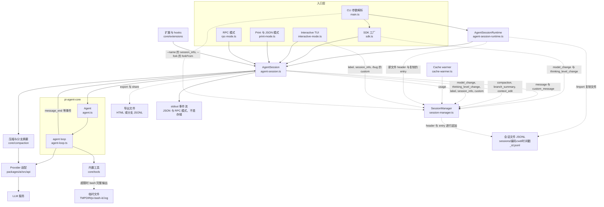
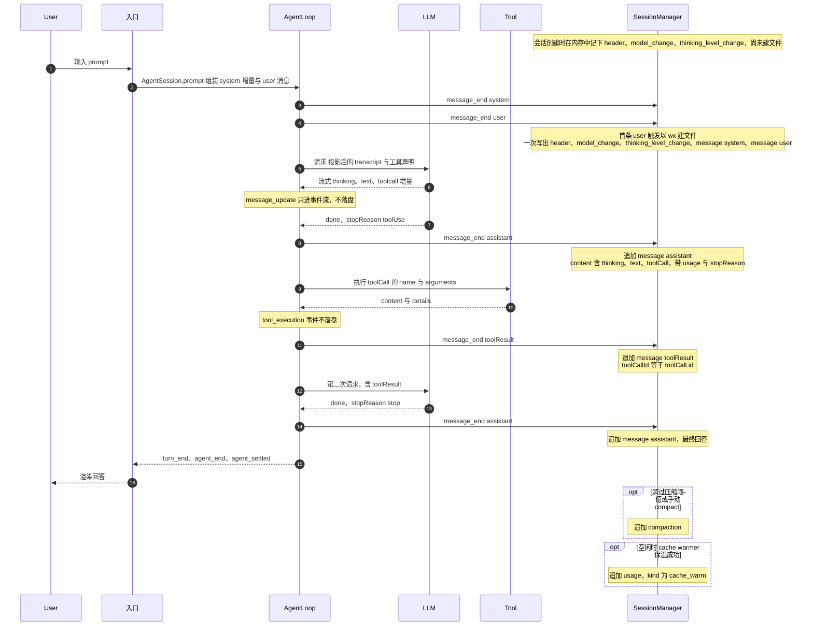
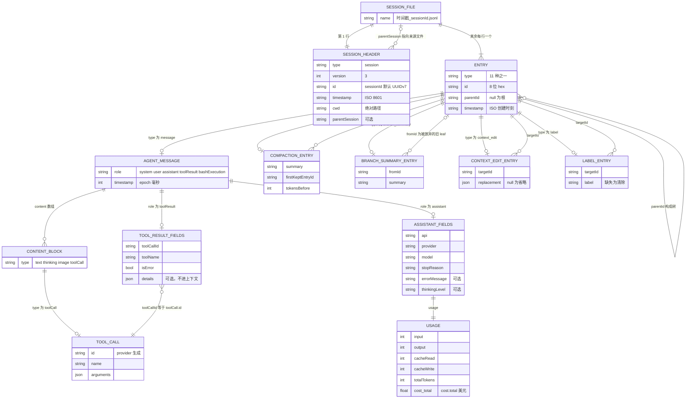

# Pi（earendil-works/pi）会话与轨迹数据分析

> 文档状态：研究快照。正文保留原基线、日期与证据；其中的状态和数字不代表当前版本。现行入口见[文档导航](../../README.md)。


> 用途：Orbit（本地跨 Agent 会话分析 Mac App）数据接入设计参考。
> 约定：「源码 HEAD」指下文 commit 的源码行为；「本机 0.99.1」指本机已安装版本写出的真实文件。所有类型摘录均为**据源码整理的精简形式（非逐字）**，以 permalink 为准。

## 0. 元信息

| 项 | 值 |
| --- | --- |
| 仓库 | [`earendil-works/pi`](https://github.com/earendil-works/pi)（monorepo；CHANGELOG 早期条目链接到 `badlogic/pi-mono`，即 Mario Zechner 的 pi-mono 改名迁移后的仓库） |
| commit | `7fbbd5f4a1d982bb02d63472dde0774fa639f99b`（2026-10-01 22:10 +0200，`feat(coding-agent): play a 3D Armin on /arminsayshi in fullscreen mode`）；本仓库子模块 `third_party/pi` 固定在这个提交 |
| 版本 | `packages/coding-agent` = `@earendil-works/pi-coding-agent` **1.0.0**（[packages/coding-agent/package.json:3](https://github.com/earendil-works/pi/blob/7fbbd5f4a1d982bb02d63472dde0774fa639f99b/packages/coding-agent/package.json#L3)，2026-10-01 发布）；monorepo 其余包同为 1.0.0（lockstep） |
| 迁移核对 | 初稿基于 `88ff80b`（2026-10-01 17:26 +0200，0.99.2 加未发布改动）。2026-10-02 迁到上面的提交：全部 permalink 按两次提交的 `git diff` 重新定位行号，并逐条核对引用行内容未变。其间未发布改动作为 1.0.0 发布，会话格式没有变化：`session-manager.ts` 与 `agent`、`ai` 两个包都没改，`CURRENT_SESSION_VERSION` 仍为 3；与会话有关的新增只有实验示例 `experimental/vacation/` 的独立 SQLite 会话（§5.6），发行包不含 |
| 本机版本 | managed install，`~/.pi/agent/install/current-version` = **0.99.1** |
| 语言 / 运行时 | TypeScript（ESM），Node.js；另有 Bun 编译的单文件二进制构建 |
| 会话相关包 | `coding-agent`（CLI/TUI/RPC/SDK、SessionManager、AgentSession）、`agent`（`pi-agent-core`，agent loop）、`ai`（`pi-ai`，消息/内容块/Usage 类型与 provider 适配） |
| 分析方法 | ① 源码静态阅读（HEAD）；② 用只读 `grep` 对照本机 0.99.1 发行包 `dist/`（`~/.pi/agent/install/releases/0.99.1/node_modules/@earendil-works/pi-coding-agent/dist/core/session-manager.js` 等）；③ 用 Python 流式解析本机 2 个 `.jsonl`，只统计 key 集合、类型分布、计数、时间差，不输出正文。未运行 pi、未安装依赖、未联网；未打开 `auth.json`、`models-store.json`。 |

一句话结论：pi 的每个会话是 **一个 append-only JSONL 文件**，第 1 行是 `session` header，其余每行是一个带 `id`/`parentId` 的 entry，组成**一棵树**（分支在同一文件内）；消息体是 pi 自定义的 provider 无关方言（`AgentMessage`：`system`/`user`/`assistant`/`toolResult` + 扩展角色），每条消息在**完成时**（`message_end`）落盘一行，流式增量不落盘。

---

## 1. 结构图与一次 chat 的数据流

### 1.1 组件表

| 组件 | 职责 | 源码位置 | 写出的记录 |
| --- | --- | --- | --- |
| CLI 入口 / 参数 | 解析 `--session/--continue/--resume/--fork/--session-id/--session-dir/--no-session/--name`，决定会话目录与 `SessionManager` 打开方式 | [packages/coding-agent/src/main.ts:358](https://github.com/earendil-works/pi/blob/7fbbd5f4a1d982bb02d63472dde0774fa639f99b/packages/coding-agent/src/main.ts#L358)、[packages/coding-agent/src/main.ts:688](https://github.com/earendil-works/pi/blob/7fbbd5f4a1d982bb02d63472dde0774fa639f99b/packages/coding-agent/src/main.ts#L688) | `--name` → `session_info`（[packages/coding-agent/src/main.ts:713](https://github.com/earendil-works/pi/blob/7fbbd5f4a1d982bb02d63472dde0774fa639f99b/packages/coding-agent/src/main.ts#L713)） |
| 交互 TUI 模式 | 终端 UI、斜杠命令（`/tree` `/fork` `/clone` `/name` `/compact` `/export` `/share` `/bug` 等） | `packages/coding-agent/src/modes/interactive/interactive-mode.ts`（如 [packages/coding-agent/src/modes/interactive/interactive-mode.ts:5595](https://github.com/earendil-works/pi/blob/7fbbd5f4a1d982bb02d63472dde0774fa639f99b/packages/coding-agent/src/modes/interactive/interactive-mode.ts#L5595) 打 label、[packages/coding-agent/src/modes/interactive/interactive-mode.ts:5648](https://github.com/earendil-works/pi/blob/7fbbd5f4a1d982bb02d63472dde0774fa639f99b/packages/coding-agent/src/modes/interactive/interactive-mode.ts#L5648) 改名） | 经 AgentSession/SessionManager 写 `label`、`session_info`；`/bug` 写 `custom`（`pi.bug-report`） |
| Print / JSON 模式 | `-p` 单次运行；`--mode json` 把 header + 事件流写 stdout | [packages/coding-agent/src/modes/print-mode.ts:122](https://github.com/earendil-works/pi/blob/7fbbd5f4a1d982bb02d63472dde0774fa639f99b/packages/coding-agent/src/modes/print-mode.ts#L122) | 会话文件写入与交互模式相同（除非 `--no-session`）；stdout 事件流不是存储 |
| RPC 模式 | stdin/stdout JSONL 命令协议，`get_entries`/`get_tree`/`get_messages` 可读会话 | [packages/coding-agent/src/modes/rpc/rpc-types.ts:65](https://github.com/earendil-works/pi/blob/7fbbd5f4a1d982bb02d63472dde0774fa639f99b/packages/coding-agent/src/modes/rpc/rpc-types.ts#L65) | 同上（经 AgentSession） |
| SDK 工厂 | `createAgentSession()` 组装 Agent + AgentSession + SessionManager | [packages/coding-agent/src/core/sdk.ts:424](https://github.com/earendil-works/pi/blob/7fbbd5f4a1d982bb02d63472dde0774fa639f99b/packages/coding-agent/src/core/sdk.ts#L424) | 新会话：初始 `model_change` + `thinking_level_change`；老会话缺 thinking 时补一条 |
| AgentSessionRuntime | `/new`、切换、`/fork`、`/clone`、导入 JSONL，替换活动 AgentSession | [packages/coding-agent/src/core/agent-session-runtime.ts:262](https://github.com/earendil-works/pi/blob/7fbbd5f4a1d982bb02d63472dde0774fa639f99b/packages/coding-agent/src/core/agent-session-runtime.ts#L262) | 新会话文件（header 带 `parentSession`），或复制路径上的 entry 到新文件 |
| AgentSession | 订阅 agent 事件并落盘；模型/思考级别切换；压缩；重试；`!` bash；树导航；扩展 API | [packages/coding-agent/src/core/agent-session.ts:1115](https://github.com/earendil-works/pi/blob/7fbbd5f4a1d982bb02d63472dde0774fa639f99b/packages/coding-agent/src/core/agent-session.ts#L1115) | `message`、`custom_message`、`model_change`、`thinking_level_change`、`compaction`、`branch_summary`、`context_edit`、`label`、`session_info`、`custom` |
| SessionManager | **唯一的 entry 追加者**（文件级操作例外：`/import` 复制文件、启动迁移 `rename`、`/resume` 列表删除，见 §1.2 要点）：内存 entry 树 + leaf 指针；懒创建文件、追加行、迁移、构建上下文 | [packages/coding-agent/src/core/session-manager.ts:987](https://github.com/earendil-works/pi/blob/7fbbd5f4a1d982bb02d63472dde0774fa639f99b/packages/coding-agent/src/core/session-manager.ts#L987) | header + 全部 11 种 entry |
| Agent（pi-agent-core） | 运行状态、事件分发；运行异常时合成失败的 assistant 消息 | [packages/agent/src/agent.ts:532](https://github.com/earendil-works/pi/blob/7fbbd5f4a1d982bb02d63472dde0774fa639f99b/packages/agent/src/agent.ts#L532) | 间接：产生 `message_end` |
| Agent loop | turn 循环：发出 system/user/assistant/toolResult 的 `message_start/end`；声明工具增减；执行工具（默认并行） | [packages/agent/src/agent-loop.ts:163](https://github.com/earendil-works/pi/blob/7fbbd5f4a1d982bb02d63472dde0774fa639f99b/packages/agent/src/agent-loop.ts#L163) | 间接：每条完成的消息 → `message` entry |
| Provider 适配（pi-ai） | 把 transcript 转成各家 API 请求，流式解析为 `AssistantMessage` | 如 [packages/ai/src/api/anthropic-messages.ts:584](https://github.com/earendil-works/pi/blob/7fbbd5f4a1d982bb02d63472dde0774fa639f99b/packages/ai/src/api/anthropic-messages.ts#L584) | 间接：决定 assistant 的 `api/provider/model/usage/stopReason/responseId/rawStopReason/diagnostics` |
| 内置工具 | `bash/read/edit/write/grep/find/ls`（Windows 有 powershell） | `packages/coding-agent/src/core/tools/`，如 [packages/coding-agent/src/core/tools/bash.ts:66](https://github.com/earendil-works/pi/blob/7fbbd5f4a1d982bb02d63472dde0774fa639f99b/packages/coding-agent/src/core/tools/bash.ts#L66) | 间接：toolResult 的 `content`/`details`；bash 截断时完整输出写到临时文件 |
| 压缩 / 分支摘要 | 选切点、调 LLM 生成摘要、统计读写文件 | `packages/coding-agent/src/core/compaction/` | AgentSession 据结果写 `compaction` / `branch_summary` |
| 扩展 / hooks | `pi.appendEntry`、`sendMessage`、`setLabel`、`setSessionName`、`tool_call`（可阻断）/`tool_result`（可改写）、`message_end` 替换、`turn_end`/`agent_before_settle` 边界草稿 | [packages/coding-agent/src/core/agent-session.ts:3359](https://github.com/earendil-works/pi/blob/7fbbd5f4a1d982bb02d63472dde0774fa639f99b/packages/coding-agent/src/core/agent-session.ts#L3359)、[packages/coding-agent/src/core/agent-session.ts:918](https://github.com/earendil-works/pi/blob/7fbbd5f4a1d982bb02d63472dde0774fa639f99b/packages/coding-agent/src/core/agent-session.ts#L918) | `custom`、`custom_message`、`context_edit`、`compaction`、`label`、`session_info` |
| Cache warmer | 空闲时以 1 token 请求保温 prompt cache | [packages/coding-agent/src/core/cache-warmer.ts:342](https://github.com/earendil-works/pi/blob/7fbbd5f4a1d982bb02d63472dde0774fa639f99b/packages/coding-agent/src/core/cache-warmer.ts#L342) | `usage`（`kind: "cache_warm"`） |
| 导出 / 分享 | `/export` HTML/JSONL、`/share`（Radius 或 GitHub gist） | [packages/coding-agent/src/core/session-export.ts:9](https://github.com/earendil-works/pi/blob/7fbbd5f4a1d982bb02d63472dde0774fa639f99b/packages/coding-agent/src/core/session-export.ts#L9)、[packages/coding-agent/src/core/export-html/index.ts:236](https://github.com/earendil-works/pi/blob/7fbbd5f4a1d982bb02d63472dde0774fa639f99b/packages/coding-agent/src/core/export-html/index.ts#L236) | 会话目录**之外**的独立文件 |
| Telemetry | `pi-telemetry` 只有 span 契约与内存参考实现，无 exporter；coding-agent 仅有安装 ping / opt-in analytics 设置 | [packages/coding-agent/src/core/telemetry.ts:8](https://github.com/earendil-works/pi/blob/7fbbd5f4a1d982bb02d63472dde0774fa639f99b/packages/coding-agent/src/core/telemetry.ts#L8) | 不写会话数据 |
| 实验性 server / durable（仅源码） | `packages/durable` + `server/client/protocol` 与 `coding-agent/src/experimental/`；发行包不含 | [packages/coding-agent/src/experimental/server.ts:69](https://github.com/earendil-works/pi/blob/7fbbd5f4a1d982bb02d63472dde0774fa639f99b/packages/coding-agent/src/experimental/server.ts#L69) | 另一套 SQLite/JSONL 存储（见 §5.6），**不是** `pi` CLI 的会话格式 |
| Evals | `packages/evals` 行为评测 | [packages/evals/src/harness.ts:343](https://github.com/earendil-works/pi/blob/7fbbd5f4a1d982bb02d63472dde0774fa639f99b/packages/evals/src/harness.ts#L343) | 复用原生会话 JSONL + `observations.jsonl`（见 §5.7） |

### 1.2 图 1：结构图（虚线 = 写入持久化）



要点：entry 的追加都经过 `SessionManager`（静态方法 `forkFrom` 不走实例的懒写流程，直接写新文件，[packages/coding-agent/src/core/session-manager.ts:1815](https://github.com/earendil-works/pi/blob/7fbbd5f4a1d982bb02d63472dde0774fa639f99b/packages/coding-agent/src/core/session-manager.ts#L1815)）。文件级操作是例外：`/import` 用 `copyFileSync` 把外部 JSONL 复制进会话目录（[packages/coding-agent/src/core/agent-session-runtime.ts:386](https://github.com/earendil-works/pi/blob/7fbbd5f4a1d982bb02d63472dde0774fa639f99b/packages/coding-agent/src/core/agent-session-runtime.ts#L386)），启动迁移把 0.30.0 遗留的会话文件 `rename` 进会话目录（[packages/coding-agent/src/migrations.ts:84](https://github.com/earendil-works/pi/blob/7fbbd5f4a1d982bb02d63472dde0774fa639f99b/packages/coding-agent/src/migrations.ts#L84)），`/resume` 列表可删除会话文件（§2.5）。agent loop 与 provider 本身不碰磁盘，只通过事件把**完成的消息**交给 AgentSession。

### 1.3 图 2：一次 chat 的时序（新会话，1 次提问 + 1 次工具调用 + 最终回答）



---

## 2. 存储布局

### 2.1 目录树（默认）

```text
~/.pi/agent/                                   ← getAgentDir()；PI_CODING_AGENT_DIR 可整体改根
├── settings.json                              ← 可含 "sessionDir"（自定义会话目录）
├── auth.json, models-store.json               ← 凭据 / 模型目录缓存，与会话无关（Orbit 不应读取）
├── bin/, install/                             ← fd/rg 与 managed install（install/current-version 记版本）
├── sessions/                                  ← getSessionsDir()
│   └── --<编码后的 cwd>--/                     ← 每个工作目录一个子目录
│       ├── <UTC 时间戳，: 和 . 换成 ->_<sessionId>.jsonl
│       └── ...                                ← 一个会话 = 一个文件（含其全部分支）
└── experimental/                              ← 仅源码实验模式会创建，见 §5.6
```

- 根目录：`join(homedir(), ".pi", "agent")`，被环境变量 `PI_CODING_AGENT_DIR` 覆盖（[packages/coding-agent/src/config.ts:563](https://github.com/earendil-works/pi/blob/7fbbd5f4a1d982bb02d63472dde0774fa639f99b/packages/coding-agent/src/config.ts#L563)）；会话根是 `<agentDir>/sessions`（[packages/coding-agent/src/config.ts:607](https://github.com/earendil-works/pi/blob/7fbbd5f4a1d982bb02d63472dde0774fa639f99b/packages/coding-agent/src/config.ts#L607)）。
- 环境变量名由 `APP_NAME`（`package.json` 的 `piConfig.name`，默认 `pi`）派生：`${APP_NAME.toUpperCase()}_CODING_AGENT_DIR` / `_CODING_AGENT_SESSION_DIR`；配置目录名来自 `piConfig.configDir`（默认 `.pi`）（[packages/coding-agent/src/config.ts:537](https://github.com/earendil-works/pi/blob/7fbbd5f4a1d982bb02d63472dde0774fa639f99b/packages/coding-agent/src/config.ts#L537)、[packages/coding-agent/src/config.ts:543](https://github.com/earendil-works/pi/blob/7fbbd5f4a1d982bb02d63472dde0774fa639f99b/packages/coding-agent/src/config.ts#L543)）。即重新打包/改名的发行版可能用别的目录与变量名。

### 2.2 cwd → 目录名编码

规则（[packages/coding-agent/src/core/session-manager.ts:589](https://github.com/earendil-works/pi/blob/7fbbd5f4a1d982bb02d63472dde0774fa639f99b/packages/coding-agent/src/core/session-manager.ts#L589)）：`resolvePath(cwd)` → 去掉开头一个 `/` 或 `\` → 把所有 `/`、`\`、`:` 换成 `-` → 两侧加 `--`。

| cwd | 目录名 |
| --- | --- |
| `~`（本机，即 `/Users/<user>`） | `--Users-<user>--` |
| `/Users/<user>/code/my-app` | `--Users-<user>-code-my-app--` |
| `C:\work\app` | `--C--work-app--` |

- **有损、不可逆**：路径中原有的 `-` 与分隔符无法区分（`/a/b-c` 与 `/a-b/c` 都编码为 `--a-b-c--`）。权威 cwd 只能取 header 的 `cwd` 字段。
- `getDefaultSessionDir()` 会立即 `mkdir`（[packages/coding-agent/src/core/session-manager.ts:596](https://github.com/earendil-works/pi/blob/7fbbd5f4a1d982bb02d63472dde0774fa639f99b/packages/coding-agent/src/core/session-manager.ts#L596)），而会话文件是懒创建的（§4.1），所以**可能存在空的项目目录**。

### 2.3 自定义会话目录

- 优先级：`--session-dir` > `PI_CODING_AGENT_SESSION_DIR` > settings 的 `sessionDir`（[packages/coding-agent/src/main.ts:688](https://github.com/earendil-works/pi/blob/7fbbd5f4a1d982bb02d63472dde0774fa639f99b/packages/coding-agent/src/main.ts#L688)）。启动时的 SettingsManager 合并全局 `~/.pi/agent/settings.json` 与项目 `<cwd>/.pi/settings.json`（[packages/coding-agent/src/core/settings-manager.ts:417](https://github.com/earendil-works/pi/blob/7fbbd5f4a1d982bb02d63472dde0774fa639f99b/packages/coding-agent/src/core/settings-manager.ts#L417)，`projectTrusted` 默认 true：[packages/coding-agent/src/core/settings-manager.ts:442](https://github.com/earendil-works/pi/blob/7fbbd5f4a1d982bb02d63472dde0774fa639f99b/packages/coding-agent/src/core/settings-manager.ts#L442)）。
- **自定义目录是扁平的**：`SessionManager.create(cwd, sessionDir)` 直接用该目录，不再按 cwd 分子目录（[packages/coding-agent/src/core/session-manager.ts:1755](https://github.com/earendil-works/pi/blob/7fbbd5f4a1d982bb02d63472dde0774fa639f99b/packages/coding-agent/src/core/session-manager.ts#L1755)）；列表时按 header `cwd` 过滤（[packages/coding-agent/src/core/session-manager.ts:1907](https://github.com/earendil-works/pi/blob/7fbbd5f4a1d982bb02d63472dde0774fa639f99b/packages/coding-agent/src/core/session-manager.ts#L1907)）。
- `--no-session` → `SessionManager.inMemory()`，不落盘（[packages/coding-agent/src/main.ts:364](https://github.com/earendil-works/pi/blob/7fbbd5f4a1d982bb02d63472dde0774fa639f99b/packages/coding-agent/src/main.ts#L364)）。
- `--session <path>` 可打开/创建任意路径的文件（显式路径被保留，[packages/coding-agent/src/core/session-manager.ts:1053](https://github.com/earendil-works/pi/blob/7fbbd5f4a1d982bb02d63472dde0774fa639f99b/packages/coding-agent/src/core/session-manager.ts#L1053)），所以会话文件也可能位于会话根之外——Orbit 只能扫描已知根目录，这类文件会漏掉。

### 2.4 文件命名与 ID

| 对象 | 格式 | 依据 |
| --- | --- | --- |
| 文件名 | `${header.timestamp.replace(/[:.]/g, "-")}_${sessionId}.jsonl`，如 `2026-09-30T15-33-04-291Z_<uuid>.jsonl`（UTC，毫秒） | [packages/coding-agent/src/core/session-manager.ts:1079](https://github.com/earendil-works/pi/blob/7fbbd5f4a1d982bb02d63472dde0774fa639f99b/packages/coding-agent/src/core/session-manager.ts#L1079) |
| sessionId（默认） | **UUIDv7**：前 48 bit 为毫秒时间戳，version nibble 为 `7`；其后 41 bit 是进程内所有 `uuidv7()` 调用共享的递增计数器（首次随机初始化），最后约 33 bit 仍是每个 ID 独立的随机数 | [packages/coding-agent/src/core/session-manager.ts:264](https://github.com/earendil-works/pi/blob/7fbbd5f4a1d982bb02d63472dde0774fa639f99b/packages/coding-agent/src/core/session-manager.ts#L264)、[packages/ai/src/utils/uuid.ts:8](https://github.com/earendil-works/pi/blob/7fbbd5f4a1d982bb02d63472dde0774fa639f99b/packages/ai/src/utils/uuid.ts#L8) |
| sessionId（自定义） | `--session-id` 或 SDK `newSession({ id })`，只校验正则 `^[A-Za-z0-9](?:[A-Za-z0-9._-]*[A-Za-z0-9])?$`，不一定是 UUID | [packages/coding-agent/src/core/session-manager.ts:268](https://github.com/earendil-works/pi/blob/7fbbd5f4a1d982bb02d63472dde0774fa639f99b/packages/coding-agent/src/core/session-manager.ts#L268) |
| entry `id` | `randomUUID().slice(0, 8)`：8 位小写 hex，在**当前文件内**查重，100 次冲突后退回完整 UUID | [packages/coding-agent/src/core/session-manager.ts:277](https://github.com/earendil-works/pi/blob/7fbbd5f4a1d982bb02d63472dde0774fa639f99b/packages/coding-agent/src/core/session-manager.ts#L277) |

- 文档 `session-format.md` 只写 "UUID"（[packages/coding-agent/docs/session-format.md:14](https://github.com/earendil-works/pi/blob/7fbbd5f4a1d982bb02d63472dde0774fa639f99b/packages/coding-agent/docs/session-format.md#L14)）；HEAD 与本机 0.99.1 dist 都是 `uuidv7()`。CHANGELOG 记载曾从普通 UUID 改为 UUIDv7，**更老的文件可能是 v4 UUID**。
- entry `id` 只在单文件内唯一：fork/clone 会把同一批 entry（同 id）复制到新文件（§5.4）。跨会话的主键应为 `(sessionId, entryId)`（sessionId 本身也可能因 `/export` + `/import` 跨文件重复，见 §9.1 第 2 条）。
- 例外命名：`importFromJsonl` 把外部 JSONL 以原文件名复制进会话目录，重名加 `-1`、`-2` 后缀（[packages/coding-agent/src/core/agent-session-runtime.ts:370](https://github.com/earendil-works/pi/blob/7fbbd5f4a1d982bb02d63472dde0774fa639f99b/packages/coding-agent/src/core/agent-session-runtime.ts#L370)）。**不要依赖文件名解析 ID/时间**，以 header 为准。

### 2.5 辅助文件

- **没有索引、数据库或标题文件**。会话列表靠扫描全部 `.jsonl` 并逐行读完整个文件构建（[packages/coding-agent/src/core/session-manager.ts:799](https://github.com/earendil-works/pi/blob/7fbbd5f4a1d982bb02d63472dde0774fa639f99b/packages/coding-agent/src/core/session-manager.ts#L799)）：标题 = 最后一条 `session_info.name`；`firstMessage` = 第一条 user 文本；`messageCount` = `message` entry 数（含所有 role、所有分支）；`modified` = user/assistant 消息时间戳最大值，退回 header 时间或文件 mtime。
- `--continue` 选**文件 mtime 最新**且 header 有效的文件（[packages/coding-agent/src/core/session-manager.ts:749](https://github.com/earendil-works/pi/blob/7fbbd5f4a1d982bb02d63472dde0774fa639f99b/packages/coding-agent/src/core/session-manager.ts#L749)）。
- `/resume` 列表中按 Ctrl+D 会删除会话文件：先尝试 `trash` 命令，失败再 `unlink` 永久删除（[packages/coding-agent/src/core/keybindings.ts:178](https://github.com/earendil-works/pi/blob/7fbbd5f4a1d982bb02d63472dde0774fa639f99b/packages/coding-agent/src/core/keybindings.ts#L178)、[packages/coding-agent/src/modes/interactive/components/session-selector.ts:654](https://github.com/earendil-works/pi/blob/7fbbd5f4a1d982bb02d63472dde0774fa639f99b/packages/coding-agent/src/modes/interactive/components/session-selector.ts#L654)）。
- bash 输出超限时完整输出写到 `os.tmpdir()/pi-bash-<16 hex>.log`（[packages/coding-agent/src/core/tools/output-accumulator.ts:26](https://github.com/earendil-works/pi/blob/7fbbd5f4a1d982bb02d63472dde0774fa639f99b/packages/coding-agent/src/core/tools/output-accumulator.ts#L26)，前缀见 [packages/coding-agent/src/core/tools/bash.ts:424](https://github.com/earendil-works/pi/blob/7fbbd5f4a1d982bb02d63472dde0774fa639f99b/packages/coding-agent/src/core/tools/bash.ts#L424)），路径记在 `toolResult.details.fullOutputPath`；属临时文件，会话中只留引用。
- 图片以 base64 内联在 JSONL 中，没有附件目录。
- 本机 `settings.json` 只有 `lastChangelogVersion`、`defaultProvider`、`defaultModel`、`deviceId` 四个键，无 `sessionDir`。

## 3. 记录 schema

文件 = UTF-8 JSONL，每行一个 JSON 对象，`JSON.stringify(entry) + "\n"`（值为 `undefined` 的可选字段**整个 key 不出现**）。行的类型由顶层 `type` 区分：`session`（仅第 1 行）+ 11 种 entry（[packages/coding-agent/src/core/session-manager.ts:183](https://github.com/earendil-works/pi/blob/7fbbd5f4a1d982bb02d63472dde0774fa639f99b/packages/coding-agent/src/core/session-manager.ts#L183)）。

### 3.1 文件头 `SessionHeader`（第 1 行，不在树中）

| 字段 | 类型 | 必有 | 说明 |
| --- | --- | --- | --- |
| `type` | `"session"` | 是 | |
| `version` | number | v1 文件没有（按 1 处理）；当前写 `3` | `CURRENT_SESSION_VERSION = 3`（[packages/coding-agent/src/core/session-manager.ts:41](https://github.com/earendil-works/pi/blob/7fbbd5f4a1d982bb02d63472dde0774fa639f99b/packages/coding-agent/src/core/session-manager.ts#L41)） |
| `id` | string | 是 | sessionId（§2.4） |
| `timestamp` | string | 是 | ISO 8601 UTC 毫秒，会话创建时间，与文件名同源 |
| `cwd` | string | 应有；读取端需容忍缺失或空串（[packages/coding-agent/src/core/session-manager.ts:739](https://github.com/earendil-works/pi/blob/7fbbd5f4a1d982bb02d63472dde0774fa639f99b/packages/coding-agent/src/core/session-manager.ts#L739)、[packages/coding-agent/src/core/session-manager.ts:856](https://github.com/earendil-works/pi/blob/7fbbd5f4a1d982bb02d63472dde0774fa639f99b/packages/coding-agent/src/core/session-manager.ts#L856)、[packages/coding-agent/src/migrations.ts:107](https://github.com/earendil-works/pi/blob/7fbbd5f4a1d982bb02d63472dde0774fa639f99b/packages/coding-agent/src/migrations.ts#L107)） | 绝对路径（`resolvePath` 后），权威项目归属 |
| `parentSession` | string | 否 | 来源会话**文件的绝对路径**（`/fork`、`/clone`、`--fork`、带 parent 的 `newSession`） |

定义见 [packages/coding-agent/src/core/session-manager.ts:43](https://github.com/earendil-works/pi/blob/7fbbd5f4a1d982bb02d63472dde0774fa639f99b/packages/coding-agent/src/core/session-manager.ts#L43)。本机两个文件的 header key 均为 `type, version, id, timestamp, cwd`，`version = 3`。

header 的历史差异（据 CHANGELOG，未在 HEAD 代码中找到对应写入路径，**待确认**）：0.80.4 曾加入「JSONL 会话 header 中的自定义 metadata」（PR #6417），更早的版本曾用 `branchedFrom` 记录来源（后来为 `parentSession`）。pi 读取时只 `JSON.parse` 整行，未知字段会被保留，解析器也应容忍 header 中的额外字段。sessionId 自 0.67.1 起改为 UUIDv7（PR #3018），更早的会话是普通 UUID。

**版本与迁移**（打开时自动执行，见 [packages/coding-agent/src/core/session-manager.ts:337](https://github.com/earendil-works/pi/blob/7fbbd5f4a1d982bb02d63472dde0774fa639f99b/packages/coding-agent/src/core/session-manager.ts#L337)）：

| 版本 | 形态 | 迁移动作 |
| --- | --- | --- |
| v1 | 线性 entry 序列，无 `id`/`parentId`；compaction 用 `firstKeptEntryIndex` | v1→v2：按行序生成 8 位 id，`parentId` = 上一行；`firstKeptEntryIndex` 换成 `firstKeptEntryId`（[packages/coding-agent/src/core/session-manager.ts:287](https://github.com/earendil-works/pi/blob/7fbbd5f4a1d982bb02d63472dde0774fa639f99b/packages/coding-agent/src/core/session-manager.ts#L287)） |
| v2 | `id`/`parentId` 树 | v2→v3：message 中 `role: "hookMessage"` 改为 `"custom"`（[packages/coding-agent/src/core/session-manager.ts:316](https://github.com/earendil-works/pi/blob/7fbbd5f4a1d982bb02d63472dde0774fa639f99b/packages/coding-agent/src/core/session-manager.ts#L316)） |
| v3 | 当前 | — |

迁移后**整文件原地重写**（[packages/coding-agent/src/core/session-manager.ts:1092](https://github.com/earendil-works/pi/blob/7fbbd5f4a1d982bb02d63472dde0774fa639f99b/packages/coding-agent/src/core/session-manager.ts#L1092)）。因此磁盘上的 v1/v2 文件只会出现在从未被新版 pi 重新打开的老会话里。例外：从 v1/v2 源文件 `forkFrom` 出的新文件写 `version: 3` 的 header，却原样复制未迁移的 entry（[packages/coding-agent/src/core/session-manager.ts:1823](https://github.com/earendil-works/pi/blob/7fbbd5f4a1d982bb02d63472dde0774fa639f99b/packages/coding-agent/src/core/session-manager.ts#L1823)、[packages/coding-agent/src/core/session-manager.ts:1848](https://github.com/earendil-works/pi/blob/7fbbd5f4a1d982bb02d63472dde0774fa639f99b/packages/coding-agent/src/core/session-manager.ts#L1848)），形成「v3 header + v1/v2 正文」，之后打开时也不会再迁移（[packages/coding-agent/src/core/session-manager.ts:341](https://github.com/earendil-works/pi/blob/7fbbd5f4a1d982bb02d63472dde0774fa639f99b/packages/coding-agent/src/core/session-manager.ts#L341)）；判断格式要看 entry 的实际形态。v3 内部仍在不断加字段/加 entry 类型（如 `usage`、`context_edit`、system 消息、`thinkingLevel`、`nestedCalls`），**version 不变**，只能靠「未知字段/类型容忍」兼容。

### 3.2 Entry 公共字段

| 字段 | 类型 | 说明 |
| --- | --- | --- |
| `type` | string | entry 类型 |
| `id` | string | 8 位 hex（§2.4） |
| `parentId` | string \| null | 父 entry；根为 `null`。迁移后的 v1 文件以及正常会话都是「每条新 entry 挂在当前 leaf 下」 |
| `timestamp` | string | ISO 8601 UTC（`new Date().toISOString()`），**entry 创建时刻**（懒写缓冲期的 entry 早于实际落盘，见 §4.1 第 2 条） |

定义见 [packages/coding-agent/src/core/session-manager.ts:57](https://github.com/earendil-works/pi/blob/7fbbd5f4a1d982bb02d63472dde0774fa639f99b/packages/coding-agent/src/core/session-manager.ts#L57)。key 顺序一般是 `type, id, parentId, timestamp, <载荷>`，但 `custom` 是 `type, customType, data, id, parentId, timestamp`、`custom_message` 是 `type, customType, content, display, details, id, parentId, timestamp`（对象字面量顺序，见 [packages/coding-agent/src/core/session-manager.ts:1290](https://github.com/earendil-works/pi/blob/7fbbd5f4a1d982bb02d63472dde0774fa639f99b/packages/coding-agent/src/core/session-manager.ts#L1290)、[packages/coding-agent/src/core/session-manager.ts:1339](https://github.com/earendil-works/pi/blob/7fbbd5f4a1d982bb02d63472dde0774fa639f99b/packages/coding-agent/src/core/session-manager.ts#L1339)）。**解析器不要依赖 key 顺序。**

### 3.3 Entry 类型一览

| `type` | 载荷字段（`?` = 可选，缺省时 key 不出现） | 进 LLM 上下文 | 谁 / 何时写 | 定义 |
| --- | --- | --- | --- | --- |
| `message` | `message: AgentMessage`（§3.4） | 是（`bashExecution` 带 `excludeFromContext` 除外；被 `context_edit` 省略/替换的除外） | AgentSession 在每个 `message_end`；`!` bash 结果 | [packages/coding-agent/src/core/session-manager.ts:64](https://github.com/earendil-works/pi/blob/7fbbd5f4a1d982bb02d63472dde0774fa639f99b/packages/coding-agent/src/core/session-manager.ts#L64) |
| `thinking_level_change` | `thinkingLevel: string`（`off/minimal/low/medium/high/xhigh/max`） | 否（状态） | 新会话初始化；切换思考级别 | [packages/coding-agent/src/core/session-manager.ts:69](https://github.com/earendil-works/pi/blob/7fbbd5f4a1d982bb02d63472dde0774fa639f99b/packages/coding-agent/src/core/session-manager.ts#L69) |
| `model_change` | `provider`, `modelId` | 否（状态） | 新会话初始化；`/model`、循环切换；分支上选择不一致时补记 | [packages/coding-agent/src/core/session-manager.ts:74](https://github.com/earendil-works/pi/blob/7fbbd5f4a1d982bb02d63472dde0774fa639f99b/packages/coding-agent/src/core/session-manager.ts#L74) |
| `usage` | `kind`, `provider`, `model`, `usage: Usage`, `note?` | 否，但计入会话 token/cost 总量 | cache warmer（`kind: "cache_warm"`）；未知 `kind` 应按普通 usage 处理 | [packages/coding-agent/src/core/session-manager.ts:80](https://github.com/earendil-works/pi/blob/7fbbd5f4a1d982bb02d63472dde0774fa639f99b/packages/coding-agent/src/core/session-manager.ts#L80) |
| `compaction` | `summary`, `firstKeptEntryId`, `tokensBefore`, `details?`, `usage?`, `fromHook?`, `systemMessage?` | 是（展开为完整 system 检查点 + `compactionSummary`） | 手动 `/compact`、阈值自动、溢出恢复、扩展草稿 | [packages/coding-agent/src/core/session-manager.ts:91](https://github.com/earendil-works/pi/blob/7fbbd5f4a1d982bb02d63472dde0774fa639f99b/packages/coding-agent/src/core/session-manager.ts#L91) |
| `branch_summary` | `fromId`, `summary`, `details?`, `usage?`, `fromHook?` | 是（转成 `branchSummary` → user 文本） | `/tree` 切换分支并选择总结 | [packages/coding-agent/src/core/session-manager.ts:106](https://github.com/earendil-works/pi/blob/7fbbd5f4a1d982bb02d63472dde0774fa639f99b/packages/coding-agent/src/core/session-manager.ts#L106) |
| `custom` | `customType`, `data?` | 否 | 扩展 `pi.appendEntry()`；内置 `pi.virtual-model-state`、`pi.bug-report`；导出文件里的 `pi.share` | [packages/coding-agent/src/core/session-manager.ts:128](https://github.com/earendil-works/pi/blob/7fbbd5f4a1d982bb02d63472dde0774fa639f99b/packages/coding-agent/src/core/session-manager.ts#L128) |
| `custom_message` | `customType`, `content: string \| (Text\|Image)[]`, `display: boolean`, `details?` | 是（转成 user 消息；`details` 不发给模型） | 扩展 `sendMessage()`、`before_agent_start` 注入；role 为 `custom` 的消息在 `message_end` 时落为此类型 | [packages/coding-agent/src/core/session-manager.ts:159](https://github.com/earendil-works/pi/blob/7fbbd5f4a1d982bb02d63472dde0774fa639f99b/packages/coding-agent/src/core/session-manager.ts#L159) |
| `context_edit` | `targetId`, `replacement: { content } \| null` | 改写目标在上下文中的贡献（`null` = 省略） | 自动重试/溢出恢复时省略失败回合；扩展草稿 | [packages/coding-agent/src/core/session-manager.ts:175](https://github.com/earendil-works/pi/blob/7fbbd5f4a1d982bb02d63472dde0774fa639f99b/packages/coding-agent/src/core/session-manager.ts#L175) |
| `label` | `targetId`, `label?`（清除时 key 不出现） | 否 | `/tree` 中打书签；扩展 `setLabel()` | [packages/coding-agent/src/core/session-manager.ts:135](https://github.com/earendil-works/pi/blob/7fbbd5f4a1d982bb02d63472dde0774fa639f99b/packages/coding-agent/src/core/session-manager.ts#L135) |
| `session_info` | `name?`（换行替换为空格并 trim；空串 = 清除标题） | 否 | `/name`、`--name`、扩展 `setSessionName()`、`/resume` 列表中改名 | [packages/coding-agent/src/core/session-manager.ts:142](https://github.com/earendil-works/pi/blob/7fbbd5f4a1d982bb02d63472dde0774fa639f99b/packages/coding-agent/src/core/session-manager.ts#L142) |

据源码整理的精简类型（非逐字）：

```ts
type FileLine = SessionHeader | SessionEntry;            // 一行一个
interface EntryBase { type: string; id: string; parentId: string | null; timestamp: string }
type SessionEntry =
  | EntryBase & { type: "message"; message: AgentMessage }
  | EntryBase & { type: "thinking_level_change"; thinkingLevel: string }
  | EntryBase & { type: "model_change"; provider: string; modelId: string }
  | EntryBase & { type: "usage"; kind: string; provider: string; model: string; usage: Usage; note?: string }
  | EntryBase & { type: "compaction"; summary: string; firstKeptEntryId: string; tokensBefore: number;
                  details?: unknown; usage?: Usage; fromHook?: boolean; systemMessage?: SystemMessage }
  | EntryBase & { type: "branch_summary"; fromId: string; summary: string; details?: unknown; usage?: Usage; fromHook?: boolean }
  | EntryBase & { type: "custom"; customType: string; data?: unknown }
  | EntryBase & { type: "custom_message"; customType: string; content: string | Block[]; display: boolean; details?: unknown }
  | EntryBase & { type: "context_edit"; targetId: string; replacement: { content: string | Block[] } | null }
  | EntryBase & { type: "label"; targetId: string; label?: string }
  | EntryBase & { type: "session_info"; name?: string };
```

补充语义：

- `compaction.firstKeptEntryId`：保留区间的起点；「不保留任何旧 entry」时等于自身 `id`（[packages/coding-agent/src/core/session-manager.ts:1278](https://github.com/earendil-works/pi/blob/7fbbd5f4a1d982bb02d63472dde0774fa639f99b/packages/coding-agent/src/core/session-manager.ts#L1278)）。`systemMessage` 是写入时刻重放得到的完整 prompt + 工具声明检查点（[packages/coding-agent/src/core/session-manager.ts:1270](https://github.com/earendil-works/pi/blob/7fbbd5f4a1d982bb02d63472dde0774fa639f99b/packages/coding-agent/src/core/session-manager.ts#L1270)）。默认实现的 `details = { readFiles: string[], modifiedFiles: string[] }`。
- `branch_summary.fromId`：被放弃分支的旧 leaf；旧 leaf 为空时写字面量 `"root"`（[packages/coding-agent/src/core/session-manager.ts:1610](https://github.com/earendil-works/pi/blob/7fbbd5f4a1d982bb02d63472dde0774fa639f99b/packages/coding-agent/src/core/session-manager.ts#L1610)）。它的 `parentId` 是新分支的接续点（可为 `null`，即成为新根）。
- `fromHook: true` 表示摘要由扩展生成（遗留命名）。

### 3.4 `AgentMessage`（`message` entry 的 `message` 字段）

`AgentMessage = Message | CustomAgentMessages[...]`，底层 `Message = SystemMessage | UserMessage | AssistantMessage | ToolResultMessage`（[packages/ai/src/types.ts:610](https://github.com/earendil-works/pi/blob/7fbbd5f4a1d982bb02d63472dde0774fa639f99b/packages/ai/src/types.ts#L610)），coding-agent 通过 declaration merging 加入 4 个角色（[packages/coding-agent/src/core/messages.ts:70](https://github.com/earendil-works/pi/blob/7fbbd5f4a1d982bb02d63472dde0774fa639f99b/packages/coding-agent/src/core/messages.ts#L70)，联合类型见 [packages/agent/src/types.ts:374](https://github.com/earendil-works/pi/blob/7fbbd5f4a1d982bb02d63472dde0774fa639f99b/packages/agent/src/types.ts#L374)）。

| role | 字段 | 是否会出现在 `message` entry | 定义 |
| --- | --- | --- | --- |
| `system` | `content: string \| TextContent[]`、`sections?: Record<string, string \| null>`、`toolsAdded?: Tool[]`、`toolsRemoved?: {name}[]`、`timestamp` | 是：会话第一次请求写完整 prompt（按 section 名）+ 全部工具声明；之后 prompt/工具变化写增量（section 设 `null` = 删除） | [packages/ai/src/types.ts:522](https://github.com/earendil-works/pi/blob/7fbbd5f4a1d982bb02d63472dde0774fa639f99b/packages/ai/src/types.ts#L522) |
| `user` | `content: string \| (TextContent \| ImageContent)[]`、`timestamp` | 是。HEAD 的交互 prompt 总是数组 `[{type:"text"}, ...images]`（[packages/coding-agent/src/core/agent-session.ts:2033](https://github.com/earendil-works/pi/blob/7fbbd5f4a1d982bb02d63472dde0774fa639f99b/packages/coding-agent/src/core/agent-session.ts#L2033)）；字符串形式来自 SDK/扩展/旧版本 | [packages/ai/src/types.ts:540](https://github.com/earendil-works/pi/blob/7fbbd5f4a1d982bb02d63472dde0774fa639f99b/packages/ai/src/types.ts#L540) |
| `assistant` | `content: (Text \| Thinking \| ToolCall)[]`、`api`、`provider`、`model`、`responseModel?`、`responseId?`、`providerThinkingLevel?`、`thinkingLevel?`、`diagnostics?`、`usage`、`stopReason`、`deferred?`、`errorMessage?`、`rawStopReason?`、`endTurn?`、`timestamp` | 是 | [packages/ai/src/types.ts:546](https://github.com/earendil-works/pi/blob/7fbbd5f4a1d982bb02d63472dde0774fa639f99b/packages/ai/src/types.ts#L546) |
| `toolResult` | `toolCallId`、`toolName`、`content: (Text \| Image)[]`、`details?`、`usage?`、`nestedCalls?`、`isError`、`timestamp` | 是 | [packages/ai/src/types.ts:594](https://github.com/earendil-works/pi/blob/7fbbd5f4a1d982bb02d63472dde0774fa639f99b/packages/ai/src/types.ts#L594) |
| `bashExecution` | `command`、`output`、`exitCode`（进程被杀/取消时为 undefined，即 key 缺失，[packages/coding-agent/src/core/bash-executor.ts:33](https://github.com/earendil-works/pi/blob/7fbbd5f4a1d982bb02d63472dde0774fa639f99b/packages/coding-agent/src/core/bash-executor.ts#L33)）、`cancelled`、`truncated`、`fullOutputPath?`、`timestamp`、`excludeFromContext?` | 是：用户在 TUI 输入 `!cmd` / `!!cmd`（`!!` = 不进上下文）或 RPC `bash`；**不是** LLM 工具调用 | [packages/coding-agent/src/core/messages.ts:29](https://github.com/earendil-works/pi/blob/7fbbd5f4a1d982bb02d63472dde0774fa639f99b/packages/coding-agent/src/core/messages.ts#L29) |
| `custom` | `customType`、`content`、`display`、`details?`、`timestamp` | 正常情况下落为 `custom_message` entry；只有 v2→v3 迁移遗留的 `hookMessage`、或 SDK 代码直接调用 `appendMessage()` 写入 custom 消息时，才会以 `message.role = "custom"` 出现 | [packages/coding-agent/src/core/messages.ts:46](https://github.com/earendil-works/pi/blob/7fbbd5f4a1d982bb02d63472dde0774fa639f99b/packages/coding-agent/src/core/messages.ts#L46) |
| `branchSummary` / `compactionSummary` | `summary`、`fromId` / `tokensBefore`、`timestamp` | **否**：只在内存投影中由 `branch_summary`/`compaction` entry 派生（[packages/coding-agent/src/core/session-manager.ts:439](https://github.com/earendil-works/pi/blob/7fbbd5f4a1d982bb02d63472dde0774fa639f99b/packages/coding-agent/src/core/session-manager.ts#L439)） | [packages/coding-agent/src/core/messages.ts:55](https://github.com/earendil-works/pi/blob/7fbbd5f4a1d982bb02d63472dde0774fa639f99b/packages/coding-agent/src/core/messages.ts#L55) |

`api` 取值（KnownApi）：`openai-completions`、`mistral-conversations`、`openai-responses`、`azure-openai-responses`、`openai-codex-responses`、`anthropic-messages`、`bedrock-converse-stream`、`google-generative-ai`、`google-vertex`、`pi-messages`，也允许任意字符串（[packages/ai/src/types.ts:17](https://github.com/earendil-works/pi/blob/7fbbd5f4a1d982bb02d63472dde0774fa639f99b/packages/ai/src/types.ts#L17)）。`stopReason`：`pending | stop | length | toolUse | error | aborted | deferred`（[packages/ai/src/types.ts:450](https://github.com/earendil-works/pi/blob/7fbbd5f4a1d982bb02d63472dde0774fa639f99b/packages/ai/src/types.ts#L450)），`pending` 不会落盘。`rawStopReason` 是 provider 原始值（本机见到 `end_turn`、`tool_use`）。

### 3.5 内容块

| `type` | 字段 | 出现于 | 定义 |
| --- | --- | --- | --- |
| `text` | `text`、`textSignature?`（provider 元数据，如 OpenAI Responses 的 message id / `{v:1,id,phase}` JSON） | user / assistant / toolResult / system / custom | [packages/ai/src/types.ts:395](https://github.com/earendil-works/pi/blob/7fbbd5f4a1d982bb02d63472dde0774fa639f99b/packages/ai/src/types.ts#L395) |
| `thinking` | `thinking`（明文推理；OpenAI Responses 存的是 reasoning summary）、`thinkingSignature?`（不透明的 provider 回放数据/签名；OpenAI Responses 为含 `encrypted_content` 的 reasoning item JSON，[packages/ai/src/api/openai-responses-shared.ts:689](https://github.com/earendil-works/pi/blob/7fbbd5f4a1d982bb02d63472dde0774fa639f99b/packages/ai/src/api/openai-responses-shared.ts#L689)、[packages/ai/src/api/openai-responses-shared.ts:540](https://github.com/earendil-works/pi/blob/7fbbd5f4a1d982bb02d63472dde0774fa639f99b/packages/ai/src/api/openai-responses-shared.ts#L540)）、`redacted?`（为 true 时 `thinking` 是占位文本 `[Reasoning redacted]`，加密载荷在 signature，[packages/ai/src/api/anthropic-messages.ts:715](https://github.com/earendil-works/pi/blob/7fbbd5f4a1d982bb02d63472dde0774fa639f99b/packages/ai/src/api/anthropic-messages.ts#L715)、[packages/ai/src/api/bedrock-converse-stream.ts:123](https://github.com/earendil-works/pi/blob/7fbbd5f4a1d982bb02d63472dde0774fa639f99b/packages/ai/src/api/bedrock-converse-stream.ts#L123)） | assistant | [packages/ai/src/types.ts:401](https://github.com/earendil-works/pi/blob/7fbbd5f4a1d982bb02d63472dde0774fa639f99b/packages/ai/src/types.ts#L401) |
| `image` | `data`（base64）、`mimeType` | user / toolResult / custom | [packages/ai/src/types.ts:411](https://github.com/earendil-works/pi/blob/7fbbd5f4a1d982bb02d63472dde0774fa639f99b/packages/ai/src/types.ts#L411) |
| `toolCall` | `id`、`name`、`arguments`（已解析的 JSON 对象）、`thoughtSignature?`（Google）、`namespace?`（OpenAI Responses） | assistant | [packages/ai/src/types.ts:417](https://github.com/earendil-works/pi/blob/7fbbd5f4a1d982bb02d63472dde0774fa639f99b/packages/ai/src/types.ts#L417) |

### 3.6 usage / cost / stopReason / provider / model 存在哪里

- **每次 LLM 调用的用量**：`assistant.usage`（必有）——`input, output, cacheRead, cacheWrite, cacheWrite1h?, reasoning?, totalTokens, cost{input, output, cacheRead, cacheWrite, total}`（[packages/ai/src/types.ts:427](https://github.com/earendil-works/pi/blob/7fbbd5f4a1d982bb02d63472dde0774fa639f99b/packages/ai/src/types.ts#L427)）。`reasoning` 已包含在 `output` 内，勿重复相加；`cacheWrite1h` 是 `cacheWrite` 的子集；cost 单位为美元（由模型价目表计算，`ModelCostRates` 是 $/百万 token）。
- **非对话用量**：`usage` entry（cache warm）、`compaction.usage`、`branch_summary.usage`、`toolResult.usage`（工具内部的嵌套模型调用）。pi 自己的 `/session` 统计把这些全部相加，且遍历**文件中所有 entry（所有分支）**（[packages/coding-agent/src/core/agent-session.ts:4134](https://github.com/earendil-works/pi/blob/7fbbd5f4a1d982bb02d63472dde0774fa639f99b/packages/coding-agent/src/core/agent-session.ts#L4134)；按模型分组见 [packages/coding-agent/src/core/usage-totals.ts:61](https://github.com/earendil-works/pi/blob/7fbbd5f4a1d982bb02d63472dde0774fa639f99b/packages/coding-agent/src/core/usage-totals.ts#L61)，assistant 用 `provider/(responseModel ?? model)` 作 key）。
- **模型**：实际应答的物理模型在 `assistant.provider/model`（`responseModel` = provider 报告的具体型号，若不同）；用户**选择**的模型（可能是 virtual model）在 `model_change`。恢复会话时按路径上最后一个 `model_change` 或 assistant 的 provider/model 决定（[packages/coding-agent/src/core/session-manager.ts:418](https://github.com/earendil-works/pi/blob/7fbbd5f4a1d982bb02d63472dde0774fa639f99b/packages/coding-agent/src/core/session-manager.ts#L418)）。
- **思考级别**：`thinking_level_change`（选择）；`assistant.thinkingLevel`（该次请求实际请求的 pi 级别，由 agent loop 在结果上补写，[packages/agent/src/agent-loop.ts:409](https://github.com/earendil-works/pi/blob/7fbbd5f4a1d982bb02d63472dde0774fa639f99b/packages/agent/src/agent-loop.ts#L409)）；`providerThinkingLevel`（provider 原生 effort）。
- **失败信息**：`assistant.stopReason ∈ {error, aborted}` + `errorMessage`；`diagnostics?: {type, timestamp, error?: {name?, message, stack?, code?}, details?}[]`（[packages/ai/src/utils/diagnostics.ts:10](https://github.com/earendil-works/pi/blob/7fbbd5f4a1d982bb02d63472dde0774fa639f99b/packages/ai/src/utils/diagnostics.ts#L10)）。

### 3.7 toolCall ↔ toolResult 关联

- 关联键：`toolResult.toolCallId === assistant.content[i].id`（`type: "toolCall"`），同时有冗余的 `toolName`。ID 多数是 provider 原值（Anthropic 一般为 `toolu_…`；本机 kimi-coding 为 `tool_` 前缀、长 29），但不总是：OpenAI Responses 存组合值 `<call_id>|<item_id>`（[packages/ai/src/api/openai-responses-shared.ts:489](https://github.com/earendil-works/pi/blob/7fbbd5f4a1d982bb02d63472dde0774fa639f99b/packages/ai/src/api/openai-responses-shared.ts#L489)、[packages/ai/src/api/openai-responses-shared.ts:510](https://github.com/earendil-works/pi/blob/7fbbd5f4a1d982bb02d63472dde0774fa639f99b/packages/ai/src/api/openai-responses-shared.ts#L510)）；Google / Vertex 在 id 缺失或重复时合成 `<工具名>_<毫秒>_<序号>`（[packages/ai/src/api/google-generative-ai.ts:195](https://github.com/earendil-works/pi/blob/7fbbd5f4a1d982bb02d63472dde0774fa639f99b/packages/ai/src/api/google-generative-ai.ts#L195)、[packages/ai/src/api/google-vertex.ts:208](https://github.com/earendil-works/pi/blob/7fbbd5f4a1d982bb02d63472dde0774fa639f99b/packages/ai/src/api/google-vertex.ts#L208)）；Mistral 缺失时自行派生（[packages/ai/src/api/mistral-conversations.ts:702](https://github.com/earendil-works/pi/blob/7fbbd5f4a1d982bb02d63472dde0774fa639f99b/packages/ai/src/api/mistral-conversations.ts#L702)）；openai-completions 与 Bedrock 在 provider 始终没给 id 时存空串（[packages/ai/src/api/openai-completions.ts:509](https://github.com/earendil-works/pi/blob/7fbbd5f4a1d982bb02d63472dde0774fa639f99b/packages/ai/src/api/openai-completions.ts#L509)、[packages/ai/src/api/openai-completions.ts:638](https://github.com/earendil-works/pi/blob/7fbbd5f4a1d982bb02d63472dde0774fa639f99b/packages/ai/src/api/openai-completions.ts#L638)、[packages/ai/src/api/bedrock-converse-stream.ts:592](https://github.com/earendil-works/pi/blob/7fbbd5f4a1d982bb02d63472dde0774fa639f99b/packages/ai/src/api/bedrock-converse-stream.ts#L592)），此时只能按顺序配对。agent loop 不再改写（[packages/agent/src/agent-loop.ts:922](https://github.com/earendil-works/pi/blob/7fbbd5f4a1d982bb02d63472dde0774fa639f99b/packages/agent/src/agent-loop.ts#L922)）。
- 每个结果是一条独立的 `message` entry，通常紧跟在 assistant entry 之后形成链：`assistant → toolResult#1 → toolResult#2 → 下一条 assistant`（`parentId` 逐个相连）。但 run 进行中也会有别的 entry 插进来：`setModel`/`setThinkingLevel`（[packages/coding-agent/src/core/agent-session.ts:2438](https://github.com/earendil-works/pi/blob/7fbbd5f4a1d982bb02d63472dde0774fa639f99b/packages/coding-agent/src/core/agent-session.ts#L2438)、[packages/coding-agent/src/core/agent-session.ts:2580](https://github.com/earendil-works/pi/blob/7fbbd5f4a1d982bb02d63472dde0774fa639f99b/packages/coding-agent/src/core/agent-session.ts#L2580)；TUI 可在 run 中循环切换，[packages/coding-agent/src/modes/interactive/interactive-mode.ts:3028](https://github.com/earendil-works/pi/blob/7fbbd5f4a1d982bb02d63472dde0774fa639f99b/packages/coding-agent/src/modes/interactive/interactive-mode.ts#L3028)、[packages/coding-agent/src/modes/interactive/interactive-mode.ts:4425](https://github.com/earendil-works/pi/blob/7fbbd5f4a1d982bb02d63472dde0774fa639f99b/packages/coding-agent/src/modes/interactive/interactive-mode.ts#L4425)）与扩展的 `appendEntry`/`setLabel`/`setSessionName`（[packages/coding-agent/src/core/agent-session.ts:3359](https://github.com/earendil-works/pi/blob/7fbbd5f4a1d982bb02d63472dde0774fa639f99b/packages/coding-agent/src/core/agent-session.ts#L3359)）都立即追加，可能落在 assistant 与其 toolResult 之间；toolResult 与下一条 assistant 之间还可能出现阈值压缩（[packages/coding-agent/src/core/agent-session.ts:748](https://github.com/earendil-works/pi/blob/7fbbd5f4a1d982bb02d63472dde0774fa639f99b/packages/coding-agent/src/core/agent-session.ts#L748)）、增量 system 消息（[packages/coding-agent/src/core/agent-session.ts:876](https://github.com/earendil-works/pi/blob/7fbbd5f4a1d982bb02d63472dde0774fa639f99b/packages/coding-agent/src/core/agent-session.ts#L876)）与 `turn_end` 边界草稿（[packages/coding-agent/src/core/agent-session.ts:918](https://github.com/earendil-works/pi/blob/7fbbd5f4a1d982bb02d63472dde0774fa639f99b/packages/coding-agent/src/core/agent-session.ts#L918)）。只有 `custom_message` 与 `bashExecution` 会推迟写入（§4.1 第 4 条）。所以配对必须用 `toolCallId`，不能靠相邻关系。
- 默认**并行执行**，但结果在全部完成后**按调用顺序**依次 `message_end`（[packages/agent/src/agent-loop.ts:646](https://github.com/earendil-works/pi/blob/7fbbd5f4a1d982bb02d63472dde0774fa639f99b/packages/agent/src/agent-loop.ts#L646)），所以同一批的 toolResult 时间戳几乎相同；顺序执行（某工具 `executionMode: "sequential"` 或全局设置）时逐个落盘。
- 未执行也会有结果：工具不存在、参数校验失败、被扩展 `tool_call` hook 阻断、中止（`"Operation aborted"`）、`stopReason: "length"` 截断的调用（统一合成 `isError: true` 的结果，[packages/agent/src/agent-loop.ts:478](https://github.com/earendil-works/pi/blob/7fbbd5f4a1d982bb02d63472dde0774fa639f99b/packages/agent/src/agent-loop.ts#L478)、[packages/agent/src/agent-loop.ts:707](https://github.com/earendil-works/pi/blob/7fbbd5f4a1d982bb02d63472dde0774fa639f99b/packages/agent/src/agent-loop.ts#L707)）。因此正常情况下每个 toolCall 都有对应 toolResult；**例外**有三种：① 中止发生时批次中尚未开始准备的调用（循环直接 `break`，见 §4.3）；② 进程在工具执行中被杀死；③ `stopReason` 为 error/aborted 的 assistant 里已经流出的 toolCall 块会保留（[packages/ai/src/api/anthropic-messages.ts:725](https://github.com/earendil-works/pi/blob/7fbbd5f4a1d982bb02d63472dde0774fa639f99b/packages/ai/src/api/anthropic-messages.ts#L725)、[packages/ai/src/api/anthropic-messages.ts:889](https://github.com/earendil-works/pi/blob/7fbbd5f4a1d982bb02d63472dde0774fa639f99b/packages/ai/src/api/anthropic-messages.ts#L889)），agent loop 直接结束本轮，既不执行也不合成结果（[packages/agent/src/agent-loop.ts:245](https://github.com/earendil-works/pi/blob/7fbbd5f4a1d982bb02d63472dde0774fa639f99b/packages/agent/src/agent-loop.ts#L245)）。这几种情况下文件里都只有 assistant 的 toolCall 而无结果；之后也不会补写——pi 只在下次请求时于内存中处理：①② 补一个 `"No result provided"` 结果（[packages/ai/src/api/transform-messages.ts:158](https://github.com/earendil-works/pi/blob/7fbbd5f4a1d982bb02d63472dde0774fa639f99b/packages/ai/src/api/transform-messages.ts#L158)），③ 的整条 assistant 被跳过（[packages/ai/src/api/transform-messages.ts:195](https://github.com/earendil-works/pi/blob/7fbbd5f4a1d982bb02d63472dde0774fa639f99b/packages/ai/src/api/transform-messages.ts#L195)，注释说明这类消息可能含不完整的调用），都不落盘。

### 3.8 `details` 字段

- `toolResult.details`：工具自定义的结构化数据，**不发给模型**、用于 UI/导出（[packages/agent/src/types.ts:424](https://github.com/earendil-works/pi/blob/7fbbd5f4a1d982bb02d63472dde0774fa639f99b/packages/agent/src/types.ts#L424)）。为 `undefined` 时 key 不出现；工具抛异常时由 `createErrorToolResult` 写成 `{}`（[packages/agent/src/agent-loop.ts:905](https://github.com/earendil-works/pi/blob/7fbbd5f4a1d982bb02d63472dde0774fa639f99b/packages/agent/src/agent-loop.ts#L905)）。

| 工具 | `details` | 依据 |
| --- | --- | --- |
| `bash` | 仅在截断时 `{ truncation: TruncationResult, fullOutputPath }`，否则缺失 | [packages/coding-agent/src/core/tools/bash.ts:66](https://github.com/earendil-works/pi/blob/7fbbd5f4a1d982bb02d63472dde0774fa639f99b/packages/coding-agent/src/core/tools/bash.ts#L66)、[packages/coding-agent/src/core/tools/bash.ts:339](https://github.com/earendil-works/pi/blob/7fbbd5f4a1d982bb02d63472dde0774fa639f99b/packages/coding-agent/src/core/tools/bash.ts#L339) |
| `read` / `grep` / `find` / `ls` | `{ truncation?, matchLimitReached? / resultLimitReached? / entryLimitReached?, linesTruncated? }` | [packages/coding-agent/src/core/tools/read.ts:27](https://github.com/earendil-works/pi/blob/7fbbd5f4a1d982bb02d63472dde0774fa639f99b/packages/coding-agent/src/core/tools/read.ts#L27) |
| `edit` | `{ diff, patch, firstChangedLine? }`（展示用 diff + 标准 unified patch） | [packages/coding-agent/src/core/tools/edit.ts:70](https://github.com/earendil-works/pi/blob/7fbbd5f4a1d982bb02d63472dde0774fa639f99b/packages/coding-agent/src/core/tools/edit.ts#L70) |
| `write` | 无（`undefined`） | [packages/coding-agent/src/core/tools/write.ts:87](https://github.com/earendil-works/pi/blob/7fbbd5f4a1d982bb02d63472dde0774fa639f99b/packages/coding-agent/src/core/tools/write.ts#L87) |
| 扩展工具 | 任意 JSON（如示例 subagent 扩展把子进程的完整消息列表放在这里，见 §5.5） | — |

- **不落盘**的工具结果字段：`structuredContent`（如 bash 的 `exit_code`、`wall_time_seconds`）只给程序化调用方，`createToolResultMessage` 不复制它（[packages/agent/src/agent-loop.ts:922](https://github.com/earendil-works/pi/blob/7fbbd5f4a1d982bb02d63472dde0774fa639f99b/packages/agent/src/agent-loop.ts#L922)）。bash 非零退出码只以文本 `Command exited with code N` 附在 `content` 末尾并置 `isError: true`（[packages/coding-agent/src/core/tools/bash.ts:400](https://github.com/earendil-works/pi/blob/7fbbd5f4a1d982bb02d63472dde0774fa639f99b/packages/coding-agent/src/core/tools/bash.ts#L400)）；超时/中止以异常形式变成 `isError: true` + `details: {}`。
- `toolResult.nestedCalls`：工具通过 `ctx.executeTool()` 调用其他工具时的有界记录 `{ calls: [{id, name, arguments?, argumentsBytes?, status: ok|error|unfinished, durationMs?, error?}], complete }`，**只存档、不发给模型**（[packages/ai/src/types.ts:573](https://github.com/earendil-works/pi/blob/7fbbd5f4a1d982bb02d63472dde0774fa639f99b/packages/ai/src/types.ts#L573)；在 `message_start` 时挂到结果上：[packages/coding-agent/src/core/agent-session.ts:1076](https://github.com/earendil-works/pi/blob/7fbbd5f4a1d982bb02d63472dde0774fa639f99b/packages/coding-agent/src/core/agent-session.ts#L1076)）。
- `custom_message.details` / `compaction.details` / `branch_summary.details`：扩展或默认实现的元数据，不进上下文。

### 3.9 文档与源码不一致处（以源码为准）

| 文档说法 | HEAD 源码 |
| --- | --- |
| `message-types.md` 的 `SystemMessage` 有 `replace?: boolean`（[packages/coding-agent/docs/message-types.md:103](https://github.com/earendil-works/pi/blob/7fbbd5f4a1d982bb02d63472dde0774fa639f99b/packages/coding-agent/docs/message-types.md#L103)） | `types.ts` 无此字段，代码中也无读取（待确认：可能是文档超前或残留） |
| `message-types.md` 的 `AssistantMessage` 未列 `thinkingLevel`、`ToolResultMessage` 未列 `nestedCalls` | 两者都存在（[packages/ai/src/types.ts:557](https://github.com/earendil-works/pi/blob/7fbbd5f4a1d982bb02d63472dde0774fa639f99b/packages/ai/src/types.ts#L557)、[packages/ai/src/types.ts:604](https://github.com/earendil-works/pi/blob/7fbbd5f4a1d982bb02d63472dde0774fa639f99b/packages/ai/src/types.ts#L604)） |
| `session-format.md`：session id "is a UUID" | 默认 UUIDv7，且可自定义为非 UUID |

## 4. 写入语义

### 4.1 何时写

1. **懒创建文件**：`SessionManager` 先把 header 与 entry 保存在内存 `fileEntries`；直到出现第一条 `user` 或 `assistant` 消息，才以 `openSync(path, "wx")`（独占创建）一次性写出全部缓冲行，之后每条 entry 单独 `appendFileSync` 一行（[packages/coding-agent/src/core/session-manager.ts:1166](https://github.com/earendil-works/pi/blob/7fbbd5f4a1d982bb02d63472dde0774fa639f99b/packages/coding-agent/src/core/session-manager.ts#L1166)、[packages/coding-agent/src/core/session-manager.ts:1172](https://github.com/earendil-works/pi/blob/7fbbd5f4a1d982bb02d63472dde0774fa639f99b/packages/coding-agent/src/core/session-manager.ts#L1172)）。所以「打开 pi 不聊天」不会留下文件；首轮回答前崩溃也能保住用户 prompt（源码注释引用 issue #10000）。
2. **新会话的初始状态 entry**：创建会话时立即（在内存中）追加 `model_change`（若已有模型）与 `thinking_level_change`（[packages/coding-agent/src/core/sdk.ts:424](https://github.com/earendil-works/pi/blob/7fbbd5f4a1d982bb02d63472dde0774fa639f99b/packages/coding-agent/src/core/sdk.ts#L424)）。它们的 `timestamp` 是会话创建时刻，可能比第一条消息早很多（本机文件 2 相差约 9.7 小时）。
3. **消息粒度 = 完成的消息**：AgentSession 在 agent 的每个 `message_end` 事件里落盘：`system`/`user`/`assistant`/`toolResult` → `message` entry；role `custom` → `custom_message` entry（[packages/coding-agent/src/core/agent-session.ts:1115](https://github.com/earendil-works/pi/blob/7fbbd5f4a1d982bb02d63472dde0774fa639f99b/packages/coding-agent/src/core/agent-session.ts#L1115)）。
   - run 开始时，[可选 system 增量] + user（+ 扩展注入的 custom）连续 `message_start/end`（[packages/agent/src/agent-loop.ts:119](https://github.com/earendil-works/pi/blob/7fbbd5f4a1d982bb02d63472dde0774fa639f99b/packages/agent/src/agent-loop.ts#L119)）。
   - assistant 在 provider 流结束（`done`/`error`）时落盘一次（[packages/agent/src/agent-loop.ts:443](https://github.com/earendil-works/pi/blob/7fbbd5f4a1d982bb02d63472dde0774fa639f99b/packages/agent/src/agent-loop.ts#L443)）。
   - toolResult 在工具完成后落盘；并行批次在**全部完成后按调用顺序**落盘（§3.7）。
   - **不落盘**：`message_update` 流式增量、`tool_execution_start/update/end`、`turn_*`、`agent_*`、queue、retry、compaction 进度等事件（它们只在 JSON/RPC 事件流与 SDK 订阅里）。文档明确 `pending` 状态的 assistant 不会写入 JSONL（[packages/coding-agent/docs/message-types.md:145](https://github.com/earendil-works/pi/blob/7fbbd5f4a1d982bb02d63472dde0774fa639f99b/packages/coding-agent/docs/message-types.md#L145)）。
4. **延迟写入**：流式进行中由扩展发送的 custom 消息推迟到 `turn_end` 再写，避免插在 toolCall 与 toolResult 之间（[packages/coding-agent/src/core/agent-session.ts:2273](https://github.com/earendil-works/pi/blob/7fbbd5f4a1d982bb02d63472dde0774fa639f99b/packages/coding-agent/src/core/agent-session.ts#L2273)）；流式中执行的 `!` bash 结果推迟到 run 结束（[packages/coding-agent/src/core/agent-session.ts:3844](https://github.com/earendil-works/pi/blob/7fbbd5f4a1d982bb02d63472dde0774fa639f99b/packages/coding-agent/src/core/agent-session.ts#L3844)、[packages/coding-agent/src/core/agent-session.ts:3876](https://github.com/earendil-works/pi/blob/7fbbd5f4a1d982bb02d63472dde0774fa639f99b/packages/coding-agent/src/core/agent-session.ts#L3876)）。
5. 其余 entry 在动作发生时立即追加：模型/思考级别切换、label、改名、压缩（摘要生成成功后）、分支摘要、cache-warm usage 等。

### 4.2 追加、覆盖与原子性

- **追加为主**：`appendFileSync(file, JSON.stringify(entry) + "\n")`，同步写、无 fsync、无文件锁、无临时文件+rename（[packages/coding-agent/src/core/session-manager.ts:1187](https://github.com/earendil-works/pi/blob/7fbbd5f4a1d982bb02d63472dde0774fa639f99b/packages/coding-agent/src/core/session-manager.ts#L1187)）。entry 一旦写入不再修改或删除（「修改」通过追加 `context_edit`/`label`/`session_info` 表达）。
- **整文件重写只有三种情况**：① 打开 v1/v2 文件时迁移后 `_rewriteFile()`（`"w"` 截断重写，[packages/coding-agent/src/core/session-manager.ts:1124](https://github.com/earendil-works/pi/blob/7fbbd5f4a1d982bb02d63472dde0774fa639f99b/packages/coding-agent/src/core/session-manager.ts#L1124)）；② 打开一个已存在的空文件时写入 header（[packages/coding-agent/src/core/session-manager.ts:1036](https://github.com/earendil-works/pi/blob/7fbbd5f4a1d982bb02d63472dde0774fa639f99b/packages/coding-agent/src/core/session-manager.ts#L1036)）；③ fork/clone 生成**新**文件（[packages/coding-agent/src/core/session-manager.ts:1719](https://github.com/earendil-works/pi/blob/7fbbd5f4a1d982bb02d63472dde0774fa639f99b/packages/coding-agent/src/core/session-manager.ts#L1719)）。
- **读时修复**：加载时若最后一行没有换行，pi 会追加一个 `"\n"`（[packages/coding-agent/src/core/session-manager.ts:668](https://github.com/earendil-works/pi/blob/7fbbd5f4a1d982bb02d63472dde0774fa639f99b/packages/coding-agent/src/core/session-manager.ts#L668)）——即 pi 仅「打开」会话也可能改动文件与 mtime。
- **损坏容忍**：无法 `JSON.parse` 的行被静默跳过（[packages/coding-agent/src/core/session-manager.ts:616](https://github.com/earendil-works/pi/blob/7fbbd5f4a1d982bb02d63472dde0774fa639f99b/packages/coding-agent/src/core/session-manager.ts#L616)）；首行不是合法 header 的文件视为非会话（[packages/coding-agent/src/core/session-manager.ts:664](https://github.com/earendil-works/pi/blob/7fbbd5f4a1d982bb02d63472dde0774fa639f99b/packages/coding-agent/src/core/session-manager.ts#L664)）。崩溃造成的半行会被丢弃。
- **并发**：源码中没有任何跨进程锁（`session-manager.ts` 无 lock 相关代码）。两个 pi 进程同时打开同一会话会各自追加、各自维护 leaf，文件仍是合法的树，但「最后一行 = 当前 leaf」的推断会在两条链之间跳变（推断，待确认）。

### 4.3 中断 / 错误在数据中的表现

| 场景 | 落盘表现 | 依据 |
| --- | --- | --- |
| provider 报错（HTTP、鉴权、网络） | 一条 assistant：`stopReason: "error"`，`errorMessage`，`content` 为已流出的部分（可能 `[]`），usage 可能全 0 | [packages/ai/src/api/anthropic-messages.ts:895](https://github.com/earendil-works/pi/blob/7fbbd5f4a1d982bb02d63472dde0774fa639f99b/packages/ai/src/api/anthropic-messages.ts#L895)；本机 1 例（content `[]`、usage 0） |
| 用户中止（Esc）流式回答 | assistant：`stopReason: "aborted"` + `errorMessage`，content 部分或 `[]` | 同上；本机 1 例 |
| agent 运行异常（非 provider） | 合成 assistant：`content: [{type:"text", text:""}]`、usage 全 0、`stopReason` error/aborted、`errorMessage` | [packages/agent/src/agent.ts:532](https://github.com/earendil-works/pi/blob/7fbbd5f4a1d982bb02d63472dde0774fa639f99b/packages/agent/src/agent.ts#L532) |
| 工具执行中中止 | 已开始的调用得到 `isError: true` 的结果（`Operation aborted` / `Command aborted` 文本）；中止后循环 `break`，**批次中尚未准备的调用没有 toolResult** | [packages/agent/src/agent-loop.ts:575](https://github.com/earendil-works/pi/blob/7fbbd5f4a1d982bb02d63472dde0774fa639f99b/packages/agent/src/agent-loop.ts#L575)、[packages/agent/src/agent-loop.ts:641](https://github.com/earendil-works/pi/blob/7fbbd5f4a1d982bb02d63472dde0774fa639f99b/packages/agent/src/agent-loop.ts#L641) |
| 下次请求时的孤儿 toolCall | 发送前在内存中补 `"No result provided"` 的合成结果，error/aborted 的 assistant 整条跳过；**这些都不落盘** | [packages/ai/src/api/transform-messages.ts:158](https://github.com/earendil-works/pi/blob/7fbbd5f4a1d982bb02d63472dde0774fa639f99b/packages/ai/src/api/transform-messages.ts#L158)、[packages/ai/src/api/transform-messages.ts:195](https://github.com/earendil-works/pi/blob/7fbbd5f4a1d982bb02d63472dde0774fa639f99b/packages/ai/src/api/transform-messages.ts#L195) |
| 输出被 token 上限截断且含工具调用 | `stopReason: "length"`；每个调用都得到合成的 `isError: true` 结果，不执行 | [packages/agent/src/agent-loop.ts:264](https://github.com/earendil-works/pi/blob/7fbbd5f4a1d982bb02d63472dde0774fa639f99b/packages/agent/src/agent-loop.ts#L264) |
| 可重试错误（如 529 overloaded） | 失败的 assistant 保留在原始历史中，紧接一条 `context_edit {targetId: 失败 assistant, replacement: null}`，退避后新的 assistant 挂在其后 | [packages/coding-agent/src/core/agent-session.ts:3713](https://github.com/earendil-works/pi/blob/7fbbd5f4a1d982bb02d63472dde0774fa639f99b/packages/coding-agent/src/core/agent-session.ts#L3713)、[packages/coding-agent/src/core/agent-session.ts:1208](https://github.com/earendil-works/pi/blob/7fbbd5f4a1d982bb02d63472dde0774fa639f99b/packages/coding-agent/src/core/agent-session.ts#L1208) |
| 上下文溢出 / 过早 `length` | 对该次尝试（assistant + 其结果）追加 `context_edit` 省略 → 压缩成功则追加 `compaction` → 以新 run 重试 | [packages/coding-agent/docs/compaction.md:85](https://github.com/earendil-works/pi/blob/7fbbd5f4a1d982bb02d63472dde0774fa639f99b/packages/coding-agent/docs/compaction.md#L85) |
| 压缩失败/取消 | 不写 `compaction`（只发 `compaction_end` 事件） | [packages/coding-agent/src/core/agent-session.ts:2800](https://github.com/earendil-works/pi/blob/7fbbd5f4a1d982bb02d63472dde0774fa639f99b/packages/coding-agent/src/core/agent-session.ts#L2800) 仅在成功路径追加 |
| 进程在流式中途崩溃 | 进行中的 assistant 完全不存在（只在 `message_end` 落盘）；文件以 user 或 toolResult 结尾 | §4.1 |
| 扩展 `tool_call` hook 阻断（权限/确认类） | 一条 `isError: true` 的 toolResult，文本为阻断原因；**没有独立的审批记录** | [packages/agent/src/agent-loop.ts:744](https://github.com/earendil-works/pi/blob/7fbbd5f4a1d982bb02d63472dde0774fa639f99b/packages/agent/src/agent-loop.ts#L744) |

### 4.4 resume / continue 如何重建上下文

1. 打开：`SessionManager.open()` 先有界读取 header（拿 cwd），再按 1 MiB 块流式读取全部行、迁移、建索引（[packages/coding-agent/src/core/session-manager.ts:1766](https://github.com/earendil-works/pi/blob/7fbbd5f4a1d982bb02d63472dde0774fa639f99b/packages/coding-agent/src/core/session-manager.ts#L1766)、[packages/coding-agent/src/core/session-manager.ts:627](https://github.com/earendil-works/pi/blob/7fbbd5f4a1d982bb02d63472dde0774fa639f99b/packages/coding-agent/src/core/session-manager.ts#L627)）。
2. **leaf = 文件中最后一个 entry（按行序）**（[packages/coding-agent/src/core/session-manager.ts:1111](https://github.com/earendil-works/pi/blob/7fbbd5f4a1d982bb02d63472dde0774fa639f99b/packages/coding-agent/src/core/session-manager.ts#L1111)）。当前位置**不单独持久化**：`/tree` 不带摘要地跳到别处、却没有再写任何 entry 就退出，下次恢复时会回到最后一行所在分支。
3. 从 leaf 沿 `parentId` 回溯到根得到 path（[packages/coding-agent/src/core/session-manager.ts:390](https://github.com/earendil-works/pi/blob/7fbbd5f4a1d982bb02d63472dde0774fa639f99b/packages/coding-agent/src/core/session-manager.ts#L390)）。
4. 若 path 上有 `compaction`，取最新一个：`[该 compaction, path 中从 firstKeptEntryId 起到它之前的非 system entry, 它之后的全部 entry]`（[packages/coding-agent/src/core/session-manager.ts:476](https://github.com/earendil-works/pi/blob/7fbbd5f4a1d982bb02d63472dde0774fa639f99b/packages/coding-agent/src/core/session-manager.ts#L476)）。
5. 对每个 target 应用 path 上最新的 `context_edit`（`null` = 省略），得到投影（[packages/coding-agent/src/core/session-manager.ts:543](https://github.com/earendil-works/pi/blob/7fbbd5f4a1d982bb02d63472dde0774fa639f99b/packages/coding-agent/src/core/session-manager.ts#L543)）。
6. entry → 消息：`message` 原样；`compaction` → `systemMessage` 检查点 + `compactionSummary`；`branch_summary` → `branchSummary`；`custom_message` → `custom`；其余（`usage`、`custom`、`label`、`session_info`、`*_change`、`context_edit`）不产生消息（[packages/coding-agent/src/core/session-manager.ts:439](https://github.com/earendil-works/pi/blob/7fbbd5f4a1d982bb02d63472dde0774fa639f99b/packages/coding-agent/src/core/session-manager.ts#L439)）。发给 LLM 前再经 `convertToLlm` 把扩展角色转成 user 文本（[packages/coding-agent/src/core/messages.ts:148](https://github.com/earendil-works/pi/blob/7fbbd5f4a1d982bb02d63472dde0774fa639f99b/packages/coding-agent/src/core/messages.ts#L148)）。
7. 模型与思考级别取自整条 path（[packages/coding-agent/src/core/session-manager.ts:418](https://github.com/earendil-works/pi/blob/7fbbd5f4a1d982bb02d63472dde0774fa639f99b/packages/coding-agent/src/core/session-manager.ts#L418)）；工具集合由 path 上 system 消息重放恢复（[packages/coding-agent/src/core/agent-session.ts:1762](https://github.com/earendil-works/pi/blob/7fbbd5f4a1d982bb02d63472dde0774fa639f99b/packages/coding-agent/src/core/agent-session.ts#L1762)）。
8. 入口差异：`--continue` = 当前 cwd 目录下 mtime 最新的文件（[packages/coding-agent/src/core/session-manager.ts:1793](https://github.com/earendil-works/pi/blob/7fbbd5f4a1d982bb02d63472dde0774fa639f99b/packages/coding-agent/src/core/session-manager.ts#L1793)）；`--resume` = 选择器；`--session <id 前缀>` 先按 header 精确匹配、再本项目前缀、再全局前缀，若属于别的 cwd 会询问是否 fork 到当前目录（[packages/coding-agent/src/main.ts:252](https://github.com/earendil-works/pi/blob/7fbbd5f4a1d982bb02d63472dde0774fa639f99b/packages/coding-agent/src/main.ts#L252)）。header 记录的 cwd 不存在时，交互模式让用户选新 cwd（只在内存覆盖，不改 header）。

## 5. Trajectory 数据形态

### 5.1 抽象序列

文件行序 = 追加时间序；**逻辑序 = 从根沿 `parentId` 到某个 leaf 的路径**。无分支时两者一致（本机两个文件都是严格线性：每行的 `parentId` 都等于上一行的 `id`）。

一条路径（一次会话、无分支、无压缩）的典型形态：

```text
[header,
 model_change?, thinking_level_change,                 ← 会话创建时的初始状态（可能多次切换）
 system(sections 全量 + toolsAdded 全量),               ← 第一次请求前；之后只在 prompt/工具变化时出现增量 system
 user,
 ( assistant[thinking*, text*, toolCall+] (stopReason=toolUse),
   toolResult × N(=该条 toolCall 数，按调用顺序) )*,
 assistant[thinking*, text+] (stopReason=stop),         ← 一个"用户回合"结束
 ( model_change | thinking_level_change | label | session_info | custom | usage )*,  ← 状态 entry，多在回合之间，也可能插在 assistant 与 toolResult 之间（§3.7）
 system?(增量), user, ... ]
```

变体：失败回合 `assistant(stopReason=error|aborted, content 可为 [])`，可重试时其后跟 `context_edit(replacement=null)` 再接新的 assistant；`!cmd` 产生独立的 `message(bashExecution)`；扩展消息为 `custom_message`；压缩为 `compaction`；切分支为 `branch_summary`。

本机文件 2 的实际结构（只列类型）：`header, model_change, thinking_level_change, system, user, assistant[thinking,toolCall,toolCall], toolResult, toolResult, assistant[toolCall], toolResult, assistant[thinking,text], user, assistant[thinking,toolCall], toolResult, assistant[thinking,text], thinking_level_change, user, assistant[thinking,text], user, assistant[thinking,toolCall], toolResult, assistant[text]`。

### 5.2 图 3：数据形态（实体关系）



### 5.3 压缩（compaction）

- 压缩**不删除也不改写**旧 entry，只追加一条 `compaction` entry（挂在当前 leaf 下）：`summary`（结构化 Markdown：Goal / Constraints & Preferences / Progress / Key Decisions / Next Steps / Critical Context，可附 `<read-files>`、`<modified-files>`）、`firstKeptEntryId`、`tokensBefore`、`systemMessage`（完整 prompt + 工具检查点）、`usage`（生成摘要的花费）、`details.readFiles/modifiedFiles`（[packages/coding-agent/docs/compaction.md:140](https://github.com/earendil-works/pi/blob/7fbbd5f4a1d982bb02d63472dde0774fa639f99b/packages/coding-agent/docs/compaction.md#L140)）。
- 重建上下文时：只用 path 上**最新**的 compaction；它之前、`firstKeptEntryId` 之前的 entry 不再发给模型；保留区间里的旧 system 消息被检查点取代（§4.4 第 4 步）。
- 触发：手动 `/compact [指令]`（`reason: manual`）、阈值 `contextTokens > contextWindow - reserveTokens`（默认 reserve 16384、keepRecent 20000，`reason: threshold`）、溢出恢复（`reason: overflow`）（[packages/coding-agent/docs/compaction.md:29](https://github.com/earendil-works/pi/blob/7fbbd5f4a1d982bb02d63472dde0774fa639f99b/packages/coding-agent/docs/compaction.md#L29)）。`reason` **不落盘**，只在 `compaction_start/end` 事件与扩展事件中出现。
- 切点只落在 user / assistant / bashExecution / custom 消息与 `branch_summary` entry 上（[packages/coding-agent/src/core/compaction/compaction.ts:351](https://github.com/earendil-works/pi/blob/7fbbd5f4a1d982bb02d63472dde0774fa639f99b/packages/coding-agent/src/core/compaction/compaction.ts#L351)、[packages/coding-agent/src/core/compaction/compaction.ts:397](https://github.com/earendil-works/pi/blob/7fbbd5f4a1d982bb02d63472dde0774fa639f99b/packages/coding-agent/src/core/compaction/compaction.ts#L397)），不会落在 toolResult 或 `compaction` entry 上；单个用户回合过大时会切在回合中间（split turn）。
- `fromHook: true` = 扩展提供的摘要；扩展还可通过边界草稿写 compaction（`tokensBefore` 由 pi 重新估算，[packages/coding-agent/src/core/agent-session.ts:937](https://github.com/earendil-works/pi/blob/7fbbd5f4a1d982bb02d63472dde0774fa639f99b/packages/coding-agent/src/core/agent-session.ts#L937)）。

### 5.4 分支、fork、clone、rewind

| 操作 | 数据表现 | 依据 |
| --- | --- | --- |
| `/tree` 选中某 entry（不总结） | 仅内存移动 leaf（`branch()`）；之后写入的第一条 entry 成为该节点的新子节点 → 同一文件出现分叉。选中 user 消息时 leaf = 其父节点，原文放回编辑器，重发即「编辑并重发」（rewind） | [packages/coding-agent/src/core/session-manager.ts:1579](https://github.com/earendil-works/pi/blob/7fbbd5f4a1d982bb02d63472dde0774fa639f99b/packages/coding-agent/src/core/session-manager.ts#L1579)、[packages/coding-agent/src/core/agent-session.ts:4049](https://github.com/earendil-works/pi/blob/7fbbd5f4a1d982bb02d63472dde0774fa639f99b/packages/coding-agent/src/core/agent-session.ts#L4049) |
| `/tree` 回到第一条 user 之前 | `resetLeaf()`，下一条 entry 的 `parentId = null` → **同一文件多个根** | [packages/coding-agent/src/core/session-manager.ts:1591](https://github.com/earendil-works/pi/blob/7fbbd5f4a1d982bb02d63472dde0774fa639f99b/packages/coding-agent/src/core/session-manager.ts#L1591) |
| `/tree` 并选择总结 | 追加 `branch_summary`：`parentId` = 新位置，`fromId` = 旧 leaf；可再追加 `label` | [packages/coding-agent/src/core/session-manager.ts:1600](https://github.com/earendil-works/pi/blob/7fbbd5f4a1d982bb02d63472dde0774fa639f99b/packages/coding-agent/src/core/session-manager.ts#L1600) |
| `/fork`（从某条 user 消息） | **新文件**：只含根到该 user 的父节点的路径；entry 保留原 `id`，`parentId` 重新串成链，路径上的 `label` 被移到末尾重建；header `parentSession` = 旧文件路径。若该 user 是根，则得到一个空的新会话（header 带 `parentSession`，同样按懒写规则在首条消息时才落盘） | [packages/coding-agent/src/core/agent-session-runtime.ts:262](https://github.com/earendil-works/pi/blob/7fbbd5f4a1d982bb02d63472dde0774fa639f99b/packages/coding-agent/src/core/agent-session-runtime.ts#L262)、[packages/coding-agent/src/core/session-manager.ts:1632](https://github.com/earendil-works/pi/blob/7fbbd5f4a1d982bb02d63472dde0774fa639f99b/packages/coding-agent/src/core/session-manager.ts#L1632) |
| `/clone` | 同上，但截到当前 leaf（`position: "at"`），即复制当前分支 | [packages/coding-agent/src/modes/interactive/interactive-mode.ts:5455](https://github.com/earendil-works/pi/blob/7fbbd5f4a1d982bb02d63472dde0774fa639f99b/packages/coding-agent/src/modes/interactive/interactive-mode.ts#L5455) |
| CLI `--fork <path\|id>`、跨项目 `--session` 确认 fork | `forkFrom`：新 header（新 id、目标 cwd、`parentSession` = 源路径）+ **源文件全部 entry 原样复制**（整棵树、原 id/parentId） | [packages/coding-agent/src/core/session-manager.ts:1815](https://github.com/earendil-works/pi/blob/7fbbd5f4a1d982bb02d63472dde0774fa639f99b/packages/coding-agent/src/core/session-manager.ts#L1815) |
| 文件快照 / undo | **没有**。pi 不记录工作区文件快照，rewind 只回退对话；文件变化只能从 `edit` 的 `details.diff/patch`、`write` 的参数推断（示例扩展 `git-checkpoint.ts` 才做 git 检查点） | 源码中无快照写入路径 |

分支在数据上的识别：同一 `parentId` 有多个子 entry（分叉点），或出现多个 `parentId: null`。`getTree()` 按 `timestamp` 对子节点排序，并把找不到父节点的孤儿也当根（[packages/coding-agent/src/core/session-manager.ts:1529](https://github.com/earendil-works/pi/blob/7fbbd5f4a1d982bb02d63472dde0774fa639f99b/packages/coding-agent/src/core/session-manager.ts#L1529)）。

```text
header
model_change ─ thinking_level_change ─ system ─ user1 ─ assistant ─ toolResult ─ assistant ─┬─ user2 ─ assistant ─ ...        (旧分支)
                                                                                           └─ branch_summary(fromId=旧 leaf) ─ user2' ─ ...  (当前分支 = 文件最后一行所在链)
```

### 5.5 子代理

- **pi CLI 没有内置子代理**。官方示例扩展 `examples/extensions/subagent` 以 `pi --mode json -p --no-session` 启动独立子进程（[packages/coding-agent/examples/extensions/subagent/index.ts:300](https://github.com/earendil-works/pi/blob/7fbbd5f4a1d982bb02d63472dde0774fa639f99b/packages/coding-agent/examples/extensions/subagent/index.ts#L300)）：子会话**不落盘**；子进程的完整消息列表、用量、退出码被放进父会话 `subagent` 工具结果的 `details.results[]`（`{agent, agentSource, task, exitCode, messages, stderr, usage{input, output, cacheRead, cacheWrite, cost, contextTokens, turns}, model?, stopReason?, errorMessage?, step?}`，[packages/coding-agent/examples/extensions/subagent/index.ts:149](https://github.com/earendil-works/pi/blob/7fbbd5f4a1d982bb02d63472dde0774fa639f99b/packages/coding-agent/examples/extensions/subagent/index.ts#L149)）。
- 工具内部调用其他工具（如 codemode 脚本）记录为 `toolResult.nestedCalls`（只有调用摘要，无结果正文）。
- 实验性 durable harness 有 `subagent` 工具与子 conversation，但存于独立 SQLite（§5.6），与 JSONL 会话无关。

### 5.6 实验性 durable / server 存储（不属于 `pi` CLI 会话）

- `packages/durable`（README 标注 Experimental）是另一套「持久化 harness」：conversation / entry / task / submission / document 模型，entry `kind` 为 `pi.user`、`pi.assistant`、`pi.system`、`pi.tool-result`、`pi.reset`、`pi.compaction`，消息仍用 pi-ai 的 `Message`（[packages/durable/src/entries.ts:15](https://github.com/earendil-works/pi/blob/7fbbd5f4a1d982bb02d63472dde0774fa639f99b/packages/durable/src/entries.ts#L15)）；存储后端为 Memory / SQLite（表 `conversations`、`entries`、`tasks`、`submissions`、`documents` 等，[packages/durable/src/storage/sqlite/migrations.ts:9](https://github.com/earendil-works/pi/blob/7fbbd5f4a1d982bb02d63472dde0774fa639f99b/packages/durable/src/storage/sqlite/migrations.ts#L9)）/ JSONL（`main.jsonl` 提交标记 + sidecar，[packages/durable/src/storage/jsonl/storage.ts:28](https://github.com/earendil-works/pi/blob/7fbbd5f4a1d982bb02d63472dde0774fa639f99b/packages/durable/src/storage/jsonl/storage.ts#L28)）。
- 使用方只有 `coding-agent/src/experimental/`：server 会话在 `~/.pi/agent/experimental/sessions/<id>/{meta.json, session.sqlite}`（[packages/coding-agent/src/experimental/session-catalog.ts:5](https://github.com/earendil-works/pi/blob/7fbbd5f4a1d982bb02d63472dde0774fa639f99b/packages/coding-agent/src/experimental/session-catalog.ts#L5)），durable TUI 在 `~/.pi/agent/experimental/durable-sessions/<sha256(cwd) 前 24 位>/<13 位毫秒>-<uuid>/session.sqlite`（[packages/coding-agent/src/experimental/durable/sessions.ts:20](https://github.com/earendil-works/pi/blob/7fbbd5f4a1d982bb02d63472dde0774fa639f99b/packages/coding-agent/src/experimental/durable/sessions.ts#L20)）；度假规划示例 `experimental/vacation/` 是 durable TUI 的副本，会话放在同样结构的 `~/.pi/agent/experimental/vacation-sessions/` 下（[packages/coding-agent/src/experimental/vacation/sessions.ts:20](https://github.com/earendil-works/pi/blob/7fbbd5f4a1d982bb02d63472dde0774fa639f99b/packages/coding-agent/src/experimental/vacation/sessions.ts#L20)）。`packages/server`、`client`、`protocol` 是远程会话的 CBOR 帧传输协议，不是存储格式。
- **发行包不含这些代码**：`package.json` 的 `files` 排除 `dist/experimental`、`dist/cli/experimental`、`dist/client`（[packages/coding-agent/package.json:31](https://github.com/earendil-works/pi/blob/7fbbd5f4a1d982bb02d63472dde0774fa639f99b/packages/coding-agent/package.json#L31)）；`main.ts` 不分派到它；本机 0.99.1 安装目录中也没有 `dist/experimental` 与 `pi-durable`。Orbit 现阶段可忽略，只需在发现 `~/.pi/agent/experimental/` 时提示「不支持」。

### 5.7 导出、事件流与评测格式

| 形式 | 内容 | 依据 |
| --- | --- | --- |
| `/export`（HTML）、`pi --export <file>` | 单文件 HTML，内嵌 base64 的 `{header, entries（全部分支）, leafId, systemPrompt?, tools?, renderedTools?}`，默认文件名 `pi-session-<原文件名>.html` | [packages/coding-agent/src/core/export-html/index.ts:130](https://github.com/earendil-works/pi/blob/7fbbd5f4a1d982bb02d63472dde0774fa639f99b/packages/coding-agent/src/core/export-html/index.ts#L130)、[packages/coding-agent/src/core/export-html/index.ts:160](https://github.com/earendil-works/pi/blob/7fbbd5f4a1d982bb02d63472dde0774fa639f99b/packages/coding-agent/src/core/export-html/index.ts#L160) |
| `/export x.jsonl`（路径以 `.jsonl` 结尾时） | 新 header（同 id、新 timestamp、无 `parentSession`）+ **仅当前分支**，`parentId` 重新串成线性链 | [packages/coding-agent/src/core/session-export.ts:9](https://github.com/earendil-works/pi/blob/7fbbd5f4a1d982bb02d63472dde0774fa639f99b/packages/coding-agent/src/core/session-export.ts#L9)、[packages/coding-agent/src/modes/interactive/interactive-mode.ts:6428](https://github.com/earendil-works/pi/blob/7fbbd5f4a1d982bb02d63472dde0774fa639f99b/packages/coding-agent/src/modes/interactive/interactive-mode.ts#L6428) |
| `/share` | 上述分支 JSONL 末尾再加一条 `custom`（`customType: "pi.share"`，`data: {systemPrompt, tools}`）上传 Radius；无 Radius 时退回 HTML + 私有 gist | [packages/coding-agent/src/modes/interactive/session-share.ts:25](https://github.com/earendil-works/pi/blob/7fbbd5f4a1d982bb02d63472dde0774fa639f99b/packages/coding-agent/src/modes/interactive/session-share.ts#L25) |
| `--mode json` | stdout：第 1 行 header，随后是 `AgentSessionEvent` JSONL（`message_update` 只保留 delta，去掉 `partial`）；`message_end.message` 与落盘的 `message` 相同 | [packages/coding-agent/docs/json.md:21](https://github.com/earendil-works/pi/blob/7fbbd5f4a1d982bb02d63472dde0774fa639f99b/packages/coding-agent/docs/json.md#L21)、[packages/coding-agent/src/modes/print-mode.ts:122](https://github.com/earendil-works/pi/blob/7fbbd5f4a1d982bb02d63472dde0774fa639f99b/packages/coding-agent/src/modes/print-mode.ts#L122) |
| RPC | 同样的事件流（无 header）；命令 `get_entries {since?}`、`get_tree`、`get_messages` 可直接取 entry/树/消息 | [packages/coding-agent/src/modes/rpc/rpc-types.ts:65](https://github.com/earendil-works/pi/blob/7fbbd5f4a1d982bb02d63472dde0774fa639f99b/packages/coding-agent/src/modes/rpc/rpc-types.ts#L65) |
| Evals | 每个 arm 保存原生会话 `session.jsonl` 快照 + `observations.jsonl`；harness 把消息转成 vitest-evals `TranscriptEvent`（`message` / `tool_call` / `tool_result`） | [packages/evals/src/harness.ts:190](https://github.com/earendil-works/pi/blob/7fbbd5f4a1d982bb02d63472dde0774fa639f99b/packages/evals/src/harness.ts#L190)、[packages/evals/src/report.ts:133](https://github.com/earendil-works/pi/blob/7fbbd5f4a1d982bb02d63472dde0774fa639f99b/packages/evals/src/report.ts#L133) |

仓库中**没有**专门的训练（SFT/RL）轨迹导出格式（对 `trajector*`、`fine-tun*`、`sharegpt`、`training data` 全仓检索无结果）。

## 6. 结构 ↔ 数据对照表

| 组件 / 阶段 | 产生的记录类型 | 关键字段 | 触发时机 |
| --- | --- | --- | --- |
| 会话创建（SessionManager.newSession / create） | `session` header（先在内存，懒写；`--fork` 与路径上已有对话的 `/fork`、`/clone` 立即写，见下文 fork / clone 行） | `version`, `id`, `timestamp`, `cwd`, `parentSession?` | 启动 pi、`/new`、`/fork`、`/clone`、`--fork` |
| 初始状态（sdk.ts） | `model_change`、`thinking_level_change` | `provider`, `modelId` / `thinkingLevel` | 新会话创建时；老会话缺思考级别时补一条 |
| Prompt 与工具装配（AgentSession + agent loop `declareToolChanges`） | `message`（`role: system`） | `content: ""`, `sections{名: 文本 \| null}`, `toolsAdded[]`, `toolsRemoved[]` | 每个 run / turn 请求前，仅当 prompt section 或工具集合有变化（会话第一次必有，含全量） |
| 用户输入 | `message`（`role: user`） | `content[]`（text + image） | 提交 prompt；steer / follow-up 在其真正进入循环时 |
| 扩展注入上下文 | `custom_message` | `customType`, `content`, `display`, `details?` | `before_agent_start` 返回 messages、`sendMessage()`（流式中推迟到 turn_end） |
| LLM 调用（agent loop + provider 适配） | `message`（`role: assistant`） | `content[thinking/text/toolCall]`, `api`, `provider`, `model`, `usage`, `stopReason`, `responseId?`, `rawStopReason?`, `thinkingLevel?`, `errorMessage?`, `diagnostics?` | provider 流结束（`done` 或 `error`/中止） |
| 工具执行 | `message`（`role: toolResult`） | `toolCallId`, `toolName`, `content[]`, `details?`, `isError`, `usage?`, `nestedCalls?` | 每个工具完成后；并行批次全部完成后按调用顺序 |
| 用户直接 shell（`!cmd` / RPC `bash`） | `message`（`role: bashExecution`） | `command`, `output`, `exitCode`, `cancelled`, `truncated`, `fullOutputPath?`, `excludeFromContext?` | 命令结束；流式中推迟到 run 结束 |
| 自动重试 / 溢出恢复 | `context_edit` | `targetId`, `replacement: null` | 可重试错误后、溢出恢复时 |
| 压缩 | `compaction` | `summary`, `firstKeptEntryId`, `tokensBefore`, `systemMessage?`, `usage?`, `details?`, `fromHook?` | `/compact`、阈值、溢出；摘要生成成功后 |
| 树导航 | `branch_summary`（可选）、`label`（可选） | `fromId`, `summary`, `usage?` / `targetId`, `label?` | `/tree` 选择总结、打标签 |
| 模型 / 思考级别切换 | `model_change` / `thinking_level_change` | `provider`, `modelId` / `thinkingLevel` | `/model`、循环切换、Shift+Tab 等 |
| 命名 | `session_info` | `name?` | `/name`、`--name`、扩展、`/resume` 改名 |
| 扩展状态与内置元数据 | `custom` | `customType`, `data?` | `pi.appendEntry()`；virtual model 路由（`pi.virtual-model-state`）；`/bug`（`pi.bug-report`） |
| Cache warmer | `usage` | `kind: "cache_warm"`, `provider`, `model`, `usage`, `note?` | 空闲保温请求成功后 |
| fork / clone | 新文件：header（`parentSession`）+ 复制的 entry，立即落盘（`--fork` 总是，[packages/coding-agent/src/core/session-manager.ts:1856](https://github.com/earendil-works/pi/blob/7fbbd5f4a1d982bb02d63472dde0774fa639f99b/packages/coding-agent/src/core/session-manager.ts#L1856)；`/fork`、`/clone` 在路径上已有 user/assistant 时，[packages/coding-agent/src/core/session-manager.ts:1719](https://github.com/earendil-works/pi/blob/7fbbd5f4a1d982bb02d63472dde0774fa639f99b/packages/coding-agent/src/core/session-manager.ts#L1719)）；复制的 entry 保留源时间戳，早于新 header（[packages/coding-agent/src/core/session-manager.ts:1665](https://github.com/earendil-works/pi/blob/7fbbd5f4a1d982bb02d63472dde0774fa639f99b/packages/coding-agent/src/core/session-manager.ts#L1665)、[packages/coding-agent/src/core/session-manager.ts:1843](https://github.com/earendil-works/pi/blob/7fbbd5f4a1d982bb02d63472dde0774fa639f99b/packages/coding-agent/src/core/session-manager.ts#L1843)） | `parentSession` | `/fork`、`/clone`、`--fork` |
| 导出 / 分享 | 会话目录外的独立文件 | — | `/export`、`/share`、`--export` |

## 7. 一次 chat 的完整落盘示例

**来源：本机数据脱敏（结构、字段顺序与本机 0.99.1 文件逐 key 一致）+ 源码推导（各字段含义）。** 所有 id、时间戳、token 数均为虚构但格式合法；正文全部替换为占位符；`toolsAdded` 只保留 2 个工具（真实文件为 `read`、`bash`、`edit`、`write` 共 4 个）；`<abs-cwd>` 处真实值为展开后的绝对路径。

场景：新会话，provider 走 `anthropic-messages` API；用户提 1 个问题 → 模型思考后调用 1 次 `bash` → 拿到结果后给出最终回答。

文件路径：`~/.pi/agent/sessions/--Users-<user>-<project>--/2026-10-01T08-00-00-000Z_01a0f67a-3800-7a3c-9d41-2b6e8f0c1a57.jsonl`

```jsonl
{"type":"session","version":3,"id":"01a0f67a-3800-7a3c-9d41-2b6e8f0c1a57","timestamp":"2026-10-01T08:00:00.000Z","cwd":"<abs-cwd>"}
{"type":"model_change","id":"3f9c2a1b","parentId":null,"timestamp":"2026-10-01T08:00:00.011Z","provider":"<provider>","modelId":"<model>"}
{"type":"thinking_level_change","id":"a41d07e2","parentId":"3f9c2a1b","timestamp":"2026-10-01T08:00:00.012Z","thinkingLevel":"high"}
{"type":"message","id":"5be8c9d0","parentId":"a41d07e2","timestamp":"2026-10-01T08:00:41.500Z","message":{"role":"system","content":"","sections":{"preamble":"<preamble section>","tools":"<tools section>","rules":"<rules section>","docs":"<docs section>","skills":"<skills section>","cwd":"<cwd section>"},"timestamp":1790841641498,"toolsAdded":[{"name":"read","description":"<tool description>","parameters":{"type":"object","required":["path"],"properties":{"path":{"type":"string","description":"<param description>"},"offset":{"type":"number","description":"<param description>"},"limit":{"type":"number","description":"<param description>"}}},"constrainedSampling":{"type":"json_schema","strict":"prefer"}},{"name":"bash","description":"<tool description>","parameters":{"type":"object","required":["command"],"properties":{"command":{"type":"string","description":"<param description>"},"timeout":{"type":"number","description":"<param description>"}}},"constrainedSampling":{"type":"json_schema","strict":"prefer"}}]}}
{"type":"message","id":"c27f4e18","parentId":"5be8c9d0","timestamp":"2026-10-01T08:00:41.501Z","message":{"role":"user","content":[{"type":"text","text":"<user prompt>"}],"timestamp":1790841641497}}
{"type":"message","id":"9e03b6a7","parentId":"c27f4e18","timestamp":"2026-10-01T08:00:46.399Z","message":{"role":"assistant","content":[{"type":"thinking","thinking":"<thinking text>","thinkingSignature":"<opaque signature>"},{"type":"toolCall","id":"<tool-call-id>","name":"bash","arguments":{"command":"<command>"}}],"api":"anthropic-messages","provider":"<provider>","model":"<model>","usage":{"input":983,"output":191,"cacheRead":1024,"cacheWrite":0,"totalTokens":2198,"cost":{"input":0.000983,"output":0.000764,"cacheRead":0.0001024,"cacheWrite":0,"total":0.0018494},"cacheWrite1h":0,"reasoning":57},"stopReason":"toolUse","timestamp":1790841641509,"responseId":"<response-id>","rawStopReason":"tool_use","thinkingLevel":"high"}}
{"type":"message","id":"0d5a8f3c","parentId":"9e03b6a7","timestamp":"2026-10-01T08:00:46.912Z","message":{"role":"toolResult","toolCallId":"<tool-call-id>","toolName":"bash","content":[{"type":"text","text":"<tool output>"}],"isError":false,"timestamp":1790841646911}}
{"type":"message","id":"71c4e2b9","parentId":"0d5a8f3c","timestamp":"2026-10-01T08:00:53.347Z","message":{"role":"assistant","content":[{"type":"thinking","thinking":"<thinking text>","thinkingSignature":"<opaque signature>"},{"type":"text","text":"<assistant text>"}],"api":"anthropic-messages","provider":"<provider>","model":"<model>","usage":{"input":379,"output":159,"cacheRead":2304,"cacheWrite":0,"totalTokens":2842,"cost":{"input":0.000379,"output":0.000636,"cacheRead":0.0002304,"cacheWrite":0,"total":0.0012454},"cacheWrite1h":0,"reasoning":21},"stopReason":"stop","timestamp":1790841646917,"responseId":"<response-id>","rawStopReason":"end_turn","thinkingLevel":"high"}}
```

逐行说明：

1. header：`id` 是 UUIDv7，前 12 位 hex 解码即 header `timestamp`（本机两个文件均如此）；文件名时间戳同源。
2. 3. 会话创建时写入的初始状态，`timestamp` 早于第一条消息（本例 41 秒，本机可达数小时）；第一个 entry 的 `parentId` 为 `null`。
4. 首次请求前的 system 消息：`content` 为空串，完整 prompt 在 `sections`（本机 section 名恰为 `preamble, tools, rules, docs, skills, cwd`），工具声明在 `toolsAdded`。注意 key 顺序 `timestamp` 在 `toolsAdded` 之前（`toolsAdded` 由 agent loop 后补）。它的 `message.timestamp` 比 user 晚 1–2 ms，但行序在 user 之前（本机实测）。
5. 用户消息：`content` 为数组；`message.timestamp` 与 entry `timestamp` 只差几毫秒。
6. 第一次 assistant：`message.timestamp` = 请求开始，entry `timestamp` = 流结束落盘时刻，差值即该次 LLM 调用耗时（本机两个文件的中位数约 26 s 与 4.9 s）。`usage.totalTokens = input + output + cacheRead + cacheWrite`、`cost.total` = 各项之和（本机 26/26 条成立）；`cacheWrite1h`、`reasoning` 排在 `cost` 之后。
7. toolResult：`toolCallId` 与第 6 行 toolCall 的 `id` 相同；`details` 为 `undefined` 时 key 不出现（本机 27 条中 26 条如此）；`message.timestamp` ≈ entry 时间。
8. 最终回答：`stopReason: "stop"`，`rawStopReason` 为 provider 原值。没有单独的「回合结束」记录——一个用户回合通常以不含 toolCall 的 assistant（`stop`/`length`）或 `error`/`aborted` 的 assistant 结束；含 toolCall 的 `length` 会以合成的失败结果继续循环；排队的 steering/follow-up 会以新的 user 消息接着出现。

若这是**已有会话**的后续提问，则没有第 1–3 行；只有当 prompt section 或工具集合变化时才会出现一条增量 system（只含变化的 `sections` 键和/或 `toolsAdded`/`toolsRemoved`）。

## 8. 本机真实数据核对结果

数据：`~/.pi/agent/sessions/--Users-<user>--/` 下 2 个文件（cwd 均为 `~`），由 pi 0.99.1 写出。统计方式：Python 按 `\n` 切分字节流逐行 `json.loads`，只记录 key 序列、类型、计数、时间差（脚本只输出结构）。

### 8.1 统计表

| 指标 | 文件 1 | 文件 2 |
| --- | --- | --- |
| 大小 / 行数 | 167,316 B / 55 行 | 57,761 B / 22 行 |
| 最长行 / 行长中位数（均含 header 行） | 12,849 B / 728 B | 8,800 B / 1,219 B |
| 坏行 / 末尾换行 | 0 / 有 | 0 / 有 |
| 文件名 ↔ header | 文件名 id = header.id；文件名时间戳 = header.timestamp；id 的 version nibble = 7，前 48 bit 解码 = header 时间 | 同左 |
| header keys / version | `type, version, id, timestamp, cwd` / 3（无 `parentSession`） | 同左 |
| entry 类型分布 | `message` 47、`model_change` 4、`thinking_level_change` 3 | `message` 18、`model_change` 1、`thinking_level_change` 2 |
| message role 分布 | system 1、user 6、assistant 18、toolResult 22 | system 1、user 4、assistant 8、toolResult 5 |
| assistant `stopReason` | toolUse 12、stop 4、error 1、aborted 1 | toolUse 4、stop 4 |
| 内容块 | user/text 6；assistant thinking 16、text 9、toolCall 22；toolResult/text 22 | user/text 4；assistant thinking 6、text 4、toolCall 5；toolResult/text 5 |
| 工具名 | bash 22 | bash 3、read 2 |
| toolResult `isError` / `toolCallId` 匹配 | 1 个 true / 22 中 22 匹配 | 0 / 5 中 5 匹配 |
| api + provider | `anthropic-messages` + `kimi-coding` 17 条；`openai-responses` + `openai` 1 条（即那条 error） | `anthropic-messages` + `kimi-coding` 8 条 |
| assistant `thinkingLevel` | max 18 | high 5、max 3 |
| usage 合计 | input 21,020；output 12,406；cacheRead 146,688；cacheWrite 0；reasoning 5,727；cost.total ≈ $0.2932 | input 12,818；output 1,695；cacheRead 20,992；cacheWrite 0；reasoning 222；cost.total ≈ $0.0229 |
| 树结构 | 54 个 entry、1 个根、0 个分叉点、无悬空 parent，严格线性 | 21 个 entry、1 个根、0 个分叉点，严格线性 |
| entry id | 全部 8 位小写 hex | 同左 |
| entry.timestamp − message.timestamp | assistant 中位 26.0 s（1.7–77.9 s）；user/system/toolResult 0–4 ms | assistant 中位 4.9 s（2.4–20.5 s） |
| 同批并行 toolResult 间隔 | 0.0 s（10 个双调用批次） | 0.0 s（1 个双调用批次） |

### 8.2 观察到的 key 集合（两文件并集）

| 记录 | key 序列（按出现顺序） | 条数 |
| --- | --- | --- |
| `model_change` | `type, id, parentId, timestamp, provider, modelId` | 5 |
| `thinking_level_change` | `type, id, parentId, timestamp, thinkingLevel` | 5 |
| `message` | `type, id, parentId, timestamp, message` | 65 |
| system | `role, content, sections, timestamp, toolsAdded`；`sections` 键 = `preamble, tools, rules, docs, skills, cwd`；`toolsAdded[]` 键 = `name, description, parameters, constrainedSampling`（`constrainedSampling = {type: "json_schema", strict: "prefer"}`） | 2 |
| user | `role, content, timestamp`（content 全为数组） | 10 |
| assistant（正常） | `role, content, api, provider, model, usage, stopReason, timestamp, responseId, rawStopReason, thinkingLevel` | 24 |
| assistant（error/aborted） | `role, content, api, provider, model, usage, stopReason, timestamp, errorMessage, thinkingLevel`（content 为 `[]`，usage 全 0） | 2 |
| usage（正常 / 失败） | `input, output, cacheRead, cacheWrite, totalTokens, cost, cacheWrite1h, reasoning` / 无后两项 | 24 / 2 |
| cost | `input, output, cacheRead, cacheWrite, total` | 26 |
| toolResult | `role, toolCallId, toolName, content, isError, timestamp`；仅 1 条（isError 的那条）多 `details: {}` | 26 / 1 |
| text 块 / thinking 块 / toolCall 块 | `type, text` / `type, thinking, thinkingSignature` / `type, id, name, arguments` | 23（user 10、assistant 13；toolResult 另有 27 个同 key 的 text 块）/ 22 / 27 |

其他形态事实：`toolCall.id` 为 `tool_` 前缀、长 29（kimi-coding）；`responseId` 为 `msg_` 前缀、长 28；`thinkingSignature` 每块约 4.3 KB 的不透明串（22/22 都有，无 `redacted`）；assistant 文本块均无 `textSignature`；`totalTokens = input + output + cacheRead + cacheWrite`、`cost.total` = 四项之和（26/26）。

本机**未出现**：`usage`、`compaction`、`branch_summary`、`custom`、`custom_message`、`context_edit`、`label`、`session_info` entry，`bashExecution` 消息，image 块，`parentSession`，`responseModel`，`diagnostics`，分支。相应结论只能依据源码。

### 8.3 与源码的差异 / 印证

1. **格式无版本差异**：0.99.1 `dist/core/session-manager.js` 与 HEAD 一致——`CURRENT_SESSION_VERSION = 3`、`createSessionId` 用 `uuidv7()`、entry id 取 `randomUUID().slice(0, 8)`、`_hasConversation()` + `"wx"` 懒创建、已有 `usage`/`context_edit` 类型与 compaction 的 `systemMessage`。0.99.2 CHANGELOG 也没有会话格式变更。
2. **懒写入得到印证**：文件 1 在第一条消息前有 6 个状态 entry（3 个 `thinking_level_change` + 3 个 `model_change`，用户首问前多次切换模型/思考级别），它们与首条消息一起落盘；文件 2 的初始 `model_change`/`thinking_level_change` 时间比首条 system 消息早约 9.7 小时（会话创建后空闲）。
3. **文件 1 第一个 entry 是 `thinking_level_change: off` 而无 `model_change`**：与 [packages/coding-agent/src/core/sdk.ts:431](https://github.com/earendil-works/pi/blob/7fbbd5f4a1d982bb02d63472dde0774fa639f99b/packages/coding-agent/src/core/sdk.ts#L431)「有模型才写 model_change」一致（推断：首次启动时尚未配置可用模型）。
4. **失败回合**：error/aborted 两条 assistant 的 `content` 为 `[]`、无 `responseId/rawStopReason`，说明来自 provider 适配层的错误路径，而不是 `agent.ts` 合成的 `[{type:"text", text:""}]`。error 那条之后没有 `context_edit`，说明不是可重试错误（推断）。
5. **文档示例与实际不同**：`session-format.md` 的 user 示例 `content` 是字符串，实际 HEAD/0.99.1 交互输入都写数组；文档说「较新消息记录 `thinkingLevel`」，本机 26/26 条 assistant 都有。
6. **工具 `details` 基本缺失**：未截断的 bash/read 结果不写 `details`（26/27），与 [packages/coding-agent/src/core/tools/bash.ts:339](https://github.com/earendil-works/pi/blob/7fbbd5f4a1d982bb02d63472dde0774fa639f99b/packages/coding-agent/src/core/tools/bash.ts#L339) 只在截断时设置一致；唯一的 `details: {}` 出现在 `isError: true` 的结果上，与工具抛异常时 `createErrorToolResult` 写 `{}` 一致（该条与前一条 assistant 相隔约 90 s，推断为超时或中止）。
7. **会话粒度**：两次 `pi` 使用各产生一个文件、同在 `--Users-<user>--` 目录；两个 sessionId 的 UUIDv7 序列位前缀相同，与「进程内单调序列」实现一致（推断两者来自同一进程，例如 `/new`）。

## 9. 对 Orbit 解析器的要点

### 9.1 发现与增量读取

1. **扫描根**：`<agentDir>/sessions` 下的 `*/*.jsonl`（`agentDir` 默认 `~/.pi/agent`；`PI_CODING_AGENT_DIR` 与 `PI_CODING_AGENT_SESSION_DIR` 一样只存在于 pi 进程的环境里，外部扫描器通常拿不到）；再读 `<agentDir>/settings.json` 的 `sessionDir`（[packages/coding-agent/src/config.ts:587](https://github.com/earendil-works/pi/blob/7fbbd5f4a1d982bb02d63472dde0774fa639f99b/packages/coding-agent/src/config.ts#L587)；若有，扫描该目录下的 `*.jsonl`，扁平）；另扫 `<agentDir>/*.jsonl`：0.30.0 曾把会话直接写在这里，此后每次启动会 `renameSync` 到 `sessions/--<cwd>--/`，目标已存在或 header 无 `cwd` 时跳过，因此可能有残留（[packages/coding-agent/src/migrations.ts:76](https://github.com/earendil-works/pi/blob/7fbbd5f4a1d982bb02d63472dde0774fa639f99b/packages/coding-agent/src/migrations.ts#L76)、[packages/coding-agent/src/main.ts:666](https://github.com/earendil-works/pi/blob/7fbbd5f4a1d982bb02d63472dde0774fa639f99b/packages/coding-agent/src/main.ts#L666)）。命令行 `--session-dir`、项目级 `<project>/.pi/settings.json` 的 `sessionDir`、`--session <任意路径>` 都无法被外部可靠发现——在 UI 中允许用户手动添加目录。忽略 `~/.pi/agent/experimental/`（另一种格式）。
2. **识别**：第一条可解析的行必须是 `type == "session"` 且 `id` 为字符串，否则不是 pi 会话（与 pi 自身判定一致）。会话标识用 `(header id, 文件路径)`：header `id` 跨文件不唯一——`/export` 出的 JSONL 保留原 id（[packages/coding-agent/src/core/session-export.ts:14](https://github.com/earendil-works/pi/blob/7fbbd5f4a1d982bb02d63472dde0774fa639f99b/packages/coding-agent/src/core/session-export.ts#L14)），`/import` 又会把它复制进会话目录（[packages/coding-agent/src/core/agent-session-runtime.ts:370](https://github.com/earendil-works/pi/blob/7fbbd5f4a1d982bb02d63472dde0774fa639f99b/packages/coding-agent/src/core/agent-session-runtime.ts#L370)）。ID 与时间**不要**从文件名解析（导入文件可任意命名）。
3. **切行**：只按字节 `\n` 切分（可去掉行尾 `\r`）。不要用会把 U+2028/U+2029 当换行的 API（如 Python `str.splitlines()`、Node `readline`；pi 文档对事件流有同样警告，[packages/coding-agent/docs/json.md:15](https://github.com/earendil-works/pi/blob/7fbbd5f4a1d982bb02d63472dde0774fa639f99b/packages/coding-agent/docs/json.md#L15)）。
4. **增量**：文件追加写，记录 `(dev, inode, size, mtime, 已解析偏移)`；变化时从偏移继续读，末尾无 `\n` 的残行先缓存。若文件变小、inode 变化、或首行 header 变化（v1/v2 迁移会整文件重写；pi 打开时还可能补一个 `\n`）→ 全量重解析。坏行跳过并计数，不中断。
5. **大文件**：单行可能很大（内联 base64 图片、长工具输出、完整 system prompt；本机最长 12.8 KB）。列表视图只需 header + 轻量扫描；详情按需加载。索引时跳过 `image.data`、`thinkingSignature`、`textSignature` 等不透明大字段。
6. **mtime 不等于最后活动时间**：pi 打开会话时可能修复换行或迁移重写。活动时间用消息时间戳（pi 自己用 user/assistant 的 `message.timestamp` 最大值）。

### 9.2 指标提取方法

| 指标 | 取法 |
| --- | --- |
| 会话列表 / 标题 | header `id`、`timestamp`；标题 = 最后一条 `session_info.name`（空串表示清除），否则用第一条 user 文本（pi 的回退做法，注意隐私） |
| cwd / 项目 | header `cwd`（权威）；目录名编码有损，仅作兜底；header 的 `cwd` 可能缺失或为空串 |
| 起止时间 | 开始：首条**非复制**的 user `message.timestamp`（header 时间是会话创建时间，可能早很多；fork/clone 文件开头是从 `parentSession` 复制的 entry，保留源时间戳且早于新 header，需先按 `parentSession` 剔除这一段）；结束：所有 entry `timestamp` 的最大值；活跃时长需剔除长空闲（本机两次提问间隔可达 1.7 小时） |
| 轮次 | 用户回合 ≈ 当前路径上 `role: user` 的 `message` 数（其中也含扩展经 `sendUserMessage()` 发出的消息，磁盘上没有来源标记，[packages/coding-agent/src/core/agent-session.ts:2318](https://github.com/earendil-works/pi/blob/7fbbd5f4a1d982bb02d63472dde0774fa639f99b/packages/coding-agent/src/core/agent-session.ts#L2318)；`/skill` 与 prompt 模板存的是展开后的全文，[packages/coding-agent/src/core/agent-session.ts:1959](https://github.com/earendil-works/pi/blob/7fbbd5f4a1d982bb02d63472dde0774fa639f99b/packages/coding-agent/src/core/agent-session.ts#L1959)、[packages/coding-agent/src/core/agent-session.ts:2029](https://github.com/earendil-works/pi/blob/7fbbd5f4a1d982bb02d63472dde0774fa639f99b/packages/coding-agent/src/core/agent-session.ts#L2029)）；LLM 调用 = `assistant` 数；pi 的「turn」= 一条 assistant + 其工具结果 |
| 消息数 | 按 role 分别计数；pi 自己的 `messageCount` 是**全文件所有分支**的 `message` entry 数（含 system） |
| 工具调用 | 遍历 assistant `content` 中的 `toolCall`：`name`、`arguments`、`id`；用 `toolCallId` 关联 toolResult：`isError`、`content`、`details`（`edit.details.patch` 可还原文件改动） |
| 工具成功/失败 | `toolResult.isError`；bash 退出码只在 `content` 文本末尾的 `Command exited with code N`（不稳定，仅作补充）；无结果的 toolCall = 中止、进程崩溃，或 error/aborted assistant 中已流出的调用 |
| 工具耗时 | **没有直接字段**。近似：`toolResult.message.timestamp − 发起该调用的 assistant entry.timestamp`；并行批次中各结果同时落盘，只能得到「整批耗时」；`structuredContent.wall_time_seconds` 不落盘 |
| LLM 耗时 | `assistant` entry `timestamp`（流结束、落盘时刻）− `message.timestamp`（provider 适配层开始请求时打的时间戳，如 [packages/ai/src/api/anthropic-messages.ts:600](https://github.com/earendil-works/pi/blob/7fbbd5f4a1d982bb02d63472dde0774fa639f99b/packages/ai/src/api/anthropic-messages.ts#L600)）≈ 首 token 延迟 + 流式时长；每次重试是独立的 assistant，各自计时 |
| 审批 | pi 没有内置逐工具审批，会话中**没有审批事件**；扩展阻断的调用表现为 `isError: true` 的 toolResult（只能靠文本识别）。项目信任决策存在 `~/.pi/agent/trust.json`（[packages/coding-agent/src/core/trust-manager.ts:214](https://github.com/earendil-works/pi/blob/7fbbd5f4a1d982bb02d63472dde0774fa639f99b/packages/coding-agent/src/core/trust-manager.ts#L214)），与会话无关 |
| token / cost | 计费口径：全文件所有 entry 的 `assistant.usage` + `usage` entry + `compaction.usage` + `branch_summary.usage` + `toolResult.usage`（与 pi `/session` 一致）；上下文口径：只看当前路径。`reasoning` 不要再加到 `output` 上；示例 subagent 扩展的子进程费用只在 `details.results[].usage`（`cost` 是数字，[packages/coding-agent/examples/extensions/subagent/index.ts:139](https://github.com/earendil-works/pi/blob/7fbbd5f4a1d982bb02d63472dde0774fa639f99b/packages/coding-agent/examples/extensions/subagent/index.ts#L139)），`/session` 不计入（[packages/coding-agent/src/core/agent-session.ts:4154](https://github.com/earendil-works/pi/blob/7fbbd5f4a1d982bb02d63472dde0774fa639f99b/packages/coding-agent/src/core/agent-session.ts#L4154)），需单独相加 |
| 模型 | 每次调用：`assistant.provider` + `responseModel ?? model`、`api`；选择历史：`model_change`；思考级别：`thinking_level_change` 与 `assistant.thinkingLevel` |
| 错误 | `assistant.stopReason ∈ {error, aborted}` + `errorMessage` + `diagnostics`；`stopReason: "length"`；随后的 `context_edit(null)` 表示该次被重试/省略 |
| 压缩 | `compaction` entry：次数、`tokensBefore`、`details.readFiles/modifiedFiles`、`usage`；`summary` 是模型生成的会话摘要（敏感） |
| 子代理 | 无内置；若装了示例 subagent 扩展：`toolName == "subagent"`，子会话消息在 `details.results[].messages`，用量在 `details.results[].usage`（不计入 `/session`，需单独相加）；codemode 嵌套调用在 `nestedCalls` |
| 分支 | 建 `parentId → children` 映射：分叉点 = 子节点数 > 1；多根 = 多个 `parentId: null`；当前分支 = 从**最后一行**回溯；`branch_summary` 标记切换；跨文件血缘用 header `parentSession`（源文件绝对路径，文件被移动后会失效） |

### 9.3 陷阱清单

- **版本**：v1（无 id/parentId，需按行序建链）、v2、v3；v3 内部持续加字段/类型而不升版本 → 对未知 `type`、未知 `role`、未知字段一律容忍并保留原始 JSON。
- **可选字段缺失 ≠ null**：`undefined` 字段整个 key 不出现；`bashExecution.exitCode` 在命令被杀/取消时缺失；`label` 清除时无 `label` 键。
- **user `content` 两种形态**：字符串或块数组。
- **两套时间**：entry `timestamp`（ISO 字符串，entry 创建时刻；懒写缓冲期的 entry 早于实际落盘，fork/clone 复制的 entry 保留源时间）与 `message.timestamp`（epoch 毫秒，消息创建/请求开始）。system 消息的 `message.timestamp` 可能晚于紧随其后的 user。
- **entry id 只在文件内唯一**；fork/clone 复制的 entry 保留原 id 与 usage → **跨会话汇总 token/cost 会重复计算**，需按 `parentSession` 血缘去重（例如以 `(entry.id, message.timestamp, responseId)` 判重）。
- **leaf 不持久化**：以最后一行作为当前位置；`usage`、`label`、`context_edit` 等也会挂进路径（下一条 user 的 `parentId` 不一定是 assistant）。
- **工具结果顺序**：按调用顺序而非完成顺序落盘；中止时可能缺结果；pi 发送请求时补的 `"No result provided"` 不在文件里。
- **失败尝试仍在原始历史**：做「模型实际看到了什么」的分析时要应用 `context_edit` 与 compaction 投影；做「实际花了多少钱」时不要应用。
- **并发写**：无文件锁，两个进程可能同时追加同一文件。
- **隐私**：文件中有完整用户输入、模型输出与推理、工具参数（命令行、文件路径）、工具输出（文件内容）、system prompt 全文（含 AGENTS.md/skills 内容与 cwd 路径）、图片 base64、`thinkingSignature` 等。Orbit 应仅本地处理、默认脱敏展示、不上传；完全不需要读取 `auth.json` / `models-store.json`。

### 9.4 推荐解析流程（伪代码）

```text
for file in scan_roots():
    header = first_valid_line(file)            # type == "session" and id is str
    entries = [parse(l) for l in split_lf(file)[1:] if parse ok]
    if header.version in (None, 1): link_by_line_order(entries)   # v1 → 线性链
    by_id = {e.id: e}; children = group_by(entries, "parentId")
    leaf = entries[-1]; active_path = walk_parent(leaf)
    tool_calls = {b.id: (assistant_entry, b) for assistant_entry in entries for b in toolCall_blocks}
    for tr in toolResult_entries: link(tool_calls[tr.message.toolCallId], tr)
    billing = sum(usage of assistant/usage/compaction/branch_summary/toolResult)   # 全文件
    context = project(active_path, latest_compaction, context_edits)               # 可选
```

## 10. 可比较维度速查表

| 维度 | pi 的取值 |
| --- | --- |
| 存储介质 | 本地文件系统上的 UTF-8 JSONL 文件（无数据库；实验性 durable 模式用 SQLite，但不随发行版提供） |
| 默认路径与覆盖方式 | `~/.pi/agent/sessions/--<编码 cwd>--/`；根目录由 `PI_CODING_AGENT_DIR` 改；会话目录由 `--session-dir` > `PI_CODING_AGENT_SESSION_DIR` > settings `sessionDir` 覆盖（覆盖后扁平存放）；`--no-session` 不落盘 |
| 会话粒度（一文件/一目录/一行） | 一个会话 = 一个 `.jsonl` 文件（含全部分支）；fork/clone 产生新文件 |
| 项目/cwd 归属方式 | header `cwd`（绝对路径，权威）+ 目录名有损编码（`/` `\` `:` → `-`，两侧 `--`） |
| 会话 ID 格式 | 默认 UUIDv7（时间有序，文件名为 `<UTC 时间戳>_<id>.jsonl`）；可用 `--session-id` 自定义（字母数字与 `._-`）；老文件可能是 v4 UUID |
| 记录 ID 与链接模型（线性/parentId 树/DAG） | 每行 8 位 hex `id` + `parentId`，构成 **parentId 树**（可多根）；当前位置 = 最后一行；跨文件通过 header `parentSession`（源文件路径）关联 |
| 消息方言（OpenAI Chat / Anthropic Messages / OpenAI Responses / 自定义） | **自定义**、provider 无关的 `AgentMessage`（pi-ai `Message` + 扩展角色）；`assistant.api` 记录实际使用的 API（`anthropic-messages`、`openai-responses`、`openai-completions` 等） |
| 角色表示 | `message.role`：`system`、`user`、`assistant`、`toolResult`、`bashExecution`（及迁移遗留的 `custom`）；扩展消息用独立 entry `custom_message`；摘要用 `compaction`/`branch_summary` entry |
| 推理内容是否落盘（是否加密/签名） | 是：`thinking` 块明文 `thinking` + 不透明的 `thinkingSignature`（provider 回放/签名数据，本机每块约 4.3 KB）；被安全过滤时 `redacted: true`、正文为占位文本 `[Reasoning redacted]`、加密载荷在 signature；OpenAI Responses 的 `thinking` 是 reasoning summary，`thinkingSignature` 是含 `encrypted_content` 的 reasoning item JSON |
| 工具调用表示与 call id 关联 | assistant `content` 中的 `{type:"toolCall", id, name, arguments}`；结果为独立 `message`（`role: toolResult`），`toolCallId` = 调用 `id`，另有冗余 `toolName`；结果按调用顺序落盘 |
| 大工具输出处理（截断/外置） | 截断后存入会话：bash 保留**末尾** 2000 行/50 KB 并把完整输出外置到 `$TMPDIR/pi-bash-*.log`（`details.fullOutputPath`，临时文件）；read 保留开头 2000 行/50 KB 并提示用 offset；find/ls/grep 有条数与 50 KB 上限；截断信息在 `details.truncation` |
| token 与 cost 记录粒度 | 每次 LLM 调用一份 `usage`（input/output/cacheRead/cacheWrite/cacheWrite1h/reasoning/totalTokens + 分项美元 cost），存在 assistant 消息上；另有 `usage` entry（cache warm）、compaction/branch_summary 的 `usage`、toolResult 的嵌套用量 |
| 模型/provider 记录位置 | 每条 assistant 的 `api`、`provider`、`model`、`responseModel?`、`thinkingLevel`、`providerThinkingLevel?`；选择变化记录在 `model_change`、`thinking_level_change` entry |
| 时间戳格式 | entry：ISO 8601 UTC 毫秒字符串（entry 创建时刻，懒写缓冲期的 entry 早于落盘）；消息：epoch 毫秒整数（创建/请求开始时刻）；header：ISO（创建时刻） |
| 流式增量是否落盘 | 否；只在完成（`message_end`）时写整条消息；增量只出现在 `--mode json`/RPC/SDK 事件流 |
| 写入方式（追加/覆盖/事务） | 同步 `appendFileSync` 逐行追加；首条 user/assistant 出现时以独占模式一次写出缓冲内容；仅迁移时整文件重写；无事务、无 fsync、无锁 |
| 压缩表示 | 追加 `compaction` entry（`summary`、`firstKeptEntryId`、`tokensBefore`、`systemMessage` 检查点、`usage`、`details.readFiles/modifiedFiles`）；旧 entry 保留不删 |
| 分支/fork/rewind 表示 | 同文件内分叉（同一 `parentId` 多个子节点，或多根）；`/tree` 切换可追加 `branch_summary`；`/fork`、`/clone`、`--fork` 生成新文件（header `parentSession`，entry 复制并保留原 id）；rewind = 回到某 user 消息的父节点重新发送 |
| 文件快照/undo | 无（不记录工作区快照；只能从 `edit` 的 `details.diff/patch` 与 `write` 参数推断文件变化） |
| 子代理表示 | 无内置；示例扩展以 `--no-session` 子进程运行，子会话消息内嵌在父会话 `subagent` 工具结果的 `details.results[].messages`；工具内嵌套调用记为 `toolResult.nestedCalls` |
| 标题/摘要 | 标题 = 最后一条 `session_info.name`（`/name`、`--name`、扩展），无标题时 UI 用首条 user 文本；无自动生成标题；摘要只有 compaction/branch_summary |
| 搜索/索引 | 无持久索引；`/resume` 每次扫描并读完所有文件（含全文 `allMessagesText` 用于搜索） |
| 导出/分享/训练格式 | `/export` → 自包含 HTML（base64 内嵌全部 entry）或当前分支 JSONL；`/share` → 分支 JSONL + `pi.share` 条目上传 Radius 或 HTML gist；`--mode json` 事件流；evals 产出原生 `session.jsonl` + `observations.jsonl`；无专门训练格式 |
| 审批/权限事件是否落盘 | 否；无内置逐工具审批；扩展 `tool_call` hook 阻断表现为 `isError: true` 的 toolResult；项目信任决策存于 `~/.pi/agent/trust.json`（不在会话中） |
| 错误/中断表示 | assistant `stopReason: error / aborted / length` + `errorMessage` + `diagnostics`；toolResult `isError: true`（中止、超时、阻断、未找到工具）；可重试错误后追加 `context_edit(replacement: null)` 再重试；崩溃时进行中的消息不存在 |
| 版本字段与迁移 | header `version`（当前 3；v1 无此字段）；打开时自动迁移 v1→v2→v3 并整文件重写；v3 内的字段/类型扩展不升版本 |
| 本机数据规模 | 2 个会话文件、1 个项目目录（cwd = `~`），共 225 KB、77 行；65 条消息（user 10、assistant 26、toolResult 27、system 2），27 次工具调用；pi 0.99.1 |

## 11. 关键源码索引

| 主题 | permalink |
| --- | --- |
| 当前会话版本常量 | [packages/coding-agent/src/core/session-manager.ts:41](https://github.com/earendil-works/pi/blob/7fbbd5f4a1d982bb02d63472dde0774fa639f99b/packages/coding-agent/src/core/session-manager.ts#L41) |
| SessionHeader / EntryBase | [packages/coding-agent/src/core/session-manager.ts:43](https://github.com/earendil-works/pi/blob/7fbbd5f4a1d982bb02d63472dde0774fa639f99b/packages/coding-agent/src/core/session-manager.ts#L43) |
| SessionEntry 联合类型 | [packages/coding-agent/src/core/session-manager.ts:183](https://github.com/earendil-works/pi/blob/7fbbd5f4a1d982bb02d63472dde0774fa639f99b/packages/coding-agent/src/core/session-manager.ts#L183) |
| sessionId（UUIDv7）与校验 | [packages/coding-agent/src/core/session-manager.ts:264](https://github.com/earendil-works/pi/blob/7fbbd5f4a1d982bb02d63472dde0774fa639f99b/packages/coding-agent/src/core/session-manager.ts#L264) |
| entry id 生成 | [packages/coding-agent/src/core/session-manager.ts:277](https://github.com/earendil-works/pi/blob/7fbbd5f4a1d982bb02d63472dde0774fa639f99b/packages/coding-agent/src/core/session-manager.ts#L277) |
| 迁移 v1→v2→v3 | [packages/coding-agent/src/core/session-manager.ts:287](https://github.com/earendil-works/pi/blob/7fbbd5f4a1d982bb02d63472dde0774fa639f99b/packages/coding-agent/src/core/session-manager.ts#L287) |
| path 回溯 / 上下文 entry / 投影 | [packages/coding-agent/src/core/session-manager.ts:390](https://github.com/earendil-works/pi/blob/7fbbd5f4a1d982bb02d63472dde0774fa639f99b/packages/coding-agent/src/core/session-manager.ts#L390)、[packages/coding-agent/src/core/session-manager.ts:476](https://github.com/earendil-works/pi/blob/7fbbd5f4a1d982bb02d63472dde0774fa639f99b/packages/coding-agent/src/core/session-manager.ts#L476)、[packages/coding-agent/src/core/session-manager.ts:543](https://github.com/earendil-works/pi/blob/7fbbd5f4a1d982bb02d63472dde0774fa639f99b/packages/coding-agent/src/core/session-manager.ts#L543) |
| entry → 上下文消息 | [packages/coding-agent/src/core/session-manager.ts:439](https://github.com/earendil-works/pi/blob/7fbbd5f4a1d982bb02d63472dde0774fa639f99b/packages/coding-agent/src/core/session-manager.ts#L439) |
| cwd 目录编码 | [packages/coding-agent/src/core/session-manager.ts:589](https://github.com/earendil-works/pi/blob/7fbbd5f4a1d982bb02d63472dde0774fa639f99b/packages/coding-agent/src/core/session-manager.ts#L589) |
| 读文件（容错、补换行） | [packages/coding-agent/src/core/session-manager.ts:627](https://github.com/earendil-works/pi/blob/7fbbd5f4a1d982bb02d63472dde0774fa639f99b/packages/coding-agent/src/core/session-manager.ts#L627) |
| 会话列表信息（标题、首条消息、活动时间） | [packages/coding-agent/src/core/session-manager.ts:799](https://github.com/earendil-works/pi/blob/7fbbd5f4a1d982bb02d63472dde0774fa639f99b/packages/coding-agent/src/core/session-manager.ts#L799) |
| 新会话与文件命名 | [packages/coding-agent/src/core/session-manager.ts:1057](https://github.com/earendil-works/pi/blob/7fbbd5f4a1d982bb02d63472dde0774fa639f99b/packages/coding-agent/src/core/session-manager.ts#L1057) |
| 建索引（leaf = 最后一行） | [packages/coding-agent/src/core/session-manager.ts:1103](https://github.com/earendil-works/pi/blob/7fbbd5f4a1d982bb02d63472dde0774fa639f99b/packages/coding-agent/src/core/session-manager.ts#L1103) |
| 懒创建与追加写 | [packages/coding-agent/src/core/session-manager.ts:1166](https://github.com/earendil-works/pi/blob/7fbbd5f4a1d982bb02d63472dde0774fa639f99b/packages/coding-agent/src/core/session-manager.ts#L1166) |
| append* 系列（message/usage/compaction/custom/...） | [packages/coding-agent/src/core/session-manager.ts:1204](https://github.com/earendil-works/pi/blob/7fbbd5f4a1d982bb02d63472dde0774fa639f99b/packages/coding-agent/src/core/session-manager.ts#L1204) |
| 树 / branch / resetLeaf / branchWithSummary | [packages/coding-agent/src/core/session-manager.ts:1529](https://github.com/earendil-works/pi/blob/7fbbd5f4a1d982bb02d63472dde0774fa639f99b/packages/coding-agent/src/core/session-manager.ts#L1529)、[packages/coding-agent/src/core/session-manager.ts:1600](https://github.com/earendil-works/pi/blob/7fbbd5f4a1d982bb02d63472dde0774fa639f99b/packages/coding-agent/src/core/session-manager.ts#L1600) |
| fork/clone 新文件 | [packages/coding-agent/src/core/session-manager.ts:1632](https://github.com/earendil-works/pi/blob/7fbbd5f4a1d982bb02d63472dde0774fa639f99b/packages/coding-agent/src/core/session-manager.ts#L1632)、[packages/coding-agent/src/core/session-manager.ts:1815](https://github.com/earendil-works/pi/blob/7fbbd5f4a1d982bb02d63472dde0774fa639f99b/packages/coding-agent/src/core/session-manager.ts#L1815) |
| 事件 → 落盘（message_end） | [packages/coding-agent/src/core/agent-session.ts:1115](https://github.com/earendil-works/pi/blob/7fbbd5f4a1d982bb02d63472dde0774fa639f99b/packages/coding-agent/src/core/agent-session.ts#L1115) |
| system 消息（prompt sections 增量） | [packages/coding-agent/src/core/agent-session.ts:1689](https://github.com/earendil-works/pi/blob/7fbbd5f4a1d982bb02d63472dde0774fa639f99b/packages/coding-agent/src/core/agent-session.ts#L1689) |
| user 消息构造 | [packages/coding-agent/src/core/agent-session.ts:2033](https://github.com/earendil-works/pi/blob/7fbbd5f4a1d982bb02d63472dde0774fa639f99b/packages/coding-agent/src/core/agent-session.ts#L2033) |
| 自动重试（context_edit 省略） | [packages/coding-agent/src/core/agent-session.ts:3713](https://github.com/earendil-works/pi/blob/7fbbd5f4a1d982bb02d63472dde0774fa639f99b/packages/coding-agent/src/core/agent-session.ts#L3713) |
| `!` bash → bashExecution | [packages/coding-agent/src/core/agent-session.ts:3830](https://github.com/earendil-works/pi/blob/7fbbd5f4a1d982bb02d63472dde0774fa639f99b/packages/coding-agent/src/core/agent-session.ts#L3830) |
| 树导航与分支摘要 | [packages/coding-agent/src/core/agent-session.ts:3915](https://github.com/earendil-works/pi/blob/7fbbd5f4a1d982bb02d63472dde0774fa639f99b/packages/coding-agent/src/core/agent-session.ts#L3915) |
| 会话统计（全文件用量） | [packages/coding-agent/src/core/agent-session.ts:4134](https://github.com/earendil-works/pi/blob/7fbbd5f4a1d982bb02d63472dde0774fa639f99b/packages/coding-agent/src/core/agent-session.ts#L4134) |
| 运行时 new/fork/clone/import | [packages/coding-agent/src/core/agent-session-runtime.ts:226](https://github.com/earendil-works/pi/blob/7fbbd5f4a1d982bb02d63472dde0774fa639f99b/packages/coding-agent/src/core/agent-session-runtime.ts#L226) |
| 新会话初始 model/thinking entry | [packages/coding-agent/src/core/sdk.ts:424](https://github.com/earendil-works/pi/blob/7fbbd5f4a1d982bb02d63472dde0774fa639f99b/packages/coding-agent/src/core/sdk.ts#L424) |
| 会话目录优先级 | [packages/coding-agent/src/main.ts:688](https://github.com/earendil-works/pi/blob/7fbbd5f4a1d982bb02d63472dde0774fa639f99b/packages/coding-agent/src/main.ts#L688) |
| agent 目录与环境变量 | [packages/coding-agent/src/config.ts:543](https://github.com/earendil-works/pi/blob/7fbbd5f4a1d982bb02d63472dde0774fa639f99b/packages/coding-agent/src/config.ts#L543) |
| coding-agent 扩展消息角色与 convertToLlm | [packages/coding-agent/src/core/messages.ts:29](https://github.com/earendil-works/pi/blob/7fbbd5f4a1d982bb02d63472dde0774fa639f99b/packages/coding-agent/src/core/messages.ts#L29)、[packages/coding-agent/src/core/messages.ts:148](https://github.com/earendil-works/pi/blob/7fbbd5f4a1d982bb02d63472dde0774fa639f99b/packages/coding-agent/src/core/messages.ts#L148) |
| 内容块 / Usage / 消息类型 | [packages/ai/src/types.ts:395](https://github.com/earendil-works/pi/blob/7fbbd5f4a1d982bb02d63472dde0774fa639f99b/packages/ai/src/types.ts#L395)、[packages/ai/src/types.ts:427](https://github.com/earendil-works/pi/blob/7fbbd5f4a1d982bb02d63472dde0774fa639f99b/packages/ai/src/types.ts#L427)、[packages/ai/src/types.ts:522](https://github.com/earendil-works/pi/blob/7fbbd5f4a1d982bb02d63472dde0774fa639f99b/packages/ai/src/types.ts#L522) |
| AgentMessage / AgentEvent | [packages/agent/src/types.ts:374](https://github.com/earendil-works/pi/blob/7fbbd5f4a1d982bb02d63472dde0774fa639f99b/packages/agent/src/types.ts#L374)、[packages/agent/src/types.ts:514](https://github.com/earendil-works/pi/blob/7fbbd5f4a1d982bb02d63472dde0774fa639f99b/packages/agent/src/types.ts#L514) |
| agent loop 主循环 / 工具声明 / 流式 / 工具结果 | [packages/agent/src/agent-loop.ts:163](https://github.com/earendil-works/pi/blob/7fbbd5f4a1d982bb02d63472dde0774fa639f99b/packages/agent/src/agent-loop.ts#L163)、[packages/agent/src/agent-loop.ts:333](https://github.com/earendil-works/pi/blob/7fbbd5f4a1d982bb02d63472dde0774fa639f99b/packages/agent/src/agent-loop.ts#L333)、[packages/agent/src/agent-loop.ts:381](https://github.com/earendil-works/pi/blob/7fbbd5f4a1d982bb02d63472dde0774fa639f99b/packages/agent/src/agent-loop.ts#L381)、[packages/agent/src/agent-loop.ts:922](https://github.com/earendil-works/pi/blob/7fbbd5f4a1d982bb02d63472dde0774fa639f99b/packages/agent/src/agent-loop.ts#L922) |
| 运行失败的合成 assistant | [packages/agent/src/agent.ts:532](https://github.com/earendil-works/pi/blob/7fbbd5f4a1d982bb02d63472dde0774fa639f99b/packages/agent/src/agent.ts#L532) |
| UUIDv7 实现 | [packages/ai/src/utils/uuid.ts:8](https://github.com/earendil-works/pi/blob/7fbbd5f4a1d982bb02d63472dde0774fa639f99b/packages/ai/src/utils/uuid.ts#L8) |
| system 消息重放 | [packages/ai/src/utils/transcript.ts:73](https://github.com/earendil-works/pi/blob/7fbbd5f4a1d982bb02d63472dde0774fa639f99b/packages/ai/src/utils/transcript.ts#L73) |
| bash 工具 details / 截断 | [packages/coding-agent/src/core/tools/bash.ts:66](https://github.com/earendil-works/pi/blob/7fbbd5f4a1d982bb02d63472dde0774fa639f99b/packages/coding-agent/src/core/tools/bash.ts#L66)、[packages/coding-agent/src/core/tools/truncate.ts:11](https://github.com/earendil-works/pi/blob/7fbbd5f4a1d982bb02d63472dde0774fa639f99b/packages/coding-agent/src/core/tools/truncate.ts#L11) |
| 导出 JSONL / HTML / 分享 | [packages/coding-agent/src/core/session-export.ts:9](https://github.com/earendil-works/pi/blob/7fbbd5f4a1d982bb02d63472dde0774fa639f99b/packages/coding-agent/src/core/session-export.ts#L9)、[packages/coding-agent/src/core/export-html/index.ts:236](https://github.com/earendil-works/pi/blob/7fbbd5f4a1d982bb02d63472dde0774fa639f99b/packages/coding-agent/src/core/export-html/index.ts#L236)、[packages/coding-agent/src/modes/interactive/session-share.ts:25](https://github.com/earendil-works/pi/blob/7fbbd5f4a1d982bb02d63472dde0774fa639f99b/packages/coding-agent/src/modes/interactive/session-share.ts#L25) |
| 用量分组 | [packages/coding-agent/src/core/usage-totals.ts:61](https://github.com/earendil-works/pi/blob/7fbbd5f4a1d982bb02d63472dde0774fa639f99b/packages/coding-agent/src/core/usage-totals.ts#L61) |
| 官方格式文档 | [packages/coding-agent/docs/session-format.md:1](https://github.com/earendil-works/pi/blob/7fbbd5f4a1d982bb02d63472dde0774fa639f99b/packages/coding-agent/docs/session-format.md#L1)、[packages/coding-agent/docs/message-types.md:1](https://github.com/earendil-works/pi/blob/7fbbd5f4a1d982bb02d63472dde0774fa639f99b/packages/coding-agent/docs/message-types.md#L1)、[packages/coding-agent/docs/compaction.md:1](https://github.com/earendil-works/pi/blob/7fbbd5f4a1d982bb02d63472dde0774fa639f99b/packages/coding-agent/docs/compaction.md#L1)、[packages/coding-agent/docs/json.md:1](https://github.com/earendil-works/pi/blob/7fbbd5f4a1d982bb02d63472dde0774fa639f99b/packages/coding-agent/docs/json.md#L1) |
| 实验性 durable entry 种类 | [packages/durable/src/entries.ts:15](https://github.com/earendil-works/pi/blob/7fbbd5f4a1d982bb02d63472dde0774fa639f99b/packages/durable/src/entries.ts#L15) |
