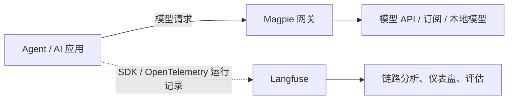

# Magpie与Langfuse调研对比

> 历史来源：本页为2026-10-01 的研究／建模提案，2026-10-07 从团队 Vault 迁入。原位置：`项目/Orbit/Magpie与Langfuse调研对比.md`。正文与原有日期、结论保留，仅整理导航和空白；私人会话定位不公开。本文中的“当前”、TODO、测试数量和执行命令仅对原文基线成立，本次没有重新验证，也不自动形成任务或授权。现行入口：[源码文档](<../README.md>)。

调研日期：2026-10-01。内容依据官方 README、产品文档及相关源码整理；未进行安装、性能测试或两者联动实测。文中的组合方案和选型建议属于 AI 调研建议，尚未形成团队决策。

用户提供的调研入口：[Magpie 仓库](https://github.com/yetone/magpie)、[Langfuse Custom Dashboards](https://langfuse.com/docs/metrics/features/custom-dashboards)。Magpie 调研时最新发布版本为 [v0.1.552](https://github.com/yetone/magpie-releases/releases/tag/v0.1.552)；源码补充核对基于提交 `957baf4925032388dc7d4bab9407ca6f391b51ee`。Langfuse 文档已包含 v4 的功能与迁移说明，实际可用范围取决于部署版本和接入方式。

## 1. 核心结论

**Magpie 侧重模型接入、Agent 配置和请求路由；Langfuse 侧重运行追踪、输出质量评估和持续改进。** 两者在 token、成本和会话分析上有重叠，也可以组合使用。

| 关键问题 | Magpie 的侧重 | Langfuse 的侧重 |
| --- | --- | --- |
| Agent 应该使用哪个模型？ | 统一模型配置、供应商接入、路由组与规则 | 用运行记录和实验结果辅助比较模型 |
| 多个账号和模型来源怎么管理？ | 账号、订阅、API key、模型列表与回退 | 应用或评估使用的模型连接与项目配置 |
| 一次任务用了多少 token、花了多少钱？ | 网关统计及支持的本地会话日志统计 | 对已采集调用进行集中分析 |
| 为什么任务失败、耗时在哪一步？ | 请求元数据、状态、耗时和本地会话汇总 | 模型、检索、工具及业务步骤的执行链路 |
| 换模型或 Prompt 后质量是否改善？ | 本次查阅未见通用评估体系 | 数据集、实验、评估器和人工反馈 |

定位依据：[Magpie 官方介绍](https://usemagpie.ai/)、[Langfuse 官方概览](https://langfuse.com/docs)。

## 2. Magpie 的特色与功能

Magpie 将多个本机 Agent 的配置与模型来源集中到一个工具中。最直观的入口是菜单栏：查看每个 Agent 当前的模型，点击后切换；背后由本地网关处理模型请求。

### 2.1 主要能力

| 能力 | 功能与特色 |
| --- | --- |
| 多 Agent 配置 | 支持 Claude Code、Codex、Gemini CLI、OpenCode、Pi、Goose、DeepSeek Harness 等；各工具支持的配置字段不同 |
| 配置文件编辑 | 局部、原子写入原生配置，保留注释、顺序和格式；切回原生配置时恢复被替换的值 |
| 协议转换 | 本地网关支持 OpenAI Chat Completions、Responses、Anthropic Messages 和 Gemini API；支持流式输出、工具调用和推理相关内容 |
| 多来源模型 | 接入供应商 API、自定义兼容端点、Ollama、LM Studio，以及其支持的订阅登录 |
| 动态模型目录 | 从供应商获取模型列表，并结合 models.dev 补充模型信息；通常使用 `provider/model` 标识模型 |
| 多账号与路由组 | 将多个账号、key 或模型来源组织到一起，通过 `group/<id>` 供 Agent 选择 |
| 配置组合 | Profiles 保存一组 Agent 设置，支持整体切换 |
| 多种运行形态 | 桌面与菜单栏、TUI、CLI、浏览器界面及 Docker 服务；项目采用 MIT 许可证 |

网关默认地址为 `127.0.0.1:3425`。客户端与供应商协议相同时直接转发，不同时进行转换。对 Magpie 已识别的 Agent，它可以直接修改配置；其他工具可通过兼容的 base URL 接入。Agent 通常在启动时读取配置，已有会话不一定立即使用新设置。

来源：[Agent 支持与配置](https://github.com/yetone/magpie#agents)、[接入指南](https://usemagpie.ai/docs/start)、[网关端点](https://github.com/yetone/magpie#connecting-anything-else)。

### 2.2 路由与订阅复用

路由主要支持四种策略：

- **Smart**：优先利用仍有额度、且额度即将重置的订阅账号。
- **In order**：按顺序使用模型或账号，遇到不可用情况回退。
- **In turn**：按轮次轮换，分散调用。
- **Least used**：偏向剩余额度更多的账号或 key。

还可以设置会话或轮次的固定策略，尽量让后续请求留在同一来源，以保留缓存收益。规则可根据上下文长度、是否包含图片、推理要求、Agent 类型或任务意图优先选择模型。

意图路由通过一个分类模型判断最新用户消息属于哪类任务，例如“简单解释”或“编写测试”。分类发生在新一轮开始时，后续工具往返通常沿用该轮选择；分类失败会回到其他规则或默认路由。这会增加分类调用的延迟与成本，不能据此判断最终任务质量。

订阅复用依赖具体供应商的认证和接入方式。例如，Claude 订阅路径需要本机安装并登录 Claude Code。不能将所有订阅都理解为可无条件替代任意供应商 API。

来源：[路由组与账号策略](https://usemagpie.ai/docs/start#3--optional-routing-groups)、[意图路由](https://usemagpie.ai/docs/intent)、[订阅接入说明](https://github.com/yetone/magpie#signed-in-agents-as-providers)。

### 2.3 两种统计口径

Magpie 的统计覆盖模型切换之外的使用分析，但需要区分数据来源。

| 类型 | 数据来源 | 可分析内容 | 主要边界 |
| --- | --- | --- | --- |
| 网关请求统计 | 经过 Magpie 的模型调用 | Agent、供应商、请求模型与返回模型、token、缓存、推理 token、耗时、首个内容延迟、状态码 | 直连供应商的请求不进入这份账本 |
| 本地会话统计 | 支持的 Agent 自身日志 | 会话、项目目录、模型、日期、token、估算成本和恢复会话命令；部分日志支持工具与 Skill 调用统计 | 支持范围与字段完整性取决于日志格式 |

因此，未经过网关的调用，也可能通过本地会话解析被统计到。会话“活动时长”依据日志间隔推算，应作为活跃度指标理解。

来源：[网关统计实现](https://github.com/yetone/magpie/blob/957baf4925032388dc7d4bab9407ca6f391b51ee/internal/usage/usage.go)、[会话解析实现](https://github.com/yetone/magpie/blob/957baf4925032388dc7d4bab9407ca6f391b51ee/internal/sessions/sessions.go)、[会话统计实现](https://github.com/yetone/magpie/blob/957baf4925032388dc7d4bab9407ca6f391b51ee/internal/sessions/stats.go)。

### 2.4 共享配置与多机迁移

Library 可以集中维护共享指令、MCP servers 和 Skills，并指定接收这些配置的 Agent。它会写入各工具对应的文件格式，主要解决多个 Agent 的工作环境一致性问题。

备份与 WebDAV/S3 同步采用本机加密；订阅登录不随备份迁移，需要在各机器重新登录。网关还支持共享给其他机器使用。

来源：[Library 实现](https://github.com/yetone/magpie/blob/957baf4925032388dc7d4bab9407ca6f391b51ee/internal/library/library.go)、[Library CLI](https://github.com/yetone/magpie/blob/957baf4925032388dc7d4bab9407ca6f391b51ee/library_cli.go)、[备份与同步](https://github.com/yetone/magpie#moving-to-another-machine)。

## 3. Langfuse 的特色与功能

Langfuse 是开源 AI 工程平台，围绕“记录真实运行 → 找到问题 → 建立测试数据 → 比较改动 → 部署 → 持续监控”组织能力。

### 3.1 运行追踪与接入

Langfuse 可以记录模型调用、检索、工具执行、外部 API 和自定义业务步骤，保留输入、输出、耗时、错误、参数、token 和元数据。核心概念为：

- **Observation**：一个运行步骤，如一次模型调用或工具执行。
- **Trace**：同一请求中的相关步骤，保留父子关系。
- **Session**：把多轮对话或连续工作流关联起来。

嵌套记录、时间线和 Agent 图有助于定位重复调用、失败节点及延迟来源。接入方式包括 Python、JavaScript/TypeScript SDK、OpenTelemetry 和框架集成；应用中未被记录的业务步骤需要补充埋点。SDK 通常在后台批量发送数据，短生命周期程序需要确保退出前完成发送。

来源：[Tracing 概览](https://langfuse.com/docs/observability/overview)、[数据模型与采集机制](https://langfuse.com/docs/observability/data-model)。

### 3.2 质量评估与实验

| 能力 | 用途 |
| --- | --- |
| LLM-as-a-Judge | 使用模型依据指定标准评价输出 |
| 代码评估器 | 检查结构、业务规则和其他可程序化条件 |
| 人工标注与用户反馈 | 建立质量判断和参考标签 |
| 自定义 Scores | 接收数值、布尔、分类或文本等评估结果 |
| 在线评估 | 检查真实运行数据并监控质量变化 |
| 数据集与离线实验 | 在固定案例上比较模型、Prompt 或代码改动 |
| CI 集成 | 根据评估阈值识别质量回退，阻止不达标改动 |

质量图表依赖评估标准、人工判断或反馈数据。调用成功、token 较少或成本较低，本身都不能证明业务答案正确。

来源：[评估概览](https://langfuse.com/docs/evaluation/overview)、[评估方法与数据概念](https://langfuse.com/docs/evaluation/core-concepts)。

### 3.3 Prompt 管理与 Playground

支持文本或多消息 Prompt、变量、Prompt 引用和消息占位符；修改形成新版本，通过 `production`、`latest` 或自定义标签管理部署与回滚。应用接入后可将运行记录关联到具体版本，比较改动效果；版本更新的可见时间受 SDK 缓存策略影响。

Playground 可并排测试多个 Prompt 或模型配置，支持工具定义、模拟工具响应及结构化输出 schema。

来源：[Prompt 概念与部署](https://langfuse.com/docs/prompt-management/data-model)、[Playground](https://langfuse.com/docs/prompt-management/features/playground)。

### 3.4 成本、告警和 Coding Agent 集成

成本可以由调用方直接提供，也可以结合模型价格定义推算；直接提供的值优先。告警支持成本、延迟、调用量和分数等指标，并可通过 Slack、Webhook 或 GitHub Actions 发送事件。

现成 Coding Agent 也可以接入：官方提供 Codex 插件和 Claude Code Hook 指南，从会话日志重建模型、工具及多轮记录。Codex 集成还支持子 Agent 的嵌套关系。接入需要额外配置，并将采集内容发送至 Langfuse 实例。

来源：[成本追踪](https://langfuse.com/docs/observability/features/token-and-cost-tracking)、[告警](https://langfuse.com/docs/observability/features/alerts)、[Codex 集成](https://langfuse.com/integrations/developer-tools/codex)、[Claude Code 集成](https://langfuse.com/integrations/developer-tools/claude-code)。

### 3.5 团队协作与部署

Langfuse 有组织、项目、角色和项目 API key 等概念。核心功能与 API 可开源自部署；项目级细粒度权限、审计日志、部分数据管理等附加功能需要企业授权。

完整自部署通常包括 Web、Worker、PostgreSQL、ClickHouse、Redis/Valkey 和对象存储，运维工作量明显高于一个本地网关。Cloud 可减少基础设施工作，但有套餐相关的用量、历史访问、协作和 API 限制。调研时 Hobby 为免费起步方案；具体费用与额度以官网为准。

来源：[访问控制](https://langfuse.com/docs/administration/rbac)、[开源与企业功能边界](https://langfuse.com/self-hosting/license-key)、[部署架构](https://langfuse.com/self-hosting)、[套餐](https://langfuse.com/pricing)。

## 4. Langfuse 自定义仪表盘

自定义仪表盘由多个 Widget 组成。每个 Widget 配置数据源、度量、分组、过滤条件和图表类型，再组合成一个监控视图。

| 维度 | 功能 |
| --- | --- |
| 指标 | 调用量、延迟、成本、token 和评估分数等 |
| 查询 | 对支持的字段进行聚合、分组与过滤，分析时间趋势 |
| 过滤 | 时间、环境、标签、元数据和模型属性等 |
| 呈现 | 趋势图、柱状图、饼图等，支持拖动和调整组件大小 |
| 复用 | 使用预设成本、延迟、用量仪表盘，复制或迁移组件 |
| 共享与导出 | 项目内共享；JSON 导入导出；查询结果导出 CSV |
| 编程接入 | Metrics API 获取聚合结果；API、CLI、MCP 管理仪表盘的部分接口仍为 unstable |

来源：[Custom Dashboards](https://langfuse.com/docs/metrics/features/custom-dashboards)、[Metrics API](https://langfuse.com/docs/metrics/features/metrics-api)。

建议按目标组织视图：

- **性能视图**：调用量、延迟、失败情况和工具耗时。
- **成本视图**：模型成本、token 趋势及业务模块成本。
- **质量视图**：评估分数、用户反馈和不同版本的表现。

这些是仪表盘设计建议，展示效果取决于实际采集字段和评估数据。Langfuse 的优势是让成本、性能与效果能够在同一环境中分析。

### v4 与接入限制

- 新建 Widget 以 observations 为主要查询基础，不再使用旧的 traces view。
- 高基数字段的分组存在 Top-N、排序或其他限制；不能假定任意字段都可以直接画时间序列。
- Metrics API v2 明确限制按 `id`、`traceId`、`userId` 和 `sessionId` 分组；仪表盘界面与 API 的支持范围需分别核对。
- 旧 SDK 或未使用新版接入标记的数据，在 Metrics API v2 中可能最多延迟 15 分钟可见。

来源：[v4 仪表盘变化](https://langfuse.com/faq/all/dashboard-changes-in-v4)、[Metrics API v2 说明](https://langfuse.com/docs/metrics/features/metrics-api)。

## 5. 异同对比

| 比较维度 | Magpie | Langfuse |
| --- | --- | --- |
| 核心定位 | Agent 配置与模型网关 | 运行观测、评估及持续改进平台 |
| 模型请求控制 | 直接转发、转换、路由与回退 | 当前正式文档重点为采集和分析；Gateway 已列入路线图 |
| 配置管理 | 修改多个 Agent 的原生配置 | 管理 Prompt、评估器、模型连接及项目配置 |
| 订阅复用 | 支持部分订阅作为模型来源 | 主要围绕应用接入与模型 API 连接 |
| 会话统计 | 本地日志汇总、项目与模型分析、恢复入口 | 执行步骤、输入输出、工具和多轮会话关联 |
| 工具与 Skills | 共享配置；部分日志可统计调用次数 | 工具链路追踪；部分 Agent 集成识别 Skills |
| 输出质量 | 本次查阅未见通用评估体系 | 人工、用户反馈、LLM Judge、代码评估和实验 |
| Prompt 管理 | 共享 Agent 指令和指令集合 | 版本、变量、标签、发布、回滚与运行效果关联 |
| 仪表盘 | 以预定义用量、请求和会话视图为主 | 可配置组件、查询、布局、导出与共享 |
| 数据组织 | 供应商、Agent、请求和本地项目 | 组织、项目、Observation、Trace、Session 和 Scores |
| 部署 | 本地工具或网关服务，启动较轻 | Cloud 接入较轻；完整自部署组件较多 |
| 开源与费用 | MIT；软件免费，模型费用另计 | 核心 MIT；企业功能另有授权；Cloud 按套餐收费 |

两者的共同点是支持多种模型来源、用量与成本分析，并提供开源或扩展方式。区别在于：Magpie 更多地改变模型调用行为；Langfuse 更多地记录、解释和比较任务表现。

Langfuse 的 [Roadmap](https://langfuse.com/docs/roadmap) 已包含原生 Gateway 方向，但路线图是投资方向，不代表相关能力已经稳定交付。因此，上表按本次正式文档确认的功能比较。

### 成本与数据口径

Magpie 的账本和会话成本在读取时按当前有效价格重算；Langfuse 的推算成本通常在入库时计算，修改价格定义主要影响后续记录。即使 token 数相同，历史金额也可能不同。固定月费订阅的 token 等价成本不能直接理解为实际新增账单。

Magpie 的网关统计日志保存在本机，但模型请求仍发送至所选供应商；Langfuse 的采集内容发送至所选择的 Cloud 或自部署实例。评估器和自动路由分类器也会产生自己的调用成本。

来源：[Magpie 成本口径](https://github.com/yetone/magpie#what-a-model-costs)、[本地统计存储](https://github.com/yetone/magpie/blob/957baf4925032388dc7d4bab9407ca6f391b51ee/internal/usage/usage.go)、[Langfuse 成本计算](https://langfuse.com/docs/observability/features/token-and-cost-tracking)。

## 6. 选型与组合建议

| 需求 | 建议 | 理由 |
| --- | --- | --- |
| 同时使用多个本机 Agent，频繁切换模型 | 优先 Magpie | 能直接管理模型接入和工具配置 |
| 管理多个 API key、订阅和回退模型 | 优先 Magpie | 路由与账号管理是核心能力 |
| 分析失败步骤、重复工具调用和耗时 | 优先 Langfuse | 执行链路与输入输出更适合诊断 |
| 比较模型、Prompt 或代码改动的质量 | 优先 Langfuse | 数据集、实验和评估形成可重复验证流程 |
| 同时需要模型管理与团队质量监控 | 组合使用 | 分别承担请求控制和运行分析 |

### 建议的组合结构

该结构是基于接口能力提出的方案，尚未实测。自研应用可将模型客户端指向 Magpie，同时用 Langfuse SDK 记录业务步骤；现成 Codex 或 Claude Code 可使用对应插件或 Hook。仅改变模型请求地址，不会自动生成完整的 Langfuse 业务链路。

实际接入应统一会话标识、模型名称和成本口径，并分别核对模型请求、运行记录及工具步骤是否完整。如果让 Langfuse 服务端的 Playground 或评估器调用 Magpie，服务端还必须能够访问网关地址；Cloud 端的 `127.0.0.1` 不指向开发者本机。

方案依据：[Magpie 网关接入](https://github.com/yetone/magpie#connecting-anything-else)、[网关与观测层的关系](https://langfuse.com/resources/engineering/llm-gateway)、[Langfuse 模型连接](https://langfuse.com/docs/administration/llm-connection)。
