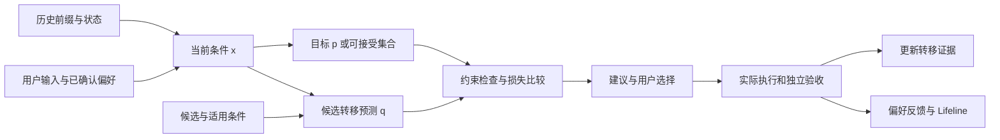

# Agent轨迹与个性化建模方案

> 历史来源：本页为2026-10-01 的研究／建模提案，2026-10-07 从团队 Vault 迁入。原位置：`项目/Orbit/Agent轨迹与个性化建模方案.md`。正文与原有日期、结论保留，仅整理导航和空白；私人会话定位不公开。本文中的“当前”、TODO、测试数量和执行命令仅对原文基线成立，本次没有重新验证，也不自动形成任务或授权。现行入口：[源码文档](<../../modules/analytics/README.md>)。

本文承接[agent轨迹数据处理方向与分析工具](<processing-methods.md>)，把“项目状态 $s_n$＋用户输入 $a_n$ → 下一状态”具体化为可采集、可估计、可验证的模型，服务于协作画像、瓶颈分析、skill 推荐和 Lifeline 更新。

本次结合Agent数据分析维度（原对话定位留在团队原稿中）最新一轮《Agent 历史轨迹的个性化建模与瓶颈分析方案》及用户提供的粘贴文本，补齐状态变化、多头转移、后续反馈、用户／项目／任务三层表征、动态画像、瓶颈聚合与 skill 净收益。讨论中的公式作为设计起点，其假设与验证条件在本文中明确。

**建模主线：用状态特征描述现在，用 $p$ 描述用户希望看到的结果，用 $q_\theta$ 描述某套 agent 策略可能产生的结果；在满足验收和执行条件的候选中，选择差距小且经验证有价值的策略。**

方案日期：2026-10-01。以下为 AI 建模建议，待团队确认；没有训练模型、读取本机原始聊天库或取得实际收益。第 11 节的概率全部为合成演算数据。理论性质、数据估计和真实效果分别说明。

## 1 符号、轨迹边界与基本假设

### 1.1 保留原框架 补齐可控制的变量

| 符号 | 含义 | 记录或估计方式 |
| --- | --- | --- |
| $i$、$u_i$ | 第 i 条轨迹、对应用户 | 一次任务运行有独立 trajectory ID；用户标识用于本机关联 |
| $n$、$t_{i,n}$ | 离散决策步、实际时间 | n 表示第几步，不表示经过几秒 |
| $s_{i,n}$ | 输入到来前的项目与执行状态 | 从截至该时刻可见的产物、检查、事件与配置构造 |
| $a_{i,n}$ | 用户在该步给出的输入 | 原文引用＋结构化意图、目标、约束及反馈 |
| $b_{i,n}$ | agent 在该步内部采取的执行过程 | 检索、修改、调用工具、验证、澄清等；一次宏观步可包含多个动作 |
| $\theta$ | 可调整的 agent 策略／配置 | skill 及版本、执行流程、参数等；首版一次改变一个主要因素 |
| $c_{i,n}$ | 运行条件 | agent、模型、依赖、权限、输入规模、预算和环境版本 |
| $h_{i,n}$ | 当前状态未覆盖的历史摘要 | 最近动作、错误修复链、已确认约束、压缩与交接记录 |
| $z_u(t),z_{\mathrm{project}},z_{\mathrm{task}}$ | 用户的时变偏好、项目特有条件、当前任务的局部表征 | 从有范围与时点的证据估计；已确认要求单独保留 |
| $r_{i,n}$ | 对本步结果随后出现的反馈观测 | 接受、纠正、回滚、重试等；记录作用对象、理由和反馈可见时间 |
| $\Delta t_{i,n}$ | 该步实际经过的时间 | 相邻决策边界之间的可测跨度；保留时钟和缺失标志 |
| $p_u$ | 用户希望的下一状态分布 | 当前要求、确认过的偏好或偏好模型；不是历史实际结果的频率 |
| $q_\theta$ | 策略 θ 下的实际转移分布 | 对相同条件下执行结果的预测；实际结果随机且受环境影响 |
| $\widehat p,\widehat q$ | 对 p、q 的估计或操作性构造 | 记录来源、模型版本、适用范围及不确定性 |

为简化后文，省略轨迹下标 i，并把完整条件记为：

$$
x_n=(s_n,a_n,h_n,c_n,u_i).
$$

其中 $u_i$ 用于定位截止该时刻有效的个人档案；模型使用的是有证据的 $z_u(t_n)$ 等表征，而不是把账号 ID 当作连续能力特征。偏好参数记为 φ、转移预测参数记为 ψ、反馈观测参数记为 ω、实际策略记为 θ，四者不混用。

原来的 $q(s_{n+1}\mid s_n,a_n)$、$p(s_{n+1}\mid s_n,a_n)$ 可以作为简写；比较时要明确它们是否还条件于同一任务、用户、历史与运行环境。

**$a_n$ 是用户输入，$b_n$ 才是 agent 动作。个性化调整的是 θ 及其执行方式；预测模型拟合得更好，本身不代表 agent 行为已经改善。**

### 1.2 n 怎样从真实日志中产生

首版按**协作决策边界**切步：用户发来新要求、agent 交付阶段结果、需要澄清／审批，或到达事先定义的检查节点。每种边界记录类型；同一种任务采用同一套切步规则，不把每个 token 当一步。

- 用户输入边界记录实际 $a_n$；内部检查节点没有新用户消息时，记 $a_n=\varnothing$，沿用仍有效的目标。空输入不表示追加授权。
- 目标改变时生成新 goal version；明显换目标时切为新 task，保留与旧任务的关系。
- 多个会话可以属于同一 task；重跑、fork 和不同策略试验分别保留 run ID。继承的历史不重复计为新执行。
- 下一边界若未出现，保存开放区间和截至观测终点的时间，不补造 $s_{n+1}$ 或失败标签。
- 边界之间的模型／工具事件保留为子轨迹和依赖图；宏观一步包含这些内部执行，不能丢掉并发关系。

新输入可能更新目标。先计算 $g_n^+=\operatorname{Update}(g_n,a_n)$，再定义本步期望与下一状态的验收口径。用新目标判断本次交付，用旧目标核对此前执行，避免把用户改需求算成旧结果失败。

### 1.3 s 是可观测状态 不是完整真实世界

日志通常看不到完整文件环境、模型实际上下文、用户未表达的意图及外部服务状态。若把真实世界状态记作 ζ，则 s 是它的部分观测与摘要；ζ 与后文的画像表征 z 分开。

严格路线可以用历史形成信念状态 $B_n(\zeta)=P(\zeta_n=\zeta\mid\text{截至 n 的观测})$；首版采用“结构化状态＋有限历史＋缺失标志”的近似。部分可观测建模的理论背景见 [Kaelbling、Littman、Cassandra 的 POMDP 技术报告](https://cs.brown.edu/research/pubs/techreports/reports/CS-96-08.html)。

“给定 $s_n,a_n$ 就足以预测下一步”是待检验的近似马尔可夫假设。若加入历史后，留出任务的预测明显改善，就补入遗漏的历史特征；不能因为写出了 q 的条件式，就宣称状态已充分。

## 2 $s_n$ 应由哪些关键 feature 组成

建议把 s 保存为有结构的对象；建模时再编码成数值、类别和向量。每个字段附来源、可见时间、单位、版本与缺失标志。

$$
s_n=(G_n,A_n,V_n,E_n,J_n,R_n,C_n,W_n,M_n).
$$

这里的九组依次是目标、产物、验证、执行、人机交互、最近历史、上下文、预算、观测质量。

| 特征组 | 首版关键字段 | 数据来源与计算 | 不应混入的东西 |
| --- | --- | --- | --- |
| 目标与阶段 $G_n$ | goal version、任务类别／领域、当前阶段、期望产物、范围、硬验收项、软偏好、当前阻塞项、歧义及历史新颖性 | 用户明确要求、确认后的任务拆分；新颖性只与此前可见任务比较；文件／依赖规模作复杂度代理 | 尚未提出的未来需求、主观猜测的最终目标；把代理指标当真实难度 |
| 产物状态 $A_n$ | 仓库／分支、文件／对象 ID 与版本、语言／格式、是否存在、修改文件数与 diff 范围、已知需求项、待处理项、产物依赖 | 文件快照引用、diff、检查点、产物关联；尽量由程序解析 | 仅凭 agent 说“完成”生成完成度 |
| 验证状态 $V_n$ | 每个验收项的 pass／fail／unchecked、检查版本、最近结果、错误指纹、未关闭错误 episode | 独立验收器、测试、人工确认；结果绑定到具体产物版本 | 没运行检查时填“通过”；把旧版本测试套到新版本 |
| 执行状态 $E_n$ | 正在运行的调用、待返回子 agent、已知依赖／汇合点、已配对等待、待审批、取消状态 | events、spans、links；只使用当前已知关系 | 把所有父子 span 都当调度依赖；把未知空档命名为审批 |
| 人机交互 $J_n$ | 已发生的协作轮次、明确接受／纠正、用户接管、要求解释、自由选择的确认节点、待回应问题 | 用户输入与反馈，关联到任务、产物及要求版本；平台强制节点单列 | 把修正需求算成不满；把强制审批算成控制偏好 |
| 最近历史 $R_n$ | 近期动作序列、同类错误重试次数、重复读取、最近纠正、接管、压缩与约束恢复 | 轨迹前缀、同版本产物及错误链；窗口记录计算版本 | 未来返工、最终接受；一个错误的多条镜像记录 |
| 上下文与记忆 $C_n$ | 已确认约束摘要、未解答问题、可见上下文／压缩状态、已加载且仍适用的记忆与 skill | 原生上下文接口、压缩事件、确认记录；无法获知时保留未知 | 假装本地 transcript 等于模型完整上下文；把“已加载”当“已执行” |
| 时间与预算 $W_n$ | 已经过时间、可测活动覆盖、已知等待、累计用量、剩余预算、截止时间、时间覆盖率 | 可信配对区间、增量用量和明确预算；口径分别保存 | token 直接换成耗时；费用估算当账单；审批跨度当人工工时 |
| 观测质量 $M_n$ | 缺失字段、时间可信级别、截断、来源覆盖、状态重建范围、语义标签来源 | 适配器检查与标签元数据 | 用零代替缺失；把 LLM 自报置信度当校准概率 |

运行条件 $c_n$ 单独保存 agent／模型版本、工具与依赖、权限、skill 配置、环境快照、输入规模。这样既能解释 q 的差异，也能避免把“环境没有某个能力”归因于用户人格。

### 2.1 首版应保留的最小状态

第一轮先实现：**任务类别与阶段、goal version 与验收项、产物版本、检查状态、错误／重试、交互统计、活动与等待、累计预算、约束摘要、运行条件、缺失标志。**

例如，状态可以表述为：“当前是文档修订阶段；4 项已知验收要求中 2 项通过、1 项失败、1 项未检查；草稿为 v2；没有后台调用，格式错误尚未关闭；当前预算已消耗一部分。”这是可核对的状态，不能概括成没有依据的“完成 50%”。

类别使用固定词表；金额和时间保留单位；规模较大的计数可作对数变换，规则在训练集上确定。文本向量用于任务与问题的相似性检索，仍保留明确的任务类别、验收和版本字段。ID 用于关联，不能当作“用户能力”的数值特征。

### 2.2 状态构造与审计

按“截至时刻的事件 → 更新目标 → 更新产物 → 绑定验证 → 更新执行图 → 计算历史与预算 → 标记缺失”重建状态。晚到事件另记 observed-at；历史回放时区分“后来才获知”与“当时可用于决策”。

状态快照使用 schema version 与 feature version，保留原始证据引用。人工修正标签后生成新版本，旧预测仍能按当时快照复核。

### 2.3 摩擦与状态变化需要专门定义

摩擦比例按可观察协作轮次计算：

$$
\mathrm{Friction}_n=
\frac{|\mathcal C_n\cup\mathcal R_n\cup\mathcal E_n^{\mathrm{fail}}|}
{|\mathcal T_n^{\mathrm{obs}}|}.
$$

三个集合分别是明确纠正、非计划重试、已确认执行失败所涉及的轮次 ID，分母为同一统计窗内可观察的协作轮次；分母为零时不计算。同一轮同时出现失败、重试和纠正只算一轮，跨轮分别计数；错误 episode 与各类次数另报。阶段节点 n 不必等于聊天轮数，不能直接用 $n+1$ 作分母。

该量描述交互中的问题密度，不是满意度或人格概率。正常探索、负面测试及新要求排除或单列，所有规则带版本。

进一步定义结构化变化：

$$
\Delta s_n=\operatorname{Diff}(s_n,s_{n+1}).
$$

数值用增量；类别用转移；文件与图用版本变化、节点／边增删；需求用 goal version 变化。只有同单位数值才直接做减法。换目标与要求变化仍保留在状态里，但不自动解释为 agent 成败。

## 3 $a_n$ 应由哪些关键 feature 组成

$$
a_n=(I_n,T_n,K_n,D_n,F_n,P_n,U_n).
$$

七组依次是输入意图、目标变化、约束、材料、反馈、授权与介入方式、时间／优先级。

| 特征组          | 应提取的内容                                      | 对 p、q 的作用                   |
| ------------ | ------------------------------------------- | --------------------------- |
| 输入意图 $I_n$   | 新任务、继续、澄清回答、纠错、局部修改、换方向、接受、拒绝、接管            | 决定切步与任务边界；接受此前结果不等于请求继续执行   |
| 目标变化 $T_n$   | 新增／删除／替换要求、期望下一阶段、目标产物、修改范围、保留事项            | 更新 $g_n^+$，确定本步应达到的状态       |
| 约束 $K_n$     | 格式、质量、必须运行的检查、不可修改范围、预算；标明硬要求或软偏好           | 构造可接受结果与策略过滤条件，防止只优化表面速度    |
| 输入材料 $D_n$   | 文件／版本引用、附件类型、项目路径、示例、参考资料、用户提供的环境信息         | 改变可执行条件与问题难度；保留材料是否完整       |
| 反馈 $F_n$     | 针对哪次结果／产物、接受或纠正什么、理由、是旧要求遗漏还是新要求            | 为上一转移提供标签，同时更新本步条件；两个用途分别记录 |
| 授权与介入 $P_n$  | 本次允许的操作、希望确认的节点、是否授权连续执行、希望 agent 解释／接管哪些步骤 | 影响允许的 θ 与协作方式；与平台强制权限分开     |
| 时间与优先级 $U_n$ | 明确截止时间、紧急程度、质量／速度／费用取舍、最先处理的事项              | 更新本次目标；“尽快”不能自行转换为精确秒数      |

原文留作证据，结构化提取保留“明确／推断／待确认”。模型可以抽取候选字段，不能自行把用户没说的限制、概率或授权填进去。

输入意图允许多标签，例如同时要求解释、修改和验证。另存原文语义向量 $e_n^a=\operatorname{Embedding}(a_n^{\mathrm{text}})$，用于相似检索和需求变化候选；语义向量不能替代明确的范围、授权、验收与反馈对象。

“详细一些”“不要再问确认”可能是当前任务的明确要求；要记录范围和生效时间。当前要求覆盖冲突的历史偏好，历史十六人格标签只作展示。

## 4 怎样定义与估计实际转移 $q_\theta$

### 4.1 q 包含执行策略和环境影响

保留用户的下一状态转移定义，并显式加入可调整策略与时间：

$$
q_\theta(s',\delta\mid x_n)
=P(s_{n+1}=s',\Delta t_n=\delta\mid x_n,\text{实际执行策略 }\theta).
$$

连续变量应理解为密度或区间概率；单个精确时间点通常不是有正概率的结果。θ 是有版本的配置，轨迹内变更时记录实际生效区间。

概念上可以拆成：

$$
q_\theta(s',\delta\mid x)
=\int K(s',\delta\mid x,b,\theta)\,\pi_\theta(db\mid x).
$$

$\pi_\theta$ 是 agent 生成内部执行过程 b 的分布；K 描述该过程与工具、项目、外部环境共同产生的结果。这里 b 包含该宏观步中的执行与反馈过程，不能用一次工具名称替代。

首版直接学习可观测转移，不分别辨识 K 和 $\pi_\theta$。同一 skill 在不同 agent、权限或任务上可能改变不同的 q；配置名相同不足以证明条件相同。

### 4.2 对整个下一状态求概率过于困难 首先定义结果投影

完整 $s'$ 含文件内容、图、数值和文本，无法靠少量日志估计高维联合分布。先定义有版本的投影：

$$
y_{n+1}=\rho_{g_n^+}(s_n,s_{n+1},\Delta t_n).
$$

y 保存用户关心的变化：**阶段验收、目标推进、输出形态、约定的介入方式、耗时、费用与返工**。它使用最新目标解释变化，不把 agent ID、随机文件 hash 等当作个性化目标。

投影后的 $q_\theta^Y$、$p_u^Y$ 必须使用同一结果空间和标签规则。首版可按任务族固定少量互斥结果类别，时间和费用另做条件分布；不能把“质量”“速度”“满意度”的边缘概率相乘，假定它们天然独立。

**投影损失小只说明这些选定指标匹配；被投影丢掉的状态差异，仍需独立验收。** 澄清任务、规划任务和最终交付任务有不同阶段标准，不让每一步都被要求直接完成整个项目。

### 4.3 从简单模型开始

- **分层计数基线。** 在去重、可比且近似平稳的样本组内统计结果。分类结果可使用 Dirichlet 先验平滑：$\widehat q_j=(N_j+\alpha_j)/(N+\sum_k\alpha_k)$。记录先验及敏感性；相关转移不能当作 N 个独立试验。
- **条件预测模型。** 数据足够后，使用多项逻辑回归等模型输出 $q^Y(j\mid x,\theta)$，比只按任务族平均更细；高维文本与交互特征按验证结果逐步加入。
- **时间模型。** 同时保留阶段时长、未完成与停止原因，采用第 7 节的方法；不只拟合成功样本。

训练预测器的损失可以是：

$$
\mathcal L_{\mathrm{fit}}
=-\sum_{i,n}w_{i,n}\log\widehat q_\psi^Y(y_{i,n+1}\mid x_{i,n},\theta_{i,n}).
$$

ψ 是预测模型参数，θ 是执行策略。$w_{i,n}$ 是事先定义的任务／用户汇总权重，防止超长会话独占训练；加权规则不自动消除相关性或选择偏差。结果标签未知时不进入已知类别损失，保留缺失样本及其原因，检查是否存在非随机漏标。

使用实际结果拟合 $\widehat q$，再用 p 与它选择 θ。把 $\widehat q$ 的输出直接训练成 p，却没有改变执行过程，会造成“预测看起来理想，实际仍未改善”。

### 4.4 检验预测概率是否可信

用未来任务检验 log loss、多类 Brier score、分类型错误和校准曲线，同时报告样本与字段覆盖。Brier score 同时受区分能力与校准影响，单独下降不能证明概率已校准。[scikit-learn 概率校准说明](https://scikit-learn.org/stable/modules/calibration.html)

候选 skill 从未在相关条件下应用时，历史数据不能直接识别它的实际转移。规则、说明书或模型模拟只能生成先验假设；需要授权试验和独立验收补证据。观测中“采用 skill 的任务成功率高”，也可能来自采用者或任务的差异。

### 4.5 将动作、结果、成本与后续反应拆成有依赖的输出

沿用最新对话的多头思路，令 b 为内部流程表示、o 为阶段结果、$\kappa=(\Delta t,\text{token},\text{调用数},\text{费用})$ 为成本，r 为随后观察到的反馈。一个可用的联合建模形式是：

$$
\begin{aligned}
\widehat q_{\psi,\omega}^{\mathrm{obs}}(b,o,\kappa,r\mid x,\theta)
={}&\widehat q_\psi^B(b\mid x,\theta)\\
&\cdot\widehat q_\psi^O(o\mid b,x,\theta)\\
&\cdot\widehat q_\psi^C(\kappa\mid o,b,x,\theta)\\
&\cdot\ell_\omega(r\mid\kappa,o,b,x,\theta).
\end{aligned}
$$

这是条件概率链式分解。直接相乘四个只条件于 x 的边缘分布，额外假定动作、结果、成本和反馈条件独立，通常不成立。参数可以共享编码器，但每个输出的条件、标签与观测质量要明确。

首版 b 可表示“先解释／先诊断／先修改／验证后交付”等流程类别与短序列；o 是独立验收或已确认阶段结果；成本保留真实单位与缺失。反应模型 $\ell_\omega$ 是辅助观测模型，不把“用户将会点赞／减少纠错”作为可无条件控制的目标。

本步 r 往往在下一次用户消息甚至更晚才可见。记录固定的反馈关联窗、截止时间与反馈对象；窗结束无反馈记未知，不算接受或放弃。完整用户后续行为还受目标变化与外部条件影响，不能全部归因于 agent。

## 5 怎样定义与获取用户期望 $p_u$

### 5.1 p 应描述希望发生什么

$p_u(s'\mid x_n)$ 是用户希望的下一状态分布，包含当前目标和协作取舍。它不是用户预测 agent 会怎样，也不是 agent 历史输出的统计分布。

| 证据层级 | 能形成什么 | 如何使用 |
| --- | --- | --- |
| 当前明确目标与验收 | 必须达到的条件、允许的阶段结果 | 直接约束本次结果与允许策略 |
| 用户直接确认的偏好 | 输出形态、介入方式、质量／时间取舍、目标比例或区间 | 形成当前任务的目标或可接受集合 |
| 同条件下的选择／成对评价 | 对两种结果或过程的相对偏好 | 训练偏好模型；允许“同样好”“无法比较” |
| 历史纠正、回滚与接管 | 可能不合适的结果，以及待核对理由 | 区分质量问题、需求改变和环境限制，再决定是否更新偏好 |
| 未回复、停留时间、人格标签 | 弱信号或未知 | 不直接生成满意／不满意或精确 p |

自然语言往往只够确定可接受范围，不够确定每个结果的概率。首先保存目标与约束；需要概率时，说明它是用户确认的分布还是模型构造的 $\widehat p$，并给出不确定性。

### 5.2 偏好学习的一条可实现路线

在同一目标与验收条件下，让用户比较两种交付或过程。用效用 $U_u(y,x)$ 建模成对选择：

$$
P_u(y^{(1)}\succ y^{(2)}\mid x)
=\sigma\!\left(U_u(y^{(1)},x)-U_u(y^{(2)},x)\right).
$$

这是 Bradley–Terry 型假设；首版可用线性效用与正则化，输入为质量、说明深度、介入方式和标准化消耗等特征。相对选择只能识别效用差；少量评价不应被扩展为可靠的完整人格。轨迹片段比较的学习方法可参考[人类偏好强化学习论文](https://arxiv.org/html/1706.03741v4)，本项目先用于偏好估计。

若产品确实需要离散目标分布，可在用户认可的结果集合 $\mathcal A_u(x)$ 上构造：

$$
\widehat p_\phi^Y(j\mid x)
=
\frac{\mathbf 1\{j\in\mathcal A_u(x)\}
\exp(U_\phi(j,x)/\tau)}
{\sum_{k\in\mathcal A_u(x)}\exp(U_\phi(k,x)/\tau)}.
$$

τ > 0 是记录并验证的温度参数，不由一次文本情绪随意决定；集合为空时先解决目标冲突。**这一步是把效用转为操作性目标分布的设计选择；成对选择模型并不能单独证明它等于真实 p。**

硬要求始终保留。当前明确要求更新本次目标；确认的长期偏好按适用任务族保存。偏好变化、证据冲突、模型不确定性分别记录，用户可修正与撤回。

### 5.3 不足以确定 p 时保留集合

需要区分两种集合：

- **可接受分布集合 $\mathcal P_{\mathrm{accept}}$。** 用户认为其中各分布都可接受，例如达到某个质量下限。无需硬指定一个精确 p。
- **期望的不确定集合 $\mathcal P_{\mathrm{uncertain}}$。** 我们不知道用户真正偏好哪个分布。应补充询问或做保守分析，不能挑一个最方便的 p 当作用户期望。

集合依据、范围、确认状态及版本都要保存。其他用户的数据可以帮助建立先验，不能覆盖本用户已明确的要求。

### 5.4 后续反馈如何反推期望

为每次实际交付保存反馈观测：

$$
r_n=(\text{明确接受},\text{纠正},\text{拒绝},\text{重试},
\text{回滚},\text{人工修改},\text{停止类型},\text{理由与作用对象}).
$$

再为第 4.5 节的观测模型引入效用参数化，用带情境的似然解释它与潜在效用的关系。将截至 t 已观察的反馈记为 $\mathcal R_{\le t}$，对应输入与解释条件记为 $\mathcal D_{\le t}$，可作条件更新：

$$
P(\phi,z\mid\mathcal R_{\le t},\mathcal D_{\le t},\omega)
\propto
P(\phi,z\mid\mathcal D_{\le t},\omega)
\prod_{\ell:\,t_\ell^{\mathrm{obs}}\le t}
\ell_\omega\!\left(
r_\ell\mid U_\phi(y_\ell,x_\ell,z),d_\ell
\right).
$$

z 包含用户／项目／任务表征，$d_\ell$ 保存需求变化、产物关系、检查结果、执行者、策略版本和反馈可靠性等解释条件。此式给定观测模型参数 ω；若同时估计 ω，需联合建模并边缘化其不确定性。乘积是给定这些条件的独立近似；同一纠错链要归并或使用组级似然，不把重复表达当多份证据。若输入或需求改变本身透露偏好，条件先验也应反映这份信息，不能假定它们天然独立于 φ。φ 与 ω 需要偏好标尺、标注或先验约束，不能只凭接受／拒绝同时唯一辨识。

例如“不是我的意思”在指向原有要求时支持偏好或理解不匹配；指向刚新增的要求时应更新目标。回滚可能因为环境变更或后续设计调整；commit 可能由 agent 自动执行。它们都不能无条件转换为 p 的高／低概率。仅“没有再修改”更不能等同满意。

**反馈只能约束用户对实际看过结果的判断，不能唯一识别所有未出现结果的期望分布。** 成对评价、明确理由和可比结果能增强辨识；不足时保留先验范围。实际效果模型 q 与偏好模型 p 分别拟合，禁止把 q 的高频输出直接抄成 p。

这些反馈可用于更新后续 $z_u(t)$ 和偏好参数，但不能回填到过去推荐的特征中。历史复盘可另生成“利用后续证据的解释版本”，与决策当时版本分开。

## 6 把“个性化 = $\min L(p,q)$”变成优化问题

### 6.1 明确对谁、在什么条件下、优化什么

对当前用户与任务条件，基本目标为：

$$
\theta^*(x)
\in\arg\min_{\theta\in\Theta_{\mathrm{allowed}}(x)}
L\!\left(p_u^Y(\cdot\mid x),q_\theta^Y(\cdot\mid x)\right).
$$

$\Theta_{\mathrm{allowed}}$ 先按适用任务、工具依赖、授权和预算等条件过滤，含保持现有配置的基线。若评价一段使用期，再对预先约定的用户任务分布 $d_u^*(x)$ 求期望；不能让日志最多的任务类型自动决定全部目标。

比较候选时固定目标版本和 p。通过改 p 让损失变小，只能算目标改变；是否符合用户意图另行确认。首版优化 skill／流程，不要求训练基础大模型。

### 6.2 损失函数怎样选

| 情况 | 推荐损失 | 数学性质与边界 |
| --- | --- | --- |
| 同一组离散结果，没有可靠状态距离 | 首版用 JS 散度 | 对称且有限；零概率可按标准约定处理。自然对数下范围为 0 到 $\ln 2$ |
| 重点确保期望结果不被漏掉 | 正向 $D_{\mathrm{KL}}(p\parallel q)$ | 有 $p_j>0,q_j=0$ 时为无穷；不能靠任意补数掩盖结构性不可达 |
| 时间或质量等级之间有可信距离 | 最优运输／Wasserstein | 反映“偏差有多远”；需要明确单位和代价。任意代价矩阵不自动构成 Wasserstein 距离 |
| 只知道可接受集合 $\mathcal A$ | 最大化 $q_\theta(\mathcal A\mid x)$，或最小化其负对数 | 直接优化达标概率；无需编造 p 内部的比例 |

离散情况定义：

$$
D_{\mathrm{KL}}(p\parallel q)=\sum_j p_j\log\frac{p_j}{q_j},
\qquad
m=\frac{p+q}{2},
$$

$$
D_{\mathrm{JS}}(p,q)
=\tfrac12D_{\mathrm{KL}}(p\parallel m)
+\tfrac12D_{\mathrm{KL}}(q\parallel m).
$$

约定 $0\log(0/q)=0$。计算前检查非负、归一、同一结果词表和相同版本。JS 有界仍可能掩盖某个重要结果的漏失，因此关键验收概率另报。SciPy 的 `jensenshannon` 返回 **JS 散度的平方根**；需要散度时对返回值平方，记录对数底。[JS API](https://docs.scipy.org/doc/scipy/reference/generated/scipy.spatial.distance.jensenshannon.html)、[相对熵 API](https://docs.scipy.org/doc/scipy/reference/generated/scipy.special.rel_entr.html)

需要运输损失时使用：

$$
W_d(p,q)=\inf_{\gamma\in\Pi(p,q)}
\mathbb E_{(y,y')\sim\gamma}[d(y,y')].
$$

$\Pi(p,q)$ 表示边缘分布分别为 p、q 的运输计划。若 d 是经定义的度量，可以讨论相应 Wasserstein 距离；数值、类别和语义尺度不能随意混用。[POT 运输损失 API](https://pythonot.github.io/all.html#ot.emd2)

### 6.3 多种数据类型对应的损失与联合口径

对固定 p，交叉熵与 KL 的关系是：

$$
H(p,q)=-\mathbb E_p\log q
=H(p)+D_{\mathrm{KL}}(p\parallel q).
$$

因此两者对 q 的最小化等价，但数值不相等；若 p 也在改变，不能省略它的熵后声称同一优化问题。用实际结果的 one-hot 标签训练 q，是预测拟合；用用户目标分布比较候选，是个性化匹配，两者分别记录。

扩展模型可用复合目标：

$$
L_{\mathrm{comp}}
=\lambda_bL_{\mathrm{action}}
+\lambda_oL_{\mathrm{outcome}}
+\lambda_\chi L_{\mathrm{interaction}}
+\lambda_\kappa L_{\mathrm{cost}}.
$$

| 分量 | 可选择的口径 | 需要控制的假设 |
| --- | --- | --- |
| 动作／流程 | 流程类别的 JS／交叉熵，短序列的条件似然 | 比较同一阶段与允许操作，长度及流程词表固定 |
| 阶段结果 | 相同验收类别的 JS／KL，达标概率与质量约束 | 不能用文本自评或用户情感替代验收 |
| 协作方式 $\chi$ | 解释深度、确认节点、交接与当前要求的偏差 | r 中的点赞／纠错属于反馈证据，不作为盲目压低纠错的目标 |
| 消耗 $\kappa$ | 条件分布的负对数似然、可信代价下的运输损失；只比均值时才用 MSE | 时间、费用与 token 分开；MSE 不刻画方差、多峰和尾部风险 |

连续高斯负对数似然仅在方差固定等条件下与 MSE 排序对应；学习方差时需保留方差项。余弦相似度是语义表示比较，不是分布 KL 或校准概率；DTW 比较过程形状，真实耗时另报。

消耗模型用实际观测的负对数似然拟合；比较个性化候选时，则按目标消耗分布计算交叉熵或运输损失。一次实际耗时的拟合损失，不能直接当作 p 与 q 的匹配损失。

复合损失的权重需要当前取舍和验证支撑，注明标准化及额外成本。它一般不等于联合 KL：联合 KL 的链式分解还包含在 p 的前缀分布下，对各条件 KL 求期望。缺维度不填零，也不静默重归一；只在相同可观察口径下比较并报告覆盖。

### 6.4 最低标准不要写成必须精确匹配的比例

若要求“当前条件下达标概率至少 90%”，应写成 $q_\theta(\mathcal A_u(x)\mid x)\ge0.9$。若要求“某使用期至少 90% 的任务达标”，则按约定任务分布约束 $\mathbb E_{x\sim d_u^*}[q_\theta(\mathcal A_u(x)\mid x)]\ge0.9$，并报告估计区间。逐任务下限与总体下限不同；把目标固定为“90% 达标、10% 不达标”，会使 100% 达标也产生分布损失，不符合最低标准。

对用户确认的可接受分布集合，可用：

$$
\min_\theta\inf_{p\in\mathcal P_{\mathrm{accept}}(x)}
D_{\mathrm{JS}}(p,q_\theta).
$$

集合须有实质约束；若允许所有分布，取 $p=q_\theta$ 会让目标恒为零。若集合代表“对真实期望的估计不确定”，则采用补充偏好采集，或研究 $\min_\theta\sup_{p\in\mathcal P_{\mathrm{uncertain}}}L(p,q_\theta)$ 的保守目标，不能用乐观的内层最小化。

权限等可控条件通过执行配置保证；任务质量与耗时属于随机结果，要报告预测范围并实际验收。固定质量约束后才比较软偏好与消耗；有多个目标时明确取舍，不把秒、钱和主观评分直接相加。成本已进入目标时，避免再重复处罚同一项成本。

### 6.5 数学上可以给什么有效性保证

对一个固定条件 x 和相同的有限候选集合，令 JS 距离 $d(p,q)=\sqrt{D_{\mathrm{JS}}(p,q)}$。假设：

$$
d(p,\widehat p)\le\varepsilon_p,\qquad
\sup_\theta d(q_\theta,\widehat q_\theta)\le\varepsilon_q.
$$

若 $\widehat\theta$ 最小化估计距离，$\theta^*$ 最小化真实距离，则：

$$
d(p,q_{\widehat\theta})
\le d(p,q_{\theta^*})+2(\varepsilon_p+\varepsilon_q).
$$

推导是两次三角不等式，中间使用估计最优性：

$$
\begin{aligned}
d(p,q_{\widehat\theta})
&\le d(\widehat p,\widehat q_{\widehat\theta})+\varepsilon_p+\varepsilon_q\\
&\le d(\widehat p,\widehat q_{\theta^*})+\varepsilon_p+\varepsilon_q\\
&\le d(p,q_{\theta^*})+2(\varepsilon_p+\varepsilon_q).
\end{aligned}
$$

**这是一条条件性误差界，解释为什么 p、q 都必须估准。** 它要求对所有候选有可信误差界、候选集合一致、选择达到估计最优；在固定 x 上，最小化 JS 距离与散度排序一致。它不直接适用于不同条件混合后的平均散度优化，也不自动保证原始完整状态、长期效果或真实质量。

普通校准曲线和一次 Bootstrap 不能单独提供上述一致误差证书。首版报告有限样本的不确定性，不能把这条公式当作已获得的实际保证。

候选过滤误判、结构性不可达、缺少候选试验，以及目标或状态口径变化，也不在上述固定候选集误差界内，须分别检查。

## 7 含时 trajectory 与多步目标

### 7.1 离散 n 和真实时间同时保留

两条轨迹都有 5 步，却可能分别耗时 2 分钟和 2 小时。相同步数或阶段编辑距离不能代表效率。

把转移建为“下一状态＋停留时间”的联合模型：

$$
q_\theta^Y(y,\delta\mid x)
=q_\theta^Y(y\mid x)\,f_\theta(\delta\mid y,x).
$$

这是条件概率分解，**没有假定结果与耗时独立**。完整理论可按半马尔可夫／时间延伸动作理解；相关概念和原始论文入口见 [Precup 的 Options 讲义](https://www.cs.mcgill.ca/~dprecup/courses/Winter2017/RL/lectures.html)。

本节 y 指结果投影中除精确耗时外的部分，δ 单独记录；若原投影已包含耗时，则先拆出该字段，避免重复建模同一个时间变量。

实作仍保存活动覆盖、审批／排队、恢复跨度与未知区间。总跨度、调用跨度总和及人工投入不同；并发分支用区间并集和已知依赖链核对，不求调用时长总和作为交付时间。详细计算沿用[处理方案](<processing-methods.md>)。

时间模型要区分：

- 完整起止：可用于确定时长与分位数。
- 尚未完成：记录右删失，不能当作零时长或从统计中删掉。
- 放弃、接管、换目标：单列停止类型，必要时考虑竞争风险。
- 中途开始采集：保留起点未知；无法配对或时钟冲突时不参与精确时长拟合。

可用 lifelines 估计同类任务的完成时间／生存曲线。删失机制与任务类型需检查；未知最终结果时，不能强行按某个最终结果类别拟合条件时长。[lifelines 生存分析](https://lifelines.readthedocs.io/en/latest/Survival%20analysis%20with%20lifelines.html)

### 7.2 不能只奖励下一步看起来更好

下一步快速输出、少做检查，可能让后面返工更多。目标应包含当前合理里程碑、最终验收和总开销；“先澄清”也可能是正确下一状态。

在共同初始状态分布、固定或相同用户输入机制、充分状态及支撑条件满足时，多步 KL 有链式分解：

$$
D_{\mathrm{KL}}(P_H\parallel Q_{\theta,H})
=
\mathbb E_{P_H}\!\left[
\sum_{n=0}^{H-1}
D_{\mathrm{KL}}\!\left(
p_n(\cdot\mid x_n)\parallel q_{\theta,n}(\cdot\mid x_n)
\right)\right].
$$

$P_H,Q_{\theta,H}$ 是整段轨迹分布，期望由目标轨迹 P 决定。若输入由共同历史策略产生，其条件项相同，分解中抵消。实际用户会因不同执行结果改变后续输入，所以不能把一条已记录输入序列直接当作所有策略的固定测试脚本。

该式说明逐步损失需要匹配正确的轨迹分布；简单平均历史每步 JS 不等于上述整段 KL，也不证明长期最优。首版先做单步候选与完整任务验收；短期前瞻和长期策略学习放到数据充分之后。

## 8 不同 trajectory 怎样交互并利用相关性

### 8.1 先定义关系 再共享信息

| 关系 | 可以共享什么 | 不能怎样合并 |
| --- | --- | --- |
| 同项目的前后任务 | 产物版本、已确认目标、环境快照、前一任务遗留问题 | 新目标沿用旧验收；把项目所有任务都当同一类别 |
| 同用户跨任务／跨 agent | 已确认偏好、当前有效记忆、同类干预经验 | 将某个 agent 的限制解释为用户偏好；迁移未经验证的配置 |
| 同类任务、条件接近的不同运行 | 转移先验、错误与恢复模式、候选 skill 的条件性表现 | 只因文字相似就借用成功率；混合权限、模型与验收差异 |
| 同任务里的多 agent 并发 | 触发／等待／产物消费关系、资源冲突、协作与交接 | 独立相乘每个 agent 的成功率；按完成时间强行串行 |
| fork、恢复、重放与重复导入 | 历史继承、分歧点、新执行区间、相关性组 ID | 将复制的历史当成更多独立证据 |

首版以同一用户的授权记录为主；跨用户共享只使用获授权的适用统计或脱敏样本。关系可用图表示，但有边不等于有因果效应，语义相似也不是执行依赖。

### 8.2 用分层模型共享经验 保留个人差异

采用最新对话的三层潜变量：

$$
z_u(t),\qquad z_{\mathrm{project}},\qquad z_{\mathrm{task}},
$$

分别解释当前仍有效的个人偏好、项目规范与工作条件、任务的局部属性。它们是待估计的表征，不能由一次会话直接宣布为已知人格。

一个可实现的偏好模型是：

$$
\begin{aligned}
U_u(y,x)&=
\left(w_0+b_u(t)+v_{\mathrm{project}(x)}+d_{k(x)}\right)^\top f(y,x),
\\
b_u(t_0)&\sim\mathcal N(0,\Sigma_u),\quad
v_p\sim\mathcal N(0,\Sigma_{\mathrm{project}}),\quad
d_k\sim\mathcal N(0,\Sigma_k).
\end{aligned}
$$

$w_0$ 为公共先验，$b_u(t)$ 是个人差异，$v_{\mathrm{project}}$ 是项目差异，$d_k$ 是任务族差异；项目项使用组级先验，个人项按时间更新。z 可保存这些参数／后验及当前特征表示；首版先用有语义的偏好系数与证据，不要求固定成 16—128 维。缺乏本用户数据时更多依赖先验，数据增加后允许偏离；明确要求单独执行，不能被平均掉。

若每个用户只在一个项目做一种任务，三种作用很难分离；应增加同用户跨项目、同项目跨任务等可比证据，或诚实保存混合条件表征。项目强制测试、平台强制审批不能自动升级为长期个人偏好。

q 另外建模，区分任务条件、agent 版本与实际策略：

$$
q_\theta^Y(j\mid x)
=\operatorname{softmax}_j\!\left(
\alpha_j^\top F(x)
+v_{\mathrm{agent},j}
+r_{\mathrm{project},j}
+r_{\mathrm{task},j}
+\gamma_{\theta,j}
\right).
$$

可对组参数使用共同先验，实现部分共享；数据足够后再加入“skill×任务”“skill×agent”交互。**这里的 $\gamma_\theta$ 首先表示条件关联；未控制策略选择与其他变化时，不能当作 skill 的因果收益。** 分层建模实践见 [PyMC 多层模型](https://www.pymc.io/projects/examples/en/latest/statistical_rethinking_lectures/12-Multilevel_Models.html)。

这比给每个用户单独训练大模型更适合冷启动；仍需先验检查、留出预测和敏感性分析。首版用分层计数，不必同时拟合所有随机效应与交互项。

### 8.3 用相似度借样本 但不把相似度当概率

对当前轨迹 i，从其他轨迹 j 借信息时，可设计：

$$
w_{ij}
=
g_{ij}\,
K_{\mathrm{task}}(i,j)
K_{\mathrm{env}}(i,j)
K_{\mathrm{phase}}(i,j)
\exp(-\lambda\,\mathrm{age}_j)
\,\eta_j.
$$

- $g_{ij}$ 是资格过滤：相容的验收、阶段、可用能力与来源范围；不相容则为零。
- K 是定义并验证的相似度，分别比较目标、运行条件和阶段；不要求三者独立。
- age 是证据到当前时点的年龄，λ 为记录的衰减参数；只检索此前已可见的记录。
- $\eta_j$ 表示数据完整性与证据可靠度的借样本权重，不是模型自报的正确概率。

这是一条候选权重规则，不是已经验证的统计定律。用于近邻检索或经验先验时，保留检索命中和排除理由；有差异的条件仍进入 q 的解释变量。去重按执行身份与继承关系做，不能对相似文本直接去重。

比较“完全不借样本”“同任务族借样本”“加入环境与时间条件”的留出结果。借样本后预测变差，说明发生负迁移，应收窄范围。

### 8.4 并发交互用项目依赖图建模

当前状态含活动中的子 agent、共享产物版本、消费／写入关系与汇合条件。一个 agent 修改文件可能改变另一个 agent 的输入，或引入冲突；因此总结果不能默认是各自成功概率的乘积。

若确有可信图与条件独立假设，可以按图的父节点分解联合分布；缺少条件、共享资源或隐变量时，保留联合观测与耦合特征。首版先用 NetworkX 记录依赖、区间并集计算覆盖、明确汇合点定位等待。

同文件不同版本的结果不能直接拼成一个“已完成项目”。项目级验收针对实际合并产物；子任务成功只作为证据，不等同于总任务成功。

### 8.5 相关性必须进入训练与评价

同一次任务、fork、重复执行和同用户的邻近任务可能高度相关。训练／评估以任务族、用户与时间目标选择分组；同一原始任务及派生运行不能跨训练与测试。未来预测用更早记录训练、较晚记录测试。[分组与时间交叉验证](https://scikit-learn.org/stable/modules/cross_validation.html)

区间估计按相关任务／会话成组，个人实验按用户汇总；不能把事件数当独立用户数。检索索引、画像、归一化、阈值和共享先验也只能读取训练及决策前可见的数据。

偏好变化、模型升级、任务难度变化分别记录并分层比较。汇总成功率提高，可能只是简单任务占比增加；应检查同类条件中的变化，再解释 Lifeline 趋势。

### 8.6 时间变化应用于偏好证据 不直接平均所有任务文本

首版可对同一坐标和适用范围内的偏好证据做衰减：

$$
\bar z_u(t)=
\frac{\sum_{i\in\mathcal E_u(t)}
g_i \eta_i e^{-\lambda_t(t-t_i^{\mathrm{obs}})}\widehat v_i}
{\sum_{i\in\mathcal E_u(t)}
g_i \eta_i e^{-\lambda_t(t-t_i^{\mathrm{obs}})}}.
$$

$\widehat v_i$ 是经归并的偏好证据表示，$g_i$ 过滤适用范围，$\eta_i\ge0$ 为证据权重；分母为零时保留未知。时间单位与衰减参数 $\lambda_t>0$ 记录版本，半衰期为 $\ln2/\lambda_t$，由稳定性与未来评价选择。

这是首版证据汇总规则，不是精确贝叶斯后验。原始 trajectory embedding 通常还编码任务主题、工具与难度，直接衰减平均只能得到“最近在做什么”，不能自动得到“用户喜欢怎样工作”。

当前明确要求直接覆盖冲突历史；稳定偏好、临时要求和 agent／环境改变分开更新。后续可研究 $z_u(t)$ 的状态空间或变化点模型，先检查同类任务中的证据再解释变化。

### 8.7 十六人格是有证据的展示投影

内部 z 保留偏好、范围、不确定性与反例；可设计：

$$
v_u(t)=\operatorname{sigmoid}(Rz_u(t)+b)
\in[0,1]^4.
$$

四个连续坐标依次表示委托 D、规划 P、验证 V、编排 O 的倾向，反端分别为控制 C、探索 E、加速 A、专精 S，与已有四轴保持一致。

R 需要用明确的偏好锚点、用户确认或标签学习；潜在向量的任意坐标不能自动解释为某个轴。轴值、证据数、适用范围与不确定性同时展示；阈值经验证后再生成 16 种组合，证据不足的轴保留待确认。推荐仍使用当前条件与偏好信息。

## 9 历史偏差与瓶颈怎样定义

### 9.1 匹配偏差、预测异常与性能问题分别保存

沿用最新对话的偏差量，对基线策略 $\theta_0$ 定义：

$$
\widehat B_n^{\mathrm{align}}
=L\!\left(
\widehat p_u^Y(\cdot\mid x_n),
\widehat q_{\theta_0}^Y(\cdot\mid x_n)
\right).
$$

它是**基于估计的期望不匹配**，需要 p、q 有共同结果空间和足够证据。单次实际转移不是一个完整 q；真实 p 未识别时也不计算看似精确的偏差。

| 对象 | 描述什么 | 应怎样解释 |
| --- | --- | --- |
| 期望不匹配 $\widehat B^{\mathrm{align}}$ | 用户希望的流程／结果与预测行为的差距 | 可能是协作风格不合、能力不足、目标不现实或模型估计不准，需核对 |
| 预测异常 $-\log\widehat q(y_{\mathrm{obs}}\mid x,\theta)$ | 实际结果是否出乎预测 | 罕见但正确的结果也可能异常，不等于用户不满 |
| 性能问题 | 未达验收、可测等待、错误恢复、返工与交付消耗 | 依据独立检查和执行链说明，不能只用偏好距离替代 |

例如“喜欢先诊断，agent 却先改代码”是协作不匹配；“环境缺依赖导致反复失败”是性能问题。JS 偏差高不能独自证明哪里是技术根因，或换 skill 一定提速。

### 9.2 分组聚合与瓶颈证据

对任务、项目、阶段或工具关系组 g，先按轨迹归并再聚合：

$$
\widehat B_{i,g}
=\frac{1}{|\mathcal N_{i,g}|}
\sum_{n\in\mathcal N_{i,g}}\widehat B_{i,n},
\qquad
\widehat B_g
=\frac{\sum_{i:\,|\mathcal N_{i,g}|>0}\nu_i\widehat B_{i,g}}
{\sum_{i:\,|\mathcal N_{i,g}|>0}\nu_i}.
$$

$\mathcal N_{i,g}$ 是有可比口径且能估计偏差的步，$\nu_i\ge0$ 是预先定义的轨迹／用户汇总权重。没有有效样本或权重和为零时不计算；未估计步不补零。同时报告任务数、步数、来源覆盖、模型不确定性和组级区间，不能只显示平均分。

工具出现在高偏差组中只表明关联。多工具一步可进入多个诊断视图；总量计算需唯一主归属或明确分摊，不能重复宣称各工具导致同一份损失。

按“出现机会与频次、偏差／错误强度、关键链位置、恢复成本、可改变的条件、证据可靠性”形成候选诊断。高频流程可能是必要验证；未知等待保留未知，完成／放弃的任务都进入结果说明。

每条瓶颈卡保存：**观测与分组 → 候选原因 → 偏好／性能口径 → 可尝试干预 → 验收及不确定项**。原始依赖、错误链和产物版本能回看；没有对照证据时仅称候选原因。

## 10 让模型直接服务于 skill 推荐

在此模型里，skill 是 θ 的组成部分，改变执行过程与 $q_\theta$，通常不改变用户原先的目标 p。

| skill 的模型接口 | 应明确的内容 | 与状态的连接 |
| --- | --- | --- |
| 适用入口 $\mathcal I_{\mathrm{skill}}$ | 任务类型、阶段、问题、依赖、权限、输入 | 根据 $s_n,a_n,c_n$ 过滤候选 |
| 内部执行规则 $\pi_{\mathrm{skill}}$ | 步骤、脚本、参数、交接和验证顺序 | 改变 b 与后续可观测状态 |
| 结束条件 $\beta_{\mathrm{skill}}$ | 完成标准、失败退出、需要用户决定的条件 | 确定下一决策边界与阶段验收 |
| 预期影响 | 哪个错误、产物、偏好或时间节点可能改善 | 明确 q 应改变的结果维度 |
| 实际依据 | skill 来源、版本、执行标记、适用试验与成本 | 区分候选、已加载、已按流程应用 |

这是借鉴时间延伸动作的建模接口，不要求已有 SKILL.md 都包含这些字段；Lifeline 需补齐或标记未知。尤其要核对“候选能否改变关键步骤”，不能因相似关键词或未安装某个 skill 就推荐。

推荐链路如下：



首版按规则发现候选，预测只对有相关证据的候选排序；记录当前目标与特征快照、完整候选、排除理由、策略版本和不推荐原因。没有足够证据时展示“适用性待核对／收益待验证”，而不是给精确收益承诺。

强通用基线使用当前任务与环境；个性化方案再加个人历史与确认偏好。两者候选目录、推荐器和执行预算相同，才能检验个人信息是否增加价值。

### 10.1 将 skill 收益写成可估计的净增益

对同一 x、目标版本及基线 $\theta_0$，令 $\theta_k$ 表示实际应用候选 skill k 的策略：

$$
\widehat G_k(x)
=L(\widehat p^Y,\widehat q_{\theta_0}^Y)
-L(\widehat p^Y,\widehat q_{\theta_k}^Y)
-\lambda_C\widehat C_k^{\mathrm{extra}}(x).
$$

$C_k^{\mathrm{extra}}$ 只包括尚未在损失中反映的安装／适配、采集、推荐或额外交互开销；已计入交付时间或成本分量的项不再重复扣除。λ 的单位与取舍必须明确，不能混加原始秒数、token 和金额。

在允许的候选中选择预测净增益最大的项，保留“无需新增 skill”这一增益为零的比较选项。若没有候选通过质量、适用与证据要求，保留现有配置并补采或报告缺口，仍须达到原有验收；多个候选的微小差异落在估计误差内时，不宣称唯一最优。

这里的 $\widehat G_k$ 是预测分数。skill 只是存在／安装／加载而未按流程执行时，不能视为新的实际 q。未见候选的反事实分布不能从说明书凭空得到，需试验；观测中的增益与经对照确认的实际收益分开保存。

### 10.2 历史分析与实际改善分为两条工作线

**历史分析线**完成状态重建、反馈归并、画像、偏差／性能诊断和候选推荐，可以先在已有记录上实现。

**改善验证线**从相同目标与初始条件出发，真正应用策略、独立验收并比较成本；这是验证 q 是否改变的环节。只有第一条线完成时，输出“建议及依据”，不把估计的分布差距减少写成已取得的改进。

## 11 一个可复算的合成例子

假设当前任务要求交付可独立验收的文件；用户偏好简洁，但也接受必要的详解。为演算定义共同的三类结果：

| 结果 | 定义 |
| --- | --- |
| $y_1$ | 通过相同验收的简洁交付 |
| $y_2$ | 通过相同验收的详细交付 |
| $y_3$ | 已确认未达验收 |

这是已能判断结果的交付步；进行中、验收未知等样本另存观测状态，不塞入失败。两种通过形态在本例中都满足硬要求，分类标准及边界要预先固定。

人为设定 $p=(0.80,0.20,0)$，三个候选预测如下。**这里 p 表示演示用的目标形态比例；若用户说的是最低标准，应改用约束，不强制匹配该比例。所有 q 均为假设，没有真实 skill 实测。**

| 候选 θ | $q(y_1),q(y_2),q(y_3)$ | JS 散度，自然对数 | 通过验收的预测概率 |
| --- | --- | --- | --- |
| 保持现有配置 | 0.45，0.30，0.25 | 0.116508 | 0.75 |
| 简洁呈现＋验证流程候选 | 0.75，0.20，0.05 | 0.017732 | 0.95 |
| 仅调整输出风格候选 | 0.50，0.35，0.15 | 0.079809 | 0.85 |

在这些人为概率成立的条件下，第二项的分布差距最小。若另外要求预测达标概率至少 0.90，第二项也满足该演示约束。实际推荐仍需检查时间／预算、适用环境和估计不确定性，随后执行验收。

本例的价值在于演示数据接口与选择逻辑；不能把这些数当作提升幅度。不能用一次实际交付结果计算真实 q；q 需要多次可比观察或经验证的条件模型。

未扣额外开销时，两个候选相对基线的预测损失减少分别为 0.098776、0.036699；按第 10.1 节再扣未重复计入的开销，才能得到预测净增益。这些仍是合成量，需与实际对照收益分别展示。

### 可复算代码

```python
from math import isclose, log

def kl(p, q):
    value = 0.0
    for pi, qi in zip(p, q):
        if pi == 0:
            continue
        if qi == 0:
            return float("inf")
        value += pi * log(pi / qi)
    return value

def js(p, q):
    assert len(p) == len(q)
    assert all(v >= 0 for v in p + q)
    assert isclose(sum(p), 1.0) and isclose(sum(q), 1.0)
    m = [(pi + qi) / 2 for pi, qi in zip(p, q)]
    return (kl(p, m) + kl(q, m)) / 2

p = [0.80, 0.20, 0.0]
candidates = {
    "baseline": [0.45, 0.30, 0.25],
    "verification": [0.75, 0.20, 0.05],
    "style": [0.50, 0.35, 0.15],
}
for name, q in candidates.items():
    print(name, f"JS={js(p, q):.6f}", f"pass={q[0] + q[1]:.2f}")
```

这是小规模分布计算示例，不是生产推荐器。输入词表、版本、缺失标签与其他执行条件仍须先检查。

## 12 数据表与分析工具怎样对应

### 12.1 在原有事件表之上增加建模表

原始事件、区间、依赖、任务表继续沿用处理方案。新增表均为派生或用户确认记录；原始聊天留在授权本机范围。

| 表 | 一条记录的含义 | 关键字段 |
| --- | --- | --- |
| `state_snapshots` | 一次决策前的状态 | trajectory／task／run／step ID、时点、s、h、c、目标版本、缺失、schema／feature version、证据引用 |
| `user_inputs` | 一次用户输入的结构化表示 | 输入引用、时点、a、作用目标／产物、明确与推断标记、确认状态 |
| `transition_samples` | 一次实际执行与下一边界 | 输入状态／输入 ID、实际 θ 版本、内部动作引用、下一状态、时间与停止类型、结果投影、验收版本、标签可见时间 |
| `preference_evidence` | 一项期望或偏好证据 | 用户、任务范围、goal version、硬／软条件、成对选择或接受范围、来源、生效／撤回时点 |
| `feedback_observations` | 对一次结果的后续观测 | 关联转移／产物、反馈类别、理由、执行者、可见时点、关联窗、已观测／未知、质量／改需求／偏好解释 |
| `profile_snapshots` | 一次可用于决策的分层画像 | 用户／项目／任务表征、时间、参数／后验范围、有效证据、适用范围、轴投影及确认、撤回与版本 |
| `trajectory_relations` | 两条轨迹或产物的关系 | 端点、继承／依赖／同类／共享产物等类型、版本、依据、相关性组 ID |
| `bottleneck_evidence` | 一项分组诊断 | 偏差／预测异常／性能类型、目标与模型版本、分组、样本与覆盖、区间、执行链、候选原因与干预链接 |
| `model_predictions` | 决策时的预测与选择依据 | x 快照、目标 p／集合及版本、各候选 q、模型版本、支撑样本、区间、损失、过滤理由、选择与实际应用链接 |

所有结果标签与特征分开存，特征带 `available_at`。反馈晚于推荐时点时，可以用于训练标签，但不能被回填到那次推荐特征中。旧预测不随着新标签悄悄改写。

### 12.2 工具只在建模任务明确后引入

| 建模任务 | 可用工具 | 首版输出与后续条件 |
| --- | --- | --- |
| 解析、截至时刻重建、字段审计 | Polars＋DuckDB＋Parquet | 状态快照、输入表、转移样本；沿用已有适配器 |
| 依赖、继承、并发与共同产物 | NetworkX；Perfetto 用于查看 | 依赖图、等待与关键链、相关性组；不替代独立验收 |
| q 的分层计数与条件分类 | NumPy／SciPy；[scikit-learn LogisticRegression](https://scikit-learn.org/stable/modules/generated/sklearn.linear_model.LogisticRegression.html) | 计数基线、概率预测及留出评分；样本充分再扩展 |
| p 的明确条件与成对偏好 | 结构化规则＋逻辑回归／偏好模型 | 可接受集合、选择模型；概率构造保留来源和假设 |
| 分层共享与估计不确定性 | PyMC，必要时用 ArviZ 诊断 | 用户／任务／agent 组参数、后验与预测检查；不作首版硬依赖 |
| JS／KL 与运输损失 | SciPy；POT 按需要加入 | 同词表分布差异；运输代价须有明确解释 |
| 含时转移与未完成任务 | lifelines；复杂停留模型后续加入 | 完成曲线、删失／停止类型、耗时范围 |
| 近邻轨迹与模式变化 | 文本向量＋检索；DTW、ruptures 后续 | 带条件的相似任务、漂移候选；不直接产出因果结论 |

首版使用计数／简单分类、JS、区间与图即可完成一条可验证链路；POMDP 求解、复杂分层模型、图神经网络和端到端强化学习都不是前提。

## 13 实现顺序与验收方案

| 阶段 | 建模工作 | 应交付的证据 |
| --- | --- | --- |
| 1 状态口径 | 固定任务族、决策边界、特征与缺失规则，人工核对状态重建 | 字段词典、合成案例、版本化快照 |
| 2 结果与目标 | 固定投影和验收，收集当前明确要求，先实现目标集合 | 不依赖 agent 自评的结果标签、目标来源与确认 |
| 3 转移基线 | 在可比任务中拟合计数／简单条件模型 | 未来留出结果、样本覆盖、分类错误与校准分析 |
| 4 候选选择 | 固定小型 skill 目录，加入约束、分组瓶颈与预测净增益 | 决策快照、基线、候选排除、不推荐与成本记录 |
| 5 跨轨迹共享 | 加入个人历史或条件近邻，一次增加一层 | 无共享／共享对照，负迁移与误差变化 |
| 6 实际干预 | 记录真实应用，按同一标准验收，更新 Lifeline | 对照结果、执行消耗、用户反馈与不确定范围 |

验证必须分开完成：

1. **结构正确。** 目标变更、晚到事件、fork、并发、恢复、缺起止和无反馈，都能生成正确状态或显式未知；没有未来信息泄漏。
2. **分布计算正确。** 概率非负归一；同词表同版本；JS 对称、相同分布为零；KL 正向与零支撑处理正确；示例表可复算。
3. **预测有用。** q 在留出任务上优于简单基线，关键类别与缺失样本单列；p 的规则经用户确认，偏好模型通过留出的成对选择评价。低损失不能替代这两项。
4. **共享有增益。** 区分“任务信息”“含时瓶颈”“个人历史”“跨 agent 经验”的逐层贡献；相同模型与候选下比较，记录额外开销。
5. **干预有效。** 优先随机分配同类任务到基线与候选；固定输入条件、验收和预算，控制缓存、顺序与学习迁移。按分配组报告推荐流程效果，实际应用另记；只比较采纳者会引入选择偏差。

还应核对新加入的关键假设：四类输出使用条件分解而非无依据的独立乘积；结构化状态变化不对类别／图直接相减；摩擦集合不重复计数；反馈不回填过去；用户／项目／任务作用能否分离；时间衰减与四轴投影是否在留出证据上稳定。

首版阶段 1—4 可用授权样本与合成案例完成工程链路；没有足够实测时，阶段 5—6 的增益保留待验证。多个重复运行用于估计波动，不增加独立任务或用户数。

遇到未见任务、未经测试 skill、低时间覆盖、严重标注分歧或偏好冲突时，保留基线并说明缺失证据，或请求必要的目标澄清。判定阈值在调参数据上确定，不能看到测试结果后再选择。

## 14 适用范围与原始建模设想

本方案回答的是可观测协作过程中的个性化；其数学结论依赖明确的状态、目标、结果空间和误差假设。它不证明四轴人格是心理学测量，也不保证任意用户、任务或 agent 上的最优策略。实际可行性与收益需按第 13 节确认。

用户原始建模设想保留如下：

> 对于每个trajectory，n为离散时刻，
>
> 1. 设s_n为当前时刻项目的状态（需要由哪些关键feature组成？），a_n为当前时刻用户的输入（需要由哪些关键feature组成？）
> 2. 设q(s\_{n+1}|s_n,a_n)是agent基于当前状态s_n和输入a_n到达下一时刻状态s\_{n+1}的概率，p(s\_{n+1}|s_n,a_n)是用户基于当前状态s_n和输入a_n希望下一时刻状态s\_{n+1}的概率。
> 3. 所谓个性化的定义就是min L(p,q)，最小化p和q之间的损失函数。
> 4. 不同的trajectory信息之间如何交互，利用好相关性？

项目定位与基准设计见Agent协作画像与Lifeline项目介绍（团队讨论／知识库来源，未随本文公开）；数据来源边界见[主流Agent本地轨迹数据调研报告](<../agent-sessions/survey-2026-10-01.md>)。
