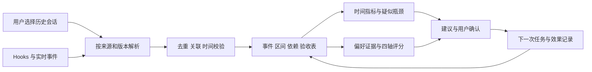
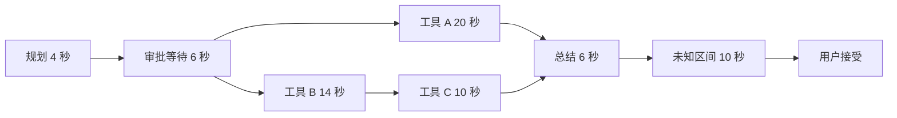

# agent轨迹数据处理方向与分析工具

> 历史来源：本页为2026-10-01 的研究／建模提案，2026-10-07 从团队 Vault 迁入。原位置：`项目/Orbit/agent轨迹数据处理方向与分析工具.md`。正文与原有日期、结论保留，仅整理导航和空白；私人会话定位不公开。本文中的“当前”、TODO、测试数量和执行命令仅对原文基线成立，本次没有重新验证，也不自动形成任务或授权。现行入口：[源码文档](<../../modules/analytics/README.md>)。

本文承接[本地轨迹数据调研报告](<../agent-sessions/survey-2026-10-01.md>)，结合Agent数据分析维度对话（原对话定位留在团队原稿中），给出 Lifeline 的数学建模、工具选型、数据结构、时间分析、四轴画像与 skill 推荐方案。共享页正文未被网页工具解析，本次通过应用中的同名原会话读取了分析内容。

**建议先用现成工具读取和核对会话，再把数据整理成“事件、时间区间、依赖关系、验收结果”四层。时间与费用用代码计算，任务含义与用户反馈用模型辅助解释，人格作为连续偏好的展示层。**

四个轴沿用原对话：控制／委托、规划／探索、验证／加速、专精／编排。它们描述人机协作方式；满意度、效率和能力另行分析，不放进人格码。

调研日期：2026-10-01。工具能力依据项目自身文档与源码；以下架构、阈值和评分是 AI 设计建议，尚未形成团队决定。未安装各工具验证兼容性，也未处理用户本机原始轨迹；文中的时间案例为合成示例。

本次补充依据（用户原文）：

> 1. 我觉得除了实际工具之外，数学工具也要想清楚，不然我们无法保证算法的有效性。
> 2. 此外，还要把后续推荐skill所需要分析的地方考虑在内，不然无法针对性分析。

名称沿革：2026-10-01，原文件名“Agent轨迹数据处理与含时分析方案.md”更名为“agent轨迹数据处理方向与分析工具.md”。

## 1 数学工具：分析什么、能保证什么

状态与用户输入特征、转移概率 p／q、反馈观测、分层动态画像、损失函数、跨轨迹共享、瓶颈及 skill 净收益，进一步见[Agent轨迹与个性化建模方案](<personalization-proposal.md>)。

平台工具负责读取、查询和展示；数学工具负责定义分析对象、推导指标、说明假设和验证结论。**有效性要分三层：公式是否成立、实现是否算对、实际使用是否带来收益。** 每个算法都应写清输入、目标、假设、基线、评价指标和停止输出结论的条件。

### 先固定轨迹的数学对象

一项任务可记为 `T = (E, I, G, C, Y)`：`E` 是事件集合，`I` 是执行区间，`G` 是有证据的执行依赖图，`C` 是任务与环境条件，`Y` 是验收结果。每次执行单独建节点，重复修复是多个执行实例；阶段序列可以循环，求关键路径的执行依赖图必须无环。

历史复盘可使用完整任务；实时推荐只使用推荐时刻已经可见的轨迹前缀。最终是否成功、后续返工和用户未来反馈属于评价标签，不能提前放进推荐特征。

### 数学方法与适用条件

| 要回答的问题 | 数学工具与核心量 | 成立条件与验证重点 |
| --- | --- | --- |
| 并发时究竟覆盖了多久 | 区间集合与并集长度：`T覆盖 = 长度(⋃ᵢ[sᵢ,eᵢ))` | 起止可配对、时间可比较；输入换序、重复同一区间、拆分区间后，覆盖长度应不变 |
| 哪条链拖住交付 | 有向无环图、拓扑排序、动态规划：`F(v)=d(v)+max F(u)`，u 为前驱；无前驱时 `F(v)=d(v)` | 权重代表不重复计入的执行或等待；核对依赖、汇合点与缺边。求出最长已知链不等于证明真实提速收益 |
| 哪些循环经常出现、停多久 | 状态转移概率与条件停留时长分布；必要时使用半马尔可夫模型 | 状态定义一致，同类任务才归并；用未来任务检查是否比简单频次／中位时长基线更准 |
| 两段过程是否可比 | 序列编辑距离、带约束的 DTW | 目标、验收与环境可比；检查特征尺度和对齐窗口，时间拉伸后的相似度不能代替实际耗时 |
| 偏好或瓶颈比例是否稳定 | 概率统计、分层比较、Bootstrap 重采样与区间估计 | 分母明确，缺失单列；按任务或相关会话成组采样，不能把同一任务的上百条事件当独立样本 |
| 某个 skill 是否值得用 | 对照实验、因果效应估计、带质量约束的决策 | 对比条件与验收一致，记录实际应用和其他变化；相关性、采纳率及人格匹配不能证明收益 |

区间并集与图上最长路径可以在指定输入和假设下验证正确性；分类、画像和推荐的有效性还取决于样本、标注与实际任务。引入更复杂的模型，需要在相同评价口径下胜过简单基线。

### 把有效性变成可执行的验证

1. **确定性计算：核对数学性质与实现。** 用可手算的小规模并发、嵌套与等待案例验证；有效区间均裁剪在同一任务窗口时，应满足 `0 ≤ T覆盖 ≤ 任务总跨度`、`T覆盖 ≤ 调用跨度总和`。小图的最长路径可用穷举路径核对，缺时间或依赖时输出未知／部分结果。
2. **语义识别：建立独立标注样本。** 分别评估任务边界、错误类别、反馈与瓶颈；报告各类精确率、召回率、混淆情况及样本数。尤其检查“正常探索被判低效”“改需求被判失败”“时间未知被判审批阻塞”。
3. **真实收益：先定指标，再比较策略。** 固定验收标准，比较规则基线、加入时间分析后的方案、再加入画像后的方案；检查每层是否增加价值。质量先达标，再比较时间、返工、人工介入和费用，计入推荐与复核开销。

训练与评估需防止轨迹泄漏：同一任务及其 fork／重放归入同一组；检验未来任务时按时间先后划分，检验新用户时按用户分组。归一化、阈值和权重只在训练／调参数据上确定。scikit-learn 的 GroupKFold 支持分组隔离；等间隔窗口可参考 TimeSeriesSplit，原始不等间隔任务需自行按日期窗口切分。[交叉验证文档](https://scikit-learn.org/stable/modules/cross_validation.html)

首版应交付一张“指标定义—假设—基线—验证结果—未覆盖情况”表。样本不足、时间覆盖太低、标注分歧较大时保留描述性结果，不给稳定画像或确定收益结论；阈值应通过验证集确定并记录版本。

## 2 可直接使用的数据处理工具

### 先复用会话解析与用量统计

| 工具 | 能处理什么 | 建议怎么用 | 主要边界 |
| --- | --- | --- | --- |
| [agentsview](https://github.com/kenn-io/agentsview/blob/c3aff4141e9b95385cb8be3a54ad7997a32a6b6c/README.md) | 多 agent 本地会话发现、解析、搜索、SQLite 归档、使用与时间分布统计；列有 Codex、Claude Code、Pi、OpenCode、Gemini CLI、Cursor、Copilot CLI 等 | 首选做样本浏览与解析参考；用 JSON／API 接出已有字段 | 支持列表不等于字段完整；Cline 明列的是 CLI，不能视为同时覆盖 VS Code 扩展；原始日志缺失的起止仍缺失 |
| [ccusage](https://github.com/ccusage/ccusage/blob/0ceb970bb636aacfee89bcb4f072da9e51529d92/docs/guide/index.md) | 多种 coding CLI 的 token、缓存和估算费用；按日期、会话、时间块汇总并输出 JSON | 用作费用统计基线，与自建统计互相核对 | 不是完整执行链解析器；无法判断任务质量或真实人工耗时；费用未必等于账单 |
| 各 agent 原生只读接口／导出 | Codex 会话查询、Claude Agent SDK 会话读取、Pi SessionManager、OpenCode export 等 | 自建适配器时优先使用，细节见前一份报告 | 仍需处理版本、分支、缺字段和不同运行形态 |

agentsview 当前提供 `stats --format json`，但该统计接口仍属实验功能；可拿来快速展示，长期接入需固定版本与保留自己的字段映射。深度分析应读取消息及调用记录，不能只拿最终汇总。[命令参考](https://github.com/kenn-io/agentsview/blob/c3aff4141e9b95385cb8be3a54ad7997a32a6b6c/docs/commands.md)

选定目录后再启动扫描。agentsview 默认会发现多种本机 agent 的会话；本项目的导入入口应限制到用户选定的数据范围。第一轮只验证 Codex、Claude Code、Pi 的授权样本，不为覆盖工具数量扩大采集范围。

### 自建分析层的工具组合

| 环节 | 推荐工具 | 具体职责 |
| --- | --- | --- |
| 清洗与批处理 | [Polars](https://docs.pola.rs/user-guide/io/json/) | 读取 JSON／NDJSON，展开嵌套字段，批量生成统一事件与调用表；格式重放逻辑仍由适配器负责 |
| 查询与统计 | [DuckDB](https://duckdb.org/docs/lts/data/json/loading_json)＋Parquet | 对本地 JSON／列式数据做 SQL 聚合；计算分组趋势、分位数和时间特征 |
| 依赖图 | [NetworkX](https://networkx.org/documentation/stable/reference/algorithms/generated/networkx.algorithms.dag.dag_longest_path.html) | 连接工具与子 agent 的真实依赖，求有向无环图上的最长路径 |
| 流程挖掘 | [PM4Py](https://processintelligence.solutions/app/pm4py/api/api/pm4py.discovery.html) | 发现常见步骤转换、返工流程、流程偏离和时间分布 |
| 时间线查看 | [Perfetto](https://perfetto.dev/docs/getting-started/other-formats) | 查看并发泳道、区间、事件、计数器和依赖箭头；Trace Processor 支持 SQL 分析 |
| 实时补采 | [OpenTelemetry](https://opentelemetry.io/docs/concepts/signals/traces/)＋agent hooks | 收集模型、工具、审批等操作的起止与关联；用 span links 表示异步关联 |
| 主观反馈与任务语义 | 规则＋结构化 LLM 分类；[Sentence Transformers](https://www.sbert.net/docs/sentence_transformer/usage/semantic_textual_similarity.html) 可做文本相似度 | 区分纠错、改需求、新任务、接受／拒绝；寻找重复任务与同类任务 |
| 后续变化与时长建模 | [ruptures](https://github.com/deepcharles/ruptures)、[tslearn](https://tslearn.readthedocs.io/en/stable/user_guide/dtw.html)、[lifelines](https://lifelines.readthedocs.io/en/latest/Survival%20analysis%20with%20lifelines.html) | 分别处理变化点、轨迹对齐、未完成任务的时长分析；首版可不引入 |

**首版核心选型：Python＋Polars＋DuckDB＋Parquet＋NetworkX，配一套简单时间线。** 会话浏览可复用 agentsview；PM4Py、Perfetto 和高级模型按演示需要加入，不必全部部署。

需要集中追踪与人工评分时，再选择 [Langfuse](https://langfuse.com/integrations/native/opentelemetry) 或 [Phoenix](https://arize.com/docs/phoenix/tracing/how-to-tracing/setup-tracing) 中的一种。它们接收经过适配的遥测，不能直接补出旧 JSONL 没保存的事件；Phoenix 还需按 OpenInference 等约定映射语义字段。

PM4Py 本次查看的开源许可证为 AGPL v3。若计划将它集成到产品，先确定所选版本及许可路线；只做首版转换统计，也可用 SQL 与 NetworkX 实现。[许可证](https://github.com/process-intelligence-solutions/pm4py/blob/release/LICENSE)

## 3 数据流与统一结构

### 处理步骤

1. **解析并保留来源。** 按 agent、运行形态、版本读取；重建消息更新、压缩、分支与 fork。只解析完整 JSONL 行；读取 SQLite 时保证快照一致性。原始定位留在本机，不把原始聊天库写进团队仓库。
2. **去重与连接。** 以原生会话、请求、响应、工具调用 ID 为主键；区分 API／UI 镜像、继承历史与实际新执行。内容相同不能直接判为重复请求。
3. **切分任务。** 先按用户新目标、明确完成或接管节点切分，语义相似度只辅助。允许用户合并／拆分；一个任务可以跨多个会话和 agent。对不确定边界保留候选，不用空闲超过某阈值直接判失败。
4. **计算与语义标注分开。** 时间、调用数、token、错误状态由代码计算；LLM 只输出任务类别、反馈类别、候选偏好、证据定位与不确定项。引述文本不能改变采集器权限或执行代码。
5. **形成可追溯结果。** 每条指标带计算版本、来源范围、字段覆盖率；每条画像与建议都能展开到具体记录，用户纠正时更新派生结果。

### 四张核心表

| 表 | 一条记录表示什么 | 必要字段 |
| --- | --- | --- |
| `events` | 某个时点发生的事情 | 原生 ID、来源定位、task／session／agent ID、事件类型、原始时间、标准时间、序号、内容引用 |
| `spans` | 一次有起止的操作 | call／request ID、开始／结束、活动类别、执行者、状态、父 span、时间来源与可信级别、token／费用口径 |
| `links` | 两项活动之间的关系 | 起点、终点、关系类型、依据；如触发、等待全部完成、生成产物、继承、重试 |
| `tasks` | 一项用户目标及其结果 | 目标与验收标准、开始、候选结束、实际接受时间、结果状态、任务条件、关联会话、标签来源 |

另外用 `profile_evidence` 保存偏好证据，用 `skill_catalog` 保存候选 skill 能力与适用条件，用 `recommendation_opportunities` 保存推荐机会与当时可见特征，用 `interventions` 保存建议、采纳、实际应用、撤销与效果。推荐相关字段见第 9 节。首版可一起放在 DuckDB；需要产品端频繁修改用户确认状态时，再用 SQLite 保存这部分状态，避免两套重复账本。

**所有事件都可以有时间戳，但只有已配对的操作才有确定时长。** 没有结束的调用保留“进行中／结束缺失”，不能填 `duration=0`。有单点时间的消息仍然有检索与顺序价值，不伪装成执行区间。

## 4 含时 trajectory 先解决时间可信度

带时间轨迹同时包含三种信息：**发生了什么、发生的顺序、执行区间与依赖。** 先校准这三种信息，才能讨论耗时占比。

### 时间字段与质量分级

建议额外保存：`event_time_utc`、`observed_at`、`start_time`、`end_time`、`duration_mono`、`clock_id`、`timestamp_kind`、`source_precision`、`timing_quality`。

- `event_time_utc` 是来源声明的发生时间；`observed_at` 是采集器看到它的时间。历史文件批量导入时，两者差值不能当作网络延迟。
- 新采集的同一时钟域区间可用单调时钟计算时长，另存 UTC 时间用于展示。不同进程或机器的单调时钟不能直接相减；跨机比较需要时钟同步依据与误差范围。
- 保留原始单位与精度，统一解析秒／毫秒／微秒及 ISO 时间。显示成微秒不会让原来的秒级记录更精确。
- 使用原生序号、父链和调用 ID 辅助排序；相同时间戳或存在时钟偏差时，不能凭文件排列强造因果顺序。

| 时间质量 | 能做什么 | 不能做什么 |
| --- | --- | --- |
| 已知配对 | 原生起止或实时采集到同一调用的完整起止，可计算其执行跨度 | 仍不能自动等同 CPU 时间、用户投入或模型内部计算时间 |
| 已知单点 | 分析事件顺序、某时点反馈与任务阶段 | 两个邻近消息的差不能默认当工具时长 |
| 有条件估计 | 有明确上下界约束时给范围，或展示有标签的近似值 | 未验证边界条件时不能声称上下界成立 |
| 缺失或冲突 | 保留未知，显示覆盖率与冲突原因 | 不补零，不算入精确时长样本 |

起止配对键建议为 `来源＋运行实例＋agent ID＋call ID`；有重试时再加 attempt。需要同时处理并发、乱序到达、重复结束、取消和部分数据缺失。负时长先作为数据质量问题检查，不直接截成零。

### 分清四种时间

1. **交付总跨度**：首次提出该目标到用户接受／独立验收达标。没有接受时间时，只能报告截至观测终点的跨度。
2. **活动覆盖时长**：模型与工具执行区间合并后的长度。同一时刻多个工具在执行，这一秒只算一次。
3. **调用跨度总和**：各操作区间分别相加，可反映并发工作量；它不是总等待时间，也不是实际硬件资源用量。
4. **用户实际投入**：需要用户主动计时、界面交互或人工标注。审批请求到回复的跨度包含离开电脑等情况，不能直接算为用户工作时间。

审批、排队、退避、执行可分别记录。某次请求的整体区间若包含排队，就不要再把整体区间与排队区间都计入“执行时间”。无法识别原因的空档只显示为未知。

## 5 含时轨迹的主要分析技术

### 5.1 区间并集与独占时间

这是首版最该做好的一项：解决并发和嵌套的重复计时。

**活动覆盖时长 = 所有有效执行区间的并集长度。** 按开始时间排序，维护当前合并区间的最远结束点；后一区间与它重叠就合并，否则另开区间。实现复杂度主要是排序的 `O(n log n)`。嵌套区间不能只与上一条记录的结束时间比较。

**父操作的独占跨度 = 父区间长度 − 父区间内子操作区间的并集长度。** 子操作先裁剪到父区间再合并。若一个父 span 包住整个任务，不能把父跨度与所有子跨度相加报告为总耗时；独占部分也可能是等待，不能都解释成有效计算。

按执行者画泳道，保留并行活动。输出总跨度、活动覆盖、审批等待、已知退避和未知区间；类别互相重叠时单独标出，只有经过互斥分配的时间才能画成加总为 100% 的构成图。

### 5.2 关键路径与并发瓶颈

关键路径回答：**哪条依赖链使最终结果必须等这么久？** 工具耗时最长，不一定就是最值得优化的地方。

依据触发调用、子 agent、等待返回、产物消费等明确关系构建有向无环图。把操作区间的时长和已知等待表示为权重，避免重复加入包裹它们的父区间；用 NetworkX 求最长路径。也可把一次操作拆为开始／结束节点，区间边记录时长，依赖边表示约束。[最长路径 API](https://networkx.org/documentation/stable/reference/algorithms/generated/networkx.algorithms.dag.dag_longest_path.html)

父 span 关系只说明包含关系，不必然给出全部调度依赖；时间先后也不等于依赖。关系不足时展示“已知依赖链”，不宣布完整关键路径。实际提速还可能改变缓存与调度，不能只靠图就保证优化收益。

### 5.3 流程挖掘与返工循环

把操作映射成少量活动：提出目标、澄清、检索、读取、修改、验证、错误、修复、交付、接受。以 task 为 case，保留活动、执行者、时间、结果；用 PM4Py 的 DFG 查看相邻步骤频次，结合区间表分析每个阶段的时间与返工。[流程发现 API](https://processintelligence.solutions/app/pm4py/api/api/pm4py.discovery.html)

例如 `验证失败 → 修复 → 重跑验证` 是修复循环。给每个错误 episode 独立 ID，按错误指纹、受影响产物和依赖连接后续动作；到恢复成功、用户接管、新目标或观测终点为止。统计循环次数、恢复概率、恢复前的模型消耗和可测执行时间。

PM4Py 相邻完成事件间的时间差，不应直接命名为排队等待。并发活动按完成时间线性排列也可能产生虚假流程边；需要并行建模，或保留 task、call、文件等多对象关系，后续考虑 object-centric process mining。首版先对已确认的顺序子流程使用 DFG。

预期失败的负面测试、正常修改后复测不自动计为低效返工。结论先写“反复出现的修复循环”，再通过验收和用户反馈判断是否有可减少的浪费。

### 5.4 序列模式与半马尔可夫思路

首版可用规则状态机识别 `搜索 → 读取 → 搜索`、`修改 → 测试失败 → 修改`、`申请权限 → 拒绝 → 改路径`，再统计同类任务中的出现率与持续跨度。

马尔可夫转移描述下一步常是什么；加入“在某状态停了多久”后，更适合研究卡顿、修复与恢复。样本足够时再考虑 HMM／HSMM：HMM 用隐藏状态概括工作阶段，HSMM 进一步显式建模停留时长。`hmmlearn` 提供 HMM 能力，不能把它当作直接现成的 HSMM 实现。[HMM 教程](https://hmmlearn.readthedocs.io/en/stable/tutorial.html)

模型学到的状态需人工解释并核对，不能因为一个状态持续很久就命名为“用户拖延”。小样本时规则通常更容易展示证据，也更容易纠错。

### 5.5 轨迹相似度与时间对齐

先匹配同类目标、输入规模、验收标准和环境，再比较过程。两次任务可以按两种方式对齐：

- **步骤对齐**：用序列编辑距离比较检索、修改、验证等顺序，保留插入、跳过与返工。
- **含时对齐**：把阶段、累计用量、失败数等转成特征序列，用 tslearn 的 DTW 对齐节奏快慢不同的轨迹。[DTW 文档](https://tslearn.readthedocs.io/en/stable/user_guide/dtw.html)

给 DTW 设置合理的对齐约束；任务类型差异过大时拒绝比较。DTW 会拉伸时间，因此“形状相似”不能代替实际速度比较；必须另外报告真实总跨度、活动覆盖、费用和验收结果。分支图也不能直接压成一个长数组后称为同一轨迹。

### 5.6 变化点与 Lifeline 趋势

按时间窗或任务窗生成失败率、明确纠正率、输入 token、重复检索比例等序列；用移动平均先展示趋势，后续用 ruptures 的离线变化点方法定位明显变化。[ruptures 项目](https://github.com/deepcharles/ruptures)

记录模型切换、skill 应用、权限调整和任务类型变化的时间，与候选变化点并列。非等间隔数据先说明窗口方式与样本量；上下文压缩天然产生的 token 锯齿也需单独标记。变化点表示统计特征改变，不证明由新 skill 导致。

### 5.7 未完成任务与生存分析

只平均成功任务的时长，会漏掉一直没解决的问题。记录 `开始 → 接受／达标`；截至观察结束还未达标的任务保留右删失时长，用 lifelines 的 Kaplan–Meier 等方法研究“经过多久仍未解决”的比例。[lifelines 文档](https://lifelines.readthedocs.io/en/latest/Survival%20analysis%20with%20lifelines.html)

用户主动放弃、换目标或接管不一定是随机删失，应单列结果，必要时使用竞争风险思路；采集从中途开始的任务也不能伪造起点。样本很少时先展示原始任务、未完成数和观测时长，暂不拟合曲线。

## 6 一个并发案例说明统计口径

以下是合成数据，时间单位为秒；A 与 B 并行，C 等 B 结束后开始，最终总结必须等 A、C 都完成。

| 活动 | 开始 | 结束 | 区间长度 | 依赖／含义 |
| --- | --- | --- | --- | --- |
| 模型规划 | 0 | 4 | 4 | 发起后执行 |
| 等待审批 | 4 | 10 | 6 | 明确记录的审批等待 |
| 工具 A | 10 | 30 | 20 | 审批完成后执行 |
| 工具 B | 10 | 24 | 14 | 与 A 并行 |
| 工具 C | 24 | 34 | 10 | 依赖 B |
| 模型总结 | 34 | 40 | 6 | 等 A 与 C 完成 |
| 未分类空档 | 40 | 50 | 10 | 50 秒时用户接受；无法判断其间在做什么 |

- **交付总跨度：50 秒。** 起点为发起，终点为用户接受。
- **执行调用跨度之和：54 秒。** 规划 4＋A 20＋B 14＋C 10＋总结 6；并发使它超过总跨度。
- **执行活动覆盖：34 秒。** `[0,4)` 与 `[10,40)`；不包含审批与未知空档。
- **到总结结束的已知关键链：40 秒。** 规划 4＋审批 6＋B 14＋C 10＋总结 6。

工具 A 的单次跨度最大，但 B＋C 才决定这一阶段何时能进入总结。A 有 4 秒余量；在这份依赖图中，单独把 A 从 20 秒减为 15 秒不改变总结开始点。最后 10 秒不能解释为用户实际投入，更不能算作模型延迟。

Perfetto 可承载这类时间线：将区间转换为 Chrome trace 的 `X` 事件，单点用 `I`、指标用 `C`、依赖用 flow。Chrome trace 时间单位为微秒；同一泳道的非嵌套重叠不适合普通同步事件，异步调用要用独立泳道或适合的异步事件。[外部格式支持](https://perfetto.dev/docs/getting-started/other-formats)

## 7 四轴画像怎样从数据形成

### 从协作选择提取偏好

原对话里的动作／介入比、验证次数比和工具熵可以作为行为特征，但不能单独当作用户偏好得分。长工具链可能来自任务难度，审批可能来自系统策略，测试可能由 agent 自动执行，工具多也可能只是环境不同。

建议将用户明确要求和主动选择作为主证据，执行轨迹作为辅证据；记录任务、权限、模型、agent 版本等条件。若某个偏好在多个 agent、同类任务中都出现，其跨工具稳定性才更值得信任。

| 轴与人格字母 | 高分方向 | 主证据 | 含时与序列辅助特征 | 必须控制的干扰 |
| --- | --- | --- | --- | --- |
| 控制 C／委托 D | 委托 D | 用户明确授权连续执行、主动要求逐步确认／接管 | 自主链长度、可自由选择时的介入节点、用户选择改变策略的频次 | 权限配置强制审批、失败迫使接管；无人回复不等于授权 |
| 规划 P／探索 E | 规划 P | 用户选择先制定计划、明确目标与验收；或主动试多个方向 | 计划与执行阶段顺序、明确需求变更、主题变化、分支探索跨度 | 新问题本就需要探索；调试循环不等于喜欢改需求 |
| 验证 V／加速 A | 验证 V | 用户要求哪些检查、选择何时验收、对漏检的纠正 | 自主要求的验证节点、验证覆盖、交付前检查链 | 强制 CI、重复失败造成复测；加速偏好也保留必要验收 |
| 专精 S／编排 O | 编排 O | 用户主动组织多个领域／工具／agent 完成目标 | 同一任务内的跨工具依赖、交接次数、任务／工具类别分布 | 单一工具没开放其他能力；工具多不一定产生协作 |

时间信息帮助描述协作节奏，但不能推断人格好坏。比如“用户常在第一次结果后选择调整方向”比“用户频繁打断所以控制欲强”更贴近证据。

工具或任务类别熵 `H = −Σ pᵢ log pᵢ` 可以描述多样性；用 `H/log K` 归一时，`K=1` 需单独处理。只有实际跨工具依赖与用户选择相符时，才用于支持编排偏好。长会话不能因事件更多而获得更大人格投票权。

### 连续评分与十六类展示

建议每个任务对每个轴最多给出一个归并后的证据分数 `x∈[0,1]`。四轴高分分别表示 D、P、V、O；不可观测的任务不参与该轴分母。

`某轴得分 = Σ(时间权重 × 证据可靠度 × 任务分数) / Σ(时间权重 × 证据可靠度)`

这是拟定的评分规则，不是经过心理测量验证的模型。证据可靠度优先级为：用户明确要求／确认，其次用户实际选择，再次轨迹推断。若加入时间衰减，可先采用 30 天半衰期作为可调参数；当前任务明确要求始终覆盖历史建议。

底层保留连续值、任务数、来源覆盖、反例和用户确认。按任务而非事件重采样可估计分数稳定性，但不能把模型自报置信度当作校准后的概率。

供首版试用的展示规则可以设为：有效证据至少来自 5 个任务、2 次会话；分数低于 0.4 或高于 0.6 才显示暂定方向，中间或不足时显示“待确认”。这些是待调参的产品规则，不是人格阈值；不强行补齐四个字母。

四轴足够确定时，组合为 16 种：

| 前两轴 | 验证＋专精 VS | 验证＋编排 VO | 加速＋专精 AS | 加速＋编排 AO |
| --- | --- | --- | --- | --- |
| 控制＋规划 CP | CPVS | CPVO | CPAS | CPAO |
| 控制＋探索 CE | CEVS | CEVO | CEAS | CEAO |
| 委托＋规划 DP | DPVS | DPVO | DPAS | DPAO |
| 委托＋探索 DE | DEVS | DEVO | DEAS | DEAO |

例如原对话的 DPVO 表示委托、规划、验证、编排，可保留 Architect 的趣味名称；CEAS 对应控制、探索、加速、专精，可保留 Hacker。**推荐系统使用连续分数与当前任务条件，不依赖四字母标签决定操作。**

## 8 满意度与瓶颈如何连接推荐

### 满意度先分类 再核对

把用户后续消息分为：明确接受、明确拒绝／纠错、局部调整、需求变化、新任务、其他／未知。情感可以作为附加字段，不能用“负面文本”直接生成“不满意”。“测试失败”也可能只是用户转述客观情况。

隐式重跑、回滚、人工重写只构成候选信号，必须结合任务和产物关系；未看到回复不算满意，也不自动算放弃。独立测试结论与主观体验分别保存。

首版先建立人工标注小样本，检查分类器把“局部调整”误判为“失败”的比例；有标签前不把任意加权公式包装成 0—100 的可靠满意度。原对话的交互放大率需要已知的最小交互基线，没有基线时不计算；先展示实际交互数与明确纠正数。

文本相似度可协助找重复任务。HDBSCAN 可聚类、UMAP 可展示任务地图，但聚类结果需回看原文；二维图上的距离也不能当作精确难度或人格差异。[HDBSCAN](https://scikit-learn.org/stable/modules/generated/sklearn.cluster.HDBSCAN.html)、[UMAP 与聚类](https://umap-learn.readthedocs.io/en/latest/clustering.html)

### 让建议直接对应可检验的问题

| 候选瓶颈 | 需满足的证据 | 可尝试的干预 | 评估重点 |
| --- | --- | --- | --- |
| 相同环境错误反复出现 | 同类错误指纹、关联修复链；区分任务与环境 | 环境预检／错误定位流程或已审查 skill | 达标率、恢复时间、额外预检消耗 |
| 读取／检索重复 | 同目标、相同文件版本、未新增信息；位于可影响总跨度的链上 | 收窄检索、缓存结果、阶段总结 | 验收保持达标，关键链跨度／调用减少 |
| 审批阻塞明显 | 明确配对的审批跨度、允许用户选择的节点 | 将可审阅计划集中展示、优化确认流程 | 是否减少阻塞；保留既定权限要求 |
| 检查遗漏造成返工 | 已确认验收遗漏、用户纠正或独立检查 | 验收清单／验证 skill | 漏项、人工复核、增加的验证时间 |
| 压缩后重复补充约束 | 压缩事件后再次出现相同要求及相关错误 | 保存确认过的任务约束与阶段交接摘要 | 约束遗漏与返工减少，额外上下文成本 |

人格影响建议的交互方式：控制型先看可审阅步骤，委托型在已授权范围内连续执行；规划型强调验收与计划，探索型允许候选方向比较。它不改变已确定的正确性要求，也不覆盖当前指令。

Lifeline 每次保存：**建议依据 → 用户是否采纳 → 是否真正应用 → 任务结果 → 是否保留／撤回。** 按同类任务与相同验收标准比较，记录模型、权限、缓存、输入规模和其他同时发生的变化。前后时间接近只支持关联；评估干预收益优先用随机分配的同类任务对照，并计入采集、推荐与复核成本。交替顺序可减少部分顺序偏差，但仍需检查任务差异与学习迁移。

## 9 面向 skill 推荐的分析需求

**推荐要解释四件事：任务需要什么能力、卡点是什么、skill 能改变哪一步、如何验证改进。** 当前目标与已确认问题决定候选；四轴偏好辅助安排执行与确认方式。推荐时还应保留“无需新增 skill”这一基线选项。

### 9.1 上游分析必须提供哪些信号

| 分析维度 | 从轨迹中提取什么 | 对推荐的作用 |
| --- | --- | --- |
| 任务与产物要求 | 任务类别、当前阶段、技术栈／文件类型、输入规模、验收标准 | 判断需要哪类能力，以及何时介入；同为写作任务，普通 Markdown 和需渲染验收的文档不同 |
| 错误与能力缺口 | 错误指纹、受影响产物、修复动作、复发与恢复；区分代码、环境、权限、外部服务与需求问题 | 对应诊断、预检或验证流程；根因未确认时只给候选，不把所有失败归为 agent 能力不足 |
| 时间与依赖位置 | 可测执行／等待跨度、关键链、并发余量、未知比例、错误恢复时间 | 判断优化是否可能影响交付；耗时最大的非关键分支不一定优先 |
| 重复与上下文损耗 | 同一版本产物的重复读取、重复纠正、压缩后约束遗漏、交接信息缺口 | 对应检索、摘要、约束保留或交接流程；任务推进需要的复查单独识别 |
| 可用环境与执行条件 | agent／模型版本、已安装及已用 skills、依赖包、可用工具、权限、网络条件 | 排除无法运行、重复覆盖或条件不匹配的候选；检查是否只需修正现有配置 |
| 用户要求与历史效果 | 当前明确指令、可确认偏好、人工介入节点、同类任务中 skill 的应用与结果 | 调整交互方式与候选优先级；记录已拒绝、撤回或未验证的建议，当前要求优先 |

每个信号都带证据定位、时间质量和可观测范围。瓶颈发生率的分母是“有机会发生且能够观测的同类任务数”，不是全体消息数；未装或未用 skill，也不直接表示需要推荐。

对含时轨迹，分别记录**出错前的预防机会、出错后的修复机会、交付前的验收机会**。推荐时点与适用阶段是特征；干预后的总耗时和恢复结果是标签。第 6 节中，A 的 20 秒并非完整瓶颈；针对 B→C 的候选仍需核对它能改变的具体操作，图上预测与重跑结果分别展示。

### 9.2 提前准备推荐数据结构

Agent Skills 规范提供 `name`、`description`，以及可选的 `compatibility`、`metadata`、`allowed-tools` 等字段。可用它们发现候选，再读取步骤及依赖；以下分析字段由 Lifeline 补充。格式合规不代表有效，工具权限仍按当前运行环境和用户授权核对。[Agent Skills 规范](https://agentskills.io/specification)

| 数据表 | 首版需要保存的字段 |
| --- | --- |
| `skill_catalog` | skill ID、来源、版本／内容 hash、解决的任务与问题、触发阶段、不适用条件、输入／输出、依赖与权限、预期开销、可验证指标、已测条件与证据；未知字段显式保留 |
| `recommendation_opportunities` | 机会 ID、task／episode ID、推荐时点、特征可见截止时间、当时特征与证据、符合条件的候选、排除理由、推荐／不推荐理由、策略版本；有随机策略时记录各选项选择概率 |
| `interventions` | 关联机会、推荐与实际执行的 skill 版本、用户采纳、应用状态及依据、起止时间、受影响步骤／产物、同类基线、验收、时间／费用／介入变化、其他干预、保留／撤回 |

“已发现／已安装／已加载说明／已按步骤执行”分别记录。能用调用或执行标记确认时保存原生依据；只能从文本推断时标成待核对。**读过 SKILL.md 不能作为 skill 已完成执行的证据。**

### 9.3 从问题到候选 再到可验证收益

1. **确定问题与推荐时点。** 先定位 task、阶段、错误 episode 或可确认缺口，冻结当时可见特征；证据不足时先补采或询问缺失条件。
2. **检索候选并检查适用条件。** 首版按问题类型与任务条件做规则检索，文本相似度辅助召回；核对运行环境、触发阶段、现有能力与当前授权。
3. **排序并说明依据。** 优先解决已确认且可改善的卡点，再看同类任务中的已测效果与开销。冷启动候选标为“适用但收益待验证”；允许无匹配、不推荐和条件待确认，不强行给一个名字。
4. **给出具体推荐卡片。** 展示证据、建议改变的步骤、适用条件、执行成本和验收方式；一次选择一个主要干预，保存选择与应用状态。
5. **按预定指标复核。** 质量达标是约束；在此基础上比较交付跨度、恢复时间、返工、实际人工介入和费用。指标冲突时展示取舍，不把秒数、费用与主观评分直接相加。

数学上，可把目标写成 `Δs(x) = E[Y(s) − Y(0) | X=x]`：在同类任务条件 x 下，使用 skill s 相对既定基线的平均效果。Y 的定义、方向与验收约束应先确定；同一任务只能观察实际采用策略的结果，因此效果需要对照估计，不能由一次前后对比直接获得。

### 9.4 推荐算法怎样验收

| 验证层 | 比较与指标 | 需要回答的问题 |
| --- | --- | --- |
| 候选匹配 | 独立人工标注的适用性；首选候选正确率、漏推荐、错误推荐及不推荐覆盖；附样本数 | 推荐是否对应真实问题、环境和阶段，而非只匹配关键词 |
| 增量价值 | 同一留出集上比较“任务规则”“任务＋时间瓶颈”“再加入画像” | 时间分析与画像分别增加了什么；无增益的特征不进入排序 |
| 实际收益 | 同类任务随机分配基线／候选；比较验收达标、恢复与交付时间、返工和总开销，报告不确定范围 | 执行后是否值得用；采纳率与点赞单独记录，不能代替效果 |

按推荐分配组评估整套推荐流程，同时记录实际应用；只比较采纳者与未采纳者会混入用户选择差异。重复任务的缓存、顺序、学习迁移及多项同时干预也要登记，解释对照的局限。

数据充足后，可研究上下文 bandit：上下文是任务与瓶颈，动作是候选 skill 或基线，反馈来自验收与成本。离线策略评估的 IPS／Doubly Robust 方法需要历史选择概率可知或可信估计、候选有足够覆盖，并满足相应模型与数据假设；极低概率会带来高方差。普通日志缺少这些条件时，先用规则与前瞻对照。[Doubly Robust Policy Evaluation and Learning](https://arxiv.org/abs/1103.4601)

## 10 首版实现顺序与验收

| 阶段 | 做什么 | 可展示结果 |
| --- | --- | --- |
| 数学与评价口径 | 固定分析对象、指标、假设、基线与拒绝输出条件；准备手算样例和标注规范 | 算法验证表、指标适用范围与未覆盖情况 |
| 数据与口径 | 固定两个 agent 适配版本，准备授权脱敏样本和合成并发样本 | 会话来源、原始定位、任务边界、缺失字段 |
| 确定性分析 | 配对起止、区间并集、已知依赖链、错误修复 episode | 时间泳道、失败恢复链、可测耗时与未知占比 |
| 语义与画像 | 分类任务／反馈、提取偏好证据、形成四轴连续分数 | 带证据的画像卡与用户修正 |
| skill 推荐准备 | 整理小规模候选目录，提取问题／条件／时点特征，保存候选与不推荐理由 | 能说明“为什么推荐、改变哪一步、怎样验收”的卡片 |
| 干预闭环 | 一次应用一个主要策略，按同一标准记录基线、实际应用与结果 | Lifeline 变化记录及同类任务对照，注明收益是否已验证 |

若按 48 小时黑客松推进，先固定数学口径并完成确定性分析与一条画像确认链，再准备少量条件清楚的 skill 候选和一个干预案例。没有足够对照时展示“适用性与评估过程”，收益标为待验证。DTW、变化点、HMM／HSMM、生存分析与 bandit 可作为技术路线扩展，不作为首版完成的前提。

解析器与时间计算至少验证以下场景：重复导入；同一请求多条记录；fork 复制历史；恢复后的累计费用；并发与嵌套；乱序和同时间戳；缺结束／取消；时钟偏差；截断工具输出；人工改需求；尚未完成任务。合成案例与真实样本必须分开。

交付界面建议只保留四个核心视图：**可回看的任务时间线、带证据的四轴卡片、可解释的疑似瓶颈、干预前后的验收与消耗比较。** 每个时间指标同时显示可测覆盖率；未知区间不被计入某种根因，每个人格方向都允许用户修改。

本方案的验证范围是文档与资料核对；实际接入兼容性、分类准确率、画像稳定性和策略收益，需用上述样本与对照评估确认。相关产品边界见Agent协作画像与Lifeline项目介绍（团队讨论／知识库来源，未随本文公开），实时采集实践见OpenTelemetry上手指南（团队讨论／知识库来源，未随本文公开）。
